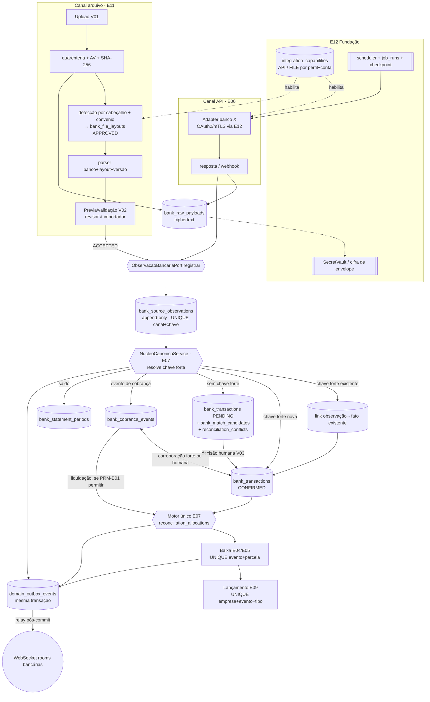
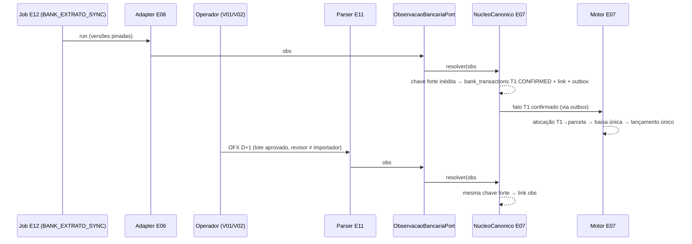

# E11-T00 — Gate CROSS bancário: APIs, arquivos e razão (inventário, ADR-ERP-026, ownership, idempotência, failback) — Plano Tático

> Papel autor: `planner` (modelo solicitado `claude-opus-5.5`; efetivo não atestável — AD-20). Documento **somente documental**: zero código, zero migration, zero gateway/parser, zero edição em `docs/execucao/`.
> Workers futuros (E06-T01..T05, E07-T01..T04, E11-T01..T11) seguem este plano literalmente. Caso não coberto, contradição com fonte superior ou teste que falha após 1 correção → **PARAR e reportar**. Worker não decide regra, não cria perfil canônico, não altera `MENUS_CANONICOS`, não preenche célula pendente do inventário.

**Goal:** Fechar o gate CROSS E11-T00 (Linear ALP-160): inventário E04–E09/E11 por banco × conta × convênio × serviço; decisão de ativação por capability; diagrama único API→observação e arquivo→observação ligados à **mesma** transação canônica; matriz de ownership de tabelas/eventos com owner do outbox de domínio; DDL conceitual sem tabela paralela de conta/título/ledger/conciliação; contrato de idempotência/dedupe; XB-01..XB-16 mapeados a testes futuros; plano de failback; ADR-ERP-026. Nada é implementado nesta onda.

**Architecture:** monólito modular NestJS 11 (Constituição: sem microserviços, sem CQRS/Event Sourcing). Um único **núcleo canônico bancário** recebe observações de qualquer canal (adapters API E06 e parsers de arquivo E11) por uma única porta (`ObservacaoBancariaPort.registrar`), resolve identidade forte e materializa no máximo **uma** `bank_transactions` / `bank_cobranca_events` por fato econômico. O motor único de conciliação E07 aloca fatos confirmados a títulos E04/E05; E09 lança uma vez por evento econômico. Perfis, capabilities, credenciais, certificados, endpoints, jobs e cofre pertencem ao E12 (plano E12-T00). Persistência PostgreSQL 18 + Drizzle; eventos financeiros saem por **outbox transacional** (`common/outbox`, owner fixado aqui) e são retransmitidos pós-commit ao `EventEmitter`/WebSocket (Princípio VI).

**Tech Stack (fixa, sem troca):** Node 22, NestJS 11, TypeScript 5 strict, Next.js 16 App Router/BFF, React 19, PostgreSQL 18, Drizzle + drizzle-kit, Zod 4, WebSocket nativo, `@nestjs/event-emitter` (já em `app.module.ts` L4/L42), JWT + RBAC (11 perfis, AD-04), Jest/Supertest, Playwright, DS v3 Direção A (AD-10). Bibliotecas de parsing OFX/CSV são escolhidas, pinadas e aprovadas no Portão 1 de E11-T05; este plano não adiciona dependência.

**Base pinada:** `origin/develop` @ `db9d8ac1760a01c262c57a9f824d2c8fcf18291b`. Última migration `0043_onda14_ocorrencias_preco` (journal idx 43, verificado); próximo índice livre `0044`, disputado com E12-T01 — a numeração real é recalculada pelo Planner de cada onda; o worker não renumera.

**Worktree / branch:** `F:/Projetos/AlphaCarnes/.worktrees/e11-t00` · `feature/erp-e11-t00-cross-bancario`. Fontes da expansão lidas do checkout coordenador `F:/Projetos/AlphaCarnes` (branch `feature/erp-fiscal-financeiro-contabil-especificacoes-2026`, HEAD `302cdb5a270d73591e3c087a16fef7190101b4f7`, PR #157 não mergeado).

**Linear:** ALP-160 (E11-T00). Cross: ALP-133..141 (E06/E07), ALP-142..154 (E08/E09), ALP-161..171 (E11-T01..T11). Gate irmão: ALP-173 (E12-T00).

---

## 0. Inventário do `develop` (db9d8ac) relevante ao gate

Verificado nesta sessão (grep sobre `app/backend/src`, 65 `pgTable` em 33 arquivos de schema):

| Objeto existente | Situação | Efeito no ERP bancário |
|---|---|---|
| Tabelas `bank_*`, `contas_bancarias`, `titulos*`, `lancamentos_contabeis`, `conciliac*`, `outbox*` | **inexistentes** (zero ocorrência) | todas as tabelas da §5 são novas; nenhuma adaptação de legado |
| Módulos `app/backend/src/modules/*` | auditoria, auth, cadastros, comercial, frota, gestao, modelos-etiqueta, operacao, operacoes, parametros, perfis, usuarios | nenhum módulo financeiro/bancário |
| `app/backend/src/integracoes/nfse/*` (EISS, AD-02) | gateway isolado + fake | **não alterar**; padrão porta/adapter/fake é o modelo (Princípio V) |
| Eventos de domínio | `this.eventEmitter.emit(...)` pós-commit em ~29 services (ex.: `faturamento.service.ts` L178/L201/L384); **sem outbox persistido** | eventos financeiros exigem outbox transacional (RNF-B02, E11-T01) → §5.4 |
| `realtime/realtime.gateway.ts` L141/L152–153 | `podeAssinar` libera **qualquer** room a quem tem `DISPONIBILIDADE_LER` | rooms bancárias exigem permissão própria → §7.3 (mesmo defeito do achado 10 do E12-T00) |
| `database/schema/parametros.schema.ts` | chave-valor JSONB | parâmetros provisórios da §10 (não segredos) usam este mecanismo, padrão AD-09 `{ valor: null, provisorio: true }` |
| `database/schema/auditoria.schema.ts` | trilha antes/depois | toda decisão bancária audita DTO redigido (conta mascarada, sem payload bruto) |
| `fornecedores`, `clientes`, `notas_fiscais_fornecedor`, `faturamentos`, `notas_fiscais` | existentes | origens de títulos E04/E05 (fora do escopo deste gate; referência por FK nos planos E04/E05) |

## 1. Decisões fixadas (não reabrir; origem entre parênteses)

1. **API é canal primário; arquivo é fallback operacional** por conta+convênio+serviço+versão de layout, construído junto, não fase 2 (Caderno B §0.2; doc 11 §1; doc 12 §2 alternativa B).
2. **Um único** núcleo canônico, motor de conciliação (E07) e razão (E09). Proibidos segundo motor, segundo ledger, tabela paralela de conta, título ou baixa (doc 11 requisito inverso; doc 12 §4; RI-B18).
3. **Importação ≠ pagamento; remessa ≠ registro; retorno de registro ≠ liquidação; extrato ≠ retorno de cobrança** (doc 11 §1; doc 10 regras negativas). Nenhuma baixa por upload; nenhuma baixa por valor/data.
4. **Nenhum layout escolhido pela extensão**: detecção por cabeçalho + configuração do convênio + manifesto aprovado em `bank_file_layouts` (E11-T02; doc 21 §5).
5. Chave fraca (`valor+direção+data+texto+conta+contraparte`) **só gera candidato** (`bank_match_candidates`); nunca dedupe destrutivo, nunca confirmação automática (doc 12 §3; doc 11 §2.1.3).
6. Observações e decisões são **append-only**; retificação = nova observação + decisão explícita; estorno = movimento compensatório (doc 11 §2.1.4; Princípio IV).
7. Ação externa (remessa, pagamento, registro de boleto) nunca é reenviada às cegas; timeout exige consulta do estado externo antes de nova instrução (doc 11 §1; JB-07; E11-V05 regra).
8. Fallback **não é automático** por retry/timeout; troca de modo exige operador autorizado, motivo, vigência e auditoria (doc 11 §2.4; E11-T08).
9. E12 é dono de provedores, perfis, endpoints, capabilities, evidências de habilitação, credenciais, certificados, cofre, jobs, checkpoints e alertas de integração (AD-18; doc 22 §1; plano E12-T00 §3.4). E06 é dono de contas, convênios e carteiras. E11 é dono de layouts, lotes, payload bruto, observações/proveniência, remessas e política de roteamento. E07 é dono dos fatos canônicos, conflitos e alocações. E04/E05 donos de títulos/parcelas/baixas. E09 dono do razão.
10. Dinheiro `NUMERIC(15,2)` trafegando como string (Princípio X prevalece sobre o "DECIMAL(18,2)" de RNF-B01 — §2 C7); datas `date`/`timestamptz`; status `TEXT + CHECK`; uuidv7 gerado no backend.
11. Dados de banco/titular **não são inventados**: célula sem evidência = `Pendente P-xx (dono)` (Princípio VII/VIII; doc 21 §7: "falta de produto significa `not_supported`, não simular").
12. Observação de ambiente **HML** nunca vira fato financeiro: lote/observação HML para em `VALIDATED` e serve só para homologar layout/adapter.
13. A UI não exibe UUID, PK, `company_id`, código E##/ALP, nome técnico de tabela nem número completo de conta (Caderno B "Requisito transversal de UX"; MATRIZ-UX requisito inverso; RNF-B11).
14. Nenhum efeito externo real, homologação ou produção é autorizado por este gate (AD-19 (3)).
15. Migrations futuras só via `drizzle-kit generate`, aditivas, reversíveis, expand → backfill → contract (Princípio X).


## 2. Conflitos de fonte resolvidos por precedência (nenhum é decisão de produto)

| # | Conflito | Fontes | Resolução |
|---|---|---|---|
| C1 | Dono de capabilities e credenciais bancárias | doc 11 §2 e doc 12 §4 (E06 dono de "banco/conta/convênio/capability e credenciais") × AD-18 + doc 22 §1 + doc 23 §3 (fundação E12) | **AD-18 (DECISOES, precedência 2) prevalece**: capabilities, credenciais, certificados, endpoints e jobs = E12; contas, convênios e carteiras = E06. E11/E06 só leem capability via `CapabilitiesService`. |
| C2 | E06-T01 "Contas, convênios e capacidades" × E12-T07 "convênios, contas, capabilities" | Caderno B §E06-T01 × doc 23 E12-T07 | E06-T01 cadastra conta/convênio/carteira e **exibe** capabilities lidas do E12; E12-T07 cadastra perfil/app/credencial/capability referenciando a conta do E06 por FK. Nenhum dos dois cria a entidade do outro. |
| C3 | Dono da transação canônica | doc 11 §2 ("tabela/fato compartilhado"; E11-T01 cria a migration) × doc 12 §4 (E07 "serviço único") | **Owner de domínio = E07** (única escrita via `NucleoCanonicoService`); **migration criada em E11-T01**, que entrega o núcleo com fakes. E07-T01..T03 estendem (alocação, matching), sem segunda tabela. |
| C4 | Dono das observações | doc 11 §2.2 ("E06/E11 shared") × doc 12 §4 (E11 dono de BankSourceObservation; E06 "escrita no serviço canônico comum") | **Owner = E11** (proveniência de todas as fontes). Adapters E06 chamam `ObservacaoBancariaPort.registrar`; não escrevem na tabela. |
| C5 | Instrução de cobrança: E06 × E05/E06 | doc 11 §2 × doc 12 §2.2 | Instrução bancária (registrar/alterar/baixar boleto) = **E06** (`bank_collection_instructions`); estado da cobrança no recebível = **E05**; evento bancário de cobrança (`bank_cobranca_events`) = fato canônico **E07**. |
| C6 | Estados do lote | doc 12 §2.2 (`uploaded…accepted, rejected`) × E11-T07 (`quarantine → parsed → validated → reviewed → ingested/rejected`) | União ordenada: `UPLOADED, QUARANTINED, PARSED, VALIDATED, AWAITING_REVIEW, ACCEPTED, INGESTED, REJECTED`. `ACCEPTED` = revisão humana aprovada; `INGESTED` = observações gravadas (restart idempotente entre os dois). |
| C7 | Precisão monetária | RNF-B01 (DECIMAL(18,2)) × Constituição Princípio X (NUMERIC(15,2)) | Constituição prevalece: `NUMERIC(15,2)`. |
| C8 | Nome do registro de layouts | doc 11 E11-T02 (`bank_file_layout_registry`) × plano E12-T00 §4 (FK `bank_file_layouts`) | `bank_file_layouts` (mesmo conceito; alinha a FK já citada pelo E12). |
| C9 | Layout oficial em E12 (`integration_reference_datasets` código `BANK_CNAB_LAYOUT`/`BANK_OPENAPI`) × manifesto E11 | doc 22 §2 × doc 11 E11-T02 | Sem duplicação: E12 guarda o **documento oficial** versionado (URL, versão, SHA-256, aprovação); E11 guarda o **manifesto executável** (segmentos, regras, mapa de ocorrências) com FK obrigatória `reference_dataset_id`. |
| C10 | Outbox: "infra de outbox/inbox compartilhada" (doc 22 §2, sob jobs) × plano E12-T00 §3.4 ("owner fixado no gate E11-T00") | doc 22 × plano E12-T00 | Fixado aqui (§5.4): `domain_outbox_events`/`domain_inbox_receipts` em `common/outbox`, criados por **E11-T01**. E12 mantém só a idempotência de job (`integration_job_idempotency_keys`) e registra a operação de varredura `DOMAIN_OUTBOX_RELAY`. |
| C11 | Rotas do protótipo `/erp/bancos/e11-v0N` × proibição de código E## visível | catalogo.js L921/936/951/966/981 × Caderno B UX | Proposta de slugs semânticos na §8; decisão **somente do Quality Owner** (P-14). Monitor não decide rota (Princípio I.6). |
| C12 | Valores do protótipo E11-V05 (ex.: "Extrato Bradesco · Não homologada") | aplicacao.js L305–310 × doc 21 | São **fictícios** (aplicacao.js L107: "Valores e identidades são fictícios"); não alimentam o inventário da §6. |
| C13 | CNAB 200/MT940 Bradesco | doc 12 §2.3/§6 × doc 21 §2.5 | Fora do pacote-base; só por aditivo após decisão P-05 do QO. |

## 3. ADR-ERP-026 — Arquitetura bancária canônica API + arquivo (conteúdo normativo deste gate)

**Estado:** proposto para Portão 1 do E11-T00. Complementa ADR-ERP-024 e ADR-ERP-025 (plano E12-T00), sem substituí-los. **Localização:** esta seção (mesma decisão do plano E12-T00 §3: não duplicar em `docs/expansao-erp-2026/` antes do #157).

### 3.1 Contexto
A AlphaCarnes opera Bradesco, Itaú e Santander (reunião Karina 25/09/2026: AP/AR, DDA, retornos/francesinha, conciliação manual em Excel). O QO decidiu APIs diretas desde a primeira entrega (10/10/2026) e arquivos como fallback construído junto (11/10/2026). O `develop` não tem nenhum objeto financeiro (§0). As fontes públicas (FEBRABAN 240 v10.9, Validador Bradesco, Itaú CNAB400, Santander H7815 v8.5) **não provam** habilitação de nenhum convênio da AlphaCarnes (doc 12 §1).

### 3.2 Decisão
Alternativa B do doc 12 §2: API e arquivo são **adaptadores de entrada** de uma única cadeia `Observação → Fato canônico → Alocação (E07) → Baixa (E04/E05) → Lançamento (E09)`. Rejeitadas: A (dois sistemas com baixas próprias) e C (só arquivos).

### 3.3 Diagrama único (API e arquivo convergem na mesma transação)

Invariante do diagrama: os ramos API e arquivo **só** se encontram em `ObservacaoBancariaPort`; nada abaixo dele sabe o canal, exceto como atributo de proveniência.

### 3.4 Sequência dos dois caminhos para o mesmo crédito (XB-01)


### 3.5 Consequências
- Positivas: idempotência determinística, failover/failback sem reprocessar baixa, proveniência auditável, um único lugar para regra de identidade.
- Custos: investimento inicial em contratos (núcleo + outbox) antes de qualquer adapter; parsers por layout homologado são itens orçamentários próprios (doc 12 §6). Impacto comercial no Caderno C: P-18.


## 4. Ownership E04–E09/E11 (tabelas e eventos)

### 4.1 Tabelas
Coluna "Task criadora" = única task que gera a migration. "Escrita" = único serviço autorizado a gravar; os demais leem por serviço/porta.

| Tabela | Owner de domínio | Task criadora | Escrita | Leitura (via serviço) |
|---|---|---|---|---|
| `companies`, `establishments` | E01 | E01-T01 | E01 | E02–E12 |
| `integration_providers` (institução bancária = provedor `kind=BANK`) | E12 | E12-T01 | E12 | E06, E11 (não existe tabela `bancos` paralela) |
| `integration_profiles`, `integration_capabilities`, `integration_credentials`, `integration_certificates*`, `integration_enablement_evidence`, `integration_reference_datasets`, `integration_job_*`, `integration_alerts` | E12 | E12-T01..T10 | E12 | E06, E07, E08, E11 |
| `bank_accounts` | E06 | E06-T01 | E06 | E04, E05, E07, E08, E09, E11, E12 (FK) |
| `bank_agreements` (convênio + carteira) | E06 | E06-T01 | E06 | E05, E11, E12 (FK `bank_agreement_id`) |
| `bank_collection_instructions` | E06 | E06-T02 | E06 (pedido do E05) | E05, E07, E11 |
| `bank_payment_instructions` | E06 | E06-T04 | E06 (pedido do E04, dupla aprovação) | E04, E07, E11 |
| `bank_dda_titles` | E06 | E06-T03 | E06 | E04 |
| `bank_file_layouts` | E11 | E11-T02 | E11 | E12 (FK em capability FILE), E06 |
| `bank_raw_payloads` | E11 | E11-T01 | E11 (`PayloadBrutoService`, cifra via E12) | E11 (auditor autorizado) |
| `bank_import_batches` | E11 | E11-T01 (estados), E11-T07 (pipeline) | E11 | E07, E08 |
| `bank_source_observations` | E11 | E11-T01 | E11 via `ObservacaoBancariaPort` (chamada por E06 e E11) | E07 |
| `bank_remittance_batches`, `bank_remittance_items` | E11 | E11-T06 | E11 | E05, E06, E04 |
| `bank_channel_routing_policies` | E11 | E11-T08 | E11 | E06, E12 (alertas `FAILBACK_ACTIVE`) |
| `bank_transactions` | E07 | E11-T01 (C3) | E07 `NucleoCanonicoService` | E04, E05, E08, E09, E11 |
| `bank_transaction_observation_links` | E07 | E11-T01 | E07 | E11 (proveniência V04) |
| `bank_cobranca_events`, `bank_cobranca_event_observations` | E07 | E11-T01 | E07 | E05, E06 |
| `bank_economic_links` (cobrança liquidada ↔ crédito em extrato) | E07 | E11-T01 | E07 | E05, E08 |
| `bank_statement_periods` | E07 | E11-T01 | E07 | E08 (posição), E07-T04 (fechamento) |
| `bank_match_candidates`, `reconciliation_conflicts` | E07 | E11-T01 | E07 | E11 (V03), E08 |
| `reconciliation_allocations` | E07 | E07-T02 | E07 | E04, E05, E09 |
| `reconciliation_closings` | E07 | E07-T04 | E07 | E08, E09 |
| títulos/parcelas AP (`payables`, `payable_installments`) | E04 | E04-T02 | E04 | E07, E08, E09 |
| títulos/parcelas AR (`receivables`, `receivable_installments`) | E05 | E05-T02 | E05 | E07, E08, E09 |
| baixas (`*_settlements`) | E04/E05 | E04-T02 / E05-T02 | E04/E05, **somente** por comando do motor E07 ou baixa manual com alçada | E07, E09 |
| `treasury_projections`, `bank_balance_snapshots` | E08 | E08-T01/T02 | E08 | E07 |
| `ledger_journal_entries`, `ledger_journal_lines`, `accounting_periods` | E09 | E09-T01/T03 | E09 | E04, E05, E07, E08 |
| `domain_outbox_events`, `domain_inbox_receipts` | **E11-T01 (infra `common/outbox`)** | E11-T01 | cada domínio na própria transação; relay único | E02, E04, E05, E06, E07, E08, E09, E11 |

Nomes físicos de E04/E05/E08/E09 são de referência: o Planner de cada uma dessas tasks confirma o nome, mas **não** pode criar segunda tabela para o mesmo conceito nem omitir as restrições da §5.3.

### 4.2 Eventos de domínio (sempre via outbox, publicados pós-commit; `snake_case` como `realtime/events/eventos.ts`)

| Evento | Owner | Gatilho | Consumidores (inbox) | Room WS |
|---|---|---|---|---|
| `lote_bancario_alterado` | E11 | transição de estado do lote | E11 V01/V02 | `bancos-arquivos` |
| `observacao_bancaria_registrada` | E11 | observação gravada (nova, não duplicada) | E07 núcleo | — (interno) |
| `transacao_bancaria_confirmada` | E07 | fato canônico `CONFIRMED` | E07 motor, E08 | `bancos-conciliacao` |
| `transacao_bancaria_estornada` | E07 | fato compensatório/`REVERSED` | E07, E08, E09 | `bancos-conciliacao` |
| `evento_cobranca_registrado` | E07 | `bank_cobranca_events` novo | E05 (estado da cobrança), E06 (instrução) | `bancos-conciliacao` |
| `conflito_bancario_aberto` / `conflito_bancario_resolvido` | E07 | conflito/candidato aberto ou decidido | E11 V03, E07-T04 | `bancos-conciliacao` |
| `alocacao_conciliacao_confirmada` / `alocacao_conciliacao_revertida` | E07 | alocação ativa/revertida | E04/E05 (baixa/estorno), E09 | `bancos-conciliacao` |
| `titulo_baixado` / `titulo_baixa_estornada` | E04/E05 | baixa/estorno | E09, E08 | `financeiro` |
| `remessa_bancaria_alterada` | E11 | transição de remessa | E05, E06 | `bancos-arquivos` |
| `canal_bancario_modo_alterado` | E11 | política de roteamento alterada | E12 saúde, E06 | `bancos-arquivos` |
| `lancamento_contabil_registrado` | E09 | lançamento postado | E08, E09 relatórios | `contabilidade` |

Payloads levam valores como string, conta mascarada (últimos 4 dígitos) e IDs internos; **nunca** payload bruto, segredo, ciphertext ou dado pessoal não mascarado.

## 5. DDL conceitual (NÃO é migration; worker ajusta a Drizzle, uuidv7 do backend e convenções reais)

### 5.1 Referências externas (não criar aqui)
```sql
-- E01-T01: companies(id), establishments(id, company_id)
-- E06-T01: bank_accounts(id, company_id, provider_id, agencia_mascarada, conta_mascarada, ...)  UNIQUE(id, company_id)
--          bank_agreements(id, company_id, bank_account_id, convenio, carteira, ...)          UNIQUE(id, company_id)
-- E12-T01: integration_providers(id), integration_profiles(id, company_id, environment, bank_account_id, bank_agreement_id),
--          integration_capabilities(id, profile_id, capability, channel, bank_file_layout_id, status),
--          integration_reference_datasets(id), integration_job_runs(id)
-- E06-T02/T04: bank_collection_instructions(id, company_id, bank_agreement_id, nosso_numero, status ...),
--              bank_payment_instructions(id, company_id, bank_account_id, status ...)
-- usuarios(id) existente.
```

### 5.2 Tabelas E11/E07 deste contrato
```sql
CREATE TABLE bank_file_layouts (                      -- E11-T02
  id uuid PRIMARY KEY,
  provider_id uuid NOT NULL REFERENCES integration_providers(id),
  service text NOT NULL CHECK (service IN ('EXTRATO','RETORNO_COBRANCA','REMESSA_COBRANCA','REMESSA_PAGAMENTO','RETORNO_PAGAMENTO','DDA')),
  direction text NOT NULL CHECK (direction IN ('IN','OUT')),
  format text NOT NULL CHECK (format IN ('CNAB240','CNAB400','OFX','CSV')),
  layout_version text NOT NULL,                        -- ex.: "H7815 v8.5 fev/2026" só após P-04
  encoding text NOT NULL, record_length integer,       -- NULL para OFX/CSV
  header_rules jsonb NOT NULL, segment_map jsonb NOT NULL, checksum_rules jsonb NOT NULL,
  occurrence_map jsonb NOT NULL DEFAULT '{}',          -- código → semântica, por convênio quando aplicável (Santander 06/09)
  csv_profile jsonb,                                   -- delimitador, decimal, data, timezone, sinal, colunas
  strong_key_fields text[] NOT NULL DEFAULT '{}',      -- campos atestados únicos pelo banco (P-19); vazio = nenhuma chave forte
  reference_dataset_id uuid NOT NULL REFERENCES integration_reference_datasets(id),
  validated_test_file_sha256 bytea CHECK (validated_test_file_sha256 IS NULL OR octet_length(validated_test_file_sha256)=32),
  status text NOT NULL CHECK (status IN ('DRAFT','HML_VALIDATED','APPROVED','RETIRED')),
  active_from date, active_to date,
  approved_by uuid REFERENCES usuarios(id), created_by uuid NOT NULL REFERENCES usuarios(id),
  created_at timestamptz NOT NULL, updated_at timestamptz NOT NULL,
  UNIQUE (provider_id, service, format, layout_version),
  CHECK (status <> 'APPROVED' OR (approved_by IS NOT NULL AND validated_test_file_sha256 IS NOT NULL AND approved_by <> created_by))
);

CREATE TABLE bank_raw_payloads (                      -- E11-T01; cifra via porta de envelope do E12 (A-04)
  id uuid PRIMARY KEY, company_id uuid NOT NULL,
  source_kind text NOT NULL CHECK (source_kind IN ('FILE','API_RESPONSE','WEBHOOK')),
  ciphertext bytea NOT NULL, nonce bytea NOT NULL CHECK (octet_length(nonce)=12),
  auth_tag bytea NOT NULL CHECK (octet_length(auth_tag)=16),
  encrypted_data_key bytea NOT NULL, kms_key_arn text NOT NULL,
  encryption_context_hash bytea NOT NULL CHECK (octet_length(encryption_context_hash)=32),
  plaintext_sha256 bytea NOT NULL CHECK (octet_length(plaintext_sha256)=32),
  size_bytes bigint NOT NULL CHECK (size_bytes > 0),
  retention_until date,                                -- NULL enquanto P-11 não decidido (nada é expurgado)
  created_at timestamptz NOT NULL
);  -- sem UPDATE de colunas criptográficas; expurgo nunca apaga observação

CREATE TABLE bank_import_batches (                    -- E11-T01/T07
  id uuid PRIMARY KEY, company_id uuid NOT NULL,
  environment text NOT NULL CHECK (environment IN ('HML','PROD')),
  bank_account_id uuid NOT NULL, bank_agreement_id uuid,
  file_capability_id uuid NOT NULL REFERENCES integration_capabilities(id),   -- channel='FILE', status ENABLED (PROD) ou HML_TESTED (HML)
  bank_file_layout_id uuid REFERENCES bank_file_layouts(id),                 -- NULL até detecção; nunca derivado da extensão
  service text NOT NULL, original_filename text NOT NULL, size_bytes bigint NOT NULL,
  sha256 bytea NOT NULL CHECK (octet_length(sha256)=32),
  raw_payload_id uuid NOT NULL REFERENCES bank_raw_payloads(id),
  status text NOT NULL CHECK (status IN ('UPLOADED','QUARANTINED','PARSED','VALIDATED','AWAITING_REVIEW','ACCEPTED','INGESTED','REJECTED')),
  validation_summary jsonb NOT NULL DEFAULT '{}',      -- contagens/totais como string, erros por linha (sem dado sensível)
  rejection_reason text,
  uploaded_by uuid NOT NULL REFERENCES usuarios(id), reviewed_by uuid REFERENCES usuarios(id),
  created_at timestamptz NOT NULL, updated_at timestamptz NOT NULL,
  FOREIGN KEY (bank_account_id, company_id) REFERENCES bank_accounts(id, company_id),
  UNIQUE (company_id, bank_account_id, service, sha256),                    -- XB-05/XB-14
  CHECK (reviewed_by IS NULL OR reviewed_by <> uploaded_by),                -- segregação
  CHECK (environment = 'PROD' OR status NOT IN ('ACCEPTED','INGESTED'))     -- decisão 12
);

CREATE TABLE bank_source_observations (               -- E11-T01; append-only
  id uuid PRIMARY KEY, company_id uuid NOT NULL,
  environment text NOT NULL CHECK (environment IN ('HML','PROD')),
  bank_account_id uuid NOT NULL,
  source_channel text NOT NULL CHECK (source_channel IN ('API','WEBHOOK','CNAB240','CNAB400','OFX','CSV')),
  observation_kind text NOT NULL CHECK (observation_kind IN ('STATEMENT_ENTRY','BALANCE','COLLECTION_EVENT','PAYMENT_EVENT','DDA_TITLE','REMITTANCE_ACK')),
  import_batch_id uuid REFERENCES bank_import_batches(id), record_index integer,
  job_run_id uuid REFERENCES integration_job_runs(id),
  raw_payload_id uuid NOT NULL REFERENCES bank_raw_payloads(id),
  source_event_key text NOT NULL,                      -- arquivo: lote:indice:tipo ; API: id do evento do banco ou sha256(resposta)+índice
  layout_version text,
  strong_key_kind text NOT NULL CHECK (strong_key_kind IN ('BANK_TX_ID','END_TO_END_ID','FITID_ATTESTED','COBRANCA_REF','PAYMENT_REF','NONE')),
  strong_key_value text,
  nosso_numero text, end_to_end_id text, tx_id text, fitid text, numero_documento text, occurrence_code text,
  effective_date date, posting_date date,
  amount numeric(15,2), direction text CHECK (direction IN ('CREDIT','DEBIT')),
  description_normalized text, counterparty_document_masked text,
  rectifies_observation_id uuid REFERENCES bank_source_observations(id),
  created_at timestamptz NOT NULL,
  UNIQUE (company_id, source_channel, source_event_key),                    -- replay idempotente
  CHECK ((strong_key_kind = 'NONE') = (strong_key_value IS NULL)),
  CHECK ((import_batch_id IS NULL) = (source_channel IN ('API','WEBHOOK'))),
  FOREIGN KEY (bank_account_id, company_id) REFERENCES bank_accounts(id, company_id)
);

CREATE TABLE bank_transactions (                      -- owner E07; criada em E11-T01
  id uuid PRIMARY KEY, company_id uuid NOT NULL, bank_account_id uuid NOT NULL,
  transaction_type text NOT NULL CHECK (transaction_type IN ('PIX','TED','BOLETO_CREDITO','PAGAMENTO','TARIFA','TRANSFERENCIA','APLICACAO','RESGATE','ESTORNO','OUTRO')),
  direction text NOT NULL CHECK (direction IN ('CREDIT','DEBIT')),
  amount numeric(15,2) NOT NULL CHECK (amount > 0),
  effective_date date NOT NULL,
  strong_key_kind text NOT NULL, strong_key_value text,
  status text NOT NULL CHECK (status IN ('PENDING','CONFIRMED','CONFLICTED','REVERSED','SUPERSEDED')),
  superseded_by_id uuid REFERENCES bank_transactions(id),
  reverses_transaction_id uuid REFERENCES bank_transactions(id),
  confirmed_by uuid REFERENCES usuarios(id),          -- NULL quando confirmada por chave forte
  confirmed_at timestamptz, created_at timestamptz NOT NULL,
  UNIQUE (id, company_id),
  CHECK ((status = 'SUPERSEDED') = (superseded_by_id IS NOT NULL)),
  CHECK (status <> 'CONFIRMED' OR strong_key_value IS NOT NULL OR confirmed_by IS NOT NULL)
);
CREATE UNIQUE INDEX uq_bank_tx_strong ON bank_transactions
  (company_id, bank_account_id, transaction_type, strong_key_kind, strong_key_value)
  WHERE strong_key_value IS NOT NULL AND status <> 'SUPERSEDED';

CREATE TABLE bank_transaction_observation_links (     -- E07
  id uuid PRIMARY KEY,
  transaction_id uuid NOT NULL REFERENCES bank_transactions(id),
  observation_id uuid NOT NULL REFERENCES bank_source_observations(id),
  link_basis text NOT NULL CHECK (link_basis IN ('STRONG_KEY','HUMAN_DECISION','RECTIFICATION')),
  decided_by uuid REFERENCES usuarios(id), conflict_id uuid,
  valid_from timestamptz NOT NULL, valid_to timestamptz,  -- única mutação permitida: fechar valid_to por decisão auditada
  CHECK (link_basis = 'STRONG_KEY' OR decided_by IS NOT NULL)
);
CREATE UNIQUE INDEX uq_obs_link_active ON bank_transaction_observation_links (observation_id) WHERE valid_to IS NULL;

CREATE TABLE bank_cobranca_events (                   -- E07; fonte API/webhook ou retorno CNAB
  id uuid PRIMARY KEY, company_id uuid NOT NULL,
  bank_agreement_id uuid NOT NULL, wallet text NOT NULL, nosso_numero text NOT NULL,
  occurrence_code text NOT NULL,
  occurrence_semantic text NOT NULL CHECK (occurrence_semantic IN ('REGISTERED','REJECTED','LIQUIDATED','WRITTEN_OFF','CANCELLED','CHANGED','FEE','DISCOUNT_REBATE','PROTEST','UNMAPPED')),
  occurrence_date date NOT NULL, sequence_ref text NOT NULL,   -- nº sequencial do registro / id do evento API
  amount_paid numeric(15,2), fee_amount numeric(15,2), credit_date date,
  collection_instruction_id uuid,                      -- FK para bank_collection_instructions adicionada por E06-T02 (expand)
  status text NOT NULL CHECK (status IN ('RECORDED','CONFLICTED','REVERSED')),
  created_at timestamptz NOT NULL,
  UNIQUE (company_id, bank_agreement_id, wallet, nosso_numero, occurrence_code, occurrence_date, sequence_ref),
  CHECK (occurrence_semantic <> 'UNMAPPED' OR status = 'CONFLICTED')   -- ocorrência sem mapa nunca produz efeito
);
CREATE TABLE bank_cobranca_event_observations (
  cobranca_event_id uuid NOT NULL REFERENCES bank_cobranca_events(id),
  observation_id uuid NOT NULL REFERENCES bank_source_observations(id),
  link_basis text NOT NULL CHECK (link_basis IN ('STRONG_KEY','HUMAN_DECISION','RECTIFICATION')),
  PRIMARY KEY (cobranca_event_id, observation_id)
);

CREATE TABLE bank_economic_links (                    -- E07: liquidação de cobrança ↔ crédito no extrato (XB-02/XB-03)
  id uuid PRIMARY KEY,
  cobranca_event_id uuid NOT NULL REFERENCES bank_cobranca_events(id),
  bank_transaction_id uuid NOT NULL REFERENCES bank_transactions(id),
  basis text NOT NULL CHECK (basis IN ('STRONG_KEY','HUMAN_DECISION')),
  decided_by uuid REFERENCES usuarios(id), valid_to timestamptz,
  CHECK (basis = 'STRONG_KEY' OR decided_by IS NOT NULL)
);
CREATE UNIQUE INDEX uq_econ_link_cob ON bank_economic_links (cobranca_event_id) WHERE valid_to IS NULL;

CREATE TABLE bank_statement_periods (                 -- E07
  id uuid PRIMARY KEY, company_id uuid NOT NULL, bank_account_id uuid NOT NULL,
  source_channel text NOT NULL, period_start date NOT NULL, period_end date NOT NULL,
  opening_balance numeric(15,2), closing_balance numeric(15,2), movements_sum numeric(15,2) NOT NULL,
  opening_observation_id uuid REFERENCES bank_source_observations(id),
  closing_observation_id uuid REFERENCES bank_source_observations(id),
  completeness text NOT NULL CHECK (completeness IN ('PARTIAL','COMPLETE','INCONSISTENT')),
  created_at timestamptz NOT NULL,
  UNIQUE (bank_account_id, source_channel, period_start, period_end),
  CHECK (period_end >= period_start),
  CHECK (completeness <> 'COMPLETE' OR (opening_balance IS NOT NULL AND closing_balance IS NOT NULL
         AND opening_balance + movements_sum = closing_balance))           -- XB-09
);

CREATE TABLE bank_match_candidates (                  -- E07; chave fraca → só sugestão
  id uuid PRIMARY KEY, company_id uuid NOT NULL,
  observation_id uuid NOT NULL REFERENCES bank_source_observations(id),
  candidate_transaction_id uuid REFERENCES bank_transactions(id),
  candidate_cobranca_event_id uuid REFERENCES bank_cobranca_events(id),
  matched_fields text[] NOT NULL,                      -- explicação exibida em V03
  status text NOT NULL CHECK (status IN ('SUGGESTED','ACCEPTED','REJECTED')),
  decided_by uuid REFERENCES usuarios(id), decided_at timestamptz, created_at timestamptz NOT NULL,
  CHECK (num_nonnulls(candidate_transaction_id, candidate_cobranca_event_id) = 1),
  CHECK (status = 'SUGGESTED' OR decided_by IS NOT NULL)                    -- nunca aceito automaticamente
);

CREATE TABLE reconciliation_conflicts (               -- E07
  id uuid PRIMARY KEY, company_id uuid NOT NULL, bank_account_id uuid NOT NULL,
  conflict_kind text NOT NULL CHECK (conflict_kind IN ('POSSIBLE_DUPLICATE_WEAK','SOURCE_DISAGREEMENT','BALANCE_MISMATCH','CORROBORATION_PENDING','RECTIFICATION','ACCOUNT_MISMATCH','OVERLAPPING_PERIOD','UNMAPPED_OCCURRENCE','EXTERNAL_STATE_UNCERTAIN')),
  subject_transaction_id uuid REFERENCES bank_transactions(id),
  subject_cobranca_event_id uuid REFERENCES bank_cobranca_events(id),
  subject_observation_id uuid REFERENCES bank_source_observations(id),
  status text NOT NULL CHECK (status IN ('OPEN','IN_REVIEW','RESOLVED_SAME','RESOLVED_DISTINCT','RESOLVED_REJECTED')),
  freezes_closing boolean NOT NULL DEFAULT true,
  resolved_by uuid REFERENCES usuarios(id), resolution_justification text, resolved_at timestamptz,
  created_at timestamptz NOT NULL,
  CHECK (status IN ('OPEN','IN_REVIEW') OR (resolved_by IS NOT NULL AND resolution_justification IS NOT NULL))
);

CREATE TABLE reconciliation_allocations (             -- E07-T02/T03; motor único
  id uuid PRIMARY KEY, company_id uuid NOT NULL,
  source_kind text NOT NULL CHECK (source_kind IN ('BANK_TRANSACTION','COBRANCA_EVENT')),
  bank_transaction_id uuid REFERENCES bank_transactions(id),
  cobranca_event_id uuid REFERENCES bank_cobranca_events(id),
  title_kind text NOT NULL CHECK (title_kind IN ('AP','AR')),
  installment_id uuid NOT NULL,                        -- FK para parcela E04/E05 adicionada por E04-T02/E05-T02 (expand)
  allocation_kind text NOT NULL CHECK (allocation_kind IN ('PRINCIPAL','JUROS','MULTA','DESCONTO','ABATIMENTO')),
  amount numeric(15,2) NOT NULL CHECK (amount > 0),
  status text NOT NULL CHECK (status IN ('ACTIVE','REVERSED')),
  reverses_allocation_id uuid REFERENCES reconciliation_allocations(id),
  decided_by uuid REFERENCES usuarios(id), created_at timestamptz NOT NULL,
  CHECK ((source_kind = 'BANK_TRANSACTION') = (bank_transaction_id IS NOT NULL)),
  CHECK ((source_kind = 'COBRANCA_EVENT') = (cobranca_event_id IS NOT NULL))
);
CREATE UNIQUE INDEX uq_alloc_active ON reconciliation_allocations
  (COALESCE(bank_transaction_id, cobranca_event_id), installment_id, allocation_kind) WHERE status = 'ACTIVE';
-- Σ(amount ACTIVE) ≤ valor da fonte: validado no serviço sob SELECT … FOR UPDATE da fonte (RNF-B03), com teste concorrente.
-- Fonte só aloca se bank_transactions.status='CONFIRMED' ou cobrança LIQUIDATED com PRM-B01 permitindo.
-- Crédito em extrato com bank_economic_links ativo para cobrança já alocada NÃO recebe nova alocação (XB-02/Exemplo B do doc 12).

CREATE TABLE bank_remittance_batches (                -- E11-T06
  id uuid PRIMARY KEY, company_id uuid NOT NULL, bank_agreement_id uuid NOT NULL,
  service text NOT NULL CHECK (service IN ('REMESSA_COBRANCA','REMESSA_PAGAMENTO')),
  bank_file_layout_id uuid NOT NULL REFERENCES bank_file_layouts(id),
  sequence_number integer NOT NULL CHECK (sequence_number > 0),
  status text NOT NULL CHECK (status IN ('DRAFT','VALIDATED','EXPORTED','SUBMITTED_EXTERNAL','ACCEPTED_BY_BANK','REJECTED_BY_BANK','PARTIALLY_ACCEPTED')),
  sha256 bytea, raw_payload_id uuid REFERENCES bank_raw_payloads(id),
  exported_by uuid REFERENCES usuarios(id), approved_by uuid REFERENCES usuarios(id),
  submission_evidence_ref text, submitted_declared_by uuid REFERENCES usuarios(id),
  ack_observation_id uuid REFERENCES bank_source_observations(id),   -- único caminho para ACCEPTED/REJECTED_BY_BANK
  created_at timestamptz NOT NULL, updated_at timestamptz NOT NULL,
  UNIQUE (bank_agreement_id, service, sequence_number),
  CHECK (approved_by IS NULL OR approved_by <> exported_by),
  CHECK (status NOT IN ('ACCEPTED_BY_BANK','REJECTED_BY_BANK','PARTIALLY_ACCEPTED') OR ack_observation_id IS NOT NULL)
);
CREATE TABLE bank_remittance_items (
  remittance_batch_id uuid NOT NULL REFERENCES bank_remittance_batches(id),
  line_index integer NOT NULL,
  collection_instruction_id uuid, payment_instruction_id uuid,    -- FKs E06 (expand)
  item_status text NOT NULL CHECK (item_status IN ('INCLUDED','ACCEPTED','REJECTED')),
  PRIMARY KEY (remittance_batch_id, line_index),
  CHECK (num_nonnulls(collection_instruction_id, payment_instruction_id) = 1)
);
-- Instrução só entra em nova remessa se não houver remessa EXPORTED/SUBMITTED_EXTERNAL aberta para ela (XB-07/XB-08); reenvio exige decisão auditada.

CREATE TABLE bank_channel_routing_policies (          -- E11-T08
  id uuid PRIMARY KEY, company_id uuid NOT NULL, bank_account_id uuid NOT NULL, bank_agreement_id uuid,
  service text NOT NULL,
  mode text NOT NULL CHECK (mode IN ('API_PREFERRED','FILE_ALLOWED','API_DISABLED','MANUAL_REVIEW')),
  reason_code text NOT NULL CHECK (reason_code IN ('API_SCOPE_403','API_PERSISTENT_UNAVAILABLE','NO_API_ENDPOINT','MANUAL_AUTHORIZED','FAILBACK')),
  justification text NOT NULL,
  api_capability_id uuid REFERENCES integration_capabilities(id),
  file_capability_id uuid REFERENCES integration_capabilities(id),
  contract_version_hash bytea NOT NULL,
  effective_from timestamptz NOT NULL, effective_to timestamptz,
  changed_by uuid NOT NULL REFERENCES usuarios(id), approved_by uuid REFERENCES usuarios(id),
  CHECK (mode <> 'FILE_ALLOWED' OR file_capability_id IS NOT NULL),
  CHECK (approved_by IS NULL OR approved_by <> changed_by)
);
CREATE UNIQUE INDEX uq_routing_active ON bank_channel_routing_policies
  (bank_account_id, COALESCE(bank_agreement_id,'00000000-0000-0000-0000-000000000000'), service) WHERE effective_to IS NULL;
```

### 5.3 Restrições exigidas das tabelas externas (contrato que os planos E04/E05/E09 devem honrar)
- Baixa AP/AR: `UNIQUE (source_economic_event_id, allocation_id)` onde `source_economic_event_id` = id da `bank_transactions` ou do `bank_cobranca_events` de origem; estorno = linha compensatória com `reverses_settlement_id`, nunca DELETE/UPDATE de valor.
- Parcela: saldo nunca negativo (CHECK + serviço sob lock).
- Razão E09: `UNIQUE (company_id, source_event_id, entry_type)`; Σ débitos = Σ créditos por lançamento; período fechado rejeita lançamento (reabertura auditada).
- Tarifa é `bank_transactions` própria (`TARIFA`) e lançamento próprio; transferência entre contas próprias = duas pernas sem receita/despesa (E08-T03).

### 5.4 Outbox de domínio (owner E11-T01; módulo `app/backend/src/common/outbox/`)
```sql
CREATE TABLE domain_outbox_events (
  id uuid PRIMARY KEY, company_id uuid NOT NULL,
  aggregate_type text NOT NULL, aggregate_id uuid NOT NULL,
  event_type text NOT NULL, event_version integer NOT NULL CHECK (event_version > 0),
  dedupe_key text NOT NULL,
  payload jsonb NOT NULL,                              -- sem segredo/payload bruto; dinheiro em string
  occurred_at timestamptz NOT NULL, published_at timestamptz,
  attempts integer NOT NULL DEFAULT 0, last_error_code text,
  UNIQUE (event_type, aggregate_id, dedupe_key)
);
CREATE INDEX ix_outbox_pending ON domain_outbox_events (occurred_at) WHERE published_at IS NULL;
CREATE TABLE domain_inbox_receipts (
  consumer text NOT NULL, event_id uuid NOT NULL REFERENCES domain_outbox_events(id),
  processed_at timestamptz NOT NULL, PRIMARY KEY (consumer, event_id)
);
```
Regras: (1) a linha de outbox é gravada **na mesma transação** da mutação de negócio; (2) o relay publica no `EventEmitter` após o commit (dispatcher pós-commit + varredura ao boot) e preenche `published_at`; (3) a varredura periódica é a operação E12 `DOMAIN_OUTBOX_RELAY` (E12-T09; até lá, varredura ao boot); (4) consumidor grava `domain_inbox_receipts` na transação do efeito → reentrega não duplica; (5) eventos operacionais não financeiros já existentes continuam no padrão atual (`eventEmitter.emit` pós-commit); a migração deles para outbox está fora do escopo da expansão bancária.


## 6. Inventário banco × conta × convênio × serviço

### 6.1 Legenda de status (inventário ALP-160)
- `NAO_DISPONIVEL` — banco não oferece o serviço para o produto ou não foi contratado (evidência formal do banco/titular). Capability inexistente ou `DISABLED`; opção bloqueada com explicação (E11-T11).
- `DISPONIBILIZADO` — contratado e com documentação oficial vigente recebida, ainda não homologado no ERP. Evidência E12 `VERIFICADO`; capability `DISABLED`/`HML_TESTED`.
- `HABILITADO` — homologado (HML com evidência + layout `APPROVED` quando arquivo) e aprovado para PROD. Capability `ENABLED`.
- `Pendente P-xx (dono)` — não há evidência; **nenhuma** célula é presumida a partir de material público.

### 6.2 Contrato genérico por serviço (vale para os três bancos)

| Serviço | Canal | Referência de correlação (candidata a chave forte) | Retificação | Segurança | Observação gerada |
|---|---|---|---|---|---|
| S1 API cobrança (registro/consulta/alteração/baixa, boleto Pix) | API | convênio + carteira + `nossoNumero` (+ `seuNumero`/nº documento; `txid` no boleto Pix) | evento de alteração/baixa/cancelamento como novo `bank_cobranca_events`; nunca editar o anterior | OAuth2/mTLS via E12; Idempotency-Key por instrução; timeout → consulta antes de reenviar | `COLLECTION_EVENT` |
| S2 Webhook (cobrança/Pix) | API (entrada) | id do evento do banco + `nossoNumero`/`endToEndId` | evento posterior compensatório; duplicado → mesma `source_event_key` | URL de callback gerada e allowlisted no E12; assinatura/token `WEBHOOK_SIGN`; rejeita sem assinatura; replay por id | `COLLECTION_EVENT` / `STATEMENT_ENTRY` |
| S3 Extrato/saldo API | API | id de lançamento do banco ou `endToEndId` (Pix) — forte só se o OpenAPI vigente atestar unicidade (P-19) | lançamento de estorno de natureza oposta; nunca sobrescrever | mTLS/OAuth; checkpoint por conta no job E12; lacuna → conflito | `STATEMENT_ENTRY`, `BALANCE` |
| S4 Pagamento API (TED/Pix/boleto de terceiro) | API | id da ordem no banco + `endToEndId`; nosso id de instrução | devolução/estorno como evento próprio | dupla aprovação; nunca reenvio após timeout sem consulta (XB-07) | `PAYMENT_EVENT` |
| S5 DDA | API ou arquivo homologado | código de barras/linha digitável + CNPJ do beneficiário | baixa/alteração do título DDA como nova observação | não presumir DDA em OFX/CSV/retorno genérico (doc 12 §5) | `DDA_TITLE` |
| S6 Remessa (cobrança; pagamento só se P-06) | arquivo (saída) | nº sequencial da remessa por convênio + `seuNumero` por linha | nunca regerar com o mesmo sequencial; reenvio = decisão auditada | transmissão fora do ERP (P-13); hash do artefato; download ≠ envio ≠ aceite | `REMITTANCE_ACK` (do retorno) |
| S7 Retorno de cobrança CNAB 240/400 | arquivo | convênio + carteira + `nossoNumero` + código de ocorrência + data + nº sequencial do registro | ocorrência de estorno/alteração; arquivo reenviado → lote idempotente por SHA-256 | quarentena, revisor ≠ importador, `occurrence_map` versionado por convênio | `COLLECTION_EVENT` |
| S8 Extrato por arquivo (CNAB 240 segmento E quando contratado, OFX, CSV perfilado) | arquivo | CNAB: geralmente **sem** chave forte (nº documento + data + valor + natureza = fraca); OFX: `FITID` só se `strong_key_fields` do manifesto o atestar; CSV: coluna de ID só se o perfil declarar | lançamento de estorno; período sobreposto → conflito | sem fórmula executável em CSV; saldo abertura/fechamento obrigatório para `COMPLETE` | `STATEMENT_ENTRY`, `BALANCE` |
| S9 Retorno de pagamentos | arquivo | nº da instrução + autenticação bancária + seu número | rejeição/devolução como evento próprio | só se P-06 aprovar remessa de pagamentos | `PAYMENT_EVENT` |

Frequência: S1/S4 sob demanda; S2 por evento; S3/S5 pelo job E12 com frequência por conta (PRM-B06); S6..S9 conforme entrega do banco (P-09). Nenhuma frequência é fixada em código.

### 6.3 Matriz por banco (células externas pendentes não são inventadas)

Contas reais, agência/conta mascaradas e convênios/carteiras: **Pendente P-01/P-02 (Karina/tesouraria + titular)** para os três bancos. A matriz é replicada por conta × convênio quando P-01/P-02 forem respondidos (nova instância Planner).

| Banco | Serviço | Referência pública verificada (não prova habilitação) | Layout/versão homologada do convênio | Status | Credencial esperada pela referência pública | Pendência (dono) |
|---|---|---|---|---|---|---|
| Bradesco | S1 API cobrança | portal `api.bradesco/openapis` (catálogo) — doc 21 §2: `PORTAL_LOGADO/HABILITACAO_PENDENTE` | sem OpenAPI vigente em mãos | Pendente P-03 | client_id/secret + certificado público no portal (doc 21 §2.2); mecanismo exato depende do OpenAPI | P-03 (responsável bancário + TI) |
| Bradesco | S2 Webhook | idem | — | Pendente P-03 | segredo de assinatura (E12 `WEBHOOK_SIGN`) | P-03 |
| Bradesco | S3 Extrato API | produto "Saldo e Extrato" no catálogo | — | Pendente P-03 | idem S1 | P-03 |
| Bradesco | S4 Pagamento API | produtos Pix/TED/Pagamentos no catálogo | — | Pendente P-03 | idem S1 | P-03, P-06 |
| Bradesco | S5 DDA | sem evidência pública no doc 21 | — | Pendente P-03 | — | P-03 |
| Bradesco | S6 Remessa cobrança | Validador Universal: cobrança 240 (dez/2024), 400 (ago/2022) | versão do convênio não recebida | Pendente P-04 | n/a (arquivo) | P-04 (responsável bancário + Karina) |
| Bradesco | S7 Retorno cobrança | idem S6 | — | Pendente P-04 | n/a | P-04, P-20 |
| Bradesco | S8 Extrato arquivo | FEBRABAN 240 v10.9 (seg. E) como referência; validador lista conciliação 200/MT940 (fora do base, C13) | — | Pendente P-04 | n/a | P-04, P-05 (QO) |
| Bradesco | S9 Retorno pagamentos | Multipag no validador | — | Pendente P-06 | n/a | P-06 (Karina + QO) |
| Itaú | S1 API cobrança | devportal Itaú; OAuth2 `client_credentials` + mTLS, certificado dinâmico; troca de domínios/CA 15/09, 18/10 e 02/11/2026 | OpenAPI só na área logada | Pendente P-03 | client_id + certificado dinâmico (CSR) + token com `expires_in` real | P-03, H-09 do E12 (CSR) |
| Itaú | S2 Webhook | devportal (área logada) | — | Pendente P-03 | `WEBHOOK_SIGN` | P-03 |
| Itaú | S3 Extrato API | catálogo; sem prova de habilitação | — | Pendente P-03 | idem S1 | P-03 |
| Itaú | S4 Pagamento API | catálogo | — | Pendente P-03 | idem S1 | P-03, P-06 |
| Itaú | S5 DDA | catálogo (elegibilidade) | — | Pendente P-03 | idem S1 | P-03 |
| Itaú | S6 Remessa cobrança | CNAB 400 público de referência **anterior** (`cobranca_cnab400_mensagem.pdf`) | manual vigente do convênio não recebido | Pendente P-04 | n/a | P-04 |
| Itaú | S7 Retorno cobrança | idem S6 | — | Pendente P-04 | n/a | P-04, P-20 |
| Itaú | S8 Extrato arquivo | não presumir CNAB seg. E (doc 12 §2.3) | — | Pendente P-04 | n/a | P-04 |
| Itaú | S9 Retorno pagamentos | sem referência no doc 21 | — | Pendente P-06 | n/a | P-06 |
| Santander | S1 API cobrança | Guia API Cobrança v2.5 jan/2024 (público, vigência não provada); workspaces | Swagger vigente não recebido | Pendente P-03 | client_id/secret + certificado A1 (parte pública no portal) | P-03 |
| Santander | S2 Webhook | Developers (área autenticada) | — | Pendente P-03 | `WEBHOOK_SIGN` | P-03 |
| Santander | S3 Extrato API | verificar separadamente do guia de cobrança (doc 21 §4.5) | — | Pendente P-03 | — | P-03 |
| Santander | S4 Pagamento API | sem evidência no doc 21 | — | Pendente P-03 | — | P-03, P-06 |
| Santander | S5 DDA | sem evidência no doc 21 | — | Pendente P-03 | — | P-03 |
| Santander | S6 Remessa cobrança | CNAB 240 H7815 v8.5 fev/2026; 400 só do convênio; "Teste de Arquivo" na conta | adesão do convênio não comprovada | Pendente P-04 | n/a | P-04 |
| Santander | S7 Retorno cobrança | H7815 v8.5 (ocorrências Pix 06/09 conforme convênio; segmento Y03) | — | Pendente P-04 | n/a | P-04, P-20 |
| Santander | S8 Extrato arquivo | página "Layout de Arquivos" por produto | — | Pendente P-04 | n/a | P-04 |
| Santander | S9 Retorno pagamentos | layouts de pagamento a fornecedor publicados | — | Pendente P-06 | n/a | P-06 |

Assinaturas da matriz (aceite ALP-160): TI — Pendente P-16; Karina/tesouraria — Pendente P-16; responsável bancário de cada instituição — Pendente P-16. A assinatura atesta o estado vigente da matriz (inclusive pendências), não habilita adapter.

### 6.4 Decisão de ativação por capability (regra, não resultado)
1. Um adapter/parser de banco × serviço só é implementado após a célula estar `DISPONIBILIZADO` (documento oficial vigente + exemplos descaracterizados); só é ativado em PROD com `HABILITADO`.
2. Capability FILE `ENABLED` exige `bank_file_layouts.status='APPROVED'` com `validated_test_file_sha256` e aprovador ≠ autor (alinhamento A-03 com E12).
3. `bank_channel_routing_policies.mode='FILE_ALLOWED'` exige capability FILE `ENABLED` para a mesma conta/convênio/serviço; arquivo para auditoria com API normal é permitido no mesmo pipeline sem gerar segunda baixa (doc 11 §2.4).
4. Célula `NAO_DISPONIVEL` → UI V05 mostra a opção bloqueada com explicação; nunca simula.
5. Serviços fora da matriz (CNAB 200/MT940, outros bancos, variantes não aprovadas) → alteração contratual (RI-B09, P-05, P-18).

## 7. Contrato de idempotência e dedupe

### 7.1 Camadas
| Camada | Chave | Comportamento em repetição | Cenário |
|---|---|---|---|
| L1 Lote | `(company_id, bank_account_id, service, sha256)` | `INSERT … ON CONFLICT DO NOTHING RETURNING`; repetição devolve o lote existente com HTTP 200 e zero movimentos novos | XB-05, XB-14 |
| L2 Observação | `(company_id, source_channel, source_event_key)` | replay do mesmo arquivo/resposta não cria observação | XB-12 |
| L3 Fato forte | `uq_bank_tx_strong` | segunda observação com mesma chave forte → só link | XB-01, XB-04 |
| L4 Evento de cobrança | `(empresa, convênio, carteira, nossoNumero, ocorrência, data, sequência)` | API + retorno do mesmo evento → um evento, duas observações | XB-02 |
| L5 Corroboração | `uq_econ_link_cob` | crédito do extrato ligado à liquidação já alocada não recebe nova alocação | XB-02, XB-03 |
| L6 Alocação/baixa | `uq_alloc_active` + `UNIQUE(source_economic_event_id, allocation_id)` | baixa única; Σ alocado ≤ fonte sob lock | XB-10 |
| L7 Razão | `UNIQUE(company_id, source_event_id, entry_type)` | um lançamento por evento | XB-01..XB-12 |
| L8 Outbox/inbox | `UNIQUE(event_type, aggregate_id, dedupe_key)` / `PK(consumer, event_id)` | reentrega não duplica efeito | fault injection |
| L9 HTTP | `Idempotency-Key` nos POST críticos (RNF-B07): mesmo payload → resposta original; payload diferente → 409 | upload, aprovar lote, decidir conflito, exportar remessa, mudar modo | XB-14 |
| L10 Remessa | `(bank_agreement_id, service, sequence_number)` + bloqueio de instrução já exportada | nunca dois arquivos com a mesma instrução aberta | XB-07, XB-08 |

### 7.2 Identidade forte (ordem do doc 11 §2.1)
1. Forte = `empresa + conta + tipo + strong_key` **somente** se o campo estiver em `strong_key_fields` do manifesto aprovado (arquivo) ou no contrato OpenAPI registrado (API). Padrão sem atestação = `NONE`.
2. Documental = SHA-256 do lote; `lote+índice+tipo` = observação. Mesmo conteúdo com nome diferente = reimportação idempotente; arquivo diferente com os mesmos eventos = proveniência separada ligada ao mesmo fato pela chave forte.
3. Sem chave forte: observação cria `bank_transactions` `PENDING` + `bank_match_candidates` (`matched_fields` explicados) + `reconciliation_conflicts` `POSSIBLE_DUPLICATE_WEAK` quando houver candidato. `PENDING` nunca aloca, nunca baixa, nunca lança. Decisão humana em V03: `RESOLVED_SAME` → link da observação ao fato existente e o `PENDING` vira `SUPERSEDED`; `RESOLVED_DISTINCT` → `PENDING` vira `CONFIRMED` com `confirmed_by`.
4. **Proibido** colapsar por `valor+data` (XB-06) e proibido auto-aceitar candidato (CHECK em `bank_match_candidates`).
5. Retificação: nova observação com `rectifies_observation_id`; abre conflito `RECTIFICATION`; o fato só muda por movimento compensatório (`ESTORNO`/`REVERSED`) decidido.

### 7.3 Concorrência, segurança e RBAC
- Toda ingestão roda em uma transação: observação + link/fato + outbox. Chamada de rede fora da transação (doc 22 §5).
- Upload: streaming com limite (PRM-B03), MIME + conteúdo, AV (P-12), quarentena; payload bruto cifrado (A-04); conta/CNPJ divergente do declarado → `REJECTED` e conflito `ACCOUNT_MISMATCH` (XB-13).
- Permissões propostas (atribuição a perfis = P-15 do QO; separadas visualização × ação): `BANCOS_ARQUIVOS_LER`, `BANCOS_ARQUIVOS_IMPORTAR`, `BANCOS_ARQUIVOS_REVISAR`, `BANCOS_CONFLITOS_DECIDIR`, `BANCOS_PROVENIENCIA_LER`, `BANCOS_REMESSA_EXPORTAR`, `BANCOS_CANAIS_GERIR`. Importador ≠ revisor (CHECK); exportador ≠ aprovador.
- WebSocket: `podeAssinar` (gateway L152–153) passa a mapa room → permissão; `bancos-arquivos` e `bancos-conciliacao` exigem `BANCOS_ARQUIVOS_LER`. Teste negativo obrigatório (E11-T09). Alinha com o achado 10 do E12-T00 (A-07).
- Logs/auditoria: conta mascarada, sem payload bruto, sem segredo; teste sentinela.


## 8. Matriz tela → protótipo (5 views E11; linhas verificadas nesta sessão no checkout coordenador @ `302cdb5`)

Fonte: `docs/prototipos/erp-integrado-v1/`. Grupo de menu: **Bancos & Tesouraria** (grupo 10, ADR-ERP-024); `homeRoutes["BANCOS & TESOURARIA"] = "E07-T01"` (catalogo.js L1098). Jornadas: J04 (aplicacao.js L122: E06-T01→E06-T02→E11-V01→E11-V02→E11-V03→E07-T02→E08-T02) e J08 (L126: E11-V01→E11-V03→E11-V04→E07-T01→E07-T03→E09-T03); MATRIZ-INTEGRAL L537 e L541.

| View | Título no protótipo | catalogo.js | componentes.js | aplicacao.js | MATRIZ-INTEGRAL | MATRIZ-UX | Rota proposta (P-14) | Task | Permissão de ver / agir |
|---|---|---|---|---|---|---|---|---|---|
| E11-V01 | Caixa de Entrada de Arquivos | L914–928 (rota L921) | L6888–6968 | L346 (cartão de importação) | L435–441 | L1239–1261 | `/bancos/arquivos` | E11-T07 + E11-T09 | `BANCOS_ARQUIVOS_LER` / `BANCOS_ARQUIVOS_IMPORTAR` |
| E11-V02 | Prévia, Validação e Aprovação do Lote | L929–943 (L936) | L6969–7056 | L346 | L443–449 | L1263–1287 | `/bancos/arquivos/validacao` | E11-T07 + E11-T09 | `BANCOS_ARQUIVOS_LER` / `BANCOS_ARQUIVOS_REVISAR` |
| E11-V03 | Conflitos entre API e Arquivos | L944–958 (L951) | L7057–7141 | L348 (XB-01) | L451–457 | L1289–1312 | `/bancos/arquivos/conflitos` | E11-T09 + E07-T02 | `BANCOS_ARQUIVOS_LER` / `BANCOS_CONFLITOS_DECIDIR` |
| E11-V04 | Proveniência e Linha do Tempo Bancária | L959–973 (L966) | L7142–7219 | L299–304 | L459–465 | L1314–1336 | `/bancos/arquivos/proveniencia` | E11-T09 | `BANCOS_PROVENIENCIA_LER` / `BANCOS_CONFLITOS_DECIDIR` (reverter alocação com justificativa) |
| E11-V05 | Saúde dos Canais e Fallback | L974–988 (L981) | L7220–7307 | L305–310 | L467–473 | L1338–1362 | `/bancos/arquivos/continuidade` | E11-T08 + E11-T09 | `BANCOS_ARQUIVOS_LER` / `BANCOS_CANAIS_GERIR` |

Campo → coluna/dono (MATRIZ-UX; a UI nunca mostra ID):
| Campo exibido | Tabela.coluna (dono) |
|---|---|
| Banco | `integration_providers.display_name` (E12) via `bank_accounts.provider_id` |
| Conta bancária | `bank_accounts.conta_mascarada` (E06) |
| Convênio bancário | `bank_agreements.convenio` mascarado (E06) |
| Serviço contratado | `integration_capabilities.capability` (E12), rótulo de negócio |
| Tipo do arquivo / Modelo de arquivo homologado | `bank_file_layouts.format` + `layout_version` (E11) |
| Selecionar arquivo / Integridade do arquivo | upload → `bank_import_batches.sha256` exibido abreviado como "integridade" (E11) |
| Arquivo processado / Situação / De / Até / Valor / Saldo | `bank_import_batches.*`, `validation_summary`, `bank_statement_periods` (E11/E07) |
| Movimentação bancária / Origem do dado / Referência fornecida pelo banco / Referência de cobrança / Data | `bank_transactions` + `bank_source_observations.source_channel`, `strong_key_value`, `nosso_numero`, `effective_date` (E07/E11) |
| Modo de operação / Integração vinculada | `bank_channel_routing_policies.mode` (E11) / `integration_profiles` (E12) |
| Responsável pela aprovação / Usuário / Justificativa auditável | `usuarios.nome`, `reviewed_by`/`approved_by`/`resolved_by`, `*_justification` + `auditoria` |

Aceite visual (todas): 7 abas, ficha, formulário, ações com justificativa, histórico, fluxo de erro, controle de acesso e os 9 estados de componentes.js ("inicial … concluído com evidência"); datagrid server-side, paginação 20, sem colunas da lista `neverShow` (componentes.js L6927–6935 para V01). Dados do protótipo são fictícios (C12).

## 9. Plano de failback (arquivo → API) e recuperação de confirmação externa
1. **Detecção:** saúde E12 indica capability API `ENABLED` e teste sem efeito bem-sucedido. Não há failback automático.
2. **Solicitação:** operador com `BANCOS_CANAIS_GERIR` pede `FILE_ALLOWED → API_PREFERRED` em V05 com justificativa; aprovação por segundo usuário quando PRM-B05 exigir.
3. **Replay:** antes de fechar a política vigente, E12 executa `BANK_FAILBACK_REPLAY` (operação registrada pelo E11-T08) a partir do checkpoint = primeiro dia coberto por arquivo, com versões de perfil/certificado pinadas.
4. **Convergência:** cada resposta passa por `ObservacaoBancariaPort`; chave forte → link ao fato existente; sem chave → candidato/conflito. Observações de arquivo **nunca** são sobrescritas nem apagadas.
5. **Saldos:** comparar `bank_statement_periods` API × arquivo por período; divergência → `BALANCE_MISMATCH` com `freezes_closing=true` (E07-T04 bloqueia fechamento).
6. **Estado externo incerto:** para toda instrução de cobrança/pagamento em remessa `EXPORTED`/`SUBMITTED_EXTERNAL` sem retorno, consultar a API **antes** de qualquer nova instrução; sem resposta conclusiva → `EXTERNAL_STATE_UNCERTAIN` e bloqueio de reenvio (XB-07).
7. **Encerramento:** nova linha de política `API_PREFERRED` (`reason_code='FAILBACK'`), anterior com `effective_to`; evento `canal_bancario_modo_alterado`; capability FILE permanece para importação de auditoria.
8. **Prova:** XB-12 (replay após três dias) com zero baixa/título/lançamento duplicado.

## 10. Parâmetros provisórios (Princípio VIII — parâmetro + badge "Provisório"; seed `{ valor: null, provisorio: true }`, padrão AD-09)

| ID | Parâmetro | Semântica de `null` (fail-closed, Princípio VII) | Pendência | Regra de teste |
|---|---|---|---|---|
| PRM-B01 | `bancos.baixaPorRetornoCobranca` | liquidação por retorno não aloca; exige crédito em extrato ou decisão humana | P-07 | testar os dois valores; asserção = invariante (uma baixa), nunca qual é o padrão de negócio |
| PRM-B02 | `bancos.alocacao.depositoMultiplosBoletos` | alocação 1:N só manual | P-08 | idem |
| PRM-B03 | `bancos.upload.limiteBytes` | upload rejeitado com mensagem "limite não configurado" | P-21 | teste com valor configurado no próprio teste |
| PRM-B04 | `bancos.retencao.arquivosBrutosDias` | nenhum expurgo executa | P-11 | expurgo nunca apaga observação |
| PRM-B05 | `bancos.canais.duplaAprovacaoModo` | exige segundo aprovador | P-10 | testar com e sem dupla aprovação |
| PRM-B06 | `bancos.extrato.frequenciaEsperada` (por conta) | sem alerta de atraso | P-09 | clock fake |
| PRM-B07 | `bancos.corroboracao.janelaDias` | candidatos sem limite de janela (somente sugestão) | P-08 | nunca auto-aceita |

Badge "Provisório" aparece em V02 (limite), V03 (regra de corroboração/1:N), V05 (dupla aprovação) e E07-T03 (baixa por retorno). Remoção do badge só com AD do QO.

## 11. Cenários XB-01..XB-16 → testes futuros (1:1)

Convenção: backend `app/backend/test/integration/erp-bancos-*.e2e-spec.ts` (PG18 real), unidade `app/backend/test/unit/erp-bancos-*.spec.ts`, Playwright `app/frontend/e2e/erp-bancos-*.spec.ts`. Fakes determinísticos por banco (Princípio V); fixtures sintéticas, nunca arquivo real.

| Caso | Task dona do teste | Arquivo / nome do teste | Asserção |
|---|---|---|---|
| XB-01 | E11-T01 | `erp-bancos-canonico.e2e-spec.ts` › "API + OFX com FITID atestado → 1 transação, 2 observações, 1 baixa" | `count(bank_transactions)=1`, links=2, baixas=1, lançamentos=1 |
| XB-02 | E11-T04 | `erp-bancos-retorno-cobranca.e2e-spec.ts` › "webhook + CNAB retorno mesmo nossoNúmero/ocorrência → 1 evento" | `bank_cobranca_events`=1, observações=2 |
| XB-03 | E07-T02 | `erp-bancos-matching.e2e-spec.ts` › "liquidação + crédito D+1 sem chave → candidato, zero segunda baixa" | candidato `SUGGESTED`, baixas=1 (ou 0 com PRM-B01 null) |
| XB-04 | E11-T05 | `erp-bancos-multicanal.e2e-spec.ts` › "CNAB+OFX+CSV mesmo evento, nomes distintos → 1 fato, 3 blobs" | 3 lotes, 1 transação forte |
| XB-05 | E11-T07 | `erp-bancos-upload.e2e-spec.ts` › "mesmo arquivo 2x → 200 com lote existente, zero movimentos" | status 200, mesmo id, observações inalteradas |
| XB-06 | E07-T02 | `erp-bancos-matching.e2e-spec.ts` › "dois arquivos, mesmo valor/data, transações reais distintas → não colapsa" | 2 transações `PENDING`, 0 `SUPERSEDED` sem decisão |
| XB-07 | E11-T06 | `erp-bancos-remessa.e2e-spec.ts` › "timeout no registro API bloqueia remessa até consulta" | 409 `EXTERNAL_STATE_UNCERTAIN` |
| XB-08 | E11-T06 | idem › "remessa exportada sem retorno permanece EXPORTED" | instrução não registrada, título não baixado |
| XB-09 | E11-T03 | `erp-bancos-cnab240-extrato.e2e-spec.ts` › "saldo inicial+movimentos≠final → INCONSISTENT + conflito" | `completeness='INCONSISTENT'`, fechamento bloqueado |
| XB-10 | E07-T03 | `erp-bancos-baixas.e2e-spec.ts` › "pagamento parcial com tarifa → parcela parcial + tarifa separada, partidas equilibradas" | Σdébito=Σcrédito, tarifa como transação própria |
| XB-11 | E07-T03 | idem › "arquivo de estorno → compensatório, sem delete" | linha `REVERSED` + compensatória; contagem anterior preservada |
| XB-12 | E11-T08 | `erp-bancos-failback.e2e-spec.ts` › "API volta após 3 dias de arquivo → replay sem duplicar" | baixas/títulos/lançamentos inalterados |
| XB-13 | E11-T07 | `erp-bancos-upload.e2e-spec.ts` › "arquivo de outro CNPJ/convênio → 422 quarentena, zero transação" | 422, `REJECTED`, conflito `ACCOUNT_MISMATCH` |
| XB-14 | E11-T07 | idem › "uploads simultâneos do mesmo arquivo → 1 lote" | `Promise.all` de 5 POST → 1 lote |
| XB-15 | E11-T02 | `erp-bancos-layouts.spec.ts` › "layout desconhecido / linha truncada / encoding inválido → rejeição por linha" | 422 com índice da linha, zero observação |
| XB-16 | E11-T11 | `erp-bancos-homologacao-matriz.e2e-spec.ts` › "banco×formato×convênio só ativa com layout APPROVED e evidência" | capability FILE `ENABLED` impossível sem layout aprovado |


## 12. Dependências

| ID | Dependência | Tipo | Efeito |
|---|---|---|---|
| D-157 | PR #157 (docs da expansão, AD-18..AD-20, constituição 1.2.0) mergeado em `develop` | bloqueia o PR deste plano | Mesma Opção A do plano E12-T00 §0: o PR documental só abre após o merge; até lá as fontes são citadas por caminho relativo e SHA `302cdb5`. Decisão de merge: Executor/QO. |
| D-E12 | Plano E12-T00 aprovado em Portão 1 (hoje em `ajustar`, veredito 2026-10-12T06:52:31Z, 14 achados) | bloqueia E11-T01 | Tabelas `integration_*` referenciadas na §5 precisam existir com os itens A-01..A-10. Se a revisão do E12 renomear tabela/coluna citada aqui → PARAR e nova instância Planner atualiza §4/§5. |
| D-E01 | E01-T01 (`companies`, `establishments`) | bloqueia E06-T01, E11-T01 | FKs `company_id`. Nenhuma tabela de empresa é criada por E06/E11. |
| D-E06 | E06-T01 (`bank_accounts`, `bank_agreements`) | bloqueia E11-T01 | FKs compostas `(id, company_id)`; E11 não cria conta. |
| D-E09 | E09-T01/T03 (razão) | bloqueia E07-T03 (efeito contábil) | restrições da §5.3. |
| D-E0405 | E04-T02 / E05-T02 (parcelas) | bloqueia E07-T02/T03 | FK `installment_id` por expand. E04/E05 podem modelar sem banco antes (doc 12 §2.5). |
| D-P16 | Assinaturas da matriz (§6.3) | bloqueia Done do ALP-160 | E11-T01/T02/T07 (agnósticos de banco, fakes) entram em Portão 1 só após ALP-160 Done; adapters/parsers por banco esperam a célula `DISPONIBILIZADO`. |

### 12.1 Itens de alinhamento que a revisão do E12-T00 deve incorporar (sem duplicar tabelas)
- **A-01** `integration_profiles.bank_account_id` nullable (FK E06) além de `bank_agreement_id`: extrato/pagamentos são por conta (doc 21 §1; doc 22 §2).
- **A-02** Vocabulário de capability bancária: `COBRANCA_REGISTRO`, `COBRANCA_CONSULTA`, `COBRANCA_ALTERACAO`, `BOLETO_PIX`, `COBRANCA_WEBHOOK`, `EXTRATO`, `SALDO`, `PAGAMENTOS`, `PIX_COBRANCA`, `PIX_PAGAMENTO`, `DDA`; canal FILE: `REMESSA_COBRANCA`, `RETORNO_COBRANCA`, `EXTRATO_ARQUIVO`, `REMESSA_PAGAMENTO`, `RETORNO_PAGAMENTO`.
- **A-03** Capability FILE só `ENABLED` com `bank_file_layouts.status='APPROVED'`; mapeamento de status da §6.1.
- **A-04** A porta de cifra de envelope do E12 expõe uso para **payload** (finalidade `BANK_RAW_PAYLOAD`) com o mesmo adapter KMS/fake; E11 não cria segundo adapter KMS.
- **A-05** Outbox de domínio: owner E11-T01 (`common/outbox`); E12 registra a operação `DOMAIN_OUTBOX_RELAY` em E12-T09.
- **A-06** Nome `bank_file_layouts` confirmado (C8).
- **A-07** `podeAssinar` por room (achado 10 do E12): mapa único compartilhado; rooms bancárias exigem `BANCOS_ARQUIVOS_LER`.
- **A-08** Dataset `BANK_CNAB_LAYOUT`/`BANK_OPENAPI` = documento oficial referenciado por `bank_file_layouts.reference_dataset_id` (C9).
- **A-09** Operações de job registradas por E06/E11: `BANK_EXTRATO_SYNC`, `BANK_COBRANCA_SYNC`, `BANK_PAGAMENTO_STATUS_SYNC`, `BANK_DDA_SYNC`, `E11_RETORNO_IMPORT`, `BANK_FAILBACK_REPLAY`, `BANK_RAW_RETENTION_PURGE` (desabilitada até P-11), `DOMAIN_OUTBOX_RELAY`.
- **A-10** Literal de ambiente `HML`/`PROD` também em `bank_import_batches`/`bank_source_observations` (decisão 12).

## 13. Pendências humanas e de dados externos (nenhuma decisão inventada)

| ID | Pendência | Dono | Bloqueia |
|---|---|---|---|
| P-01 | Contas reais por banco (agência/conta, titular CNPJ, empresa/estabelecimento) | Karina/tesouraria + titular | linhas por conta da §6.3; seeds de E06-T01 |
| P-02 | Convênios e carteiras de cobrança por banco/conta | Karina + gerente de cada banco | S1/S6/S7 |
| P-03 | Serviços de API contratados por conta e OpenAPI/Swagger vigente (cobrança, webhook, extrato, pagamentos, Pix, DDA) sem segredos | responsável bancário + TI | adapters E06-T02..T04 por banco |
| P-04 | Layouts/versões de arquivo do convênio (extrato, retorno, remessa) + arquivo de teste descaracterizado + uso da ferramenta de validação do banco | responsável bancário + Karina | parsers E11-T03..T06 por banco |
| P-05 | Inclusão de CNAB 200/MT940 Bradesco (aditivo) | Quality Owner | parser 200/MT940 (fora do base) |
| P-06 | Necessidade de remessa/retorno de pagamentos por arquivo onde API de pagamento faltar | Karina + QO | S6 pagamento, S9 |
| P-07 | Baixa a partir de retorno de liquidação antes do extrato (PRM-B01) | Karina + QO | remoção do badge PRM-B01 |
| P-08 | Regra de depósito com múltiplos boletos (1:N) e janela de corroboração | Karina | PRM-B02, PRM-B07 |
| P-09 | Frequência/horário de entrega de extratos e retornos por banco (D+0/D+1) | Karina + bancos | PRM-B06; agendas E12 |
| P-10 | Alçadas: quem importa, revisa lote, decide conflito, exporta remessa, muda modo; dupla aprovação | QO + Karina | PRM-B05; seed de permissões |
| P-11 | Retenção e descarte de arquivos/payloads brutos (LGPD, fiscal) | QO + TI + contador | PRM-B04; job de expurgo |
| P-12 | Antivírus/política de conteúdo de upload no ambiente on-premises (docs 017/018) | TI | E11-T07 em PROD |
| P-13 | Canal de transmissão de remessa fora do ERP (internet banking, VAN, SFTP) e evidência aceita de envio | TI + bancos | E11-T06 `SUBMITTED_EXTERNAL` |
| P-14 | Rotas semânticas da §8 no lugar de `/erp/bancos/e11-v0N` | Quality Owner | E11-T09 |
| P-15 | Atribuição das 7 permissões `BANCOS_*` aos 11 perfis (AD-04) | Quality Owner | seed de E11-T07 |
| P-16 | Assinatura da matriz §6.3 por TI, Karina/tesouraria e responsável bancário de cada banco | os três signatários | Done do ALP-160 |
| P-18 | Impacto comercial no Caderno C por layout/banco/serviço homologado | Quality Owner | orçamento fechado por variante |
| P-19 | Atestação de unicidade de identificadores (FITID, id de lançamento, E2E) por banco/layout | responsável bancário + Karina | `strong_key_fields` dos manifestos |
| P-20 | Mapa de ocorrências por convênio (ex.: Santander 06/09 Pix, segmento Y03) | responsável bancário | `occurrence_map` |
| P-21 | Limite de tamanho de upload | TI | PRM-B03 |
| H-01 (E12) | Identidade AWS/KMS no runtime on-premises | TI + QO | cifra real de `bank_raw_payloads` (fake no CI segue) |

## 14. Riscos

| Risco | Mitigação |
|---|---|
| Duplicidade de baixa entre API, retorno e extrato | camadas L3–L7; `bank_economic_links`; teste XB-01/02/04/12 |
| Auto-match por valor/data | CHECK em `bank_match_candidates`; `PENDING` não aloca; XB-06 |
| Retorno de registro tratado como dinheiro | `occurrence_semantic` separado; só `LIQUIDATED` + PRM-B01 aloca; XB-02/03 |
| Reenvio cego após timeout | `EXTERNAL_STATE_UNCERTAIN`; bloqueio de remessa; XB-07 |
| Layout escolhido pela extensão | detecção por cabeçalho + convênio + manifesto `APPROVED`; XB-15 |
| Vazamento de dado bancário | payload bruto cifrado, conta mascarada, logs sem payload, RBAC por room |
| Divergência com a revisão do E12-T00 | D-E12 + A-01..A-10; parada se nomes mudarem |
| Numeração de migration disputada (`0044`) | recalculada pelo Planner de cada onda |
| Saldo parcial tomado como final | `completeness`; fechamento só `COMPLETE`; XB-09 |
| Escopo comercial por variante | P-18; RI-B09 |
| Dependência serial longa (D-157 → D-E12 → D-E01 → D-E06) | ordem explícita §16; E04/E05 modelam em paralelo sem banco |

## 15. Tasks desta onda (E11-T00, documental)

Shell canônico: `pwsh`. Se `rg` não estiver no PATH, use o equivalente `Select-String` indicado (na sessão do Planner `rg` não estava disponível; as verificações foram feitas com busca equivalente).

### Task 1: Pinar a base e conferir as fontes (Executor)
- Passo 1 — base:
  - `git -C F:/Projetos/AlphaCarnes/.worktrees/e11-t00 fetch origin`
  - `git -C F:/Projetos/AlphaCarnes/.worktrees/e11-t00 merge-base HEAD origin/develop`
  - Saída esperada: `db9d8ac1760a01c262c57a9f824d2c8fcf18291b`. Divergente → PARAR (critério §19).
- Passo 2 — escopo do diff:
  - `git -C F:/Projetos/AlphaCarnes/.worktrees/e11-t00 diff --name-only db9d8ac1760a01c262c57a9f824d2c8fcf18291b`
  - Saída esperada: apenas `docs/superpowers/plans/2026-10-12-e11-t00-cross-bancario-apis-arquivos-razao.md` (arquivos de `.codex/runtime/` não são versionados).
- Passo 3 — journal:
  - `(Get-Content F:/Projetos/AlphaCarnes/.worktrees/e11-t00/app/backend/src/database/migrations/meta/_journal.json -Raw | ConvertFrom-Json).entries | Select-Object -Last 1 idx,tag`
  - Saída esperada: `43  0043_onda14_ocorrencias_preco`.
- Passo 4 — fontes no coordenador (todas `True`):
  - `'docs/governance/constituicao.md','docs/execucao/DECISOES.md','docs/expansao-erp-2026/10-BACKLOG-KIRO-TESTES.md','docs/expansao-erp-2026/11-E11-FALLBACK-BANCARIO-ARQUIVOS.md','docs/expansao-erp-2026/12-AVALIACAO-CROSS-ARQUITETURA-BANCARIA.md','docs/expansao-erp-2026/21-FONTES-BANCARIAS-ONBOARDING-E-LAYOUTS.md','docs/expansao-erp-2026/22-ARQUITETURA-INTEGRACOES-CERTIFICADOS-BATCH-CADASTROS.md','docs/expansao-erp-2026/23-CROSS-IMPACTO-E12-PLANO-KIRO.md','docs/expansao-erp-2026/24-ADR-COFRE-POSTGRES-KMS-MENU-13-GRUPOS.md','docs/expansao-erp-2026/B-ESCOPO-NOVOS-MODULOS-ERP.md','docs/prototipos/erp-integrado-v1/catalogo.js','docs/prototipos/erp-integrado-v1/aplicacao.js','docs/prototipos/erp-integrado-v1/componentes.js','docs/prototipos/erp-integrado-v1/MATRIZ-INTEGRAL-INTERFACES.md','docs/prototipos/erp-integrado-v1/MATRIZ-UX-COMPONENTES-61-TELAS.md' | ForEach-Object { Test-Path (Join-Path F:/Projetos/AlphaCarnes $_) }`
  - `git -C F:/Projetos/AlphaCarnes rev-parse HEAD` → registrar (lido: `302cdb5a270d73591e3c087a16fef7190101b4f7`).
- Passo 5 — `Get-FileHash -Algorithm SHA256` deste plano, registrado no relato do Executor.
- Commit: nenhum nesta task.

### Task 2: Verificações estáticas do plano (Monitor do Portão 1 reexecuta)
- Ausência de objetos bancários no `develop`:
  - `rg -n "'(bank_[a-z_]+|contas_bancarias|titulos[a-z_]*|lancamentos_contabeis|conciliac[a-z_]*|outbox[a-z_]*)'" F:/Projetos/AlphaCarnes/.worktrees/e11-t00/app/backend/src`
  - equivalente: `Get-ChildItem F:/Projetos/AlphaCarnes/.worktrees/e11-t00/app/backend/src -Recurse -Filter *.ts | Select-String -Pattern "'(bank_[a-z_]+|contas_bancarias|titulos[a-z_]*|lancamentos_contabeis|conciliac[a-z_]*|outbox[a-z_]*)'"`
  - Saída esperada: nenhuma linha.
- Linhas do protótipo (§8): `rg -n "E11-V0[1-5]" F:/Projetos/AlphaCarnes/docs/prototipos/erp-integrado-v1` (ou `Select-String -Path F:/Projetos/AlphaCarnes/docs/prototipos/erp-integrado-v1/* -Pattern 'E11-V0[1-5]'`). Saída esperada: catalogo.js 915/930/945/960/975; componentes.js 6888/6969/7057/7142/7220; aplicacao.js 122/126/299/305/346/348; MATRIZ-INTEGRAL 435/443/451/459/467; MATRIZ-UX 1239/1263/1289/1314/1338.
- Gateway: `Select-String -Path F:/Projetos/AlphaCarnes/.worktrees/e11-t00/app/backend/src/realtime/realtime.gateway.ts -Pattern 'podeAssinar|DISPONIBILIDADE_LER'` → linhas 141, 152, 153.
- Termos proibidos no plano: `Select-String -Path <plano> -CaseSensitive -Pattern 'T[B]D|T[O]DO|a defini[r]'` → zero; `Select-String -Path <plano> -CaseSensitive -Pattern '\bM[a]rca\b'` → zero (os colchetes impedem que esta própria linha case).
- Commit: nenhum.

### Task 3: Commit documental do plano (Executor)
- `git -C F:/Projetos/AlphaCarnes/.worktrees/e11-t00 add docs/superpowers/plans/2026-10-12-e11-t00-cross-bancario-apis-arquivos-razao.md`
- `git -C F:/Projetos/AlphaCarnes/.worktrees/e11-t00 commit -m "docs(e11-t00): plano tatico + ADR-ERP-026 CROSS bancario APIs, arquivos e razao (gate documental)"`
- Saída esperada: 1 arquivo alterado. Sem push nesta task.

### Task 4: Portão 1 por Monitor independente (nova instância)
- O Monitor audita contra Constituição I–X, AD-04/10/15/18/19/20, doc 11 §4 E11-T00 e doc 12 §8; reexecuta Tasks 1–2; forma conclusão antes de ler veredito anterior.
- Saída esperada: linha em `docs/execucao/GATE-VEREDITOS.md` escrita **pelo Monitor** com `modelo solicitado=claude-opus-5.5; efetivo=não atestável nesta instalação (AD-20); esforço=não controlável`.
- `ajustar` → nova instância Planner revisa este arquivo. Commit do veredito pelo Executor, byte a byte: `git commit -m "chore(e11-t00): registra veredito Portao 1 do Monitor"`.

### Task 5: Encaminhar pendências humanas (Coordenador → donos)
- Enviar §13 (P-01..P-21) e o bloco de assinaturas §6.3 aos donos; respostas voltam a **nova instância Planner**, que atualiza §6.3 (nunca o Worker). Decisões de produto (P-05, P-07, P-10, P-14, P-15, P-18) entram em `DECISOES.md` somente se fornecidas explicitamente pelo QO.
- Saída esperada: comentário no ALP-160 listando pendências e donos. Commit: nenhum.

### Task 6: Rebase após D-157 e D-E12
- Pré-condição: #157 mergeado e plano E12-T00 aprovado em Portão 1.
- `git -C F:/Projetos/AlphaCarnes/.worktrees/e11-t00 fetch origin`; `git -C F:/Projetos/AlphaCarnes/.worktrees/e11-t00 rebase origin/develop`
- `Select-String -Path F:/Projetos/AlphaCarnes/.worktrees/e11-t00/docs/execucao/DECISOES.md -Pattern 'AD-18|AD-19|AD-20'` → três linhas.
- Conferir no plano E12-T00 aprovado os nomes `integration_providers`, `integration_profiles`, `integration_capabilities`, `integration_reference_datasets`, `integration_job_runs` e a incorporação de A-01..A-10. Divergência → PARAR, nova instância Planner.
- Se o schema/migrations de `develop` avançou além de `0043` → PARAR, nova instância Planner recalcula §0/§5.
- Commit: nenhum (rebase reescreve só o commit documental local; push só na Task 7).

### Task 7: PR documental, Portão 2 e Portão A (Executor)
- `git -C F:/Projetos/AlphaCarnes/.worktrees/e11-t00 diff --name-only origin/develop` → apenas o plano (e, se houver, a linha de veredito commitada na Task 4).
- `npm ci; npm run lint; npm run type-check; npm run test; npm run build` na raiz do worktree.
- `git push -u origin feature/erp-e11-t00-cross-bancario`; PR para `develop` com título `docs(e11-t00): gate CROSS bancario APIs, arquivos e razao`.
- Saída esperada: oito jobs do CI verdes; Vercel não é gate (PR não toca `landing/**`). Portão 2 e Portão A por Monitores novos; merge somente do SHA aprovado.

## 16. Fases futuras — DoD → teste 1:1 (cada task terá plano e Portão 1 próprios)

Ordem: E11-T01 (após ALP-160 Done, D-E12, D-E01, D-E06) → E11-T02 → E11-T07 → E07-T01 → E07-T02 → E07-T03 → E11-T03/T04/T05 por célula `DISPONIBILIZADO` → E06-T02..T05 por célula → E11-T06 → E11-T08 → E11-T09 → E07-T04 → E11-T10 → E11-T11. E06-T01 corre após E01-T01 e E12-T01.

| Task | DoD | Teste obrigatório (1:1) |
|---|---|---|
| E06-T01 contas/convênios | conta e convênio por empresa; capabilities exibidas do E12, não gravadas | `erp-bancos-contas.e2e-spec.ts`: "conta de outra empresa rejeitada por FK composta"; "tela não grava capability (403/rota inexistente)"; "número de conta mascarado em resposta e auditoria"; Playwright "cascata banco→conta→convênio limpa filho incompatível" |
| E06-T02 cobrança API | instrução idempotente; timeout → consulta | "mesma Idempotency-Key + payload igual → resposta original"; "payload diferente → 409"; "timeout fake → estado `EXTERNAL_STATE_UNCERTAIN`, zero reenvio"; "webhook duplicado → 1 evento" |
| E06-T03 extrato/saldo/DDA | sync por job E12 com checkpoint | "lacuna de checkpoint → conflito"; "capability não habilitada → job não executa"; "DDA só com capability DDA" |
| E06-T04 pagamentos | dupla aprovação; estado final pelo banco | "aprovador = solicitante → 422"; "pago só após `PAYMENT_EVENT` confirmado"; "falha de autenticação → erro explícito, sem sucesso" |
| E06-T05 console APIs | segredos redigidos, reprocesso idempotente | "sentinela de segredo ausente em log/resposta/WS"; "reprocessar exige justificativa e não duplica observação" |
| E07-T01 painel conciliação | consolidado por conta/período só de fatos canônicos | "PENDING não aparece como conciliável"; "um lançamento não liquida duas obrigações sem rateio explícito" |
| E07-T02 matching | auto só chave forte; resto sugestão | XB-03, XB-06; "candidato nunca ACCEPTED sem decided_by (CHECK)" |
| E07-T03 baixas/estornos | baixa única, estorno compensatório | XB-10, XB-11; "Σ alocado > fonte sob 2 requisições concorrentes → uma falha 409"; "período contábil fechado rejeita lançamento" |
| E07-T04 fechamento | só com saldo `COMPLETE` e zero conflito com `freezes_closing` | "conflito aberto bloqueia fechamento"; "reabertura exige trilha"; XB-09 |
| E11-T01 canônico | tabelas §5.2/§5.4, outbox na mesma transação | XB-01; "falha após INSERT de observação → rollback total, sem outbox órfão" (fault injection); "observação HML não cria fato"; "UPDATE em observação rejeitado pelo serviço"; "down + up recria schema idêntico" |
| E11-T02 layouts | detecção por cabeçalho + convênio; manifesto aprovado | XB-15; "arquivo `.ret` renomeado `.ofx` detectado pelo conteúdo ou rejeitado"; "layout DRAFT → 422"; "CRLF/charset/registro truncado/trailer com soma errada → bloqueio" |
| E11-T03 CNAB 240 extrato | saldos e totais; parcial nunca final | XB-09; "frequências sobrepostas → `OVERLAPPING_PERIOD`"; "snapshot D+1 parcial → `PARTIAL`" |
| E11-T04 retorno cobrança | semântica por `occurrence_map` | XB-02; "ocorrência não mapeada → `UNMAPPED` + conflito, sem efeito"; "registro aceito não aloca"; "retorno após API não cria segundo boleto nem título" |
| E11-T05 OFX/CSV | perfil explícito; ID forte só se atestado | XB-04; "1.234,56 × 1,234.56"; "timezone e centavos"; "CSV sem ID nunca auto-baixa"; "blob cifrado e SHA mantido" |
| E11-T06 remessa | gerar ≠ enviar ≠ aceito | XB-07, XB-08; "sequencial duplicado → 409"; "aceite só por `ack_observation_id`"; "serviço não habilitado → 422" |
| E11-T07 upload/quarentena | pipeline e segregação | XB-05, XB-13, XB-14; "revisor = importador → 422"; "limite não configurado → rejeição explícita (PRM-B03 null)"; "restart entre ACCEPTED e INGESTED retoma sem duplicar" |
| E11-T08 roteamento | modo por capability com auditoria | XB-12; "uma falha isolada não muda modo"; "FILE_ALLOWED sem capability FILE ENABLED → 422"; "mudar modo não altera lançamento conciliado" |
| E11-T09 painéis | 5 views fiéis ao protótipo | Playwright `erp-bancos-arquivos.spec.ts`: 9 estados por view; "perfil sem permissão → 403 e room WS negada"; "nenhum UUID/E## visível"; "dados sigilosos ausentes em prévia não autorizada"; "UI atualiza por evento WS, sem polling" |
| E11-T10 conciliação integrada | motor único AR/AP/tesouraria/razão | "API + CNAB mesmo txId, retorno + extrato, OFX + API, correção bancária e inversão → um título baixado e partidas equilibradas" |
| E11-T11 homologação cruzada | matriz 3 bancos × formatos × operações | XB-16; "variante sem evidência permanece bloqueada com explicação"; relatório de evidências CI/Playwright anexado ao ALP-171 |

Regra de teste para parâmetros provisórios (§10): testes configuram o parâmetro dentro do próprio teste e afirmam invariantes; nenhum teste fixa o valor de negócio ainda pendente.

## 17. Referências lidas
Coordenador @ `302cdb5`: `docs/governance/constituicao.md` v1.2.0; `docs/execucao/DECISOES.md` AD-04/AD-09/AD-10/AD-15/AD-18/AD-19/AD-20; `docs/expansao-erp-2026/10-…`, `11-…`, `12-…`, `21-…`, `22-…`, `23-…`, `24-…`, `B-ESCOPO-NOVOS-MODULOS-ERP.md` (§0, §2, §3, E04–E09, §4-A, §4-B, UX transversal, §5–§8); `docs/prototipos/erp-integrado-v1/{catalogo.js,aplicacao.js,componentes.js,MATRIZ-INTEGRAL-INTERFACES.md,MATRIZ-UX-COMPONENTES-61-TELAS.md}`. Worktree e12-t00: plano `2026-10-12-e12-t00-cross-adr-fundacao-integracoes.md` e veredito Portão 1 `ajustar` (commit `0e9e90a`). Worktree e11-t00 @ `db9d8ac`: `app/backend/src/{app.module.ts, realtime/realtime.gateway.ts, database/schema/*, database/migrations/meta/_journal.json, modules/*, integracoes/nfse/*}`, `common/rbac/permissoes.ts`.

## 18. Rollback
Gate só documental: `git revert <sha do commit da Task 3>` no branch, sem efeito em schema ou dados. Fases futuras: cada migration com down script (Princípio X); observações, decisões, lançamentos e payloads cifrados nunca são apagados por rollback de aplicação — reversão de efeito financeiro é sempre movimento compensatório.

## 19. Critérios de parada (qualquer um → PARAR e reportar)
- `merge-base` ≠ `db9d8ac` ou diff com arquivo além deste plano.
- Fonte da §17 ausente ou com linhas da §8 divergentes.
- #157 não mergeado no momento de abrir o PR (D-157).
- Plano E12-T00 aprovado com nomes/colunas diferentes dos usados na §5 ou sem A-01..A-10.
- Qualquer pedido para: criar tabela de conta/título/baixa/ledger/conciliação fora do owner da §4; aceitar match por valor/data; baixar por upload; escolher layout por extensão; reenviar remessa/pagamento sem consulta; gravar segredo fora do cofre E12; adicionar variável de integração ao `.env`.
- Célula da §6.3 preenchida sem evidência do dono, ou pendência P-xx tratada como resolvida sem registro.
- Necessidade de efeito externo real (AD-19 (3)) ou de dado bancário real em fixture.
- Divergência visual em relação ao protótipo ERP sem emenda.
