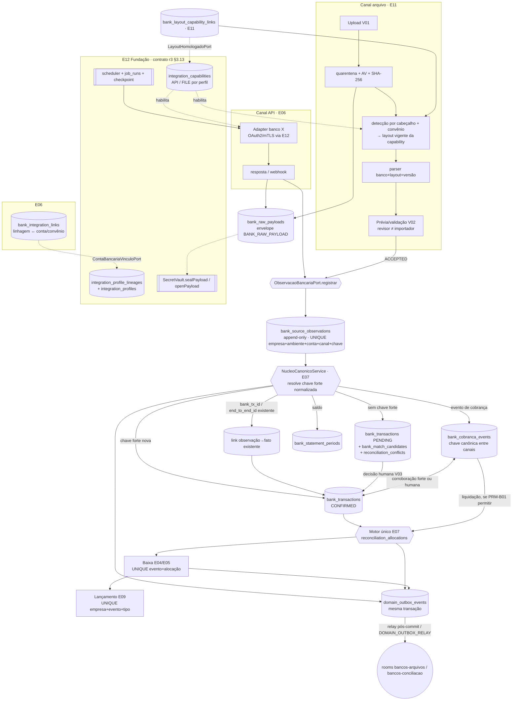
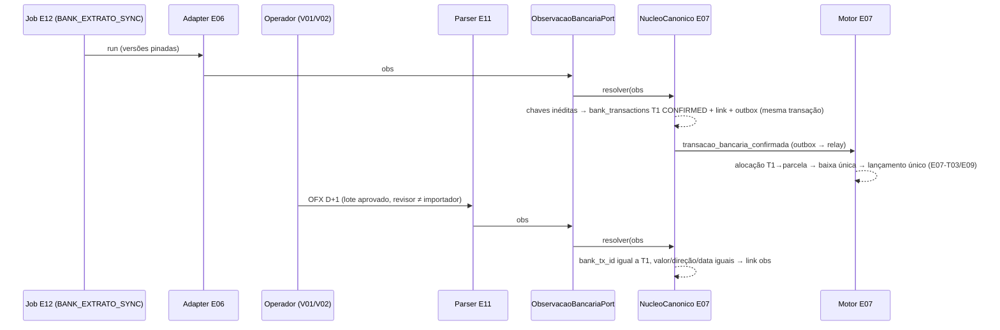

# E11-T00 — Gate CROSS bancário: APIs, arquivos e razão (inventário, ADR-ERP-026, ownership, idempotência, failback) — Plano Tático

> Papel autor: `planner` (modelo solicitado `claude-opus-5.5`; efetivo não atestável — AD-20). Documento **somente documental**: zero código, zero migration, zero gateway/parser, zero edição em `docs/execucao/`.
> Workers futuros (E06-T01..T05, E07-T01..T04, E11-T01..T11) seguem este plano literalmente. Caso não coberto, contradição com fonte superior ou teste que falha após 1 correção → **PARAR e reportar**. Worker não decide regra, não cria perfil canônico, não altera `MENUS_CANONICOS`, não preenche célula pendente do inventário.

**Goal:** Fechar o gate CROSS E11-T00 (Linear ALP-160): inventário E04–E09/E11 por banco × conta × convênio × serviço; decisão de ativação por capability; diagrama único API→observação e arquivo→observação ligados à **mesma** transação canônica; matriz de ownership de tabelas/eventos com owner do outbox de domínio; DDL conceitual sem tabela paralela de conta/título/ledger/conciliação, com todas as FKs declaradas; contrato de idempotência/dedupe; XB-01..XB-16 e Exemplos A–D do doc 12 mapeados a testes futuros; plano de failback; ADR-ERP-026. Nada é implementado nesta onda.

**Architecture:** monólito modular NestJS 11 (Constituição: sem microserviços, sem CQRS/Event Sourcing). Um único **núcleo canônico bancário** recebe observações de qualquer canal (adapters API E06 e parsers de arquivo E11) por uma única porta (`ObservacaoBancariaPort.registrar`), resolve identidade forte **normalizada** e materializa no máximo **uma** `bank_transactions` / `bank_cobranca_events` por fato econômico. O motor único de conciliação E07 aloca fatos confirmados a parcelas E04/E05; E09 lança uma vez por evento econômico. Perfis, capabilities, credenciais, certificados, endpoints, jobs e cofre pertencem ao E12; a interface E12↔E11/E06 é a do **plano E12-T00 r3 §3.13 (contrato canônico)**, adotada aqui literalmente. Persistência PostgreSQL 18 + Drizzle; eventos financeiros saem por **outbox transacional** (`common/outbox`, owner E11-T01) e são retransmitidos pós-commit ao `EventEmitter`/WebSocket (Princípio VI).

**Tech Stack (fixa, sem troca):** Node 22, NestJS 11, TypeScript 5 strict, Next.js 16 App Router/BFF, React 19, PostgreSQL 18, Drizzle + drizzle-kit, Zod 4, WebSocket nativo, `@nestjs/event-emitter` (já em `app.module.ts` L4/L42), JWT + RBAC (11 perfis, AD-04), Jest/Supertest, Playwright, DS v3 Direção A (AD-10). Bibliotecas de parsing OFX/CSV são escolhidas, pinadas e aprovadas no Portão 1 de E11-T05; este plano não adiciona dependência.

**Base pinada:** `origin/develop` @ `db9d8ac1760a01c262c57a9f824d2c8fcf18291b` (merge-base do branch). Última migration `0043_onda14_ocorrencias_preco` (journal idx 43, verificado); próximo índice livre `0044`, disputado com E12-T01 — a numeração real é recalculada pelo Planner de cada onda; o worker não renumera.

**Worktree / branch:** `F:/Projetos/AlphaCarnes/.worktrees/e11-t00` · `feature/erp-e11-t00-cross-bancario` (local, não publicado; 2 commits acima de `db9d8ac`: `c9bed46`, `8f7153c`). Fontes da expansão lidas do checkout coordenador `F:/Projetos/AlphaCarnes` (branch `feature/erp-fiscal-financeiro-contabil-especificacoes-2026`, HEAD `302cdb5a270d73591e3c087a16fef7190101b4f7`, PR #157 não mergeado). Contrato E12 lido de `F:/Projetos/AlphaCarnes/.worktrees/e12-t00/docs/superpowers/plans/2026-10-12-e12-t00-cross-adr-fundacao-integracoes.md` r3, sha256 `9A6F65C615A7791D57F1FBBA5A0C90601545366F9067889412E23F0596185B86`.

**Linear:** ALP-160 (E11-T00). Cross: ALP-133..141 (E06/E07), ALP-142..154 (E08/E09), ALP-161..171 (E11-T01..T11). Gate irmão: ALP-173 (E12-T00).

---

## Histórico de revisões

| Revisão | Data | Plano (sha256) | Motivo |
|---|---|---|---|
| r1 | 2026-10-12 | `ab26672291b9c13a…` (commit `c9bed46`) | versão inicial; Portão 1 = `ajustar` (veredito 2026-10-12T07:46:32Z, 13 achados; commit `8f7153c`) |
| r2 | 2026-10-12 | (calculado pelo Monitor) | resolve os 13 achados e adota literalmente o contrato E12-T00 r3 §3.13 |

**Achados do Portão 1 sobre a r1 → correção na r2:**

| Achado r1 | Correção | Seção corrigida |
|---|---|---|
| 1. §5.1/§6.4/§8/§12.1 (A-01/A-03) contradizem o E12 | removidos `integration_profiles.bank_account_id/bank_agreement_id` e `integration_capabilities.bank_file_layout_id`; `bank_integration_links` (E06) listada com a DDL do contrato; `bank_layout_capability_links` (E11-T02) com DDL literal; regra FILE via `LayoutHomologadoPort`; §12.1 substituída pelas respostas do E12 r3; D-E12 atualizado | §4.1; §5.1; §5.2 (ligação de layout); §6.4; §8; §12; §12.1 |
| 2. `bank_raw_payloads` sem `vault_key_id`/`cipher_alg`/AAD; A-04 ausente | colunas de envelope do contrato §3.13.4 transcritas literalmente; `SecretVault.sealPayload/openPayload`; AAD e EncryptionContext do contrato; grants de workload | §5.2 `bank_raw_payloads`; §7.3; §12.1 A-04 |
| 3. FKs ausentes | todas as FKs declaradas: `company_id` → `companies` em toda tabela; conta/convênio por FK composta; capability por `(id, company_id, environment, channel)`; `conflict_id`; payload; lote; observação; FKs que dependem de tabela criada depois entram por expand na task nomeada (bloco "FKs adiadas") | §5.2; §5.2.1 |
| 4. `uq_bank_tx_strong` com `transaction_type`+`strong_key_kind` impede XB-01 | chave forte canônica normalizada: colunas `bank_tx_id` e `end_to_end_id` (valores normalizados), sem `transaction_type`; FITID atestado pelo manifesto é mapeado para `BANK_TX_ID`; `strong_key_kind` com CHECK e coerência NONE↔NULL | §5.2 observações/transações; §7.2 |
| 5. UNIQUE de `bank_cobranca_events` diverge API × CNAB (XB-02) | chave canônica entre canais sem `occurrence_code`/`sequence_ref` (ficam na observação); `nosso_numero_canonical`; dois índices por classe de semântica + `distinct_seq`; no máximo uma observação STRONG_KEY por canal e evento | §5.2 cobrança; §7.1 L4; §7.2.1 |
| 6. UNIQUE de observação sem `environment`/`bank_account_id` | `UNIQUE (company_id, environment, bank_account_id, source_channel, source_event_key)` | §5.2; §7.1 L2 |
| 7. `installment_id` polimórfico | `payable_installment_id` + `receivable_installment_id` com FK composta e CHECK de exclusividade coerente com `title_kind` | §5.2 alocações; §5.3 |
| 8. PK sem `DEFAULT uuidv7()` | todas as PKs `uuid DEFAULT uuidv7()` (`docs/data/convencoes-schema.md` L12); E12 r3 não mantém exceção: segredos e payload também têm DEFAULT, com o id obtido por `SELECT uuidv7()` antes da cifragem por causa da AAD (§5.2 nota) | §5.2; §2 C14 |
| 9. `bank_file_layouts` sem convênio | layout com escopo `PROVIDER` ou `AGREEMENT` (`company_id`/`bank_agreement_id` + FK), `occurrence_map` e normalização por escopo; ligação à capability pelo `bank_layout_capability_links.bank_agreement_id` do contrato | §5.2 layouts |
| 10. XB-01 na E11-T01 afirma baixa/lançamento; XB-03 ambíguo | XB-01a (E11-T01: fato/observações/links) + XB-01b (E11-T10: alocação/baixa/lançamento); XB-03a (PRM-B01 = `true`) e XB-03b (PRM-B01 = `false`) em E07-T03 | §11; §16 |
| 11. Exemplos A–D do doc 12 §8 não mapeados 1:1 | linhas EX-A1/A2, EX-B1/B2, EX-C, EX-D1/D2 com task, arquivo e asserção | §11.1 |
| 12. `num_nonnulls(subject_*)>=1`; `UNIQUE(id, company_id)` do E06 | CHECK em `reconciliation_conflicts`; restrições exigidas de E01/E04/E05/E06/E09 listadas | §5.2; §5.3 |
| 13. Task 2 com saída incompleta; Task 3 duplicaria commit | Task 2 com a saída real completa (56 linhas) colada; Task 3 reconhece `c9bed46`/`8f7153c` e só commita a revisão r2 | §15 |

Ajuste adicional, não apontado: Task 6 passa de `rebase` para `merge origin/develop` (mesma decisão do E12 r3, sem reescrever o commit de veredito `8f7153c`); permissão `BANCOS_PAYLOAD_BRUTO_LER` acrescentada porque o contrato §3.13.4 exige permissão E11 para `openPayload` com acesso USER; `bank_file_layouts.service` passa a usar os 5 literais FILE de capability (A-02) e S5 DDA por arquivo fica condicionado a emenda do CHECK do E12 (§6.2, §12.1).

---

## 0. Inventário do `develop` (db9d8ac) relevante ao gate

Verificado nesta sessão (busca sobre `app/backend/src`, 65 `pgTable` em 33 arquivos de schema):

| Objeto existente | Situação | Efeito no ERP bancário |
|---|---|---|
| Tabelas `bank_*`, `contas_bancarias`, `titulos*`, `lancamentos_contabeis`, `conciliac*`, `outbox*` | **inexistentes** (zero ocorrência; Task 2) | todas as tabelas da §5 são novas; nenhuma adaptação de legado |
| Módulos `app/backend/src/modules/*` | auditoria, auth, cadastros, comercial, frota, gestao, modelos-etiqueta, operacao, operacoes, parametros, perfis, usuarios | nenhum módulo financeiro/bancário |
| `app/backend/src/integracoes/nfse/*` (EISS, AD-02) | gateway isolado + fake | **não alterar**; padrão porta/adapter/fake é o modelo (Princípio V) |
| Eventos de domínio | `this.eventEmitter.emit(...)` pós-commit em ~29 services (ex.: `faturamento.service.ts` L178/L201/L384); **sem outbox persistido** | eventos financeiros exigem outbox transacional (RNF-B02, E11-T01) → §5.4 |
| `realtime/realtime.gateway.ts` L141/L152–153 | `podeAssinar(ws)` libera **qualquer** room a quem tem `DISPONIBILIDADE_LER` | rooms bancárias entram no mapa compartilhado `room-permissoes.ts` do contrato E12 r3 §3.13.6 → §7.3 |
| `database/schema/parametros.schema.ts` | chave-valor JSONB | parâmetros provisórios da §10 (não segredos) usam este mecanismo, padrão AD-09 `{ valor: null, provisorio: true }` |
| `database/schema/auditoria.schema.ts` | trilha antes/depois | toda decisão bancária audita DTO redigido (conta mascarada, sem payload bruto) |
| `fornecedores`, `clientes`, `notas_fiscais_fornecedor`, `faturamentos`, `notas_fiscais` | existentes | origens de títulos E04/E05 (fora do escopo deste gate; referência por FK nos planos E04/E05) |

## 1. Decisões fixadas (não reabrir; origem entre parênteses)

1. **API é canal primário; arquivo é fallback operacional** por conta+convênio+serviço+versão de layout, construído junto, não fase 2 (Caderno B §0.2; doc 11 §1; doc 12 §2 alternativa B).
2. **Um único** núcleo canônico, motor de conciliação (E07) e razão (E09). Proibidos segundo motor, segundo ledger, tabela paralela de conta, título ou baixa (doc 11 requisito inverso; doc 12 §4; RI-B18).
3. **Importação ≠ pagamento; remessa ≠ registro; retorno de registro ≠ liquidação; extrato ≠ retorno de cobrança** (doc 11 §1; doc 10 regras negativas). Nenhuma baixa por upload; nenhuma baixa por valor/data.
4. **Nenhum layout escolhido pela extensão**: detecção por cabeçalho + configuração do convênio + manifesto aprovado em `bank_file_layouts` ligado à capability por `bank_layout_capability_links` (E11-T02; doc 21 §5).
5. Chave fraca (`valor+direção+data+texto+conta+contraparte`) **só gera candidato** (`bank_match_candidates`); nunca dedupe destrutivo, nunca confirmação automática (doc 12 §3; doc 11 §2.1.3).
6. Observações e decisões são **append-only**; retificação = nova observação + decisão explícita; estorno = movimento compensatório (doc 11 §2.1.4; Princípio IV).
7. Ação externa (remessa, pagamento, registro de boleto) nunca é reenviada às cegas; timeout exige consulta do estado externo antes de nova instrução (doc 11 §1; JB-07; E11-V05 regra).
8. Fallback **não é automático** por retry/timeout; troca de modo exige operador autorizado, motivo, vigência e auditoria (doc 11 §2.4; E11-T08).
9. E12 é dono de provedores, perfis (linhagens e versões), endpoints, capabilities, evidências de habilitação, credenciais, certificados, cofre, jobs, checkpoints e alertas de integração (AD-18; doc 22 §1; E12 r3 §3.4/§3.13). E06 é dono de contas, convênios, carteiras e de `bank_integration_links`. E11 é dono de layouts, `bank_layout_capability_links`, lotes, payload bruto, observações/proveniência, remessas, política de roteamento e outbox de domínio. E07 é dono dos fatos canônicos, conflitos e alocações. E04/E05 donos de títulos/parcelas/baixas. E09 dono do razão.
10. Dinheiro `NUMERIC(15,2)` trafegando como string (Princípio X prevalece sobre o "DECIMAL(18,2)" de RNF-B01 — §2 C7); datas `date`/`timestamptz`; status `TEXT + CHECK`; PK `uuid DEFAULT uuidv7()`.
11. Dados de banco/titular **não são inventados**: célula sem evidência = `Pendente P-xx (dono)` (Princípio VII/VIII; doc 21 §7: "falta de produto significa `not_supported`, não simular").
12. Observação de ambiente **HML** nunca vira fato financeiro: lote/observação HML para em `VALIDATED` e serve só para homologar layout/adapter (garantido por CHECK e por FK com `environment='PROD'` nas tabelas de vínculo, §5.2).
13. A UI não exibe UUID, PK, `company_id`, código E##/ALP, nome técnico de tabela nem número completo de conta (Caderno B "Requisito transversal de UX"; MATRIZ-UX requisito inverso; RNF-B11).
14. Nenhum efeito externo real, homologação ou produção é autorizado por este gate (AD-19 (3)).
15. Migrations futuras só via `drizzle-kit generate`, aditivas, reversíveis, expand → backfill → contract (Princípio X).

## 2. Conflitos de fonte resolvidos por precedência (nenhum é decisão de produto)

| # | Conflito | Fontes | Resolução |
|---|---|---|---|
| C1 | Dono de capabilities e credenciais bancárias | doc 11 §2 e doc 12 §4 (E06 dono de "banco/conta/convênio/capability e credenciais") × AD-18 + doc 22 §1 + doc 23 §3 (fundação E12) | **AD-18 (DECISOES, precedência 2) prevalece**: capabilities, credenciais, certificados, endpoints e jobs = E12; contas, convênios e carteiras = E06. E11/E06 só leem capability via `CapabilitiesService`. |
| C2 | E06-T01 "Contas, convênios e capacidades" × E12-T07 "convênios, contas, capabilities" | Caderno B §E06-T01 × doc 23 E12-T07 | E06-T01 cadastra conta/convênio/carteira, cria `bank_integration_links` e implementa `ContaBancariaVinculoPort`; **exibe** capabilities lidas do E12. E12-T07 cadastra linhagem/perfil/credencial/capability sem coluna de conta (E12 r3 §3.13.1 A-01). Nenhum dos dois cria a entidade do outro. |
| C3 | Dono da transação canônica | doc 11 §2 ("tabela/fato compartilhado"; E11-T01 cria a migration) × doc 12 §4 (E07 "serviço único") | **Owner de domínio = E07** (única escrita via `NucleoCanonicoService`); **migration criada em E11-T01**, que entrega o núcleo com fakes. E07-T01..T03 estendem (alocação, matching), sem segunda tabela. |
| C4 | Dono das observações | doc 11 §2.2 ("E06/E11 shared") × doc 12 §4 (E11 dono de BankSourceObservation; E06 "escrita no serviço canônico comum") | **Owner = E11** (proveniência de todas as fontes). Adapters E06 chamam `ObservacaoBancariaPort.registrar`; não escrevem na tabela. |
| C5 | Instrução de cobrança: E06 × E05/E06 | doc 11 §2 × doc 12 §2.2 | Instrução bancária (registrar/alterar/baixar boleto) = **E06** (`bank_collection_instructions`); estado da cobrança no recebível = **E05**; evento bancário de cobrança (`bank_cobranca_events`) = fato canônico **E07**. |
| C6 | Estados do lote | doc 12 §2.2 (`uploaded…accepted, rejected`) × E11-T07 (`quarantine → parsed → validated → reviewed → ingested/rejected`) | União ordenada: `UPLOADED, QUARANTINED, PARSED, VALIDATED, AWAITING_REVIEW, ACCEPTED, INGESTED, REJECTED`. `ACCEPTED` = revisão humana aprovada; `INGESTED` = observações gravadas (restart idempotente entre os dois). |
| C7 | Precisão monetária | RNF-B01 (DECIMAL(18,2)) × Constituição Princípio X (NUMERIC(15,2)) | Constituição prevalece: `NUMERIC(15,2)`. |
| C8 | Nome do registro de layouts | doc 11 E11-T02 (`bank_file_layout_registry`) × E12 r3 §3.13.2 (`bank_file_layouts`) | `bank_file_layouts` (aceito em A-06). |
| C9 | Layout oficial em E12 (`integration_reference_datasets` `BANK_CNAB_LAYOUT`/`BANK_OPENAPI`) × manifesto E11 | doc 22 §2 × doc 11 E11-T02 | Sem duplicação: E12 guarda o **documento oficial** versionado; E11 guarda o **manifesto executável** com FK composta `(reference_dataset_id, provider_id)` → `integration_reference_datasets(id, provider_id)` (A-08). |
| C10 | Outbox: "infra de outbox/inbox compartilhada" (doc 22 §2) × E12 r3 §3.13.5 | doc 22 × E12 r3 | `domain_outbox_events`/`domain_inbox_receipts` em `common/outbox`, criados por **E11-T01**; E12-T09 registra `DOMAIN_OUTBOX_RELAY` (um job por empresa, handler E11-T01). Eventos E12 não passam pelo outbox (E12 r3 §3.13.5). |
| C11 | Rotas do protótipo `/erp/bancos/e11-v0N` × proibição de código E## visível | catalogo.js L921/936/951/966/981 × Caderno B UX | Proposta de slugs semânticos na §8; decisão **somente do Quality Owner** (P-14). |
| C12 | Valores do protótipo E11-V05 (ex.: "Extrato Bradesco · Não homologada") | aplicacao.js L305–310 × doc 21 | São **fictícios**; não alimentam o inventário da §6. |
| C13 | CNAB 200/MT940 Bradesco | doc 12 §2.3/§6 × doc 21 §2.5 | Fora do pacote-base; só por aditivo após decisão P-05 do QO. |
| C14 | `convencoes-schema.md` (checklist: `updated_at` e `deleted_at` em toda tabela de negócio) × Constituição Princípio IV ("histórias append-only nunca são reescritas") | `docs/data/convencoes-schema.md` × constituição | PK `DEFAULT uuidv7()`, `created_at DEFAULT now()` e índice em toda FK valem para todas as tabelas. Tabelas **append-only** (observações, links de observação, eventos de cobrança, outbox/inbox) não têm `deleted_at` nem `updated_at`: exclusão lógica ou física reescreveria a história; inativação é por `status`/`valid_to`, como nas ligações do E12 r3 §3.13.3. Tabelas de configuração (`bank_file_layouts`) têm `updated_at` e `deleted_at`. |


## 3. ADR-ERP-026 — Arquitetura bancária canônica API + arquivo (conteúdo normativo deste gate)

**Estado:** proposto para Portão 1 do E11-T00. Complementa ADR-ERP-024 e ADR-ERP-025 (plano E12-T00 r3), sem substituí-los. **Localização:** esta seção (mesma decisão do plano E12-T00: não duplicar em `docs/expansao-erp-2026/` antes do #157).

### 3.1 Contexto
A AlphaCarnes opera Bradesco, Itaú e Santander (reunião Karina 25/09/2026: AP/AR, DDA, retornos/francesinha, conciliação manual em Excel). O QO decidiu APIs diretas desde a primeira entrega (10/10/2026) e arquivos como fallback construído junto (11/10/2026). O `develop` não tem nenhum objeto financeiro (§0). As fontes públicas (FEBRABAN 240 v10.9, Validador Bradesco, Itaú CNAB400, Santander H7815 v8.5) **não provam** habilitação de nenhum convênio da AlphaCarnes (doc 12 §1).

### 3.2 Decisão
Alternativa B do doc 12 §2: API e arquivo são **adaptadores de entrada** de uma única cadeia `Observação → Fato canônico → Alocação (E07) → Baixa (E04/E05) → Lançamento (E09)`. Rejeitadas: A (dois sistemas com baixas próprias) e C (só arquivos).

### 3.3 Diagrama único (API e arquivo convergem na mesma transação)

Invariante do diagrama: os ramos API e arquivo **só** se encontram em `ObservacaoBancariaPort`; nada abaixo dele sabe o canal, exceto como atributo de proveniência.

### 3.4 Sequência dos dois caminhos para o mesmo crédito (XB-01 / Exemplo A)


### 3.5 Consequências
- Positivas: idempotência determinística, failover/failback sem reprocessar baixa, proveniência auditável, um único lugar para regra de identidade.
- Custos: investimento inicial em contratos (núcleo + outbox) antes de qualquer adapter; parsers por layout homologado são itens orçamentários próprios (doc 12 §6). Impacto comercial no Caderno C: P-18.

## 4. Ownership E04–E09/E11 (tabelas e eventos)

### 4.1 Tabelas
Coluna "Task criadora" = única task que gera a migration. "Escrita" = único serviço autorizado a gravar; os demais leem por serviço/porta.

| Tabela | Owner de domínio | Task criadora | Escrita | Leitura (via serviço) |
|---|---|---|---|---|
| `companies`, `establishments` (nomes conceituais; físico = E01-T01) | E01 | E01-T01 | E01 | E02–E12 |
| `integration_providers` (instituição bancária = provedor `kind='BANK'`) | E12 | E12-T01 | E12 | E06, E11 (não existe tabela `bancos` paralela) |
| `integration_profile_lineages`, `integration_profiles`, `integration_capabilities`, `integration_credentials`, `integration_certificates*`, `integration_enablement_evidence`, `integration_reference_datasets`, `integration_vault_keys`, `integration_job_*`, `integration_workload_grants`, `integration_alerts` | E12 | E12-T01..T10 | E12 | E06, E07, E08, E11 |
| `bank_accounts` | E06 | E06-T01 | E06 | E04, E05, E07, E08, E09, E11, E12 (porta) |
| `bank_agreements` (convênio + carteira) | E06 | E06-T01 | E06 | E05, E11, E12 (porta) |
| `bank_integration_links` (linhagem E12 ↔ conta/convênio) | E06 | E06-T01 | E06 | E12 via `ContaBancariaVinculoPort` |
| `bank_collection_instructions` | E06 | E06-T02 | E06 (pedido do E05) | E05, E07, E11 |
| `bank_payment_instructions` | E06 | E06-T04 | E06 (pedido do E04, dupla aprovação) | E04, E07, E11 |
| `bank_dda_titles` | E06 | E06-T03 | E06 | E04 |
| `bank_file_layouts` | E11 | E11-T02 | E11 | E06, E12 (via porta) |
| `bank_layout_capability_links` (capability FILE ↔ layout vigente) | E11 | E11-T02 | E11 `LayoutsService` | E12 via `LayoutHomologadoPort` |
| `bank_raw_payloads` | E11 | E11-T01 | E11 (`PayloadBrutoService`, envelope via `SecretVault.sealPayload`) | E11 (`openPayload` com grant ou permissão) |
| `bank_import_batches` | E11 | E11-T01 (estados), E11-T07 (pipeline) | E11 | E07, E08 |
| `bank_source_observations` | E11 | E11-T01 | E11 via `ObservacaoBancariaPort` (chamada por E06 e E11) | E07 |
| `bank_remittance_batches`, `bank_remittance_items` | E11 | E11-T06 | E11 | E05, E06, E04 |
| `bank_channel_routing_policies` | E11 | E11-T08 | E11 | E06, E12 (evento `canal_bancario_modo_alterado`) |
| `bank_transactions` | E07 | E11-T01 (C3) | E07 `NucleoCanonicoService` | E04, E05, E08, E09, E11 |
| `bank_transaction_observation_links` | E07 | E11-T01 | E07 | E11 (proveniência V04) |
| `bank_cobranca_events`, `bank_cobranca_event_observations` | E07 | E11-T01 | E07 | E05, E06 |
| `bank_economic_links` (cobrança liquidada ↔ crédito em extrato) | E07 | E11-T01 | E07 | E05, E08 |
| `bank_statement_periods` | E07 | E11-T01 | E07 | E08 (posição), E07-T04 (fechamento) |
| `bank_match_candidates`, `reconciliation_conflicts` | E07 | E11-T01 | E07 | E11 (V03), E08 |
| `reconciliation_allocations` | E07 | E07-T02 | E07 | E04, E05, E09 |
| `reconciliation_closings` | E07 | E07-T04 | E07 | E08, E09 |
| títulos/parcelas AP (`payables`, `payable_installments`) | E04 | E04-T02 | E04 | E07, E08, E09 |
| títulos/parcelas AR (`receivables`, `receivable_installments`) | E05 | E05-T02 | E05 | E07, E08, E09 |
| baixas (`*_settlements`) | E04/E05 | E04-T02 / E05-T02 | E04/E05, **somente** por comando do motor E07 ou baixa manual com alçada | E07, E09 |
| `treasury_projections`, `bank_balance_snapshots` | E08 | E08-T01/T02 | E08 | E07 |
| `ledger_journal_entries`, `ledger_journal_lines`, `accounting_periods` | E09 | E09-T01/T03 | E09 | E04, E05, E07, E08 |
| `domain_outbox_events`, `domain_inbox_receipts` | **E11-T01 (infra `common/outbox`)** | E11-T01 | cada domínio na própria transação; relay único (`DOMAIN_OUTBOX_RELAY`) | E02, E04, E05, E06, E07, E08, E09, E11, E12 (consumidor `integracoes.saude`) |

Nomes físicos de E04/E05/E08/E09 são de referência: o Planner de cada uma dessas tasks confirma o nome, mas **não** pode criar segunda tabela para o mesmo conceito nem omitir as restrições da §5.3. Nomes E12/E06 das ligações e do envelope são os do contrato E12 r3 §3.13.2 e não podem ser alterados por plano posterior sem nova revisão de ambos.

### 4.2 Eventos de domínio (sempre via outbox, publicados pós-commit; `snake_case` como `realtime/events/eventos.ts`)

| Evento | Owner | Gatilho | Consumidores (inbox) | Room WS |
|---|---|---|---|---|
| `lote_bancario_alterado` | E11 | transição de estado do lote | E11 V01/V02 | `bancos-arquivos` |
| `observacao_bancaria_registrada` | E11 | observação gravada (nova, não duplicada) | E07 núcleo | — (interno) |
| `transacao_bancaria_confirmada` | E07 | fato canônico `CONFIRMED` | E07 motor, E08 | `bancos-conciliacao` |
| `transacao_bancaria_estornada` | E07 | fato compensatório/`REVERSED` | E07, E08, E09 | `bancos-conciliacao` |
| `evento_cobranca_registrado` | E07 | `bank_cobranca_events` novo | E05 (estado da cobrança), E06 (instrução) | `bancos-conciliacao` |
| `conflito_bancario_aberto` / `conflito_bancario_resolvido` | E07 | conflito/candidato aberto ou decidido | E11 V03, E07-T04 | `bancos-conciliacao` |
| `alocacao_conciliacao_confirmada` / `alocacao_conciliacao_revertida` | E07 | alocação ativa/revertida | E04/E05 (baixa/estorno), E09 | `bancos-conciliacao` |
| `titulo_baixado` / `titulo_baixa_estornada` | E04/E05 | baixa/estorno | E09, E08 | room do plano E04/E05 (fora do contrato E12 r3 §3.13.6; até registro, nenhum broadcast) |
| `remessa_bancaria_alterada` | E11 | transição de remessa | E05, E06 | `bancos-arquivos` |
| `canal_bancario_modo_alterado` | E11 (E11-T08) | política de roteamento alterada | E12 consumidor `integracoes.saude` (alerta `FAILBACK_ACTIVE`), E06 | `bancos-arquivos` |
| `lancamento_contabil_registrado` | E09 | lançamento postado | E08, E09 relatórios | room do plano E09 (idem) |

Payloads levam valores como string, conta mascarada (últimos 4 dígitos) e IDs internos; **nunca** payload bruto, segredo, ciphertext ou dado pessoal não mascarado. Rooms `financeiro`/`contabilidade` da r1 foram retiradas: o contrato E12 r3 §3.13.6 deixa o registro delas aos planos E04/E05/E09, e `broadcastRoom` rejeita room fora de `ROOMS_PROTEGIDAS`.


## 5. DDL conceitual (NÃO é migration; worker transcreve para Drizzle e gera com drizzle-kit)

Regras gerais (valem para todo bloco abaixo): PK `uuid DEFAULT uuidv7()` (`docs/data/convencoes-schema.md` L12); `created_at timestamptz NOT NULL DEFAULT now()`; índice em toda FK (convenção "Índices obrigatórios"; o worker declara `index()` no Drizzle); FKs compostas com colunas nulas usam `MATCH SIMPLE` (FK só vale quando todas as colunas estão preenchidas — é o comportamento desejado para `bank_agreement_id` opcional); `companies`/`establishments` são nomes conceituais (físico = E01-T01, D-E01). Onde o id participa de AAD (`bank_raw_payloads`), o backend obtém o valor por `SELECT uuidv7()` antes da cifragem e o envia explicitamente; a coluna mantém `DEFAULT uuidv7()` (mesma regra do E12 r3 para `integration_secret_versions`; o E12 r3 não mantém exceção sem DEFAULT).

### 5.1 Referências externas (não criar aqui; nomes literais do E12 r3 §3.13.2 e restrições de §3.13.7)
```sql
-- E01-T01: companies(id); establishments(id, company_id) UNIQUE (id, company_id)
-- E12-T01: integration_providers(id, kind)                         UNIQUE (id, kind)
--          integration_profile_lineages(id, company_id, environment, service_id, provider_id)  UNIQUE-alvo de bank_integration_links
--          integration_profiles(id, lineage_id, company_id, environment)   -- SEM conta, convênio ou layout (A-01 rejeitada)
--          integration_capabilities(id, profile_id, company_id, environment, capability, channel, status)
--                                    UNIQUE (id, company_id, environment, channel)   -- SEM bank_file_layout_id
--          integration_reference_datasets(id, provider_id)        UNIQUE (id, provider_id)
--          integration_vault_keys(id, environment, kms_key_arn)   UNIQUE (id, environment, kms_key_arn)
--          integration_job_runs(id)                               -- FK simples (contrato §3.13.2)
--          integration_workload_grants(operation, service, purpose, environment)
-- E06-T01: bank_accounts(id, company_id, provider_id NOT NULL REFERENCES integration_providers(id), agencia_mascarada, conta_mascarada, ...)
--            UNIQUE (id, company_id), UNIQUE (id, company_id, provider_id)
--          bank_agreements(id, company_id, bank_account_id, convenio, carteira, ...)
--            UNIQUE (id, company_id), UNIQUE (id, bank_account_id, company_id)
--          bank_integration_links — DDL literal do E12 r3 §3.13.3 (reproduzida abaixo só para leitura; owner E06)
-- E06-T02: bank_collection_instructions(id, company_id, bank_agreement_id, nosso_numero, status ...)  UNIQUE (id, company_id)
-- E06-T04: bank_payment_instructions(id, company_id, bank_account_id, status ...)                    UNIQUE (id, company_id)
-- E04-T02: payable_installments(id, company_id, ...)    UNIQUE (id, company_id)
-- E05-T02: receivable_installments(id, company_id, ...) UNIQUE (id, company_id)
-- usuarios(id) existente (auth.schema.ts).
```
`bank_integration_links` (owner E06, criada em E06-T01 — transcrição literal do E12 r3 §3.13.3; este plano não a cria):
```sql
CREATE TABLE bank_integration_links (
  id uuid PRIMARY KEY DEFAULT uuidv7(),
  company_id uuid NOT NULL,
  environment text NOT NULL CHECK (environment IN ('HML','PROD')),
  profile_lineage_id uuid NOT NULL,
  provider_id uuid NOT NULL,
  service_id uuid NOT NULL,
  bank_account_id uuid NOT NULL,
  bank_agreement_id uuid,                        -- NULL para serviço por conta (extrato, saldo, pagamentos, DDA)
  status text NOT NULL CHECK (status IN ('ACTIVE','RETIRED')),
  valid_from timestamptz NOT NULL, valid_to timestamptz,
  created_by uuid NOT NULL REFERENCES usuarios(id),
  created_at timestamptz NOT NULL DEFAULT now(), updated_at timestamptz NOT NULL DEFAULT now(),
  FOREIGN KEY (profile_lineage_id, company_id, environment, service_id, provider_id)
    REFERENCES integration_profile_lineages (id, company_id, environment, service_id, provider_id),
  FOREIGN KEY (bank_account_id, company_id, provider_id)
    REFERENCES bank_accounts (id, company_id, provider_id),
  FOREIGN KEY (bank_agreement_id, bank_account_id, company_id)
    REFERENCES bank_agreements (id, bank_account_id, company_id),
  CHECK ((status = 'ACTIVE') = (valid_to IS NULL))
);
CREATE UNIQUE INDEX uq_bil_lineage_active ON bank_integration_links (profile_lineage_id) WHERE status = 'ACTIVE';
CREATE UNIQUE INDEX uq_bil_account_service_active ON bank_integration_links
  (bank_account_id, COALESCE(bank_agreement_id,'00000000-0000-0000-0000-000000000000'), service_id, environment)
  WHERE status = 'ACTIVE';
```

### 5.2 Tabelas E11/E07 deste contrato
```sql
-- ── Layouts (E11-T02) ───────────────────────────────────────────────────────
CREATE TABLE bank_file_layouts (
  id uuid PRIMARY KEY DEFAULT uuidv7(),
  provider_id uuid NOT NULL REFERENCES integration_providers(id),
  scope text NOT NULL CHECK (scope IN ('PROVIDER','AGREEMENT')),   -- AGREEMENT: versão/ocorrências próprias do convênio
  company_id uuid REFERENCES companies(id),
  bank_agreement_id uuid,
  service text NOT NULL CHECK (service IN ('REMESSA_COBRANCA','RETORNO_COBRANCA','EXTRATO_ARQUIVO','REMESSA_PAGAMENTO','RETORNO_PAGAMENTO')),  -- literais FILE do E12 (A-02)
  direction text NOT NULL CHECK (direction IN ('IN','OUT')),
  format text NOT NULL CHECK (format IN ('CNAB240','CNAB400','OFX','CSV')),
  layout_version text NOT NULL,                        -- ex.: "H7815 v8.5 fev/2026" só após P-04
  encoding text NOT NULL, record_length integer,       -- NULL para OFX/CSV
  header_rules jsonb NOT NULL, segment_map jsonb NOT NULL, checksum_rules jsonb NOT NULL,
  occurrence_map jsonb NOT NULL DEFAULT '{}',          -- código → semântica (P-20); por convênio quando scope='AGREEMENT'
  csv_profile jsonb,                                   -- delimitador, decimal, data, timezone, sinal, colunas
  strong_key_map jsonb NOT NULL DEFAULT '{}',          -- campo do layout → {kind: BANK_TX_ID|END_TO_END_ID, normalize: [...]} (§7.2); '{}' = nenhuma chave forte
  strong_key_evidence_ref text,                        -- referência da atestação de unicidade do banco (P-19), sem segredo
  cobranca_key_normalization jsonb NOT NULL DEFAULT '{}', -- normalização de nossoNúmero (§7.2.1; P-20)
  reference_dataset_id uuid NOT NULL,
  validated_test_file_sha256 bytea CHECK (validated_test_file_sha256 IS NULL OR octet_length(validated_test_file_sha256)=32),
  status text NOT NULL CHECK (status IN ('DRAFT','HML_VALIDATED','APPROVED','RETIRED')),
  active_from date, active_to date,
  approved_by uuid REFERENCES usuarios(id), created_by uuid NOT NULL REFERENCES usuarios(id),
  created_at timestamptz NOT NULL DEFAULT now(), updated_at timestamptz NOT NULL DEFAULT now(), deleted_at timestamptz,
  FOREIGN KEY (reference_dataset_id, provider_id) REFERENCES integration_reference_datasets (id, provider_id),   -- A-08
  FOREIGN KEY (bank_agreement_id, company_id) REFERENCES bank_agreements (id, company_id),
  UNIQUE (id, provider_id),                                                                                     -- exigido pelo E12 r3 §3.13.7
  CHECK ((scope = 'AGREEMENT') = (bank_agreement_id IS NOT NULL)),
  CHECK ((company_id IS NULL) = (bank_agreement_id IS NULL)),
  CHECK ((direction = 'OUT') = (service IN ('REMESSA_COBRANCA','REMESSA_PAGAMENTO'))),
  CHECK (strong_key_map = '{}'::jsonb OR strong_key_evidence_ref IS NOT NULL),
  CHECK (status <> 'APPROVED' OR (approved_by IS NOT NULL AND validated_test_file_sha256 IS NOT NULL AND approved_by <> created_by))
);
CREATE UNIQUE INDEX uq_layout_version ON bank_file_layouts
  (provider_id, COALESCE(bank_agreement_id,'00000000-0000-0000-0000-000000000000'), service, format, layout_version)
  WHERE deleted_at IS NULL;
-- Serviço (E11-T02, com teste): provedor do convênio (bank_agreements→bank_accounts.provider_id) = provider_id do layout;
-- layout APPROVED exige dataset APPROVED ou ACTIVE (A-08).

-- ── Ligação capability FILE ↔ layout (E11-T02) — DDL literal do E12 r3 §3.13.3 ─
CREATE TABLE bank_layout_capability_links (
  id uuid PRIMARY KEY DEFAULT uuidv7(),
  company_id uuid NOT NULL,
  environment text NOT NULL CHECK (environment IN ('HML','PROD')),
  capability_id uuid NOT NULL,
  capability_channel text NOT NULL DEFAULT 'FILE' CHECK (capability_channel = 'FILE'),
  provider_id uuid NOT NULL,
  bank_file_layout_id uuid NOT NULL,
  bank_agreement_id uuid,                        -- quando layout/mapa de ocorrências é por convênio
  status text NOT NULL CHECK (status IN ('ACTIVE','RETIRED')),
  valid_from timestamptz NOT NULL, valid_to timestamptz,
  created_by uuid NOT NULL REFERENCES usuarios(id),
  created_at timestamptz NOT NULL DEFAULT now(), updated_at timestamptz NOT NULL DEFAULT now(),
  FOREIGN KEY (capability_id, company_id, environment, capability_channel)
    REFERENCES integration_capabilities (id, company_id, environment, channel),
  FOREIGN KEY (bank_file_layout_id, provider_id)
    REFERENCES bank_file_layouts (id, provider_id),
  FOREIGN KEY (bank_agreement_id, company_id)
    REFERENCES bank_agreements (id, company_id),
  CHECK ((status = 'ACTIVE') = (valid_to IS NULL))
);
CREATE UNIQUE INDEX uq_blcl_capability_active ON bank_layout_capability_links (capability_id) WHERE status = 'ACTIVE';
-- Validado por LayoutsService.vincular (E11-T02, com teste nomeado em §16): provider_id = provedor da linhagem da capability;
-- layout.service = capability.capability; layout scope='AGREEMENT' ⇒ ligação com o mesmo bank_agreement_id.
-- LayoutsService.aposentar/desvincular de capability ENABLED chama CapabilitiesService.suspender(capabilityId,'LAYOUT_RETIRED',tx)
-- na mesma transação (alerta LAYOUT_OUTDATED). E11-T02 implementa LayoutHomologadoPort.layoutVigente(capabilityId, tx).

-- ── Payload bruto (E11-T01) — colunas de envelope literais do E12 r3 §3.13.4 ─
CREATE TABLE bank_raw_payloads (
  id uuid PRIMARY KEY DEFAULT uuidv7(),           -- valor gerado antes da cifragem e enviado explicitamente
  company_id uuid NOT NULL REFERENCES companies(id),
  environment text NOT NULL CHECK (environment IN ('HML','PROD')),
  source_kind text NOT NULL CHECK (source_kind IN ('FILE','API_RESPONSE','WEBHOOK')),
  service text NOT NULL CHECK (service = 'BANK_RAW'),
  purpose text NOT NULL CHECK (purpose = 'BANK_RAW_PAYLOAD'),
  cipher_alg text NOT NULL CHECK (cipher_alg = 'AES-256-GCM'),
  ciphertext bytea NOT NULL,
  nonce bytea NOT NULL CHECK (octet_length(nonce) = 12),
  auth_tag bytea NOT NULL CHECK (octet_length(auth_tag) = 16),
  encrypted_data_key bytea NOT NULL,
  vault_key_id uuid NOT NULL,
  kms_key_arn text NOT NULL,
  encryption_context_hash bytea NOT NULL CHECK (octet_length(encryption_context_hash) = 32),
  plaintext_sha256 bytea NOT NULL CHECK (octet_length(plaintext_sha256) = 32),
  FOREIGN KEY (vault_key_id, environment, kms_key_arn) REFERENCES integration_vault_keys (id, environment, kms_key_arn),
  UNIQUE (id, company_id, environment),
  -- colunas próprias do E11 (acréscimo permitido pelo contrato; nenhuma coluna de envelope afrouxada):
  size_bytes bigint NOT NULL CHECK (size_bytes > 0),
  retention_until date,                           -- NULL enquanto P-11 pendente: nada é expurgado
  created_at timestamptz NOT NULL DEFAULT now()
);  -- colunas de envelope imutáveis; expurgo nunca é UPDATE delas (se P-11 exigir anular ciphertext → conflito C8/H-12 do E12, PARAR)
-- EncryptionContext = {companyId, environment, purpose:'BANK_RAW_PAYLOAD', service:'BANK_RAW'};
-- AAD (JSON, chaves ordenadas) = {companyId, environment, payloadId, plaintextSha256 (hex minúsculo), purpose, service, sourceKind};
-- encryption_context_hash = SHA-256 da AAD. LOCAL_FAKE: kms_key_arn = 'local-fake:<id>'.

-- ── Lote de arquivo (E11-T01/T07) ──────────────────────────────────────────
CREATE TABLE bank_import_batches (
  id uuid PRIMARY KEY DEFAULT uuidv7(),
  company_id uuid NOT NULL REFERENCES companies(id),
  environment text NOT NULL CHECK (environment IN ('HML','PROD')),
  bank_account_id uuid NOT NULL, bank_agreement_id uuid,
  file_capability_id uuid NOT NULL,
  file_capability_channel text NOT NULL DEFAULT 'FILE' CHECK (file_capability_channel = 'FILE'),
  bank_file_layout_id uuid REFERENCES bank_file_layouts(id),   -- NULL até detecção; nunca derivado da extensão
  service text NOT NULL CHECK (service IN ('RETORNO_COBRANCA','EXTRATO_ARQUIVO','RETORNO_PAGAMENTO')),   -- = capability.capability (serviço + teste)
  original_filename text NOT NULL, size_bytes bigint NOT NULL CHECK (size_bytes > 0),
  sha256 bytea NOT NULL CHECK (octet_length(sha256)=32),
  raw_payload_id uuid NOT NULL,
  status text NOT NULL CHECK (status IN ('UPLOADED','QUARANTINED','PARSED','VALIDATED','AWAITING_REVIEW','ACCEPTED','INGESTED','REJECTED')),
  validation_summary jsonb NOT NULL DEFAULT '{}',      -- contagens/totais como string, erros por linha (sem dado sensível)
  rejection_reason text,
  uploaded_by uuid NOT NULL REFERENCES usuarios(id), reviewed_by uuid REFERENCES usuarios(id),
  created_at timestamptz NOT NULL DEFAULT now(), updated_at timestamptz NOT NULL DEFAULT now(),
  FOREIGN KEY (bank_account_id, company_id) REFERENCES bank_accounts (id, company_id),
  FOREIGN KEY (bank_agreement_id, bank_account_id, company_id) REFERENCES bank_agreements (id, bank_account_id, company_id),
  FOREIGN KEY (file_capability_id, company_id, environment, file_capability_channel)
    REFERENCES integration_capabilities (id, company_id, environment, channel),   -- E12 r3 §3.13.3
  FOREIGN KEY (raw_payload_id, company_id, environment) REFERENCES bank_raw_payloads (id, company_id, environment),
  UNIQUE (company_id, environment, bank_account_id, service, sha256),           -- L1; XB-05/XB-14
  UNIQUE (id, company_id, environment, bank_account_id),                        -- alvo da observação
  UNIQUE (id, company_id),                                                      -- alvo de reconciliation_conflicts.subject_import_batch_id
  CHECK (reviewed_by IS NULL OR reviewed_by <> uploaded_by),                    -- segregação
  CHECK (environment = 'PROD' OR status NOT IN ('ACCEPTED','INGESTED'))         -- decisão 12
);
-- Serviço (E11-T07, com teste): capability FILE com status ENABLED (PROD) ou HML_TESTED (HML); capability pertence a linhagem
-- cujo vínculo ativo (bank_integration_links) é desta conta (+convênio); layout detectado = layoutVigente(capability).

-- ── Observação (E11-T01; append-only) ──────────────────────────────────────
CREATE TABLE bank_source_observations (
  id uuid PRIMARY KEY DEFAULT uuidv7(),
  company_id uuid NOT NULL REFERENCES companies(id),
  environment text NOT NULL CHECK (environment IN ('HML','PROD')),
  bank_account_id uuid NOT NULL, bank_agreement_id uuid,
  source_channel text NOT NULL CHECK (source_channel IN ('API','WEBHOOK','CNAB240','CNAB400','OFX','CSV')),
  observation_kind text NOT NULL CHECK (observation_kind IN ('STATEMENT_ENTRY','BALANCE','COLLECTION_EVENT','PAYMENT_EVENT','DDA_TITLE','REMITTANCE_ACK')),
  import_batch_id uuid, record_index integer,
  job_run_id uuid REFERENCES integration_job_runs(id),   -- FK simples (contrato); empresa/ambiente do run validados no serviço + teste
  raw_payload_id uuid NOT NULL,
  source_event_key text NOT NULL,                      -- arquivo: lote:indice:tipo ; API: id do evento do banco ou sha256(resposta)+índice
  layout_version text,
  -- chave forte canônica normalizada (§7.2)
  strong_key_kind text NOT NULL CHECK (strong_key_kind IN ('BANK_TX_ID','END_TO_END_ID','BOTH','NONE')),
  bank_tx_id text,                                     -- id do lançamento do banco, normalizado; FITID atestado entra aqui
  end_to_end_id text,                                  -- E2E Pix normalizado
  strong_key_source text CHECK (strong_key_source IN ('API_CONTRACT','MANIFEST_ATTESTED')),
  strong_key_source_field text,                        -- proveniência: 'FITID', nome do campo/coluna (nunca o valor bruto mascarado de outra coisa)
  -- referências de cobrança (canal-específicas; a chave canônica do evento fica em bank_cobranca_events)
  nosso_numero text, nosso_numero_canonical text, wallet text, occurrence_code text, occurrence_sequence_ref text,
  tx_id text, numero_documento text,
  effective_date date, posting_date date,
  amount numeric(15,2), fee_amount numeric(15,2), direction text CHECK (direction IN ('CREDIT','DEBIT')),
  description_normalized text, counterparty_document_masked text,
  rectifies_observation_id uuid,
  created_at timestamptz NOT NULL DEFAULT now(),
  FOREIGN KEY (bank_account_id, company_id) REFERENCES bank_accounts (id, company_id),
  FOREIGN KEY (bank_agreement_id, bank_account_id, company_id) REFERENCES bank_agreements (id, bank_account_id, company_id),
  FOREIGN KEY (import_batch_id, company_id, environment, bank_account_id)
    REFERENCES bank_import_batches (id, company_id, environment, bank_account_id),
  FOREIGN KEY (raw_payload_id, company_id, environment) REFERENCES bank_raw_payloads (id, company_id, environment),
  FOREIGN KEY (rectifies_observation_id, company_id, bank_account_id)
    REFERENCES bank_source_observations (id, company_id, bank_account_id),
  UNIQUE (company_id, environment, bank_account_id, source_channel, source_event_key),   -- L2; replay idempotente
  UNIQUE (id, company_id), UNIQUE (id, company_id, bank_account_id),
  UNIQUE (id, company_id, environment, bank_account_id, source_channel),                 -- alvo dos links
  CHECK ((strong_key_kind = 'NONE')          = (bank_tx_id IS NULL AND end_to_end_id IS NULL)),
  CHECK ((strong_key_kind = 'BANK_TX_ID')    = (bank_tx_id IS NOT NULL AND end_to_end_id IS NULL)),
  CHECK ((strong_key_kind = 'END_TO_END_ID') = (bank_tx_id IS NULL AND end_to_end_id IS NOT NULL)),
  CHECK ((strong_key_kind = 'BOTH')          = (bank_tx_id IS NOT NULL AND end_to_end_id IS NOT NULL)),
  CHECK ((strong_key_kind = 'NONE') = (strong_key_source IS NULL)),
  CHECK (bank_tx_id IS NULL OR (bank_tx_id = btrim(bank_tx_id) AND length(bank_tx_id) > 0)),
  CHECK (end_to_end_id IS NULL OR (end_to_end_id = btrim(end_to_end_id) AND length(end_to_end_id) > 0)),
  CHECK ((import_batch_id IS NULL) = (source_channel IN ('API','WEBHOOK'))),
  CHECK ((import_batch_id IS NULL) = (record_index IS NULL)),
  CHECK (source_channel NOT IN ('CNAB240','CNAB400','OFX','CSV') OR strong_key_kind = 'NONE' OR strong_key_source = 'MANIFEST_ATTESTED'),
  CHECK (observation_kind <> 'COLLECTION_EVENT' OR (bank_agreement_id IS NOT NULL AND nosso_numero_canonical IS NOT NULL))
);
```


```sql
-- ── Fato canônico (owner E07; criada em E11-T01) — somente PROD (decisão 12) ─
CREATE TABLE bank_transactions (
  id uuid PRIMARY KEY DEFAULT uuidv7(),
  company_id uuid NOT NULL REFERENCES companies(id),
  bank_account_id uuid NOT NULL,
  transaction_type text NOT NULL CHECK (transaction_type IN ('PIX','TED','BOLETO_CREDITO','PAGAMENTO','TARIFA','TRANSFERENCIA','APLICACAO','RESGATE','ESTORNO','OUTRO')),  -- descritivo; NÃO compõe a chave forte
  direction text NOT NULL CHECK (direction IN ('CREDIT','DEBIT')),
  amount numeric(15,2) NOT NULL CHECK (amount > 0),
  effective_date date NOT NULL,
  bank_tx_id text, end_to_end_id text,                 -- chave forte canônica normalizada (§7.2); mesmas regras de forma da observação
  status text NOT NULL CHECK (status IN ('PENDING','CONFIRMED','CONFLICTED','REVERSED','SUPERSEDED')),
  superseded_by_id uuid, reverses_transaction_id uuid,
  confirmed_by uuid REFERENCES usuarios(id),          -- NULL quando confirmada por chave forte
  confirmed_at timestamptz,
  created_at timestamptz NOT NULL DEFAULT now(), updated_at timestamptz NOT NULL DEFAULT now(),
  FOREIGN KEY (bank_account_id, company_id) REFERENCES bank_accounts (id, company_id),
  FOREIGN KEY (superseded_by_id, company_id, bank_account_id) REFERENCES bank_transactions (id, company_id, bank_account_id),
  FOREIGN KEY (reverses_transaction_id, company_id, bank_account_id) REFERENCES bank_transactions (id, company_id, bank_account_id),
  UNIQUE (id, company_id), UNIQUE (id, company_id, bank_account_id),
  CHECK ((status = 'SUPERSEDED') = (superseded_by_id IS NOT NULL)),
  CHECK (bank_tx_id IS NULL OR (bank_tx_id = btrim(bank_tx_id) AND length(bank_tx_id) > 0)),
  CHECK (end_to_end_id IS NULL OR (end_to_end_id = btrim(end_to_end_id) AND length(end_to_end_id) > 0)),
  CHECK (status <> 'CONFIRMED' OR bank_tx_id IS NOT NULL OR end_to_end_id IS NOT NULL OR confirmed_by IS NOT NULL)
);
CREATE UNIQUE INDEX uq_bank_tx_bank_id ON bank_transactions (company_id, bank_account_id, bank_tx_id)
  WHERE bank_tx_id IS NOT NULL AND status <> 'SUPERSEDED';
CREATE UNIQUE INDEX uq_bank_tx_e2e ON bank_transactions (company_id, bank_account_id, end_to_end_id)
  WHERE end_to_end_id IS NOT NULL AND status <> 'SUPERSEDED';
-- Mutação permitida em linha existente (serviço, auditada): status, superseded_by_id, confirmed_*; e preencher bank_tx_id/end_to_end_id
-- NULL com o valor de uma observação que casou pela outra chave (nunca trocar valor não nulo).

-- ── Conflitos (E07) ─────────────────────────────────────────────────────────
CREATE TABLE reconciliation_conflicts (
  id uuid PRIMARY KEY DEFAULT uuidv7(),
  company_id uuid NOT NULL REFERENCES companies(id),
  bank_account_id uuid NOT NULL,
  conflict_kind text NOT NULL CHECK (conflict_kind IN ('POSSIBLE_DUPLICATE_WEAK','SOURCE_DISAGREEMENT','BALANCE_MISMATCH','CORROBORATION_PENDING','RECTIFICATION','ACCOUNT_MISMATCH','OVERLAPPING_PERIOD','UNMAPPED_OCCURRENCE','EXTERNAL_STATE_UNCERTAIN')),
  subject_transaction_id uuid, subject_cobranca_event_id uuid, subject_observation_id uuid,
  subject_import_batch_id uuid,                        -- ACCOUNT_MISMATCH de lote rejeitado (XB-13) não tem observação
  status text NOT NULL CHECK (status IN ('OPEN','IN_REVIEW','RESOLVED_SAME','RESOLVED_DISTINCT','RESOLVED_REJECTED')),
  freezes_closing boolean NOT NULL DEFAULT true,
  resolved_by uuid REFERENCES usuarios(id), resolution_justification text, resolved_at timestamptz,
  created_at timestamptz NOT NULL DEFAULT now(), updated_at timestamptz NOT NULL DEFAULT now(),
  FOREIGN KEY (bank_account_id, company_id) REFERENCES bank_accounts (id, company_id),
  FOREIGN KEY (subject_transaction_id, company_id, bank_account_id) REFERENCES bank_transactions (id, company_id, bank_account_id),
  FOREIGN KEY (subject_observation_id, company_id, bank_account_id) REFERENCES bank_source_observations (id, company_id, bank_account_id),
  -- (subject_cobranca_event_id, company_id, bank_account_id) → bank_cobranca_events: declarada no Drizzle (referência adiante, mesma migration)
  -- (subject_import_batch_id, company_id) → bank_import_batches(id, company_id): idem; bank_import_batches declara UNIQUE (id, company_id)
  UNIQUE (id, company_id),
  CHECK (num_nonnulls(subject_transaction_id, subject_cobranca_event_id, subject_observation_id, subject_import_batch_id) >= 1),
  CHECK (status IN ('OPEN','IN_REVIEW') OR (resolved_by IS NOT NULL AND resolution_justification IS NOT NULL))
);

CREATE TABLE bank_transaction_observation_links (     -- E07; só observação PROD vira fato
  id uuid PRIMARY KEY DEFAULT uuidv7(),
  company_id uuid NOT NULL REFERENCES companies(id),
  environment text NOT NULL DEFAULT 'PROD' CHECK (environment = 'PROD'),
  bank_account_id uuid NOT NULL,
  source_channel text NOT NULL,
  transaction_id uuid NOT NULL, observation_id uuid NOT NULL,
  link_basis text NOT NULL CHECK (link_basis IN ('STRONG_KEY','HUMAN_DECISION','RECTIFICATION')),
  decided_by uuid REFERENCES usuarios(id), conflict_id uuid,
  valid_from timestamptz NOT NULL DEFAULT now(), valid_to timestamptz,  -- única mutação: fechar valid_to por decisão auditada
  FOREIGN KEY (transaction_id, company_id, bank_account_id) REFERENCES bank_transactions (id, company_id, bank_account_id),
  FOREIGN KEY (observation_id, company_id, environment, bank_account_id, source_channel)
    REFERENCES bank_source_observations (id, company_id, environment, bank_account_id, source_channel),
  FOREIGN KEY (conflict_id, company_id) REFERENCES reconciliation_conflicts (id, company_id),
  CHECK (link_basis = 'STRONG_KEY' OR (decided_by IS NOT NULL AND conflict_id IS NOT NULL))
);
CREATE UNIQUE INDEX uq_obs_link_active ON bank_transaction_observation_links (observation_id) WHERE valid_to IS NULL;

-- ── Evento de cobrança (E07) — chave canônica entre canais (§7.2.1) ─────────
CREATE TABLE bank_cobranca_events (
  id uuid PRIMARY KEY DEFAULT uuidv7(),
  company_id uuid NOT NULL REFERENCES companies(id),
  bank_account_id uuid NOT NULL, bank_agreement_id uuid NOT NULL,
  wallet text NOT NULL, nosso_numero_canonical text NOT NULL,
  occurrence_semantic text NOT NULL CHECK (occurrence_semantic IN ('REGISTERED','REJECTED','LIQUIDATED','WRITTEN_OFF','CANCELLED','CHANGED','FEE','DISCOUNT_REBATE','PROTEST','UNMAPPED')),
  occurrence_date date NOT NULL,
  amount_paid numeric(15,2), fee_amount numeric(15,2), credit_date date,
  distinct_seq smallint NOT NULL DEFAULT 0 CHECK (distinct_seq >= 0),   -- > 0 só por conflito RESOLVED_DISTINCT
  distinct_conflict_id uuid,
  status text NOT NULL CHECK (status IN ('RECORDED','CONFLICTED','REVERSED')),
  created_at timestamptz NOT NULL DEFAULT now(), updated_at timestamptz NOT NULL DEFAULT now(),
  FOREIGN KEY (bank_agreement_id, bank_account_id, company_id) REFERENCES bank_agreements (id, bank_account_id, company_id),
  FOREIGN KEY (distinct_conflict_id, company_id) REFERENCES reconciliation_conflicts (id, company_id),
  UNIQUE (id, company_id), UNIQUE (id, company_id, bank_account_id),
  CHECK ((distinct_seq = 0) = (distinct_conflict_id IS NULL)),
  CHECK (nosso_numero_canonical = btrim(nosso_numero_canonical) AND length(nosso_numero_canonical) > 0),
  CHECK (occurrence_semantic <> 'UNMAPPED' OR status = 'CONFLICTED')   -- ocorrência sem mapa nunca produz efeito
);
-- semântica única por título (enquanto não REVERSED)
CREATE UNIQUE INDEX uq_cob_event_unico ON bank_cobranca_events
  (company_id, bank_agreement_id, wallet, nosso_numero_canonical, occurrence_semantic, distinct_seq)
  WHERE occurrence_semantic IN ('REGISTERED','LIQUIDATED','WRITTEN_OFF','CANCELLED') AND status <> 'REVERSED';
-- semântica repetível
CREATE UNIQUE INDEX uq_cob_event_repetivel ON bank_cobranca_events
  (company_id, bank_agreement_id, wallet, nosso_numero_canonical, occurrence_semantic, occurrence_date, amount_paid, distinct_seq)
  NULLS NOT DISTINCT
  WHERE occurrence_semantic NOT IN ('REGISTERED','LIQUIDATED','WRITTEN_OFF','CANCELLED');
-- collection_instruction_id + FK (collection_instruction_id, company_id) → bank_collection_instructions: adicionada por expand em E06-T02.

CREATE TABLE bank_cobranca_event_observations (
  id uuid PRIMARY KEY DEFAULT uuidv7(),
  company_id uuid NOT NULL REFERENCES companies(id),
  environment text NOT NULL DEFAULT 'PROD' CHECK (environment = 'PROD'),
  bank_account_id uuid NOT NULL, source_channel text NOT NULL,
  cobranca_event_id uuid NOT NULL, observation_id uuid NOT NULL,
  link_basis text NOT NULL CHECK (link_basis IN ('STRONG_KEY','HUMAN_DECISION','RECTIFICATION')),
  decided_by uuid REFERENCES usuarios(id), conflict_id uuid,
  created_at timestamptz NOT NULL DEFAULT now(),
  FOREIGN KEY (cobranca_event_id, company_id, bank_account_id) REFERENCES bank_cobranca_events (id, company_id, bank_account_id),
  FOREIGN KEY (observation_id, company_id, environment, bank_account_id, source_channel)
    REFERENCES bank_source_observations (id, company_id, environment, bank_account_id, source_channel),
  FOREIGN KEY (conflict_id, company_id) REFERENCES reconciliation_conflicts (id, company_id),
  UNIQUE (cobranca_event_id, observation_id),
  CHECK (link_basis = 'STRONG_KEY' OR (decided_by IS NOT NULL AND conflict_id IS NOT NULL))
);
CREATE UNIQUE INDEX uq_cob_obs_observation ON bank_cobranca_event_observations (observation_id);
CREATE UNIQUE INDEX uq_cob_obs_canal ON bank_cobranca_event_observations (cobranca_event_id, source_channel)
  WHERE link_basis = 'STRONG_KEY';     -- no máximo 1 observação por canal liga automaticamente a um evento

CREATE TABLE bank_economic_links (                    -- E07: liquidação de cobrança ↔ crédito no extrato (XB-02/XB-03, Exemplo B)
  id uuid PRIMARY KEY DEFAULT uuidv7(),
  company_id uuid NOT NULL REFERENCES companies(id),
  bank_account_id uuid NOT NULL,
  cobranca_event_id uuid NOT NULL, bank_transaction_id uuid NOT NULL,
  basis text NOT NULL CHECK (basis IN ('STRONG_KEY','HUMAN_DECISION')),
  decided_by uuid REFERENCES usuarios(id), conflict_id uuid,
  created_at timestamptz NOT NULL DEFAULT now(), valid_to timestamptz,
  FOREIGN KEY (cobranca_event_id, company_id, bank_account_id) REFERENCES bank_cobranca_events (id, company_id, bank_account_id),
  FOREIGN KEY (bank_transaction_id, company_id, bank_account_id) REFERENCES bank_transactions (id, company_id, bank_account_id),
  FOREIGN KEY (conflict_id, company_id) REFERENCES reconciliation_conflicts (id, company_id),
  CHECK (basis = 'STRONG_KEY' OR (decided_by IS NOT NULL AND conflict_id IS NOT NULL))
);
CREATE UNIQUE INDEX uq_econ_link_cob ON bank_economic_links (cobranca_event_id) WHERE valid_to IS NULL;
-- Serviço (E07, com teste): Σ (amount_paid − COALESCE(fee_amount,0)) dos eventos com link ativo para um crédito = amount do crédito;
-- caso contrário o link não é criado e abre CORROBORATION_PENDING. 1:N (vários boletos → um crédito) automático só se PRM-B02 permitir.

CREATE TABLE bank_statement_periods (                 -- E07; só PROD
  id uuid PRIMARY KEY DEFAULT uuidv7(),
  company_id uuid NOT NULL REFERENCES companies(id),
  bank_account_id uuid NOT NULL,
  source_channel text NOT NULL CHECK (source_channel IN ('API','CNAB240','CNAB400','OFX','CSV')),
  period_start date NOT NULL, period_end date NOT NULL,
  opening_balance numeric(15,2), closing_balance numeric(15,2), movements_sum numeric(15,2) NOT NULL,
  opening_observation_id uuid, closing_observation_id uuid,
  completeness text NOT NULL CHECK (completeness IN ('PARTIAL','COMPLETE','INCONSISTENT')),
  created_at timestamptz NOT NULL DEFAULT now(),
  FOREIGN KEY (bank_account_id, company_id) REFERENCES bank_accounts (id, company_id),
  FOREIGN KEY (opening_observation_id, company_id, bank_account_id) REFERENCES bank_source_observations (id, company_id, bank_account_id),
  FOREIGN KEY (closing_observation_id, company_id, bank_account_id) REFERENCES bank_source_observations (id, company_id, bank_account_id),
  UNIQUE (company_id, bank_account_id, source_channel, period_start, period_end),
  CHECK (period_end >= period_start),
  CHECK (completeness <> 'COMPLETE' OR (opening_balance IS NOT NULL AND closing_balance IS NOT NULL
         AND opening_balance + movements_sum = closing_balance))           -- XB-09
);

CREATE TABLE bank_match_candidates (                  -- E07; chave fraca → só sugestão
  id uuid PRIMARY KEY DEFAULT uuidv7(),
  company_id uuid NOT NULL REFERENCES companies(id),
  observation_id uuid NOT NULL,
  candidate_transaction_id uuid, candidate_cobranca_event_id uuid,
  conflict_id uuid,
  matched_fields text[] NOT NULL,                      -- explicação exibida em V03
  status text NOT NULL CHECK (status IN ('SUGGESTED','ACCEPTED','REJECTED')),
  decided_by uuid REFERENCES usuarios(id), decided_at timestamptz,
  created_at timestamptz NOT NULL DEFAULT now(),
  FOREIGN KEY (observation_id, company_id) REFERENCES bank_source_observations (id, company_id),
  FOREIGN KEY (candidate_transaction_id, company_id) REFERENCES bank_transactions (id, company_id),
  FOREIGN KEY (candidate_cobranca_event_id, company_id) REFERENCES bank_cobranca_events (id, company_id),
  FOREIGN KEY (conflict_id, company_id) REFERENCES reconciliation_conflicts (id, company_id),
  CHECK (num_nonnulls(candidate_transaction_id, candidate_cobranca_event_id) = 1),
  CHECK (status = 'SUGGESTED' OR decided_by IS NOT NULL)                    -- nunca aceito automaticamente
);

-- ── Alocação (E07-T02/T03; motor único) — após E04-T02/E05-T02 (D-E0405) ────
CREATE TABLE reconciliation_allocations (
  id uuid PRIMARY KEY DEFAULT uuidv7(),
  company_id uuid NOT NULL REFERENCES companies(id),
  source_kind text NOT NULL CHECK (source_kind IN ('BANK_TRANSACTION','COBRANCA_EVENT')),
  bank_transaction_id uuid, cobranca_event_id uuid,
  title_kind text NOT NULL CHECK (title_kind IN ('AP','AR')),
  payable_installment_id uuid, receivable_installment_id uuid,
  allocation_kind text NOT NULL CHECK (allocation_kind IN ('PRINCIPAL','JUROS','MULTA','DESCONTO','ABATIMENTO')),
  amount numeric(15,2) NOT NULL CHECK (amount > 0),
  status text NOT NULL CHECK (status IN ('ACTIVE','REVERSED')),
  reverses_allocation_id uuid,
  decided_by uuid REFERENCES usuarios(id),
  created_at timestamptz NOT NULL DEFAULT now(), updated_at timestamptz NOT NULL DEFAULT now(),
  FOREIGN KEY (bank_transaction_id, company_id) REFERENCES bank_transactions (id, company_id),
  FOREIGN KEY (cobranca_event_id, company_id) REFERENCES bank_cobranca_events (id, company_id),
  FOREIGN KEY (payable_installment_id, company_id) REFERENCES payable_installments (id, company_id),        -- E04-T02
  FOREIGN KEY (receivable_installment_id, company_id) REFERENCES receivable_installments (id, company_id),  -- E05-T02
  FOREIGN KEY (reverses_allocation_id, company_id) REFERENCES reconciliation_allocations (id, company_id),
  UNIQUE (id, company_id),
  CHECK ((source_kind = 'BANK_TRANSACTION') = (bank_transaction_id IS NOT NULL)),
  CHECK ((source_kind = 'COBRANCA_EVENT') = (cobranca_event_id IS NOT NULL)),
  CHECK (num_nonnulls(payable_installment_id, receivable_installment_id) = 1),
  CHECK ((title_kind = 'AP') = (payable_installment_id IS NOT NULL)),
  CHECK ((title_kind = 'AR') = (receivable_installment_id IS NOT NULL))
);
CREATE UNIQUE INDEX uq_alloc_active ON reconciliation_allocations
  (source_kind, COALESCE(bank_transaction_id, cobranca_event_id), title_kind,
   COALESCE(payable_installment_id, receivable_installment_id), allocation_kind) WHERE status = 'ACTIVE';
-- Σ(amount ACTIVE) ≤ valor da fonte: validado no serviço sob SELECT … FOR UPDATE da fonte (RNF-B03), com teste concorrente.
-- Fonte só aloca se bank_transactions.status='CONFIRMED' ou cobrança LIQUIDATED (status RECORDED) com PRM-B01 = true.
-- Crédito com bank_economic_links ativo para cobrança já alocada NÃO recebe nova alocação (XB-02/Exemplo B).

-- ── Remessa (E11-T06) — após E06-T02 ────────────────────────────────────────
CREATE TABLE bank_remittance_batches (
  id uuid PRIMARY KEY DEFAULT uuidv7(),
  company_id uuid NOT NULL REFERENCES companies(id),
  environment text NOT NULL CHECK (environment IN ('HML','PROD')),
  bank_agreement_id uuid NOT NULL,
  service text NOT NULL CHECK (service IN ('REMESSA_COBRANCA','REMESSA_PAGAMENTO')),
  file_capability_id uuid NOT NULL,
  file_capability_channel text NOT NULL DEFAULT 'FILE' CHECK (file_capability_channel = 'FILE'),
  bank_file_layout_id uuid NOT NULL REFERENCES bank_file_layouts(id),   -- = layoutVigente(file_capability_id), serviço + teste
  sequence_number integer NOT NULL CHECK (sequence_number > 0),
  status text NOT NULL CHECK (status IN ('DRAFT','VALIDATED','EXPORTED','SUBMITTED_EXTERNAL','ACCEPTED_BY_BANK','REJECTED_BY_BANK','PARTIALLY_ACCEPTED')),
  sha256 bytea CHECK (sha256 IS NULL OR octet_length(sha256)=32), raw_payload_id uuid,
  exported_by uuid REFERENCES usuarios(id), approved_by uuid REFERENCES usuarios(id),
  submission_evidence_ref text, submitted_declared_by uuid REFERENCES usuarios(id),
  ack_observation_id uuid,                              -- único caminho para ACCEPTED/REJECTED_BY_BANK
  created_at timestamptz NOT NULL DEFAULT now(), updated_at timestamptz NOT NULL DEFAULT now(),
  FOREIGN KEY (bank_agreement_id, company_id) REFERENCES bank_agreements (id, company_id),
  FOREIGN KEY (file_capability_id, company_id, environment, file_capability_channel)
    REFERENCES integration_capabilities (id, company_id, environment, channel),
  FOREIGN KEY (raw_payload_id, company_id, environment) REFERENCES bank_raw_payloads (id, company_id, environment),
  FOREIGN KEY (ack_observation_id, company_id) REFERENCES bank_source_observations (id, company_id),
  UNIQUE (company_id, environment, bank_agreement_id, service, sequence_number),
  UNIQUE (id, company_id),
  CHECK (approved_by IS NULL OR approved_by <> exported_by),
  CHECK (environment = 'PROD' OR status IN ('DRAFT','VALIDATED','EXPORTED')),            -- decisão 12
  CHECK (status NOT IN ('ACCEPTED_BY_BANK','REJECTED_BY_BANK','PARTIALLY_ACCEPTED') OR ack_observation_id IS NOT NULL)
);
CREATE TABLE bank_remittance_items (
  id uuid PRIMARY KEY DEFAULT uuidv7(),
  company_id uuid NOT NULL REFERENCES companies(id),
  remittance_batch_id uuid NOT NULL,
  line_index integer NOT NULL CHECK (line_index > 0),
  collection_instruction_id uuid NOT NULL,
  item_status text NOT NULL CHECK (item_status IN ('INCLUDED','ACCEPTED','REJECTED')),
  created_at timestamptz NOT NULL DEFAULT now(), updated_at timestamptz NOT NULL DEFAULT now(),
  FOREIGN KEY (remittance_batch_id, company_id) REFERENCES bank_remittance_batches (id, company_id),
  FOREIGN KEY (collection_instruction_id, company_id) REFERENCES bank_collection_instructions (id, company_id),   -- E06-T02
  UNIQUE (remittance_batch_id, line_index)
);
-- Remessa de pagamento (P-06): a task que habilitar REMESSA_PAGAMENTO (após E06-T04 e decisão P-06) faz expand:
-- collection_instruction_id passa a nullable, entra payment_instruction_id + FK (payment_instruction_id, company_id) → bank_payment_instructions
-- e CHECK (num_nonnulls(collection_instruction_id, payment_instruction_id) = 1). Até lá a coluna não existe (nenhuma FK pendente).
-- Instrução só entra em nova remessa se não houver remessa EXPORTED/SUBMITTED_EXTERNAL aberta para ela (XB-07/XB-08); reenvio exige decisão auditada.

-- ── Roteamento de canal (E11-T08) ───────────────────────────────────────────
CREATE TABLE bank_channel_routing_policies (
  id uuid PRIMARY KEY DEFAULT uuidv7(),
  company_id uuid NOT NULL REFERENCES companies(id),
  environment text NOT NULL CHECK (environment IN ('HML','PROD')),
  bank_account_id uuid NOT NULL, bank_agreement_id uuid,
  service_family text NOT NULL CHECK (service_family IN ('EXTRATO','COBRANCA','PAGAMENTOS','DDA')),   -- mapa família↔capabilities em §6.4
  mode text NOT NULL CHECK (mode IN ('API_PREFERRED','FILE_ALLOWED','API_DISABLED','MANUAL_REVIEW')),
  reason_code text NOT NULL CHECK (reason_code IN ('API_SCOPE_403','API_PERSISTENT_UNAVAILABLE','NO_API_ENDPOINT','MANUAL_AUTHORIZED','FAILBACK')),
  justification text NOT NULL CHECK (length(justification) > 0),
  api_capability_id uuid,
  api_capability_channel text NOT NULL DEFAULT 'API' CHECK (api_capability_channel = 'API'),
  file_capability_id uuid,
  file_capability_channel text NOT NULL DEFAULT 'FILE' CHECK (file_capability_channel = 'FILE'),
  contract_version_hash bytea NOT NULL CHECK (octet_length(contract_version_hash) = 32),
  effective_from timestamptz NOT NULL, effective_to timestamptz,
  changed_by uuid NOT NULL REFERENCES usuarios(id), approved_by uuid REFERENCES usuarios(id),
  created_at timestamptz NOT NULL DEFAULT now(),
  FOREIGN KEY (bank_account_id, company_id) REFERENCES bank_accounts (id, company_id),
  FOREIGN KEY (bank_agreement_id, bank_account_id, company_id) REFERENCES bank_agreements (id, bank_account_id, company_id),
  FOREIGN KEY (api_capability_id, company_id, environment, api_capability_channel)
    REFERENCES integration_capabilities (id, company_id, environment, channel),
  FOREIGN KEY (file_capability_id, company_id, environment, file_capability_channel)
    REFERENCES integration_capabilities (id, company_id, environment, channel),   -- E12 r3 §3.13.3
  CHECK (mode <> 'FILE_ALLOWED' OR file_capability_id IS NOT NULL),
  CHECK (approved_by IS NULL OR approved_by <> changed_by)
);
CREATE UNIQUE INDEX uq_routing_active ON bank_channel_routing_policies
  (company_id, environment, bank_account_id, COALESCE(bank_agreement_id,'00000000-0000-0000-0000-000000000000'), service_family)
  WHERE effective_to IS NULL;
```

#### 5.2.1 FKs adiadas e validações de serviço (lista exata; nada fica sem dono)
| Relação | Por que não está no CREATE | Quem declara / valida | Teste |
|---|---|---|---|
| `bank_cobranca_events.collection_instruction_id` → `bank_collection_instructions(id, company_id)` | tabela E06-T02 é criada depois de E11-T01 | E06-T02, migration expand (coluna + FK juntas) | E06-T02 "evento de cobrança de instrução de outra empresa → violação de FK" |
| `bank_remittance_items.payment_instruction_id` | depende de E06-T04 e P-06 | task que habilitar `REMESSA_PAGAMENTO` | EX-C (§11.1) |
| `reconciliation_conflicts.subject_cobranca_event_id`/`subject_import_batch_id` | referência adiante na mesma migration | Drizzle `foreignKey()` (drizzle-kit gera a constraint) | E11-T01 "conflito sem nenhum sujeito → violação de CHECK" |
| `bank_source_observations.job_run_id`: empresa/ambiente do run | contrato E12 r3 fixa FK simples para `integration_job_runs(id)` | `ObservacaoBancariaPort.registrar` compara `run.company_id`/`run.environment` | E11-T01 "observação com run de outra empresa → 422" |
| layout × convênio × provedor; layout × capability; batch.service × capability | FK não cruza `bank_agreements→bank_accounts.provider_id` nem `integration_capabilities.capability` | `LayoutsService.vincular` (E11-T02), `UploadService` (E11-T07) | E11-T02 "layout de outro banco → 422"; E11-T07 "serviço do lote ≠ capability → 422" |
| routing `service_family` × capability | idem | `RoteamentoService` (E11-T08) | E11-T08 "capability FILE de outra família → 422" |
| Σ alocado ≤ fonte; Σ líquido do vínculo econômico | agregação | E07 sob lock | E07-T03 concorrência; EX-B1 |

### 5.3 Restrições exigidas das tabelas externas (contrato que os planos E01/E04/E05/E06/E09 devem honrar)
- E01-T01: `establishments UNIQUE (id, company_id)` (D-E01; igual ao E12 r3).
- E06-T01: `bank_accounts.provider_id NOT NULL REFERENCES integration_providers(id)`, `UNIQUE (id, company_id)`, `UNIQUE (id, company_id, provider_id)`; `bank_agreements UNIQUE (id, company_id)`, `UNIQUE (id, bank_account_id, company_id)` (E12 r3 §3.13.7); `bank_integration_links` com a DDL de §5.1 e `ContaBancariaVinculoPort`.
- E06-T02/T04: `bank_collection_instructions UNIQUE (id, company_id)`; `bank_payment_instructions UNIQUE (id, company_id)`.
- E04-T02/E05-T02: `payable_installments UNIQUE (id, company_id)`, `receivable_installments UNIQUE (id, company_id)`; saldo da parcela nunca negativo (CHECK + serviço sob lock).
- Baixa AP/AR: `UNIQUE (source_economic_event_id, allocation_id)` onde `source_economic_event_id` = id da `bank_transactions` ou do `bank_cobranca_events` de origem; FK `(allocation_id, company_id)` → `reconciliation_allocations(id, company_id)`; estorno = linha compensatória com `reverses_settlement_id`, nunca DELETE/UPDATE de valor.
- Razão E09: `UNIQUE (company_id, source_event_id, entry_type)`; Σ débitos = Σ créditos por lançamento; período fechado rejeita lançamento (reabertura auditada).
- Tarifa é `bank_transactions` própria (`TARIFA`) quando o extrato a traz em linha própria; quando o crédito vem líquido (Exemplo B), a tarifa é lançamento próprio derivado de `bank_cobranca_events.fee_amount`, nunca abatida da receita. Transferência entre contas próprias = duas pernas sem receita/despesa (E08-T03).

### 5.4 Outbox de domínio (owner E11-T01; módulo `app/backend/src/common/outbox/`)
```sql
CREATE TABLE domain_outbox_events (
  id uuid PRIMARY KEY DEFAULT uuidv7(),
  company_id uuid NOT NULL REFERENCES companies(id),
  aggregate_type text NOT NULL, aggregate_id uuid NOT NULL,
  event_type text NOT NULL, event_version integer NOT NULL CHECK (event_version > 0),
  dedupe_key text NOT NULL,
  payload jsonb NOT NULL,                              -- sem segredo/payload bruto; dinheiro em string
  occurred_at timestamptz NOT NULL DEFAULT now(), published_at timestamptz,
  attempts integer NOT NULL DEFAULT 0, last_error_code text,
  UNIQUE (event_type, aggregate_id, dedupe_key)
);
CREATE INDEX ix_outbox_pending ON domain_outbox_events (company_id, occurred_at) WHERE published_at IS NULL;
CREATE TABLE domain_inbox_receipts (
  consumer text NOT NULL, event_id uuid NOT NULL REFERENCES domain_outbox_events(id),
  processed_at timestamptz NOT NULL DEFAULT now(), PRIMARY KEY (consumer, event_id)
);
```
Regras (alinhadas ao E12 r3 §3.13.5): (1) a linha de outbox é gravada **na mesma transação** da mutação de negócio; (2) dispatcher pós-commit publica no `EventEmitter` e preenche `published_at`; (3) varredura periódica = operação `DOMAIN_OUTBOX_RELAY`, **uma** `integration_job_definitions` por empresa ativa (sem linhagem, `concurrency_key='DOMAIN_OUTBOX_RELAY'`, `schedule_type='INTERVAL'`, sem grant), registrada e agendada por E12-T09 com handler do E11-T01 que publica só as linhas da empresa do job; antes de E12-T09, varredura ao boot; (4) consumidor grava `domain_inbox_receipts` na transação do efeito → reentrega não duplica (inclui o consumidor E12 `integracoes.saude` de `canal_bancario_modo_alterado`); (5) eventos E12 **não** passam por este outbox; (6) eventos operacionais não financeiros já existentes continuam no padrão atual (`eventEmitter.emit` pós-commit), fora do escopo da expansão bancária.


## 6. Inventário banco × conta × convênio × serviço

### 6.1 Legenda de status (inventário ALP-160; mapeamento aceito pelo E12 r3 §3.13.1 A-03)
- `NAO_DISPONIVEL` — banco não oferece o serviço para o produto ou não foi contratado (evidência formal do banco/titular). Capability inexistente ou `DISABLED` sem evidência; opção bloqueada com explicação (E11-T11).
- `DISPONIBILIZADO` — contratado e com documentação oficial vigente recebida, ainda não homologado no ERP. Evidência E12 `VERIFICADO`; capability `DISABLED`/`HML_TESTED`.
- `HABILITADO` — homologado (HML com evidência + layout `APPROVED` vigente na ligação quando arquivo) e aprovado para PROD. Capability `ENABLED`. Rótulo do inventário E11, não coluna do E12.
- `Pendente P-xx (dono)` — não há evidência; **nenhuma** célula é presumida a partir de material público.

### 6.2 Contrato genérico por serviço (vale para os três bancos)

| Serviço | Canal | Capability E12 (A-02) | Referência de correlação (candidata a chave forte) | Retificação | Segurança | Observação gerada |
|---|---|---|---|---|---|---|
| S1 API cobrança (registro/consulta/alteração/baixa, boleto Pix) | API | `COBRANCA_REGISTRO`, `COBRANCA_CONSULTA`, `COBRANCA_ALTERACAO`, `BOLETO_PIX` | convênio + carteira + `nossoNumero` canônico (+ `seuNumero`/nº documento; `txid` no boleto Pix) | evento de alteração/baixa/cancelamento como novo `bank_cobranca_events`; nunca editar o anterior | OAuth2/mTLS via E12; Idempotency-Key por instrução; timeout → consulta antes de reenviar | `COLLECTION_EVENT` |
| S2 Webhook (cobrança/Pix) | API (entrada) | `COBRANCA_WEBHOOK` | id do evento do banco + `nossoNumero`/`endToEndId` | evento posterior compensatório; duplicado → mesma `source_event_key` | URL de callback e assinatura via E12 (webhook + credencial `WEBHOOK_SIGN`); rejeita sem assinatura; replay por id | `COLLECTION_EVENT` / `STATEMENT_ENTRY` |
| S3 Extrato/saldo API | API | `EXTRATO`, `SALDO` | id de lançamento do banco (`bank_tx_id`) ou `endToEndId` (Pix) — forte só se o OpenAPI registrado atestar unicidade (P-19) | lançamento de estorno de natureza oposta; nunca sobrescrever | mTLS/OAuth; checkpoint por conta no job `BANK_EXTRATO_SYNC`; lacuna → conflito | `STATEMENT_ENTRY`, `BALANCE` |
| S4 Pagamento API (TED/Pix/boleto de terceiro) | API | `PAGAMENTOS`, `PIX_PAGAMENTO` | id da ordem no banco + `endToEndId`; nosso id de instrução | devolução/estorno como evento próprio | dupla aprovação; nunca reenvio após timeout sem consulta (XB-07) | `PAYMENT_EVENT` |
| S5 DDA | API (arquivo só com emenda) | `DDA` (API). Não há capability FILE de DDA no CHECK do E12 r3: DDA por arquivo exige emenda do E12 por nova instância Planner antes de qualquer layout | código de barras/linha digitável + CNPJ do beneficiário | baixa/alteração do título DDA como nova observação | não presumir DDA em OFX/CSV/retorno genérico (doc 12 §5) | `DDA_TITLE` |
| S6 Remessa (cobrança; pagamento só se P-06) | arquivo (saída) | `REMESSA_COBRANCA`, `REMESSA_PAGAMENTO` | nº sequencial da remessa por convênio + `seuNumero` por linha | nunca regerar com o mesmo sequencial; reenvio = decisão auditada | transmissão fora do ERP (P-13); hash do artefato; download ≠ envio ≠ aceite | `REMITTANCE_ACK` (do retorno) |
| S7 Retorno de cobrança CNAB 240/400 | arquivo | `RETORNO_COBRANCA` | convênio + carteira + `nossoNumero` canônico + semântica + data (chave canônica §7.2.1); código de ocorrência e nº sequencial ficam na observação | ocorrência de estorno/alteração; arquivo reenviado → lote idempotente por SHA-256 | quarentena, revisor ≠ importador, `occurrence_map` versionado por convênio | `COLLECTION_EVENT` |
| S8 Extrato por arquivo (CNAB 240 segmento E quando contratado, OFX, CSV perfilado) | arquivo | `EXTRATO_ARQUIVO` | CNAB: geralmente **sem** chave forte (nº documento + data + valor + natureza = fraca); OFX: `FITID` só se `strong_key_map` do manifesto o atestar como `BANK_TX_ID`; CSV: coluna de ID só se o perfil declarar | lançamento de estorno; período sobreposto → conflito | sem fórmula executável em CSV; saldo abertura/fechamento obrigatório para `COMPLETE` | `STATEMENT_ENTRY`, `BALANCE` |
| S9 Retorno de pagamentos | arquivo | `RETORNO_PAGAMENTO` | nº da instrução + autenticação bancária + seu número | rejeição/devolução como evento próprio | só se P-06 aprovar remessa de pagamentos | `PAYMENT_EVENT` |

Frequência: S1/S4 sob demanda; S2 por evento; S3/S5 pelos jobs `BANK_EXTRATO_SYNC`/`BANK_DDA_SYNC` com frequência por conta (PRM-B06); S6..S9 conforme entrega do banco (P-09). Nenhuma frequência é fixada em código.

### 6.3 Matriz por banco (células externas pendentes não são inventadas)

Contas reais, agência/conta mascaradas e convênios/carteiras: **Pendente P-01/P-02 (Karina/tesouraria + titular)** para os três bancos. A matriz é replicada por conta × convênio quando P-01/P-02 forem respondidos (nova instância Planner).

| Banco | Serviço | Referência pública verificada (não prova habilitação) | Layout/versão homologada do convênio | Status | Credencial esperada pela referência pública | Pendência (dono) |
|---|---|---|---|---|---|---|
| Bradesco | S1 API cobrança | portal `api.bradesco/openapis` (catálogo) — doc 21 §2: `PORTAL_LOGADO/HABILITACAO_PENDENTE` | sem OpenAPI vigente em mãos | Pendente P-03 | client_id/secret + certificado público no portal (doc 21 §2.2); mecanismo exato depende do OpenAPI | P-03 (responsável bancário + TI) |
| Bradesco | S2 Webhook | idem | — | Pendente P-03 | segredo de assinatura (E12 `WEBHOOK_SIGN`) | P-03 |
| Bradesco | S3 Extrato API | produto "Saldo e Extrato" no catálogo | — | Pendente P-03 | idem S1 | P-03 |
| Bradesco | S4 Pagamento API | produtos Pix/TED/Pagamentos no catálogo | — | Pendente P-03 | idem S1 | P-03, P-06 |
| Bradesco | S5 DDA | sem evidência pública no doc 21 | — | Pendente P-03 | — | P-03 |
| Bradesco | S6 Remessa cobrança | Validador Universal: cobrança 240 (dez/2024), 400 (ago/2022) | versão do convênio não recebida | Pendente P-04 | n/a (arquivo) | P-04 (responsável bancário + Karina) |
| Bradesco | S7 Retorno cobrança | idem S6 | — | Pendente P-04 | n/a | P-04, P-20 |
| Bradesco | S8 Extrato arquivo | FEBRABAN 240 v10.9 (seg. E) como referência; validador lista conciliação 200/MT940 (fora do base, C13) | — | Pendente P-04 | n/a | P-04, P-05 (QO) |
| Bradesco | S9 Retorno pagamentos | Multipag no validador | — | Pendente P-06 | n/a | P-06 (Karina + QO) |
| Itaú | S1 API cobrança | devportal Itaú; OAuth2 `client_credentials` + mTLS, certificado dinâmico; troca de domínios/CA 15/09, 18/10 e 02/11/2026 | OpenAPI só na área logada | Pendente P-03 | client_id + certificado dinâmico (CSR) + token com `expires_in` real | P-03, H-09 do E12 (CSR) |
| Itaú | S2 Webhook | devportal (área logada) | — | Pendente P-03 | `WEBHOOK_SIGN` | P-03 |
| Itaú | S3 Extrato API | catálogo; sem prova de habilitação | — | Pendente P-03 | idem S1 | P-03 |
| Itaú | S4 Pagamento API | catálogo | — | Pendente P-03 | idem S1 | P-03, P-06 |
| Itaú | S5 DDA | catálogo (elegibilidade) | — | Pendente P-03 | idem S1 | P-03 |
| Itaú | S6 Remessa cobrança | CNAB 400 público de referência **anterior** (`cobranca_cnab400_mensagem.pdf`) | manual vigente do convênio não recebido | Pendente P-04 | n/a | P-04 |
| Itaú | S7 Retorno cobrança | idem S6 | — | Pendente P-04 | n/a | P-04, P-20 |
| Itaú | S8 Extrato arquivo | não presumir CNAB seg. E (doc 12 §2.3) | — | Pendente P-04 | n/a | P-04 |
| Itaú | S9 Retorno pagamentos | sem referência no doc 21 | — | Pendente P-06 | n/a | P-06 |
| Santander | S1 API cobrança | Guia API Cobrança v2.5 jan/2024 (público, vigência não provada); workspaces | Swagger vigente não recebido | Pendente P-03 | client_id/secret + certificado A1 (parte pública no portal) | P-03 |
| Santander | S2 Webhook | Developers (área autenticada) | — | Pendente P-03 | `WEBHOOK_SIGN` | P-03 |
| Santander | S3 Extrato API | verificar separadamente do guia de cobrança (doc 21 §4.5) | — | Pendente P-03 | — | P-03 |
| Santander | S4 Pagamento API | sem evidência no doc 21 | — | Pendente P-03 | — | P-03, P-06 |
| Santander | S5 DDA | sem evidência no doc 21 | — | Pendente P-03 | — | P-03 |
| Santander | S6 Remessa cobrança | CNAB 240 H7815 v8.5 fev/2026; 400 só do convênio; "Teste de Arquivo" na conta | adesão do convênio não comprovada | Pendente P-04 | n/a | P-04 |
| Santander | S7 Retorno cobrança | H7815 v8.5 (ocorrências Pix 06/09 conforme convênio; segmento Y03) | — | Pendente P-04 | n/a | P-04, P-20 |
| Santander | S8 Extrato arquivo | página "Layout de Arquivos" por produto | — | Pendente P-04 | n/a | P-04 |
| Santander | S9 Retorno pagamentos | layouts de pagamento a fornecedor publicados | — | Pendente P-06 | n/a | P-06 |

Assinaturas da matriz (aceite ALP-160): TI — Pendente P-16; Karina/tesouraria — Pendente P-16; responsável bancário de cada instituição — Pendente P-16. A assinatura atesta o estado vigente da matriz (inclusive pendências), não habilita adapter.

### 6.4 Decisão de ativação por capability (regra, não resultado)
1. Um adapter/parser de banco × serviço só é implementado após a célula estar `DISPONIBILIZADO` (documento oficial vigente + exemplos descaracterizados); só é ativado em PROD com `HABILITADO`.
2. Linhagem `provider_kind='BANK'` só ativa versão com vínculo ativo em `bank_integration_links` (`ContaBancariaVinculoPort.vinculoAtivo`, E06-T01; regra E12 `PerfisService.ativar`).
3. Capability FILE: `CapabilitiesService.habilitar` só leva a `ENABLED` se `LayoutHomologadoPort.layoutVigente(capabilityId)` (implementação E11-T02 sobre `bank_layout_capability_links` ACTIVE + `bank_file_layouts`) devolver `APPROVED`; `HML_TESTED` aceita `HML_VALIDATED` ou `APPROVED`; `null`/outro status → 422. Aposentar/desvincular layout de capability `ENABLED` → `CapabilitiesService.suspender(capabilityId, 'LAYOUT_RETIRED', tx)` na mesma transação.
4. `bank_channel_routing_policies.mode='FILE_ALLOWED'` exige capability FILE `ENABLED` da mesma família para a mesma conta/convênio; arquivo para auditoria com API normal é permitido no mesmo pipeline sem gerar segunda baixa (doc 11 §2.4).
5. Mapa família de roteamento ↔ capabilities (constante de código, não parâmetro): `EXTRATO` ↔ API `EXTRATO`/`SALDO`, FILE `EXTRATO_ARQUIVO`; `COBRANCA` ↔ API `COBRANCA_*`/`BOLETO_PIX`/`PIX_COBRANCA`, FILE `REMESSA_COBRANCA`/`RETORNO_COBRANCA`; `PAGAMENTOS` ↔ API `PAGAMENTOS`/`PIX_PAGAMENTO`, FILE `REMESSA_PAGAMENTO`/`RETORNO_PAGAMENTO`; `DDA` ↔ API `DDA` (sem FILE, §6.2 S5).
6. Célula `NAO_DISPONIVEL` → UI V05 mostra a opção bloqueada com explicação; nunca simula.
7. Serviços fora da matriz (CNAB 200/MT940, outros bancos, variantes não aprovadas) → alteração contratual (RI-B09, P-05, P-18).

## 7. Contrato de idempotência e dedupe

### 7.1 Camadas
| Camada | Chave | Comportamento em repetição | Cenário |
|---|---|---|---|
| L1 Lote | `(company_id, environment, bank_account_id, service, sha256)` | `INSERT … ON CONFLICT DO NOTHING RETURNING`; repetição devolve o lote existente com HTTP 200 e zero movimentos novos | XB-05, XB-14, EX-D1 |
| L2 Observação | `(company_id, environment, bank_account_id, source_channel, source_event_key)` | replay do mesmo arquivo/resposta não cria observação | XB-12 |
| L3 Fato forte | `uq_bank_tx_bank_id` / `uq_bank_tx_e2e` (sem `transaction_type`) | observação com `bank_tx_id` ou `end_to_end_id` já existente na conta → só link | XB-01, XB-04, EX-A1 |
| L4 Evento de cobrança | `uq_cob_event_unico` / `uq_cob_event_repetivel` + `uq_cob_obs_canal` | API/webhook + retorno CNAB do mesmo evento → um evento, uma observação por canal | XB-02 |
| L5 Corroboração | `uq_econ_link_cob` + soma líquida | crédito do extrato ligado à liquidação já alocada não recebe nova alocação | XB-02, XB-03, EX-B1 |
| L6 Alocação/baixa | `uq_alloc_active` + `UNIQUE(source_economic_event_id, allocation_id)` | baixa única; Σ alocado ≤ fonte sob lock | XB-10 |
| L7 Razão | `UNIQUE(company_id, source_event_id, entry_type)` | um lançamento por evento e tipo | XB-01b, XB-10, EX-A1, EX-B1 |
| L8 Outbox/inbox | `UNIQUE(event_type, aggregate_id, dedupe_key)` / `PK(consumer, event_id)` | reentrega não duplica efeito | fault injection |
| L9 HTTP | `Idempotency-Key` nos POST críticos (RNF-B07): mesmo payload → resposta original; payload diferente → 409 | upload, aprovar lote, decidir conflito, exportar remessa, mudar modo | XB-14 |
| L10 Remessa | `(company_id, environment, bank_agreement_id, service, sequence_number)` + bloqueio de instrução já exportada | nunca dois arquivos com a mesma instrução aberta | XB-07, XB-08, EX-C |

### 7.2 Identidade forte de lançamento (ordem do doc 11 §2.1; doc 12 §3 "identificador único bancário/EndToEndId validado")
1. Chave forte canônica = `empresa + conta + bank_tx_id` **ou** `empresa + conta + end_to_end_id`, com valores **normalizados**. `transaction_type` não compõe a chave (API pode classificar como `PIX` e o OFX como `OUTRO` para o mesmo lançamento — XB-01).
2. Origem da chave: API → só campos que o contrato OpenAPI registrado (dataset `BANK_OPENAPI`) atesta como únicos (`strong_key_source='API_CONTRACT'`); arquivo → só campos de `bank_file_layouts.strong_key_map` do manifesto `APPROVED` com `strong_key_evidence_ref` (`'MANIFEST_ATTESTED'`). **FITID atestado = ID bancário**: o manifesto mapeia `FITID → {kind: BANK_TX_ID}` só quando a atestação P-19 do banco afirmar que o FITID é o identificador do lançamento; sem atestação, `strong_key_kind='NONE'`. CHECKs garantem `kind ∈ {BANK_TX_ID, END_TO_END_ID, BOTH, NONE}` e `NONE ⇔ ambas as colunas NULL`.
3. Normalização: operações de um conjunto fechado validado por Zod (`TRIM`, `UPPER`, `DIGITS_ONLY`, `STRIP_LEADING_ZEROS`), declaradas por campo no `strong_key_map` (arquivo) ou no registro do contrato API (E06); a escolha por banco/layout é evidência P-19, nunca suposição. Fixtures de teste usam manifesto sintético.
4. Resolução no núcleo (uma transação): procura por `bank_tx_id` e por `end_to_end_id`. (a) Nenhum → novo fato `CONFIRMED`. (b) Um fato encontrado e `amount`/`direction`/`effective_date` iguais → link `STRONG_KEY`; coluna de chave nula do fato é preenchida com a da observação. (c) Encontrado com valor/direção/data diferente, ou as duas chaves apontam fatos diferentes → nenhum link; conflito `SOURCE_DISAGREEMENT` com `subject_observation_id` e `subject_transaction_id`.
5. Documental = SHA-256 do lote; `lote+índice+tipo` = observação. Mesmo conteúdo com nome diferente = reimportação idempotente; arquivo diferente com os mesmos eventos = proveniência separada ligada ao mesmo fato pela chave forte.
6. Sem chave forte: observação cria `bank_transactions` `PENDING` + `bank_match_candidates` (`matched_fields` explicados) + `reconciliation_conflicts` `POSSIBLE_DUPLICATE_WEAK` quando houver candidato. `PENDING` nunca aloca, nunca baixa, nunca lança. Decisão humana em V03: `RESOLVED_SAME` → link da observação ao fato existente (`HUMAN_DECISION`) e o `PENDING` vira `SUPERSEDED`; `RESOLVED_DISTINCT` → `PENDING` vira `CONFIRMED` com `confirmed_by`.
7. **Proibido** colapsar por `valor+data` (XB-06/EX-D2) e proibido auto-aceitar candidato (CHECK em `bank_match_candidates`).
8. Retificação: nova observação com `rectifies_observation_id`; abre conflito `RECTIFICATION`; o fato só muda por movimento compensatório (`ESTORNO`/`REVERSED`) decidido.

#### 7.2.1 Chave canônica de evento de cobrança entre canais (XB-02)
1. Chave = `empresa + convênio + carteira + nosso_numero_canonical + occurrence_semantic` (+ `occurrence_date` + `amount_paid` para semânticas repetíveis) + `distinct_seq`. `occurrence_code` e `occurrence_sequence_ref` diferem entre API e CNAB e ficam **só** na observação.
2. `occurrence_semantic` vem do `occurrence_map` do layout (arquivo) ou do mapa do contrato API registrado (E06); código sem mapa → `UNMAPPED` + conflito `UNMAPPED_OCCURRENCE`, sem efeito.
3. `nosso_numero_canonical` = `nossoNumero` normalizado por `bank_file_layouts.cobranca_key_normalization` (arquivo) ou pelo registro do contrato API (E06), com o mesmo conjunto fechado de operações de §7.2 item 3; a regra por banco/convênio é evidência P-20.
4. Semânticas únicas por título (`REGISTERED`, `LIQUIDATED`, `WRITTEN_OFF`, `CANCELLED`): no máximo um evento não `REVERSED` por chave. Repetíveis (`REJECTED`, `CHANGED`, `FEE`, `DISCOUNT_REBATE`, `PROTEST`, `UNMAPPED`): chave inclui data e valor (`NULLS NOT DISTINCT`).
5. Link automático `STRONG_KEY` de uma observação a um evento existente só se: (a) o evento ainda não tem link `STRONG_KEY` do **mesmo** `source_channel` (`uq_cob_obs_canal`); (b) `amount_paid`, `fee_amount` (quando ambos informados) e `occurrence_date` coincidem. Falhou (a) ou (b) → nenhum link, evento `CONFLICTED`, conflito `SOURCE_DISAGREEMENT`; decisão `RESOLVED_DISTINCT` cria novo evento com `distinct_seq` seguinte e `distinct_conflict_id` (ex.: pagamento em duplicidade), `RESOLVED_SAME` cria link `HUMAN_DECISION`. Evento `CONFLICTED` nunca aloca.

### 7.3 Concorrência, segurança e RBAC
- Toda ingestão roda em uma transação: observação + link/fato + outbox. Chamada de rede (banco, KMS) fora da transação (doc 22 §5; E12 r3 §3.13.4). Efeito de domínio de job (E06/E11) é gravado pelo handler na transação do resultado do run aberta pelo E12, junto com o outbox do domínio e o checkpoint (E12 r3 §3.13.5).
- Payload bruto: `PayloadBrutoService` faz `SELECT uuidv7()`, chama `SecretVault.sealPayload({companyId, environment, sourceKind, payloadId}, plaintext)` fora da transação e persiste a linha de §5.2. Leitura só por `SecretVault.openPayload`: WORKLOAD exige `integration_workload_grants (operation, 'BANK_RAW', 'BANK_RAW_PAYLOAD', environment)` não revogado — operações que abrem payload: `E11_RETORNO_IMPORT` (reparse do lote) e `BANK_FAILBACK_REPLAY` quando reprocessa resposta armazenada; USER exige `BANCOS_PAYLOAD_BRUTO_LER`, relida do banco (`RbacService.resolverPermissoes`). Padrão: negar. Nenhum segundo adapter KMS no E11.
- Upload: streaming com limite (PRM-B03), MIME + conteúdo, AV (P-12), quarentena; conta/CNPJ/convênio divergente do declarado → `REJECTED` e conflito `ACCOUNT_MISMATCH` com `subject_import_batch_id` (XB-13).
- Permissões propostas (atribuição a perfis = P-15 do QO; separadas visualização × ação): `BANCOS_ARQUIVOS_LER`, `BANCOS_ARQUIVOS_IMPORTAR`, `BANCOS_ARQUIVOS_REVISAR`, `BANCOS_CONFLITOS_DECIDIR`, `BANCOS_PROVENIENCIA_LER`, `BANCOS_PAYLOAD_BRUTO_LER`, `BANCOS_REMESSA_EXPORTAR`, `BANCOS_CANAIS_GERIR`. Importador ≠ revisor (CHECK); exportador ≠ aprovador (CHECK).
- WebSocket (E12 r3 §3.13.6, literal): arquivo `app/backend/src/realtime/room-permissoes.ts` com `ROOMS_PROTEGIDAS` e `permissaoParaRoom`, criado pela primeira task entre E12-T04 e E11-T09 (a segunda acrescenta suas entradas). `bancos-arquivos` → `BANCOS_ARQUIVOS_LER`; `bancos-conciliacao` → `BANCOS_ARQUIVOS_LER`; `admin-integracoes` → `INTEGRACOES_VIEW` (E12); rooms legadas (`dashboard`, `desossa`, `operacao:<data>`, `faturamento:<id>`) e qualquer outra fora do mapa continuam com `DISPONIBILIDADE_LER` e só recebem o `broadcast` por `roomsDaData`. `podeAssinar(ws, room)`; `broadcastRoom` rejeita room fora do mapa e remove socket com `exp` vencido. Testes negativos obrigatórios (E11-T09).
- Logs/auditoria: conta mascarada, sem payload bruto, sem segredo; teste sentinela.


## 8. Matriz tela → protótipo (5 views E11; linhas verificadas no checkout coordenador @ `302cdb5`, saída completa na Task 2)

Fonte: `docs/prototipos/erp-integrado-v1/`. Grupo de menu: **Bancos & Tesouraria** (grupo 10, ADR-ERP-024); `homeRoutes["BANCOS & TESOURARIA"] = "E07-T01"` (catalogo.js L1098). Jornadas: J04 (aplicacao.js L122: E06-T01→E06-T02→E11-V01→E11-V02→E11-V03→E07-T02→E08-T02) e J08 (L126: E11-V01→E11-V03→E11-V04→E07-T01→E07-T03→E09-T03); MATRIZ-INTEGRAL L537 e L541.

| View | Título no protótipo | catalogo.js | componentes.js | aplicacao.js | MATRIZ-INTEGRAL | MATRIZ-UX | Rota proposta (P-14) | Task | Permissão de ver / agir |
|---|---|---|---|---|---|---|---|---|---|
| E11-V01 | Caixa de Entrada de Arquivos | L914–928 (id L915, rota L921) | L6888–6968 | L346 (cartão de importação) | L435–441 | L1239–1261 | `/bancos/arquivos` | E11-T07 + E11-T09 | `BANCOS_ARQUIVOS_LER` / `BANCOS_ARQUIVOS_IMPORTAR` |
| E11-V02 | Prévia, Validação e Aprovação do Lote | L929–943 (L930, L936) | L6969–7056 | L346 | L443–449 | L1263–1287 | `/bancos/arquivos/validacao` | E11-T07 + E11-T09 | `BANCOS_ARQUIVOS_LER` / `BANCOS_ARQUIVOS_REVISAR` |
| E11-V03 | Conflitos entre API e Arquivos | L944–958 (L945, L951) | L7057–7141 | L348 (XB-01) | L451–457 | L1289–1312 | `/bancos/arquivos/conflitos` | E11-T09 + E07-T02 | `BANCOS_ARQUIVOS_LER` / `BANCOS_CONFLITOS_DECIDIR` |
| E11-V04 | Proveniência e Linha do Tempo Bancária | L959–973 (L960, L966) | L7142–7219 | L299–304 | L459–465 | L1314–1336 | `/bancos/arquivos/proveniencia` | E11-T09 | `BANCOS_PROVENIENCIA_LER` (payload bruto só com `BANCOS_PAYLOAD_BRUTO_LER`) / `BANCOS_CONFLITOS_DECIDIR` (reverter alocação com justificativa) |
| E11-V05 | Saúde dos Canais e Fallback | L974–988 (L975, L981) | L7220–7307 | L305–310 | L467–473 | L1338–1362 | `/bancos/arquivos/continuidade` | E11-T08 + E11-T09 | `BANCOS_ARQUIVOS_LER` / `BANCOS_CANAIS_GERIR` |

Campo → coluna/dono (MATRIZ-UX; a UI nunca mostra ID):
| Campo exibido | Tabela.coluna (dono) |
|---|---|
| Banco | `integration_providers.display_name` (E12) via `bank_accounts.provider_id` |
| Conta bancária | `bank_accounts.conta_mascarada` (E06) |
| Convênio bancário | `bank_agreements.convenio` mascarado (E06) |
| Serviço contratado | `integration_capabilities.capability` (E12), rótulo de negócio |
| Tipo do arquivo / Modelo de arquivo homologado | `bank_file_layouts.format` + `layout_version` (E11), obtido pela ligação ACTIVE em `bank_layout_capability_links` |
| Selecionar arquivo / Integridade do arquivo | upload → `bank_import_batches.sha256` exibido abreviado como "integridade" (E11) |
| Arquivo processado / Situação / De / Até / Valor / Saldo | `bank_import_batches.*`, `validation_summary`, `bank_statement_periods` (E11/E07) |
| Movimentação bancária / Origem do dado / Referência fornecida pelo banco / Referência de cobrança / Data | `bank_transactions` + `bank_source_observations.source_channel`, `bank_tx_id`/`end_to_end_id`, `nosso_numero`, `effective_date` (E07/E11) |
| Modo de operação / Integração vinculada | `bank_channel_routing_policies.mode` (E11) / `integration_profile_lineages.display_name` (E12) via `bank_integration_links` (E06) |
| Responsável pela aprovação / Usuário / Justificativa auditável | `usuarios.nome`, `reviewed_by`/`approved_by`/`resolved_by`, `*_justification` + `auditoria` |

Aceite visual (todas): 7 abas, ficha, formulário, ações com justificativa, histórico, fluxo de erro, controle de acesso e os 9 estados de componentes.js ("inicial … concluído com evidência"); datagrid server-side, paginação 20, sem colunas da lista `neverShow` (componentes.js L6927–6935 para V01). Dados do protótipo são fictícios (C12).

## 9. Plano de failback (arquivo → API) e recuperação de confirmação externa
1. **Detecção:** saúde E12 indica capability API `ENABLED` e teste sem efeito bem-sucedido. Não há failback automático.
2. **Solicitação:** operador com `BANCOS_CANAIS_GERIR` pede `FILE_ALLOWED → API_PREFERRED` em V05 com justificativa; aprovação por segundo usuário quando PRM-B05 exigir.
3. **Replay:** antes de fechar a política vigente, o scheduler E12 executa `BANK_FAILBACK_REPLAY` (operação registrada pelo E11-T08 via `JobsService.registrarOperacao`) a partir do checkpoint = primeiro dia coberto por arquivo, com versões de perfil/certificado pinadas.
4. **Convergência:** cada resposta passa por `ObservacaoBancariaPort`; chave forte normalizada → link ao fato existente; sem chave → candidato/conflito. Observações de arquivo **nunca** são sobrescritas nem apagadas.
5. **Saldos:** comparar `bank_statement_periods` API × arquivo por período; divergência → `BALANCE_MISMATCH` com `freezes_closing=true` (E07-T04 bloqueia fechamento).
6. **Estado externo incerto:** para toda instrução de cobrança/pagamento em remessa `EXPORTED`/`SUBMITTED_EXTERNAL` sem retorno, consultar a API **antes** de qualquer nova instrução; sem resposta conclusiva → `EXTERNAL_STATE_UNCERTAIN` e bloqueio de reenvio (XB-07, EX-C).
7. **Encerramento:** nova linha de política `API_PREFERRED` (`reason_code='FAILBACK'`), anterior com `effective_to`; evento `canal_bancario_modo_alterado` (consumido pelo E12 `integracoes.saude`, que resolve o alerta `FAILBACK_ACTIVE`); capability FILE permanece para importação de auditoria.
8. **Prova:** XB-12 (replay após três dias) com zero baixa/título/lançamento duplicado.

## 10. Parâmetros provisórios (Princípio VIII — parâmetro + badge "Provisório"; seed `{ valor: null, provisorio: true }`, padrão AD-09)

| ID | Parâmetro | Valores | Semântica de `null` (fail-closed, Princípio VII) | Pendência (dono) | Regra de teste |
|---|---|---|---|---|---|
| PRM-B01 | `bancos.baixaPorRetornoCobranca` | `true` / `false` | igual a `false`: liquidação por retorno não aloca; exige crédito em extrato ou decisão humana | P-07 (Karina + QO) | XB-03a com `true`, XB-03b com `false`; asserção = invariante (nenhuma segunda baixa), nunca qual é o padrão de negócio |
| PRM-B02 | `bancos.alocacao.depositoMultiplosBoletos` | `true` / `false` | alocação/vínculo 1:N só manual | P-08 (Karina) | EX-B2 com os dois valores |
| PRM-B03 | `bancos.upload.limiteBytes` | inteiro > 0 | upload rejeitado com mensagem "limite não configurado" | P-21 (TI) | teste com valor configurado no próprio teste + teste do `null` |
| PRM-B04 | `bancos.retencao.arquivosBrutosDias` | inteiro > 0 | nenhum expurgo executa (`BANK_RAW_RETENTION_PURGE` `enabled=false`) | P-11 (QO + TI + contador) | expurgo nunca apaga observação |
| PRM-B05 | `bancos.canais.duplaAprovacaoModo` | `true` / `false` | exige segundo aprovador | P-10 (QO + Karina) | testar com e sem dupla aprovação |
| PRM-B06 | `bancos.extrato.frequenciaEsperada` (por conta) | duração ISO-8601 | sem alerta de atraso | P-09 (Karina + bancos) | clock fake |
| PRM-B07 | `bancos.corroboracao.janelaDias` | inteiro ≥ 0 | candidatos sem limite de janela (somente sugestão) | P-08 (Karina) | nunca auto-aceita |

Badge "Provisório" aparece em V02 (limite), V03 (regra de corroboração/1:N), V05 (dupla aprovação) e E07-T03 (baixa por retorno). Remoção do badge só com AD do QO.

## 11. Cenários XB-01..XB-16 → testes futuros (1:1)

Convenção: backend `app/backend/test/integration/erp-bancos-*.e2e-spec.ts` (PG18 real), unidade `app/backend/test/unit/erp-bancos-*.spec.ts`, Playwright `app/frontend/e2e/erp-bancos-*.spec.ts`. Fakes determinísticos por banco (Princípio V); fixtures e manifestos sintéticos, nunca arquivo real. Cada asserção só cobre tabelas que existem na task dona.

| Caso | Task dona do teste | Arquivo / nome do teste | Asserção |
|---|---|---|---|
| XB-01a | E11-T01 | `erp-bancos-canonico.e2e-spec.ts` › "API (bank_tx_id+E2E) + OFX com FITID atestado como BANK_TX_ID → 1 transação, 2 observações" | `count(bank_transactions)=1`, observações=2, links ativos=2 (`STRONG_KEY`), 1 linha `transacao_bancaria_confirmada` no outbox |
| XB-01b | E11-T10 | `erp-bancos-conciliacao-integrada.e2e-spec.ts` › "XB-01 efeito: 1 alocação, 1 baixa, 1 lançamento" | alocações ACTIVE=1, baixas=1, lançamentos=1, Σdébito=Σcrédito |
| XB-02 | E11-T04 | `erp-bancos-retorno-cobranca.e2e-spec.ts` › "webhook + CNAB retorno mesma liquidação (códigos de ocorrência distintos) → 1 evento" | `bank_cobranca_events`=1, `bank_cobranca_event_observations`=2 (canais distintos) |
| XB-03a | E07-T03 | `erp-bancos-baixas.e2e-spec.ts` › "PRM-B01=true: liquidação aloca; crédito D+1 sem chave → candidato, nenhuma segunda baixa" | baixas=1, candidato `SUGGESTED`, alocações do crédito=0 |
| XB-03b | E07-T03 | idem › "PRM-B01=false: liquidação não aloca; crédito D+1 sem chave → PENDING + candidato, zero baixa" | baixas=0, crédito `PENDING`, candidato `SUGGESTED` |
| XB-04 | E11-T05 | `erp-bancos-multicanal.e2e-spec.ts` › "CNAB+OFX+CSV mesmo evento, nomes distintos → 1 fato, 3 blobs" | 3 lotes, 3 payloads, 1 transação forte |
| XB-05 | E11-T07 | `erp-bancos-upload.e2e-spec.ts` › "mesmo arquivo 2x → 200 com lote existente, zero movimentos" | status 200, mesmo id, observações inalteradas |
| XB-06 | E07-T02 | `erp-bancos-matching.e2e-spec.ts` › "dois arquivos, mesmo valor/data, transações reais distintas → não colapsa" | 2 transações `PENDING`, 0 `SUPERSEDED` sem decisão |
| XB-07 | E11-T06 | `erp-bancos-remessa.e2e-spec.ts` › "timeout no registro API bloqueia remessa até consulta" | 409 `EXTERNAL_STATE_UNCERTAIN` |
| XB-08 | E11-T06 | idem › "remessa exportada sem retorno permanece EXPORTED" | instrução não registrada, título não baixado |
| XB-09 | E11-T03 | `erp-bancos-cnab240-extrato.e2e-spec.ts` › "saldo inicial+movimentos≠final → INCONSISTENT + conflito" | `completeness='INCONSISTENT'`, fechamento bloqueado |
| XB-10 | E07-T03 | `erp-bancos-baixas.e2e-spec.ts` › "pagamento parcial com tarifa → parcela parcial + tarifa separada, partidas equilibradas" | Σdébito=Σcrédito, tarifa como transação própria |
| XB-11 | E07-T03 | idem › "arquivo de estorno → compensatório, sem delete" | linha `REVERSED` + compensatória; contagem anterior preservada |
| XB-12 | E11-T08 | `erp-bancos-failback.e2e-spec.ts` › "API volta após 3 dias de arquivo → replay sem duplicar" | baixas/títulos/lançamentos inalterados |
| XB-13 | E11-T07 | `erp-bancos-upload.e2e-spec.ts` › "arquivo de outro CNPJ/convênio → 422 quarentena, zero transação" | 422, `REJECTED`, conflito `ACCOUNT_MISMATCH` com `subject_import_batch_id` |
| XB-14 | E11-T07 | idem › "uploads simultâneos do mesmo arquivo → 1 lote" | `Promise.all` de 5 POST → 1 lote |
| XB-15 | E11-T02 | `erp-bancos-layouts.spec.ts` › "layout desconhecido / linha truncada / encoding inválido → rejeição por linha" | 422 com índice da linha, zero observação |
| XB-16 | E11-T11 | `erp-bancos-homologacao-matriz.e2e-spec.ts` › "banco×formato×convênio só ativa com layout APPROVED e evidência" | capability FILE `ENABLED` impossível sem ligação a layout `APPROVED` |

### 11.1 Exemplos A–D do doc 12 §3 (exigidos pelo doc 12 §8) → testes (1:1)

| Exemplo (doc 12 §3) | Teste | Task dona | Arquivo / nome | Asserção |
|---|---|---|---|---|
| A — API crédito R$ 5.000 + OFX D+1 com FITID comprovado | EX-A1 | E11-T10 | `erp-bancos-conciliacao-integrada.e2e-spec.ts` › "Exemplo A: 2 observações, 1 transação, 1 alocação, 1 baixa, 1 lançamento" | contagens exatas 2/1/1/1/1 |
| A — "IDs sem vínculo inequívoco → conflito para revisão" | EX-A2 | E11-T01 | `erp-bancos-canonico.e2e-spec.ts` › "Exemplo A: OFX sem FITID atestado ou com valor divergente → conflito, nenhum link automático" | link `STRONG_KEY` da obs#2 = 0; conflito `SOURCE_DISAGREEMENT` (valor divergente) ou candidato + `POSSIBLE_DUPLICATE_WEAK` (sem atestação) |
| B — retorno liquidado + extrato API com crédito líquido (total − tarifa) | EX-B1 | E11-T10 | idem › "Exemplo B: crédito líquido não gera receita nova; tarifa separada; data de crédito e abatimento conferidos" | títulos/receitas novos=0; baixa=1 pelo valor bruto; lançamento de tarifa próprio = `fee_amount`; vínculo econômico com Σ líquido = crédito; `credit_date` do evento = `effective_date` do crédito (divergência → `CORROBORATION_PENDING`); Σdébito=Σcrédito; executado com PRM-B01 `true` e `false` |
| B — vários boletos num depósito → alocação 1:N autorizada | EX-B2 | E07-T03 | `erp-bancos-baixas.e2e-spec.ts` › "Exemplo B 1:N com PRM-B02 configurado" | `true`: um crédito vinculado a 2 eventos, 2 baixas, nenhuma duplicada; `false`: vínculo só por decisão humana (sem link automático) |
| C — remessa de pagamento exportada e não comprovada | EX-C | task que habilitar `REMESSA_PAGAMENTO` (extensão de E11-T06 após E06-T04 e P-06); equivalente API em E06-T04 | `erp-bancos-remessa-pagamento.e2e-spec.ts` › "Exemplo C: SUBMITTED_EXTERNAL sem retorno não baixa e bloqueia reenvio" | título AP não baixado; nova instrução da mesma obrigação → 409 até retorno/extrato/consulta; E06-T04 "pago só após `PAYMENT_EVENT` confirmado" |
| D — mesmo CSV sem ID forte importado 2x | EX-D1 | E11-T07 | `erp-bancos-upload.e2e-spec.ts` › "Exemplo D: CSV repetido = mesmo lote por hash" | 200, mesmo lote, observações inalteradas |
| D — arquivos diferentes, mesmo valor/data | EX-D2 | E07-T02 | `erp-bancos-matching.e2e-spec.ts` › "Exemplo D: CSVs distintos com mesmo valor/data não colapsam" | 2 transações `PENDING`, candidato sem decisão, 0 `SUPERSEDED` |


## 12. Dependências

| ID | Dependência | Tipo | Efeito |
|---|---|---|---|
| D-157 | PR #157 (docs da expansão, AD-18..AD-20, constituição 1.2.0) mergeado em `develop` | bloqueia o PR deste plano | Mesma Opção A do plano E12-T00 §0: o PR documental só abre após o merge; até lá as fontes são citadas por caminho relativo e SHA `302cdb5`. Decisão de merge: Executor/QO. |
| D-E12 | Plano E12-T00 **r3** (sha256 `9A6F65C6…`) aprovado em Portão 1; contrato canônico = **§3.13** (3.13.1 respostas A-01..A-10, 3.13.2 nomes, 3.13.3 ligações, 3.13.4 envelope, 3.13.5 outbox/relay, 3.13.6 rooms, 3.13.7 restrições, 3.13.8 testes) | bloqueia E11-T01 | Este plano usa os nomes de §3.13 literalmente (§5.1/§5.2/§7.3). Se a versão aprovada do E12 divergir de §3.13 r3 em nome, coluna, FK, UNIQUE, porta, operação ou room → PARAR e nova instância Planner revisa §4/§5/§7 deste plano. |
| D-E01 | E01-T01 (`companies`, `establishments` com `UNIQUE (id, company_id)`) | bloqueia E06-T01, E11-T01 | FKs `company_id`. Nenhuma tabela de empresa é criada por E06/E11. |
| D-E06 | E06-T01 (`bank_accounts`, `bank_agreements` com os UNIQUEs de §5.3; `bank_integration_links`; `ContaBancariaVinculoPort`) | bloqueia E11-T01 | FKs compostas; E11 não cria conta nem ligação de linhagem. |
| D-E09 | E09-T01/T03 (razão) | bloqueia E07-T03 (efeito contábil) e E11-T10 | restrições da §5.3. |
| D-E0405 | E04-T02 / E05-T02 (parcelas com `UNIQUE (id, company_id)`) | bloqueia E07-T02/T03 | FKs `payable_installment_id`/`receivable_installment_id` declaradas na criação de `reconciliation_allocations`. E04/E05 podem modelar sem banco antes (doc 12 §2.5). |
| D-P16 | Assinaturas da matriz (§6.3) | bloqueia Done do ALP-160 | E11-T01/T02/T07 (agnósticos de banco, fakes) entram em Portão 1 só após ALP-160 Done; adapters/parsers por banco esperam a célula `DISPONIBILIZADO`. |

### 12.1 Respostas do E12-T00 r3 (§3.13.1) aos pedidos A-01..A-10 da r1 — adotadas
Os pedidos da r1 deixam de ser pedidos: esta tabela registra a decisão do E12 r3 e o que este plano adotou. Nenhum item fica aberto.

| Item | Decisão E12 r3 | Adotado neste plano |
|---|---|---|
| A-01 | **rejeitada na forma** (não há conta/convênio em `integration_profiles`); necessidade atendida por `bank_integration_links` (E06-T01), ligada à linhagem | §5.1 (colunas removidas; DDL da ligação transcrita); §4.1; §6.4 item 2; §8 "Integração vinculada" |
| A-02 | aceita: CHECK de `integration_capabilities.capability` com 11 API + 5 FILE (+ fiscais); canal FILE ⇔ 5 códigos FILE | §6.2 coluna "Capability"; `bank_file_layouts.service`/`bank_import_batches.service`/`bank_remittance_batches.service` com os literais FILE |
| A-03 | aceita, via `bank_layout_capability_links` + `LayoutHomologadoPort` | §5.2 (DDL literal); §6.1; §6.4 item 3 |
| A-04 | aceita com colunas canônicas: `SecretVault.sealPayload/openPayload`, envelope `BANK_RAW_PAYLOAD` | §5.2 `bank_raw_payloads`; §7.3 |
| A-05 | aceita: outbox E11-T01; `DOMAIN_OUTBOX_RELAY` por empresa, registro/scheduler E12-T09, handler E11-T01 | §5.4 |
| A-06 | aceita: `bank_file_layouts` com `UNIQUE (id, provider_id)` | §5.2 |
| A-07 | aceita: `room-permissoes.ts` compartilhado | §7.3 |
| A-08 | aceita com FK composta `(reference_dataset_id, provider_id)` → `integration_reference_datasets(id, provider_id)` | §5.2 |
| A-09 | aceita: operações e donos | E06: `BANK_EXTRATO_SYNC`, `BANK_COBRANCA_SYNC`, `BANK_PAGAMENTO_STATUS_SYNC`, `BANK_DDA_SYNC`; E11: `E11_RETORNO_IMPORT`, `BANK_FAILBACK_REPLAY`, `BANK_RAW_RETENTION_PURGE` (`enabled=false` até P-11), `DOMAIN_OUTBOX_RELAY` — registradas com `JobsService.registrarOperacao(operation, handler, {donoDominio, exigeLinhagem, grants})`; grants em §7.3 |
| A-10 | aceita e estendida: `HML`/`PROD` em lotes, observações, `bank_raw_payloads` e nas duas ligações | §5.1/§5.2 |

Itens que dependem de emenda futura do E12 (não são conflito com fonte superior; nenhum bloqueia E11-T01): (i) capability FILE de DDA, se P-03/P-04 trouxer DDA por arquivo (§6.2 S5); (ii) forma do expurgo de payload se P-11 exigir anular `ciphertext` (conflito C8/H-12 já registrado no E12 r3). Ambos → PARAR e nova instância Planner de E12 e E11.

## 13. Pendências humanas e de dados externos (nenhuma decisão inventada)

| ID | Pendência | Dono | Parâmetro / efeito no código (Princípio VIII) | Bloqueia |
|---|---|---|---|---|
| P-01 | Contas reais por banco (agência/conta, titular CNPJ, empresa/estabelecimento) | Karina/tesouraria + titular | nenhuma conta semeada | linhas por conta da §6.3; seeds de E06-T01 |
| P-02 | Convênios e carteiras de cobrança por banco/conta | Karina + gerente de cada banco | nenhum convênio semeado | S1/S6/S7 |
| P-03 | Serviços de API contratados por conta e OpenAPI/Swagger vigente (cobrança, webhook, extrato, pagamentos, Pix, DDA) sem segredos | responsável bancário + TI | capability `DISABLED` | adapters E06-T02..T04 por banco |
| P-04 | Layouts/versões de arquivo do convênio (extrato, retorno, remessa) + arquivo de teste descaracterizado + uso da ferramenta de validação do banco | responsável bancário + Karina | layout `DRAFT` | parsers E11-T03..T06 por banco |
| P-05 | Inclusão de CNAB 200/MT940 Bradesco (aditivo) | Quality Owner | formato fora do CHECK | parser 200/MT940 (fora do base) |
| P-06 | Necessidade de remessa/retorno de pagamentos por arquivo onde API de pagamento faltar | Karina + QO | `REMESSA_PAGAMENTO` sem layout; coluna de pagamento em itens não criada | S6 pagamento, S9, EX-C |
| P-07 | Baixa a partir de retorno de liquidação antes do extrato | Karina + QO | PRM-B01 + badge | remoção do badge PRM-B01 |
| P-08 | Regra de depósito com múltiplos boletos (1:N) e janela de corroboração | Karina | PRM-B02, PRM-B07 + badge | remoção dos badges |
| P-09 | Frequência/horário de entrega de extratos e retornos por banco (D+0/D+1) | Karina + bancos | PRM-B06 + badge | agendas E12 |
| P-10 | Alçadas: quem importa, revisa lote, decide conflito, exporta remessa, muda modo; dupla aprovação | QO + Karina | PRM-B05 + badge | seed de permissões |
| P-11 | Retenção e descarte de arquivos/payloads brutos (LGPD, fiscal) | QO + TI + contador | PRM-B04; `BANK_RAW_RETENTION_PURGE` desabilitada | job de expurgo |
| P-12 | Antivírus/política de conteúdo de upload no ambiente on-premises (docs 017/018) | TI | upload em PROD bloqueado sem AV configurado | E11-T07 em PROD |
| P-13 | Canal de transmissão de remessa fora do ERP (internet banking, VAN, SFTP) e evidência aceita de envio | TI + bancos | `submission_evidence_ref` obrigatório para `SUBMITTED_EXTERNAL` | E11-T06 |
| P-14 | Rotas semânticas da §8 no lugar de `/erp/bancos/e11-v0N` | Quality Owner | — | E11-T09 |
| P-15 | Atribuição das 8 permissões `BANCOS_*` aos 11 perfis (AD-04) | Quality Owner | permissões criadas sem atribuição a perfis até a decisão; teste usa usuário com permissão concedida no próprio teste | seed de E11-T07 |
| P-16 | Assinatura da matriz §6.3 por TI, Karina/tesouraria e responsável bancário de cada banco | os três signatários | — | Done do ALP-160 |
| P-18 | Impacto comercial no Caderno C por layout/banco/serviço homologado | Quality Owner | — | orçamento fechado por variante |
| P-19 | Atestação de unicidade de identificadores (FITID = id do lançamento, id de lançamento API, E2E) e regra de normalização por banco/layout | responsável bancário + Karina | `strong_key_map='{}'` (chave `NONE`) | `strong_key_map`/`strong_key_evidence_ref` dos manifestos |
| P-20 | Mapa de ocorrências por convênio (ex.: Santander 06/09 Pix, segmento Y03) e normalização de `nossoNumero` entre API e arquivo | responsável bancário | ocorrência `UNMAPPED` sem efeito | `occurrence_map`, `cobranca_key_normalization` |
| P-21 | Limite de tamanho de upload | TI | PRM-B03 + badge | E11-T07 |
| H-01 (E12) | Identidade AWS/KMS no runtime on-premises | TI + QO | `LOCAL_FAKE` no CI | cifra real de `bank_raw_payloads` |
| P6/H-02 (E12) | KEK física distinta ou compartilhada entre HML e PROD | TI | parâmetro P6 do E12 (seed `DISTINTA`) | ativação de chave PROD; payload segue a chave `ACTIVE` do ambiente |

## 14. Riscos

| Risco | Mitigação |
|---|---|
| Duplicidade de baixa entre API, retorno e extrato | camadas L3–L7; `bank_economic_links`; XB-01/02/04/12, EX-A1, EX-B1 |
| Chave forte mal atestada (FITID não único) | `strong_key_map` só com evidência P-19; divergência de valor/data → conflito, não link (§7.2 item 4c) |
| Fusão indevida de eventos de cobrança (pagamento em duplicidade) | uma observação `STRONG_KEY` por canal e evento; comparação de valor/data; `distinct_seq` por decisão humana |
| Auto-match por valor/data | CHECK em `bank_match_candidates`; `PENDING` não aloca; XB-06, EX-D2 |
| Retorno de registro tratado como dinheiro | `occurrence_semantic` separado; só `LIQUIDATED` + PRM-B01 aloca; XB-02/03 |
| Reenvio cego após timeout | `EXTERNAL_STATE_UNCERTAIN`; bloqueio de remessa; XB-07, EX-C |
| Layout escolhido pela extensão | detecção por cabeçalho + convênio + layout vigente da capability; XB-15 |
| Vazamento de dado bancário | envelope `BANK_RAW_PAYLOAD`, `openPayload` com grant/permissão, conta mascarada, logs sem payload, RBAC por room |
| Divergência com o E12 aprovado | D-E12 + §12.1; parada se §3.13 mudar |
| Numeração de migration disputada (`0044`) | recalculada pelo Planner de cada onda |
| Saldo parcial tomado como final | `completeness`; fechamento só `COMPLETE`; XB-09 |
| Escopo comercial por variante | P-18; RI-B09 |
| Dependência serial longa (D-157 → D-E12 → D-E01 → D-E06) | ordem explícita §16; E04/E05 modelam em paralelo sem banco |


## 15. Tasks desta onda (E11-T00, documental)

Shell canônico: `pwsh`. `rg` não está no PATH desta instalação (verificado: `Get-Command rg` sem resultado); os comandos usam `Select-String`.

### Task 1: Pinar a base e conferir as fontes (Executor)
- Passo 1 — base:
  - `git -C F:/Projetos/AlphaCarnes/.worktrees/e11-t00 fetch origin`
  - `git -C F:/Projetos/AlphaCarnes/.worktrees/e11-t00 merge-base HEAD origin/develop`
  - Saída esperada: `db9d8ac1760a01c262c57a9f824d2c8fcf18291b`. Divergente → PARAR (§19).
- Passo 2 — escopo do diff:
  - `git -C F:/Projetos/AlphaCarnes/.worktrees/e11-t00 diff --name-only db9d8ac1760a01c262c57a9f824d2c8fcf18291b`
  - Saída esperada (exatamente estas duas linhas; a primeira vem do commit de veredito `8f7153c`):
    ```
    docs/execucao/GATE-VEREDITOS.md
    docs/superpowers/plans/2026-10-12-e11-t00-cross-bancario-apis-arquivos-razao.md
    ```
- Passo 3 — journal:
  - `(Get-Content F:/Projetos/AlphaCarnes/.worktrees/e11-t00/app/backend/src/database/migrations/meta/_journal.json -Raw | ConvertFrom-Json).entries | Select-Object -Last 1 idx,tag`
  - Saída esperada: `43  0043_onda14_ocorrencias_preco`.
- Passo 4 — fontes no coordenador (todas `True`):
  - `'docs/governance/constituicao.md','docs/execucao/DECISOES.md','docs/data/convencoes-schema.md','docs/expansao-erp-2026/10-BACKLOG-KIRO-TESTES.md','docs/expansao-erp-2026/11-E11-FALLBACK-BANCARIO-ARQUIVOS.md','docs/expansao-erp-2026/12-AVALIACAO-CROSS-ARQUITETURA-BANCARIA.md','docs/expansao-erp-2026/21-FONTES-BANCARIAS-ONBOARDING-E-LAYOUTS.md','docs/expansao-erp-2026/22-ARQUITETURA-INTEGRACOES-CERTIFICADOS-BATCH-CADASTROS.md','docs/expansao-erp-2026/23-CROSS-IMPACTO-E12-PLANO-KIRO.md','docs/expansao-erp-2026/24-ADR-COFRE-POSTGRES-KMS-MENU-13-GRUPOS.md','docs/expansao-erp-2026/B-ESCOPO-NOVOS-MODULOS-ERP.md','docs/prototipos/erp-integrado-v1/catalogo.js','docs/prototipos/erp-integrado-v1/aplicacao.js','docs/prototipos/erp-integrado-v1/componentes.js','docs/prototipos/erp-integrado-v1/MATRIZ-INTEGRAL-INTERFACES.md','docs/prototipos/erp-integrado-v1/MATRIZ-UX-COMPONENTES-61-TELAS.md' | ForEach-Object { Test-Path (Join-Path F:/Projetos/AlphaCarnes $PSItem) }`
  - `git -C F:/Projetos/AlphaCarnes rev-parse HEAD` → registrar (lido: `302cdb5a270d73591e3c087a16fef7190101b4f7`).
- Passo 5 — contrato E12: `(Get-FileHash F:/Projetos/AlphaCarnes/.worktrees/e12-t00/docs/superpowers/plans/2026-10-12-e12-t00-cross-adr-fundacao-integracoes.md).Hash` → `9A6F65C615A7791D57F1FBBA5A0C90601545366F9067889412E23F0596185B86` (r3). Hash diferente → conferir se §3.13 mudou; mudou → PARAR (D-E12).
- Passo 6 — `Get-FileHash -Algorithm SHA256` deste plano, registrado no relato do Executor.
- Commit: nenhum nesta task.

### Task 2: Verificações estáticas do plano (Monitor do Portão 1 reexecuta)
- Ausência de objetos bancários no `develop`:
  - `(Get-ChildItem F:/Projetos/AlphaCarnes/.worktrees/e11-t00/app/backend/src -Recurse -Filter *.ts | Select-String -Pattern "'(bank_[a-z_]+|contas_bancarias|titulos[a-z_]*|lancamentos_contabeis|conciliac[a-z_]*|outbox[a-z_]*)'").Count`
  - Saída real (2026-10-12): `0`.
- Linhas do protótipo (§8):
  - `Select-String -Path F:/Projetos/AlphaCarnes/docs/prototipos/erp-integrado-v1/* -Pattern 'E11-V0[1-5]' | Select-Object Filename, LineNumber | Format-Table -AutoSize | Out-String -Width 200`
  - Saída real completa (2026-10-12, 56 linhas de correspondência; a pasta também contém `estilos.css` e `index.html`, sem correspondência):
    ```
    Filename                          LineNumber
    --------                          ----------
    aplicacao.js                             107
    aplicacao.js                             122
    aplicacao.js                             126
    aplicacao.js                             218
    aplicacao.js                             299
    aplicacao.js                             305
    aplicacao.js                             346
    aplicacao.js                             348
    catalogo.js                              915
    catalogo.js                              921
    catalogo.js                              930
    catalogo.js                              936
    catalogo.js                              945
    catalogo.js                              951
    catalogo.js                              960
    catalogo.js                              966
    catalogo.js                              975
    catalogo.js                              981
    componentes.js                          6888
    componentes.js                          6889
    componentes.js                          6969
    componentes.js                          6970
    componentes.js                          7057
    componentes.js                          7058
    componentes.js                          7142
    componentes.js                          7143
    componentes.js                          7220
    componentes.js                          7221
    MATRIZ-INTEGRAL-INTERFACES.md              7
    MATRIZ-INTEGRAL-INTERFACES.md            435
    MATRIZ-INTEGRAL-INTERFACES.md            436
    MATRIZ-INTEGRAL-INTERFACES.md            443
    MATRIZ-INTEGRAL-INTERFACES.md            444
    MATRIZ-INTEGRAL-INTERFACES.md            451
    MATRIZ-INTEGRAL-INTERFACES.md            452
    MATRIZ-INTEGRAL-INTERFACES.md            459
    MATRIZ-INTEGRAL-INTERFACES.md            460
    MATRIZ-INTEGRAL-INTERFACES.md            467
    MATRIZ-INTEGRAL-INTERFACES.md            468
    MATRIZ-INTEGRAL-INTERFACES.md            537
    MATRIZ-INTEGRAL-INTERFACES.md            541
    MATRIZ-UX-COMPONENTES-61-TELAS.md       1239
    MATRIZ-UX-COMPONENTES-61-TELAS.md       1240
    MATRIZ-UX-COMPONENTES-61-TELAS.md       1261
    MATRIZ-UX-COMPONENTES-61-TELAS.md       1263
    MATRIZ-UX-COMPONENTES-61-TELAS.md       1264
    MATRIZ-UX-COMPONENTES-61-TELAS.md       1287
    MATRIZ-UX-COMPONENTES-61-TELAS.md       1289
    MATRIZ-UX-COMPONENTES-61-TELAS.md       1290
    MATRIZ-UX-COMPONENTES-61-TELAS.md       1312
    MATRIZ-UX-COMPONENTES-61-TELAS.md       1314
    MATRIZ-UX-COMPONENTES-61-TELAS.md       1315
    MATRIZ-UX-COMPONENTES-61-TELAS.md       1336
    MATRIZ-UX-COMPONENTES-61-TELAS.md       1338
    MATRIZ-UX-COMPONENTES-61-TELAS.md       1339
    MATRIZ-UX-COMPONENTES-61-TELAS.md       1362
    ```
  - Contagem: `(Select-String -Path F:/Projetos/AlphaCarnes/docs/prototipos/erp-integrado-v1/* -Pattern 'E11-V0[1-5]').Count` → `56`. Linhas usadas na §8 e fora dela: aplicacao.js L107 (KPI "5 E11" da home do protótipo) e L218 (referência agregada), MATRIZ-INTEGRAL L7 (cabeçalho) — não mudam a matriz da §8.
- Gateway: `Select-String -Path F:/Projetos/AlphaCarnes/.worktrees/e11-t00/app/backend/src/realtime/realtime.gateway.ts -Pattern 'podeAssinar|DISPONIBILIDADE_LER' | Select-Object LineNumber, Line | Format-Table -AutoSize | Out-String -Width 250`
  - Saída real:
    ```
    LineNumber Line
    ---------- ----
           141           if (this.podeAssinar(ws)) this.hub.join(ws, msg.room);
           152   private podeAssinar(ws: AuthSocket): boolean {
           153     return ws.user?.permissoes?.includes(PERMISSOES.DISPONIBILIDADE_LER) ?? false;
    ```
- EventEmitter: `Select-String -Path F:/Projetos/AlphaCarnes/.worktrees/e11-t00/app/backend/src/app.module.ts -Pattern 'EventEmitter'` → linhas 4 e 42.
- Convenção de PK: `Select-String -Path F:/Projetos/AlphaCarnes/.worktrees/e11-t00/docs/data/convencoes-schema.md -Pattern 'uuidv7'` → linha 12.
- Contrato literal: `Select-String -Path <plano> -Pattern 'bank_integration_links|bank_layout_capability_links|BANK_RAW_PAYLOAD|DOMAIN_OUTBOX_RELAY|room-permissoes.ts'` → ≥ 1 linha para cada termo; `Select-String -Path <plano> -Pattern 'integration_profiles\(id, company_id, environment, bank_account_id|bank_file_layout_id, status\)'` → zero.
- Termos proibidos no plano: `Select-String -Path <plano> -CaseSensitive -Pattern 'T[B]D|T[O]DO|a defini[r]'` → zero; `Select-String -Path <plano> -CaseSensitive -Pattern '\bM[a]rca\b'` → zero.
- Commit: nenhum.

### Task 3: Commit documental da revisão (Executor)
- Estado reconhecido (`git -C F:/Projetos/AlphaCarnes/.worktrees/e11-t00 log --format='%h %s' db9d8ac..HEAD`, lido nesta sessão):
  ```
  8f7153c chore(e11-t00): registra veredito Portao 1 r1 (ajustar) do Monitor
  c9bed46 docs(e11-t00): plano tatico + ADR-ERP-026 do gate CROSS bancario (documental)
  ```
  `c9bed46` já é o commit documental da r1 e **não** é refeito nem reescrito; `8f7153c` contém só a linha do veredito (byte a byte do Monitor).
- Se `git -C F:/Projetos/AlphaCarnes/.worktrees/e11-t00 status --short` mostrar ` M docs/superpowers/plans/2026-10-12-e11-t00-cross-bancario-apis-arquivos-razao.md` (revisão r2 deste Planner):
  - `git -C F:/Projetos/AlphaCarnes/.worktrees/e11-t00 add docs/superpowers/plans/2026-10-12-e11-t00-cross-bancario-apis-arquivos-razao.md`
  - `git -C F:/Projetos/AlphaCarnes/.worktrees/e11-t00 commit -m "docs(e11-t00): revisa plano tatico r2 (Portao 1 r1 ajustar; contrato E12 r3 §3.13)"`
  - Saída esperada: `1 file changed`. Se o status mostrar outro arquivo → PARAR.
- Se o status estiver vazio (revisão já commitada): nenhum commit. Sem push nesta task.

### Task 4: Portão 1 por Monitor independente (nova instância)
- O Monitor audita contra Constituição I–X, AD-04/10/15/18/19/20, doc 11 §4 E11-T00, doc 12 §8 e o contrato E12 r3 §3.13; reexecuta Tasks 1–2; forma conclusão antes de ler veredito anterior.
- Saída esperada: linha em `docs/execucao/GATE-VEREDITOS.md` escrita **pelo Monitor** com `modelo solicitado=claude-opus-5.5; efetivo=não atestável nesta instalação (AD-20); esforço=não controlável`.
- `ajustar` → nova instância Planner revisa este arquivo. Commit do veredito pelo Executor, byte a byte: `git commit -m "chore(e11-t00): registra veredito Portao 1 r2 do Monitor"`.

### Task 5: Encaminhar pendências humanas (Coordenador → donos)
- Enviar §13 (P-01..P-21) e o bloco de assinaturas §6.3 aos donos; respostas voltam a **nova instância Planner**, que atualiza §6.3 (nunca o Worker). Decisões de produto (P-05, P-07, P-10, P-14, P-15, P-18) entram em `DECISOES.md` somente se fornecidas explicitamente pelo QO.
- Saída esperada: comentário no ALP-160 listando pendências e donos. Commit: nenhum.

### Task 6: Atualizar com `develop` após D-157 e D-E12
- Pré-condição: #157 mergeado e plano E12-T00 aprovado em Portão 1.
- `git -C F:/Projetos/AlphaCarnes/.worktrees/e11-t00 fetch origin`; `git -C F:/Projetos/AlphaCarnes/.worktrees/e11-t00 merge --no-ff origin/develop -m "chore(e11-t00): integra origin/develop"` (merge, não rebase: não reescreve `c9bed46`/`8f7153c` nem exige force-push).
- Conflito de merge em qualquer arquivo → PARAR (não resolver por escolha de lado).
- `Select-String -Path F:/Projetos/AlphaCarnes/.worktrees/e11-t00/docs/execucao/DECISOES.md -Pattern 'AD-18|AD-19|AD-20'` → três linhas ou mais.
- Conferir no plano E12-T00 aprovado que §3.13 é idêntica à r3 nos nomes usados aqui. Divergência → PARAR, nova instância Planner.
- Se o journal de `develop` avançou além de `0043` → PARAR, nova instância Planner recalcula §0/§5.

### Task 7: PR documental, Portão 2 e Portão A (Executor)
- `git -C F:/Projetos/AlphaCarnes/.worktrees/e11-t00 diff --name-only origin/develop` → apenas este plano e `docs/execucao/GATE-VEREDITOS.md` (linhas de veredito commitadas).
- `npm ci; npm run lint; npm run type-check; npm run test; npm run build` na raiz do worktree.
- `git push -u origin feature/erp-e11-t00-cross-bancario`; PR para `develop` com título `docs(e11-t00): gate CROSS bancario APIs, arquivos e razao`.
- Saída esperada: oito jobs do CI verdes; Vercel não é gate (PR não toca `landing/**`). Portão 2 e Portão A por Monitores novos; merge somente do SHA aprovado.

## 16. Fases futuras — DoD → teste 1:1 (cada task terá plano e Portão 1 próprios)

Ordem: E11-T01 (após ALP-160 Done, D-E12, D-E01, D-E06) → E11-T02 → E11-T07 → E07-T01 → E07-T02 → E07-T03 → E11-T03/T04/T05 por célula `DISPONIBILIZADO` → E06-T02..T05 por célula → E11-T06 → E11-T08 → E11-T09 → E07-T04 → E11-T10 → E11-T11. E06-T01 corre após E01-T01 e E12-T01.

| Task | DoD | Teste obrigatório (1:1) |
|---|---|---|
| E06-T01 contas/convênios/ligação | conta e convênio por empresa; `bank_integration_links`; `ContaBancariaVinculoPort`; capabilities exibidas do E12, não gravadas | `erp-bancos-contas.e2e-spec.ts`: "conta de outra empresa rejeitada por FK composta"; "segunda conta ativa na mesma linhagem → violação `uq_bil_lineage_active`"; "mesma conta+convênio+serviço+ambiente em duas linhagens ativas → violação `uq_bil_account_service_active`"; "duas contas do mesmo banco e serviço em duas linhagens → aceito"; "conta de outro banco que o da linhagem → violação de FK"; "tela não grava capability (403/rota inexistente)"; "número de conta mascarado em resposta e auditoria"; Playwright "cascata banco→conta→convênio limpa filho incompatível" |
| E06-T02 cobrança API | instrução idempotente; timeout → consulta; FK de `collection_instruction_id` em eventos (expand) | "mesma Idempotency-Key + payload igual → resposta original"; "payload diferente → 409"; "timeout fake → estado `EXTERNAL_STATE_UNCERTAIN`, zero reenvio"; "webhook duplicado → 1 evento"; "evento de cobrança de instrução de outra empresa → violação de FK" |
| E06-T03 extrato/saldo/DDA | sync por job E12 com checkpoint; efeito na transação do resultado do run | "lacuna de checkpoint → conflito"; "capability não habilitada → job não executa"; "DDA só com capability DDA"; "rollback do resultado do run → nenhuma observação, outbox nem checkpoint" |
| E06-T04 pagamentos | dupla aprovação; estado final pelo banco | "aprovador = solicitante → 422"; "pago só após `PAYMENT_EVENT` confirmado" (EX-C, canal API); "falha de autenticação → erro explícito, sem sucesso" |
| E06-T05 console APIs | segredos redigidos, reprocesso idempotente | "sentinela de segredo ausente em log/resposta/WS"; "reprocessar exige justificativa e não duplica observação" |
| E07-T01 painel conciliação | consolidado por conta/período só de fatos canônicos | "PENDING não aparece como conciliável"; "um lançamento não liquida duas obrigações sem rateio explícito" |
| E07-T02 matching | auto só chave forte; resto sugestão | XB-06; EX-D2; "candidato nunca ACCEPTED sem decided_by (CHECK)" |
| E07-T03 baixas/estornos | baixa única, estorno compensatório | XB-03a, XB-03b, XB-10, XB-11, EX-B2; "Σ alocado > fonte sob 2 requisições concorrentes → uma falha 409"; "alocação com AP e AR ao mesmo tempo → violação de CHECK"; "parcela de outra empresa → violação de FK"; "evento de cobrança CONFLICTED não aloca"; "período contábil fechado rejeita lançamento" |
| E07-T04 fechamento | só com saldo `COMPLETE` e zero conflito com `freezes_closing` | "conflito aberto bloqueia fechamento"; "reabertura exige trilha"; XB-09 |
| E11-T01 canônico + outbox | tabelas §5.2/§5.4, outbox na mesma transação, handler `DOMAIN_OUTBOX_RELAY`, envelope via `SecretVault` | XB-01a; EX-A2; "falha após INSERT de observação → rollback total, sem outbox órfão" (fault injection); "observação HML não cria fato (FK `environment='PROD'` nos links)"; "observação com run de outra empresa → 422"; "BOTH sem uma das colunas → violação de CHECK"; "duas chaves apontando fatos diferentes → SOURCE_DISAGREEMENT"; "conflito sem sujeito → violação de CHECK"; "UPDATE em observação rejeitado pelo serviço"; contrato E12 r3 §3.13.8: "`sealPayload` + `openPayload` com grant → plaintext idêntico", "sem grant → erro sem chamar Decrypt", "AAD com `plaintextSha256` alterado → falha GCM", "payload HML com chave PROD → violação de FK", "`DOMAIN_OUTBOX_RELAY` de duas empresas publica só as linhas de cada uma", "rollback do resultado do run → nenhuma linha de outbox nem checkpoint"; "down + up recria schema idêntico" |
| E11-T02 layouts + ligação | detecção por cabeçalho + convênio; manifesto aprovado; `bank_layout_capability_links`; `LayoutHomologadoPort` | XB-15; "arquivo `.ret` renomeado `.ofx` detectado pelo conteúdo ou rejeitado"; "layout DRAFT → 422"; "CRLF/charset/registro truncado/trailer com soma errada → bloqueio"; "layout de outro banco → 422"; "layout AGREEMENT ligado a convênio diferente → 422"; "`strong_key_map` sem evidência → violação de CHECK"; "layout APPROVED com dataset STAGED → 422"; contrato E12 r3 §3.13.8: "ligação de capability API → violação de FK (canal)", "aposentar layout com capability ENABLED → capability SUSPENDED na mesma transação" |
| E11-T03 CNAB 240 extrato | saldos e totais; parcial nunca final | XB-09; "frequências sobrepostas → `OVERLAPPING_PERIOD`"; "snapshot D+1 parcial → `PARTIAL`" |
| E11-T04 retorno cobrança | semântica por `occurrence_map`; chave canônica entre canais | XB-02; "ocorrência não mapeada → `UNMAPPED` + conflito, sem efeito"; "registro aceito não aloca"; "retorno após API não cria segundo boleto nem título"; "duas liquidações do mesmo nossoNúmero no mesmo canal → conflito, não link"; "liquidação API × CNAB com valor divergente → CONFLICTED" |
| E11-T05 OFX/CSV | perfil explícito; ID forte só se atestado | XB-04; "1.234,56 × 1,234.56"; "timezone e centavos"; "CSV sem ID nunca auto-baixa"; "blob cifrado e SHA mantido" |
| E11-T06 remessa | gerar ≠ enviar ≠ aceito | XB-07, XB-08; "sequencial duplicado → 409"; "aceite só por `ack_observation_id`"; "serviço não habilitado → 422"; "remessa HML não passa de EXPORTED (CHECK)" |
| Extensão `REMESSA_PAGAMENTO` (após E06-T04 e P-06) | itens de pagamento por expand | EX-C |
| E11-T07 upload/quarentena | pipeline e segregação | XB-05, XB-13, XB-14, EX-D1; "revisor = importador → 422"; "limite não configurado → rejeição explícita (PRM-B03 null)"; "restart entre ACCEPTED e INGESTED retoma sem duplicar"; "serviço do lote ≠ capability → 422"; "capability FILE de outra empresa → violação de FK" |
| E11-T08 roteamento | modo por capability com auditoria; operação `BANK_FAILBACK_REPLAY` | XB-12; "uma falha isolada não muda modo"; "FILE_ALLOWED sem capability FILE ENABLED → 422"; "capability FILE de outra família → 422"; "mudar modo não altera lançamento conciliado"; "consumidor `integracoes.saude` recebe `canal_bancario_modo_alterado` uma vez (inbox)" |
| E11-T09 painéis | 5 views fiéis ao protótipo; `room-permissoes.ts` | Playwright `erp-bancos-arquivos.spec.ts`: 9 estados por view; "perfil sem permissão → 403 e room WS negada"; "nenhum UUID/E## visível"; "dados sigilosos ausentes em prévia não autorizada"; "UI atualiza por evento WS, sem polling"; contrato E12 r3 §3.13.6: "toda room passada a `broadcastRoom` no código está em `ROOMS_PROTEGIDAS`"; "socket com `exp` vencido não recebe broadcast de `bancos-conciliacao`" |
| E11-T10 conciliação integrada | motor único AR/AP/tesouraria/razão | XB-01b; EX-A1; EX-B1; "API + CNAB mesmo txId, retorno + extrato, OFX + API, correção bancária e inversão → um título baixado e partidas equilibradas" |
| E11-T11 homologação cruzada | matriz 3 bancos × formatos × operações | XB-16; "variante sem evidência permanece bloqueada com explicação"; relatório de evidências CI/Playwright anexado ao ALP-171 |

Regra de teste para parâmetros provisórios (§10): testes configuram o parâmetro dentro do próprio teste e afirmam invariantes; nenhum teste fixa o valor de negócio ainda pendente.

## 17. Referências lidas
Coordenador @ `302cdb5`: `docs/governance/constituicao.md` v1.2.0 (Princípios IV, VII, VIII, X); `docs/execucao/DECISOES.md` AD-04/AD-09/AD-10/AD-15/AD-18/AD-19/AD-20; `docs/data/convencoes-schema.md` (L12 PK `UUID DEFAULT uuidv7()`; colunas obrigatórias; índices em FK); `docs/expansao-erp-2026/10-…`, `11-…` (§4 E11-T00, E11-T06/T07, §5 XB L155–172), `12-…` (§3 Exemplos A–D, §8), `21-…`, `22-…`, `23-…`, `24-…`, `B-ESCOPO-NOVOS-MODULOS-ERP.md`; `docs/prototipos/erp-integrado-v1/{catalogo.js,aplicacao.js,componentes.js,MATRIZ-INTEGRAL-INTERFACES.md,MATRIZ-UX-COMPONENTES-61-TELAS.md}`. Worktree e12-t00: plano E12-T00 r3 (sha256 `9A6F65C6…`), §3.13 inteira e DDL §4 de `integration_providers`, `integration_profile_lineages`, `integration_profiles`, `integration_reference_datasets`, `integration_capabilities`, `integration_vault_keys`, `integration_job_definitions`, `integration_job_runs`, `integration_workload_grants`, `integration_alerts`. Worktree e11-t00 @ `db9d8ac` + `c9bed46` + `8f7153c`: `docs/execucao/GATE-VEREDITOS.md` L160 (veredito r1); `app/backend/src/{app.module.ts, realtime/realtime.gateway.ts, database/schema/*, database/migrations/meta/_journal.json, modules/*, integracoes/nfse/*}`, `common/rbac/permissoes.ts`.

## 18. Rollback
Gate só documental: `git revert <sha>` dos commits documentais no branch (`c9bed46` e o commit da Task 3), sem efeito em schema ou dados. Fases futuras: cada migration com down script (Princípio X); observações, decisões, lançamentos e payloads cifrados nunca são apagados por rollback de aplicação — reversão de efeito financeiro é sempre movimento compensatório.

## 19. Critérios de parada (qualquer um → PARAR e reportar)
- `merge-base` ≠ `db9d8ac` ou diff com arquivo além deste plano e de `docs/execucao/GATE-VEREDITOS.md`.
- Fonte da §17 ausente ou com linhas da §8/Task 2 divergentes.
- #157 não mergeado no momento de abrir o PR (D-157).
- Plano E12-T00 aprovado com §3.13 diferente da r3 nos nomes, colunas, FKs, UNIQUEs, portas, operações ou rooms usados aqui (D-E12).
- Necessidade de capability FILE de DDA ou de expurgo que anule `ciphertext` (§12.1).
- Qualquer pedido para: criar tabela de conta/título/baixa/ledger/conciliação fora do owner da §4; aceitar match por valor/data; baixar por upload; escolher layout por extensão; reenviar remessa/pagamento sem consulta; gravar segredo ou payload fora do envelope E12; criar segundo adapter KMS; adicionar variável de integração ao `.env`.
- Célula da §6.3 preenchida sem evidência do dono, `strong_key_map`/`occurrence_map` preenchido sem P-19/P-20, ou pendência P-xx tratada como resolvida sem registro.
- Necessidade de efeito externo real (AD-19 (3)) ou de dado bancário real em fixture.
- Divergência visual em relação ao protótipo ERP sem emenda.
