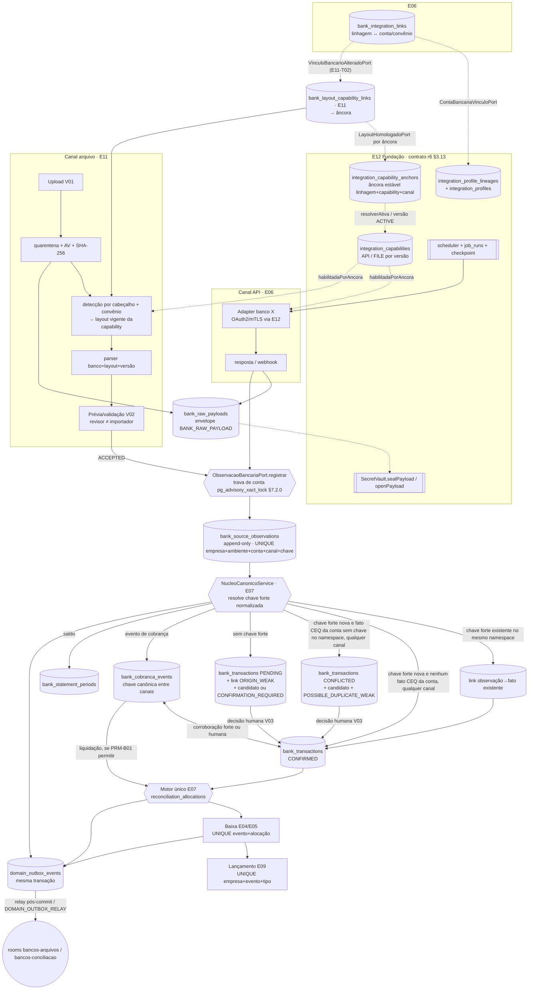

# E11-T00 — Gate CROSS bancário: APIs, arquivos e razão (inventário, ADR-ERP-026, ownership, idempotência, failback) — Plano Tático

> Papel autor: `planner` (modelo solicitado `claude-opus-5.5`; efetivo não atestável — AD-20). Documento **somente documental**: zero código, zero migration, zero gateway/parser, zero edição em `docs/execucao/`.
> Workers futuros (E06-T01..T05, E07-T01..T04, E11-T01..T11) seguem este plano literalmente. Caso não coberto, contradição com fonte superior ou teste que falha após 1 correção → **PARAR e reportar**. Worker não decide regra, não cria perfil canônico, não altera `MENUS_CANONICOS`, não preenche célula pendente do inventário.

**Goal:** Fechar o gate CROSS E11-T00 (Linear ALP-160): inventário E04–E09/E11 por banco × conta × convênio × serviço; decisão de ativação por capability; diagrama único API→observação e arquivo→observação ligados à **mesma** transação canônica; matriz de ownership de tabelas/eventos com owner do outbox de domínio; DDL conceitual sem tabela paralela de conta/título/ledger/conciliação, com todas as FKs declaradas; contrato de idempotência/dedupe; XB-01..XB-16 e Exemplos A–D do doc 12 mapeados a testes futuros; plano de failback; ADR-ERP-026. Nada é implementado nesta onda.

**Architecture:** monólito modular NestJS 11 (Constituição: sem microserviços, sem CQRS/Event Sourcing). Um único **núcleo canônico bancário** recebe observações de qualquer canal (adapters API E06 e parsers de arquivo E11) por uma única porta (`ObservacaoBancariaPort.registrar`), resolve identidade forte **normalizada** e materializa no máximo **uma** `bank_transactions` / `bank_cobranca_events` por fato econômico. O motor único de conciliação E07 aloca fatos confirmados a parcelas E04/E05; E09 lança uma vez por evento econômico. Perfis, capabilities, credenciais, certificados, endpoints, jobs e cofre pertencem ao E12; a interface E12↔E11/E06 é a do **plano E12-T00 r6 §3.13 (contrato canônico)**, adotada aqui literalmente. Toda ingestão bancária e toda decisão sobre fatos, eventos e alocações de uma conta serializa pela **trava de conta** (`pg_advisory_xact_lock`, §7.2.0), adquirida antes de qualquer busca. Persistência PostgreSQL 18 + Drizzle; eventos financeiros saem por **outbox transacional** (`common/outbox`, owner E11-T01) e são retransmitidos pós-commit ao `EventEmitter`/WebSocket (Princípio VI).

**Tech Stack (fixa, sem troca):** Node 22, NestJS 11, TypeScript 5 strict, Next.js 16 App Router/BFF, React 19, PostgreSQL 18, Drizzle + drizzle-kit, Zod 4, WebSocket nativo, `@nestjs/event-emitter` (já em `app.module.ts` L4/L42), JWT + RBAC (11 perfis, AD-04), Jest/Supertest, Playwright, DS v3 Direção A (AD-10). Bibliotecas de parsing OFX/CSV são escolhidas, pinadas e aprovadas no Portão 1 de E11-T05; este plano não adiciona dependência.

**Base pinada:** `origin/develop` @ `db9d8ac1760a01c262c57a9f824d2c8fcf18291b` (merge-base do branch). Última migration `0043_onda14_ocorrencias_preco` (journal idx 43, verificado); próximo índice livre `0044`, disputado com E12-T01 — a numeração real é recalculada pelo Planner de cada onda; o worker não renumera.

**Worktree / branch:** `F:/Projetos/AlphaCarnes/.worktrees/e11-t00` · `feature/erp-e11-t00-cross-bancario` (local, não publicado; 8 commits acima de `db9d8ac`, lidos por `git log --format='%h %s' db9d8ac..HEAD` em 2026-10-12 nesta sessão: `c9bed46` plano r1, `8f7153c` veredito r1, `171f563` plano r2, `a2e2ff9` veredito r2, `9349220` plano r3, `b46d36d` veredito r3, `3002e44` plano r4, `224231f` veredito r4; `git status --short` vazio antes desta revisão; a revisão r5 deste arquivo fica não commitada até a Task 3). Fontes da expansão lidas do checkout coordenador `F:/Projetos/AlphaCarnes` (branch `feature/erp-fiscal-financeiro-contabil-especificacoes-2026`, HEAD `302cdb5a270d73591e3c087a16fef7190101b4f7`, PR #157 não mergeado). Contrato E12 lido de `F:/Projetos/AlphaCarnes/.worktrees/e12-t00/docs/superpowers/plans/2026-10-12-e12-t00-cross-adr-fundacao-integracoes.md` **r6** (arquivo inteiro sha256 `88FF270EE3152E9320E49B787AE394B6EA83158B712DB84BC57252306B946914`, 1654 linhas, lido **não commitado** no worktree e12-t00 sobre `97691d5` — a r5 está commitada em `103b326` e o veredito r5 em `97691d5`; bloco §3.13 — da linha `### 3.13 ` até a linha anterior a `## 4. `, unido por LF, UTF-8 — sha256 `2BBBB82F7378E6764CA6E7E51F6C2689225E8F524ACA11D82E6426F5A4DEFBF8`, `$s=497`, `$e=710`, comando na Task 1 Passo 5). A §3.13 r6 traz as alterações de contrato C6-1..C6-12 marcadas "alteração de contrato r6: E11 deve adotar" (âncora estável `integration_capability_anchors`, regra inversa do vínculo bancário `VinculoBancarioAlteradoPort`, `bank_accounts.provider_kind`, `layoutVigente`/`datasetAposentado` por âncora, `suspenderPorAncora`/`suspenderPorLinhagem`, regra inversa de layout estendida a `HML_TESTED`, rotação de chave de cofre e §3.13.9), adotadas literalmente aqui (§4.1, §5.1, §5.2, §5.2.1, §5.3, §6.4, §7.3, §16).

**Linear:** ALP-160 (E11-T00). Cross: ALP-133..141 (E06/E07), ALP-142..154 (E08/E09), ALP-161..171 (E11-T01..T11). Gate irmão: ALP-173 (E12-T00).

---

## Histórico de revisões

| Revisão | Data | Plano (sha256) | Motivo |
|---|---|---|---|
| r1 | 2026-10-12 | `ab26672291b9c13a…` (commit `c9bed46`) | versão inicial; Portão 1 = `ajustar` (veredito 2026-10-12T07:46:32Z, 13 achados; commit `8f7153c`) |
| r2 | 2026-10-12 | `61b4f46a552a711d…` (commit `171f563`) | resolve os 13 achados e adota literalmente o contrato E12-T00 r3 §3.13; Portão 1 = `ajustar` (veredito 2026-10-12T08:55:30Z, 9 achados; commit `a2e2ff9`) |
| r3 | 2026-10-12 | `a9569115fe053d2c…` (commit `9349220`) | resolve os 9 achados da r2 sem alterar o contrato canônico E12-T00 §3.13 (ligações, envelope, operações, portas e rooms idênticos); Portão 1 = `ajustar` (veredito 2026-10-12T09:27:55Z, 9 achados; commit `b46d36d`) |
| r4 | 2026-10-12 | `3446291a57c98370…` (commit `3002e44`, mensagem real "docs(e11-t00): revisao v4 do plano apos Portao 1 r3 (adota contrato E12 r5)") | resolve os 9 achados da r3 e adota literalmente a única alteração de contrato do E12-T00 r5 §3.13.3 (regra de convênio da ligação de layout); D-E12 passa a ancorar no conteúdo de §3.13 (hash do bloco), não no número da revisão do E12; Portão 1 = `ajustar` (veredito 2026-10-12T10:06:12Z, 7 achados; commit `224231f`) |
| r5 | 2026-10-12 | (calculado pelo Monitor) | resolve os 7 achados da r4 (1 bloqueante: trava de conta antes de toda busca em toda ingestão e decisão) e adota literalmente as alterações de contrato C6-1..C6-12 do E12-T00 r6 §3.13 (âncora estável de capability, regra inversa do vínculo bancário, conta presa a provedor `BANK`, §3.13.9); D-E12 ancorado no bloco §3.13 r6 `2BBBB82F…` |

**Achados do Portão 1 sobre a r1 → correção na r2:**

| Achado r1 | Correção | Seção corrigida |
|---|---|---|
| 1. §5.1/§6.4/§8/§12.1 (A-01/A-03) contradizem o E12 | removidos `integration_profiles.bank_account_id/bank_agreement_id` e `integration_capabilities.bank_file_layout_id`; `bank_integration_links` (E06) listada com a DDL do contrato; `bank_layout_capability_links` (E11-T02) com DDL literal; regra FILE via `LayoutHomologadoPort`; §12.1 substituída pelas respostas do E12 r3; D-E12 atualizado | §4.1; §5.1; §5.2 (ligação de layout); §6.4; §8; §12; §12.1 |
| 2. `bank_raw_payloads` sem `vault_key_id`/`cipher_alg`/AAD; A-04 ausente | colunas de envelope do contrato §3.13.4 transcritas literalmente; `SecretVault.sealPayload/openPayload`; AAD e EncryptionContext do contrato; grants de workload | §5.2 `bank_raw_payloads`; §7.3; §12.1 A-04 |
| 3. FKs ausentes | todas as FKs declaradas: `company_id` → `companies` em toda tabela; conta/convênio por FK composta; capability por `(id, company_id, environment, channel)`; `conflict_id`; payload; lote; observação; FKs que dependem de tabela criada depois entram por expand na task nomeada (bloco "FKs adiadas") | §5.2; §5.2.1 |
| 4. `uq_bank_tx_strong` com `transaction_type`+`strong_key_kind` impede XB-01 | chave forte canônica normalizada: colunas `bank_tx_id` e `end_to_end_id` (valores normalizados), sem `transaction_type`; FITID atestado pelo manifesto é mapeado para `BANK_TX_ID`; `strong_key_kind` com CHECK e coerência NONE↔NULL | §5.2 observações/transações; §7.2 |
| 5. UNIQUE de `bank_cobranca_events` diverge API × CNAB (XB-02) | chave canônica entre canais sem `occurrence_code`/`sequence_ref` (ficam na observação); `nosso_numero_canonical`; dois índices por classe de semântica + `distinct_seq`; no máximo uma observação STRONG_KEY por canal e evento | §5.2 cobrança; §7.1 L4; §7.2.1 |
| 6. UNIQUE de observação sem `environment`/`bank_account_id` | `UNIQUE (company_id, environment, bank_account_id, source_channel, source_event_key)` | §5.2; §7.1 L2 |
| 7. `installment_id` polimórfico | `payable_installment_id` + `receivable_installment_id` com FK composta e CHECK de exclusividade coerente com `title_kind` | §5.2 alocações; §5.3 |
| 8. PK sem `DEFAULT uuidv7()` | todas as PKs `uuid DEFAULT uuidv7()` (`docs/data/convencoes-schema.md` L12); E12 r3 não mantém exceção: segredos e payload também têm DEFAULT, com o id obtido por `SELECT uuidv7()` antes da cifragem por causa da AAD (§5.2 nota) | §5.2; §2 C14 |
| 9. `bank_file_layouts` sem convênio | layout com escopo `PROVIDER` ou `AGREEMENT` (`company_id`/`bank_agreement_id` + FK), `occurrence_map` e normalização por escopo; ligação à capability pelo `bank_layout_capability_links.bank_agreement_id` do contrato | §5.2 layouts |
| 10. XB-01 na E11-T01 afirma baixa/lançamento; XB-03 ambíguo | XB-01a (E11-T01: fato/observações/links) + XB-01b (E11-T10: alocação/baixa/lançamento); XB-03a (PRM-B01 = `true`) e XB-03b (PRM-B01 = `false`) em E07-T03 | §11; §16 |
| 11. Exemplos A–D do doc 12 §8 não mapeados 1:1 | linhas EX-A1/A2, EX-B1/B2, EX-C, EX-D1/D2 com task, arquivo e asserção | §11.1 |
| 12. `num_nonnulls(subject_*)>=1`; `UNIQUE(id, company_id)` do E06 | CHECK em `reconciliation_conflicts`; restrições exigidas de E01/E04/E05/E06/E09 listadas | §5.2; §5.3 |
| 13. Task 2 com saída incompleta; Task 3 duplicaria commit | Task 2 com a saída real completa (56 linhas) colada; Task 3 reconhece `c9bed46`/`8f7153c` e só commita a revisão r2 | §15 |

Ajuste adicional, não apontado: Task 6 passa de `rebase` para `merge origin/develop` (mesma decisão do E12 r3, sem reescrever o commit de veredito `8f7153c`); permissão `BANCOS_PAYLOAD_BRUTO_LER` acrescentada porque o contrato §3.13.4 exige permissão E11 para `openPayload` com acesso USER; `bank_file_layouts.service` passa a usar os 5 literais FILE de capability (A-02) e S5 DDA por arquivo fica condicionado a emenda do CHECK do E12 (§6.2, §12.1).

**Achados do Portão 1 sobre a r2 → correção na r3:**

| Achado r2 | Correção | Seção corrigida |
|---|---|---|
| 1. BLOQUEANTE — `bank_tx_id` mistura namespaces; chave forte inédita vira `CONFIRMED` sem checar fato de outro canal (XB-01 pode gerar 2 fatos `CONFIRMED`) | `bank_tx_id` passa a valer só dentro de um **namespace de identidade** (`strong_key_namespace` / `bank_tx_id_namespace`); namespace compartilhado entre canais exige **atestação de equivalência entre canais** (P-19, `strong_key_equivalence_ref` no manifesto e no registro do contrato API E06); sem ela o namespace é local ao canal. Chave forte inédita com fato de outro canal na mesma conta, sem chave no mesmo namespace e com atributos fracos coincidentes ⇒ fato `CONFLICTED` + candidato + conflito `POSSIBLE_DUPLICATE_WEAK`, nunca `CONFIRMED`. Teste E11-T01 nomeado "FITID atestado ≠ id API ⇒ nenhum segundo CONFIRMED alocável" | §3.3; §3.4; §5.2 (layouts, observações, transações); §7.1 L3; §7.2 itens 1, 2 e 4; §11 XB-01a; §11.1 EX-A2; §13 P-19; §14; §16 E11-T01/E11-T02 |
| 2. BLOQUEANTE — CHECK de `link_basis` impede ligar a observação de origem de `PENDING`; `PENDING` sem candidato não tem caminho para `CONFIRMED`; sem garantia PROD para `PENDING` | `link_basis` ganha `ORIGIN_WEAK` (origem sem chave forte, `decided_by`/`conflict_id` nulos por CHECK); todo fato nasce com `origin_observation_id NOT NULL` e FK com `environment='PROD'` (garantia estrutural também para `PENDING`/`CONFLICTED`); `PENDING` sem candidato abre `CONFIRMATION_REQUIRED` na mesma transação, com caminho explícito `RESOLVED_DISTINCT → CONFIRMED` / `RESOLVED_SAME → SUPERSEDED`; testes de rejeição nomeados | §5.2 (transações, conflitos, links); §5.2.1; §7.2 item 6; §16 E11-T01/E07-T04 |
| 3. BLOQUEANTE — XB-03 só testava crédito sem chave; regra anti-duplicidade só cobria cobrança já alocada | regra simétrica R-CORR (§7.2.2): liquidação e crédito correlacionados por atributos fracos abrem `CORROBORATION_PENDING` com os dois sujeitos; enquanto um lado tiver alocação `ACTIVE` e a corroboração estiver aberta, o outro não aloca automaticamente, verificado sob lock dos dois lados; testes XB-03a..XB-03f com crédito `CONFIRMED` por `bank_tx_id` nas duas ordens de chegada e PRM-B01 `true`/`false`, mais o caso sem chave e o concorrente | §5.2 alocações; §7.1 L5; §7.2.2; §10 PRM-B01; §11 XB-03a..f; §16 E07-T03 |
| 4. MENOR — `wallet` sem origem para API/webhook; igualdade de `occurrence_date` fixa semântica de P-20 | `wallet` derivada do convênio por FK composta `(bank_agreement_id, bank_account_id, company_id, wallet)` → `bank_agreements(id, bank_account_id, company_id, carteira)` (equivalente a CHECK de derivação; nenhum canal informa carteira); `occurrence_date` = data canônica escolhida pelo `canonical_date_field` do mapa de ocorrências P-20 por semântica; entrada sem esse campo ⇒ `UNMAPPED` | §5.2 cobrança; §5.3 E06-T01; §7.2.1 itens 2 e 5; §13 P-20 |
| 5. MENOR — `updated_at`/`deleted_at` incoerentes com C14; PK composta em `domain_inbox_receipts` | classificação tabela a tabela em §5.0 (configuração / mutável restrita / append-only / append-only com vigência) com `updated_at`/`deleted_at` alinhados no DDL; `domain_inbox_receipts` passa a `id uuid DEFAULT uuidv7()` + `UNIQUE (consumer, event_id)` (semântica de dedupe inalterada) | §2 C14; §5.0; §5.2; §5.4; §7.1 L8 |
| 6. MENOR — retirada de `transactionType` da chave diverge de doc 11 §2.1 e doc 12 §3 sem conflito registrado | conflito C15 registrado e resolvido por coerência com o critério de aceite XB-01/Exemplo A das mesmas fontes: "tipo" da chave = tipo do **identificador** (`strong_key_kind` + namespace), não `transaction_type` | §2 C15; §7.2 item 1 |
| 7. MENOR — cabeçalho/Task 3/§18 diziam 2 commits | estado real `c9bed46`, `8f7153c`, `171f563`, `a2e2ff9` (saída de `git log db9d8ac..HEAD`) no cabeçalho, Tasks 3/4/6, §17 e rollback; mensagem do commit r3 fixada | cabeçalho; §15 Tasks 3, 4, 6; §17; §18 |
| 8. MENOR — sem garantia PROD em períodos/candidatos/conflitos; lote `ACCEPTED`/`INGESTED` sem CHECK de `reviewed_by`; candidatos sem FK de conta; provedor do layout sem `kind='BANK'` | `environment` constante `PROD` + FKs com ambiente em `bank_statement_periods`, `bank_match_candidates`, `reconciliation_conflicts`; CHECK `reviewed_by` em lote; `bank_match_candidates.bank_account_id` com FKs compostas por conta; `bank_file_layouts.provider_kind` + FK `(provider_id, provider_kind)` → `integration_providers(id, kind)`; testes nomeados em §5.2.1 | §5.2; §5.2.1 |
| 9. MENOR — FK `subject_import_batch_id` como referência adiante; matriz de custo só como P-18; P-17 ausente | FK inline (a tabela de lotes vem antes no DDL); §14.1 matriz de custo sem dupla precificação com uma linha por entregável e valor = P-18 explícita; P-17 registrado como número não atribuído | §5.2 conflitos; §5.2.1; §13; §14.1 |

**Achados do Portão 1 sobre a r3 → correção na r4:**

| Achado r3 | Correção | Seção corrigida |
|---|---|---|
| 1. BLOQUEANTE — detecção de chave inédita (4(d)) só olhava fato de **outro** `source_channel`: troca de namespace no mesmo canal e conta (manifesto OFX/CSV v1 `LOCAL` → v2 `SHARED` após P-19; registro API `LOCAL` → `SHARED` + `BANK_FAILBACK_REPLAY` ou reprocesso E06-T05) criava segundo `CONFIRMED` alocável | 4(d) passa a considerar **qualquer** fato não `SUPERSEDED`/`REVERSED` da conta sem chave no namespace da observação, **independente do canal** (critério de candidato de equivalência não provada CEQ, §7.2 item 4(d)); 4(a) referencia o CEQ; L3 e os dois diagramas reescritos; teste E11-T01 XB-01d "mesmo canal, namespace alterado ⇒ CONFLICTED, count(CONFIRMED)=1" (variantes manifesto OFX `LOCAL`→`SHARED` e registro API `LOCAL`→`SHARED` com replay) | §3.3; §3.4; §5.2 (comentário de `bank_transactions`); §7.1 L3; §7.2 item 4; §11 XB-01d; §14; §16 E11-T01 |
| 2. MENOR — 4(d) exigia `effective_date` estritamente igual: fail-open para datas API × arquivo divergentes | CEQ usa o critério fraco de candidatos: `direction` e `amount` iguais e `|Δ effective_date|` ≤ PRM-B07 dias (`null` = sem limite, fail-closed); o mesmo critério vale para candidatos de observação sem chave (item 6); testes de datas divergentes dentro/fora da janela e com `null` | §7.2 itens 4(d) e 6; §10 PRM-B07; §16 E11-T01 |
| 3. MENOR — CHECK permitia `CONFIRMED` com chave sem `confirmed_by` (transição `CONFLICTED → CONFIRMED` sem decisão); faltavam testes de transição | coluna imutável `created_status` em `bank_transactions` + CHECKs: fato nascido `CONFIRMED` tem chave e não tem `confirmed_by`; fato nascido `PENDING`/`CONFLICTED` só fica `CONFIRMED` com `confirmed_by`/`confirmed_at`; serviço exige conflito `RESOLVED_DISTINCT`; testes "CONFLICTED→CONFIRMED sem RESOLVED_DISTINCT → 422", "UPDATE CONFLICTED→CONFIRMED sem confirmed_by → violação de CHECK", "RESOLVED_DISTINCT de POSSIBLE_DUPLICATE_WEAK ⇒ CONFIRMED com confirmed_by/confirmed_at" | §5.0; §5.2 `bank_transactions`; §7.2 item 4(d); §16 E11-T01 |
| 4. MENOR — XB-04 "1 fato/1 transação forte" incoerente com §7.2 sem namespace `SHARED` comum a CNAB/OFX/CSV | XB-04 dividido: XB-04a com pré-condição fixada do manifesto sintético (OFX e CSV no mesmo `SHARED:` fixture com equivalência; CNAB sem chave) e XB-04b sem `SHARED` (namespaces `LOCAL`); asserções de 1 `CONFIRMED`, demais `CONFLICTED`/`PENDING` com candidato e zero alocação, e 1 fato ativo com 3 observações só após decisão `RESOLVED_SAME` | §11 XB-04a/XB-04b; §16 E11-T05 |
| 5. MENOR — §9 item 4/XB-12 "chave forte → link ao fato existente" só vale com `SHARED` | §9 item 4 reescrito pelos ramos 4(b)/4(c)/4(d)/6 de §7.2; XB-12 dividido em XB-12a (namespaces `LOCAL`: conflitos `POSSIBLE_DUPLICATE_WEAK` esperados, zero alocação nova) e XB-12b (`SHARED` atestado: links `STRONG_KEY`, zero fato novo) | §9; §11 XB-12a/XB-12b; §16 E11-T08 |
| 6. MENOR — XB-03e parava no `PENDING` | XB-03e asserta `CORROBORATION_PENDING` aberto e `CONFIRMATION_REQUIRED` e continua até a confirmação humana do crédito (`RESOLVED_DISTINCT`): PRM-B01=`true` → baixas=1 (liquidação), crédito confirmado sem alocação automática; PRM-B01=`false` → crédito confirmado aloca, baixas=1 | §11 XB-03e |
| 7. MENOR — correlação forte por `end_to_end_id` sem fonte no evento de cobrança | E2E da liquidação = `end_to_end_id` das observações ligadas ao evento por `bank_cobranca_event_observations` (leitura declarada, sem coluna nova); E2E divergentes entre observações ligadas → nenhuma correlação forte + `SOURCE_DISAGREEMENT`; três testes E07-T03 | §7.2.2 item 1; §16 E07-T03 |
| 8. MENOR — namespace do fato sem CHECK de formato; sem validação chave do fato = chave da origem; observação API/WEBHOOK podia ter `strong_key_source='MANIFEST_ATTESTED'` | CHECK de formato de `bank_transactions.bank_tx_id_namespace` (`LOCAL:<canal>` dos 6 canais ou `SHARED:_%`); CHECK único `strong_key_source` × canal na observação (API/WEBHOOK ⇒ `API_CONTRACT`, arquivo ⇒ `MANIFEST_ATTESTED`); regra de serviço "chave do fato na criação = chave da observação de origem" + testes | §5.2 observações/transações; §5.2.1; §16 E11-T01 |
| 9. MENOR — pino D-E12 exigia "E12 r3 `9A6F65C6` aprovado", mas a r3 recebeu `ajustar` | D-E12 ancorado em "versão aprovada do E12-T00 cujo §3.13 seja idêntico ao desta revisão" (r5: arquivo `B0A214A9…`, bloco §3.13 `8186A1EA…`); Task 1 Passo 5, Task 6, §17 e §19 conferem o hash do bloco, não o número da revisão | cabeçalho; §12 D-E12; §15 Tasks 1 e 6; §17; §19 |

Alteração de contrato adotada (E12-T00 r5, §3.13.3, aditiva): bullet "Regra de convênio da ligação de layout" transcrito literalmente em §5.2 (comentário de `bank_layout_capability_links`), §5.2.1, §6.4 item 3 e §16 E11-T02 (teste "convênio da ligação de layout diferente do convênio do vínculo ativo da linhagem → 422"). Referências "E12 r3" fora do histórico passam a "E12 r5": as partes de §3.13 citadas são idênticas nas duas revisões, salvo o bullet acrescentado.

**Achados do Portão 1 sobre a r4 → correção na r5:**

| Achado r4 | Correção | Seção corrigida |
|---|---|---|
| 1. BLOQUEANTE — trava por conta só cobria `STATEMENT_ENTRY` com chave; ingestão sem chave e `COLLECTION_EVENT`/R-CORR fora (liquidação + crédito concorrentes sem `CORROBORATION_PENDING`; obs com chave + sem chave concorrentes com `CONFIRMATION_REQUIRED` sem candidato) | nova §7.2.0 "Trava de conta (TC)": `pg_advisory_xact_lock(hashtextextended('bancos:conta:' \|\| bank_account_id, 0))` como **primeira instrução** de toda ingestão (antes do INSERT da observação e de toda busca de chave, CEQ, candidato, chave canônica de cobrança e correlação R-CORR; `STATEMENT_ENTRY` com e sem chave, `COLLECTION_EVENT`, `BALANCE`, `PAYMENT_EVENT`, `REMITTANCE_ACK`, retificação; todos os canais, lote, replay, reprocesso e handler de run) e também do motor E07, das decisões V03/V04, do fechamento e da remessa; várias contas → ordem crescente da chave de trava, todas antes da primeira leitura; ordem global trava de linhagem → TC → `FOR UPDATE` de fatos/eventos → parcelas; `READ COMMITTED`; autoauditoria K1–K16 (§7.2.3); testes E11-T01 "obs com chave + obs sem chave concorrentes ⇒ candidato presente" e E07-T03/E11-T04 XB-03g "liquidação e crédito concorrentes ⇒ CORROBORATION_PENDING aberto, baixas ≤ 1" | §3.3; §3.4; §5.2 (alocação, remessa); §5.2.1; §7.1 L5; §7.2.0 (nova); §7.2 itens 4 e 6; §7.2.1 item 5; §7.2.2 itens 1, 3 e 5; §7.2.3 (nova); §7.3; §9; §11 XB-03g; §14; §16; §19 |
| 2. MENOR — `occurrence_date NOT NULL` sem fonte para `UNMAPPED`, mas CHECK e `uq_cob_event_repetivel` incluíam `UNMAPPED` | escolhido **só conflito na observação**: `occurrence_semantic` sem `UNMAPPED`, CHECK `UNMAPPED → CONFLICTED` removido, índice repetível comentado sem `UNMAPPED`, CHECK novo em `reconciliation_conflicts` (`UNMAPPED_OCCURRENCE` ⇒ só `subject_observation_id`); fechamento só por `RESOLVED_REJECTED` justificado; testes E11-T04 | §5.2 `bank_cobranca_events`, `reconciliation_conflicts`; §5.2.1; §7.2.1 itens 2 e 4; §13 P-20; §16 E11-T04 |
| 3. MENOR — EX-A1 e XB-01b sem pré-condição `SHARED` atestado; variante API de XB-01d sem pré-condição sem `end_to_end_id` | pré-condições fixadas: EX-A1 e XB-01b com o mesmo `SHARED:` fixture e `strong_key_equivalence_ref` fixture no registro API e no manifesto OFX; XB-01d (variantes manifesto e API/failback) com lançamento sintético sem `end_to_end_id` (`strong_key_kind='BANK_TX_ID'`) | §11 XB-01b, XB-01d; §11.1 EX-A1 |
| 4. MENOR — `ack_observation_id` com FK só `(id, company_id)` | `bank_remittance_batches.bank_account_id NOT NULL` + FK `(bank_agreement_id, bank_account_id, company_id)`; FK `(ack_observation_id, company_id, environment, bank_account_id, bank_agreement_id)` → `bank_source_observations` (novo UNIQUE-alvo); `observation_kind='REMITTANCE_ACK'` por serviço; testes E11-T06 | §5.2 observações e remessa; §5.2.1; §16 E11-T06 |
| 5. MENOR — retificação/estorno sem criação do fato compensatório frente a `origin_observation_id NOT NULL UNIQUE` e CHECKs de `created_status`, nem dono de `REVERSED` | §7.2 item 8 reescrito: estorno = fato originado pela própria observação de estorno (UNIQUE e CHECKs sem exceção) + conflito novo `REVERSAL_PENDING`; `REVERSED` só por `NucleoCanonicoService.registrarEstorno` (E07-T03) na decisão, com `reverses_transaction_id` preenchido uma vez (`uq_bank_tx_reverses`, CHECK de auto-referência); retificação = conflito `RECTIFICATION` → `RESOLVED_DISTINCT` cria fato `created_status='RECTIFICATION'` (novo literal, CHECK com decisor) e marca o original `SUPERSEDED`; cobrança análoga com evento `REVERSED` | §4.2; §5.0; §5.2 `bank_transactions`, `reconciliation_conflicts`, links, alocações; §5.2.1; §7.2 itens 4 e 8; §11 XB-11; §16 E11-T01/E07-T03/E11-T04 |
| 6. MENOR — §17 citava doc 12 §8 L54–60 | corrigido para L55–61 (verificado com `Get-Content` nesta sessão: L55 título §8, L56–61 critérios) | §17 |
| 7. MENOR — mensagem fixada da Task 3 ≠ commit real `3002e44`; cabeçalho/§17 desatualizados (6 commits, r4 não commitada, E12 sobre `7e7ffd3`) | estado real por `git log --format='%h %s' db9d8ac..HEAD` (8 commits, inclusive `3002e44` e `224231f`) no cabeçalho, histórico, Tasks 1/3/4/6, §17 e §18; mensagem real do r4 registrada; E12 r5 em `103b326`, r6 lida não commitada sobre `97691d5` | cabeçalho; histórico; §15 Tasks 1, 3, 4, 6; §17; §18 |

Alterações de contrato adotadas (E12-T00 r6, §3.13, C6-1..C6-12, marcadas "E11 deve adotar"): DDL de `bank_layout_capability_links` com `capability_anchor_id` e FK para `integration_capability_anchors(id, company_id, environment, channel)`; `bank_import_batches.file_capability_anchor_id`, `bank_remittance_batches.file_capability_anchor_id`, `bank_channel_routing_policies.file_capability_anchor_id`/`api_capability_anchor_id` com FK para a âncora (nenhuma FK do E11 para `integration_capabilities`); `habilitadaPorAncora`/`resolverAtiva` no uso; `LayoutHomologadoPort.layoutVigente(âncora)` com `datasetVigente` e `datasetAposentado`; regra inversa de layout estendida a `HML_TESTED` e regra de troca de layout; `VinculoBancarioAlteradoPort.aoAlterarVinculo` implementado no E11-T02 (com trava de linhagem interna); regras E06 do vínculo e de conta/convênio inativados; `bank_accounts.provider_kind` + FK; `openPayload` com chave `RETIRED`; testes literais do §3.13.8 em §16 (E06-T01, E11-T02). Bloco §3.13 r6 sha256 `2BBBB82F…` (D-E12).

---

## 0. Inventário do `develop` (db9d8ac) relevante ao gate

Verificado nesta sessão (busca sobre `app/backend/src`, 65 `pgTable` em 33 arquivos de schema):

| Objeto existente | Situação | Efeito no ERP bancário |
|---|---|---|
| Tabelas `bank_*`, `contas_bancarias`, `titulos*`, `lancamentos_contabeis`, `conciliac*`, `outbox*` | **inexistentes** (zero ocorrência; Task 2) | todas as tabelas da §5 são novas; nenhuma adaptação de legado |
| Módulos `app/backend/src/modules/*` | auditoria, auth, cadastros, comercial, frota, gestao, modelos-etiqueta, operacao, operacoes, parametros, perfis, usuarios | nenhum módulo financeiro/bancário |
| `app/backend/src/integracoes/nfse/*` (EISS, AD-02) | gateway isolado + fake | **não alterar**; padrão porta/adapter/fake é o modelo (Princípio V) |
| Eventos de domínio | `this.eventEmitter.emit(...)` pós-commit em ~29 services (ex.: `faturamento.service.ts` L178/L201/L384); **sem outbox persistido** | eventos financeiros exigem outbox transacional (RNF-B02, E11-T01) → §5.4 |
| `realtime/realtime.gateway.ts` L141/L152–153 | `podeAssinar(ws)` libera **qualquer** room a quem tem `DISPONIBILIDADE_LER` | rooms bancárias entram no mapa compartilhado `room-permissoes.ts` do contrato E12 r6 §3.13.6 → §7.3 |
| `database/schema/parametros.schema.ts` | chave-valor JSONB | parâmetros provisórios da §10 (não segredos) usam este mecanismo, padrão AD-09 `{ valor: null, provisorio: true }` |
| `database/schema/auditoria.schema.ts` | trilha antes/depois | toda decisão bancária audita DTO redigido (conta mascarada, sem payload bruto) |
| `fornecedores`, `clientes`, `notas_fiscais_fornecedor`, `faturamentos`, `notas_fiscais` | existentes | origens de títulos E04/E05 (fora do escopo deste gate; referência por FK nos planos E04/E05) |

## 1. Decisões fixadas (não reabrir; origem entre parênteses)

1. **API é canal primário; arquivo é fallback operacional** por conta+convênio+serviço+versão de layout, construído junto, não fase 2 (Caderno B §0.2; doc 11 §1; doc 12 §2 alternativa B).
2. **Um único** núcleo canônico, motor de conciliação (E07) e razão (E09). Proibidos segundo motor, segundo ledger, tabela paralela de conta, título ou baixa (doc 11 requisito inverso; doc 12 §4; RI-B18).
3. **Importação ≠ pagamento; remessa ≠ registro; retorno de registro ≠ liquidação; extrato ≠ retorno de cobrança** (doc 11 §1; doc 10 regras negativas). Nenhuma baixa por upload; nenhuma baixa por valor/data.
4. **Nenhum layout escolhido pela extensão**: detecção por cabeçalho + configuração do convênio + manifesto aprovado em `bank_file_layouts` ligado à capability por `bank_layout_capability_links` (E11-T02; doc 21 §5).
5. Chave fraca (`valor+direção+data+texto+conta+contraparte`) **só gera candidato** (`bank_match_candidates`); nunca dedupe destrutivo, nunca confirmação automática (doc 12 §3; doc 11 §2.1.3).
6. Observações e decisões são **append-only**; retificação = nova observação + decisão explícita; estorno = movimento compensatório (doc 11 §2.1.4; Princípio IV).
7. Ação externa (remessa, pagamento, registro de boleto) nunca é reenviada às cegas; timeout exige consulta do estado externo antes de nova instrução (doc 11 §1; JB-07; E11-V05 regra).
8. Fallback **não é automático** por retry/timeout; troca de modo exige operador autorizado, motivo, vigência e auditoria (doc 11 §2.4; E11-T08).
9. E12 é dono de provedores, perfis (linhagens e versões), endpoints, capabilities, evidências de habilitação, credenciais, certificados, cofre, jobs, checkpoints e alertas de integração (AD-18; doc 22 §1; E12 r6 §3.4/§3.13). E06 é dono de contas, convênios, carteiras e de `bank_integration_links`. E11 é dono de layouts, `bank_layout_capability_links`, lotes, payload bruto, observações/proveniência, remessas, política de roteamento e outbox de domínio. E07 é dono dos fatos canônicos, conflitos e alocações. E04/E05 donos de títulos/parcelas/baixas. E09 dono do razão.
10. Dinheiro `NUMERIC(15,2)` trafegando como string (Princípio X prevalece sobre o "DECIMAL(18,2)" de RNF-B01 — §2 C7); datas `date`/`timestamptz`; status `TEXT + CHECK`; PK `uuid DEFAULT uuidv7()`.
11. Dados de banco/titular **não são inventados**: célula sem evidência = `Pendente P-xx (dono)` (Princípio VII/VIII; doc 21 §7: "falta de produto significa `not_supported`, não simular").
12. Observação de ambiente **HML** nunca vira fato financeiro: lote/observação HML para em `VALIDATED` e serve só para homologar layout/adapter (garantido por CHECK e por FK com `environment='PROD'` nas tabelas de vínculo e na observação de origem de todo fato, evento, período, candidato e conflito, §5.2).
13. A UI não exibe UUID, PK, `company_id`, código E##/ALP, nome técnico de tabela nem número completo de conta (Caderno B "Requisito transversal de UX"; MATRIZ-UX requisito inverso; RNF-B11).
14. Nenhum efeito externo real, homologação ou produção é autorizado por este gate (AD-19 (3)).
15. Migrations futuras só via `drizzle-kit generate`, aditivas, reversíveis, expand → backfill → contract (Princípio X).

## 2. Conflitos de fonte resolvidos por precedência (nenhum é decisão de produto)

| # | Conflito | Fontes | Resolução |
|---|---|---|---|
| C1 | Dono de capabilities e credenciais bancárias | doc 11 §2 e doc 12 §4 (E06 dono de "banco/conta/convênio/capability e credenciais") × AD-18 + doc 22 §1 + doc 23 §3 (fundação E12) | **AD-18 (DECISOES, precedência 2) prevalece**: capabilities, credenciais, certificados, endpoints e jobs = E12; contas, convênios e carteiras = E06. E11/E06 só leem capability via `CapabilitiesService`. |
| C2 | E06-T01 "Contas, convênios e capacidades" × E12-T07 "convênios, contas, capabilities" | Caderno B §E06-T01 × doc 23 E12-T07 | E06-T01 cadastra conta/convênio/carteira, cria `bank_integration_links` e implementa `ContaBancariaVinculoPort`; **exibe** capabilities lidas do E12. E12-T07 cadastra linhagem/perfil/credencial/capability sem coluna de conta (E12 r6 §3.13.1 A-01). Nenhum dos dois cria a entidade do outro. |
| C3 | Dono da transação canônica | doc 11 §2 ("tabela/fato compartilhado"; E11-T01 cria a migration) × doc 12 §4 (E07 "serviço único") | **Owner de domínio = E07** (única escrita via `NucleoCanonicoService`); **migration criada em E11-T01**, que entrega o núcleo com fakes. E07-T01..T03 estendem (alocação, matching), sem segunda tabela. |
| C4 | Dono das observações | doc 11 §2.2 ("E06/E11 shared") × doc 12 §4 (E11 dono de BankSourceObservation; E06 "escrita no serviço canônico comum") | **Owner = E11** (proveniência de todas as fontes). Adapters E06 chamam `ObservacaoBancariaPort.registrar`; não escrevem na tabela. |
| C5 | Instrução de cobrança: E06 × E05/E06 | doc 11 §2 × doc 12 §2.2 | Instrução bancária (registrar/alterar/baixar boleto) = **E06** (`bank_collection_instructions`); estado da cobrança no recebível = **E05**; evento bancário de cobrança (`bank_cobranca_events`) = fato canônico **E07**. |
| C6 | Estados do lote | doc 12 §2.2 (`uploaded…accepted, rejected`) × E11-T07 (`quarantine → parsed → validated → reviewed → ingested/rejected`) | União ordenada: `UPLOADED, QUARANTINED, PARSED, VALIDATED, AWAITING_REVIEW, ACCEPTED, INGESTED, REJECTED`. `ACCEPTED` = revisão humana aprovada; `INGESTED` = observações gravadas (restart idempotente entre os dois). |
| C7 | Precisão monetária | RNF-B01 (DECIMAL(18,2)) × Constituição Princípio X (NUMERIC(15,2)) | Constituição prevalece: `NUMERIC(15,2)`. |
| C8 | Nome do registro de layouts | doc 11 E11-T02 (`bank_file_layout_registry`) × E12 r6 §3.13.2 (`bank_file_layouts`) | `bank_file_layouts` (aceito em A-06). |
| C9 | Layout oficial em E12 (`integration_reference_datasets` `BANK_CNAB_LAYOUT`/`BANK_OPENAPI`) × manifesto E11 | doc 22 §2 × doc 11 E11-T02 | Sem duplicação: E12 guarda o **documento oficial** versionado; E11 guarda o **manifesto executável** com FK composta `(reference_dataset_id, provider_id)` → `integration_reference_datasets(id, provider_id)` (A-08). |
| C10 | Outbox: "infra de outbox/inbox compartilhada" (doc 22 §2) × E12 r6 §3.13.5 | doc 22 × E12 r6 | `domain_outbox_events`/`domain_inbox_receipts` em `common/outbox`, criados por **E11-T01**; E12-T09 registra `DOMAIN_OUTBOX_RELAY` (um job por empresa, handler E11-T01). Eventos E12 não passam pelo outbox (E12 r6 §3.13.5). |
| C11 | Rotas do protótipo `/erp/bancos/e11-v0N` × proibição de código E## visível | catalogo.js L921/936/951/966/981 × Caderno B UX | Proposta de slugs semânticos na §8; decisão **somente do Quality Owner** (P-14). |
| C12 | Valores do protótipo E11-V05 (ex.: "Extrato Bradesco · Não homologada") | aplicacao.js L305–310 × doc 21 | São **fictícios**; não alimentam o inventário da §6. |
| C13 | CNAB 200/MT940 Bradesco | doc 12 §2.3/§6 × doc 21 §2.5 | Fora do pacote-base; só por aditivo após decisão P-05 do QO. |
| C14 | `convencoes-schema.md` (checklist: `updated_at` e `deleted_at` em toda tabela de negócio) × Constituição Princípio IV ("histórias append-only nunca são reescritas") | `docs/data/convencoes-schema.md` × constituição | PK `DEFAULT uuidv7()`, `created_at DEFAULT now()` e índice em toda FK valem para todas as tabelas (inclusive `domain_inbox_receipts`, sem PK composta). `updated_at` e `deleted_at` seguem a classe de cada tabela, fixada tabela a tabela em §5.0: **configuração** (`updated_at` + `deleted_at`); **mutável restrita** (só as colunas listadas mudam, por serviço auditado: `updated_at`, sem `deleted_at`); **append-only** (nenhum UPDATE/DELETE: sem `updated_at` e sem `deleted_at`); **append-only com vigência** (única mutação = preencher uma vez `valid_to`/`effective_to`, cujo valor registra o instante: sem `updated_at`, sem `deleted_at`). Nenhuma tabela financeira tem `deleted_at`: exclusão lógica reescreveria a história; inativação é por `status`/vigência, como nas ligações do E12 r6 §3.13.3 (que mantêm o `updated_at` literal do contrato). |
| C15 | `transactionType` na chave forte | doc 11 §2.1 item 1 (L29: `empresaId + bankAccountId + transactionType + bankTransactionId/EndToEndId/FITID validado`) e doc 12 §3 (L20: `empresa+conta+tipo+identificador único bancário/EndToEndId validado`) × critério de aceite das mesmas fontes: doc 11 XB-01 (API + OFX do mesmo crédito → um fato) e doc 12 §3 Exemplo A (2 observações, 1 transação) | Não é decisão de produto: as duas fontes têm o mesmo nível e o próprio critério de aceite delas é inatingível se a classificação descritiva compuser a chave (a API pode classificar `PIX` e o OFX `OUTRO` o mesmo lançamento). "Tipo" da chave é lido como **tipo do identificador** (`strong_key_kind` `BANK_TX_ID`/`END_TO_END_ID` + `strong_key_namespace`, §7.2), que separa identificadores de natureza diferente sem fundir nem duplicar o lançamento; `transaction_type` é atributo descritivo do fato e divergência dele entre observações ligadas só aparece na proveniência (V04). Se o Monitor ou o QO lerem "tipo" como `transaction_type` → PARAR (XB-01 e Exemplo A ficariam em contradição com a chave). |


## 3. ADR-ERP-026 — Arquitetura bancária canônica API + arquivo (conteúdo normativo deste gate)

**Estado:** proposto para Portão 1 do E11-T00. Complementa ADR-ERP-024 e ADR-ERP-025 (plano E12-T00 r5), sem substituí-los. **Localização:** esta seção (mesma decisão do plano E12-T00: não duplicar em `docs/expansao-erp-2026/` antes do #157).

### 3.1 Contexto
A AlphaCarnes opera Bradesco, Itaú e Santander (reunião Karina 25/09/2026: AP/AR, DDA, retornos/francesinha, conciliação manual em Excel). O QO decidiu APIs diretas desde a primeira entrega (10/10/2026) e arquivos como fallback construído junto (11/10/2026). O `develop` não tem nenhum objeto financeiro (§0). As fontes públicas (FEBRABAN 240 v10.9, Validador Bradesco, Itaú CNAB400, Santander H7815 v8.5) **não provam** habilitação de nenhum convênio da AlphaCarnes (doc 12 §1).

### 3.2 Decisão
Alternativa B do doc 12 §2: API e arquivo são **adaptadores de entrada** de uma única cadeia `Observação → Fato canônico → Alocação (E07) → Baixa (E04/E05) → Lançamento (E09)`. Rejeitadas: A (dois sistemas com baixas próprias) e C (só arquivos).

### 3.3 Diagrama único (API e arquivo convergem na mesma transação)

Invariante do diagrama: os ramos API e arquivo **só** se encontram em `ObservacaoBancariaPort`; nada abaixo dele sabe o canal, exceto como atributo de proveniência — inclusive a detecção de chave inédita: o critério CEQ (§7.2 item 4(d)) não filtra por canal, de modo que troca de namespace no mesmo canal (manifesto `LOCAL`→`SHARED`, registro API `LOCAL`→`SHARED` seguido de replay) também cai em `CONFLICTED`. A porta adquire a trava de conta (§7.2.0) antes da primeira leitura, para os dois canais e para todo `observation_kind`; capabilities são referenciadas fora do E12 só pela âncora (E12 r6 §3.13.9).

### 3.4 Sequência dos dois caminhos para o mesmo crédito (XB-01 / Exemplo A)
```mermaid
sequenceDiagram
  participant J as Job E12 (BANK_EXTRATO_SYNC)
  participant A as Adapter E06
  participant U as Operador (V01/V02)
  participant P as Parser E11
  participant O as ObservacaoBancariaPort
  participant N as NucleoCanonico E07
  participant M as Motor E07
  J->>A: run (versões pinadas)
  A->>O: obs#1 canal=API, namespace NS (registro do contrato API), bank_tx_id=norm(id do lançamento), end_to_end_id=norm(E2E)
  O->>N: resolver(obs#1)
  N-->>N: trava de conta (§7.2.0) antes de buscar; chaves inéditas e nenhum fato CEQ na conta (qualquer canal, §7.2 item 4d) → T1 CONFIRMED + link STRONG_KEY + outbox (mesma transação)
  N->>M: transacao_bancaria_confirmada (outbox → relay)
  M-->>M: alocação T1→parcela → baixa única → lançamento único (E07-T03/E09)
  U->>P: OFX D+1 (lote aprovado, revisor ≠ importador)
  P->>O: obs#2 canal=OFX, FITID mapeado no manifesto como BANK_TX_ID no namespace NS (equivalência com o id da API atestada, P-19)
  O->>N: resolver(obs#2)
  N-->>N: trava de conta (§7.2.0); mesmo namespace e bank_tx_id de T1, valor/direção/data iguais → link obs#2→T1; nenhum fato novo; nenhum outbox de baixa
  Note over N: sem atestação de equivalência o FITID fica em namespace local do OFX → T1 é fato CEQ (sem chave em LOCAL:OFX) → T2 CONFLICTED + candidato T1 + POSSIBLE_DUPLICATE_WEAK, T2 não aloca (§7.2 item 4d); o mesmo vale se o namespace mudar no mesmo canal
```

### 3.5 Consequências
- Positivas: idempotência determinística, failover/failback sem reprocessar baixa, proveniência auditável, um único lugar para regra de identidade.
- Custos: investimento inicial em contratos (núcleo + outbox) antes de qualquer adapter; parsers por layout homologado são itens orçamentários próprios (doc 12 §6). Impacto comercial no Caderno C: P-18.

## 4. Ownership E04–E09/E11 (tabelas e eventos)

### 4.1 Tabelas
Coluna "Task criadora" = única task que gera a migration. "Escrita" = único serviço autorizado a gravar; os demais leem por serviço/porta.

| Tabela | Owner de domínio | Task criadora | Escrita | Leitura (via serviço) |
|---|---|---|---|---|
| `companies`, `establishments` (nomes conceituais; físico = E01-T01) | E01 | E01-T01 | E01 | E02–E12 |
| `integration_providers` (instituição bancária = provedor `kind='BANK'`) | E12 | E12-T01 | E12 | E06, E11 (não existe tabela `bancos` paralela) |
| `integration_profile_lineages`, `integration_profiles`, `integration_capability_anchors` (âncora estável, r6), `integration_capabilities`, `integration_credentials`, `integration_certificates*`, `integration_enablement_evidence`, `integration_reference_datasets`, `integration_vault_keys`, `integration_job_*`, `integration_workload_grants`, `integration_alerts` | E12 | E12-T01..T10 | E12 | E06, E07, E08, E11 |
| `bank_accounts` | E06 | E06-T01 | E06 | E04, E05, E07, E08, E09, E11, E12 (porta) |
| `bank_agreements` (convênio + carteira) | E06 | E06-T01 | E06 | E05, E11, E12 (porta) |
| `bank_integration_links` (linhagem E12 ↔ conta/convênio) | E06 | E06-T01 | E06 (`VinculosService.trocar`/`aposentar` chamam `VinculoBancarioAlteradoPort.aoAlterarVinculo` na mesma transação, E12 r6 §3.13.3) | E12 via `ContaBancariaVinculoPort` |
| `bank_collection_instructions` | E06 | E06-T02 | E06 (pedido do E05) | E05, E07, E11 |
| `bank_payment_instructions` | E06 | E06-T04 | E06 (pedido do E04, dupla aprovação) | E04, E07, E11 |
| `bank_dda_titles` | E06 | E06-T03 | E06 | E04 |
| `bank_file_layouts` | E11 | E11-T02 | E11 | E06, E12 (via porta) |
| `bank_layout_capability_links` (âncora de capability FILE ↔ layout vigente, válida para todas as versões da linhagem) | E11 | E11-T02 | E11 `LayoutsService` e `VinculoBancarioAlteradoPort` (implementação E11-T02) | E12 via `LayoutHomologadoPort` por âncora |
| `bank_raw_payloads` | E11 | E11-T01 | E11 (`PayloadBrutoService`, envelope via `SecretVault.sealPayload`) | E11 (`openPayload` com grant ou permissão) |
| `bank_import_batches` | E11 | E11-T01 (estados), E11-T07 (pipeline) | E11 | E07, E08 |
| `bank_source_observations` | E11 | E11-T01 | E11 via `ObservacaoBancariaPort` (chamada por E06 e E11) | E07 |
| `bank_remittance_batches`, `bank_remittance_items` | E11 | E11-T06 | E11 | E05, E06, E04 |
| `bank_channel_routing_policies` | E11 | E11-T08 | E11 | E06, E12 (evento `canal_bancario_modo_alterado`) |
| `bank_transactions` | E07 | E11-T01 (C3) | E07 `NucleoCanonicoService` | E04, E05, E08, E09, E11 |
| `bank_transaction_observation_links` | E07 | E11-T01 | E07 | E11 (proveniência V04) |
| `bank_cobranca_events`, `bank_cobranca_event_observations` | E07 | E11-T01 | E07 | E05, E06 |
| `bank_economic_links` (cobrança liquidada ↔ crédito em extrato) | E07 | E11-T01 | E07 | E05, E08 |
| `bank_statement_periods` | E07 | E11-T01 | E07 | E08 (posição), E07-T04 (fechamento) |
| `bank_match_candidates`, `reconciliation_conflicts` | E07 | E11-T01 | E07 | E11 (V03), E08 |
| `reconciliation_allocations` | E07 | E07-T02 | E07 | E04, E05, E09 |
| `reconciliation_closings` | E07 | E07-T04 | E07 | E08, E09 |
| títulos/parcelas AP (`payables`, `payable_installments`) | E04 | E04-T02 | E04 | E07, E08, E09 |
| títulos/parcelas AR (`receivables`, `receivable_installments`) | E05 | E05-T02 | E05 | E07, E08, E09 |
| baixas (`*_settlements`) | E04/E05 | E04-T02 / E05-T02 | E04/E05, **somente** por comando do motor E07 ou baixa manual com alçada | E07, E09 |
| `treasury_projections`, `bank_balance_snapshots` | E08 | E08-T01/T02 | E08 | E07 |
| `ledger_journal_entries`, `ledger_journal_lines`, `accounting_periods` | E09 | E09-T01/T03 | E09 | E04, E05, E07, E08 |
| `domain_outbox_events`, `domain_inbox_receipts` | **E11-T01 (infra `common/outbox`)** | E11-T01 | cada domínio na própria transação; relay único (`DOMAIN_OUTBOX_RELAY`) | E02, E04, E05, E06, E07, E08, E09, E11, E12 (consumidor `integracoes.saude`) |

Nomes físicos de E04/E05/E08/E09 são de referência: o Planner de cada uma dessas tasks confirma o nome, mas **não** pode criar segunda tabela para o mesmo conceito nem omitir as restrições da §5.3. Nomes E12/E06 das ligações e do envelope são os do contrato E12 r6 §3.13.2 e não podem ser alterados por plano posterior sem nova revisão de ambos. Nenhuma tabela desta §4 fora do E12 referencia `integration_capabilities(id)`: toda referência a capability é FK composta para `integration_capability_anchors(id, company_id, environment, channel)` (E12 r6 §3.13.3/§3.13.9).

### 4.2 Eventos de domínio (sempre via outbox, publicados pós-commit; `snake_case` como `realtime/events/eventos.ts`)

| Evento | Owner | Gatilho | Consumidores (inbox) | Room WS |
|---|---|---|---|---|
| `lote_bancario_alterado` | E11 | transição de estado do lote | E11 V01/V02 | `bancos-arquivos` |
| `observacao_bancaria_registrada` | E11 | observação gravada (nova, não duplicada) | E07 núcleo | — (interno) |
| `transacao_bancaria_confirmada` | E07 | fato canônico `CONFIRMED` | E07 motor, E08 | `bancos-conciliacao` |
| `transacao_bancaria_estornada` | E07 | estorno decidido (original `REVERSED`, compensatório com `reverses_transaction_id`) ou retificação decidida (original `SUPERSEDED` pelo fato `created_status='RECTIFICATION'`), §7.2 item 8 | E07, E08, E09 | `bancos-conciliacao` |
| `evento_cobranca_registrado` | E07 | `bank_cobranca_events` novo | E05 (estado da cobrança), E06 (instrução) | `bancos-conciliacao` |
| `conflito_bancario_aberto` / `conflito_bancario_resolvido` | E07 | conflito/candidato aberto ou decidido | E11 V03, E07-T04 | `bancos-conciliacao` |
| `alocacao_conciliacao_confirmada` / `alocacao_conciliacao_revertida` | E07 | alocação ativa/revertida | E04/E05 (baixa/estorno), E09 | `bancos-conciliacao` |
| `titulo_baixado` / `titulo_baixa_estornada` | E04/E05 | baixa/estorno | E09, E08 | room do plano E04/E05 (fora do contrato E12 r6 §3.13.6; até registro, nenhum broadcast) |
| `remessa_bancaria_alterada` | E11 | transição de remessa | E05, E06 | `bancos-arquivos` |
| `canal_bancario_modo_alterado` | E11 (E11-T08) | política de roteamento alterada | E12 consumidor `integracoes.saude` (alerta `FAILBACK_ACTIVE`), E06 | `bancos-arquivos` |
| `lancamento_contabil_registrado` | E09 | lançamento postado | E08, E09 relatórios | room do plano E09 (idem) |

Payloads levam valores como string, conta mascarada (últimos 4 dígitos) e IDs internos; **nunca** payload bruto, segredo, ciphertext ou dado pessoal não mascarado. Rooms `financeiro`/`contabilidade` da r1 foram retiradas: o contrato E12 r6 §3.13.6 deixa o registro delas aos planos E04/E05/E09, e `broadcastRoom` rejeita room fora de `ROOMS_PROTEGIDAS`.


## 5. DDL conceitual (NÃO é migration; worker transcreve para Drizzle e gera com drizzle-kit)

Regras gerais (valem para todo bloco abaixo): PK `uuid DEFAULT uuidv7()` (`docs/data/convencoes-schema.md` L12); `created_at timestamptz NOT NULL DEFAULT now()`; índice em toda FK (convenção "Índices obrigatórios"; o worker declara `index()` no Drizzle); FKs compostas com colunas nulas usam `MATCH SIMPLE` (FK só vale quando todas as colunas estão preenchidas — é o comportamento desejado para `bank_agreement_id` opcional); `companies`/`establishments` são nomes conceituais (físico = E01-T01, D-E01). Onde o id participa de AAD (`bank_raw_payloads`), o backend obtém o valor por `SELECT uuidv7()` antes da cifragem e o envia explicitamente; a coluna mantém `DEFAULT uuidv7()` (mesma regra do E12 r6 para `integration_secret_versions`; o E12 r6 não mantém exceção sem DEFAULT).

### 5.0 Classe de cada tabela (C14) — `updated_at`/`deleted_at` alinhados ao DDL abaixo

| Tabela | Classe | `updated_at` | `deleted_at` | Única mutação permitida (serviço do owner, auditada) |
|---|---|---|---|---|
| `bank_file_layouts` | configuração | sim | sim | campos de manifesto só em `DRAFT`; depois só `status`, `active_to`, `approved_by` |
| `bank_layout_capability_links` | ligação do contrato E12 r6 §3.13.3 (literal) | sim (literal do contrato) | não | `status`, `valid_to` |
| `bank_raw_payloads` | append-only | não | não | nenhuma (expurgo: P-11; nunca UPDATE do envelope) |
| `bank_import_batches` | mutável restrita | sim | não | `status`, `bank_file_layout_id` (uma vez), `validation_summary`, `rejection_reason`, `reviewed_by` |
| `bank_source_observations` | append-only | não | não | nenhuma |
| `bank_transactions` | mutável restrita | sim | não | `status`, `superseded_by_id`, `confirmed_by`/`confirmed_at`, preenchimento único de chave nula (§5.2), preenchimento único de `reverses_transaction_id` na decisão de estorno (§7.2 item 8); `created_status` nunca muda |
| `reconciliation_conflicts` | mutável restrita | sim | não | `status`, `resolved_by`, `resolution_justification`, `resolved_at` |
| `bank_transaction_observation_links` | append-only com vigência | não | não | preencher `valid_to` uma vez |
| `bank_cobranca_events` | mutável restrita | sim | não | `status` (`REVERSED` só por decisão de retificação, §7.2 item 8) |
| `bank_cobranca_event_observations` | append-only | não | não | nenhuma |
| `bank_economic_links` | append-only com vigência | não | não | preencher `valid_to` uma vez |
| `bank_statement_periods` | mutável restrita | sim | não | saldos, `movements_sum`, observações de abertura/fechamento e `completeness`, recalculados pelo núcleo (valor anterior na auditoria) |
| `bank_match_candidates` | mutável restrita | sim | não | `status`, `decided_by`, `decided_at` |
| `reconciliation_allocations` | mutável restrita | sim | não | `status` `ACTIVE → REVERSED` |
| `bank_remittance_batches` | mutável restrita | sim | não | `status`, `sha256`, `raw_payload_id`, `exported_by`, `approved_by`, `submission_*`, `ack_observation_id` |
| `bank_remittance_items` | mutável restrita | sim | não | `item_status` |
| `bank_channel_routing_policies` | mutável restrita | sim | não | `approved_by` (uma vez), `effective_to` (uma vez) |
| `domain_outbox_events` | mutável restrita (técnica) | sim | não | `published_at`, `attempts`, `last_error_code` |
| `domain_inbox_receipts` | append-only | não | não | nenhuma |

Teste de convenção (E11-T01, unidade sobre o schema Drizzle): "tabela classificada append-only/append-only com vigência não declara `updated_at` nem `deleted_at`; tabela mutável restrita declara `updated_at` e não declara `deleted_at`".

### 5.1 Referências externas (não criar aqui; nomes literais do E12 r6 §3.13.2 e restrições de §3.13.7)
```sql
-- E01-T01: companies(id); establishments(id, company_id) UNIQUE (id, company_id)
-- E12-T01: integration_providers(id, kind)                         UNIQUE (id, kind)
--          integration_profile_lineages(id, company_id, environment, service_id, provider_id)  UNIQUE-alvo de bank_integration_links
--          integration_profiles(id, lineage_id, company_id, environment)   -- SEM conta, convênio ou layout (A-01 rejeitada)
--          integration_capability_anchors(id, lineage_id, company_id, environment, capability, channel, callback_path)   -- r6, âncora estável
--                                    UNIQUE (lineage_id, capability, channel)          -- chave lógica
--                                    UNIQUE (id, company_id, environment, channel)     -- ÚNICO alvo das FKs de E06/E11 a capability (§3.13.3)
--          integration_capabilities(id, profile_id, lineage_id, capability_anchor_id, company_id, environment, capability, channel, status)
--                                    UNIQUE (id, company_id, environment, channel)   -- SEM bank_file_layout_id; SEM FK externa desde a r6:
--                                    nenhuma tabela do E11/E06 referencia integration_capabilities(id) (E12 r6 §3.13.2/§3.13.9 regra 3)
--          integration_reference_datasets(id, provider_id)        UNIQUE (id, provider_id)
--          integration_vault_keys(id, environment, kms_key_arn)   UNIQUE (id, environment, kms_key_arn)
--          integration_job_runs(id)                               -- FK simples (contrato §3.13.2)
--          integration_workload_grants(operation, service, purpose, environment)
-- E06-T01: bank_accounts(id, company_id, provider_id NOT NULL, provider_kind text NOT NULL DEFAULT 'BANK' CHECK (provider_kind = 'BANK'),
--            agencia_mascarada, conta_mascarada, ...)
--            FOREIGN KEY (provider_id, provider_kind) REFERENCES integration_providers (id, kind)   -- E12 r6 §3.13.7 (conta presa a provedor BANK)
--            UNIQUE (id, company_id), UNIQUE (id, company_id, provider_id)
--          bank_agreements(id, company_id, bank_account_id, convenio, carteira, ...)
--            UNIQUE (id, company_id), UNIQUE (id, bank_account_id, company_id), UNIQUE (id, bank_account_id, company_id, carteira)  -- último: §5.3
--          bank_integration_links — DDL literal do E12 r6 §3.13.3 (reproduzida abaixo só para leitura; owner E06)
--          VinculoBancarioAlteradoPort (token VINCULO_BANCARIO_ALTERADO_PORT) — interface definida em E06-T01 com padrão no-op;
--            aoAlterarVinculo(lineageId, novoVinculo: { bankAccountId, bankAgreementId | null } | null, tx): void — implementação E11-T02 (§5.2)
-- E06-T02: bank_collection_instructions(id, company_id, bank_agreement_id, nosso_numero, status ...)  UNIQUE (id, company_id)
-- E06-T04: bank_payment_instructions(id, company_id, bank_account_id, status ...)                    UNIQUE (id, company_id)
-- E04-T02: payable_installments(id, company_id, ...)    UNIQUE (id, company_id)
-- E05-T02: receivable_installments(id, company_id, ...) UNIQUE (id, company_id)
-- usuarios(id) existente (auth.schema.ts).
```
`bank_integration_links` (owner E06, criada em E06-T01 — transcrição literal do E12 r6 §3.13.3; este plano não a cria):
```sql
CREATE TABLE bank_integration_links (
  id uuid PRIMARY KEY DEFAULT uuidv7(),
  company_id uuid NOT NULL,
  environment text NOT NULL CHECK (environment IN ('HML','PROD')),
  profile_lineage_id uuid NOT NULL,
  provider_id uuid NOT NULL,
  service_id uuid NOT NULL,
  bank_account_id uuid NOT NULL,
  bank_agreement_id uuid,                        -- NULL para serviço por conta (extrato, saldo, pagamentos, DDA)
  status text NOT NULL CHECK (status IN ('ACTIVE','RETIRED')),
  valid_from timestamptz NOT NULL, valid_to timestamptz,
  created_by uuid NOT NULL REFERENCES usuarios(id),
  created_at timestamptz NOT NULL DEFAULT now(), updated_at timestamptz NOT NULL DEFAULT now(),
  FOREIGN KEY (profile_lineage_id, company_id, environment, service_id, provider_id)
    REFERENCES integration_profile_lineages (id, company_id, environment, service_id, provider_id),
  FOREIGN KEY (bank_account_id, company_id, provider_id)
    REFERENCES bank_accounts (id, company_id, provider_id),          -- E06 declara UNIQUE (id, company_id, provider_id); conta presa a provedor kind='BANK' (§3.13.7, r6) ⇒ linhagem ligada é BANK
  FOREIGN KEY (bank_agreement_id, bank_account_id, company_id)
    REFERENCES bank_agreements (id, bank_account_id, company_id),    -- E06 declara UNIQUE (id, bank_account_id, company_id)
  CHECK ((status = 'ACTIVE') = (valid_to IS NULL))
);
CREATE UNIQUE INDEX uq_bil_lineage_active ON bank_integration_links (profile_lineage_id) WHERE status = 'ACTIVE';
CREATE UNIQUE INDEX uq_bil_account_service_active ON bank_integration_links
  (bank_account_id, COALESCE(bank_agreement_id,'00000000-0000-0000-0000-000000000000'), service_id, environment)
  WHERE status = 'ACTIVE';
```
Regras E06 do contrato r6 que tocam o E11 (literal de E12 r6 §3.13.3, owner E06-T01): `VinculosService.trocar`/`aposentar` chamam, **na mesma transação**, `VinculoBancarioAlteradoPort.aoAlterarVinculo(lineageId, novoVinculo | null, tx)`; aposentar sem substituto chama também `CapabilitiesService.suspenderPorLinhagem(lineageId, 'BANK_LINK_RETIRED', tx)` (alerta `BANK_LINK_MISSING`); falha em qualquer passo → rollback da troca/aposentadoria inteira; transição que tire de uso conta ou convênio referenciado por vínculo `ACTIVE` só é aceita com a troca ou a aposentadoria desse vínculo na mesma transação, senão 422.

### 5.2 Tabelas E11/E07 deste contrato
```sql
-- ── Layouts (E11-T02) ───────────────────────────────────────────────────────
CREATE TABLE bank_file_layouts (
  id uuid PRIMARY KEY DEFAULT uuidv7(),
  provider_id uuid NOT NULL,
  provider_kind text NOT NULL DEFAULT 'BANK' CHECK (provider_kind = 'BANK'),   -- layout só de instituição bancária
  scope text NOT NULL CHECK (scope IN ('PROVIDER','AGREEMENT')),   -- AGREEMENT: versão/ocorrências próprias do convênio
  company_id uuid REFERENCES companies(id),
  bank_agreement_id uuid,
  service text NOT NULL CHECK (service IN ('REMESSA_COBRANCA','RETORNO_COBRANCA','EXTRATO_ARQUIVO','REMESSA_PAGAMENTO','RETORNO_PAGAMENTO')),  -- literais FILE do E12 (A-02)
  direction text NOT NULL CHECK (direction IN ('IN','OUT')),
  format text NOT NULL CHECK (format IN ('CNAB240','CNAB400','OFX','CSV')),
  layout_version text NOT NULL,                        -- ex.: "H7815 v8.5 fev/2026" só após P-04
  encoding text NOT NULL, record_length integer,       -- NULL para OFX/CSV
  header_rules jsonb NOT NULL, segment_map jsonb NOT NULL, checksum_rules jsonb NOT NULL,
  occurrence_map jsonb NOT NULL DEFAULT '{}',          -- código → {semantic, canonical_date_field} (P-20); por convênio quando scope='AGREEMENT'
  csv_profile jsonb,                                   -- delimitador, decimal, data, timezone, sinal, colunas
  strong_key_map jsonb NOT NULL DEFAULT '{}',          -- campo do layout → {kind: BANK_TX_ID|END_TO_END_ID, namespace, normalize: [...]} (§7.2); '{}' = nenhuma chave forte
  strong_key_evidence_ref text,                        -- referência da atestação de unicidade do banco (P-19), sem segredo
  strong_key_equivalence_ref text,                     -- referência da atestação de equivalência entre canais (P-19): exigida quando algum namespace do mapa é compartilhado
  cobranca_key_normalization jsonb NOT NULL DEFAULT '{}', -- normalização de nossoNúmero (§7.2.1; P-20)
  reference_dataset_id uuid NOT NULL,
  validated_test_file_sha256 bytea CHECK (validated_test_file_sha256 IS NULL OR octet_length(validated_test_file_sha256)=32),
  status text NOT NULL CHECK (status IN ('DRAFT','HML_VALIDATED','APPROVED','RETIRED')),
  active_from date, active_to date,
  approved_by uuid REFERENCES usuarios(id), created_by uuid NOT NULL REFERENCES usuarios(id),
  created_at timestamptz NOT NULL DEFAULT now(), updated_at timestamptz NOT NULL DEFAULT now(), deleted_at timestamptz,
  FOREIGN KEY (reference_dataset_id, provider_id) REFERENCES integration_reference_datasets (id, provider_id),   -- A-08
  FOREIGN KEY (provider_id, provider_kind) REFERENCES integration_providers (id, kind),                         -- UNIQUE (id, kind) do E12 §4
  FOREIGN KEY (bank_agreement_id, company_id) REFERENCES bank_agreements (id, company_id),
  UNIQUE (id, provider_id),                                                                                     -- exigido pelo E12 r6 §3.13.7
  CHECK ((scope = 'AGREEMENT') = (bank_agreement_id IS NOT NULL)),
  CHECK ((company_id IS NULL) = (bank_agreement_id IS NULL)),
  CHECK ((direction = 'OUT') = (service IN ('REMESSA_COBRANCA','REMESSA_PAGAMENTO'))),
  CHECK (strong_key_map = '{}'::jsonb OR strong_key_evidence_ref IS NOT NULL),
  CHECK (status <> 'APPROVED' OR (approved_by IS NOT NULL AND validated_test_file_sha256 IS NOT NULL AND approved_by <> created_by))
);
CREATE UNIQUE INDEX uq_layout_version ON bank_file_layouts
  (provider_id, COALESCE(bank_agreement_id,'00000000-0000-0000-0000-000000000000'), service, format, layout_version)
  WHERE deleted_at IS NULL;
-- Serviço (E11-T02, com teste): provedor do convênio (bank_agreements→bank_accounts.provider_id) = provider_id do layout;
-- layout APPROVED exige dataset APPROVED ou ACTIVE (A-08).
-- Serviço (E11-T02, Zod, com teste): namespace de strong_key_map é 'LOCAL' (local ao canal: o núcleo grava 'LOCAL:<source_channel>',
-- p.ex. 'LOCAL:OFX'; o índice único já inclui empresa e conta) ou 'SHARED:<rótulo da atestação>'; 'SHARED:*' exige
-- strong_key_equivalence_ref não nulo; o rótulo vem da atestação P-19 (nunca escolhido pelo worker). occurrence_map: toda entrada
-- declara semantic e canonical_date_field.

-- ── Ligação âncora de capability FILE ↔ layout (E11-T02) — DDL literal do E12 r6 §3.13.3 ─
-- Uma âncora de capability FILE ↔ no máximo 1 layout vigente, válido para todas as versões da linhagem
-- (r6: a ligação aponta a âncora estável, não a capability da versão).
CREATE TABLE bank_layout_capability_links (
  id uuid PRIMARY KEY DEFAULT uuidv7(),
  company_id uuid NOT NULL,
  environment text NOT NULL CHECK (environment IN ('HML','PROD')),
  capability_anchor_id uuid NOT NULL,            -- r6: substitui capability_id (alvo deixou de ser a versão)
  capability_channel text NOT NULL DEFAULT 'FILE' CHECK (capability_channel = 'FILE'),
  provider_id uuid NOT NULL,
  bank_file_layout_id uuid NOT NULL,
  bank_agreement_id uuid,                        -- quando layout/mapa de ocorrências é por convênio
  status text NOT NULL CHECK (status IN ('ACTIVE','RETIRED')),
  valid_from timestamptz NOT NULL, valid_to timestamptz,
  created_by uuid NOT NULL REFERENCES usuarios(id),
  created_at timestamptz NOT NULL DEFAULT now(), updated_at timestamptz NOT NULL DEFAULT now(),
  FOREIGN KEY (capability_anchor_id, company_id, environment, capability_channel)
    REFERENCES integration_capability_anchors (id, company_id, environment, channel),
  FOREIGN KEY (bank_file_layout_id, provider_id)
    REFERENCES bank_file_layouts (id, provider_id),                  -- E11 declara UNIQUE (id, provider_id)
  FOREIGN KEY (bank_agreement_id, company_id)
    REFERENCES bank_agreements (id, company_id),                     -- E06 declara UNIQUE (id, company_id)
  CHECK ((status = 'ACTIVE') = (valid_to IS NULL))
);
CREATE UNIQUE INDEX uq_blcl_capability_active ON bank_layout_capability_links (capability_anchor_id) WHERE status = 'ACTIVE';
-- Validado por LayoutsService.vincular (E11-T02, com teste nomeado em §16): provider_id = provedor da linhagem da âncora;
-- layout.service = âncora.capability; layout scope='AGREEMENT' ⇒ ligação com o mesmo bank_agreement_id.
-- Regra de convênio da ligação de layout (contrato E12-T00 r6 §3.13.3, bullet "alteração de contrato r5, aditiva", mantido literal na r6):
--   quando `bank_layout_capability_links.bank_agreement_id` é preenchido, ele deve ser igual ao `bank_agreement_id` do vínculo
--   `ACTIVE` da linhagem da capability em `bank_integration_links` (lido por `ContaBancariaVinculoPort.vinculoAtivo(lineageId, tx)`);
--   vínculo ausente, vínculo com `bank_agreement_id` nulo ou convênio diferente → 422 sem gravar. Validado por
--   `LayoutsService.vincular` (E11) com teste E11-T02 "convênio da ligação de layout diferente do convênio do vínculo ativo da
--   linhagem → 422". `bank_agreement_id` nulo na ligação continua aceito (layout não específico de convênio).
--   (lineageId = integration_capability_anchors.lineage_id da âncora; com a regra AGREEMENT acima, layout AGREEMENT só liga
--   a âncora cuja linhagem tem vínculo ativo com o mesmo convênio.)
-- Regra inversa de layout (E12 r6 §3.13.3, literal): aposentar o layout ou a ligação de uma âncora cuja capability esteja ENABLED ou
--   HML_TESTED em qualquer versão chama CapabilitiesService.suspenderPorAncora(capabilityAnchorId, 'LAYOUT_RETIRED', tx) na mesma
--   transação (alerta LAYOUT_OUTDATED). Trocar o layout ligado a uma âncora com capability ENABLED/HML_TESTED na versão ACTIVE
--   (aposentar a ligação e criar outra na mesma transação) só é aceito se o novo layout satisfizer o status atual (APPROVED com
--   datasetVigente para ENABLED; HML_VALIDATED/APPROVED com datasetVigente para HML_TESTED); caso contrário 422 sem gravar.
-- LayoutHomologadoPort (implementação E11-T02, E12 r6 §3.13.2): layoutVigente(capabilityAnchorId, tx) devolve
--   { layoutId, status, datasetVigente } da ligação ACTIVE da âncora (datasetVigente = dataset reference_dataset_id do layout em
--   APPROVED/ACTIVE agora) ou null; datasetAposentado(datasetId, tx) devolve as âncoras com ligação ACTIVE a layout que referencia o
--   dataset (o E12 chama suspenderPorAncora(…, 'LAYOUT_DATASET_RETIRED') para cada uma, §3.13.9 I8).
-- VinculoBancarioAlteradoPort.aoAlterarVinculo (implementação E11-T02, E12 r6 §3.13.3, literal; chamada pelo E06 na transação dele):
--   para cada ligação ACTIVE de âncora da linhagem com bank_agreement_id preenchido, se novoVinculo é nulo ou
--   novoVinculo.bankAgreementId ≠ bank_agreement_id da ligação → ligação RETIRED (valid_to = now()) e
--   CapabilitiesService.suspenderPorAncora(capabilityAnchorId, 'BANK_LINK_CHANGED', tx) → alerta LAYOUT_OUTDATED; ligação com o mesmo
--   convênio ou sem convênio → mantida (revalidada). Erro em qualquer passo propaga e o E06 desfaz a transação inteira.
--   Serialização (E11, interna à implementação; não altera o contrato): trava de linhagem
--   pg_advisory_xact_lock(hashtextextended('bancos:linhagem:' || lineage_id::text, 0)) adquirida como primeira instrução por
--   aoAlterarVinculo e por LayoutsService.vincular/aposentar/desvincular/trocar, antes de ler vinculoAtivo ou as ligações (§7.2.0 item 6).

-- ── Payload bruto (E11-T01) — colunas de envelope literais do E12 r6 §3.13.4 ─
CREATE TABLE bank_raw_payloads (
  id uuid PRIMARY KEY DEFAULT uuidv7(),           -- valor gerado antes da cifragem e enviado explicitamente
  company_id uuid NOT NULL REFERENCES companies(id),
  environment text NOT NULL CHECK (environment IN ('HML','PROD')),
  source_kind text NOT NULL CHECK (source_kind IN ('FILE','API_RESPONSE','WEBHOOK')),
  service text NOT NULL CHECK (service = 'BANK_RAW'),
  purpose text NOT NULL CHECK (purpose = 'BANK_RAW_PAYLOAD'),
  cipher_alg text NOT NULL CHECK (cipher_alg = 'AES-256-GCM'),
  ciphertext bytea NOT NULL,
  nonce bytea NOT NULL CHECK (octet_length(nonce) = 12),
  auth_tag bytea NOT NULL CHECK (octet_length(auth_tag) = 16),
  encrypted_data_key bytea NOT NULL,
  vault_key_id uuid NOT NULL,
  kms_key_arn text NOT NULL,
  encryption_context_hash bytea NOT NULL CHECK (octet_length(encryption_context_hash) = 32),
  plaintext_sha256 bytea NOT NULL CHECK (octet_length(plaintext_sha256) = 32),
  FOREIGN KEY (vault_key_id, environment, kms_key_arn) REFERENCES integration_vault_keys (id, environment, kms_key_arn),
  UNIQUE (id, company_id, environment),
  -- colunas próprias do E11 (acréscimo permitido pelo contrato; nenhuma coluna de envelope afrouxada):
  size_bytes bigint NOT NULL CHECK (size_bytes > 0),
  retention_until date,                           -- NULL enquanto P-11 pendente: nada é expurgado
  created_at timestamptz NOT NULL DEFAULT now()
);  -- colunas de envelope imutáveis; expurgo nunca é UPDATE delas (se P-11 exigir anular ciphertext → conflito C8/H-12 do E12, PARAR)
-- EncryptionContext = {companyId, environment, purpose:'BANK_RAW_PAYLOAD', service:'BANK_RAW'};
-- AAD (JSON, chaves ordenadas) = {companyId, environment, payloadId, plaintextSha256 (hex minúsculo), purpose, service, sourceKind};
-- encryption_context_hash = SHA-256 da AAD. LOCAL_FAKE: kms_key_arn = 'local-fake:<id>'.

-- ── Lote de arquivo (E11-T01/T07) ──────────────────────────────────────────
CREATE TABLE bank_import_batches (
  id uuid PRIMARY KEY DEFAULT uuidv7(),
  company_id uuid NOT NULL REFERENCES companies(id),
  environment text NOT NULL CHECK (environment IN ('HML','PROD')),
  bank_account_id uuid NOT NULL, bank_agreement_id uuid,
  file_capability_anchor_id uuid NOT NULL,       -- E12 r6 §3.13.3: âncora estável, nunca integration_capabilities(id)
  file_capability_channel text NOT NULL DEFAULT 'FILE' CHECK (file_capability_channel = 'FILE'),
  bank_file_layout_id uuid REFERENCES bank_file_layouts(id),   -- NULL até detecção; nunca derivado da extensão
  service text NOT NULL CHECK (service IN ('RETORNO_COBRANCA','EXTRATO_ARQUIVO','RETORNO_PAGAMENTO')),   -- = capability.capability (serviço + teste)
  original_filename text NOT NULL, size_bytes bigint NOT NULL CHECK (size_bytes > 0),
  sha256 bytea NOT NULL CHECK (octet_length(sha256)=32),
  raw_payload_id uuid NOT NULL,
  status text NOT NULL CHECK (status IN ('UPLOADED','QUARANTINED','PARSED','VALIDATED','AWAITING_REVIEW','ACCEPTED','INGESTED','REJECTED')),
  validation_summary jsonb NOT NULL DEFAULT '{}',      -- contagens/totais como string, erros por linha (sem dado sensível)
  rejection_reason text,
  uploaded_by uuid NOT NULL REFERENCES usuarios(id), reviewed_by uuid REFERENCES usuarios(id),
  created_at timestamptz NOT NULL DEFAULT now(), updated_at timestamptz NOT NULL DEFAULT now(),
  FOREIGN KEY (bank_account_id, company_id) REFERENCES bank_accounts (id, company_id),
  FOREIGN KEY (bank_agreement_id, bank_account_id, company_id) REFERENCES bank_agreements (id, bank_account_id, company_id),
  FOREIGN KEY (file_capability_anchor_id, company_id, environment, file_capability_channel)
    REFERENCES integration_capability_anchors (id, company_id, environment, channel),   -- E12 r6 §3.13.3
  FOREIGN KEY (raw_payload_id, company_id, environment) REFERENCES bank_raw_payloads (id, company_id, environment),
  UNIQUE (company_id, environment, bank_account_id, service, sha256),           -- L1; XB-05/XB-14
  UNIQUE (id, company_id, environment, bank_account_id),                        -- alvo da observação e de reconciliation_conflicts.subject_import_batch_id
  UNIQUE (id, company_id),                                                      -- alvo genérico por empresa
  CHECK (reviewed_by IS NULL OR reviewed_by <> uploaded_by),                    -- segregação
  CHECK (status NOT IN ('ACCEPTED','INGESTED') OR reviewed_by IS NOT NULL),     -- aceite só com revisor
  CHECK (environment = 'PROD' OR status NOT IN ('ACCEPTED','INGESTED'))         -- decisão 12
);
-- Serviço (E11-T07, com teste): CapabilitiesService.habilitadaPorAncora(file_capability_anchor_id, agora) e resolverAtiva(âncora) com
-- status ENABLED (PROD) ou HML_TESTED (HML), verificado em cada uso (upload, detecção e ACCEPTED→INGESTED; E12 r6 §3.13.9 regra 3);
-- âncora pertence a linhagem cujo vínculo ativo (bank_integration_links) é desta conta (+convênio); service = âncora.capability;
-- layout detectado = layoutVigente(file_capability_anchor_id).layoutId com datasetVigente=true.

-- ── Observação (E11-T01; append-only) ──────────────────────────────────────
CREATE TABLE bank_source_observations (
  id uuid PRIMARY KEY DEFAULT uuidv7(),
  company_id uuid NOT NULL REFERENCES companies(id),
  environment text NOT NULL CHECK (environment IN ('HML','PROD')),
  bank_account_id uuid NOT NULL, bank_agreement_id uuid,
  source_channel text NOT NULL CHECK (source_channel IN ('API','WEBHOOK','CNAB240','CNAB400','OFX','CSV')),
  observation_kind text NOT NULL CHECK (observation_kind IN ('STATEMENT_ENTRY','BALANCE','COLLECTION_EVENT','PAYMENT_EVENT','DDA_TITLE','REMITTANCE_ACK')),
  import_batch_id uuid, record_index integer,
  job_run_id uuid REFERENCES integration_job_runs(id),   -- FK simples (contrato); empresa/ambiente do run validados no serviço + teste
  raw_payload_id uuid NOT NULL,
  source_event_key text NOT NULL,                      -- arquivo: lote:indice:tipo ; API: id do evento do banco ou sha256(resposta)+índice
  layout_version text,
  -- chave forte canônica normalizada (§7.2)
  strong_key_kind text NOT NULL CHECK (strong_key_kind IN ('BANK_TX_ID','END_TO_END_ID','BOTH','NONE')),
  bank_tx_id text,                                     -- id do lançamento do banco, normalizado; FITID atestado entra aqui
  end_to_end_id text,                                  -- E2E Pix normalizado
  strong_key_source text CHECK (strong_key_source IN ('API_CONTRACT','MANIFEST_ATTESTED')),
  strong_key_namespace text,                           -- namespace de bank_tx_id (§7.2 item 2): 'LOCAL:<source_channel>' ou 'SHARED:<rótulo>' atestado
  strong_key_source_field text,                        -- proveniência: 'FITID', nome do campo/coluna (nunca o valor bruto mascarado de outra coisa)
  -- referências de cobrança (canal-específicas; a chave canônica do evento fica em bank_cobranca_events)
  nosso_numero text, nosso_numero_canonical text, wallet text, occurrence_code text, occurrence_sequence_ref text,
  tx_id text, numero_documento text,
  effective_date date, posting_date date,
  amount numeric(15,2), fee_amount numeric(15,2), direction text CHECK (direction IN ('CREDIT','DEBIT')),
  description_normalized text, counterparty_document_masked text,
  rectifies_observation_id uuid,
  created_at timestamptz NOT NULL DEFAULT now(),
  FOREIGN KEY (bank_account_id, company_id) REFERENCES bank_accounts (id, company_id),
  FOREIGN KEY (bank_agreement_id, bank_account_id, company_id) REFERENCES bank_agreements (id, bank_account_id, company_id),
  FOREIGN KEY (import_batch_id, company_id, environment, bank_account_id)
    REFERENCES bank_import_batches (id, company_id, environment, bank_account_id),
  FOREIGN KEY (raw_payload_id, company_id, environment) REFERENCES bank_raw_payloads (id, company_id, environment),
  FOREIGN KEY (rectifies_observation_id, company_id, bank_account_id)
    REFERENCES bank_source_observations (id, company_id, bank_account_id),
  UNIQUE (company_id, environment, bank_account_id, source_channel, source_event_key),   -- L2; replay idempotente
  UNIQUE (id, company_id), UNIQUE (id, company_id, bank_account_id),
  UNIQUE (id, company_id, environment, bank_account_id, source_channel),                 -- alvo dos links
  UNIQUE (id, company_id, environment, bank_account_id),                                 -- alvo das origens/sujeitos PROD (fatos, eventos, períodos, candidatos, conflitos)
  UNIQUE (id, company_id, environment, bank_account_id, bank_agreement_id),              -- alvo de bank_remittance_batches.ack_observation_id (ambiente+conta+convênio)
  CHECK ((strong_key_kind = 'NONE')          = (bank_tx_id IS NULL AND end_to_end_id IS NULL)),
  CHECK ((strong_key_kind = 'BANK_TX_ID')    = (bank_tx_id IS NOT NULL AND end_to_end_id IS NULL)),
  CHECK ((strong_key_kind = 'END_TO_END_ID') = (bank_tx_id IS NULL AND end_to_end_id IS NOT NULL)),
  CHECK ((strong_key_kind = 'BOTH')          = (bank_tx_id IS NOT NULL AND end_to_end_id IS NOT NULL)),
  CHECK ((strong_key_kind = 'NONE') = (strong_key_source IS NULL)),
  CHECK ((bank_tx_id IS NULL) = (strong_key_namespace IS NULL)),
  CHECK (strong_key_namespace IS NULL OR strong_key_namespace = 'LOCAL:' || source_channel OR strong_key_namespace LIKE 'SHARED:_%'),
  CHECK (bank_tx_id IS NULL OR (bank_tx_id = btrim(bank_tx_id) AND length(bank_tx_id) > 0)),
  CHECK (end_to_end_id IS NULL OR (end_to_end_id = btrim(end_to_end_id) AND length(end_to_end_id) > 0)),
  CHECK ((import_batch_id IS NULL) = (source_channel IN ('API','WEBHOOK'))),
  CHECK ((import_batch_id IS NULL) = (record_index IS NULL)),
  CHECK (strong_key_source IS NULL OR strong_key_source = CASE WHEN source_channel IN ('API','WEBHOOK') THEN 'API_CONTRACT' ELSE 'MANIFEST_ATTESTED' END),   -- origem da chave coerente com o canal
  CHECK (observation_kind <> 'COLLECTION_EVENT' OR (bank_agreement_id IS NOT NULL AND nosso_numero_canonical IS NOT NULL))
);
```


```sql
-- ── Fato canônico (owner E07; criada em E11-T01) — somente PROD (decisão 12) ─
CREATE TABLE bank_transactions (
  id uuid PRIMARY KEY DEFAULT uuidv7(),
  company_id uuid NOT NULL REFERENCES companies(id),
  environment text NOT NULL DEFAULT 'PROD' CHECK (environment = 'PROD'),   -- garantia estrutural PROD, inclusive PENDING/CONFLICTED
  bank_account_id uuid NOT NULL,
  origin_observation_id uuid NOT NULL,                 -- observação que originou o fato (link STRONG_KEY ou ORIGIN_WEAK na mesma transação)
  transaction_type text NOT NULL CHECK (transaction_type IN ('PIX','TED','BOLETO_CREDITO','PAGAMENTO','TARIFA','TRANSFERENCIA','APLICACAO','RESGATE','ESTORNO','OUTRO')),  -- descritivo; NÃO compõe a chave forte (C15)
  direction text NOT NULL CHECK (direction IN ('CREDIT','DEBIT')),
  amount numeric(15,2) NOT NULL CHECK (amount > 0),
  effective_date date NOT NULL,
  bank_tx_id_namespace text, bank_tx_id text, end_to_end_id text,   -- chave forte canônica normalizada (§7.2); mesmas regras de forma da observação
  status text NOT NULL CHECK (status IN ('PENDING','CONFIRMED','CONFLICTED','REVERSED','SUPERSEDED')),
  created_status text NOT NULL CHECK (created_status IN ('PENDING','CONFIRMED','CONFLICTED','RECTIFICATION')),   -- base de nascimento; imutável (serviço + teste); RECTIFICATION = criado por decisão RESOLVED_DISTINCT de RECTIFICATION (§7.2 item 8)
  superseded_by_id uuid, reverses_transaction_id uuid,
  confirmed_by uuid REFERENCES usuarios(id),          -- NULL quando confirmada por chave forte na criação
  confirmed_at timestamptz,
  created_at timestamptz NOT NULL DEFAULT now(), updated_at timestamptz NOT NULL DEFAULT now(),
  FOREIGN KEY (bank_account_id, company_id) REFERENCES bank_accounts (id, company_id),
  FOREIGN KEY (origin_observation_id, company_id, environment, bank_account_id)
    REFERENCES bank_source_observations (id, company_id, environment, bank_account_id),   -- observação HML nunca origina fato
  FOREIGN KEY (superseded_by_id, company_id, bank_account_id) REFERENCES bank_transactions (id, company_id, bank_account_id),
  FOREIGN KEY (reverses_transaction_id, company_id, bank_account_id) REFERENCES bank_transactions (id, company_id, bank_account_id),
  UNIQUE (id, company_id), UNIQUE (id, company_id, bank_account_id),
  UNIQUE (origin_observation_id),                      -- uma observação origina no máximo um fato
  CHECK ((status = 'SUPERSEDED') = (superseded_by_id IS NOT NULL)),
  CHECK ((bank_tx_id IS NULL) = (bank_tx_id_namespace IS NULL)),
  CHECK (bank_tx_id_namespace IS NULL
         OR bank_tx_id_namespace IN ('LOCAL:API','LOCAL:WEBHOOK','LOCAL:CNAB240','LOCAL:CNAB400','LOCAL:OFX','LOCAL:CSV')
         OR bank_tx_id_namespace LIKE 'SHARED:_%'),                                    -- mesmo formato da observação (§7.2 item 2)
  CHECK (bank_tx_id IS NULL OR (bank_tx_id = btrim(bank_tx_id) AND length(bank_tx_id) > 0)),
  CHECK (end_to_end_id IS NULL OR (end_to_end_id = btrim(end_to_end_id) AND length(end_to_end_id) > 0)),
  CHECK (status <> 'PENDING' OR (bank_tx_id IS NULL AND end_to_end_id IS NULL)),       -- PENDING = sem chave forte
  CHECK (created_status <> 'PENDING' OR status <> 'CONFLICTED'),                       -- PENDING nunca vira CONFLICTED
  CHECK (created_status <> 'CONFLICTED' OR bank_tx_id IS NOT NULL OR end_to_end_id IS NOT NULL),   -- CONFLICTED nasce de chave inédita (4d)
  CHECK (created_status <> 'CONFIRMED'
         OR ((bank_tx_id IS NOT NULL OR end_to_end_id IS NOT NULL) AND confirmed_by IS NULL)),   -- nascido CONFIRMED = por chave forte, sem decisor
  CHECK (status <> 'CONFIRMED' OR created_status = 'CONFIRMED' OR confirmed_by IS NOT NULL),     -- PENDING/CONFLICTED → CONFIRMED só com decisor
  CHECK ((confirmed_by IS NULL) = (confirmed_at IS NULL)),
  CHECK (created_status <> 'RECTIFICATION'
         OR (confirmed_by IS NOT NULL AND status IN ('CONFIRMED','REVERSED','SUPERSEDED'))),     -- fato retificado nasce CONFIRMED por decisor (§7.2 item 8)
  CHECK (reverses_transaction_id IS NULL OR reverses_transaction_id <> id)                   -- compensatório nunca compensa a si mesmo
);
CREATE UNIQUE INDEX uq_bank_tx_reverses ON bank_transactions (reverses_transaction_id)
  WHERE reverses_transaction_id IS NOT NULL;                                                    -- no máximo um compensatório por fato original
CREATE UNIQUE INDEX uq_bank_tx_bank_id ON bank_transactions (company_id, bank_account_id, bank_tx_id_namespace, bank_tx_id)
  WHERE bank_tx_id IS NOT NULL AND status <> 'SUPERSEDED';
CREATE UNIQUE INDEX uq_bank_tx_e2e ON bank_transactions (company_id, bank_account_id, end_to_end_id)
  WHERE end_to_end_id IS NOT NULL AND status <> 'SUPERSEDED';
-- Mutação permitida em linha existente (serviço, auditada): status, superseded_by_id, confirmed_*, reverses_transaction_id (uma vez, só no
-- estorno decidido); e preencher bank_tx_id_namespace+bank_tx_id
-- (juntos) ou end_to_end_id NULL com o valor de uma observação que casou pela outra chave (nunca trocar valor não nulo). created_status nunca muda.
-- Criação (NucleoCanonicoService, E11-T01, com teste): (bank_tx_id_namespace, bank_tx_id, end_to_end_id) do fato = os da observação de origem
-- (origin_observation_id); created_status = status inicial (CONFIRMED pelo ramo 4(a), CONFLICTED pelo 4(d), PENDING pelo item 6,
-- RECTIFICATION pela decisão de retificação do item 8, cuja chave é preenchida na mesma transação logo após o original virar SUPERSEDED
-- e, no commit, é igual à da observação retificadora).
-- Estorno (§7.2 item 8): o fato compensatório é o fato originado pela própria observação do lançamento de estorno do banco
-- (origin_observation_id = essa observação, UNIQUE preservado; created_status pelos ramos normais); reverses_transaction_id é preenchido
-- uma única vez e o original passa a REVERSED somente por NucleoCanonicoService.registrarEstorno (E07-T03), na decisão RESOLVED_SAME do
-- conflito REVERSAL_PENDING, sob a trava de conta; nenhum outro caminho grava REVERSED (serviço + teste).
-- Transição CONFLICTED/PENDING → CONFIRMED (serviço, com teste): só pela decisão RESOLVED_DISTINCT do conflito aberto do fato
-- (POSSIBLE_DUPLICATE_WEAK ou CONFIRMATION_REQUIRED), gravando confirmed_by = resolved_by e confirmed_at = resolved_at; sem essa decisão → 422.
-- Status CONFLICTED = fato criado por chave forte inédita na conta enquanto existe fato CEQ (§7.2 item 4d, qualquer canal) sem prova de
-- equivalência; nunca aloca.

-- ── Conflitos (E07) ─────────────────────────────────────────────────────────
CREATE TABLE reconciliation_conflicts (
  id uuid PRIMARY KEY DEFAULT uuidv7(),
  company_id uuid NOT NULL REFERENCES companies(id),
  environment text NOT NULL DEFAULT 'PROD' CHECK (environment = 'PROD'),   -- conflito só de dado PROD; HML para no lote (rejection_reason)
  bank_account_id uuid NOT NULL,
  conflict_kind text NOT NULL CHECK (conflict_kind IN ('POSSIBLE_DUPLICATE_WEAK','SOURCE_DISAGREEMENT','BALANCE_MISMATCH','CORROBORATION_PENDING','CONFIRMATION_REQUIRED','RECTIFICATION','ACCOUNT_MISMATCH','OVERLAPPING_PERIOD','UNMAPPED_OCCURRENCE','EXTERNAL_STATE_UNCERTAIN','REVERSAL_PENDING')),
  subject_transaction_id uuid, subject_cobranca_event_id uuid, subject_observation_id uuid,
  subject_import_batch_id uuid,                        -- ACCOUNT_MISMATCH de lote rejeitado (XB-13) não tem observação
  status text NOT NULL CHECK (status IN ('OPEN','IN_REVIEW','RESOLVED_SAME','RESOLVED_DISTINCT','RESOLVED_REJECTED')),
  freezes_closing boolean NOT NULL DEFAULT true,
  resolved_by uuid REFERENCES usuarios(id), resolution_justification text, resolved_at timestamptz,
  created_at timestamptz NOT NULL DEFAULT now(), updated_at timestamptz NOT NULL DEFAULT now(),
  FOREIGN KEY (bank_account_id, company_id) REFERENCES bank_accounts (id, company_id),
  FOREIGN KEY (subject_transaction_id, company_id, bank_account_id) REFERENCES bank_transactions (id, company_id, bank_account_id),
  FOREIGN KEY (subject_observation_id, company_id, environment, bank_account_id)
    REFERENCES bank_source_observations (id, company_id, environment, bank_account_id),
  FOREIGN KEY (subject_import_batch_id, company_id, environment, bank_account_id)
    REFERENCES bank_import_batches (id, company_id, environment, bank_account_id),          -- inline: a tabela de lotes vem antes
  -- (subject_cobranca_event_id, company_id, bank_account_id) → bank_cobranca_events: declarada no Drizzle (referência adiante legítima:
  -- bank_cobranca_events referencia esta tabela por distinct_conflict_id, ciclo resolvido na mesma migration)
  UNIQUE (id, company_id),
  CHECK (num_nonnulls(subject_transaction_id, subject_cobranca_event_id, subject_observation_id, subject_import_batch_id) >= 1),
  CHECK (conflict_kind <> 'CONFIRMATION_REQUIRED' OR (subject_transaction_id IS NOT NULL AND status <> 'RESOLVED_REJECTED')),
  CHECK (conflict_kind <> 'CORROBORATION_PENDING' OR (subject_transaction_id IS NOT NULL AND subject_cobranca_event_id IS NOT NULL)),
  CHECK (conflict_kind <> 'UNMAPPED_OCCURRENCE'
         OR (subject_observation_id IS NOT NULL AND subject_transaction_id IS NULL AND subject_cobranca_event_id IS NULL)),   -- ocorrência sem mapa: só a observação, nunca evento (§7.2.1 item 2)
  CHECK (conflict_kind <> 'RECTIFICATION' OR subject_observation_id IS NOT NULL),                 -- sujeito = observação retificadora (§7.2 item 8)
  CHECK (conflict_kind <> 'REVERSAL_PENDING' OR subject_transaction_id IS NOT NULL),              -- sujeito = fato de estorno (§7.2 item 8)
  CHECK (status IN ('OPEN','IN_REVIEW') OR (resolved_by IS NOT NULL AND resolution_justification IS NOT NULL))
);

CREATE TABLE bank_transaction_observation_links (     -- E07; só observação PROD vira fato
  id uuid PRIMARY KEY DEFAULT uuidv7(),
  company_id uuid NOT NULL REFERENCES companies(id),
  environment text NOT NULL DEFAULT 'PROD' CHECK (environment = 'PROD'),
  bank_account_id uuid NOT NULL,
  source_channel text NOT NULL,
  transaction_id uuid NOT NULL, observation_id uuid NOT NULL,
  link_basis text NOT NULL CHECK (link_basis IN ('STRONG_KEY','ORIGIN_WEAK','HUMAN_DECISION','RECTIFICATION')),
  decided_by uuid REFERENCES usuarios(id), conflict_id uuid,
  valid_from timestamptz NOT NULL DEFAULT now(), valid_to timestamptz,  -- única mutação: fechar valid_to por decisão auditada
  created_at timestamptz NOT NULL DEFAULT now(),
  FOREIGN KEY (transaction_id, company_id, bank_account_id) REFERENCES bank_transactions (id, company_id, bank_account_id),
  FOREIGN KEY (observation_id, company_id, environment, bank_account_id, source_channel)
    REFERENCES bank_source_observations (id, company_id, environment, bank_account_id, source_channel),
  FOREIGN KEY (conflict_id, company_id) REFERENCES reconciliation_conflicts (id, company_id),
  CHECK (link_basis NOT IN ('STRONG_KEY','ORIGIN_WEAK') OR (decided_by IS NULL AND conflict_id IS NULL)),   -- automáticos: sem decisor
  CHECK (link_basis IN ('STRONG_KEY','ORIGIN_WEAK') OR (decided_by IS NOT NULL AND conflict_id IS NOT NULL))
);
CREATE UNIQUE INDEX uq_obs_link_active ON bank_transaction_observation_links (observation_id) WHERE valid_to IS NULL;
-- ORIGIN_WEAK: ligação da observação de origem (strong_key_kind='NONE') ao fato PENDING que ela criou, na mesma transação
-- (= bank_transactions.origin_observation_id). Serviço (E07/E11-T01, com teste): ORIGIN_WEAK só para observação sem chave forte
-- e só para o fato cujo origin_observation_id é a própria observação; RESOLVED_SAME fecha valid_to do ORIGIN_WEAK e cria
-- HUMAN_DECISION para o fato escolhido (o PENDING vira SUPERSEDED); a proveniência V04 mostra as duas linhas.
-- RECTIFICATION (decided_by + conflict_id do conflito RECTIFICATION): link de origem da observação retificadora ao fato
-- created_status='RECTIFICATION' (RESOLVED_DISTINCT) ou ao fato vigente sem mudança (RESOLVED_SAME), §7.2 item 8.

-- ── Evento de cobrança (E07) — chave canônica entre canais (§7.2.1) ─────────
CREATE TABLE bank_cobranca_events (
  id uuid PRIMARY KEY DEFAULT uuidv7(),
  company_id uuid NOT NULL REFERENCES companies(id),
  environment text NOT NULL DEFAULT 'PROD' CHECK (environment = 'PROD'),
  bank_account_id uuid NOT NULL, bank_agreement_id uuid NOT NULL,
  origin_observation_id uuid NOT NULL,                 -- observação que originou o evento (link STRONG_KEY na mesma transação)
  wallet text NOT NULL,                                -- derivada do convênio (FK abaixo), nunca lida do canal
  nosso_numero_canonical text NOT NULL,
  occurrence_semantic text NOT NULL CHECK (occurrence_semantic IN ('REGISTERED','REJECTED','LIQUIDATED','WRITTEN_OFF','CANCELLED','CHANGED','FEE','DISCOUNT_REBATE','PROTEST')),   -- sem UNMAPPED: ocorrência sem mapa não cria evento (§7.2.1 item 2)
  occurrence_date date NOT NULL,                       -- data canônica = campo canonical_date_field do mapa P-20 para a semântica (§7.2.1 item 2); sem ela não há evento
  amount_paid numeric(15,2), fee_amount numeric(15,2), credit_date date,
  distinct_seq smallint NOT NULL DEFAULT 0 CHECK (distinct_seq >= 0),   -- > 0 só por conflito RESOLVED_DISTINCT
  distinct_conflict_id uuid,
  status text NOT NULL CHECK (status IN ('RECORDED','CONFLICTED','REVERSED')),
  created_at timestamptz NOT NULL DEFAULT now(), updated_at timestamptz NOT NULL DEFAULT now(),
  FOREIGN KEY (bank_agreement_id, bank_account_id, company_id) REFERENCES bank_agreements (id, bank_account_id, company_id),
  FOREIGN KEY (bank_agreement_id, bank_account_id, company_id, wallet)
    REFERENCES bank_agreements (id, bank_account_id, company_id, carteira),          -- derivação da carteira (E06-T01 declara o UNIQUE, §5.3)
  FOREIGN KEY (origin_observation_id, company_id, environment, bank_account_id)
    REFERENCES bank_source_observations (id, company_id, environment, bank_account_id),
  FOREIGN KEY (distinct_conflict_id, company_id) REFERENCES reconciliation_conflicts (id, company_id),
  UNIQUE (id, company_id), UNIQUE (id, company_id, bank_account_id),
  UNIQUE (origin_observation_id),
  CHECK ((distinct_seq = 0) = (distinct_conflict_id IS NULL)),
  CHECK (wallet = btrim(wallet) AND length(wallet) > 0),
  CHECK (nosso_numero_canonical = btrim(nosso_numero_canonical) AND length(nosso_numero_canonical) > 0)
);
-- semântica única por título (enquanto não REVERSED)
CREATE UNIQUE INDEX uq_cob_event_unico ON bank_cobranca_events
  (company_id, bank_agreement_id, wallet, nosso_numero_canonical, occurrence_semantic, distinct_seq)
  WHERE occurrence_semantic IN ('REGISTERED','LIQUIDATED','WRITTEN_OFF','CANCELLED') AND status <> 'REVERSED';
-- semântica repetível (REJECTED, CHANGED, FEE, DISCOUNT_REBATE, PROTEST; UNMAPPED não existe como evento)
CREATE UNIQUE INDEX uq_cob_event_repetivel ON bank_cobranca_events
  (company_id, bank_agreement_id, wallet, nosso_numero_canonical, occurrence_semantic, occurrence_date, amount_paid, distinct_seq)
  NULLS NOT DISTINCT
  WHERE occurrence_semantic NOT IN ('REGISTERED','LIQUIDATED','WRITTEN_OFF','CANCELLED');
-- collection_instruction_id + FK (collection_instruction_id, company_id) → bank_collection_instructions: adicionada por expand em E06-T02.

CREATE TABLE bank_cobranca_event_observations (
  id uuid PRIMARY KEY DEFAULT uuidv7(),
  company_id uuid NOT NULL REFERENCES companies(id),
  environment text NOT NULL DEFAULT 'PROD' CHECK (environment = 'PROD'),
  bank_account_id uuid NOT NULL, source_channel text NOT NULL,
  cobranca_event_id uuid NOT NULL, observation_id uuid NOT NULL,
  link_basis text NOT NULL CHECK (link_basis IN ('STRONG_KEY','HUMAN_DECISION','RECTIFICATION')),
  decided_by uuid REFERENCES usuarios(id), conflict_id uuid,
  created_at timestamptz NOT NULL DEFAULT now(),
  FOREIGN KEY (cobranca_event_id, company_id, bank_account_id) REFERENCES bank_cobranca_events (id, company_id, bank_account_id),
  FOREIGN KEY (observation_id, company_id, environment, bank_account_id, source_channel)
    REFERENCES bank_source_observations (id, company_id, environment, bank_account_id, source_channel),
  FOREIGN KEY (conflict_id, company_id) REFERENCES reconciliation_conflicts (id, company_id),
  UNIQUE (cobranca_event_id, observation_id),
  CHECK (link_basis = 'STRONG_KEY' OR (decided_by IS NOT NULL AND conflict_id IS NOT NULL))
);
CREATE UNIQUE INDEX uq_cob_obs_observation ON bank_cobranca_event_observations (observation_id);
CREATE UNIQUE INDEX uq_cob_obs_canal ON bank_cobranca_event_observations (cobranca_event_id, source_channel)
  WHERE link_basis = 'STRONG_KEY';     -- no máximo 1 observação por canal liga automaticamente a um evento

CREATE TABLE bank_economic_links (                    -- E07: liquidação de cobrança ↔ crédito no extrato (XB-02/XB-03, Exemplo B)
  id uuid PRIMARY KEY DEFAULT uuidv7(),
  company_id uuid NOT NULL REFERENCES companies(id),
  bank_account_id uuid NOT NULL,
  cobranca_event_id uuid NOT NULL, bank_transaction_id uuid NOT NULL,
  basis text NOT NULL CHECK (basis IN ('STRONG_KEY','HUMAN_DECISION')),
  decided_by uuid REFERENCES usuarios(id), conflict_id uuid,
  created_at timestamptz NOT NULL DEFAULT now(), valid_to timestamptz,
  FOREIGN KEY (cobranca_event_id, company_id, bank_account_id) REFERENCES bank_cobranca_events (id, company_id, bank_account_id),
  FOREIGN KEY (bank_transaction_id, company_id, bank_account_id) REFERENCES bank_transactions (id, company_id, bank_account_id),
  FOREIGN KEY (conflict_id, company_id) REFERENCES reconciliation_conflicts (id, company_id),
  CHECK (basis = 'STRONG_KEY' OR (decided_by IS NOT NULL AND conflict_id IS NOT NULL))
);
CREATE UNIQUE INDEX uq_econ_link_cob ON bank_economic_links (cobranca_event_id) WHERE valid_to IS NULL;
-- Serviço (E07, com teste): Σ (amount_paid − COALESCE(fee_amount,0)) dos eventos com link ativo para um crédito = amount do crédito;
-- caso contrário o link não é criado e abre CORROBORATION_PENDING. 1:N (vários boletos → um crédito) automático só se PRM-B02 permitir.

CREATE TABLE bank_statement_periods (                 -- E07; só PROD
  id uuid PRIMARY KEY DEFAULT uuidv7(),
  company_id uuid NOT NULL REFERENCES companies(id),
  environment text NOT NULL DEFAULT 'PROD' CHECK (environment = 'PROD'),
  bank_account_id uuid NOT NULL,
  source_channel text NOT NULL CHECK (source_channel IN ('API','CNAB240','CNAB400','OFX','CSV')),
  period_start date NOT NULL, period_end date NOT NULL,
  opening_balance numeric(15,2), closing_balance numeric(15,2), movements_sum numeric(15,2) NOT NULL,
  opening_observation_id uuid, closing_observation_id uuid,
  completeness text NOT NULL CHECK (completeness IN ('PARTIAL','COMPLETE','INCONSISTENT')),
  created_at timestamptz NOT NULL DEFAULT now(), updated_at timestamptz NOT NULL DEFAULT now(),
  FOREIGN KEY (bank_account_id, company_id) REFERENCES bank_accounts (id, company_id),
  FOREIGN KEY (opening_observation_id, company_id, environment, bank_account_id)
    REFERENCES bank_source_observations (id, company_id, environment, bank_account_id),
  FOREIGN KEY (closing_observation_id, company_id, environment, bank_account_id)
    REFERENCES bank_source_observations (id, company_id, environment, bank_account_id),
  UNIQUE (company_id, bank_account_id, source_channel, period_start, period_end),
  CHECK (period_end >= period_start),
  CHECK (completeness <> 'COMPLETE' OR (opening_balance IS NOT NULL AND closing_balance IS NOT NULL
         AND opening_observation_id IS NOT NULL AND closing_observation_id IS NOT NULL
         AND opening_balance + movements_sum = closing_balance))           -- XB-09; COMPLETE só com saldos observados em PROD
);
-- PARTIAL/INCONSISTENT sem observação de saldo: o serviço só soma movimentos de bank_transactions (environment='PROD' por CHECK).

CREATE TABLE bank_match_candidates (                  -- E07; chave fraca → só sugestão
  id uuid PRIMARY KEY DEFAULT uuidv7(),
  company_id uuid NOT NULL REFERENCES companies(id),
  environment text NOT NULL DEFAULT 'PROD' CHECK (environment = 'PROD'),
  bank_account_id uuid NOT NULL,
  observation_id uuid NOT NULL,
  candidate_transaction_id uuid, candidate_cobranca_event_id uuid,
  conflict_id uuid,
  matched_fields text[] NOT NULL,                      -- explicação exibida em V03
  status text NOT NULL CHECK (status IN ('SUGGESTED','ACCEPTED','REJECTED')),
  decided_by uuid REFERENCES usuarios(id), decided_at timestamptz,
  created_at timestamptz NOT NULL DEFAULT now(), updated_at timestamptz NOT NULL DEFAULT now(),
  FOREIGN KEY (bank_account_id, company_id) REFERENCES bank_accounts (id, company_id),
  FOREIGN KEY (observation_id, company_id, environment, bank_account_id)
    REFERENCES bank_source_observations (id, company_id, environment, bank_account_id),
  FOREIGN KEY (candidate_transaction_id, company_id, bank_account_id) REFERENCES bank_transactions (id, company_id, bank_account_id),
  FOREIGN KEY (candidate_cobranca_event_id, company_id, bank_account_id) REFERENCES bank_cobranca_events (id, company_id, bank_account_id),
  FOREIGN KEY (conflict_id, company_id) REFERENCES reconciliation_conflicts (id, company_id),
  CHECK (num_nonnulls(candidate_transaction_id, candidate_cobranca_event_id) = 1),
  CHECK (conflict_id IS NOT NULL),                                          -- todo candidato pertence a um conflito decidível em V03
  CHECK (status = 'SUGGESTED' OR (decided_by IS NOT NULL AND decided_at IS NOT NULL))   -- nunca aceito automaticamente
);

-- ── Alocação (E07-T02/T03; motor único) — após E04-T02/E05-T02 (D-E0405) ────
CREATE TABLE reconciliation_allocations (
  id uuid PRIMARY KEY DEFAULT uuidv7(),
  company_id uuid NOT NULL REFERENCES companies(id),
  source_kind text NOT NULL CHECK (source_kind IN ('BANK_TRANSACTION','COBRANCA_EVENT')),
  bank_transaction_id uuid, cobranca_event_id uuid,
  title_kind text NOT NULL CHECK (title_kind IN ('AP','AR')),
  payable_installment_id uuid, receivable_installment_id uuid,
  allocation_kind text NOT NULL CHECK (allocation_kind IN ('PRINCIPAL','JUROS','MULTA','DESCONTO','ABATIMENTO')),
  amount numeric(15,2) NOT NULL CHECK (amount > 0),
  status text NOT NULL CHECK (status IN ('ACTIVE','REVERSED')),
  reverses_allocation_id uuid,
  decided_by uuid REFERENCES usuarios(id),
  created_at timestamptz NOT NULL DEFAULT now(), updated_at timestamptz NOT NULL DEFAULT now(),
  FOREIGN KEY (bank_transaction_id, company_id) REFERENCES bank_transactions (id, company_id),
  FOREIGN KEY (cobranca_event_id, company_id) REFERENCES bank_cobranca_events (id, company_id),
  FOREIGN KEY (payable_installment_id, company_id) REFERENCES payable_installments (id, company_id),        -- E04-T02
  FOREIGN KEY (receivable_installment_id, company_id) REFERENCES receivable_installments (id, company_id),  -- E05-T02
  FOREIGN KEY (reverses_allocation_id, company_id) REFERENCES reconciliation_allocations (id, company_id),
  UNIQUE (id, company_id),
  CHECK ((source_kind = 'BANK_TRANSACTION') = (bank_transaction_id IS NOT NULL)),
  CHECK ((source_kind = 'COBRANCA_EVENT') = (cobranca_event_id IS NOT NULL)),
  CHECK (num_nonnulls(payable_installment_id, receivable_installment_id) = 1),
  CHECK ((title_kind = 'AP') = (payable_installment_id IS NOT NULL)),
  CHECK ((title_kind = 'AR') = (receivable_installment_id IS NOT NULL))
);
CREATE UNIQUE INDEX uq_alloc_active ON reconciliation_allocations
  (source_kind, COALESCE(bank_transaction_id, cobranca_event_id), title_kind,
   COALESCE(payable_installment_id, receivable_installment_id), allocation_kind) WHERE status = 'ACTIVE';
-- Σ(amount ACTIVE) ≤ valor da fonte: validado no serviço sob a trava de conta (§7.2.0) seguida de SELECT … FOR UPDATE da fonte (RNF-B03), com teste concorrente.
-- Fonte só aloca se bank_transactions.status='CONFIRMED' ou cobrança LIQUIDATED (status RECORDED) com PRM-B01 = true.
-- Regra simétrica R-CORR (§7.2.2): fonte com bank_economic_links ativo cuja contraparte tem alocação ACTIVE, ou sujeito de
-- CORROBORATION_PENDING OPEN/IN_REVIEW cuja contraparte tem alocação ACTIVE, NÃO recebe alocação automática — vale para crédito
-- e para liquidação, nas duas ordens de chegada; verificação sob a trava de conta (§7.2.0) e, depois dela, FOR UPDATE das duas fontes em
-- ordem de id e das parcelas em ordem de id. Fato com reverses_transaction_id preenchido, fato REVERSED e sujeito de REVERSAL_PENDING
-- OPEN/IN_REVIEW não recebem alocação automática (§7.2 item 8).

-- ── Remessa (E11-T06) — após E06-T02 ────────────────────────────────────────
CREATE TABLE bank_remittance_batches (
  id uuid PRIMARY KEY DEFAULT uuidv7(),
  company_id uuid NOT NULL REFERENCES companies(id),
  environment text NOT NULL CHECK (environment IN ('HML','PROD')),
  bank_account_id uuid NOT NULL,                        -- conta do convênio (FK composta abaixo); alvo da trava de conta e do ack
  bank_agreement_id uuid NOT NULL,
  service text NOT NULL CHECK (service IN ('REMESSA_COBRANCA','REMESSA_PAGAMENTO')),
  file_capability_anchor_id uuid NOT NULL,              -- E12 r6 §3.13.3: âncora estável, nunca integration_capabilities(id)
  file_capability_channel text NOT NULL DEFAULT 'FILE' CHECK (file_capability_channel = 'FILE'),
  bank_file_layout_id uuid NOT NULL REFERENCES bank_file_layouts(id),   -- = layoutVigente(file_capability_anchor_id).layoutId com datasetVigente, serviço + teste
  sequence_number integer NOT NULL CHECK (sequence_number > 0),
  status text NOT NULL CHECK (status IN ('DRAFT','VALIDATED','EXPORTED','SUBMITTED_EXTERNAL','ACCEPTED_BY_BANK','REJECTED_BY_BANK','PARTIALLY_ACCEPTED')),
  sha256 bytea CHECK (sha256 IS NULL OR octet_length(sha256)=32), raw_payload_id uuid,
  exported_by uuid REFERENCES usuarios(id), approved_by uuid REFERENCES usuarios(id),
  submission_evidence_ref text, submitted_declared_by uuid REFERENCES usuarios(id),
  ack_observation_id uuid,                              -- único caminho para ACCEPTED/REJECTED_BY_BANK; mesma empresa, ambiente, conta e convênio (FK)
  created_at timestamptz NOT NULL DEFAULT now(), updated_at timestamptz NOT NULL DEFAULT now(),
  FOREIGN KEY (bank_agreement_id, company_id) REFERENCES bank_agreements (id, company_id),
  FOREIGN KEY (bank_agreement_id, bank_account_id, company_id) REFERENCES bank_agreements (id, bank_account_id, company_id),
  FOREIGN KEY (file_capability_anchor_id, company_id, environment, file_capability_channel)
    REFERENCES integration_capability_anchors (id, company_id, environment, channel),   -- E12 r6 §3.13.3
  FOREIGN KEY (raw_payload_id, company_id, environment) REFERENCES bank_raw_payloads (id, company_id, environment),
  FOREIGN KEY (ack_observation_id, company_id, environment, bank_account_id, bank_agreement_id)
    REFERENCES bank_source_observations (id, company_id, environment, bank_account_id, bank_agreement_id),   -- ack de outro ambiente/conta/convênio → violação de FK
  UNIQUE (company_id, environment, bank_agreement_id, service, sequence_number),
  UNIQUE (id, company_id),
  CHECK (approved_by IS NULL OR approved_by <> exported_by),
  CHECK (environment = 'PROD' OR status IN ('DRAFT','VALIDATED','EXPORTED')),            -- decisão 12
  CHECK (status NOT IN ('ACCEPTED_BY_BANK','REJECTED_BY_BANK','PARTIALLY_ACCEPTED') OR ack_observation_id IS NOT NULL)
);
CREATE TABLE bank_remittance_items (
  id uuid PRIMARY KEY DEFAULT uuidv7(),
  company_id uuid NOT NULL REFERENCES companies(id),
  remittance_batch_id uuid NOT NULL,
  line_index integer NOT NULL CHECK (line_index > 0),
  collection_instruction_id uuid NOT NULL,
  item_status text NOT NULL CHECK (item_status IN ('INCLUDED','ACCEPTED','REJECTED')),
  created_at timestamptz NOT NULL DEFAULT now(), updated_at timestamptz NOT NULL DEFAULT now(),
  FOREIGN KEY (remittance_batch_id, company_id) REFERENCES bank_remittance_batches (id, company_id),
  FOREIGN KEY (collection_instruction_id, company_id) REFERENCES bank_collection_instructions (id, company_id),   -- E06-T02
  UNIQUE (remittance_batch_id, line_index)
);
-- Remessa de pagamento (P-06): a task que habilitar REMESSA_PAGAMENTO (após E06-T04 e decisão P-06) faz expand:
-- collection_instruction_id passa a nullable, entra payment_instruction_id + FK (payment_instruction_id, company_id) → bank_payment_instructions
-- e CHECK (num_nonnulls(collection_instruction_id, payment_instruction_id) = 1). Até lá a coluna não existe (nenhuma FK pendente).
-- Instrução só entra em nova remessa se não houver remessa EXPORTED/SUBMITTED_EXTERNAL aberta para ela (XB-07/XB-08); reenvio exige decisão auditada.
-- Inclusão de instrução: trava de conta (§7.2.0) da conta do convênio + SELECT … FOR UPDATE das instruções em ordem de id antes do teste de
-- remessa aberta. Aceite/rejeição (E11-T06, serviço + teste): só com ack_observation_id de observation_kind='REMITTANCE_ACK' (outro kind → 422),
-- gravado na ingestão dessa observação sob a trava de conta + SELECT … FOR UPDATE da remessa; FK composta garante mesmo ambiente, conta e convênio.

-- ── Roteamento de canal (E11-T08) ───────────────────────────────────────────
CREATE TABLE bank_channel_routing_policies (
  id uuid PRIMARY KEY DEFAULT uuidv7(),
  company_id uuid NOT NULL REFERENCES companies(id),
  environment text NOT NULL CHECK (environment IN ('HML','PROD')),
  bank_account_id uuid NOT NULL, bank_agreement_id uuid,
  service_family text NOT NULL CHECK (service_family IN ('EXTRATO','COBRANCA','PAGAMENTOS','DDA')),   -- mapa família↔capabilities em §6.4
  mode text NOT NULL CHECK (mode IN ('API_PREFERRED','FILE_ALLOWED','API_DISABLED','MANUAL_REVIEW')),
  reason_code text NOT NULL CHECK (reason_code IN ('API_SCOPE_403','API_PERSISTENT_UNAVAILABLE','NO_API_ENDPOINT','MANUAL_AUTHORIZED','FAILBACK')),
  justification text NOT NULL CHECK (length(justification) > 0),
  api_capability_anchor_id uuid,                        -- E12 r6 §3.13.3: âncora estável
  api_capability_channel text NOT NULL DEFAULT 'API' CHECK (api_capability_channel = 'API'),
  file_capability_anchor_id uuid,                       -- E12 r6 §3.13.3: âncora estável
  file_capability_channel text NOT NULL DEFAULT 'FILE' CHECK (file_capability_channel = 'FILE'),
  contract_version_hash bytea NOT NULL CHECK (octet_length(contract_version_hash) = 32),
  effective_from timestamptz NOT NULL, effective_to timestamptz,
  changed_by uuid NOT NULL REFERENCES usuarios(id), approved_by uuid REFERENCES usuarios(id),
  created_at timestamptz NOT NULL DEFAULT now(), updated_at timestamptz NOT NULL DEFAULT now(),
  FOREIGN KEY (bank_account_id, company_id) REFERENCES bank_accounts (id, company_id),
  FOREIGN KEY (bank_agreement_id, bank_account_id, company_id) REFERENCES bank_agreements (id, bank_account_id, company_id),
  FOREIGN KEY (api_capability_anchor_id, company_id, environment, api_capability_channel)
    REFERENCES integration_capability_anchors (id, company_id, environment, channel),
  FOREIGN KEY (file_capability_anchor_id, company_id, environment, file_capability_channel)
    REFERENCES integration_capability_anchors (id, company_id, environment, channel),   -- E12 r6 §3.13.3
  CHECK (mode <> 'FILE_ALLOWED' OR file_capability_anchor_id IS NOT NULL),
  CHECK (approved_by IS NULL OR approved_by <> changed_by)
);
CREATE UNIQUE INDEX uq_routing_active ON bank_channel_routing_policies
  (company_id, environment, bank_account_id, COALESCE(bank_agreement_id,'00000000-0000-0000-0000-000000000000'), service_family)
  WHERE effective_to IS NULL;
-- RoteamentoService (E11-T08, serviço + teste): FILE_ALLOWED exige habilitadaPorAncora(file_capability_anchor_id) no momento da mudança e
-- em cada uso do modo; troca de modo sob SELECT … FOR UPDATE da política vigente (uq_routing_active impede duas vigentes).
```

#### 5.2.1 FKs adiadas e validações de serviço (lista exata; nada fica sem dono)
| Relação | Por que não está no CREATE | Quem declara / valida | Teste |
|---|---|---|---|
| `bank_cobranca_events.collection_instruction_id` → `bank_collection_instructions(id, company_id)` | tabela E06-T02 é criada depois de E11-T01 | E06-T02, migration expand (coluna + FK juntas) | E06-T02 "evento de cobrança de instrução de outra empresa → violação de FK" |
| `bank_remittance_items.payment_instruction_id` | depende de E06-T04 e P-06 | task que habilitar `REMESSA_PAGAMENTO` | EX-C (§11.1) |
| `reconciliation_conflicts.subject_cobranca_event_id` | referência adiante legítima (ciclo com `bank_cobranca_events.distinct_conflict_id`, mesma migration); `subject_import_batch_id` passou a FK inline | Drizzle `foreignKey()` (drizzle-kit gera a constraint) | E11-T01 "conflito sem nenhum sujeito → violação de CHECK"; "conflito com evento de cobrança de outra conta → violação de FK"; "conflito com lote HML → violação de FK (ambiente)" |
| `bank_source_observations.job_run_id`: empresa/ambiente do run | contrato E12 r6 fixa FK simples para `integration_job_runs(id)` | `ObservacaoBancariaPort.registrar` compara `run.company_id`/`run.environment` | E11-T01 "observação com run de outra empresa → 422" |
| layout × convênio × provedor; layout × âncora; batch.service × âncora | FK não cruza `bank_agreements→bank_accounts.provider_id` nem `integration_capability_anchors.capability` | `LayoutsService.vincular` (E11-T02), `UploadService` (E11-T07) | E11-T02 "layout de outro banco → 422"; E11-T07 "serviço do lote ≠ capability da âncora → 422" |
| toda referência do E11 a capability é âncora; habilitação verificada no uso (E12 r6 §3.13.3/§3.13.9) | estrutural + estado na versão `ACTIVE` | FKs para `integration_capability_anchors`; `CapabilitiesService.habilitadaPorAncora`/`resolverAtiva`; `LayoutHomologadoPort.layoutVigente(âncora)` | E11-T02 "nenhuma FK do schema E11 aponta para `integration_capabilities` (snapshot de schema)"; E11-T07 "lote com âncora de outra empresa → violação de FK"; "lote com âncora de canal API → violação de FK (canal)"; "upload após ativar v2 da linhagem usa a capability da v2 e o mesmo layout (sem nova ligação)"; "capability da âncora SUSPENDED entre ACCEPTED e INGESTED → INGESTED negado com 422"; E11-T06 "remessa com âncora sem layout de dataset vigente → 422"; E11-T08 "FILE_ALLOWED com âncora cuja capability ativa não está ENABLED → 422" |
| regra inversa de layout (ENABLED **e** `HML_TESTED`), troca de layout, dataset aposentado, regra inversa do vínculo bancário (E12 r6 §3.13.3, literal) | estado de três donos (E06, E11, E12) | `LayoutsService.aposentar/desvincular/trocar`, `LayoutHomologadoPort.datasetAposentado`, `VinculoBancarioAlteradoPort.aoAlterarVinculo` (E11-T02), todos sob a trava de linhagem (§7.2.0 item 6) | testes de E11-T02 em §16 (lista literal do E12 r6 §3.13.8) e "vincular layout concorrente com troca de vínculo para outro convênio ⇒ nenhuma ligação ACTIVE com convênio ≠ do vínculo ativo" |
| convênio da ligação de layout = convênio do vínculo `ACTIVE` da linhagem da capability (contrato E12 r6 §3.13.3, literal) | FK `(bank_agreement_id, company_id)` → `bank_agreements` não cruza `bank_integration_links` | `LayoutsService.vincular` (E11-T02) via `ContaBancariaVinculoPort.vinculoAtivo(lineageId, tx)`; vínculo ausente, vínculo com convênio nulo ou convênio diferente → 422 sem gravar; convênio nulo na ligação aceito | E11-T02 "convênio da ligação de layout diferente do convênio do vínculo ativo da linhagem → 422"; "ligação com convênio preenchido e vínculo ativo sem convênio → 422"; "ligação com convênio preenchido e linhagem sem vínculo ativo → 422"; "ligação sem convênio → aceita" |
| chave do fato na criação = chave da observação de origem; `created_status` imutável; `CONFLICTED`/`PENDING` → `CONFIRMED` só por `RESOLVED_DISTINCT` | cruza `bank_transactions` × `bank_source_observations` × `reconciliation_conflicts` | `NucleoCanonicoService` (E11-T01); CHECKs de `created_status` em §5.2 | E11-T01 "fato criado com bank_tx_id/namespace/E2E ≠ os da observação de origem → 422"; "UPDATE de created_status rejeitado pelo serviço"; "CONFLICTED→CONFIRMED sem RESOLVED_DISTINCT → 422"; "UPDATE CONFLICTED→CONFIRMED sem confirmed_by → violação de CHECK"; "fato created_status=CONFIRMED com confirmed_by → violação de CHECK" |
| formato do namespace no fato; `strong_key_source` × canal | — (estrutural) | CHECKs de §5.2 em `bank_transactions` e `bank_source_observations` | E11-T01 "fato com namespace 'LOCAL:XYZ' ou 'FOO' → violação de CHECK"; "observação API com strong_key_source='MANIFEST_ATTESTED' → violação de CHECK"; "observação OFX com strong_key_source='API_CONTRACT' → violação de CHECK" |
| namespace `SHARED:*` × atestação de equivalência; `canonical_date_field` no mapa de ocorrências | conteúdo JSONB | `LayoutsService` (Zod, E11-T02); registro do contrato API (E06-T02/T03) | E11-T02 "`strong_key_map` com namespace SHARED sem `strong_key_equivalence_ref` → 422"; "entrada de `occurrence_map` sem `canonical_date_field` → 422" |
| `ORIGIN_WEAK` só para observação sem chave forte e para o fato que ela originou | cruza `bank_source_observations.strong_key_kind` e `bank_transactions.origin_observation_id` | `NucleoCanonicoService` (E11-T01) | E11-T01 "link ORIGIN_WEAK de observação com chave forte → 422"; "link ORIGIN_WEAK com `decided_by` → violação de CHECK"; "link HUMAN_DECISION sem `conflict_id` → violação de CHECK" |
| todo `PENDING`/`CONFLICTED` tem conflito aberto | invariante entre tabelas | `NucleoCanonicoService` na mesma transação; E07-T04 recusa fechamento com `PENDING`/`CONFLICTED` no período | E11-T01 "PENDING sem candidato ⇒ CONFIRMATION_REQUIRED na mesma transação"; E07-T04 "PENDING aberto bloqueia fechamento" |
| garantia PROD de fatos, eventos, períodos, candidatos e conflitos | — (estrutural) | `environment='PROD'` por CHECK + FK com ambiente para a observação | E11-T01 "fato PENDING com observação de origem HML → violação de FK"; "candidato com observação HML → violação de FK"; "período com observação de saldo HML → violação de FK"; "evento de cobrança com origem HML → violação de FK" |
| conta de candidato, provedor `BANK` do layout, revisor do lote | — (estrutural) | FKs compostas e CHECK de §5.2 | E07-T02 "candidato com fato de outra conta → violação de FK"; E11-T02 "layout de provedor FISCAL → violação de FK `(provider_id, provider_kind)`"; E11-T07 "lote ACCEPTED sem `reviewed_by` → violação de CHECK" |
| carteira do evento de cobrança | — (estrutural) | FK `(bank_agreement_id, bank_account_id, company_id, wallet)` | E11-T04 "evento com carteira diferente da do convênio → violação de FK"; "observação com carteira informada ≠ convênio → `SOURCE_DISAGREEMENT`, sem evento" |
| routing `service_family` × capability | idem | `RoteamentoService` (E11-T08) | E11-T08 "capability FILE de outra família → 422" |
| `ack_observation_id` × ambiente/conta/convênio da remessa; `observation_kind` do ack | FK composta cobre ambiente+conta+convênio; o kind cruza a observação | FK `(ack_observation_id, company_id, environment, bank_account_id, bank_agreement_id)` (§5.2); `RemessaService` (E11-T06) exige `REMITTANCE_ACK` | E11-T06 "ack por observação HML em remessa PROD → violação de FK"; "ack por observação de outra conta → violação de FK"; "ack por observação de outro convênio ou sem convênio → violação de FK"; "ack por observação STATEMENT_ENTRY → 422"; "remessa com conta diferente da do convênio → violação de FK" |
| trava de conta antes de toda busca (§7.2.0) | invariante de execução | `NucleoCanonicoService`, motor E07, decisões V03/V04, fechamento E07-T04, remessa E11-T06 | E11-T01 "primeira instrução da transação de ingestão é pg_advisory_xact_lock da conta (STATEMENT_ENTRY com e sem chave, COLLECTION_EVENT, BALANCE, PAYMENT_EVENT, REMITTANCE_ACK, retificação)"; "obs com chave + obs sem chave concorrentes ⇒ candidato presente"; "transação com duas contas adquire as travas em ordem crescente da chave de trava; duas transações com as mesmas contas em ordens opostas terminam sem deadlock"; E07-T03/E11-T04 "liquidação e crédito concorrentes ⇒ CORROBORATION_PENDING aberto, baixas ≤ 1" |
| `UNMAPPED_OCCURRENCE` só na observação; nenhum evento sem semântica e data canônica | CHECK de `occurrence_semantic` sem `UNMAPPED` + CHECK do conflito | CHECKs de §5.2; `NucleoCanonicoService` (§7.2.1 item 2) | E11-T04 "ocorrência sem mapa, entrada sem `canonical_date_field` ou campo de data vazio ⇒ zero `bank_cobranca_events` + `UNMAPPED_OCCURRENCE` com `subject_observation_id`"; "INSERT de evento com occurrence_semantic='UNMAPPED' → violação de CHECK"; "UNMAPPED_OCCURRENCE com `subject_cobranca_event_id` → violação de CHECK" |
| estorno e retificação (§7.2 item 8): compensatório = fato da observação de estorno; `REVERSED` só por `registrarEstorno`; retificação = original `SUPERSEDED` + fato `created_status='RECTIFICATION'` | cruza dois fatos, alocações e conflitos | `NucleoCanonicoService` (E11-T01 cria; E07-T03 decide), motor E07, sob a trava de conta | E11-T01 "retificação RESOLVED_DISTINCT ⇒ original SUPERSEDED (superseded_by_id = novo), novo created_status=RECTIFICATION com confirmed_by e chave = a da observação retificadora, link de origem RECTIFICATION"; "fato RECTIFICATION sem confirmed_by → violação de CHECK"; "fato RECTIFICATION PENDING ou CONFLICTED → violação de CHECK"; "retificação RESOLVED_SAME ⇒ link RECTIFICATION ao fato vigente, zero fato novo"; E07-T03 "XB-11"; "segundo compensatório do mesmo original → violação de `uq_bank_tx_reverses`"; "fato que compensa a si mesmo → violação de CHECK"; "UPDATE para REVERSED fora de registrarEstorno → 422"; "estorno com valor diferente ou mesma direção → 422"; "fato de estorno não aloca enquanto REVERSAL_PENDING aberto" |
| Σ alocado ≤ fonte; Σ líquido do vínculo econômico; regra simétrica R-CORR | agregação / estado de dois agregados | E07 sob a trava de conta (§7.2.0) e lock das duas fontes | E07-T03 concorrência; EX-B1; XB-03a..g |

### 5.3 Restrições exigidas das tabelas externas (contrato que os planos E01/E04/E05/E06/E09 devem honrar)
- E01-T01: `establishments UNIQUE (id, company_id)` (D-E01; igual ao E12 r6).
- E06-T01: `bank_accounts.provider_id NOT NULL`, `provider_kind text NOT NULL DEFAULT 'BANK' CHECK (provider_kind = 'BANK')` e FK `(provider_id, provider_kind)` → `integration_providers(id, kind)` (E12 r6 §3.13.7), `UNIQUE (id, company_id)`, `UNIQUE (id, company_id, provider_id)`; `bank_agreements UNIQUE (id, company_id)`, `UNIQUE (id, bank_account_id, company_id)` (E12 r6 §3.13.7); `VinculosService.trocar`/`aposentar` e transições de conta/convênio conforme as regras inversas do E12 r6 §3.13.3 (transcritas em §5.1), com a interface `VinculoBancarioAlteradoPort` e implementação padrão no-op substituída pela do E11-T02; acréscimo deste plano (não altera o contrato E12): `bank_agreements.carteira text NOT NULL` e `UNIQUE (id, bank_account_id, company_id, carteira)`, alvo da derivação de `bank_cobranca_events.wallet`; `bank_integration_links` com a DDL de §5.1 e `ContaBancariaVinculoPort`.
- E06-T02/T04: `bank_collection_instructions UNIQUE (id, company_id)`; `bank_payment_instructions UNIQUE (id, company_id)`.
- E04-T02/E05-T02: `payable_installments UNIQUE (id, company_id)`, `receivable_installments UNIQUE (id, company_id)`; saldo da parcela nunca negativo (CHECK + serviço sob lock).
- Baixa AP/AR: `UNIQUE (source_economic_event_id, allocation_id)` onde `source_economic_event_id` = id da `bank_transactions` ou do `bank_cobranca_events` de origem; FK `(allocation_id, company_id)` → `reconciliation_allocations(id, company_id)`; estorno = linha compensatória com `reverses_settlement_id`, nunca DELETE/UPDATE de valor.
- Razão E09: `UNIQUE (company_id, source_event_id, entry_type)`; Σ débitos = Σ créditos por lançamento; período fechado rejeita lançamento (reabertura auditada).
- Tarifa é `bank_transactions` própria (`TARIFA`) quando o extrato a traz em linha própria; quando o crédito vem líquido (Exemplo B), a tarifa é lançamento próprio derivado de `bank_cobranca_events.fee_amount`, nunca abatida da receita. Transferência entre contas próprias = duas pernas sem receita/despesa (E08-T03).

### 5.4 Outbox de domínio (owner E11-T01; módulo `app/backend/src/common/outbox/`)
```sql
CREATE TABLE domain_outbox_events (
  id uuid PRIMARY KEY DEFAULT uuidv7(),
  company_id uuid NOT NULL REFERENCES companies(id),
  aggregate_type text NOT NULL, aggregate_id uuid NOT NULL,
  event_type text NOT NULL, event_version integer NOT NULL CHECK (event_version > 0),
  dedupe_key text NOT NULL,
  payload jsonb NOT NULL,                              -- sem segredo/payload bruto; dinheiro em string
  occurred_at timestamptz NOT NULL DEFAULT now(), published_at timestamptz,
  attempts integer NOT NULL DEFAULT 0, last_error_code text,
  created_at timestamptz NOT NULL DEFAULT now(), updated_at timestamptz NOT NULL DEFAULT now(),
  UNIQUE (event_type, aggregate_id, dedupe_key)
);
CREATE INDEX ix_outbox_pending ON domain_outbox_events (company_id, occurred_at) WHERE published_at IS NULL;
CREATE TABLE domain_inbox_receipts (                   -- append-only
  id uuid PRIMARY KEY DEFAULT uuidv7(),                -- convenção L12; a deduplicação é o UNIQUE abaixo
  consumer text NOT NULL, event_id uuid NOT NULL REFERENCES domain_outbox_events(id),
  processed_at timestamptz NOT NULL DEFAULT now(), created_at timestamptz NOT NULL DEFAULT now(),
  UNIQUE (consumer, event_id)                          -- reentrega do mesmo evento ao mesmo consumidor → ON CONFLICT DO NOTHING
);
```
Regras (alinhadas ao E12 r6 §3.13.5): (1) a linha de outbox é gravada **na mesma transação** da mutação de negócio; (2) dispatcher pós-commit publica no `EventEmitter` e preenche `published_at`; (3) varredura periódica = operação `DOMAIN_OUTBOX_RELAY`, **uma** `integration_job_definitions` por empresa ativa (sem linhagem, `concurrency_key='DOMAIN_OUTBOX_RELAY'`, `schedule_type='INTERVAL'`, sem grant), registrada e agendada por E12-T09 com handler do E11-T01 que publica só as linhas da empresa do job; antes de E12-T09, varredura ao boot; (4) consumidor grava `domain_inbox_receipts` na transação do efeito → reentrega não duplica (inclui o consumidor E12 `integracoes.saude` de `canal_bancario_modo_alterado`); (5) eventos E12 **não** passam por este outbox; (6) eventos operacionais não financeiros já existentes continuam no padrão atual (`eventEmitter.emit` pós-commit), fora do escopo da expansão bancária.


## 6. Inventário banco × conta × convênio × serviço

### 6.1 Legenda de status (inventário ALP-160; mapeamento aceito pelo E12 r6 §3.13.1 A-03)
- `NAO_DISPONIVEL` — banco não oferece o serviço para o produto ou não foi contratado (evidência formal do banco/titular). Capability inexistente ou `DISABLED` sem evidência; opção bloqueada com explicação (E11-T11).
- `DISPONIBILIZADO` — contratado e com documentação oficial vigente recebida, ainda não homologado no ERP. Evidência E12 `VERIFICADO`; capability `DISABLED`/`HML_TESTED`.
- `HABILITADO` — homologado (HML com evidência + layout `APPROVED` vigente na ligação quando arquivo) e aprovado para PROD. Capability `ENABLED`. Rótulo do inventário E11, não coluna do E12.
- `Pendente P-xx (dono)` — não há evidência; **nenhuma** célula é presumida a partir de material público.

### 6.2 Contrato genérico por serviço (vale para os três bancos)

| Serviço | Canal | Capability E12 (A-02) | Referência de correlação (candidata a chave forte) | Retificação | Segurança | Observação gerada |
|---|---|---|---|---|---|---|
| S1 API cobrança (registro/consulta/alteração/baixa, boleto Pix) | API | `COBRANCA_REGISTRO`, `COBRANCA_CONSULTA`, `COBRANCA_ALTERACAO`, `BOLETO_PIX` | convênio + carteira + `nossoNumero` canônico (+ `seuNumero`/nº documento; `txid` no boleto Pix) | evento de alteração/baixa/cancelamento como novo `bank_cobranca_events`; nunca editar o anterior | OAuth2/mTLS via E12; Idempotency-Key por instrução; timeout → consulta antes de reenviar | `COLLECTION_EVENT` |
| S2 Webhook (cobrança/Pix) | API (entrada) | `COBRANCA_WEBHOOK` | id do evento do banco + `nossoNumero`/`endToEndId` | evento posterior compensatório; duplicado → mesma `source_event_key` | URL de callback e assinatura via E12 (webhook + credencial `WEBHOOK_SIGN`); rejeita sem assinatura; replay por id | `COLLECTION_EVENT` / `STATEMENT_ENTRY` |
| S3 Extrato/saldo API | API | `EXTRATO`, `SALDO` | id de lançamento do banco (`bank_tx_id`) ou `endToEndId` (Pix) — forte só se o OpenAPI registrado atestar unicidade (P-19) | lançamento de estorno de natureza oposta; nunca sobrescrever | mTLS/OAuth; checkpoint por conta no job `BANK_EXTRATO_SYNC`; lacuna → conflito | `STATEMENT_ENTRY`, `BALANCE` |
| S4 Pagamento API (TED/Pix/boleto de terceiro) | API | `PAGAMENTOS`, `PIX_PAGAMENTO` | id da ordem no banco + `endToEndId`; nosso id de instrução | devolução/estorno como evento próprio | dupla aprovação; nunca reenvio após timeout sem consulta (XB-07) | `PAYMENT_EVENT` |
| S5 DDA | API (arquivo só com emenda) | `DDA` (API). Não há capability FILE de DDA no CHECK do E12 r6: DDA por arquivo exige emenda do E12 por nova instância Planner antes de qualquer layout | código de barras/linha digitável + CNPJ do beneficiário | baixa/alteração do título DDA como nova observação | não presumir DDA em OFX/CSV/retorno genérico (doc 12 §5) | `DDA_TITLE` |
| S6 Remessa (cobrança; pagamento só se P-06) | arquivo (saída) | `REMESSA_COBRANCA`, `REMESSA_PAGAMENTO` | nº sequencial da remessa por convênio + `seuNumero` por linha | nunca regerar com o mesmo sequencial; reenvio = decisão auditada | transmissão fora do ERP (P-13); hash do artefato; download ≠ envio ≠ aceite | `REMITTANCE_ACK` (do retorno) |
| S7 Retorno de cobrança CNAB 240/400 | arquivo | `RETORNO_COBRANCA` | convênio + carteira + `nossoNumero` canônico + semântica + data (chave canônica §7.2.1); código de ocorrência e nº sequencial ficam na observação | ocorrência de estorno/alteração; arquivo reenviado → lote idempotente por SHA-256 | quarentena, revisor ≠ importador, `occurrence_map` versionado por convênio | `COLLECTION_EVENT` |
| S8 Extrato por arquivo (CNAB 240 segmento E quando contratado, OFX, CSV perfilado) | arquivo | `EXTRATO_ARQUIVO` | CNAB: geralmente **sem** chave forte (nº documento + data + valor + natureza = fraca); OFX: `FITID` só se `strong_key_map` do manifesto o atestar como `BANK_TX_ID`; CSV: coluna de ID só se o perfil declarar | lançamento de estorno; período sobreposto → conflito | sem fórmula executável em CSV; saldo abertura/fechamento obrigatório para `COMPLETE` | `STATEMENT_ENTRY`, `BALANCE` |
| S9 Retorno de pagamentos | arquivo | `RETORNO_PAGAMENTO` | nº da instrução + autenticação bancária + seu número | rejeição/devolução como evento próprio | só se P-06 aprovar remessa de pagamentos | `PAYMENT_EVENT` |

Frequência: S1/S4 sob demanda; S2 por evento; S3/S5 pelos jobs `BANK_EXTRATO_SYNC`/`BANK_DDA_SYNC` com frequência por conta (PRM-B06); S6..S9 conforme entrega do banco (P-09). Nenhuma frequência é fixada em código.

### 6.3 Matriz por banco (células externas pendentes não são inventadas)

Contas reais, agência/conta mascaradas e convênios/carteiras: **Pendente P-01/P-02 (Karina/tesouraria + titular)** para os três bancos. A matriz é replicada por conta × convênio quando P-01/P-02 forem respondidos (nova instância Planner).

| Banco | Serviço | Referência pública verificada (não prova habilitação) | Layout/versão homologada do convênio | Status | Credencial esperada pela referência pública | Pendência (dono) |
|---|---|---|---|---|---|---|
| Bradesco | S1 API cobrança | portal `api.bradesco/openapis` (catálogo) — doc 21 §2: `PORTAL_LOGADO/HABILITACAO_PENDENTE` | sem OpenAPI vigente em mãos | Pendente P-03 | client_id/secret + certificado público no portal (doc 21 §2.2); mecanismo exato depende do OpenAPI | P-03 (responsável bancário + TI) |
| Bradesco | S2 Webhook | idem | — | Pendente P-03 | segredo de assinatura (E12 `WEBHOOK_SIGN`) | P-03 |
| Bradesco | S3 Extrato API | produto "Saldo e Extrato" no catálogo | — | Pendente P-03 | idem S1 | P-03 |
| Bradesco | S4 Pagamento API | produtos Pix/TED/Pagamentos no catálogo | — | Pendente P-03 | idem S1 | P-03, P-06 |
| Bradesco | S5 DDA | sem evidência pública no doc 21 | — | Pendente P-03 | — | P-03 |
| Bradesco | S6 Remessa cobrança | Validador Universal: cobrança 240 (dez/2024), 400 (ago/2022) | versão do convênio não recebida | Pendente P-04 | n/a (arquivo) | P-04 (responsável bancário + Karina) |
| Bradesco | S7 Retorno cobrança | idem S6 | — | Pendente P-04 | n/a | P-04, P-20 |
| Bradesco | S8 Extrato arquivo | FEBRABAN 240 v10.9 (seg. E) como referência; validador lista conciliação 200/MT940 (fora do base, C13) | — | Pendente P-04 | n/a | P-04, P-05 (QO) |
| Bradesco | S9 Retorno pagamentos | Multipag no validador | — | Pendente P-06 | n/a | P-06 (Karina + QO) |
| Itaú | S1 API cobrança | devportal Itaú; OAuth2 `client_credentials` + mTLS, certificado dinâmico; troca de domínios/CA 15/09, 18/10 e 02/11/2026 | OpenAPI só na área logada | Pendente P-03 | client_id + certificado dinâmico (CSR) + token com `expires_in` real | P-03, H-09 do E12 (CSR) |
| Itaú | S2 Webhook | devportal (área logada) | — | Pendente P-03 | `WEBHOOK_SIGN` | P-03 |
| Itaú | S3 Extrato API | catálogo; sem prova de habilitação | — | Pendente P-03 | idem S1 | P-03 |
| Itaú | S4 Pagamento API | catálogo | — | Pendente P-03 | idem S1 | P-03, P-06 |
| Itaú | S5 DDA | catálogo (elegibilidade) | — | Pendente P-03 | idem S1 | P-03 |
| Itaú | S6 Remessa cobrança | CNAB 400 público de referência **anterior** (`cobranca_cnab400_mensagem.pdf`) | manual vigente do convênio não recebido | Pendente P-04 | n/a | P-04 |
| Itaú | S7 Retorno cobrança | idem S6 | — | Pendente P-04 | n/a | P-04, P-20 |
| Itaú | S8 Extrato arquivo | não presumir CNAB seg. E (doc 12 §2.3) | — | Pendente P-04 | n/a | P-04 |
| Itaú | S9 Retorno pagamentos | sem referência no doc 21 | — | Pendente P-06 | n/a | P-06 |
| Santander | S1 API cobrança | Guia API Cobrança v2.5 jan/2024 (público, vigência não provada); workspaces | Swagger vigente não recebido | Pendente P-03 | client_id/secret + certificado A1 (parte pública no portal) | P-03 |
| Santander | S2 Webhook | Developers (área autenticada) | — | Pendente P-03 | `WEBHOOK_SIGN` | P-03 |
| Santander | S3 Extrato API | verificar separadamente do guia de cobrança (doc 21 §4.5) | — | Pendente P-03 | — | P-03 |
| Santander | S4 Pagamento API | sem evidência no doc 21 | — | Pendente P-03 | — | P-03, P-06 |
| Santander | S5 DDA | sem evidência no doc 21 | — | Pendente P-03 | — | P-03 |
| Santander | S6 Remessa cobrança | CNAB 240 H7815 v8.5 fev/2026; 400 só do convênio; "Teste de Arquivo" na conta | adesão do convênio não comprovada | Pendente P-04 | n/a | P-04 |
| Santander | S7 Retorno cobrança | H7815 v8.5 (ocorrências Pix 06/09 conforme convênio; segmento Y03) | — | Pendente P-04 | n/a | P-04, P-20 |
| Santander | S8 Extrato arquivo | página "Layout de Arquivos" por produto | — | Pendente P-04 | n/a | P-04 |
| Santander | S9 Retorno pagamentos | layouts de pagamento a fornecedor publicados | — | Pendente P-06 | n/a | P-06 |

Assinaturas da matriz (aceite ALP-160): TI — Pendente P-16; Karina/tesouraria — Pendente P-16; responsável bancário de cada instituição — Pendente P-16. A assinatura atesta o estado vigente da matriz (inclusive pendências), não habilita adapter.

### 6.4 Decisão de ativação por capability (regra, não resultado)
1. Um adapter/parser de banco × serviço só é implementado após a célula estar `DISPONIBILIZADO` (documento oficial vigente + exemplos descaracterizados); só é ativado em PROD com `HABILITADO`.
2. Linhagem `provider_kind='BANK'` só ativa versão com vínculo ativo em `bank_integration_links` (`ContaBancariaVinculoPort.vinculoAtivo`, E06-T01; regra E12 `PerfisService.ativar`, que na mesma transação revalida toda capability `ENABLED`/`HML_TESTED` da versão — FILE: `layoutVigente(âncora)` e `datasetVigente` — e falha com 422 sem ativar nada, E12 r6 §3.13.9 regra 5). Depois da ativação, a perda do vínculo segue a regra inversa do vínculo bancário (`aoAlterarVinculo`; aposentar sem substituto → `suspenderPorLinhagem(…, 'BANK_LINK_RETIRED')` + `BANK_LINK_MISSING`), e a conta só aponta provedor `kind='BANK'` (FK `(provider_id, provider_kind)`).
3. Capability FILE: `CapabilitiesService.habilitar` só leva a `ENABLED` se `LayoutHomologadoPort.layoutVigente(capabilityAnchorId da capability)` (implementação E11-T02 sobre `bank_layout_capability_links` ACTIVE da âncora + `bank_file_layouts`) devolver `status='APPROVED'`; `HML_TESTED` aceita `HML_VALIDATED` ou `APPROVED`; `null`/outro status ou `datasetVigente=false` → 422. Aposentar/desvincular layout de âncora cuja capability esteja `ENABLED` ou `HML_TESTED` em qualquer versão → `CapabilitiesService.suspenderPorAncora(capabilityAnchorId, 'LAYOUT_RETIRED', tx)` na mesma transação; troca de layout em âncora habilitada exige layout compatível com o status atual, senão 422; aposentar dataset `BANK_CNAB_LAYOUT`/`BANK_OPENAPI` → `datasetAposentado` + `suspenderPorAncora(…, 'LAYOUT_DATASET_RETIRED')`; troca de vínculo para outro convênio → ligação com o convênio antigo `RETIRED` + `suspenderPorAncora(…, 'BANK_LINK_CHANGED')` (E12 r6 §3.13.3, literal em §5.2). Ao vincular layout à âncora (`LayoutsService.vincular`), `bank_agreement_id` preenchido na ligação deve ser igual ao `bank_agreement_id` do vínculo `ACTIVE` da linhagem da capability em `bank_integration_links` (`ContaBancariaVinculoPort.vinculoAtivo(lineageId, tx)`); vínculo ausente, vínculo com convênio nulo ou convênio diferente → 422 sem gravar; convênio nulo na ligação continua aceito (contrato E12 r6 §3.13.3, literal em §5.2).
4. `bank_channel_routing_policies.mode='FILE_ALLOWED'` exige âncora FILE cuja capability na versão `ACTIVE` esteja `ENABLED` (`habilitadaPorAncora`), da mesma família, para a mesma conta/convênio; arquivo para auditoria com API normal é permitido no mesmo pipeline sem gerar segunda baixa (doc 11 §2.4).
5. Mapa família de roteamento ↔ capabilities (constante de código, não parâmetro): `EXTRATO` ↔ API `EXTRATO`/`SALDO`, FILE `EXTRATO_ARQUIVO`; `COBRANCA` ↔ API `COBRANCA_*`/`BOLETO_PIX`/`PIX_COBRANCA`, FILE `REMESSA_COBRANCA`/`RETORNO_COBRANCA`; `PAGAMENTOS` ↔ API `PAGAMENTOS`/`PIX_PAGAMENTO`, FILE `REMESSA_PAGAMENTO`/`RETORNO_PAGAMENTO`; `DDA` ↔ API `DDA` (sem FILE, §6.2 S5).
6. Célula `NAO_DISPONIVEL` → UI V05 mostra a opção bloqueada com explicação; nunca simula.
7. Serviços fora da matriz (CNAB 200/MT940, outros bancos, variantes não aprovadas) → alteração contratual (RI-B09, P-05, P-18).

## 7. Contrato de idempotência e dedupe

### 7.1 Camadas
| Camada | Chave | Comportamento em repetição | Cenário |
|---|---|---|---|
| L1 Lote | `(company_id, environment, bank_account_id, service, sha256)` | `INSERT … ON CONFLICT DO NOTHING RETURNING`; repetição devolve o lote existente com HTTP 200 e zero movimentos novos | XB-05, XB-14, EX-D1 |
| L2 Observação | `(company_id, environment, bank_account_id, source_channel, source_event_key)` | replay do mesmo arquivo/resposta não cria observação | XB-01d (replay com a mesma `source_event_key`), XB-12a, XB-12b |
| L3 Fato forte | `uq_bank_tx_bank_id` (empresa+conta+namespace+`bank_tx_id`) / `uq_bank_tx_e2e` (sem `transaction_type`) | observação com chave já existente no mesmo namespace (ou E2E) na conta → só link; chave inédita com fato CEQ na conta (qualquer fato não `SUPERSEDED`/`REVERSED` sem chave no namespace da observação, de **qualquer** canal, inclusive o mesmo — §7.2 item 4(d)) → `CONFLICTED`, nunca segundo `CONFIRMED` | XB-01, XB-01d, XB-04, XB-12, EX-A1, EX-A2 |
| L4 Evento de cobrança | `uq_cob_event_unico` / `uq_cob_event_repetivel` + `uq_cob_obs_canal` | API/webhook + retorno CNAB do mesmo evento → um evento, uma observação por canal | XB-02 |
| L5 Corroboração | `uq_econ_link_cob` + soma líquida + regra simétrica R-CORR (§7.2.2) + trava de conta (§7.2.0) | enquanto liquidação e crédito correlacionados tiverem corroboração aberta (ou vínculo econômico ativo), o lado ainda não alocado não aloca automaticamente, em qualquer ordem de chegada, inclusive concorrente | XB-02, XB-03a..g, EX-B1 |
| L6 Alocação/baixa | `uq_alloc_active` + `UNIQUE(source_economic_event_id, allocation_id)` | baixa única; Σ alocado ≤ fonte sob lock | XB-10 |
| L7 Razão | `UNIQUE(company_id, source_event_id, entry_type)` | um lançamento por evento e tipo | XB-01b, XB-10, EX-A1, EX-B1 |
| L8 Outbox/inbox | `UNIQUE(event_type, aggregate_id, dedupe_key)` / `UNIQUE(consumer, event_id)` | reentrega não duplica efeito | fault injection |
| L9 HTTP | `Idempotency-Key` nos POST críticos (RNF-B07): mesmo payload → resposta original; payload diferente → 409 | upload, aprovar lote, decidir conflito, exportar remessa, mudar modo | XB-14 |
| L10 Remessa | `(company_id, environment, bank_agreement_id, service, sequence_number)` + bloqueio de instrução já exportada | nunca dois arquivos com a mesma instrução aberta | XB-07, XB-08, EX-C |

### 7.2 Identidade forte de lançamento (ordem do doc 11 §2.1; doc 12 §3 "identificador único bancário/EndToEndId validado")

#### 7.2.0 Trava de conta (TC) — serialização de toda leitura-decisão-escrita sobre fatos, eventos e alocações
1. **Chave e primitiva.** `k(conta) = hashtextextended('bancos:conta:' || bank_account_id::text, 0)` (bigint); aquisição `SELECT pg_advisory_xact_lock(k)` na própria transação, liberada no commit/rollback. Colisão de hash entre contas só serializa a mais; nunca libera concorrência.
2. **Toda ingestão, antes de qualquer busca.** É a **primeira instrução** da transação de `ObservacaoBancariaPort.registrar`/`NucleoCanonicoService.resolver`, antes do INSERT da observação (L2) e antes de: busca por chave forte (item 4(a)–(c)), busca CEQ (4(d)), busca de candidatos sem chave (item 6), chave canônica e link `STRONG_KEY` de cobrança (§7.2.1), correlação R-CORR e criação de `CORROBORATION_PENDING` (§7.2.2 item 1), retificação/estorno (item 8), recálculo de `bank_statement_periods` (`BALANCE`), `PAYMENT_EVENT`, `DDA_TITLE` e `REMITTANCE_ACK`. Vale para `STATEMENT_ENTRY` com e sem chave e para `COLLECTION_EVENT`, em todo canal (API, webhook, CNAB, OFX, CSV), na ingestão de lote (`ACCEPTED → INGESTED`, um lote por transação), em `BANK_FAILBACK_REPLAY`, no reprocesso E06-T05 e no resultado de run aberto pelo E12 (§7.3). "Segundo a chegar" (§7.2.2 item 1) = a transação que adquire a TC depois.
3. **Também antes da primeira leitura**, com a mesma chave: motor E07 (alocação automática e manual, reversão de alocação); decisões V03/V04 (todo `RESOLVED_*` de conflito e candidato, transições `PENDING`/`CONFLICTED → CONFIRMED`/`SUPERSEDED`, `distinct_seq`, vínculo econômico `HUMAN_DECISION`, `registrarEstorno`, retificação); fechamento E07-T04; inclusão de instrução em remessa e aceite de remessa (E11-T06, conta do convênio).
4. **Mais de uma conta na mesma transação** (rateio manual de uma parcela por créditos de contas diferentes, E07-T03; par de transferência entre contas próprias, E08-T03; resultado de run que cubra mais de uma conta): o serviço calcula `k` de todas, remove repetidas e adquire em **ordem crescente de `k`** (ordem numérica do bigint, não do uuid — evita deadlock mesmo com colisão de hash), todas antes da primeira leitura. Nenhuma TC é adquirida depois de `SELECT … FOR UPDATE` ou de outra TC fora dessa ordem.
5. **Ordem global de aquisição** (todo caminho segue um prefixo ou subconjunto ordenado): trava de linhagem (item 6) → TC em ordem crescente de `k` → `SELECT … FOR UPDATE` de fatos, eventos, conflitos, remessas, instruções e políticas em ordem crescente de id → `FOR UPDATE` de parcelas E04/E05 em ordem crescente de id. Baixa manual E04/E05 sem fonte bancária toma só a última etapa.
6. **Trava de linhagem** (só E11-T02, §5.2): `pg_advisory_xact_lock(hashtextextended('bancos:linhagem:' || lineage_id::text, 0))`, primeira instrução de `aoAlterarVinculo` e de `LayoutsService.vincular/aposentar/desvincular/trocar`; nenhum caminho de ingestão a toma.
7. **Isolamento.** `READ COMMITTED` (padrão do PostgreSQL): toda leitura que decide é instrução posterior à aquisição e enxerga o commit do detentor anterior. Os UNIQUE de L1–L10 continuam como rede de segurança; violação de UNIQUE sob TC é defeito (teste falha), não caminho normal.
8. **Testes nomeados.** E11-T01: "primeira instrução da transação de ingestão é pg_advisory_xact_lock da conta (STATEMENT_ENTRY com e sem chave, COLLECTION_EVENT, BALANCE, PAYMENT_EVENT, REMITTANCE_ACK, retificação)" (espião de SQL); "obs com chave + obs sem chave concorrentes ⇒ candidato presente"; "duas observações concorrentes da mesma conta com chaves inéditas em namespaces diferentes e mesmo valor ⇒ count(CONFIRMED)=1"; "transação com duas contas adquire as travas em ordem crescente da chave de trava; duas transações com as mesmas contas em ordens opostas terminam sem deadlock". E07-T03 (XB-03g) e E11-T04: "liquidação e crédito concorrentes ⇒ CORROBORATION_PENDING aberto, baixas ≤ 1". Concorrência forçada por barreira de teste após a aquisição (as duas ordens) e repetida com `Promise.all` em 20 rodadas.
1. Chave forte canônica = `empresa + conta + bank_tx_id_namespace + bank_tx_id` **ou** `empresa + conta + end_to_end_id`, com valores **normalizados**. `transaction_type` não compõe a chave (API pode classificar como `PIX` e o OFX como `OUTRO` para o mesmo lançamento — XB-01; conflito de fonte C15). O "tipo" das fontes é o tipo do identificador (`strong_key_kind` + namespace).
2. Origem e namespace da chave: API → só campos que o contrato OpenAPI registrado (dataset `BANK_OPENAPI`) atesta como únicos (`strong_key_source='API_CONTRACT'`); arquivo → só campos de `bank_file_layouts.strong_key_map` do manifesto `APPROVED` com `strong_key_evidence_ref` (`'MANIFEST_ATTESTED'`). Unicidade dentro de um canal **não** prova identidade entre canais: todo `bank_tx_id` é gravado com um namespace — `LOCAL:<source_channel>` por padrão, ou `SHARED:<rótulo>` somente quando a **atestação de equivalência entre canais** (P-19: o banco atesta que o campo do arquivo, p.ex. o FITID, carrega o mesmo identificador que o campo da API) estiver referenciada em `bank_file_layouts.strong_key_equivalence_ref` **e** no registro do contrato API do E06 com o mesmo rótulo. Sem atestação de unicidade, `strong_key_kind='NONE'`; sem atestação de equivalência, o namespace é local e a chave só deduplica dentro do mesmo canal. `end_to_end_id` é o identificador do arranjo Pix e não tem namespace por canal; a atestação P-19 prova apenas que o campo do canal carrega o E2E. CHECKs garantem `kind ∈ {BANK_TX_ID, END_TO_END_ID, BOTH, NONE}`, `NONE ⇔ ambas as colunas NULL` e `bank_tx_id ⇔ namespace`.
3. Normalização: operações de um conjunto fechado validado por Zod (`TRIM`, `UPPER`, `DIGITS_ONLY`, `STRIP_LEADING_ZEROS`), declaradas por campo no `strong_key_map` (arquivo) ou no registro do contrato API (E06); a escolha por banco/layout é evidência P-19, nunca suposição. Fixtures de teste usam manifesto sintético (inclusive o rótulo `SHARED:*` e a referência de equivalência, ambos fictícios e marcados como fixture).
4. Resolução no núcleo (observação `STATEMENT_ENTRY`; `COLLECTION_EVENT` segue §7.2.1 e seu `end_to_end_id` só serve à correlação de §7.2.2; uma transação; busca por `(namespace, bank_tx_id)` e por `end_to_end_id` em `bank_transactions` não `SUPERSEDED` **e** em observações com link ativo, para achar o fato de uma chave que só existe na proveniência; fato `SUPERSEDED` achado pela proveniência é substituído pelo último fato da cadeia `superseded_by_id`; tudo depois da TC, §7.2.0). (a) Nenhum fato pela chave **e** nenhum fato CEQ (item 4d) → novo fato `CONFIRMED` (`created_status='CONFIRMED'`) + link `STRONG_KEY` (origem). (b) Um fato encontrado e `amount`/`direction`/`effective_date` iguais → link `STRONG_KEY`; coluna de chave nula do fato é preenchida com a da observação. (c) Encontrado com valor/direção/data diferente, ou as duas chaves apontam fatos diferentes → nenhum link nem fato; conflito `SOURCE_DISAGREEMENT` com `subject_observation_id` e `subject_transaction_id`. (d) Nenhum fato pela chave, mas existe ao menos um **fato CEQ** (candidato de equivalência não provada) → novo fato **`CONFLICTED`** (`created_status='CONFLICTED'`, com a chave da observação e link `STRONG_KEY` de origem) + um `bank_match_candidates` por fato CEQ (`candidate_transaction_id` = fato existente) + conflito `POSSIBLE_DUPLICATE_WEAK` (`subject_transaction_id` = o novo fato `CONFLICTED`, `subject_observation_id` = a observação; os fatos existentes ficam nos candidatos); **nunca** `CONFIRMED`.
   - **Critério CEQ** (único; não depende de canal): fato F é CEQ para a observação O quando, cumulativamente: (i) mesma empresa e conta e `F.status ∉ {SUPERSEDED, REVERSED}` — `PENDING`, `CONFLICTED` e `CONFIRMED` contam; (ii) F **não** tem chave no namespace da observação: se O traz `bank_tx_id`, `F.bank_tx_id_namespace` é nulo ou diferente de `O.strong_key_namespace`; se O traz `end_to_end_id`, `F.end_to_end_id` é nulo (E2E não tem namespace; E2E diferentes = lançamentos distintos); (iii) **qualquer** `source_channel` de F (observação de origem ou links ativos), **inclusive o mesmo** de O — cobre manifesto OFX/CSV v1 `LOCAL:OFX` substituído por v2 `SHARED:*` após P-19, registro do contrato API `LOCAL:API` → `SHARED:*` seguido de `BANK_FAILBACK_REPLAY` ou reprocesso E06-T05, e fato de outro canal sem equivalência; (iv) critério fraco de candidatos: `F.direction = O.direction`, `F.amount = O.amount` e `|F.effective_date − O.effective_date|` ≤ PRM-B07 dias (`null` = sem limite de janela: todo fato com mesma direção e valor é CEQ — fail-closed, Princípio VII; datas API × arquivo divergentes ficam cobertas).
   - Fato com chave no **mesmo** namespace (ou com E2E, quando O traz E2E) e valor diferente nunca é CEQ: identificadores distintos no mesmo namespace = lançamentos distintos.
   - Decisão em V03: `RESOLVED_SAME` (escolhendo um fato CEQ) → link `HUMAN_DECISION` da observação ao fato escolhido, link de origem fechado (`valid_to`) e fato `CONFLICTED` → `SUPERSEDED`; `RESOLVED_DISTINCT` → `CONFLICTED` → `CONFIRMED` com `confirmed_by`/`confirmed_at` (= `resolved_by`/`resolved_at`; CHECK de `created_status` impede `CONFIRMED` sem decisor). Sem conflito `RESOLVED_DISTINCT` do fato, a transição para `CONFIRMED` → 422.
   - Concorrência: a busca pela chave, a busca CEQ e a busca de candidatos rodam depois da trava de conta (§7.2.0), adquirida como primeira instrução da transação de ingestão; duas observações simultâneas da mesma conta com chaves inéditas em namespaces diferentes não criam dois `CONFIRMED`, e uma observação com chave concorrente com uma sem chave sempre resulta em candidato entre os dois fatos (testes E11-T01 nomeados em §7.2.0 item 8 e §16).
5. Documental = SHA-256 do lote; `lote+índice+tipo` = observação. Mesmo conteúdo com nome diferente = reimportação idempotente; arquivo diferente com os mesmos eventos = proveniência separada ligada ao mesmo fato pela chave forte do mesmo namespace.
6. Sem chave forte (busca de candidatos depois da TC, §7.2.0): a observação cria `bank_transactions` `PENDING` (`created_status='PENDING'`, `origin_observation_id` = a observação) + link `ORIGIN_WEAK` (sem `decided_by`/`conflict_id`, CHECK) na mesma transação; se houver candidato — fato não `SUPERSEDED`/`REVERSED` da conta, de qualquer canal, que satisfaz o critério fraco (iv) do item 4(d) (mesma direção e valor, janela PRM-B07, `null` = sem limite) → `bank_match_candidates` (`matched_fields` explicados) + conflito `POSSIBLE_DUPLICATE_WEAK`; se **não** houver candidato → conflito `CONFIRMATION_REQUIRED` com `subject_transaction_id` = o `PENDING` (nenhum `PENDING` fica sem item de decisão). `PENDING`/`CONFLICTED` nunca alocam, nunca baixam, nunca lançam e bloqueiam o fechamento do período (E07-T04). Caminho para `CONFIRMED`, explícito em V03: `RESOLVED_DISTINCT` (com justificativa e `BANCOS_CONFLITOS_DECIDIR`) → `PENDING` vira `CONFIRMED` com `confirmed_by`/`confirmed_at`; `RESOLVED_SAME` → link `HUMAN_DECISION` ao fato existente, `ORIGIN_WEAK` fechado e o `PENDING` vira `SUPERSEDED`; `RESOLVED_REJECTED` não existe para `CONFIRMATION_REQUIRED` (CHECK): observação errada se corrige por retificação (item 8). Fallback CNAB/CSV em PROD, portanto, sempre chega a `CONFIRMED` por decisão humana auditada; observação HML nunca chega a fato (FK de origem com `environment='PROD'`).
7. **Proibido** colapsar por `valor+data` (XB-06/EX-D2) e proibido auto-aceitar candidato (CHECK em `bank_match_candidates`).
8. Retificação e estorno (doc 11 §2.1.4; Princípio IV; tudo sob a TC da conta, §7.2.0). Nenhum dos dois apaga ou edita valor de fato, observação ou alocação.
   - **Retificação** (o banco corrige a informação de um lançamento já observado): nova observação O2 com `rectifies_observation_id` = O1. Na ingestão, O2 **não** passa pelos ramos 4/6: o núcleo abre conflito `RECTIFICATION` (`subject_observation_id` = O2; `subject_transaction_id` = fato vigente F1 de O1, seguindo `superseded_by_id`, quando existir) e não cria fato nem link. Decisão em V03 (`BANCOS_CONFLITOS_DECIDIR`, justificativa): `RESOLVED_SAME` → link `RECTIFICATION` (decided_by, conflict_id) de O2 a F1, sem mudar F1; `RESOLVED_REJECTED` → O2 fica só na proveniência; `RESOLVED_DISTINCT` → na mesma transação, nesta ordem: (a) o motor E07 reverte as alocações `ACTIVE` de F1 (`ACTIVE → REVERSED`, outbox `alocacao_conciliacao_revertida` → baixa compensatória E04/E05 com `reverses_settlement_id` e estorno contábil E09); (b) INSERT do fato Fn com `origin_observation_id` = O2, `created_status='RECTIFICATION'`, `status='CONFIRMED'`, `confirmed_by`/`confirmed_at` = `resolved_by`/`resolved_at`, atributos de O2 e chave ainda nula; (c) F1 → `SUPERSEDED` com `superseded_by_id` = Fn (sai de `uq_bank_tx_*`); (d) Fn recebe a chave de O2 (preenchimento único; no commit, chave de Fn = chave de O2); (e) link de origem `RECTIFICATION` O2→Fn; (f) outbox `transacao_bancaria_estornada` (F1) e `transacao_bancaria_confirmada` (Fn). Fn aloca pelo motor como qualquer `CONFIRMED`, inclusive sob R-CORR. Observação de cobrança retificadora segue o mesmo conflito com `subject_cobranca_event_id`; `RESOLVED_DISTINCT` → alocações do evento revertidas, evento → `REVERSED` (sai de `uq_cob_event_unico`) e novo evento com `origin_observation_id` = O2 e link `RECTIFICATION`.
   - **Estorno** (o banco lança um movimento compensatório): a observação do lançamento de estorno passa pelos ramos 4/6 normalmente e origina o **fato compensatório** Fc (`origin_observation_id` = essa observação, logo `UNIQUE (origin_observation_id)` e os CHECKs de `created_status` valem sem exceção; direção oposta impede que o original seja CEQ dele). Quando Fc tem `transaction_type='ESTORNO'`, o núcleo abre, na mesma transação, conflito `REVERSAL_PENDING` (`subject_transaction_id` = Fc) com um `bank_match_candidates` por fato da conta não `SUPERSEDED`/`REVERSED`, `CONFIRMED`, de direção oposta, mesmo `amount` e dentro de PRM-B07 (`null` = sem janela); sem candidato o conflito abre sem candidato. Enquanto `REVERSAL_PENDING` estiver aberto, Fc não aloca automaticamente. Decisão: `RESOLVED_SAME` escolhendo o original F1 → `NucleoCanonicoService.registrarEstorno(F1, Fc)` (E07-T03), único caminho que grava `REVERSED`: exige F1 e Fc `CONFIRMED`, mesma conta, direções opostas e `amount` igual (senão 422), grava `Fc.reverses_transaction_id = F1` (uma vez; `uq_bank_tx_reverses`), `F1.status = 'REVERSED'`, reverte as alocações `ACTIVE` de F1 como em (a) e grava outbox `transacao_bancaria_estornada`; Fc nunca aloca. `RESOLVED_DISTINCT` → Fc é fato próprio e aloca normalmente. Estorno parcial (valor diferente) nunca marca `REVERSED`: segue `RESOLVED_DISTINCT`.

#### 7.2.1 Chave canônica de evento de cobrança entre canais (XB-02)
1. Chave = `empresa + convênio + carteira + nosso_numero_canonical + occurrence_semantic` (+ `occurrence_date` + `amount_paid` para semânticas repetíveis) + `distinct_seq`. `occurrence_code` e `occurrence_sequence_ref` diferem entre API e CNAB e ficam **só** na observação.
2. `occurrence_semantic` e `occurrence_date` vêm do `occurrence_map` do layout (arquivo) ou do mapa do contrato API registrado (E06): cada entrada declara `semantic` e `canonical_date_field` (qual campo do canal é a data canônica daquela semântica, p.ex. data da ocorrência ou data do crédito), ambos evidência P-20. Código sem mapa, entrada sem `canonical_date_field` ou registro cujo campo de data canônica vem vazio → **nenhum** `bank_cobranca_events` (não existe evento sem semântica e data canônica: `occurrence_semantic` não admite `UNMAPPED` e `occurrence_date` é `NOT NULL`) e conflito `UNMAPPED_OCCURRENCE` com `subject_observation_id` = a observação (CHECK de §5.2), sem efeito. O conflito fica `OPEN` com `freezes_closing=true` até decisão `RESOLVED_REJECTED` justificada (a observação permanece na proveniência); o tratamento econômico de uma ocorrência ainda não mapeada depende de P-20 e de nova instância Planner. Este plano não fixa qual campo é a data canônica de nenhuma semântica. `wallet` do evento é sempre a `carteira` do convênio (FK composta de §5.2); `wallet` informada pelo canal fica só na observação e, se diferente da do convênio, gera `SOURCE_DISAGREEMENT` sem evento.
3. `nosso_numero_canonical` = `nossoNumero` normalizado por `bank_file_layouts.cobranca_key_normalization` (arquivo) ou pelo registro do contrato API (E06), com o mesmo conjunto fechado de operações de §7.2 item 3; a regra por banco/convênio é evidência P-20.
4. Semânticas únicas por título (`REGISTERED`, `LIQUIDATED`, `WRITTEN_OFF`, `CANCELLED`): no máximo um evento não `REVERSED` por chave. Repetíveis (`REJECTED`, `CHANGED`, `FEE`, `DISCOUNT_REBATE`, `PROTEST`): chave inclui data e valor (`NULLS NOT DISTINCT`).
5. Link automático `STRONG_KEY` de uma observação a um evento existente (busca pela chave canônica depois da TC, §7.2.0) só se: (a) o evento ainda não tem link `STRONG_KEY` do **mesmo** `source_channel` (`uq_cob_obs_canal`); (b) `amount_paid`, `fee_amount` (quando ambos informados) e `occurrence_date` canônica (item 2) coincidem. Falhou (a) ou (b) → nenhum link, evento `CONFLICTED`, conflito `SOURCE_DISAGREEMENT`; decisão `RESOLVED_DISTINCT` cria novo evento com `distinct_seq` seguinte e `distinct_conflict_id` (ex.: pagamento em duplicidade), `RESOLVED_SAME` cria link `HUMAN_DECISION`. Evento `CONFLICTED` nunca aloca.

#### 7.2.2 Regra simétrica de corroboração liquidação × crédito (R-CORR; XB-02, XB-03, Exemplo B)
1. Correlação: evento `LIQUIDATED` (`RECORDED`) e fato de crédito (`direction='CREDIT'`) da mesma conta. Correlação **forte** só quando ambos trazem o mesmo `end_to_end_id` (boleto Pix) atestado (P-19/P-20) → `bank_economic_links` `STRONG_KEY`, sujeito à soma líquida de §5.2. Fonte do E2E de cada lado (sem coluna nova): crédito = `bank_transactions.end_to_end_id`; liquidação = `bank_source_observations.end_to_end_id` das observações ligadas ao evento por `bank_cobranca_event_observations` (qualquer `link_basis`; `strong_key_source` coerente com o canal pelo CHECK de §5.2). Correlação forte exige que todas as observações ligadas com E2E não nulo tragam o **mesmo** valor e que ele seja igual ao do crédito; E2E divergentes entre observações ligadas ao mesmo evento → nenhuma correlação forte e conflito `SOURCE_DISAGREEMENT` (`subject_cobranca_event_id`), seguido da correlação fraca abaixo; nenhuma observação ligada com E2E → só correlação fraca. Qualquer outra correlação (valor bruto ou líquido igual ao crédito, `credit_date` do evento = `effective_date` do crédito, dentro da janela PRM-B07) é **fraca** → `bank_match_candidates` + conflito `CORROBORATION_PENDING` com `subject_transaction_id` = o crédito e `subject_cobranca_event_id` = a liquidação, criado pelo núcleo na transação do **segundo** a chegar — a que adquire a trava de conta (§7.2.0) depois; como a ingestão de `STATEMENT_ENTRY` e a de `COLLECTION_EVENT` da mesma conta tomam a mesma TC antes de qualquer busca de correlação, o segundo sempre enxerga o primeiro —, seja o evento ou o crédito, e mesmo quando o crédito é `CONFIRMED` por chave forte (`bank_tx_id`): chave forte do lançamento prova o lançamento, não o vínculo com o boleto.
2. Bloqueio simétrico: uma fonte (crédito **ou** liquidação) não recebe alocação automática enquanto (a) for sujeito de `CORROBORATION_PENDING` `OPEN`/`IN_REVIEW` cuja outra fonte tem alocação `ACTIVE`, ou (b) tiver `bank_economic_links` ativo cuja contraparte tem alocação `ACTIVE`. O lado já alocado permanece; o outro espera decisão. Sem alocação ativa em nenhum dos lados, a fonte elegível aloca normalmente (crédito `CONFIRMED`; liquidação só com PRM-B01 = `true`), e a outra passa a ser bloqueada por (a).
3. Concorrência: o motor E07 adquire primeiro a trava de conta (§7.2.0; ordem crescente de `k` se a alocação envolver mais de uma conta) e só então trava, em ordem crescente de id, a fonte a alocar e toda contraparte de conflito `CORROBORATION_PENDING` aberto ou de vínculo econômico ativo (`SELECT … FOR UPDATE`), e depois as parcelas, antes de avaliar o item 2; ingestão e motor da mesma conta ficam serializados, de modo que nenhuma alocação é decidida sem enxergar uma corroboração criada por ingestão concorrente já commitada, e duas alocações simultâneas dos dois lados resultam em no máximo uma `ACTIVE`.
4. Decisão em V03: `RESOLVED_SAME` → `bank_economic_links` `HUMAN_DECISION` (o lado não alocado nunca aloca pelo item 2b); `RESOLVED_DISTINCT` → os dois ficam livres para alocação própria; alocação manual do lado bloqueado só depois da decisão.
5. Invariante testada (§11): para qualquer ordem de chegada, inclusive chegada concorrente (XB-03g), e qualquer valor de PRM-B01, um boleto liquidado gera no máximo uma baixa. Mecanismo: TC na ingestão (garante a criação de `CORROBORATION_PENDING` pelo segundo a chegar) + TC e `FOR UPDATE` no motor (garante o bloqueio do item 2); o saldo da parcela (§5.3) é só a última rede de segurança.

#### 7.2.3 Autoauditoria de concorrência (r5) — todo caminho que lê, decide e escreve fatos, eventos ou alocações
| # | Caminho (dono) | Leitura que decide | Escrita | Proteção |
|---|---|---|---|---|
| K1 | ingestão `STATEMENT_ENTRY` com chave (E11-T01, ramos 4(a)–(d)) | fato pela chave/proveniência; fatos CEQ | fato, link, candidato, conflito, outbox | TC antes do INSERT da observação + `uq_bank_tx_*`, `uq_obs_link_active` |
| K2 | ingestão `STATEMENT_ENTRY` sem chave (item 6) | candidatos pelo critério fraco | fato `PENDING`, `ORIGIN_WEAK`, candidato, conflito | TC (mesma de K1: chave × sem chave da mesma conta serializam) |
| K3 | ingestão `COLLECTION_EVENT` (§7.2.1) | evento pela chave canônica; link do mesmo canal | evento, link, conflito, `distinct_seq` | TC + `uq_cob_event_*`, `uq_cob_obs_canal` |
| K4 | R-CORR na ingestão (§7.2.2 item 1), dos dois lados | crédito ↔ liquidação correlacionáveis; E2E das observações ligadas | `bank_economic_links`, `CORROBORATION_PENDING`, candidato | TC (crédito e liquidação são da mesma conta) + `uq_econ_link_cob` |
| K5 | ingestão `BALANCE` / períodos | período existente, soma de movimentos | `bank_statement_periods`, `BALANCE_MISMATCH`/`OVERLAPPING_PERIOD` | TC + UNIQUE do período |
| K6 | ingestão `REMITTANCE_ACK` / `PAYMENT_EVENT` | estado da remessa / instrução | `ack_observation_id`, status de remessa e itens | TC + `FOR UPDATE` da remessa (ou instrução E06) |
| K7 | retificação e estorno (item 8) | fato vigente, alocações, candidatos de estorno | `SUPERSEDED`/`REVERSED`, Fn/Fc, reversão de alocação, links | TC + `FOR UPDATE` dos fatos em ordem de id + `uq_bank_tx_reverses` |
| K8 | decisões V03/V04 (E07-T02/T04, E11-T09) | conflito `OPEN`/`IN_REVIEW`, candidatos, fatos | status de conflito/candidato/fato, links `HUMAN_DECISION`, vínculo econômico | TC + `FOR UPDATE` do conflito (status relido) + L9 `Idempotency-Key` |
| K9 | motor de alocação automática e manual, reversão (E07-T02/T03) | `CONFIRMED`, R-CORR item 2, Σ alocado, saldo da parcela | `reconciliation_allocations`, outbox de baixa | TC (ordem de `k`) → `FOR UPDATE` fontes/contrapartes → `FOR UPDATE` parcelas + `uq_alloc_active` |
| K10 | baixa E04/E05 e lançamento E09 a partir do outbox | inbox, saldo da parcela | `*_settlements`, `ledger_journal_*` | `domain_inbox_receipts UNIQUE (consumer, event_id)` + `UNIQUE (source_economic_event_id, allocation_id)` + `FOR UPDATE` da parcela + `UNIQUE (company_id, source_event_id, entry_type)` |
| K11 | fechamento E07-T04 | `PENDING`/`CONFLICTED`/conflitos com `freezes_closing` do período | `reconciliation_closings` | TC da conta (nenhuma ingestão ou decisão da conta intercala) |
| K12 | inclusão de instrução em remessa (E11-T06) | remessa aberta da instrução | `bank_remittance_items`, sequencial | TC + `FOR UPDATE` das instruções em ordem de id + UNIQUE de sequencial (L10) |
| K13 | lote `ACCEPTED → INGESTED` (E11-T07) | status do lote, capability por âncora | observações (via K1–K6), status do lote | TC + `FOR UPDATE` do lote; restart idempotente por L2 |
| K14 | política de roteamento (E11-T08) | política vigente, `habilitadaPorAncora` | nova política, `effective_to` | `FOR UPDATE` da vigente + `uq_routing_active` |
| K15 | ligação de layout e `aoAlterarVinculo` (E11-T02) | vínculo ativo, ligações `ACTIVE` | ligação, suspensão por âncora | trava de linhagem (§7.2.0 item 6) + `uq_blcl_capability_active`; transação do E06 em `aoAlterarVinculo` |
| K16 | relay de outbox (`DOMAIN_OUTBOX_RELAY`) | linhas sem `published_at` | `published_at`, `attempts` | um job por empresa com `concurrency_key` (E12) + consumidores idempotentes por inbox |

Nenhum caminho decide sobre fatos, eventos ou alocações de uma conta fora de K1–K16; um caminho novo em plano posterior sem TC → PARAR.

### 7.3 Concorrência, segurança e RBAC
- Toda ingestão roda em uma transação: trava de conta (§7.2.0, primeira instrução) + observação + link/fato + outbox. Chamada de rede (banco, KMS) fora da transação (doc 22 §5; E12 r6 §3.13.4). Efeito de domínio de job (E06/E11) é gravado pelo handler na transação do resultado do run aberta pelo E12, junto com o outbox do domínio e o checkpoint (E12 r6 §3.13.5); a TC é a primeira instrução do handler nessa transação.
- Payload bruto: `PayloadBrutoService` faz `SELECT uuidv7()`, chama `SecretVault.sealPayload({companyId, environment, sourceKind, payloadId}, plaintext)` fora da transação e persiste a linha de §5.2. Leitura só por `SecretVault.openPayload`: WORKLOAD exige `integration_workload_grants (operation, 'BANK_RAW', 'BANK_RAW_PAYLOAD', environment)` não revogado — operações que abrem payload: `E11_RETORNO_IMPORT` (reparse do lote) e `BANK_FAILBACK_REPLAY` quando reprocessa resposta armazenada; USER exige `BANCOS_PAYLOAD_BRUTO_LER`, relida do banco (`RbacService.resolverPermissoes`). Padrão: negar. Nenhum segundo adapter KMS no E11. Rotação (E12 r6 §3.13.4/§3.13.9 I11): `openPayload` decifra com a chave `vault_key_id` da linha em qualquer status (`ACTIVE` ou `RETIRED`); só `sealPayload` exige a chave `ACTIVE` do ambiente — aposentar chave nunca torna payload bruto ilegível.
- Upload: streaming com limite (PRM-B03), MIME + conteúdo, AV (P-12), quarentena; conta/CNPJ/convênio divergente do declarado → `REJECTED` e, em PROD, conflito `ACCOUNT_MISMATCH` com `subject_import_batch_id` (XB-13); em HML só `rejection_reason` (conflitos são só PROD, §5.2).
- Permissões propostas (atribuição a perfis = P-15 do QO; separadas visualização × ação): `BANCOS_ARQUIVOS_LER`, `BANCOS_ARQUIVOS_IMPORTAR`, `BANCOS_ARQUIVOS_REVISAR`, `BANCOS_CONFLITOS_DECIDIR`, `BANCOS_PROVENIENCIA_LER`, `BANCOS_PAYLOAD_BRUTO_LER`, `BANCOS_REMESSA_EXPORTAR`, `BANCOS_CANAIS_GERIR`. Importador ≠ revisor (CHECK); exportador ≠ aprovador (CHECK).
- WebSocket (E12 r6 §3.13.6, literal): arquivo `app/backend/src/realtime/room-permissoes.ts` com `ROOMS_PROTEGIDAS` e `permissaoParaRoom`, criado pela primeira task entre E12-T04 e E11-T09 (a segunda acrescenta suas entradas). `bancos-arquivos` → `BANCOS_ARQUIVOS_LER`; `bancos-conciliacao` → `BANCOS_ARQUIVOS_LER`; `admin-integracoes` → `INTEGRACOES_VIEW` (E12); rooms legadas (`dashboard`, `desossa`, `operacao:<data>`, `faturamento:<id>`) e qualquer outra fora do mapa continuam com `DISPONIBILIDADE_LER` e só recebem o `broadcast` por `roomsDaData`. `podeAssinar(ws, room)`; `broadcastRoom` rejeita room fora do mapa e remove socket com `exp` vencido. Testes negativos obrigatórios (E11-T09).
- Logs/auditoria: conta mascarada, sem payload bruto, sem segredo; teste sentinela.


## 8. Matriz tela → protótipo (5 views E11; linhas verificadas no checkout coordenador @ `302cdb5`, saída completa na Task 2)

Fonte: `docs/prototipos/erp-integrado-v1/`. Grupo de menu: **Bancos & Tesouraria** (grupo 10, ADR-ERP-024); `homeRoutes["BANCOS & TESOURARIA"] = "E07-T01"` (catalogo.js L1098). Jornadas: J04 (aplicacao.js L122: E06-T01→E06-T02→E11-V01→E11-V02→E11-V03→E07-T02→E08-T02) e J08 (L126: E11-V01→E11-V03→E11-V04→E07-T01→E07-T03→E09-T03); MATRIZ-INTEGRAL L537 e L541.

| View | Título no protótipo | catalogo.js | componentes.js | aplicacao.js | MATRIZ-INTEGRAL | MATRIZ-UX | Rota proposta (P-14) | Task | Permissão de ver / agir |
|---|---|---|---|---|---|---|---|---|---|
| E11-V01 | Caixa de Entrada de Arquivos | L914–928 (id L915, rota L921) | L6888–6968 | L346 (cartão de importação) | L435–441 | L1239–1261 | `/bancos/arquivos` | E11-T07 + E11-T09 | `BANCOS_ARQUIVOS_LER` / `BANCOS_ARQUIVOS_IMPORTAR` |
| E11-V02 | Prévia, Validação e Aprovação do Lote | L929–943 (L930, L936) | L6969–7056 | L346 | L443–449 | L1263–1287 | `/bancos/arquivos/validacao` | E11-T07 + E11-T09 | `BANCOS_ARQUIVOS_LER` / `BANCOS_ARQUIVOS_REVISAR` |
| E11-V03 | Conflitos entre API e Arquivos | L944–958 (L945, L951) | L7057–7141 | L348 (XB-01) | L451–457 | L1289–1312 | `/bancos/arquivos/conflitos` | E11-T09 + E07-T02 | `BANCOS_ARQUIVOS_LER` / `BANCOS_CONFLITOS_DECIDIR` |
| E11-V04 | Proveniência e Linha do Tempo Bancária | L959–973 (L960, L966) | L7142–7219 | L299–304 | L459–465 | L1314–1336 | `/bancos/arquivos/proveniencia` | E11-T09 | `BANCOS_PROVENIENCIA_LER` (payload bruto só com `BANCOS_PAYLOAD_BRUTO_LER`) / `BANCOS_CONFLITOS_DECIDIR` (reverter alocação com justificativa) |
| E11-V05 | Saúde dos Canais e Fallback | L974–988 (L975, L981) | L7220–7307 | L305–310 | L467–473 | L1338–1362 | `/bancos/arquivos/continuidade` | E11-T08 + E11-T09 | `BANCOS_ARQUIVOS_LER` / `BANCOS_CANAIS_GERIR` |

Campo → coluna/dono (MATRIZ-UX; a UI nunca mostra ID):
| Campo exibido | Tabela.coluna (dono) |
|---|---|
| Banco | `integration_providers.display_name` (E12) via `bank_accounts.provider_id` |
| Conta bancária | `bank_accounts.conta_mascarada` (E06) |
| Convênio bancário | `bank_agreements.convenio` mascarado (E06) |
| Serviço contratado | `integration_capabilities.capability` (E12), rótulo de negócio |
| Tipo do arquivo / Modelo de arquivo homologado | `bank_file_layouts.format` + `layout_version` (E11), obtido pela ligação ACTIVE em `bank_layout_capability_links` |
| Selecionar arquivo / Integridade do arquivo | upload → `bank_import_batches.sha256` exibido abreviado como "integridade" (E11) |
| Arquivo processado / Situação / De / Até / Valor / Saldo | `bank_import_batches.*`, `validation_summary`, `bank_statement_periods` (E11/E07) |
| Movimentação bancária / Origem do dado / Referência fornecida pelo banco / Referência de cobrança / Data | `bank_transactions` + `bank_source_observations.source_channel`, `bank_tx_id`/`end_to_end_id`, `nosso_numero`, `effective_date` (E07/E11) |
| Modo de operação / Integração vinculada | `bank_channel_routing_policies.mode` (E11) / `integration_profile_lineages.display_name` (E12) via `bank_integration_links` (E06) |
| Responsável pela aprovação / Usuário / Justificativa auditável | `usuarios.nome`, `reviewed_by`/`approved_by`/`resolved_by`, `*_justification` + `auditoria` |

Aceite visual (todas): 7 abas, ficha, formulário, ações com justificativa, histórico, fluxo de erro, controle de acesso e os 9 estados de componentes.js ("inicial … concluído com evidência"); datagrid server-side, paginação 20, sem colunas da lista `neverShow` (componentes.js L6927–6935 para V01). Dados do protótipo são fictícios (C12).

## 9. Plano de failback (arquivo → API) e recuperação de confirmação externa
1. **Detecção:** saúde E12 indica capability API `ENABLED` e teste sem efeito bem-sucedido. Não há failback automático.
2. **Solicitação:** operador com `BANCOS_CANAIS_GERIR` pede `FILE_ALLOWED → API_PREFERRED` em V05 com justificativa; aprovação por segundo usuário quando PRM-B05 exigir.
3. **Replay:** antes de fechar a política vigente, o scheduler E12 executa `BANK_FAILBACK_REPLAY` (operação registrada pelo E11-T08 via `JobsService.registrarOperacao`) a partir do checkpoint = primeiro dia coberto por arquivo, com versões de perfil/certificado pinadas.
4. **Convergência:** cada resposta passa por `ObservacaoBancariaPort` (trava de conta como primeira instrução, §7.2.0) e segue os ramos de §7.2 sem exceção para replay: chave forte já existente no **mesmo** namespace (ou mesmo E2E) com valor/direção/data iguais → link ao fato existente (4b), o que só ocorre para fatos de arquivo quando o namespace é `SHARED:*` atestado (P-19) ou o E2E coincide; valor/direção/data divergentes → `SOURCE_DISAGREEMENT` (4c); chave inédita no namespace da resposta (p.ex. `LOCAL:API` diante de fatos de arquivo em `LOCAL:OFX` ou sem chave, ou registro API trocado de `LOCAL` para `SHARED` antes do replay) com fato CEQ → fato `CONFLICTED` + candidato + `POSSIBLE_DUPLICATE_WEAK`, sem alocação (4d); sem chave → `PENDING` + candidato/conflito (item 6). Observações de arquivo **nunca** são sobrescritas nem apagadas; nenhuma alocação nova nasce do replay sem decisão humana.
5. **Saldos:** comparar `bank_statement_periods` API × arquivo por período; divergência → `BALANCE_MISMATCH` com `freezes_closing=true` (E07-T04 bloqueia fechamento).
6. **Estado externo incerto:** para toda instrução de cobrança/pagamento em remessa `EXPORTED`/`SUBMITTED_EXTERNAL` sem retorno, consultar a API **antes** de qualquer nova instrução; sem resposta conclusiva → `EXTERNAL_STATE_UNCERTAIN` e bloqueio de reenvio (XB-07, EX-C).
7. **Encerramento:** nova linha de política `API_PREFERRED` (`reason_code='FAILBACK'`), anterior com `effective_to`; evento `canal_bancario_modo_alterado` (consumido pelo E12 `integracoes.saude`, que resolve o alerta `FAILBACK_ACTIVE`); capability FILE permanece para importação de auditoria.
8. **Prova:** XB-12a/XB-12b (replay após três dias, com namespaces locais e com `SHARED` atestado) com zero baixa/título/lançamento duplicado e zero alocação nova sem decisão.

## 10. Parâmetros provisórios (Princípio VIII — parâmetro + badge "Provisório"; seed `{ valor: null, provisorio: true }`, padrão AD-09)

| ID | Parâmetro | Valores | Semântica de `null` (fail-closed, Princípio VII) | Pendência (dono) | Regra de teste |
|---|---|---|---|---|---|
| PRM-B01 | `bancos.baixaPorRetornoCobranca` | `true` / `false` | igual a `false`: liquidação por retorno não aloca; exige crédito em extrato ou decisão humana | P-07 (Karina + QO) | XB-03a..g com `true` e `false`; asserção = invariante (nenhuma segunda baixa, regra simétrica R-CORR), nunca qual é o padrão de negócio |
| PRM-B02 | `bancos.alocacao.depositoMultiplosBoletos` | `true` / `false` | alocação/vínculo 1:N só manual | P-08 (Karina) | EX-B2 com os dois valores |
| PRM-B03 | `bancos.upload.limiteBytes` | inteiro > 0 | upload rejeitado com mensagem "limite não configurado" | P-21 (TI) | teste com valor configurado no próprio teste + teste do `null` |
| PRM-B04 | `bancos.retencao.arquivosBrutosDias` | inteiro > 0 | nenhum expurgo executa (`BANK_RAW_RETENTION_PURGE` `enabled=false`) | P-11 (QO + TI + contador) | expurgo nunca apaga observação |
| PRM-B05 | `bancos.canais.duplaAprovacaoModo` | `true` / `false` | exige segundo aprovador | P-10 (QO + Karina) | testar com e sem dupla aprovação |
| PRM-B06 | `bancos.extrato.frequenciaEsperada` (por conta) | duração ISO-8601 | sem alerta de atraso | P-09 (Karina + bancos) | clock fake |
| PRM-B07 | `bancos.corroboracao.janelaDias` | inteiro ≥ 0 | candidatos sem limite de janela (somente sugestão); no critério CEQ de §7.2 item 4(d), `null` = todo fato com mesma direção e valor é CEQ (mais conflitos, nunca segundo `CONFIRMED`) | P-08 (Karina) | nunca auto-aceita; E11-T01 testa 4(d) com janela configurada no teste (datas dentro e fora) e com `null` |

Badge "Provisório" aparece em V02 (limite), V03 (regra de corroboração/1:N), V05 (dupla aprovação) e E07-T03 (baixa por retorno). Remoção do badge só com AD do QO.

## 11. Cenários XB-01..XB-16 → testes futuros (1:1)

Convenção: backend `app/backend/test/integration/erp-bancos-*.e2e-spec.ts` (PG18 real), unidade `app/backend/test/unit/erp-bancos-*.spec.ts`, Playwright `app/frontend/e2e/erp-bancos-*.spec.ts`. Fakes determinísticos por banco (Princípio V); fixtures e manifestos sintéticos, nunca arquivo real. Cada asserção só cobre tabelas que existem na task dona.

| Caso | Task dona do teste | Arquivo / nome do teste | Asserção |
|---|---|---|---|
| XB-01a | E11-T01 | `erp-bancos-canonico.e2e-spec.ts` › "API (bank_tx_id+E2E) + OFX com FITID atestado como BANK_TX_ID no mesmo namespace SHARED (equivalência atestada no manifesto sintético) → 1 transação, 2 observações" | `count(bank_transactions)=1`, observações=2, links ativos=2 (`STRONG_KEY`), 1 linha `transacao_bancaria_confirmada` no outbox |
| XB-01c | E11-T01 | idem › "FITID atestado ≠ id API ⇒ nenhum segundo CONFIRMED alocável" | manifesto sintético com FITID atestado só como único (namespace `LOCAL:OFX`, sem equivalência); API cria T1 `CONFIRMED`; OFX do mesmo crédito cria T2 `CONFLICTED` + candidato `SUGGESTED` (T1) + `POSSIBLE_DUPLICATE_WEAK`; `count(status='CONFIRMED')=1`; comando de alocação sobre T2 → 422; `RESOLVED_SAME` → T2 `SUPERSEDED` e obs#2 ligada a T1 por `HUMAN_DECISION`; ordem inversa (OFX antes da API) com o mesmo resultado simétrico |
| XB-01d | E11-T01 | idem › "mesmo canal, namespace alterado ⇒ CONFLICTED, count(CONFIRMED)=1" | variante manifesto (pré-condição: lançamento sintético **sem** `end_to_end_id` nas duas entregas — `strong_key_kind='BANK_TX_ID'`): OFX lote 1 com manifesto sintético v1 (`LOCAL:OFX`) cria T1 `CONFIRMED`; manifesto v2 aprovado com `SHARED:` fixture + `strong_key_equivalence_ref` fixture; OFX lote 2 (SHA diferente) com o mesmo lançamento (mesmo FITID) cria T2 `CONFLICTED` + candidato `SUGGESTED` (T1) + `POSSIBLE_DUPLICATE_WEAK`; `count(status='CONFIRMED')=1`; alocação sobre T2 → 422. Variante API/failback (pré-condição: lançamento sintético **sem** `end_to_end_id` — `strong_key_kind='BANK_TX_ID'`, p.ex. tipo `TED` no fake; com E2E o ramo 4(b) ligaria a reentrega a T1 pelo E2E e a variante não provaria a troca de namespace): registro do contrato API sintético `LOCAL:API` cria T1 `CONFIRMED`; registro trocado para `SHARED:` fixture; `BANK_FAILBACK_REPLAY` fake reentrega o lançamento com `source_event_key` nova → T2 `CONFLICTED`, `count(status='CONFIRMED')=1`; replay com a mesma `source_event_key` → zero observação nova (L2). Em ambas: `RESOLVED_SAME` → T2 `SUPERSEDED`, observação ligada a T1 por `HUMAN_DECISION`; `RESOLVED_DISTINCT` → T2 `CONFIRMED` com `confirmed_by`/`confirmed_at` |
| XB-01b | E11-T10 | `erp-bancos-conciliacao-integrada.e2e-spec.ts` › "XB-01 efeito: 1 alocação, 1 baixa, 1 lançamento" | pré-condição fixada (mesma de XB-01a): registro do contrato API sintético e manifesto OFX sintético com o mesmo `SHARED:` fixture e `strong_key_equivalence_ref` fixture nos dois; API com `bank_tx_id`+E2E, OFX com FITID mapeado como `BANK_TX_ID` nesse namespace; parcela AR sintética aberta no valor do crédito. Asserções: fatos=1, links `STRONG_KEY`=2, alocações ACTIVE=1, baixas=1, lançamentos=1, Σdébito=Σcrédito |
| XB-02 | E11-T04 | `erp-bancos-retorno-cobranca.e2e-spec.ts` › "webhook + CNAB retorno mesma liquidação (códigos de ocorrência distintos) → 1 evento" | `bank_cobranca_events`=1, `bank_cobranca_event_observations`=2 (canais distintos) |
| XB-03a | E07-T03 | `erp-bancos-baixas.e2e-spec.ts` › "PRM-B01=true, liquidação → crédito CONFIRMED por bank_tx_id: crédito não aloca" | liquidação aloca (baixas=1); crédito `CONFIRMED` chega depois → `CORROBORATION_PENDING` (crédito + liquidação) + candidato; alocação automática do crédito=0; baixas=1 |
| XB-03b | E07-T03 | idem › "PRM-B01=true, crédito CONFIRMED por bank_tx_id → liquidação: liquidação não aloca" | crédito aloca (baixas=1); liquidação chega depois → `CORROBORATION_PENDING` + candidato; alocações da liquidação=0; baixas=1 |
| XB-03c | E07-T03 | idem › "PRM-B01=false, liquidação → crédito CONFIRMED por bank_tx_id: uma baixa pelo crédito" | liquidação não aloca; crédito chega → `CORROBORATION_PENDING`; crédito aloca (nenhum lado tinha alocação); alocações da liquidação=0; baixas=1 |
| XB-03d | E07-T03 | idem › "PRM-B01=false, crédito CONFIRMED por bank_tx_id → liquidação: nenhuma segunda baixa" | crédito aloca; liquidação chega → `CORROBORATION_PENDING`; alocações da liquidação=0; baixas=1 |
| XB-03e | E07-T03 | idem › "crédito D+1 sem chave, PRM-B01 true e false: PENDING + corroboração aberta até a confirmação humana, nenhuma segunda baixa" | `true`: liquidação aloca (baixas=1); crédito D+1 sem chave → `PENDING` + `CONFIRMATION_REQUIRED` + `CORROBORATION_PENDING` `OPEN` (crédito + liquidação) + candidato `SUGGESTED`; `RESOLVED_DISTINCT` do `CONFIRMATION_REQUIRED` → crédito `CONFIRMED` com `confirmed_by`/`confirmed_at`, `CORROBORATION_PENDING` continua `OPEN`, alocação automática do crédito=0, baixas=1; `RESOLVED_SAME` da corroboração → vínculo econômico `HUMAN_DECISION`, crédito continua sem alocação, baixas=1. `false`: liquidação não aloca; crédito `PENDING` + `CORROBORATION_PENDING` `OPEN` + candidato, baixas=0; `RESOLVED_DISTINCT` do `CONFIRMATION_REQUIRED` → crédito `CONFIRMED` aloca (nenhum lado tinha alocação), alocações da liquidação=0, baixas=1 |
| XB-03f | E07-T03 | idem › "alocação concorrente dos dois lados com corroboração aberta → no máximo uma ACTIVE" | `Promise.all` de alocação do crédito e da liquidação (PRM-B01=true) → uma `ACTIVE`, a outra 409; baixas=1; `RESOLVED_SAME` posterior → vínculo econômico `HUMAN_DECISION` e o lado não alocado continua sem alocação |
| XB-03g | E07-T03 (efeito) e E11-T04 (ingestão) | `erp-bancos-baixas.e2e-spec.ts` e `erp-bancos-retorno-cobranca.e2e-spec.ts` › "liquidação e crédito concorrentes ⇒ CORROBORATION_PENDING aberto, baixas ≤ 1" | ingestão simultânea (`Promise.all`, 20 rodadas, e barreira de teste após a TC nas duas ordens) da observação `COLLECTION_EVENT` de liquidação e da `STATEMENT_ENTRY` do crédito correspondente (crédito com `bank_tx_id`, correlação fraca), com PRM-B01 `true` e `false` e o motor E07 ativo. Em toda rodada: exatamente um `CORROBORATION_PENDING` `OPEN` com os dois sujeitos e um candidato; `count(reconciliation_allocations ACTIVE)` somando os dois lados ≤ 1; baixas ≤ 1 (=1 com PRM-B01 `true`, pela liquidação ou pelo crédito, nunca as duas; =1 pelo crédito com `false`); nenhuma violação de UNIQUE nem deadlock. E11-T04 asserta a parte de ingestão (corroboração e candidato) com o motor desligado |
| XB-04a | E11-T05 | `erp-bancos-multicanal.e2e-spec.ts` › "CNAB+OFX+CSV mesmo evento, nomes distintos, OFX e CSV no mesmo SHARED atestado → 1 fato ativo após decisão, 3 blobs" | pré-condição fixada: manifestos sintéticos OFX e CSV com o mesmo `SHARED:` fixture + `strong_key_equivalence_ref` fixture; CNAB 240 extrato sem chave (`strong_key_map='{}'`); ordem OFX → CSV → CNAB. Asserções: 3 lotes, 3 payloads, 3 observações; OFX → T1 `CONFIRMED`; CSV → link `STRONG_KEY` a T1 (nenhum fato novo); CNAB → T2 `PENDING` + `ORIGIN_WEAK` + candidato T1 + `POSSIBLE_DUPLICATE_WEAK`; `count(status='CONFIRMED')=1`; alocações de T2=0; `RESOLVED_SAME` → T2 `SUPERSEDED`, 1 fato não `SUPERSEDED` com 3 observações ligadas (2 `STRONG_KEY` + 1 `HUMAN_DECISION`) |
| XB-04b | E11-T05 | idem › "CNAB+OFX+CSV mesmo evento sem namespace compartilhado → 1 CONFIRMED, demais CONFLICTED/PENDING sem alocação" | pré-condição: OFX e CSV com chave atestada só como única (`LOCAL:OFX`, `LOCAL:CSV`); CNAB sem chave; ordem OFX → CSV → CNAB. Asserções: OFX → T1 `CONFIRMED`; CSV → T2 `CONFLICTED` + candidato T1; CNAB → T3 `PENDING` + candidatos T1 e T2; `count(status='CONFIRMED')=1`; alocações de T2 e T3=0 (comando de alocação → 422); `RESOLVED_SAME` de T2 e de T3 para T1 → 1 fato não `SUPERSEDED` com 3 observações ligadas, 3 blobs |
| XB-05 | E11-T07 | `erp-bancos-upload.e2e-spec.ts` › "mesmo arquivo 2x → 200 com lote existente, zero movimentos" | status 200, mesmo id, observações inalteradas |
| XB-06 | E07-T02 | `erp-bancos-matching.e2e-spec.ts` › "dois arquivos, mesmo valor/data, transações reais distintas → não colapsa" | 2 transações `PENDING`, 0 `SUPERSEDED` sem decisão |
| XB-07 | E11-T06 | `erp-bancos-remessa.e2e-spec.ts` › "timeout no registro API bloqueia remessa até consulta" | 409 `EXTERNAL_STATE_UNCERTAIN` |
| XB-08 | E11-T06 | idem › "remessa exportada sem retorno permanece EXPORTED" | instrução não registrada, título não baixado |
| XB-09 | E11-T03 | `erp-bancos-cnab240-extrato.e2e-spec.ts` › "saldo inicial+movimentos≠final → INCONSISTENT + conflito" | `completeness='INCONSISTENT'`, fechamento bloqueado |
| XB-10 | E07-T03 | `erp-bancos-baixas.e2e-spec.ts` › "pagamento parcial com tarifa → parcela parcial + tarifa separada, partidas equilibradas" | Σdébito=Σcrédito, tarifa como transação própria |
| XB-11 | E07-T03 | idem › "arquivo de estorno → compensatório, sem delete" | pré-condição: F1 `CONFIRMED` alocado e baixado; extrato com o lançamento de estorno (direção oposta, mesmo valor, `transaction_type='ESTORNO'`) → Fc originado pela própria observação de estorno (`origin_observation_id` = ela) + `REVERSAL_PENDING` com candidato F1; alocação automática de Fc=0; `RESOLVED_SAME` → `registrarEstorno`: `Fc.reverses_transaction_id = F1`, F1 `REVERSED`, alocação de F1 `REVERSED`, baixa compensatória com `reverses_settlement_id`, estorno contábil equilibrado; contagem de fatos, observações e alocações anteriores preservada (nenhum DELETE) |
| XB-12a | E11-T08 | `erp-bancos-failback.e2e-spec.ts` › "API volta após 3 dias de arquivo, namespaces locais → replay gera conflitos esperados, sem duplicar" | pré-condição: 3 dias de OFX (`LOCAL:OFX`) já `CONFIRMED` e alocados + CNAB sem chave já decidido; registro API sintético `LOCAL:API`. Replay `BANK_FAILBACK_REPLAY` fake: cada lançamento API → fato `CONFLICTED` + candidato (fato de arquivo) + `POSSIBLE_DUPLICATE_WEAK` (4d); `count(status='CONFIRMED')` inalterado; alocações novas=0; baixas/títulos/lançamentos inalterados; observações de arquivo inalteradas |
| XB-12b | E11-T08 | idem › "API volta após 3 dias de arquivo, SHARED atestado → links ao fato existente, zero fato novo" | pré-condição: manifesto OFX e registro API com o mesmo `SHARED:` fixture (equivalência fixture nos dois). Replay: cada lançamento API → link `STRONG_KEY` ao fato de arquivo (4b); fatos novos=0; conflitos novos=0; alocações novas=0; baixas/títulos/lançamentos inalterados |
| XB-13 | E11-T07 | `erp-bancos-upload.e2e-spec.ts` › "arquivo de outro CNPJ/convênio → 422 quarentena, zero transação" | 422, `REJECTED`, conflito `ACCOUNT_MISMATCH` com `subject_import_batch_id` |
| XB-14 | E11-T07 | idem › "uploads simultâneos do mesmo arquivo → 1 lote" | `Promise.all` de 5 POST → 1 lote |
| XB-15 | E11-T02 | `erp-bancos-layouts.spec.ts` › "layout desconhecido / linha truncada / encoding inválido → rejeição por linha" | 422 com índice da linha, zero observação |
| XB-16 | E11-T11 | `erp-bancos-homologacao-matriz.e2e-spec.ts` › "banco×formato×convênio só ativa com layout APPROVED e evidência" | capability FILE `ENABLED` impossível sem ligação a layout `APPROVED` |

### 11.1 Exemplos A–D do doc 12 §3 (exigidos pelo doc 12 §8) → testes (1:1)

| Exemplo (doc 12 §3) | Teste | Task dona | Arquivo / nome | Asserção |
|---|---|---|---|---|
| A — API crédito R$ 5.000 + OFX D+1 com FITID comprovado | EX-A1 | E11-T10 | `erp-bancos-conciliacao-integrada.e2e-spec.ts` › "Exemplo A: 2 observações, 1 transação, 1 alocação, 1 baixa, 1 lançamento" | pré-condição fixada ("FITID comprovado" = equivalência atestada): registro do contrato API sintético e manifesto OFX sintético com o mesmo `SHARED:` fixture e `strong_key_equivalence_ref` fixture nos dois, FITID mapeado como `BANK_TX_ID`; crédito sintético de 5000.00 e parcela AR sintética aberta no mesmo valor. Asserções: contagens exatas 2/1/1/1/1 e 2 links `STRONG_KEY` |
| A — "IDs sem vínculo inequívoco → conflito para revisão" | EX-A2 | E11-T01 | `erp-bancos-canonico.e2e-spec.ts` › "Exemplo A: OFX sem FITID atestado, com FITID sem equivalência ou com valor divergente → conflito, nenhum link automático" | link `STRONG_KEY` da obs#2 a T1 = 0; `count(status='CONFIRMED')=1`; conflito `SOURCE_DISAGREEMENT` (valor divergente no mesmo namespace), ou T2 `CONFLICTED` + candidato + `POSSIBLE_DUPLICATE_WEAK` (FITID sem equivalência, XB-01c), ou T2 `PENDING` + link `ORIGIN_WEAK` + candidato + `POSSIBLE_DUPLICATE_WEAK` (sem atestação) |
| B — retorno liquidado + extrato API com crédito líquido (total − tarifa) | EX-B1 | E11-T10 | idem › "Exemplo B: crédito líquido não gera receita nova; tarifa separada; data de crédito e abatimento conferidos" | títulos/receitas novos=0; baixa=1 pelo valor bruto; lançamento de tarifa próprio = `fee_amount`; vínculo econômico com Σ líquido = crédito; `credit_date` do evento = `effective_date` do crédito (divergência → `CORROBORATION_PENDING`); Σdébito=Σcrédito; executado com PRM-B01 `true` e `false` |
| B — vários boletos num depósito → alocação 1:N autorizada | EX-B2 | E07-T03 | `erp-bancos-baixas.e2e-spec.ts` › "Exemplo B 1:N com PRM-B02 configurado" | `true`: um crédito vinculado a 2 eventos, 2 baixas, nenhuma duplicada; `false`: vínculo só por decisão humana (sem link automático) |
| C — remessa de pagamento exportada e não comprovada | EX-C | task que habilitar `REMESSA_PAGAMENTO` (extensão de E11-T06 após E06-T04 e P-06); equivalente API em E06-T04 | `erp-bancos-remessa-pagamento.e2e-spec.ts` › "Exemplo C: SUBMITTED_EXTERNAL sem retorno não baixa e bloqueia reenvio" | título AP não baixado; nova instrução da mesma obrigação → 409 até retorno/extrato/consulta; E06-T04 "pago só após `PAYMENT_EVENT` confirmado" |
| D — mesmo CSV sem ID forte importado 2x | EX-D1 | E11-T07 | `erp-bancos-upload.e2e-spec.ts` › "Exemplo D: CSV repetido = mesmo lote por hash" | 200, mesmo lote, observações inalteradas |
| D — arquivos diferentes, mesmo valor/data | EX-D2 | E07-T02 | `erp-bancos-matching.e2e-spec.ts` › "Exemplo D: CSVs distintos com mesmo valor/data não colapsam" | 2 transações `PENDING`, candidato sem decisão, 0 `SUPERSEDED` |


## 12. Dependências

| ID | Dependência | Tipo | Efeito |
|---|---|---|---|
| D-157 | PR #157 (docs da expansão, AD-18..AD-20, constituição 1.2.0) mergeado em `develop` | bloqueia o PR deste plano | Mesma Opção A do plano E12-T00 §0: o PR documental só abre após o merge; até lá as fontes são citadas por caminho relativo e SHA `302cdb5`. Decisão de merge: Executor/QO. |
| D-E12 | **Versão aprovada em Portão 1 do E12-T00 cujo §3.13 seja idêntico ao desta revisão**: o da r6 (arquivo sha256 `88FF270EE3152E9320E49B787AE394B6EA83158B712DB84BC57252306B946914`, 1654 linhas, não commitado no worktree e12-t00 sobre `97691d5`; bloco §3.13 sha256 `2BBBB82F7378E6764CA6E7E51F6C2689225E8F524ACA11D82E6426F5A4DEFBF8`, linhas 497–709, calculado como na Task 1 Passo 5). Contrato canônico = **§3.13** (3.13.1 respostas A-01..A-10, 3.13.2 nomes — inclusive `integration_capability_anchors`, `CapabilitiesService` por âncora, `LayoutHomologadoPort` por âncora e `VinculoBancarioAlteradoPort` —, 3.13.3 ligações — inclusive a regra de convênio r5 e as regras inversas r6 —, 3.13.4 envelope e rotação, 3.13.5 outbox/relay, 3.13.6 rooms, 3.13.7 restrições, 3.13.8 testes, 3.13.9 âncora estável e matriz I1–I12). O número da revisão aprovada do E12 não importa; importa o conteúdo de §3.13 | bloqueia E11-T01 | Este plano usa os nomes de §3.13 literalmente (§4.1/§5.1/§5.2/§5.2.1/§5.3/§6.4/§7.3/§16). Se a versão aprovada do E12 tiver bloco §3.13 com hash diferente de `2BBBB82F…` → PARAR e nova instância Planner compara as diferenças e revisa §4/§5/§6/§7/§16 deste plano. |
| D-E01 | E01-T01 (`companies`, `establishments` com `UNIQUE (id, company_id)`) | bloqueia E06-T01, E11-T01 | FKs `company_id`. Nenhuma tabela de empresa é criada por E06/E11. |
| D-E06 | E06-T01 (`bank_accounts` com `provider_kind` e os UNIQUEs de §5.3; `bank_agreements`; `bank_integration_links`; `ContaBancariaVinculoPort`; `VinculosService` com as regras inversas r6 e interface `VinculoBancarioAlteradoPort` no-op) | bloqueia E11-T01 | FKs compostas; E11 não cria conta nem ligação de linhagem; E11-T02 substitui o no-op pela implementação de §5.2. |
| D-E09 | E09-T01/T03 (razão) | bloqueia E07-T03 (efeito contábil) e E11-T10 | restrições da §5.3. |
| D-E0405 | E04-T02 / E05-T02 (parcelas com `UNIQUE (id, company_id)`) | bloqueia E07-T02/T03 | FKs `payable_installment_id`/`receivable_installment_id` declaradas na criação de `reconciliation_allocations`. E04/E05 podem modelar sem banco antes (doc 12 §2.5). |
| D-P16 | Assinaturas da matriz (§6.3) | bloqueia Done do ALP-160 | E11-T01/T02/T07 (agnósticos de banco, fakes) entram em Portão 1 só após ALP-160 Done; adapters/parsers por banco esperam a célula `DISPONIBILIZADO`. |

### 12.1 Respostas do E12-T00 r5 (§3.13.1) aos pedidos A-01..A-10 da r1 — adotadas
Os pedidos da r1 deixam de ser pedidos: esta tabela registra a decisão do E12 r6 e o que este plano adotou. Nenhum item fica aberto.

| Item | Decisão E12 r6 | Adotado neste plano |
|---|---|---|
| A-01 | **rejeitada na forma** (não há conta/convênio em `integration_profiles`); necessidade atendida por `bank_integration_links` (E06-T01), ligada à linhagem | §5.1 (colunas removidas; DDL da ligação transcrita); §4.1; §6.4 item 2; §8 "Integração vinculada" |
| A-02 | aceita: CHECK de `integration_capabilities.capability` com 11 API + 5 FILE (+ fiscais); canal FILE ⇔ 5 códigos FILE | §6.2 coluna "Capability"; `bank_file_layouts.service`/`bank_import_batches.service`/`bank_remittance_batches.service` com os literais FILE |
| A-03 | aceita, via `bank_layout_capability_links` + `LayoutHomologadoPort` (r6: ligação e porta por âncora `integration_capability_anchors`, `datasetVigente`, `datasetAposentado`, regra inversa estendida a `HML_TESTED`) | §5.2 (DDL literal r6); §6.1; §6.4 item 3 |
| A-04 | aceita com colunas canônicas: `SecretVault.sealPayload/openPayload`, envelope `BANK_RAW_PAYLOAD` | §5.2 `bank_raw_payloads`; §7.3 |
| A-05 | aceita: outbox E11-T01; `DOMAIN_OUTBOX_RELAY` por empresa, registro/scheduler E12-T09, handler E11-T01 | §5.4 |
| A-06 | aceita: `bank_file_layouts` com `UNIQUE (id, provider_id)` | §5.2 |
| A-07 | aceita: `room-permissoes.ts` compartilhado | §7.3 |
| A-08 | aceita com FK composta `(reference_dataset_id, provider_id)` → `integration_reference_datasets(id, provider_id)` | §5.2 |
| A-09 | aceita: operações e donos | E06: `BANK_EXTRATO_SYNC`, `BANK_COBRANCA_SYNC`, `BANK_PAGAMENTO_STATUS_SYNC`, `BANK_DDA_SYNC`; E11: `E11_RETORNO_IMPORT`, `BANK_FAILBACK_REPLAY`, `BANK_RAW_RETENTION_PURGE` (`enabled=false` até P-11), `DOMAIN_OUTBOX_RELAY` — registradas com `JobsService.registrarOperacao(operation, handler, {donoDominio, exigeLinhagem, grants})`; grants em §7.3 |
| A-10 | aceita e estendida: `HML`/`PROD` em lotes, observações, `bank_raw_payloads` e nas duas ligações | §5.1/§5.2 |

Alterações de contrato r6 (E12 r6 §3.13, "E11 deve adotar") — todas adotadas: âncora estável e FKs do E11 para `integration_capability_anchors` (§5.2 `bank_layout_capability_links`, `bank_import_batches`, `bank_remittance_batches`, `bank_channel_routing_policies`); `habilitadaPorAncora`/`resolverAtiva` no uso (§5.2, §6.4); `LayoutHomologadoPort.layoutVigente(âncora)`/`datasetAposentado` (§5.2); `VinculoBancarioAlteradoPort.aoAlterarVinculo` implementado no E11-T02 (§5.2); `bank_accounts.provider_kind` (§5.1, §5.3); `openPayload` com chave `RETIRED` (§7.3); testes do §3.13.8 (§16 E06-T01 e E11-T02).

Itens que dependem de emenda futura do E12 (não são conflito com fonte superior; nenhum bloqueia E11-T01): (i) capability FILE de DDA, se P-03/P-04 trouxer DDA por arquivo (§6.2 S5); (ii) forma do expurgo de payload se P-11 exigir anular `ciphertext` (conflito C8/H-12 já registrado no E12 r6). Ambos → PARAR e nova instância Planner de E12 e E11.

## 13. Pendências humanas e de dados externos (nenhuma decisão inventada)

| ID | Pendência | Dono | Parâmetro / efeito no código (Princípio VIII) | Bloqueia |
|---|---|---|---|---|
| P-01 | Contas reais por banco (agência/conta, titular CNPJ, empresa/estabelecimento) | Karina/tesouraria + titular | nenhuma conta semeada | linhas por conta da §6.3; seeds de E06-T01 |
| P-02 | Convênios e carteiras de cobrança por banco/conta | Karina + gerente de cada banco | nenhum convênio semeado | S1/S6/S7 |
| P-03 | Serviços de API contratados por conta e OpenAPI/Swagger vigente (cobrança, webhook, extrato, pagamentos, Pix, DDA) sem segredos | responsável bancário + TI | capability `DISABLED` | adapters E06-T02..T04 por banco |
| P-04 | Layouts/versões de arquivo do convênio (extrato, retorno, remessa) + arquivo de teste descaracterizado + uso da ferramenta de validação do banco | responsável bancário + Karina | layout `DRAFT` | parsers E11-T03..T06 por banco |
| P-05 | Inclusão de CNAB 200/MT940 Bradesco (aditivo) | Quality Owner | formato fora do CHECK | parser 200/MT940 (fora do base) |
| P-06 | Necessidade de remessa/retorno de pagamentos por arquivo onde API de pagamento faltar | Karina + QO | `REMESSA_PAGAMENTO` sem layout; coluna de pagamento em itens não criada | S6 pagamento, S9, EX-C |
| P-07 | Baixa a partir de retorno de liquidação antes do extrato | Karina + QO | PRM-B01 + badge | remoção do badge PRM-B01 |
| P-08 | Regra de depósito com múltiplos boletos (1:N) e janela de corroboração | Karina | PRM-B02, PRM-B07 + badge | remoção dos badges |
| P-09 | Frequência/horário de entrega de extratos e retornos por banco (D+0/D+1) | Karina + bancos | PRM-B06 + badge | agendas E12 |
| P-10 | Alçadas: quem importa, revisa lote, decide conflito, exporta remessa, muda modo; dupla aprovação | QO + Karina | PRM-B05 + badge | seed de permissões |
| P-11 | Retenção e descarte de arquivos/payloads brutos (LGPD, fiscal) | QO + TI + contador | PRM-B04; `BANK_RAW_RETENTION_PURGE` desabilitada | job de expurgo |
| P-12 | Antivírus/política de conteúdo de upload no ambiente on-premises (docs 017/018) | TI | upload em PROD bloqueado sem AV configurado | E11-T07 em PROD |
| P-13 | Canal de transmissão de remessa fora do ERP (internet banking, VAN, SFTP) e evidência aceita de envio | TI + bancos | `submission_evidence_ref` obrigatório para `SUBMITTED_EXTERNAL` | E11-T06 |
| P-14 | Rotas semânticas da §8 no lugar de `/erp/bancos/e11-v0N` | Quality Owner | — | E11-T09 |
| P-15 | Atribuição das 8 permissões `BANCOS_*` aos 11 perfis (AD-04) | Quality Owner | permissões criadas sem atribuição a perfis até a decisão; teste usa usuário com permissão concedida no próprio teste | seed de E11-T07 |
| P-16 | Assinatura da matriz §6.3 por TI, Karina/tesouraria e responsável bancário de cada banco | os três signatários | — | Done do ALP-160 |
| P-17 | Número não atribuído (lacuna herdada da r1; mantida para não renumerar P-18..P-21 já citados em vereditos anteriores). Nenhuma pendência usa este número | — | — | nada |
| P-18 | Impacto comercial no Caderno C por layout/banco/serviço homologado; valores da matriz de custo da §14.1 | Quality Owner | — | orçamento fechado por variante |
| P-19 | Atestação de unicidade de identificadores (FITID = id do lançamento, id de lançamento API, E2E) e regra de normalização por banco/layout; **atestação de equivalência entre canais** (o campo do arquivo carrega o mesmo identificador que o campo da API) com o rótulo do namespace `SHARED:*` | responsável bancário + Karina | `strong_key_map='{}'` (chave `NONE`); com unicidade e sem equivalência, namespace `LOCAL:<canal>` (fatos de canais diferentes nunca se fundem automaticamente) | `strong_key_map`/`strong_key_evidence_ref`/`strong_key_equivalence_ref` dos manifestos e registro do contrato API (E06) |
| P-20 | Mapa de ocorrências por convênio (ex.: Santander 06/09 Pix, segmento Y03), **campo de data canônica por semântica** (`canonical_date_field`) e normalização de `nossoNumero` entre API e arquivo | responsável bancário | ocorrência não mapeada não cria evento: observação + conflito `UNMAPPED_OCCURRENCE`, sem efeito (inclusive entrada sem `canonical_date_field`); tratamento econômico de ocorrência não mapeada só após resposta (nova instância Planner) | `occurrence_map`, `cobranca_key_normalization` |
| P-21 | Limite de tamanho de upload | TI | PRM-B03 + badge | E11-T07 |
| H-01 (E12) | Identidade AWS/KMS no runtime on-premises | TI + QO | `LOCAL_FAKE` no CI | cifra real de `bank_raw_payloads` |
| P6/H-02 (E12) | KEK física distinta ou compartilhada entre HML e PROD | TI | parâmetro P6 do E12 (seed `DISTINTA`) | ativação de chave PROD; payload segue a chave `ACTIVE` do ambiente |

## 14. Riscos

| Risco | Mitigação |
|---|---|
| Duplicidade de baixa entre API, retorno e extrato | camadas L3–L7; `bank_economic_links`; XB-01/02/04/12, EX-A1, EX-B1 |
| Corrida entre ingestões, motor e decisões da mesma conta (corroboração ou candidato perdido) | trava de conta antes de toda busca (§7.2.0), ordem global de aquisição, autoauditoria K1–K16 (§7.2.3); XB-03g e testes concorrentes E11-T01 |
| Capability trocada por nova versão do perfil deixa ligações órfãs | âncora estável (E12 r6 §3.13.9) em toda FK do E11; `habilitadaPorAncora` no uso; snapshot de schema sem FK para `integration_capabilities` |
| Chave forte mal atestada (FITID não único) ou sem equivalência entre canais | `strong_key_map` só com evidência P-19; namespace `LOCAL:<canal>` sem atestação de equivalência; chave inédita com fato CEQ da conta (qualquer canal, inclusive o mesmo após troca de namespace) → `CONFLICTED`, nunca segundo `CONFIRMED` (§7.2 item 4d); divergência de valor/data → conflito, não link (4c) |
| Fusão indevida de eventos de cobrança (pagamento em duplicidade) | uma observação `STRONG_KEY` por canal e evento; comparação de valor/data; `distinct_seq` por decisão humana |
| Auto-match por valor/data | CHECK em `bank_match_candidates`; `PENDING` não aloca; XB-06, EX-D2 |
| Retorno de registro tratado como dinheiro | `occurrence_semantic` separado; só `LIQUIDATED` + PRM-B01 aloca; XB-02/03 |
| Reenvio cego após timeout | `EXTERNAL_STATE_UNCERTAIN`; bloqueio de remessa; XB-07, EX-C |
| Layout escolhido pela extensão | detecção por cabeçalho + convênio + layout vigente da capability; XB-15 |
| Vazamento de dado bancário | envelope `BANK_RAW_PAYLOAD`, `openPayload` com grant/permissão, conta mascarada, logs sem payload, RBAC por room |
| Divergência com o E12 aprovado | D-E12 + §12.1; parada se §3.13 mudar |
| Numeração de migration disputada (`0044`) | recalculada pelo Planner de cada onda |
| Saldo parcial tomado como final | `completeness`; fechamento só `COMPLETE`; XB-09 |
| Escopo comercial por variante | P-18; RI-B09 |
| Dependência serial longa (D-157 → D-E12 → D-E01 → D-E06) | ordem explícita §16; E04/E05 modelam em paralelo sem banco |

### 14.1 Matriz de custo sem dupla precificação (doc 12 §8) — valores = Pendente P-18 (Quality Owner)
Regra estrutural (não comercial): cada entregável tem **uma** linha e **uma** task dona, a mesma da §4/§16; nenhum entregável aparece em dois épicos. Este plano não atribui valor, esforço nem preço; o QO preenche a coluna de valor ao responder P-18 (nova instância Planner transcreve).

| Entregável | Task dona (única linha de custo) | Não é precificado também em | Valor |
|---|---|---|---|
| Núcleo canônico, observações, outbox de domínio | E11-T01 | E07 (owner de domínio, sem migration própria do núcleo) | Pendente P-18 |
| Registro de layouts + ligação capability↔layout | E11-T02 | E12-T07 (só a porta) | Pendente P-18 |
| Parser por banco × layout × versão homologada (CNAB 240 extrato, retorno de cobrança, OFX/CSV) | E11-T03 / E11-T04 / E11-T05, uma linha por célula `DISPONIBILIZADO` da §6.3 | E06 | Pendente P-18 |
| Adapter API por banco × serviço | E06-T02 / E06-T03 / E06-T04, uma linha por célula da §6.3 | E11 | Pendente P-18 |
| Contas, convênios e `bank_integration_links` | E06-T01 | E12-T07 | Pendente P-18 |
| Remessa de cobrança (e de pagamento, se P-06) | E11-T06 (+ extensão `REMESSA_PAGAMENTO`) | E06-T02/T04 | Pendente P-18 |
| Upload/quarentena/revisão | E11-T07 | — | Pendente P-18 |
| Roteamento de canal e failback | E11-T08 | E12 (só alerta `FAILBACK_ACTIVE`) | Pendente P-18 |
| Matching, alocação, baixa, fechamento | E07-T01..T04 | E11-T10 (só testes integrados) | Pendente P-18 |
| Painéis E11-V01..V05 | E11-T09 | — | Pendente P-18 |
| Conciliação integrada (prova ponta a ponta) | E11-T10 | E07 | Pendente P-18 |
| Homologação cruzada 3 bancos | E11-T11 | E06 | Pendente P-18 |
| Variantes fora do pacote-base (CNAB 200/MT940, DDA por arquivo) | aditivo (P-05 / emenda E12) | pacote-base | Pendente P-18 |


## 15. Tasks desta onda (E11-T00, documental)

Shell canônico: `pwsh`. `rg` não está no PATH desta instalação (verificado: `Get-Command rg` sem resultado); os comandos usam `Select-String`.

### Task 1: Pinar a base e conferir as fontes (Executor)
- Passo 1 — base:
  - `git -C F:/Projetos/AlphaCarnes/.worktrees/e11-t00 fetch origin`
  - `git -C F:/Projetos/AlphaCarnes/.worktrees/e11-t00 merge-base HEAD origin/develop`
  - Saída esperada: `db9d8ac1760a01c262c57a9f824d2c8fcf18291b`. Divergente → PARAR (§19).
- Passo 2 — escopo do diff:
  - `git -C F:/Projetos/AlphaCarnes/.worktrees/e11-t00 diff --name-only db9d8ac1760a01c262c57a9f824d2c8fcf18291b`
  - Saída esperada (exatamente estas duas linhas; a primeira vem dos commits de veredito `8f7153c`, `a2e2ff9`, `b46d36d` e `224231f`):
    ```
    docs/execucao/GATE-VEREDITOS.md
    docs/superpowers/plans/2026-10-12-e11-t00-cross-bancario-apis-arquivos-razao.md
    ```
- Passo 3 — journal:
  - `(Get-Content F:/Projetos/AlphaCarnes/.worktrees/e11-t00/app/backend/src/database/migrations/meta/_journal.json -Raw | ConvertFrom-Json).entries | Select-Object -Last 1 idx,tag`
  - Saída esperada: `43  0043_onda14_ocorrencias_preco`.
- Passo 4 — fontes no coordenador (todas `True`):
  - `'docs/governance/constituicao.md','docs/execucao/DECISOES.md','docs/data/convencoes-schema.md','docs/expansao-erp-2026/10-BACKLOG-KIRO-TESTES.md','docs/expansao-erp-2026/11-E11-FALLBACK-BANCARIO-ARQUIVOS.md','docs/expansao-erp-2026/12-AVALIACAO-CROSS-ARQUITETURA-BANCARIA.md','docs/expansao-erp-2026/21-FONTES-BANCARIAS-ONBOARDING-E-LAYOUTS.md','docs/expansao-erp-2026/22-ARQUITETURA-INTEGRACOES-CERTIFICADOS-BATCH-CADASTROS.md','docs/expansao-erp-2026/23-CROSS-IMPACTO-E12-PLANO-KIRO.md','docs/expansao-erp-2026/24-ADR-COFRE-POSTGRES-KMS-MENU-13-GRUPOS.md','docs/expansao-erp-2026/B-ESCOPO-NOVOS-MODULOS-ERP.md','docs/prototipos/erp-integrado-v1/catalogo.js','docs/prototipos/erp-integrado-v1/aplicacao.js','docs/prototipos/erp-integrado-v1/componentes.js','docs/prototipos/erp-integrado-v1/MATRIZ-INTEGRAL-INTERFACES.md','docs/prototipos/erp-integrado-v1/MATRIZ-UX-COMPONENTES-61-TELAS.md' | ForEach-Object { Test-Path (Join-Path F:/Projetos/AlphaCarnes $PSItem) }`
  - `git -C F:/Projetos/AlphaCarnes rev-parse HEAD` → registrar (lido: `302cdb5a270d73591e3c087a16fef7190101b4f7`).
- Passo 5 — contrato E12 (âncora = conteúdo de §3.13, não número de revisão):
  - `(Get-FileHash -LiteralPath F:/Projetos/AlphaCarnes/.worktrees/e12-t00/docs/superpowers/plans/2026-10-12-e12-t00-cross-adr-fundacao-integracoes.md -Algorithm SHA256).Hash` → registrar (lido nesta revisão: `88FF270EE3152E9320E49B787AE394B6EA83158B712DB84BC57252306B946914`, E12 r6, 1654 linhas, não commitado sobre `97691d5`). Hash do arquivo diferente não é, por si, bloqueio.
  - Hash do bloco §3.13: `$l = Get-Content -LiteralPath F:/Projetos/AlphaCarnes/.worktrees/e12-t00/docs/superpowers/plans/2026-10-12-e12-t00-cross-adr-fundacao-integracoes.md -Encoding utf8; $s = ($l | Select-String -Pattern '^### 3\.13 ').LineNumber; $e = ($l | Select-String -Pattern '^## 4\. ').LineNumber; [Convert]::ToHexString([Security.Cryptography.SHA256]::HashData([Text.Encoding]::UTF8.GetBytes(($l[($s-1)..($e-2)] -join [char]10))))`
  - Saída esperada: `2BBBB82F7378E6764CA6E7E51F6C2689225E8F524ACA11D82E6426F5A4DEFBF8` (lido nesta sessão: `$s=497`, `$e=710`). Diferente → PARAR (D-E12).
  - Conferir também, no veredito do Portão 1 do E12-T00 registrado em `docs/execucao/GATE-VEREDITOS.md` do worktree e12-t00, que a versão `aprovado` tem esse mesmo bloco §3.13; enquanto não houver `aprovado`, E11-T01 continua bloqueado (D-E12), sem impedir o Portão 1 deste plano documental.
- Passo 6 — `Get-FileHash -Algorithm SHA256` deste plano, registrado no relato do Executor.
- Commit: nenhum nesta task.

### Task 2: Verificações estáticas do plano (Monitor do Portão 1 reexecuta)
- Ausência de objetos bancários no `develop`:
  - `(Get-ChildItem F:/Projetos/AlphaCarnes/.worktrees/e11-t00/app/backend/src -Recurse -Filter *.ts | Select-String -Pattern "'(bank_[a-z_]+|contas_bancarias|titulos[a-z_]*|lancamentos_contabeis|conciliac[a-z_]*|outbox[a-z_]*)'").Count`
  - Saída real (2026-10-12): `0`.
- Linhas do protótipo (§8):
  - `Select-String -Path F:/Projetos/AlphaCarnes/docs/prototipos/erp-integrado-v1/* -Pattern 'E11-V0[1-5]' | Select-Object Filename, LineNumber | Format-Table -AutoSize | Out-String -Width 200`
  - Saída real completa (2026-10-12, 56 linhas de correspondência; a pasta também contém `estilos.css` e `index.html`, sem correspondência):
    ```
    Filename                          LineNumber
    --------                          ----------
    aplicacao.js                             107
    aplicacao.js                             122
    aplicacao.js                             126
    aplicacao.js                             218
    aplicacao.js                             299
    aplicacao.js                             305
    aplicacao.js                             346
    aplicacao.js                             348
    catalogo.js                              915
    catalogo.js                              921
    catalogo.js                              930
    catalogo.js                              936
    catalogo.js                              945
    catalogo.js                              951
    catalogo.js                              960
    catalogo.js                              966
    catalogo.js                              975
    catalogo.js                              981
    componentes.js                          6888
    componentes.js                          6889
    componentes.js                          6969
    componentes.js                          6970
    componentes.js                          7057
    componentes.js                          7058
    componentes.js                          7142
    componentes.js                          7143
    componentes.js                          7220
    componentes.js                          7221
    MATRIZ-INTEGRAL-INTERFACES.md              7
    MATRIZ-INTEGRAL-INTERFACES.md            435
    MATRIZ-INTEGRAL-INTERFACES.md            436
    MATRIZ-INTEGRAL-INTERFACES.md            443
    MATRIZ-INTEGRAL-INTERFACES.md            444
    MATRIZ-INTEGRAL-INTERFACES.md            451
    MATRIZ-INTEGRAL-INTERFACES.md            452
    MATRIZ-INTEGRAL-INTERFACES.md            459
    MATRIZ-INTEGRAL-INTERFACES.md            460
    MATRIZ-INTEGRAL-INTERFACES.md            467
    MATRIZ-INTEGRAL-INTERFACES.md            468
    MATRIZ-INTEGRAL-INTERFACES.md            537
    MATRIZ-INTEGRAL-INTERFACES.md            541
    MATRIZ-UX-COMPONENTES-61-TELAS.md       1239
    MATRIZ-UX-COMPONENTES-61-TELAS.md       1240
    MATRIZ-UX-COMPONENTES-61-TELAS.md       1261
    MATRIZ-UX-COMPONENTES-61-TELAS.md       1263
    MATRIZ-UX-COMPONENTES-61-TELAS.md       1264
    MATRIZ-UX-COMPONENTES-61-TELAS.md       1287
    MATRIZ-UX-COMPONENTES-61-TELAS.md       1289
    MATRIZ-UX-COMPONENTES-61-TELAS.md       1290
    MATRIZ-UX-COMPONENTES-61-TELAS.md       1312
    MATRIZ-UX-COMPONENTES-61-TELAS.md       1314
    MATRIZ-UX-COMPONENTES-61-TELAS.md       1315
    MATRIZ-UX-COMPONENTES-61-TELAS.md       1336
    MATRIZ-UX-COMPONENTES-61-TELAS.md       1338
    MATRIZ-UX-COMPONENTES-61-TELAS.md       1339
    MATRIZ-UX-COMPONENTES-61-TELAS.md       1362
    ```
  - Contagem: `(Select-String -Path F:/Projetos/AlphaCarnes/docs/prototipos/erp-integrado-v1/* -Pattern 'E11-V0[1-5]').Count` → `56`. Linhas usadas na §8 e fora dela: aplicacao.js L107 (KPI "5 E11" da home do protótipo) e L218 (referência agregada), MATRIZ-INTEGRAL L7 (cabeçalho) — não mudam a matriz da §8.
- Gateway: `Select-String -Path F:/Projetos/AlphaCarnes/.worktrees/e11-t00/app/backend/src/realtime/realtime.gateway.ts -Pattern 'podeAssinar|DISPONIBILIDADE_LER' | Select-Object LineNumber, Line | Format-Table -AutoSize | Out-String -Width 250`
  - Saída real:
    ```
    LineNumber Line
    ---------- ----
           141           if (this.podeAssinar(ws)) this.hub.join(ws, msg.room);
           152   private podeAssinar(ws: AuthSocket): boolean {
           153     return ws.user?.permissoes?.includes(PERMISSOES.DISPONIBILIDADE_LER) ?? false;
    ```
- EventEmitter: `Select-String -Path F:/Projetos/AlphaCarnes/.worktrees/e11-t00/app/backend/src/app.module.ts -Pattern 'EventEmitter'` → linhas 4 e 42.
- Convenção de PK: `Select-String -Path F:/Projetos/AlphaCarnes/.worktrees/e11-t00/docs/data/convencoes-schema.md -Pattern 'uuidv7'` → linha 12.
- Contrato literal: `Select-String -Path <plano> -Pattern 'bank_integration_links|bank_layout_capability_links|BANK_RAW_PAYLOAD|DOMAIN_OUTBOX_RELAY|room-permissoes.ts'` → ≥ 1 linha para cada termo; `Select-String -Path <plano> -Pattern 'integration_profiles\(id, company_id, environment, bank_account_id|bank_file_layout_id, status\)'` → zero; `Select-String -Path <plano> -Pattern 'REFERENCES integration_capabilities \('` → zero (E12 r6 §3.13.9 regra 3); `(Select-String -Path <plano> -Pattern 'REFERENCES integration_capability_anchors \(id, company_id, environment, channel\)').Count` → `5` (ligação de layout, lote, remessa e as duas da política de roteamento); `Select-String -Path <plano> -Pattern 'pg_advisory_xact_lock'` → ≥ 1 linha em §7.2.0.
- Termos proibidos no plano: `Select-String -Path <plano> -CaseSensitive -Pattern 'T[B]D|T[O]DO|a defini[r]'` → zero; `Select-String -Path <plano> -CaseSensitive -Pattern '\bM[a]rca\b'` → zero.
- Commit: nenhum.

### Task 3: Commit documental da revisão (Executor)
- Estado reconhecido (`git -C F:/Projetos/AlphaCarnes/.worktrees/e11-t00 log --format='%h %s' db9d8ac..HEAD`, saída real lida nesta sessão, 8 commits; `git status --short` vazio antes desta revisão):
  ```
  224231f chore(e11-t00): registra veredito Portao 1 r4 (ajustar) do Monitor
  3002e44 docs(e11-t00): revisao v4 do plano apos Portao 1 r3 (adota contrato E12 r5)
  b46d36d chore(e11-t00): registra veredito Portao 1 r3 (ajustar) do Monitor
  9349220 docs(e11-t00): revisao v3 do plano apos Portao 1 r2 (contrato E12 3.13 inalterado)
  a2e2ff9 chore(e11-t00): registra veredito Portao 1 r2 (ajustar) do Monitor
  171f563 docs(e11-t00): revisao v2 do plano apos Portao 1 r1 (alinhado ao contrato E12 v3)
  8f7153c chore(e11-t00): registra veredito Portao 1 r1 (ajustar) do Monitor
  c9bed46 docs(e11-t00): plano tatico + ADR-ERP-026 do gate CROSS bancario (documental)
  ```
  `c9bed46` (plano r1), `171f563` (plano r2), `9349220` (plano r3) e `3002e44` (plano r4) são os commits documentais já feitos e **não** são refeitos nem reescritos; `8f7153c`, `a2e2ff9`, `b46d36d` e `224231f` contêm só as linhas de veredito (byte a byte do Monitor). A mensagem real do commit r4 é a de `3002e44` acima (a r4 tinha fixado "… (adota contrato E12 r5 3.13)", que não foi a usada; o registro correto é o desta lista).
- Se `git -C F:/Projetos/AlphaCarnes/.worktrees/e11-t00 status --short` mostrar exatamente ` M docs/superpowers/plans/2026-10-12-e11-t00-cross-bancario-apis-arquivos-razao.md` (revisão r5 deste Planner):
  - `git -C F:/Projetos/AlphaCarnes/.worktrees/e11-t00 add docs/superpowers/plans/2026-10-12-e11-t00-cross-bancario-apis-arquivos-razao.md`
  - `git -C F:/Projetos/AlphaCarnes/.worktrees/e11-t00 commit -m "docs(e11-t00): revisao v5 do plano apos Portao 1 r4 (adota contrato E12 r6 3.13)"` — mensagem literal; o relato do Executor cita o SHA e a mensagem reais lidos por `git log -1 --format='%h %s'`.
  - Saída esperada: `1 file changed`. Se o status mostrar outro arquivo → PARAR.
- Se o status estiver vazio (revisão já commitada): nenhum commit. Sem push nesta task.

### Task 4: Portão 1 por Monitor independente (nova instância)
- O Monitor audita contra Constituição I–X, AD-04/10/15/18/19/20, doc 11 §4 E11-T00, doc 12 §8 e o contrato E12 r6 §3.13; reexecuta Tasks 1–2; forma conclusão antes de ler veredito anterior.
- Saída esperada: linha em `docs/execucao/GATE-VEREDITOS.md` escrita **pelo Monitor** com `modelo solicitado=claude-opus-5.5; efetivo=não atestável nesta instalação (AD-20); esforço=não controlável`.
- `ajustar` → nova instância Planner revisa este arquivo. Commit do veredito pelo Executor, byte a byte: `git commit -m "chore(e11-t00): registra veredito Portao 1 r5 do Monitor"`.

### Task 5: Encaminhar pendências humanas (Coordenador → donos)
- Enviar §13 (P-01..P-21) e o bloco de assinaturas §6.3 aos donos; respostas voltam a **nova instância Planner**, que atualiza §6.3 (nunca o Worker). Decisões de produto (P-05, P-07, P-10, P-14, P-15, P-18) entram em `DECISOES.md` somente se fornecidas explicitamente pelo QO.
- Saída esperada: comentário no ALP-160 listando pendências e donos. Commit: nenhum.

### Task 6: Atualizar com `develop` após D-157 e D-E12
- Pré-condição: #157 mergeado e plano E12-T00 aprovado em Portão 1.
- `git -C F:/Projetos/AlphaCarnes/.worktrees/e11-t00 fetch origin`; `git -C F:/Projetos/AlphaCarnes/.worktrees/e11-t00 merge --no-ff origin/develop -m "chore(e11-t00): integra origin/develop"` (merge, não rebase: não reescreve `c9bed46`/`8f7153c`/`171f563`/`a2e2ff9`/`9349220`/`b46d36d`/`3002e44`/`224231f` nem o commit r5, e não exige force-push).
- Conflito de merge em qualquer arquivo → PARAR (não resolver por escolha de lado).
- `Select-String -Path F:/Projetos/AlphaCarnes/.worktrees/e11-t00/docs/execucao/DECISOES.md -Pattern 'AD-18|AD-19|AD-20'` → três linhas ou mais.
- Conferir no plano E12-T00 aprovado que o bloco §3.13 tem sha256 `2BBBB82F7378E6764CA6E7E51F6C2689225E8F524ACA11D82E6426F5A4DEFBF8` (comando da Task 1 Passo 5). Divergência → PARAR, nova instância Planner.
- Se o journal de `develop` avançou além de `0043` → PARAR, nova instância Planner recalcula §0/§5.

### Task 7: PR documental, Portão 2 e Portão A (Executor)
- `git -C F:/Projetos/AlphaCarnes/.worktrees/e11-t00 diff --name-only origin/develop` → apenas este plano e `docs/execucao/GATE-VEREDITOS.md` (linhas de veredito commitadas).
- `npm ci; npm run lint; npm run type-check; npm run test; npm run build` na raiz do worktree.
- `git push -u origin feature/erp-e11-t00-cross-bancario`; PR para `develop` com título `docs(e11-t00): gate CROSS bancario APIs, arquivos e razao`.
- Saída esperada: oito jobs do CI verdes; Vercel não é gate (PR não toca `landing/**`). Portão 2 e Portão A por Monitores novos; merge somente do SHA aprovado.

## 16. Fases futuras — DoD → teste 1:1 (cada task terá plano e Portão 1 próprios)

Ordem: E11-T01 (após ALP-160 Done, D-E12, D-E01, D-E06) → E11-T02 → E11-T07 → E07-T01 → E07-T02 → E07-T03 → E11-T03/T04/T05 por célula `DISPONIBILIZADO` → E06-T02..T05 por célula → E11-T06 → E11-T08 → E11-T09 → E07-T04 → E11-T10 → E11-T11. E06-T01 corre após E01-T01 e E12-T01.

| Task | DoD | Teste obrigatório (1:1) |
|---|---|---|
| E06-T01 contas/convênios/ligação | conta e convênio por empresa; conta presa a provedor `BANK`; `bank_integration_links`; `ContaBancariaVinculoPort`; `VinculosService` com regras inversas r6 e `VinculoBancarioAlteradoPort` no-op; capabilities exibidas do E12, não gravadas | `erp-bancos-contas.e2e-spec.ts`: "conta de outra empresa rejeitada por FK composta"; "segunda conta ativa na mesma linhagem → violação `uq_bil_lineage_active`"; "mesma conta+convênio+serviço+ambiente em duas linhagens ativas → violação `uq_bil_account_service_active`"; "duas contas do mesmo banco e serviço em duas linhagens → aceito"; "conta de outro banco que o da linhagem → violação de FK"; "tela não grava capability (403/rota inexistente)"; "número de conta mascarado em resposta e auditoria"; contrato E12 r6 §3.13.8 (literal): "conta com provedor FISCAL ou REFERENCE → violação de FK `(provider_id, provider_kind)`"; "`bank_integration_links` com linhagem FISCAL/REFERENCE → violação de FK (via provedor da conta)"; "UPDATE de `integration_providers.kind` de provedor referenciado por conta → violação de FK"; "trocar vínculo para convênio diferente → ligação de layout com o convênio antigo RETIRED e capability FILE SUSPENDED + LAYOUT_OUTDATED na mesma transação (porta `VinculoBancarioAlteradoPort` fake registrando a chamada)"; "trocar vínculo mantendo o convênio → `aoAlterarVinculo` chamado e ligação mantida"; "aposentar vínculo sem substituto → `aoAlterarVinculo(lineageId, null)` + capabilities da linhagem SUSPENDED + BANK_LINK_MISSING; falha da porta → rollback da aposentadoria"; "inativar conta ou convênio com vínculo ACTIVE sem trocar/aposentar o vínculo → 422 sem gravar"; Playwright "cascata banco→conta→convênio limpa filho incompatível" |
| E06-T02 cobrança API | instrução idempotente; timeout → consulta; FK de `collection_instruction_id` em eventos (expand) | "mesma Idempotency-Key + payload igual → resposta original"; "payload diferente → 409"; "timeout fake → estado `EXTERNAL_STATE_UNCERTAIN`, zero reenvio"; "webhook duplicado → 1 evento"; "evento de cobrança de instrução de outra empresa → violação de FK" |
| E06-T03 extrato/saldo/DDA | sync por job E12 com checkpoint; efeito na transação do resultado do run | "lacuna de checkpoint → conflito"; "capability não habilitada → job não executa"; "DDA só com capability DDA"; "id de lançamento da API gravado em `LOCAL:API`, salvo atestação de equivalência registrada no contrato API com o mesmo rótulo `SHARED:*` do manifesto"; "rollback do resultado do run → nenhuma observação, outbox nem checkpoint" |
| E06-T04 pagamentos | dupla aprovação; estado final pelo banco | "aprovador = solicitante → 422"; "pago só após `PAYMENT_EVENT` confirmado" (EX-C, canal API); "falha de autenticação → erro explícito, sem sucesso" |
| E06-T05 console APIs | segredos redigidos, reprocesso idempotente | "sentinela de segredo ausente em log/resposta/WS"; "reprocessar exige justificativa e não duplica observação" |
| E07-T01 painel conciliação | consolidado por conta/período só de fatos canônicos | "PENDING não aparece como conciliável"; "um lançamento não liquida duas obrigações sem rateio explícito" |
| E07-T02 matching | auto só chave forte; resto sugestão | XB-06; EX-D2; "candidato nunca ACCEPTED sem decided_by (CHECK)"; "candidato sem conflito → violação de CHECK"; "candidato com fato de outra conta → violação de FK"; "candidato com observação HML → violação de FK" |
| E07-T03 baixas/estornos | baixa única, estorno compensatório, regra simétrica R-CORR | XB-03a, XB-03b, XB-03c, XB-03d, XB-03e, XB-03f, XB-03g "liquidação e crédito concorrentes ⇒ CORROBORATION_PENDING aberto, baixas ≤ 1", XB-10, XB-11, EX-B2; "motor adquire a trava de conta antes de ler conflitos/alocações (espião de SQL)"; "rateio manual com créditos de duas contas adquire as travas em ordem crescente da chave"; "segundo compensatório do mesmo original → violação de `uq_bank_tx_reverses`"; "fato que compensa a si mesmo → violação de CHECK"; "UPDATE para REVERSED fora de registrarEstorno → 422"; "estorno com valor diferente ou mesma direção → 422"; "fato de estorno não aloca enquanto REVERSAL_PENDING aberto"; "estorno RESOLVED_DISTINCT → fato de estorno aloca normalmente"; "liquidação com observação ligada cujo E2E = E2E do crédito ⇒ bank_economic_links STRONG_KEY"; "liquidação sem observação ligada com E2E ⇒ só correlação fraca (CORROBORATION_PENDING)"; "observações ligadas ao mesmo evento com E2E divergentes ⇒ nenhum vínculo STRONG_KEY + SOURCE_DISAGREEMENT"; "Σ alocado > fonte sob 2 requisições concorrentes → uma falha 409"; "alocação com AP e AR ao mesmo tempo → violação de CHECK"; "parcela de outra empresa → violação de FK"; "evento de cobrança CONFLICTED não aloca"; "período contábil fechado rejeita lançamento" |
| E07-T04 fechamento | só com saldo `COMPLETE` e zero conflito com `freezes_closing` | "conflito aberto bloqueia fechamento"; "PENDING aberto bloqueia fechamento"; "CONFLICTED aberto bloqueia fechamento"; "reabertura exige trilha"; XB-09 |
| E11-T01 canônico + outbox | tabelas §5.2/§5.4, trava de conta (§7.2.0), outbox na mesma transação, handler `DOMAIN_OUTBOX_RELAY`, envelope via `SecretVault` | XB-01a; XB-01c "FITID atestado ≠ id API ⇒ nenhum segundo CONFIRMED alocável"; XB-01d "mesmo canal, namespace alterado ⇒ CONFLICTED, count(CONFIRMED)=1" (variantes manifesto e API/failback); "datas divergentes API × arquivo dentro da janela PRM-B07 ⇒ CONFLICTED, count(CONFIRMED)=1"; "datas divergentes fora da janela PRM-B07 ⇒ CONFIRMED sem candidato"; "PRM-B07 null e datas divergentes ⇒ CONFLICTED"; "fato CEQ REVERSED ou SUPERSEDED não gera CONFLICTED"; "fato com chave no mesmo namespace e valor igual, id diferente ⇒ CONFIRMED (não é CEQ)"; "duas observações concorrentes da mesma conta com chaves inéditas em namespaces diferentes e mesmo valor ⇒ count(CONFIRMED)=1"; "obs com chave + obs sem chave concorrentes ⇒ candidato presente" (mesma conta, mesma direção/valor/data; nas duas ordens forçadas por barreira e em 20 rodadas `Promise.all`: exatamente um `bank_match_candidates` ligando os dois fatos e um `POSSIBLE_DUPLICATE_WEAK`, zero `CONFIRMATION_REQUIRED` cujo fato tenha fato CEQ, `count(CONFIRMED)` ≤ 1); "primeira instrução da transação de ingestão é pg_advisory_xact_lock da conta (STATEMENT_ENTRY com e sem chave, COLLECTION_EVENT, BALANCE, PAYMENT_EVENT, REMITTANCE_ACK, retificação)"; "transação com duas contas adquire as travas em ordem crescente da chave de trava; duas transações com as mesmas contas em ordens opostas terminam sem deadlock"; "retificação RESOLVED_DISTINCT ⇒ original SUPERSEDED (superseded_by_id = novo), novo created_status=RECTIFICATION com confirmed_by e chave = a da observação retificadora, link de origem RECTIFICATION"; "retificação RESOLVED_SAME ⇒ link RECTIFICATION ao fato vigente, zero fato novo"; "observação retificadora não passa pelos ramos 4/6 (zero fato e zero link até a decisão)"; "fato RECTIFICATION sem confirmed_by → violação de CHECK"; "fato RECTIFICATION PENDING ou CONFLICTED → violação de CHECK"; "RECTIFICATION sem subject_observation_id → violação de CHECK"; "replay de lançamento cujo fato foi SUPERSEDED por retificação liga ao fato final da cadeia"; "observação de estorno (`transaction_type='ESTORNO'`) origina fato próprio + REVERSAL_PENDING com candidato de direção oposta e mesmo valor"; "CONFLICTED→CONFIRMED sem RESOLVED_DISTINCT → 422"; "UPDATE CONFLICTED→CONFIRMED sem confirmed_by → violação de CHECK"; "RESOLVED_DISTINCT de POSSIBLE_DUPLICATE_WEAK ⇒ CONFIRMED com confirmed_by/confirmed_at"; "fato created_status=CONFIRMED com confirmed_by → violação de CHECK"; "UPDATE de created_status rejeitado pelo serviço"; "fato criado com bank_tx_id/namespace/E2E ≠ os da observação de origem → 422"; "fato com namespace 'LOCAL:XYZ' ou 'FOO' → violação de CHECK"; "observação API com strong_key_source='MANIFEST_ATTESTED' → violação de CHECK"; "observação OFX com strong_key_source='API_CONTRACT' → violação de CHECK"; EX-A2; "falha após INSERT de observação → rollback total, sem outbox órfão" (fault injection); "observação HML não cria fato (FK `environment='PROD'` nos links e na origem)"; "fato PENDING com observação de origem HML → violação de FK"; "CSV PROD sem chave → PENDING + link ORIGIN_WEAK, visível na proveniência"; "PENDING sem candidato ⇒ CONFIRMATION_REQUIRED na mesma transação"; "CONFIRMATION_REQUIRED RESOLVED_DISTINCT ⇒ CONFIRMED com confirmed_by"; "CONFIRMATION_REQUIRED RESOLVED_REJECTED → violação de CHECK"; "link ORIGIN_WEAK com decided_by → violação de CHECK"; "link ORIGIN_WEAK de observação com chave forte → 422"; "link HUMAN_DECISION sem conflict_id → violação de CHECK"; "PENDING com bank_tx_id → violação de CHECK"; "bank_tx_id sem namespace → violação de CHECK"; "namespace LOCAL de outro canal → violação de CHECK"; "mesmo FITID LOCAL:OFX em segundo arquivo → link ao fato existente"; "observação com run de outra empresa → 422"; "BOTH sem uma das colunas → violação de CHECK"; "duas chaves apontando fatos diferentes → SOURCE_DISAGREEMENT"; "conflito sem sujeito → violação de CHECK"; "UPDATE em observação rejeitado pelo serviço"; teste de convenção de §5.0; contrato E12 r6 §3.13.8: "`sealPayload` + `openPayload` com grant → plaintext idêntico", "sem grant → erro sem chamar Decrypt", "AAD com `plaintextSha256` alterado → falha GCM", "payload HML com chave PROD → violação de FK", "`DOMAIN_OUTBOX_RELAY` de duas empresas publica só as linhas de cada uma", "rollback do resultado do run → nenhuma linha de outbox nem checkpoint"; "down + up recria schema idêntico" |
| E11-T02 layouts + ligação | detecção por cabeçalho + convênio; manifesto aprovado; `bank_layout_capability_links` por âncora; `LayoutHomologadoPort` por âncora; `VinculoBancarioAlteradoPort` | XB-15; "arquivo `.ret` renomeado `.ofx` detectado pelo conteúdo ou rejeitado"; "layout DRAFT → 422"; "CRLF/charset/registro truncado/trailer com soma errada → bloqueio"; "layout de outro banco → 422"; "layout AGREEMENT ligado a convênio diferente → 422"; "convênio da ligação de layout diferente do convênio do vínculo ativo da linhagem → 422" (contrato E12 r6 §3.13.3); "ligação com convênio preenchido e vínculo ativo sem convênio → 422"; "ligação com convênio preenchido e linhagem sem vínculo ativo → 422"; "ligação sem convênio → aceita"; "`strong_key_map` sem evidência → violação de CHECK"; "`strong_key_map` com namespace SHARED sem `strong_key_equivalence_ref` → 422"; "entrada de `occurrence_map` sem `canonical_date_field` → 422"; "layout de provedor FISCAL → violação de FK `(provider_id, provider_kind)`"; "layout APPROVED com dataset STAGED → 422"; contrato E12 r6 §3.13.8: "ligação de capability API → violação de FK (canal)", "aposentar layout com capability ENABLED → capability SUSPENDED na mesma transação"; acréscimos r6 do §3.13.8 (literal): "ligação de layout aponta a âncora; após ativar v2 o layout continua vigente para a v2"; "`aoAlterarVinculo` com convênio novo diferente → ligação RETIRED + `suspenderPorAncora(…, 'BANK_LINK_CHANGED')` + LAYOUT_OUTDATED na mesma transação"; "`aoAlterarVinculo` com o mesmo convênio, ou ligação sem convênio → ligação mantida"; "`aoAlterarVinculo(lineageId, null)` → toda ligação com convênio da linhagem RETIRED"; "aposentar/desvincular layout de capability HML_TESTED → SUSPENDED"; "trocar layout de âncora ENABLED por layout HML_VALIDATED → 422 sem gravar"; "`layoutVigente` com dataset do layout RETIRED → `datasetVigente=false`"; "`datasetAposentado` devolve só as âncoras com ligação ACTIVE a layout do dataset"; "nenhuma FK do schema E11 aponta para `integration_capabilities` (snapshot de schema)"; "implementação E11 de `VinculoBancarioAlteradoPort` substitui o no-op do E06 no container de DI"; (E12-T08 + E11-T02) "aposentar dataset BANK_CNAB_LAYOUT referenciado por layout vigente → `datasetAposentado` devolve a âncora e a capability fica SUSPENDED + LAYOUT_OUTDATED na mesma transação"; deste plano: "ligação com âncora de outra empresa → violação de FK"; "vincular layout concorrente com troca de vínculo para outro convênio ⇒ nenhuma ligação ACTIVE com convênio ≠ do vínculo ativo" (trava de linhagem) |
| E11-T03 CNAB 240 extrato | saldos e totais; parcial nunca final | XB-09; "frequências sobrepostas → `OVERLAPPING_PERIOD`"; "snapshot D+1 parcial → `PARTIAL`"; "COMPLETE sem observação de saldo → violação de CHECK"; "período com observação de saldo HML → violação de FK" |
| E11-T04 retorno cobrança | semântica por `occurrence_map`; chave canônica entre canais | XB-02; XB-03g (parte de ingestão) "liquidação e crédito concorrentes ⇒ CORROBORATION_PENDING aberto, baixas ≤ 1"; "ocorrência sem mapa, entrada sem `canonical_date_field` ou campo de data vazio ⇒ zero `bank_cobranca_events` + `UNMAPPED_OCCURRENCE` com `subject_observation_id`, sem efeito"; "INSERT de evento com occurrence_semantic='UNMAPPED' → violação de CHECK"; "UNMAPPED_OCCURRENCE com `subject_cobranca_event_id` → violação de CHECK"; "UNMAPPED_OCCURRENCE só fecha por RESOLVED_REJECTED justificado e bloqueia o fechamento enquanto aberto"; "COLLECTION_EVENT concorrente da API e do CNAB para o mesmo evento ⇒ 1 evento, 2 observações ligadas, zero violação de UNIQUE"; "retificação de evento RESOLVED_DISTINCT ⇒ evento anterior REVERSED e novo evento com origem na observação retificadora"; "registro aceito não aloca"; "retorno após API não cria segundo boleto nem título"; "duas liquidações do mesmo nossoNúmero no mesmo canal → conflito, não link"; "liquidação API × CNAB com valor divergente → CONFLICTED"; "evento com carteira diferente da do convênio → violação de FK"; "observação com carteira informada ≠ convênio → `SOURCE_DISAGREEMENT`, sem evento"; "evento de cobrança com origem HML → violação de FK" |
| E11-T05 OFX/CSV | perfil explícito; ID forte só se atestado | XB-04a; XB-04b; "1.234,56 × 1,234.56"; "timezone e centavos"; "CSV sem ID nunca auto-baixa"; "blob cifrado e SHA mantido" |
| E11-T06 remessa | gerar ≠ enviar ≠ aceito | XB-07, XB-08; "sequencial duplicado → 409"; "aceite só por `ack_observation_id`"; "ack por observação HML em remessa PROD → violação de FK"; "ack por observação de outra conta → violação de FK"; "ack por observação de outro convênio ou sem convênio → violação de FK"; "ack por observação STATEMENT_ENTRY → 422"; "remessa com conta diferente da do convênio → violação de FK"; "inclusão concorrente da mesma instrução em duas remessas ⇒ uma inclusão, a outra 409"; "remessa com âncora de outra empresa ou de canal API → violação de FK"; "remessa com âncora sem layout de dataset vigente → 422"; "serviço não habilitado → 422"; "remessa HML não passa de EXPORTED (CHECK)" |
| Extensão `REMESSA_PAGAMENTO` (após E06-T04 e P-06) | itens de pagamento por expand | EX-C |
| E11-T07 upload/quarentena | pipeline e segregação | XB-05, XB-13, XB-14, EX-D1; "revisor = importador → 422"; "lote ACCEPTED sem `reviewed_by` → violação de CHECK"; "XB-13 em HML → lote REJECTED sem conflito"; "limite não configurado → rejeição explícita (PRM-B03 null)"; "restart entre ACCEPTED e INGESTED retoma sem duplicar"; "serviço do lote ≠ capability da âncora → 422"; "lote com âncora de outra empresa → violação de FK"; "lote com âncora de canal API → violação de FK (canal)"; "upload após ativar v2 da linhagem usa a capability da v2 e o mesmo layout (sem nova ligação)"; "capability da âncora SUSPENDED entre ACCEPTED e INGESTED → INGESTED negado com 422" |
| E11-T08 roteamento | modo por capability com auditoria; operação `BANK_FAILBACK_REPLAY` | XB-12a; XB-12b; "uma falha isolada não muda modo"; "FILE_ALLOWED sem capability FILE ENABLED → 422"; "FILE_ALLOWED com âncora cuja capability ativa não está ENABLED → 422"; "política com âncora de outra empresa ou de canal trocado → violação de FK"; "duas mudanças de modo concorrentes ⇒ uma política vigente"; "capability FILE de outra família → 422"; "mudar modo não altera lançamento conciliado"; "consumidor `integracoes.saude` recebe `canal_bancario_modo_alterado` uma vez (inbox)" |
| E11-T09 painéis | 5 views fiéis ao protótipo; `room-permissoes.ts` | Playwright `erp-bancos-arquivos.spec.ts`: 9 estados por view; "perfil sem permissão → 403 e room WS negada"; "nenhum UUID/E## visível"; "dados sigilosos ausentes em prévia não autorizada"; "UI atualiza por evento WS, sem polling"; contrato E12 r6 §3.13.6: "toda room passada a `broadcastRoom` no código está em `ROOMS_PROTEGIDAS`"; "socket com `exp` vencido não recebe broadcast de `bancos-conciliacao`" |
| E11-T10 conciliação integrada | motor único AR/AP/tesouraria/razão | XB-01b; EX-A1; EX-B1; "API + CNAB mesmo txId, retorno + extrato, OFX + API, correção bancária e inversão → um título baixado e partidas equilibradas" |
| E11-T11 homologação cruzada | matriz 3 bancos × formatos × operações | XB-16; "variante sem evidência permanece bloqueada com explicação"; relatório de evidências CI/Playwright anexado ao ALP-171 |

Regra de teste para parâmetros provisórios (§10): testes configuram o parâmetro dentro do próprio teste e afirmam invariantes; nenhum teste fixa o valor de negócio ainda pendente.

## 17. Referências lidas
Coordenador @ `302cdb5`: `docs/governance/constituicao.md` v1.2.0 (Princípios IV, VII, VIII, X); `docs/execucao/DECISOES.md` AD-04/AD-09/AD-10/AD-15/AD-18/AD-19/AD-20; `docs/data/convencoes-schema.md` (L12 PK `UUID DEFAULT uuidv7()`; colunas obrigatórias; índices em FK); `docs/expansao-erp-2026/10-…`, `11-…` (§2.1 item 1 L29, §4 E11-T00, E11-T06/T07, §5 XB L155–172), `12-…` (§3 L17–28 com a chave de transação L20 e Exemplos A–D, §8 L55–61), `21-…`, `22-…`, `23-…`, `24-…`, `B-ESCOPO-NOVOS-MODULOS-ERP.md`; `docs/prototipos/erp-integrado-v1/{catalogo.js,aplicacao.js,componentes.js,MATRIZ-INTEGRAL-INTERFACES.md,MATRIZ-UX-COMPONENTES-61-TELAS.md}`. Worktree e12-t00: plano E12-T00 r6 (arquivo sha256 `88FF270E…`, 1654 linhas, não commitado sobre `97691d5`; r5 commitada em `103b326`; bloco §3.13 L497–709 sha256 `2BBBB82F…`), §3.13 inteira (inclusive o bullet r5 "Regra de convênio da ligação de layout" em §3.13.3, L602, as alterações r6 C6-1..C6-12 e §3.13.9, L681) e DDL §4 de `integration_providers`, `integration_profile_lineages`, `integration_profiles`, `integration_capability_anchors` (L869), `integration_reference_datasets`, `integration_capabilities`, `integration_vault_keys`, `integration_job_definitions`, `integration_job_runs`, `integration_workload_grants`, `integration_alerts`. Worktree e11-t00 @ `db9d8ac` + `c9bed46` + `8f7153c` + `171f563` + `a2e2ff9` + `9349220` + `b46d36d` + `3002e44` + `224231f`: `docs/execucao/GATE-VEREDITOS.md` L160 (veredito r1), L161 (veredito r2), L162 (veredito r3) e L163 (veredito r4); `app/backend/src/{app.module.ts, realtime/realtime.gateway.ts, database/schema/*, database/migrations/meta/_journal.json, modules/*, integracoes/nfse/*}`, `common/rbac/permissoes.ts`.

## 18. Rollback
Gate só documental: `git revert <sha>` dos commits documentais do plano no branch — `c9bed46` (r1), `171f563` (r2), `9349220` (r3), `3002e44` (r4) e o commit r5 da Task 3, do mais novo ao mais antigo —, sem efeito em schema ou dados; os commits de veredito `8f7153c`/`a2e2ff9`/`b46d36d`/`224231f` não são revertidos pelo Executor (o registro de veredito pertence ao Monitor). Fases futuras: cada migration com down script (Princípio X); observações, decisões, lançamentos e payloads cifrados nunca são apagados por rollback de aplicação — reversão de efeito financeiro é sempre movimento compensatório.

## 19. Critérios de parada (qualquer um → PARAR e reportar)
- `merge-base` ≠ `db9d8ac` ou diff com arquivo além deste plano e de `docs/execucao/GATE-VEREDITOS.md`.
- Fonte da §17 ausente ou com linhas da §8/Task 2 divergentes.
- #157 não mergeado no momento de abrir o PR (D-157).
- Plano E12-T00 aprovado com bloco §3.13 de sha256 diferente de `2BBBB82F7378E6764CA6E7E51F6C2689225E8F524ACA11D82E6426F5A4DEFBF8` (D-E12; comando da Task 1 Passo 5).
- Caminho novo de leitura-decisão-escrita sobre fatos, eventos ou alocações bancárias sem a trava de conta como primeira instrução, ou com aquisição fora da ordem global (§7.2.0, §7.2.3).
- Qualquer FK de tabela fora do E12 para `integration_capabilities(id)` (E12 r6 §3.13.9 regra 3).
- Necessidade de capability FILE de DDA ou de expurgo que anule `ciphertext` (§12.1).
- Qualquer pedido para: criar tabela de conta/título/baixa/ledger/conciliação fora do owner da §4; aceitar match por valor/data; baixar por upload; escolher layout por extensão; reenviar remessa/pagamento sem consulta; gravar segredo ou payload fora do envelope E12; criar segundo adapter KMS; adicionar variável de integração ao `.env`.
- Célula da §6.3 preenchida sem evidência do dono, `strong_key_map`/`occurrence_map` preenchido sem P-19/P-20, ou pendência P-xx tratada como resolvida sem registro.
- Necessidade de efeito externo real (AD-19 (3)) ou de dado bancário real em fixture.
- Divergência visual em relação ao protótipo ERP sem emenda.
