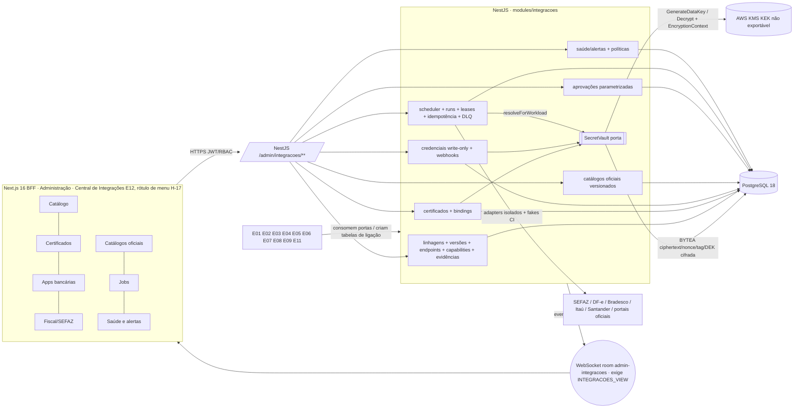

# E12-T00 — Gate CROSS: ADR da fundação de integrações (cofre PostgreSQL + AWS KMS, certificados, jobs batch, 7 views, ownership) — Plano Tático

> Papel autor: `planner`. Documento **somente documental**: zero código, zero migration, zero PR aberto por este papel.
> Workers futuros (E12-T01..T12) seguem este plano **literalmente**; caso não coberto, `old_string` que não casa ou teste que falha após 1 correção → **PARAR e reportar**. Worker não decide regra, não edita `docs/execucao/`, não cria perfil canônico, não altera `MENUS_CANONICOS`.

**Goal:** Congelar, para o Portão 1 do gate CROSS E12-T00 (Linear ALP-173), a arquitetura única da plataforma de integrações do ERP AlphaCarnes. Ela cobre perfis por provedor/serviço/ambiente (com versões), endpoints em allowlist, capabilities, certificados A1 e chaves bancárias, credenciais write-only, webhooks, cofre criptográfico em PostgreSQL com KEK em AWS KMS, catálogos oficiais versionados, jobs batch sem sessão humana, aprovações parametrizadas e as 7 views da Central de Integrações E12 (rótulo de menu pendente, H-17). O plano fixa ownership, fronteiras, DDL conceitual com FKs declaradas, mapa de consumidores, matriz tela→protótipo e campo→coluna, análise de ADR-002/006/011 e da auth BFF/JWT, riscos e pendências, e o DoD→teste 1:1 de E12-T01..T12. Nada é implementado nesta onda.

**Architecture:** monólito modular NestJS 11 (Constituição, "sem microserviços"). O módulo novo `app/backend/src/modules/integracoes/` é a autoridade única (Princípio III), com submódulos `perfis`, `cofre`, `certificados`, `credenciais`, `webhooks`, `referencias`, `aprovacoes`, `jobs` e `saude`. O cofre fica atrás de uma porta `SecretVault` (token DI `SECRET_VAULT`, padrão ADR-011) com dois adapters: `KmsEnvelopeVault`, que cifra com AES-256-GCM no NestJS usando DEK de `GenerateDataKey`, e `LocalFakeEnvelopeVault`, determinístico para CI/dev (Princípio V). Ciphertext, nonce, tag e DEK cifrada ficam em `BYTEA` no PostgreSQL 18. O scheduler roda dentro do processo backend com lease/fencing no PostgreSQL. Eventos são emitidos pós-commit via `@nestjs/event-emitter` e WebSocket nativo na room `admin-integracoes`, protegida por `INTEGRACOES_VIEW` (Princípio VI, ADR-004). Frontend Next.js 16 App Router com BFF, DS v3 Direção A (AD-10).

**Tech Stack (fixa, sem troca):** Node 22, NestJS 11, TypeScript 5 strict, Next.js 16 App Router/BFF, React 19, PostgreSQL 18, Drizzle + drizzle-kit, Zod 4, WebSocket nativo, JWT + RBAC (11 perfis, AD-04), Jest/Supertest, Playwright. Biblioteca de KMS e de parsing PKCS#12/X.509 será escolhida em E12-T02/T03 com versão pinada e aprovada no Portão 1 daquela task (regra de dependências do AGENTS). Este plano não as adiciona. Upload multipart usa o multer já embutido em `@nestjs/platform-express` 11.1.28 (dependência existente), só com armazenamento em memória.

**Base pinada no momento do plano:** `origin/develop` @ `db9d8ac1760a01c262c57a9f824d2c8fcf18291b` (merge-base do branch). Última migration: `0043_onda14_ocorrencias_preco`; próximo índice livre: `0044`. Fontes contratuais lidas no checkout coordenador `F:/Projetos/AlphaCarnes` @ `302cdb5a270d73591e3c087a16fef7190101b4f7` (branch do PR #157). Se o journal de develop avançar, a numeração das tasks futuras é recalculada pelo Planner da onda; o worker não renumera.

**Worktree / branch:** `F:/Projetos/AlphaCarnes/.worktrees/e12-t00` · `feature/erp-e12-t00-cross-adr`. Nunca implementar no worktree coordenador.

**Linear:** ALP-173 (E12-T00). Tasks futuras: E12-T01..T12. Gate irmão: ALP-160 (E11-T00), com plano próprio produzido por outra instância de Planner.

---

## Histórico de revisões

| Revisão | Data | Plano (sha256) | Motivo |
|---|---|---|---|
| r1 | 2026-10-12 | `08cff0b4…` | versão inicial; Portão 1 = `ajustar` (veredito 2026-10-12T06:52:31Z) |
| r2 | 2026-10-12 | `91a78240…` | resolve os 14 achados do Portão 1; Portão 1 = `ajustar` (veredito 2026-10-12T07:49:08Z, 11 achados) |
| r3 | 2026-10-12 | `9a6f65c6…` | resolve os 11 achados do Portão 1 sobre a r2 e cria o contrato canônico de interface E12↔E11/E06 (§3.13), que o E11-T00 v2 adota literalmente; Portão 1 = `ajustar` (veredito 2026-10-12T08:56:02Z, 5 achados) |
| r4 | 2026-10-12 | `f1760c22…` | resolve os 5 achados do Portão 1 sobre a r3; §3.13 (contrato canônico) **inalterada byte a byte**; Portão 1 = `ajustar` (veredito 2026-10-12T09:28:13Z, 5 achados) |
| r5 | 2026-10-12 | `b0a214a9…` | resolve os 5 achados do Portão 1 sobre a r4. **Alteração de contrato r5: E11 deve adotar** — um único bullet **aditivo** em §3.13.3 (convênio da ligação de layout = convênio do vínculo ativo da linhagem em `bank_integration_links`, com teste nomeado); nenhum nome, coluna, FK, UNIQUE, porta, operação ou room do contrato r4 foi renomeado ou removido; Portão 1 = `ajustar` (veredito 2026-10-12T10:03:53Z, 3 achados) |
| r6 | 2026-10-12 | `88ff270e…` | resolve os 3 achados do Portão 1 sobre a r5. **Alteração de contrato r6: E11 deve adotar** — âncora estável de capability `integration_capability_anchors` (chave lógica `(lineage_id, capability, channel)`), clone/revalidação de versão, regras inversas de invalidação posterior (vínculo bancário, conta/convênio, escopo de linhagem, layout, dataset, credencial de webhook, base pública, chave de cofre) e amarra `bank_accounts` → provedor `BANK`; lista exata C6-1..C6-12 abaixo; Portão 1 = `ajustar` (veredito 2026-10-12T10:58:00Z, 3 achados) |
| r7 | 2026-10-12 | (calculado pelo Monitor) | resolve os 3 achados do Portão 1 sobre a r6 e o lado E12 do achado 1 (bloqueante cruzado) do veredito do E11-T00 r5 (2026-10-12T11:00:10Z). **Alteração de contrato r7: E11 deve adotar** — trava de linhagem compartilhada `travarLinhagens` (§3.13.10), ordem global de travas com classe 0 de job/run do E12, revalidação de credenciais/bindings/evidências/endpoints na ativação, propagação de revogação/suspensão às cópias, checagem de status no uso em `resolveForWorkload`, `ReferenciasService.vigenciaParaUso` (`FOR SHARE` do dataset); lista exata C7-1..C7-10 abaixo |

**Achados do Portão 1 sobre a r6 (veredito 2026-10-12T10:58:00Z) e achado cruzado do E11-T00 r5 (veredito 2026-10-12T11:00:10Z, item 1) → correção na r7:**

| Achado | Correção | Seção corrigida |
|---|---|---|
| r6-1 (bloqueante). Clone copia credenciais (mesmo `secret_version_id`, `ACTIVE`) e bindings (`CURRENT`) para a v+1 `DRAFT`; revogação/suspensão/rotação posterior na versão `ACTIVE` (`CredenciaisService.revogar`, `revokeBinding`, segredo `REVOKED`/`RETIRED`, certificado `REVOKED`/`EXPIRED`/`revoked_at`/`not_after`) não alcança as cópias; `PerfisService.ativar` só revalidava capabilities/webhooks/conta; `resolveForWorkload` sem checagem de status no uso (doc 22 L70 "não usar cert vencido/revogado em nova operação"; L81 "credencial revogada suspende") | Três camadas, todas sob a trava de linhagem (§3.13.10): (1) **propagação às cópias** na mesma transação da mudança (§3.13.9 regra 4a): revogar/suspender credencial atinge toda credencial da linhagem com o mesmo `secret_version_id`; revogar/aposentar binding (inclusive por rotação) atinge todo binding da linhagem com o mesmo `(certificate_id, purpose)` em versão não `ACTIVE`; o mesmo para suspensão manual de capability (por âncora), suspensão de webhook (por âncora) e rejeição de evidência (descendentes por `cloned_from_evidence_id`); (2) **revalidação na ativação** (§3.13.9 regra 5 (d)–(g)): toda credencial `ACTIVE` exige segredo `ACTIVE` não vencido e credencial não vencida; todo binding `CURRENT`/`ROTATION_OVERLAP` exige certificado `VALID`, `revoked_at` nulo, `not_before ≤ now() < not_after` e chave privada `ACTIVE`; evidência `VERIFICADO` na vigência; endpoint com dataset oficial `ACTIVE` e vigente; falha → 422 sem ativar, com a lista; (3) **checagem no uso** em `SecretVault.resolveForWorkload` (§3.8, §3.13.9 regra 7), fail-closed a cada chamada: `REVOKED`, `SUSPENDED`, vencido ou certificado não `VALID` nunca resolvem, nem para run com pin; `RETIRED` por rotação só resolve para o run que o fixou (§3.9 passo 3; doc 22 L70 "jobs fixam versão de cert no início"). Matriz I13–I19; testes T03/T07 nomeados | §3.2.1; §3.6; §3.8; §3.9; §3.13.8; §3.13.9 regras 4a, 5, 7 e I13–I19; §9 T03/T07 |
| r6-2 (menor). `integration_provider_hosts.approved_by` e `integration_workload_grants.approved_by` `NOT NULL`, mas com P2.HML = 0 o pedido HML nasce `APPROVED` sem votos (§3.12.1) e o valor fica indefinido | Alinhado a `integration_secret_versions`: `approved_by` nullable = usuário que completou o quórum; `NULL` quando o pedido nasceu `APPROVED` com `required_approvals = 0` (só em HML) ou quando a linha não tem pedido (`approval_request_id` nulo; para hosts, só a linha de seed do E12-T01, §3.4 "seed + admin com aprovação"); CHECK `environment <> 'PROD' OR approval_request_id IS NULL OR approved_by IS NOT NULL`; testes T01/T03 nomeados | §3.12.1; §4 hosts e grants; §9 T01/T03 |
| r6-3 (menor). §8 Task 2 (texto e mensagem de commit) dizia r5 | Task 2 cita r7 no texto e na mensagem de commit | §8 Task 2 |
| E11-r5-1 (bloqueante cruzado). Trava de linhagem só nos caminhos E11; `CapabilitiesService.habilitar` e `PerfisService.ativar` liam `layoutVigente` sem serialização: aposentar/desvincular concorrente com habilitar deixa capability FILE `ENABLED` sem layout vigente (A-03, XB-16); o mesmo para `datasetAposentado` × habilitar; locks de job/run do E12 antes da trava de conta não declarados | **Uma** primitiva compartilhada, dona E12: `travarLinhagens(tx, lineageIds)` = `pg_advisory_xact_lock(hashtextextended('integracoes:linhagem:' \|\| lineage_id::text, 0))` em ordem crescente da chave, **primeira instrução** de toda operação E12/E11/E06 que lê estado de ligação/vínculo/layout/dataset/cópia e decide ou escreve sobre a linhagem (lista fechada em §3.13.10 item 3, inclui `habilitar`, `ativar`, clone, `aoAlterarVinculo`, `LayoutsService.vincular/aposentar/desvincular/trocar`, `datasetAposentado`); substitui a chave `bancos:linhagem:` do E11. Dataset lido por `ReferenciasService.vigenciaParaUso` com `FOR SHARE`; `ReferenciasService.aposentar` trava as linhagens do provedor e depois `FOR UPDATE` do dataset. Ordem global: classe 0 (job/run/lease/checkpoint do E12) → classe 1 (linhagem) → classe 2 (conta, E11 §7.2.0) → classe 3a (dataset) → classe 3b (demais linhas, `FOR UPDATE` em ordem de id) → classe 4 (parcelas); classe 0 disjunta de todo caminho E06/E07/E11; prova de ausência de deadlock em §3.13.10 item 6; teste "aposentar layout × habilitar capability FILE ⇒ nunca ENABLED sem ligação ACTIVE APPROVED" (E12-T07 + E11-T02) | §3.13.2; §3.13.3; §3.13.7; §3.13.8; §3.13.10 (nova); §3.9; §7.1 D-E06/D-E11; §9 T07/T08/T09; §12 |

**Alteração de contrato r7: E11 deve adotar** (lista exata das mudanças em §3.13; o plano E11-T00 adota literalmente na próxima revisão, D-E11; nenhum nome, coluna, FK, UNIQUE, porta ou room do contrato r6 foi renomeado ou removido):
- **C7-1** §3.13.2: linha nova `travarLinhagens(tx, lineageIds)` (primitiva compartilhada, E12-T01) com a chave `hashtextextended('integracoes:linhagem:' || lineage_id::text, 0)`; substitui a chave `bancos:linhagem:` do plano E11 (§7.2.0 item 6 dele).
- **C7-2** §3.13.2: linha nova `ReferenciasService.vigenciaParaUso(datasetId, tx)` (leitura `FOR SHARE` do dataset); `LayoutHomologadoPort.layoutVigente` calcula `datasetVigente` por ela; E11 (`LayoutsService.vincular/trocar`, aprovação de layout) também a usa.
- **C7-3** §3.13.2: `CapabilitiesService.suspenderPorAncora`/`suspenderPorLinhagem` exigem a trava de linhagem já adquirida pelo chamador (reaquisição reentrante, §3.13.10 item 2).
- **C7-4** §3.13.3: bullet novo "Serialização (r7)" — regra FILE, regra de convênio, regras inversas de layout e de vínculo e regra de conta só rodam sob a trava de linhagem.
- **C7-5** §3.13.7: E06-T01 adota a trava em `VinculosService.trocar/aposentar` e nas transições de conta/convênio (seguida da trava de conta da conta envolvida); E11-T02 adota a primitiva no lugar de `bancos:linhagem:` e acrescenta habilitar/ativar a K15.
- **C7-6** §3.13.8: testes de contrato r7 (concorrência e espião de primeira instrução).
- **C7-7** §3.13.9 regra 4a (nova): propagação às cópias de revogação/suspensão/rotação/rejeição.
- **C7-8** §3.13.9 regra 5 itens (d)–(g) (revalidação de credenciais, bindings, evidências e endpoints na ativação) e regra 7 (nova: checagem no uso em `resolveForWorkload`).
- **C7-9** §3.13.9 matriz: linhas I13–I20.
- **C7-10** §3.13.10 (nova): trava de linhagem, operações cobertas, ordem global de classes 0–4, disjunção da classe 0 com E06/E07/E11, isolamento e prova de ausência de deadlock.

**Autoauditoria r7 (operações E12 que leem estado mutável por outro módulo ou por outra versão e decidem/escrevem; objetos clonados cujo estado muda depois)** — encontrados e tratados: `CapabilitiesService.habilitar` (layout/dataset do E11; achado E11-r5-1), `PerfisService.ativar` (layout, vínculo E06, estado das cópias; achados E11-r5-1 e r6-1), `PerfisService.criarVersao` (clone lê o estado da versão de origem; sem trava, uma revogação concorrente não alcançaria a cópia recém-criada), `PerfisService.excluirLinhagem` (vínculo E06 e layout E11, I6), `ReferenciasService.aposentar` (âncoras do E11 por `datasetAposentado`, várias linhagens), `WebhooksService.aposentarBase` (webhooks de várias linhagens, I10), `AprovacoesService.votar`/`abrir` quando o voto (ou o pedido com 0) transita objeto de linhagem (a transição chama `ativar`/`habilitar`), `JobsService.iniciarRun` (lê a versão `ACTIVE`, credenciais e bindings para fixar os pins), `CredenciaisService.revogar/suspender/reativar`, `BindingService.associar/rotacionar` e `SecretVault.revokeBinding`, `CapabilitiesService.suspender` manual, `WebhooksService.ativar/suspender`, `EvidenciasService.verificar/rejeitar` — todos passam a tomar a trava de linhagem como primeira instrução (§3.13.10 item 3). Objetos clonados: capability (suspensão manual), credencial (revogação/suspensão/rotação), binding (revogação/rotação; certificado `REVOKED`/`EXPIRED`), webhook (suspensão), evidência (rejeição/vencimento), endpoint (dataset oficial aposentado/fim de vigência) → I13–I19. Conferidos sem defeito, com motivo: `approval_request_id` copiado (pedido `APPROVED`/`REJECTED`/`CANCELLED` é terminal: nenhum serviço transita pedido fora desses status; teste T03); checagens E01/E02 da V04 na ativação (pré-condição de ativação; a autoridade no uso é o próprio E02 ao numerar e emitir, sem estado E12 derivado); recepção de webhook e `habilitadaPorAncora`/`resolver()` no uso (leitura pontual linearizada antes de uma suspensão concorrente; nenhum estado persistido afirma validade); `CERT_EXPIRY_SCAN` (marca `EXPIRED`; coberto pela checagem no uso e pela revalidação na ativação); pins de run (fixados por run por desenho; revogado/vencido nunca resolve, regra 7).

**Achados do Portão 1 sobre a r5 (veredito 2026-10-12T10:03:53Z) → correção na r6:**

| Achado r5 | Correção | Seção corrigida |
|---|---|---|
| r5-1 (bloqueante). Versão nova clona capabilities com ids novos, mas `bank_layout_capability_links.capability_id`, `uq_blcl_capability_active`, `LayoutHomologadoPort.layoutVigente(capabilityId)` e `file_capability_id` do E11 prendem-se ao id da versão; clone omitia evidências e webhooks e não definia o status das capabilities clonadas | **Escolha única: âncora estável** (re-apontamento atômico rejeitado, motivos em §3.13.9). Tabela E12 `integration_capability_anchors` com chave lógica `UNIQUE (lineage_id, capability, channel)`; cada capability de versão aponta sua âncora por FK composta; toda FK de E06/E11 (e E04/E05/E07/E08) vai para a âncora, nunca para `integration_capabilities(id)`; portas recebem a âncora e resolvem a capability da versão `ACTIVE`. Clone copia status/carimbos de capabilities, evidências (com `cloned_from_evidence_id`, sem re-verificação), credenciais, bindings e webhooks (mesmo `callback_path`, que passa a morar na âncora); status copiado só vale quando a versão é `ACTIVE`; filho editado no `DRAFT` volta ao estado inicial; `PerfisService.ativar` revalida tudo na mesma transação (falha → 422 sem ativar); webhook recebido resolve por âncora → versão `ACTIVE`. Testes E12-T01, E12-T07, E11-T02 nomeados | §3.13.2, §3.13.3, §3.13.8, §3.13.9 (nova); §3.2.1; §3.4; §3.6; §4 (âncora, capabilities, evidências, webhooks); §5.1; §9 T01/T07 |
| r5-2 (bloqueante). Regra de convênio só em `LayoutsService.vincular`; trocar/aposentar o vínculo da linhagem no E06 deixa ligação de layout `ACTIVE` com convênio de outra conta | Regra inversa: `VinculosService.trocar`/`aposentar` (E06) chamam, na mesma transação, `VinculoBancarioAlteradoPort.aoAlterarVinculo(lineageId, novoVinculo \| null, tx)` (porta definida pelo E06-T01, implementada pelo E11-T02): ligação de layout com convênio diferente do novo (ou com convênio, quando não há substituto) → `RETIRED` + `CapabilitiesService.suspenderPorAncora(…, 'BANK_LINK_CHANGED', tx)` → alerta `LAYOUT_OUTDATED`; mesmo convênio ou sem convênio → mantida. Aposentar sem substituto também suspende todas as capabilities habilitadas da linhagem (`suspenderPorLinhagem`, alerta novo `BANK_LINK_MISSING`). Testes E06-T01 e E11-T02 nomeados | §3.13.2, §3.13.3, §3.13.7, §3.13.8, §3.13.9 I3–I5; §4 `integration_alerts`; §7.1 D-E06/D-E11; §9 T07 |
| r5-3 (menor). `bank_accounts.provider_id` só referencia `integration_providers(id)`, sem `kind='BANK'`; `bank_integration_links` aceitava linhagem `FISCAL`/`REFERENCE` | `bank_accounts.provider_kind text NOT NULL DEFAULT 'BANK' CHECK (provider_kind = 'BANK')` + FK `(provider_id, provider_kind)` → `integration_providers(id, kind)`; como a FK de `bank_integration_links` exige o mesmo `provider_id` na conta e na linhagem, a linhagem ligada é necessariamente `BANK`. Testes E06-T01 nomeados | §3.13.7, §3.13.8, §3.13.9 I12 |

**Alteração de contrato r6: E11 deve adotar** (lista exata das mudanças em §3.13; o plano E11-T00 adota literalmente na próxima revisão, D-E11):
- **C6-1** §3.13.2: linha nova `integration_capability_anchors` (E12-T01; UNIQUEs-alvo `(id, company_id, environment, channel)`, `(id, lineage_id, company_id, environment, capability, channel)`, `(id, callback_path)`; chave lógica `UNIQUE (lineage_id, capability, channel)`).
- **C6-2** §3.13.2: linha `integration_capabilities` ganha `lineage_id`, `capability_anchor_id` e os UNIQUEs `(profile_id, capability_anchor_id)` e `(id, capability_anchor_id, profile_id, company_id, environment, capability)`; o UNIQUE `(id, company_id, environment, channel)` permanece, mas deixa de ser alvo de FK externa.
- **C6-3** §3.13.2: `CapabilitiesService` mantém `habilitada`/`habilitar`/`suspender` (por id de versão; `habilitada` passa a exigir versão `ACTIVE`) e ganha `resolverAtiva(capabilityAnchorId, tx)`, `habilitadaPorAncora(capabilityAnchorId, em)`, `suspenderPorAncora(capabilityAnchorId, motivo, tx)` e `suspenderPorLinhagem(lineageId, motivo, tx)`.
- **C6-4** §3.13.2: `LayoutHomologadoPort.layoutVigente` passa a receber `capabilityAnchorId` e a devolver também `datasetVigente: boolean`; ganha `datasetAposentado(datasetId, tx): capabilityAnchorId[]`.
- **C6-5** §3.13.2: porta nova `VinculoBancarioAlteradoPort` (token `VINCULO_BANCARIO_ALTERADO_PORT`; definida pelo E06-T01, implementada pelo E11-T02; padrão no-op) com `aoAlterarVinculo(lineageId, novoVinculo, tx)`.
- **C6-6** §3.13.3 DDL de `bank_layout_capability_links`: `capability_id` → `capability_anchor_id` (renomeação necessária: o alvo deixou de ser a versão), FK `(capability_anchor_id, company_id, environment, capability_channel)` → `integration_capability_anchors(id, company_id, environment, channel)`; `uq_blcl_capability_active` (nome mantido) passa a ser sobre `capability_anchor_id`. DDL de `bank_integration_links` inalterada.
- **C6-7** §3.13.3 bullet da regra FILE: `layoutVigente(âncora)` e `datasetVigente=false` ⇒ `ENABLED`/`HML_TESTED` negados.
- **C6-8** §3.13.3 bullet da regra inversa do E11: vale para capability `ENABLED` **ou** `HML_TESTED`, chama `suspenderPorAncora`; troca de layout em âncora habilitada exige layout que satisfaça o status atual (senão 422).
- **C6-9** §3.13.3 bullets novos: regra inversa do vínculo bancário (E06, I3/I4) e regra de conta/convênio inativados (E06, I5).
- **C6-10** §3.13.3 último bullet: FKs do E11 para capability (`bank_import_batches`, `bank_remittance_batches`, `bank_channel_routing_policies`) passam a `file_capability_anchor_id`/`api_capability_anchor_id` → `integration_capability_anchors(id, company_id, environment, channel)`; nenhuma FK do E11 para `integration_capabilities(id)`.
- **C6-11** §3.13.7: `bank_accounts.provider_kind` + FK `(provider_id, provider_kind)` → `integration_providers(id, kind)`; transições de conta/convênio conforme I5.
- **C6-12** §3.13.8 testes de contrato acrescentados e §3.13.9 (nova: âncora, clone, ativação, resolução de webhook e matriz de invalidação posterior I1–I12).

**Autoauditoria da §3.13 (mesmo tipo de defeito: ligação válida na criação que fica inválida por mudança posterior em outra tabela)** — casos encontrados, todos tratados com regra + teste em §3.13.9: I1 ligações a capability × nova versão (achado r5-1); I2 evidência e webhook × nova versão (achado r5-1); I3 convênio da ligação de layout × troca de vínculo (achado r5-2); I4 versão `ACTIVE` de linhagem `BANK` × aposentadoria do vínculo sem substituto (a regra de conta só valia na ativação); I5 vínculo × inativação de conta/convênio no E06; I6 vínculo, ligação de layout e âncora × alteração do escopo ou exclusão lógica da linhagem; I7 capability `HML_TESTED` × aposentadoria do layout (a regra inversa r5 só cobria `ENABLED`) e troca de layout em âncora habilitada; I8 layout `APPROVED` × aposentadoria do dataset `BANK_CNAB_LAYOUT`/`BANK_OPENAPI` (A-08 só na aprovação do layout); I9 webhook `ACTIVE` × revogação/suspensão da credencial `WEBHOOK_SIGN`; I10 webhook `ACTIVE` × aposentadoria da base pública; I11 payload/segredo × rotação da chave de cofre (`ACTIVE` → `RETIRED`); I12 conta × tipo do provedor (achado r5-3; UPDATE de `kind` referenciado bloqueado pela FK). Conferidos sem defeito: grant de workload revogado (verificado no uso por `openPayload`); `DOMAIN_OUTBOX_RELAY` (FK para empresa permanece válida); mapa room→permissão (permissão no subscribe e `exp` no `broadcastRoom`, F4); pins de job (fixados por run, por desenho).

**Achados do Portão 1 sobre a r4 (veredito 2026-10-12T09:28:13Z) → correção na r5:**

| Achado r4 | Correção | Seção corrigida |
|---|---|---|
| r4-1 (bloqueante). Função `required_approvals` por `subject_kind` × ambiente indefinida e contraditória (§3.12 "snapshot de P2 desse ambiente" × §3.9 P2.CHECKPOINT; `JOB_REPROCESS` PROD = P2.PROD ou REPROCESSAMENTO?); CHECK isentava `JOB_REPROCESS` PROD do piso ≥ 2 sem fonte; ciclo de pedido com 0 aprovações indefinido | §3.12.1 nova: **uma** função `required_approvals(subject_kind, environment)` = `max` entre o valor provisório do ambiente, o valor provisório do tipo e os pisos com fonte; tabela com os 13 `subject_kind` × {HML, PROD}. Dupla aprovação PROD (doc 22 §7 L96; ADR-ERP-024 L42) vale para **todo** pedido PROD, inclusive `JOB_REPROCESS`; a única situação PROD com 0 é `CHECKPOINT_CHANGE` com P2.CHECKPOINT = 0, por fonte expressa ("alterar checkpoint com trilha", distinto de "reprocessar sob aprovação", catalogo.js L1074). Ciclo com 0: o pedido é sempre aberto e nasce `APPROVED`, sem votos, na transação da transição do objeto; voto posterior → 422. CHECKs de `integration_approval_requests` e `integration_job_checkpoint_changes` reescritos; testes por caso (T01, T03 `aprovacoes-quorum.spec.ts`, T09) | §3.6; §3.7; §3.9 passos 7 e 7a; §3.12 P2/P7 e §3.12.1 (nova); §4 approval_requests e trilha de checkpoint; §6.1/§6.2 V06; §7.2 H-04; §9 T01/T03/T09 |
| r4-2. P2 semeava `HML: 0` sem fonte e fail-open, sem declarar | `HML` declarado **sem fonte** (nenhuma fonte fixa quórum HML; doc 22 L49 separa "homologar" de "ativar com dupla aprovação"; catalogo.js L1000 fala de "aprovação de produção") e semeado **1**, fail-closed (Princípio VII); sem piso (aceita 0, decisão do QO em H-04); testes variam P2.HML ∈ {0, 1, 2} | §3.12 P2 e §3.12.1; §7.2 H-04; §9 T03 |
| r4-3. `bank_layout_capability_links.bank_agreement_id` preso só a `(id, company_id)`: convênio de outra conta/banco aceito | Regra de serviço **aditiva** em §3.13.3: o convênio da ligação de layout, quando preenchido, é o `bank_agreement_id` do vínculo `ACTIVE` da linhagem da capability em `bank_integration_links`; teste E11-T02 nomeado. **Alteração de contrato r5: E11 deve adotar** | §3.13.3 (único bullet acrescentado); §7.1 D-E11 |
| r4-4. Conflito de rótulo de menu não registrado (constituição v1.2.0 L93 `Administração → Integrações` × AD-18/ADR-024 "Central de Integrações" × catalogo.js L1172 "Central de integrações") | C11 registrado com as linhas conferidas; posição (grupo Administração, 7 views) fixada por fontes compatíveis; rótulo **não** fixado (fontes não demonstravelmente compatíveis; precedência exigiria interpretar a constituição) → pendência do QO **H-17**; nenhum teste fixa rótulo. Substitui, quanto ao rótulo, a correção r1-14 | §1 item 10; §2 C11; §3.3; §5.2; §6.1; §7.1 D-E10; §7.2 H-17; §9 T04; §12 |
| r4-5. `gh pr create` sem corpo falha em modo não interativo; comandos relativos sem diretório; `Test-Path` da §10 não literal | Toda task começa com `Set-Location -LiteralPath F:/Projetos/AlphaCarnes/.worktrees/e12-t00`; Task 1 lista um `Test-Path -LiteralPath` absoluto por fonte da §10; `Get-FileHash -LiteralPath` absoluto; Task 4 grava o corpo em `.codex/runtime/pr-e12-t00-body.md` (ignorado pelo `.gitignore`) e usa `gh pr create --body-file` | §8 Tasks 1–4 |

Alteração de contrato da r5 (§3.13): **somente** o bullet "Regra de convênio da ligação de layout" acrescentado em §3.13.3, logo após o bullet de `provider_id`. É aditivo: não altera DDL, nome, coluna, FK, UNIQUE, porta, operação nem room de §3.13; só restringe, por serviço do E11 (`LayoutsService.vincular`), um valor que a FK já aceitava. O plano E11-T00 deve adotá-lo literalmente na próxima revisão (D-E11). As demais mudanças da r5 em §4 (`integration_approval_requests`, `integration_job_checkpoint_changes`) são internas ao E12 e não tocam UNIQUE-alvo listado em §3.13.2.

**Achados do Portão 1 sobre a r3 (veredito 2026-10-12T08:56:02Z) → correção na r4:**

| Achado r3 | Correção | Seção corrigida |
|---|---|---|
| r3-1. `integration_job_idempotency_keys.first_run_id` e `integration_job_dead_letters.reprocess_run_id` com FK simples (cross-empresa/cross-job possível); `integration_job_runs` sem `UNIQUE (id, company_id)`/`(id, job_id)`; afirmação "todas as relações E12 por FK composta com `company_id`" falsa | `integration_job_runs` ganha `UNIQUE (id, company_id)` e `UNIQUE (id, job_id)`; chave de idempotência com FK `(first_run_id, company_id)` → `runs(id, company_id)`; DLQ ganha `job_id`/`company_id` com FKs `(job_id, company_id)` → jobs, `(run_id, job_id)` e `(reprocess_run_id, job_id)` → `runs(id, job_id)`, `reprocess_run_id <> run_id` e `REPROCESSED` ⇔ `reprocess_run_id` preenchido; §3.6 passa a listar também essas FKs e a enumerar, com motivo, as FKs simples remanescentes (alvo ou origem sem empresa); bloco "FKs e justificativas" da §4 reescrito; testes T09 | §3.6; §4 jobs e "FKs e justificativas"; §9 T09 |
| r3-2. Pedido `JOB_ENABLE`/`DATASET_ACTIVATION` com `environment` HML (P2.HML=0) contorna o piso PROD ≥ 2: jobs/runs usavam `(approval_request_id, company_id)` e datasets `(id)` | Jobs, runs e trilha de checkpoint com linhagem: FK adicional `(approval_request_id, company_id, environment)`; CHECK `DATASET_ACTIVATION ⇒ environment='PROD'` em `integration_approval_requests` + coluna `approval_environment = 'PROD'` e FK `(approval_request_id, approval_environment)` → `(id, environment)` em datasets; regra de serviço `AprovacoesService.vincular` "ambiente do pedido = ambiente do objeto" com testes T01/T08/T09; ambiente do pedido de job sem linhagem (sem fonte) = parâmetro P7 (seed fail-closed `PROD`) + badge Provisório (H-16), testes variando P7 | §3.6; §3.12 P7; §4 approval_requests/datasets/jobs/runs; §7.2 H-16; §9 T01/T08/T09 |
| r3-3. `CHECKPOINT_CHANGE ≥ 1` fixado em CHECK como "fonte", mas catalogo.js L1074, MATRIZ-INTEGRAL L520 e MATRIZ-UX L1510 dizem "alterar checkpoint com trilha" (só reprocesso é "sob aprovação"); teste fixava H-04 | Fixado só o que a fonte diz: trilha obrigatória (`integration_job_checkpoint_changes`, justificativa NOT NULL, valor anterior e novo, autor). Aprovação de checkpoint só por P2.CHECKPOINT provisório, **sem piso**: removido o `CHECKPOINT_CHANGE` do CHECK `>= 1` (o CHECK passa a valer só para `JOB_REPROCESS`); teste varia P2.CHECKPOINT ∈ {0, 1} | §3.9 passo 7a; §3.12 P2; §4 approval_requests e trilha; §6.1/§6.2 V06; §7.2 H-04; §9 T09 |
| r3-4. `rg` indisponível na máquina do gate (Task 3 e F7) | Cada comando `rg` ganha o equivalente `Select-String` (pwsh) com o resultado esperado; conferido nesta revisão: `Get-ChildItem app/backend/src -Recurse -File \| Select-String -Pattern 'process\.env'` → 27 linhas, 10 arquivos | §3.11 F7; §8 Task 3; §9 T11 |
| r3-5. Thumbprint preenchido no INSERT no fluxo PFX; a FK de 6 colunas exige thumbprint no segredo antes do certificado; sequências não descritas | §3.8.1 nova com as sequências PFX/PEM e CSR passo a passo (ordem dos INSERTs/UPDATE na mesma transação, CHECKs envolvidos, `expires_at` do segredo CSR nulo); coluna não sigilosa `public_key_sha256` em `integration_secret_versions` para casar o certificado emitido com a chave do CSR (extensão C8 (i)); regra de thumbprint da §3.6 corrigida; testes T03/T05 incluindo "certificado antes do thumbprint do segredo ⇒ violação de FK" | §2 C8; §3.6; §3.8.1 (nova); §4 `integration_secret_versions`; §9 T03/T05 |

Nenhuma correção da r4 exigiu mudar §3.13: as tabelas alteradas (`integration_job_runs`, `integration_job_idempotency_keys`, `integration_job_dead_letters`, `integration_job_definitions`, `integration_approval_requests`, `integration_reference_datasets`, `integration_secret_versions`) só **ganham** colunas, UNIQUEs, FKs ou CHECKs; nenhum UNIQUE-alvo listado em §3.13.2 (`integration_reference_datasets UNIQUE (provider_id, dataset_code, version_label)`/`(id, provider_id)`, `integration_job_runs(id)` referenciado por FK simples do E11) foi removido ou renomeado. A nova tabela `integration_job_checkpoint_changes` é interna ao E12 e não é referenciada por E06/E11.

**Achados do Portão 1 sobre a r2 (veredito 2026-10-12T07:49:08Z) → correção na r3:**

| Achado r2 | Correção | Seção corrigida |
|---|---|---|
| r2-1. Coerência com E11-T00: A-01..A-10 sem resposta; `bank_integration_links`/`bank_layout_capability_links` sem DDL; envelope `BANK_RAW_PAYLOAD`, `kms_key_arn` nullable × NOT NULL, `DOMAIN_OUTBOX_RELAY`, mapa de rooms e relação eventos E12 × `domain_outbox_events` indefinidos | Seção nova "Contrato de interface E12↔E11/E06 (canônico)" com resposta item a item A-01..A-10, tabela única de nomes, DDL exata das duas tabelas de ligação (colunas, FKs compostas, UNIQUEs), regra FILE `ENABLED` × layout `APPROVED`, colunas e AAD do envelope `BANK_RAW_PAYLOAD`, `DOMAIN_OUTBOX_RELAY` por empresa, eventos E12 fora do outbox e mapa room→permissão; revisão obrigatória do E11 registrada | §3.13 (nova); §2 C4/C10; §3.5; §5.1; §7.1 D-E06/D-E11; §12 |
| r2-2. `uq_lineage_scope` impede duas contas do mesmo banco/serviço | Cardinalidade fixada: 1 linhagem BANK ↔ no máximo 1 conta (+ convênio opcional) ativa; 1 conta(+convênio) × serviço × ambiente ↔ no máximo 1 linhagem ativa (UNIQUEs na ligação E06). `uq_lineage_scope` passa a valer só para provedores não bancários; linhagens BANK têm `uq_lineage_bank_name`. Testes alinhados | §3.2.1; §4 linhagens; §3.13.3; §9 T01 |
| r2-3. `uq_vault_key_active ON ((true))` fixa o resultado de H-02 e contraria ADR-024 L44 | `integration_vault_keys.environment`; uma chave `ACTIVE` por ambiente (`uq_vault_key_active ON (environment)`); segredo/payload presos à chave do próprio ambiente por FK `(vault_key_id, environment, kms_key_arn)`; KEK física distinta ou compartilhada entre HML/PROD = parâmetro P6 (seed fail-closed `DISTINTA`) + badge; testes variam P6 | §3.6; §3.8; §3.12 P6; §4 cofre; §7.2 H-02; §9 T02 |
| r2-4. §3.6 afirma FK composta em todas as relações; pins de `job_runs`, webhook (capability/credencial `WEBHOOK_SIGN`), `approval_request_id` entre empresas e finalidade segredo×certificado sem amarra | FKs compostas reais para pins (`(pinned_profile_id, profile_lineage_id, company_id, environment)` etc.), webhook (`(capability_id, profile_id, company_id, environment, capability_code)` e `(signing_credential_id, profile_id, company_id, environment, signing_credential_type)`), aprovações (`(approval_request_id, company_id[, environment])`), chave privada (`(…, purpose, private_key_secret_kind, thumbprint_sha256)`) e credencial (`(…, secret_kind)`); o que FK não expressa vira validação de serviço com teste nomeado; §3.6 reescrita com a lista exata | §3.6; §4; §9 T01/T07/T09 |
| r2-5. `approval_requests.company_id NOT NULL` para assuntos globais | `company_id` nullable + CHECK por `subject_kind` (globais: `HOST_ALLOWLIST`, `VAULT_KEY`, `DATASET_ACTIVATION`, `PUBLIC_BASE`, `WORKLOAD_GRANT`); teste por caso | §4 `integration_approval_requests`; §9 T01 |
| r2-6. `reference_datasets` UNIQUE sem `provider_id` | `UNIQUE (provider_id, dataset_code, version_label)` + `UNIQUE (id, provider_id)` (alvo da FK do E11); teste com três bancos | §4; §3.13.2; §9 T08 |
| r2-7. Allowlist de `process.env` incompleta (seed.ts L447–448; faturamento.controller.ts L100) | Inventário completo: 27 ocorrências em 10 arquivos (`rg -n "process\.env" app/backend/src` em `db9d8ac`), por arquivo/linha/nome; allowlist exata | §3.11 F7; §9 T02/T11 |
| r2-8. `aprovacoes_operacionais` não analisada | Análise do schema existente e decisão de não reuso com fundamentos verificáveis (FK `operacao_id` NOT NULL, decisor único, CHECK de tipos operacionais, sem empresa/ambiente, eventos em `dashboard`, permissões `APROVACOES_*`) | §3.7.1 (nova) |
| r2-9. Desvios do DDL ratificado do ADR-024 fora da §2 | r3 volta ao DDL ratificado (ciphertext/DEK/`kms_key_arn` NOT NULL; status sem `DESTROYED`; `cert_thumbprint_sha256` e `approved_by` restaurados); o que resta é extensão registrada item a item em C8; P4 (crypto-shredding) retirado, H-12 passa a exigir emenda do ADR | §2 C8; §3.8; §3.12 P4; §4 `integration_secret_versions`; §7.2 H-12; §9 T03 |
| r2-10. Linhas de `realtime.gateway.ts` e `rbac.guard.ts` | Conferidas em `db9d8ac`: handshake L99–109, `autenticar` L125–134, `registrar` L136–149, `podeAssinar` L151–154, `broadcast` L426–434; `rbac.guard.ts` tem 50 linhas, `canActivate` L15–49, decisão L36–46 | §3.5; §3.11 F3/F4; §5.2 |
| r2-11. D-E01 sem `UNIQUE (id, company_id)` em `establishments` | D-E01 exige `UNIQUE (id, company_id)` em `establishments` (alvo das FKs compostas) | §7.1 D-E01; §4 (nota inicial) |

Ajuste adicional, não apontado, por coerência com o contrato e com `docs/data/convencoes-schema.md` L12 ("PKs: `UUID DEFAULT uuidv7()`"), também apontado no veredito do E11-T00 (item 8): `integration_secret_versions.id` volta a ter `DEFAULT uuidv7()`; o id continua gerado por `SELECT uuidv7()` antes da cifragem e enviado explicitamente, e a proteção do achado r1-5 passa a ser feita pelo tipo de inserção do repositório, pela conferência do `RETURNING id` e pela verificação GCM na decifragem (§3.8). A AAD passa a incluir `expiresAt`, para cobrir literalmente "ID/vigência" do ADR-024 Pipeline 4 (C8).

**Achados do Portão 1 sobre a r1 (veredito 2026-10-12T06:52:31Z) → correção na r2** (mantidos; onde a r3 alterou a solução, a tabela acima indica):

| Achado do Portão 1 | Correção | Seção corrigida |
|---|---|---|
| 1. `credentials` sem FKs compostas por empresa | FKs `(profile_id, company_id, environment)` e `(secret_version_id, company_id, environment)`; teste "credencial de outra empresa" | §4 `integration_credentials`; §9 T01 |
| 2. certificados/bindings sem coerência de ambiente, finalidade e estabelecimento | `environment` em `integration_certificates`; FK da chave privada por `(id, company_id, environment)`; binding com FK `(certificate_id, company_id, environment, purpose)`; regra de estabelecimento no serviço com teste | §3.6; §4 certificados/bindings; §9 T01/T03 |
| 3. FKs só em comentário | todas as FKs declaradas; as polimórficas justificadas; vínculos com E06/E11 invertidos para tabelas de ligação do dono consumidor | §4 (bloco "FKs e justificativas"); §2 C4; §3.4 |
| 4. semântica de versão de perfil | `integration_profile_lineages` (escopo único) + `integration_profiles` (uma linha por versão, imutável fora de DRAFT); pin por FK de id | §3.2.1; §4; §3.9 |
| 5. AAD inclui `secretVersionId` mas id tem DEFAULT no DB | id obtido por `SELECT uuidv7()` antes da cifragem; coluna sem DEFAULT | §3.8; §4 `integration_secret_versions` |
| 6. falta matriz campo→coluna/dono por view | matriz por view (V01 responsável, V03 app ID/workspaceId e webhook em allowlist, V04 IE/CRT/série/número/cNF, V06 DLQ) | §6.2 |
| 7. 60/30/15/7 fixos em CHECK | `integration_alert_policies` configurável no DB, seed 60/30/15/7; teste com outro conjunto | §4; §9 T10 |
| 8. Princípio VIII para H-03/H-04/H-10/H-12; seed do administrador ambígua; teste fixando H-04 | quatro parâmetros com `provisorio: true` + badge; seed do administrador fundamentada em doc 013 §2.1; testes exercitam o parâmetro | §3.7; §3.12; §9 |
| 9. H-05/C6 com Monitor como responsável | responsável = Quality Owner | §2 C6; §7.2 H-05 |
| 10. `podeAssinar` libera qualquer room com `DISPONIBILIDADE_LER` | mapa room→permissão (`admin-integracoes` exige `INTEGRACOES_VIEW`); E12 não publica em `dashboard`; testes | §3.5; §3.11 F4; §9 T04 |
| 11. DoD→teste incompleto vs doc 23 §8 | testes acrescentados para T01..T12 | §9 |
| 12. falta inspeção de ADR-002/006/011 e auth BFF/JWT | análise com achados F1..F11 e consequências | §3.11 |
| 13. Task 1 esperava HEAD=db9d8ac; tasks sem commit | Task 1 confere merge-base; toda task tem passo de commit literal | §8 |
| 14. rótulo do menu; linhas da MATRIZ-UX V07; permissão de ver × agir | "Central de integrações" (catalogo.js L1169–1174, `epics.E12`); MATRIZ-UX V07 L1527–1549; colunas separadas de permissão | §1 item 10; §6.1 |

Ajuste adicional, não apontado, por segurança operacional: a Task 3 passa de rebase para merge de `origin/develop` no branch, para não exigir force-push (regras de git do AGENTS). Nenhum outro conteúdo não apontado foi alterado além do necessário para coerência com as correções acima.

---

## 0. Dependência documental com o PR #157 (decisão de merge NÃO tomada aqui)

Fatos verificados:
- `docs/expansao-erp-2026/**` e `docs/prototipos/erp-integrado-v1/**` só existem na branch `feature/erp-fiscal-financeiro-contabil-especificacoes-2026` (PR #157, não mergeado; tip lido `302cdb5`).
- Em `db9d8ac`, `docs/execucao/DECISOES.md` **não contém AD-18, AD-19 nem AD-20**, e `docs/governance/constituicao.md` não está na versão 1.2.0 (emenda do menu de 13 grupos). Os pilares normativos deste ADR estão, portanto, somente no #157.

| Opção | Descrição | Prós | Contras |
|---|---|---|---|
| **A (recomendada)** | O PR do E12-T00 (destino `develop`) só abre depois do merge do #157. Este branch recebe merge do `develop` resultante (sem force-push), e os links relativos para Cadernos e protótipo passam a resolver. | Fonte única; nenhuma cópia; AD-18..20 e constituição 1.2.0 vigentes no mesmo `develop`; Portão 2 do PR documental verifica links reais. | O E12-T00 fica serializado atrás do #157. |
| B | Portar para este PR cópias dos docs 22/23/24, das matrizes e de `catalogo.js`, com cabeçalho de proveniência (branch, SHA e caminho de origem). | Independe do #157. | Duplica fonte de verdade; causa conflito de merge quando o #157 entrar; as cópias podem divergir; AD-18..20 continuariam ausentes de `develop` (DECISOES só recebe decisão do QO e não pode ser portada pelo planner). |

Recomendação: **Opção A.** Enquanto o #157 não mergear, este plano cita as fontes por caminho relativo ao repositório (`docs/expansao-erp-2026/...`) e registra o SHA de leitura na Task 1. Decisão de merge: Executor ou Quality Owner.

## 1. Decisões fixadas (não reabrir; origem entre parênteses)

1. E12 é a fundação **única** de perfis, endpoints, capabilities, certificados, credenciais, webhooks, catálogos oficiais e jobs. É proibido duplicar isso em E02, E06 ou E11 (AD-18; doc 23 D3; Caderno B §4-B).
2. Os segredos ficam no PostgreSQL **somente como ciphertext** AES-256-GCM gerado no NestJS. Cada versão de segredo tem sua DEK de 256 bits, obtida por `kms:GenerateDataKey` e guardada cifrada ao lado do ciphertext. A KEK é AWS KMS não exportável. Não há chave mestra no DB, em `.env`, no frontend, no repositório, em logs ou em `parametros.valor_json` (AD-18 (3); ADR-ERP-024).
3. Proibidos: `pgcrypto` com chave enviada ao banco; Secrets Manager por certificado; plaintext ou PFX em disco temporário (inclui `diskStorage`/`dest` do multer); GET de chave privada; senha PFX persistida (ADR-ERP-024 "Requisitos inversos"; doc 22 §4).
4. Nonce de 96 bits nova a cada cifragem; tag de 16 bytes. O `EncryptionContext` do KMS é exatamente `{companyId, environment, service, purpose, secretVersion}` (ADR-ERP-024 Pipeline 3). A AAD canônica é JSON com chaves ordenadas `{companyId, environment, expiresAt, purpose, secretVersion, secretVersionId, service}` ("mesmos campos do contexto + ID/vigência", Pipeline 4; `expiresAt` em ISO-8601 UTC ou `null`). `encryption_context_hash` = SHA-256 da AAD canônica. `secretVersionId` é gerado antes da cifragem (§3.8). O envelope de payload bruto bancário usa a mesma porta com AAD própria (§3.13.4).
5. Ambientes externos: literais `HML` e `PROD`, conforme o CHECK de ADR-ERP-024. O doc 22 usa "PRD"; prevalece o ADR ratificado.
6. Upload: A1 PFX/P12 ou CRT+KEY (e, quando o banco exigir, CSR gerado no backend). A senha é transitória, write-only, só em memória. A3 é rejeitado no upload para batch (doc 22 §4.7).
7. Jobs batch rodam sem sessão de operador, com identidade técnica de menor privilégio, lease com fencing token, idempotência e checkpoint. A chamada de rede fica fora da transação. A versão de perfil, de segredo e de certificado é fixada (por id) no início do run (doc 22 §5).
8. A UI só reage a eventos pós-commit via WS; nenhum polling novo no frontend. O scheduler de backend não é polling de UI (Princípio VI; doc 22 §5).
9. `.env` fica restrito ao bootstrap técnico já existente em `env.schema.ts` (DATABASE_URL, JWT_*, COOKIE_SECURE, THROTTLE_*, CORS_ORIGIN, LOG_LEVEL, PORT) e às variáveis legadas já lidas por `process.env` em `develop` (inventário completo, 27 ocorrências em 10 arquivos, em §3.11 F7). É **proibido** acrescentar `BANK_*`, `SEFAZ_*`, `CERT_*`, `CNAB_*`, `JOB_*`, `VAULT_*`, URL, ARN, região, cron, timezone de negócio ou client_id (doc 22 §6).
10. Menu: a Central de Integrações E12 fica no grupo Administração (grupo 13), com 7 views em subnavegação (AD-18 (1), DECISOES L25; ADR-ERP-024 L7 e L64; constituição v1.2.0 L93). Os 9 grupos originais e as 39 rotas não mudam. O **rótulo** do item de menu não é fixado por este plano: as fontes divergem (C11) e a decisão é do QO (**H-17**). Neste documento, "Central de Integrações" designa o módulo, não o rótulo de menu. O botão "Central de Integrações" de `aplicacao.js` L218 é atalho interno de outra tela, não rótulo de menu.
11. 11 perfis canônicos (AD-04; AD-18 (5)). Personas do protótipo não viram perfis.
12. A UI não exibe UUID, PK, `company_id`, secretRef, ARN, código E##/ALP nem nome técnico de tabela (Caderno B "Requisito transversal de UX integral"; MATRIZ-UX "Requisito inverso"; "Sem colunas técnicas" em cada datagrid E12).
13. Nenhum efeito externo real (SEFAZ, banco), homologação ou produção é autorizado por este gate (AD-19 (3)).
14. Migrations futuras: só via `drizzle-kit generate`, uuidv7, TIMESTAMPTZ, status TEXT+CHECK, soft delete onde for entidade de negócio, um schema Drizzle por domínio, sem trigger nem SQL manual (Princípio X).

## 2. Conflitos entre fontes, resolvidos por precedência (nenhum é decisão de produto)

| # | Conflito | Fontes | Resolução |
|---|---|---|---|
| C1 | V05 e V06 invertidos | doc 22 §3 (V05=Jobs, V06=Versões) × catalogo.js/MATRIZ (V05=Catálogos Oficiais, V06=Jobs) | Prevalece o protótipo (precedência 4 > 6): **V05 = Catálogos Oficiais e Versões; V06 = Jobs Batch e Histórico**. |
| C2 | `PRD` × `PROD` | doc 22 × ADR-ERP-024 (referenciado por AD-18) | `PROD`. |
| C3 | Cofre em Secrets Manager | doc 23 E12-T02 ("Secrets Manager ou equivalente") × AD-18 | AD-18 prevalece: KMS + ciphertext em PostgreSQL; Secrets Manager não é usado. |
| C4 | `external_contracts` com conta, convênio e carteira; `bankAccountId` no perfil; pedido A-01 do E11-T00 v1 (`integration_profiles.bank_account_id`/`bank_agreement_id`) | doc 22 §2 × ownership do próprio doc 22 §1 (E06 é dono de contas e convênios; E11 de layouts) | O E12 guarda só **evidência de habilitação** (`integration_enablement_evidence`). Conta, convênio e carteira ficam no E06, que cria a tabela de ligação `bank_integration_links` (FK composta para `integration_profile_lineages` e para suas próprias tabelas). Layout de arquivo fica no E11, que cria `bank_layout_capability_links` (FK composta para `integration_capabilities`). O E12 não tem coluna apontando para E06/E11: a dependência vai do consumidor para a fundação. DDL, cardinalidade e portas exatas em §3.13. |
| C5 | "Worker independente" × "sem microserviços" | doc 22/23 × Constituição | Scheduler e worker rodam como módulo do mesmo processo NestJS. Réplicas são coordenadas por lease no PostgreSQL. Não há serviço novo nem variável de ambiente nova. |
| C6 | Rota de protótipo `/admin/integracoes/e12-v0N` × proibição de código E## visível | catalogo.js × Caderno B UX | Proposta: slugs semânticos (§6.1). Mudança de rota é estrutura de navegação (Princípio I.6): decide **somente o Quality Owner** → **H-05**. |
| C7 | BullMQ (ADR-006) × stack fixada sem Redis | ADR-006 × Constituição "Stack fixada"; ADR-011 adiou BullMQ | Jobs E12 usam lease/fencing em PostgreSQL. Nenhuma fila Redis é introduzida (exigiria ADR nova + emenda). |
| C8 | DDL de `integration_secret_versions` deste plano × DDL ratificado | ADR-ERP-024 L12–33 (DDL), L35 ("DDL ilustra contrato; worker deve ajustar convenções reais (`uuidv7`, status, migration drizzle-kit…)"), Pipeline 3–4 (L39–40) | Nenhuma coluna ratificada é removida nem afrouxada; a r2 afrouxava (ciphertext/DEK/`kms_key_arn` nullable, status `DESTROYED`, sem `cert_thumbprint_sha256`/`approved_by`) e a r3 volta ao ratificado. Extensões registradas, todas por L35 ou por aperto de restrição: (a) `id DEFAULT uuidv7()` (convencoes-schema L12), com id gerado e enviado antes da cifragem; (b) FKs para `companies`, `usuarios`, `integration_vault_keys` e `integration_approval_requests`; (c) `created_at DEFAULT now()`; (d) colunas novas `secret_kind`, `vault_key_id`, `approval_request_id`; (e) CHECK de 32 bytes em `encryption_context_hash`, CHECKs de `secret_kind`×`purpose`×`cert_thumbprint_sha256` e de `approved_by` em PROD `ACTIVE`; (f) UNIQUEs adicionais sobre `id` (alvos de FK composta); (g) `kms_key_arn` de `LOCAL_FAKE` = literal `local-fake:<vault_key_id>` (mantém NOT NULL); (h) AAD inclui `secretVersionId` e `expiresAt` ("ID/vigência" do Pipeline 4), e `expires_at` fica imutável; (i) coluna não sigilosa `public_key_sha256` (SHA-256 do SubjectPublicKeyInfo DER da chave pública correspondente), obrigatória para `PRIVATE_KEY_PKCS8` e imutável, usada para casar o certificado emitido com a chave do CSR (§3.8.1). Destruição criptográfica exigiria afrouxar NOT NULL do ADR → não é feita (H-12). |
| C9 | PK sem `DEFAULT` (r2, achado r1-5) × convenção de schema | `docs/data/convencoes-schema.md` L12 × plano r2 §3.8 | Convenção prevalece (Princípio X): `DEFAULT uuidv7()` em todas as PKs, inclusive `integration_secret_versions` e `bank_raw_payloads`. A integridade id↔AAD é garantida pelo serviço (§3.8 passos 1, 5 e decifragem), não pela ausência de DEFAULT. |
| C10 | Pedidos A-01..A-10 do E11-T00 v1 (§12.1) × C4 e ownership deste plano | plano E11-T00 v1 §5.1/§12.1 × AD-18, doc 22 §1 | Respondidos item a item em §3.13.1. Onde há rejeição, o contrato canônico (§3.13.2) dá o nome substituto; o E11-T00 v2 adota §3.13 literalmente. |
| C11 | Rótulo do item de menu da E12 | constituição v1.2.0 L93 ("A plataforma E12 integra `Administração → Integrações`, com 7 views"); DECISOES L25, AD-18 (1) ("Central de Integrações E12 permanece em Administração"); ADR-ERP-024 L7 ("O grupo Administração comporta a Central de Integrações E12 com sete views") e L64 ("Central de Integrações E12 (7 views com subnav/abas)"); catalogo.js L1169–1174 (`epics.E12` = `"ADMINISTRAÇÃO"`, `"integracao"`, `"Central de integrações"`, `"admin"`; rótulo em L1172) | **Posição:** as quatro fontes são compatíveis (grupo Administração, 7 views) → fixada (§1 item 10). **Rótulo:** compatibilidade não demonstrável. A constituição (precedência 1) grafa `Integrações` em notação de caminho, sem declarar que é o rótulo; AD-18 e ADR-024 nomeiam o módulo "Central de Integrações" sem declarar rótulo de menu; o protótipo (precedência 4) grafa "Central de integrações". Aplicar a precedência exigiria interpretar L93 como rótulo, o que é interpretação e não fonte; e rótulo de menu é estrutura de navegação (Princípio I, L13 "rótulos preservados" e L18 "mudanças estruturais … exigem emenda"). → pendência do QO **H-17**. Nenhum teste fixa rótulo; o E10-T04 cria a entrada só após a AD de H-17, que indica também se a redação de L93 precisa de emenda. |


## 3. ADR-ERP-025 — Fundação de integrações E12 (conteúdo normativo deste gate)

**Estado:** proposto para o Portão 1 do E12-T00. Complementa ADR-ERP-024, sem substituí-lo.
**Localização recomendada:** seção deste plano, em `docs/superpowers/plans/`, diretório que já existe em `develop`. Um arquivo separado em `docs/expansao-erp-2026/` só faria sentido depois do #157 (§0) e duplicaria a seção. Recomendação: **manter o ADR aqui**.

### 3.1 Contexto
O ERP precisa operar NF-e 55/DF-e (E02/E03), APIs de três bancos (E06), arquivos CNAB/OFX/CSV (E11), SPED (E09) e catálogos normativos (E01) sem `.env` operacional e sem segredo em claro. Em `develop` existem só o EISS municipal (`integracoes/nfse/`, segredo por `process.env`, ADR-006/011) e `parametros` (chave-valor JSONB, legível por todos os 11 perfis via `PARAMETROS_LER` e auditado com valor antes e depois). Esse mecanismo é inadequado como cofre (doc 23 D2, rejeitada), mas é o veículo correto para parâmetros **não sigilosos** com `provisorio`/`pendencia` (padrão já usado em `seed.ts` L79–92).

### 3.2 Decisão
Adotar D3 (doc 23): cadastro central versionado no PostgreSQL, cofre em envelope com AWS KMS, jobs definidos no banco e console administrativo de 7 views. Os épicos de domínio consomem interfaces da fundação e não copiam suas tabelas.

#### 3.2.1 Versionamento de perfil
- `integration_profile_lineages` = a identidade lógica e o **escopo** de uma integração ("Integração vinculada" na UI): empresa, estabelecimento (nulo = vale para a empresa toda), provedor (com seu `kind`), serviço, ambiente, nome de exibição e responsável. Para provedores `FISCAL`/`REFERENCE`, o escopo `(empresa, estabelecimento, serviço, ambiente)` é único entre linhagens não excluídas (`uq_lineage_scope`). Para provedores `BANK`, a mesma empresa pode ter várias linhagens do mesmo banco/serviço/ambiente, uma por conta (+ convênio): o nome de exibição é único nesse escopo (`uq_lineage_bank_name`) e a cardinalidade com a conta é garantida pela ligação do E06 (§3.13.3): 1 linhagem ↔ no máximo 1 conta ativa; 1 conta (+ convênio) × serviço × ambiente ↔ no máximo 1 linhagem ativa. Linhagem `BANK` sem ligação ativa não ativa versão (`ContaBancariaVinculoPort`, §3.13.2). As colunas de escopo da linhagem (`company_id`, `establishment_id`, `provider_id`, `provider_kind`, `service_id`, `environment`) são imutáveis após o INSERT; a exclusão lógica (`deleted_at`) só é aceita sem vínculo bancário ativo e sem layout vigente em âncora da linhagem (§3.13.9 I6).
- `integration_profiles` = **uma linha por versão** da linhagem (`version` 1, 2, …, único por linhagem). Só a versão em `DRAFT` é editável. Submeter congela a versão. Editar uma versão congelada cria `version + 1` em `DRAFT`, clonando endpoints, capabilities, evidências, bindings, credenciais e webhooks (as referências a segredo são copiadas; segredo não é recifrado). Cada capability clonada mantém a mesma âncora estável (`integration_capability_anchors`, chave lógica `(lineage_id, capability, channel)`); status inicial dos filhos clonados, reset por edição e resolução por âncora em §3.13.9.
- No máximo uma versão `ACTIVE` por linhagem (índice parcial). Ativar uma nova versão revalida, na mesma transação, capabilities habilitadas, webhooks ativos, a regra de conta, e (r7) credenciais, bindings, evidências e endpoints da versão a ativar (§3.13.9 regra 5; falha → 422 sem ativar) e aposenta a anterior (`SUSPENDED` → histórico). Criar versão, ativar e toda mudança que alcance cópias rodam sob a trava de linhagem (§3.13.10).
- Jobs e runs fixam `pinned_profile_id` (FK para a linha da versão), nunca um inteiro de versão. O inteiro `version` serve só para exibição e ordenação.
- Concorrência de edição: coluna `row_version` (lock otimista). Conflito → HTTP 409 com o estado atual (estado "conflito concorrente" da MATRIZ-UX).

### 3.3 Diagrama


### 3.4 Ownership — tabelas

| Tabela (E12) | Dono | Pode escrever | Consumidores (somente leitura via serviço) |
|---|---|---|---|
| `integration_providers`, `integration_provider_hosts`, `integration_services` | E12 | E12 (seed + admin com aprovação) | todos |
| `integration_profile_lineages`, `integration_profiles` | E12 | E12 | E02, E03, E06, E09, E11 |
| `integration_endpoints` | E12 | E12 (só hosts da allowlist) | adapters de E02, E03, E06, E09 |
| `integration_capability_anchors`, `integration_capabilities` | E12 | E12 | E04, E05, E06, E07, E08, E11 (FKs externas só para a âncora, §3.13.9) |
| `integration_enablement_evidence` | E12 | E12 | E06, E11-T00 |
| `integration_vault_keys` | E12 (cofre) | E12 com aprovação PROD | `SecretVault` |
| `integration_secret_versions` | E12 (cofre) | só `SecretVault` | nenhum acesso direto; só `resolveForWorkload` |
| `integration_certificates`, `integration_certificate_bindings` | E12 | E12 | E02, E03, E06, E09 (metadados); adapters (binding) |
| `integration_credentials` | E12 | E12 | adapters E05/E06 |
| `integration_public_bases`, `integration_webhook_endpoints` | E12 | E12 | E05, E06 (recepção de notificação) |
| `integration_reference_datasets`, `integration_reference_artifacts` | E12 | E12 | E01 (ativação de regra é do E01), E02, E09, E11 |
| `integration_approval_requests`, `integration_approval_votes` | E12 | E12 | V01..V07 |
| `integration_job_definitions` | E12 | E12 | domínios registram tipos de operação |
| `integration_job_checkpoint_changes` | E12 | E12 (V06, `BATCH_EXEC`) | V06 (trilha) |
| `integration_job_runs`, `integration_job_dead_letters` | E12 | scheduler E12 | E12 saúde, E07, E08 (status) |
| `integration_job_leases`, `integration_job_idempotency_keys` | E12 | scheduler E12 | — |
| `integration_workload_grants` | E12 | E12 (com aprovação) | `SecretVault` |
| `integration_alert_policies`, `integration_alerts` | E12 | E12 saúde | V07 |

Ficam **fora do E12** (não criar): empresas e estabelecimentos, IE, CRT (E01-T01); contas bancárias, convênios, carteiras e a ligação `bank_integration_links` (E06-T01); layouts, lotes, payload bruto `bank_raw_payloads`, observações de arquivo e a ligação `bank_layout_capability_links` (E11); série, numeração e cNF da NF-e (E02); transação econômica, conciliação e baixa (E07); documentos fiscais NF-e e eventos SEFAZ (E02/E03); razão e SPED (E09); outbox genérico de eventos de domínio `domain_outbox_events`/`domain_inbox_receipts` (owner E11-T01, `common/outbox`; relação com o E12 em §3.13.5).

### 3.5 Ownership — eventos (todos pós-commit; valores em snake_case conforme `realtime/events/eventos.ts`)

| Evento | Dono | Room WS | Gatilho |
|---|---|---|---|
| `integracao_perfil_alterado` | E12 | `admin-integracoes` | criar, editar, submeter, aprovar, suspender versão de perfil |
| `certificado_importado` | E12 | `admin-integracoes` | upload validado e cifrado |
| `certificado_binding_alterado` | E12 | `admin-integracoes` | associar, rotacionar, revogar binding |
| `credencial_rotacionada` | E12 | `admin-integracoes` | criar ou rotacionar segredo (só metadados) |
| `catalogo_oficial_alterado` | E12 | `admin-integracoes` | staging, validação, aprovação, ativação |
| `aprovacao_integracao_alterada` | E12 | `admin-integracoes` | abrir, votar, concluir pedido de aprovação |
| `job_execucao_alterada` | E12 | `admin-integracoes` | transição de estado de run, entrada/saída de DLQ, alteração de checkpoint (trilha `PENDING_APPROVAL`/`APPLIED`/`REJECTED`) |
| `alerta_integracao_aberto` / `alerta_integracao_reconhecido` | E12 | `admin-integracoes` | janela de expiração da política, falha, CA trocada, gap NSU |

Regras de entrega:
- Os eventos E12 **não** usam `roomsDaData(dataOperacao)` (`eventos.ts` L89–91 publica em `dashboard`, `desossa` e `operacao:<data>`; o gateway faz isso em `broadcast`, `realtime.gateway.ts` L426–434). O gateway ganha `broadcastRoom(room, evento, payload)`, que só aceita room registrada no mapa room→permissão (§3.13.6) e é usado pela room `admin-integracoes`.
- A room `dashboard` **não recebe** eventos E12. Motivo: `podeAssinar` (`realtime.gateway.ts` L151–154, chamado em L141) libera qualquer room a qualquer portador de `DISPONIBILIDADE_LER`, o que inclui perfis operacionais sem `INTEGRACOES_VIEW`; enviar alertas de integração para lá vazaria metadados de integração. A superfície de alertas é a V07.
- Assinar `admin-integracoes` exige `INTEGRACOES_VIEW` (mapa room→permissão compartilhado com o E11, §3.13.6). As rooms existentes mantêm a regra atual.
- Eventos E12 são notificações de UI de estado já persistido: emitidos por `@nestjs/event-emitter` **após o commit**, sem passar por `domain_outbox_events`. Nenhum épico de domínio consome evento E12 para produzir efeito; efeito de domínio produzido dentro de um job é gravado pelo handler do domínio, com a linha de outbox dele, na transação do resultado do run (§3.13.5).
- Eventos de negócio (`nfe_autorizada`, título baixado, observação bancária etc.) pertencem aos épicos de domínio. Payloads E12 **nunca** carregam segredo, ciphertext, secretRef ou ARN.

### 3.6 Fronteiras empresa/estabelecimento, HML/PROD e finalidade (lista exata: FK composta × validação de serviço)
- **Empresa:** toda linha E12 com dado de empresa traz `company_id` (FK para a tabela de empresa do E01-T01) e, quando aplicável, `establishment_id` (FK composta `(establishment_id, company_id)` → `establishments(id, company_id)`, que exige o `UNIQUE (id, company_id)` de D-E01). Além das FKs abaixo, o backend valida a empresa em cada serviço (Princípio III; escopo usuário↔empresa em §3.11 F5).
- **HML/PROD:** `environment` está em linhagem, versão de perfil, endpoint, capability, evidência, certificado, segredo, binding, credencial, webhook, chave de cofre, base pública e grant. O ambiente entra na AAD e no EncryptionContext, portanto um ciphertext HML não decifra num contexto PROD. Um mesmo A1 usado nos dois ambientes é enviado duas vezes, gerando duas linhas e dois ciphertexts com contextos distintos.
- **Relações garantidas por FK composta declarada (§4):**

| Relação | FK (colunas → alvo) |
|---|---|
| linhagem → estabelecimento | `(establishment_id, company_id)` → `establishments(id, company_id)` |
| linhagem → provedor/tipo e serviço | `(provider_id, provider_kind)` → `integration_providers(id, kind)`; `(service_id, provider_id)` → `integration_services(id, provider_id)` |
| versão de perfil → linhagem | `(lineage_id, company_id, environment)` → `integration_profile_lineages(id, company_id, environment)` |
| endpoint, capability, evidência → versão | `(profile_id, company_id, environment)` → `integration_profiles(id, company_id, environment)` |
| capability → versão e linhagem; capability → âncora estável (r6) | `(profile_id, lineage_id, company_id, environment)` → `integration_profiles(id, lineage_id, company_id, environment)`; `(capability_anchor_id, lineage_id, company_id, environment, capability, channel)` → `integration_capability_anchors(id, lineage_id, company_id, environment, capability, channel)` |
| âncora → linhagem | `(lineage_id, company_id, environment)` → `integration_profile_lineages(id, company_id, environment)` |
| evidência clonada → evidência de origem | `(cloned_from_evidence_id, company_id, environment)` → `integration_enablement_evidence(id, company_id, environment)` |
| endpoint → allowlist | `(provider_id, environment, host)` → `integration_provider_hosts` |
| certificado → estabelecimento | `(establishment_id, company_id)` → `establishments(id, company_id)` |
| certificado → chave privada (empresa, ambiente, **finalidade**, tipo, thumbprint) | `(private_key_secret_version_id, company_id, environment, purpose, private_key_secret_kind, thumbprint_sha256)` → `integration_secret_versions(id, company_id, environment, purpose, secret_kind, cert_thumbprint_sha256)` |
| binding → versão e certificado (finalidade) | `(profile_id, company_id, environment)` → perfis; `(certificate_id, company_id, environment, purpose)` → `integration_certificates(id, company_id, environment, purpose)` |
| credencial → versão e segredo (tipo) | `(profile_id, company_id, environment)` → perfis; `(secret_version_id, company_id, environment, secret_kind)` → `integration_secret_versions(id, company_id, environment, secret_kind)`; CHECK `credential_type`↔`secret_kind` |
| webhook → mesma versão, capability de webhook (e sua âncora), credencial `WEBHOOK_SIGN` da mesma versão, base do ambiente, caminho público da âncora | `(capability_id, capability_anchor_id, profile_id, company_id, environment, capability_code)` → `integration_capabilities(id, capability_anchor_id, profile_id, company_id, environment, capability)`; `(capability_anchor_id, callback_path)` → `integration_capability_anchors(id, callback_path)`; `(signing_credential_id, profile_id, company_id, environment, signing_credential_type)` → `integration_credentials(id, profile_id, company_id, environment, credential_type)`; `(public_base_id, environment)` → `integration_public_bases(id, environment)` |
| segredo → chave de cofre do mesmo ambiente | `(vault_key_id, environment, kms_key_arn)` → `integration_vault_keys(id, environment, kms_key_arn)` |
| job → linhagem | `(profile_lineage_id, company_id, environment)` → linhagens |
| run → job | `(job_id, company_id)` → `integration_job_definitions(id, company_id)`; `(job_id, company_id, profile_lineage_id, environment)` → `integration_job_definitions(id, company_id, profile_lineage_id, environment)` |
| run → pins | `(pinned_profile_id, profile_lineage_id, company_id, environment)` → `integration_profiles(id, lineage_id, company_id, environment)`; `(pinned_secret_version_id, company_id, environment)` → segredos; `(pinned_certificate_id, company_id, environment)` → `integration_certificates(id, company_id, environment)` |
| chave de idempotência → primeiro run (mesma empresa) | `(first_run_id, company_id)` → `integration_job_runs(id, company_id)` |
| DLQ → job, run e run de reprocesso (mesmo job, mesma empresa) | `(job_id, company_id)` → `integration_job_definitions(id, company_id)`; `(run_id, job_id)` → `integration_job_runs(id, job_id)`; `(reprocess_run_id, job_id)` → `integration_job_runs(id, job_id)` |
| trilha de checkpoint → job | `(job_id, company_id)` → `integration_job_definitions(id, company_id)`; `(job_id, company_id, profile_lineage_id, environment)` → `integration_job_definitions(id, company_id, profile_lineage_id, environment)` |
| objeto de empresa → pedido de aprovação | `(approval_request_id, company_id, environment)` → `integration_approval_requests(id, company_id, environment)` em perfis, segredos, bindings, credenciais e webhooks; em jobs, runs e trilha de checkpoint, `(approval_request_id, company_id)` → `(id, company_id)` sempre **e** `(approval_request_id, company_id, environment)` → `(id, company_id, environment)`, que vale quando o objeto tem linhagem (MATCH SIMPLE: `environment` nulo só em objeto sem linhagem; ambiente do pedido nesse caso = P7, regra de serviço abaixo) |
| objeto global → pedido de aprovação | `(approval_request_id, environment)` → `integration_approval_requests(id, environment)` em hosts, chaves de cofre, bases públicas e grants; em datasets, `(approval_request_id, approval_environment)` → `(id, environment)` com `approval_environment = 'PROD'` fixo por CHECK, e no pedido CHECK `subject_kind <> 'DATASET_ACTIVATION' OR environment = 'PROD'` |

- **FKs simples remanescentes entre objetos E12 (motivo: o alvo ou a origem não tem `company_id`):** `integration_services.provider_id`, `integration_provider_hosts.provider_id`, `integration_reference_datasets.provider_id` e `integration_provider_hosts.source_dataset_id`/`integration_endpoints.official_source_dataset_id` → objetos globais (provedor, dataset); `integration_reference_artifacts.dataset_id` → dataset (global); `integration_approval_votes.request_id` → pedido (o voto não tem empresa própria; herda a do pedido); `integration_job_leases.job_id` → job (lease 1:1 sem empresa própria). Toda relação entre dois objetos E12 que **ambos** têm `company_id` é FK composta com `company_id` (tabela acima); referências a `usuarios(id)` e a `companies(id)` são FKs simples para tabelas de fora do E12.

- **Relações que FK não expressa → validação de serviço com teste nomeado (§9):**

| Regra | Serviço | Teste (§9) |
|---|---|---|
| certificado de estabelecimento B não vincula a perfil do estabelecimento A; escopo empresa (`establishment_id` nulo) vale para qualquer estabelecimento | `BindingService.validarEscopo` | T01 "rejeita certificado de estabelecimento B…"; "certificado de escopo empresa aceito…" |
| `provider_id` do endpoint = provedor da linhagem | `EndpointsService.validar` | T01 "endpoint de outro provedor → 422" |
| pedido de aprovação do objeto global tem `company_id` nulo; o `subject_kind` do pedido corresponde ao tipo do objeto e `subject_id` ao seu id | `AprovacoesService.vincular` | T01 "pedido de empresa usado em objeto global → 422"; "pedido de outro subject_kind → 422"; "pedido com subject inexistente → 422" |
| ambiente do pedido = ambiente do objeto (verificado antes do INSERT/UPDATE, além das FKs); para job, run de reprocesso e trilha de checkpoint **sem linhagem**, ambiente do pedido = valor de P7 no momento da abertura | `AprovacoesService.vincular` | T01 "ambiente do pedido ≠ ambiente do objeto → 422 sem gravar (AprovacoesService.vincular)"; T08 "dataset só aceita pedido DATASET_ACTIVATION PROD…"; T09 "ambiente do pedido ≠ ambiente do job com linhagem → 422 sem gravar"; "P7=PROD: pedido HML para job sem linhagem → 422…"; "P7=HML: pedido HML para job sem linhagem aceito…" |
| run apontado por `reprocess_run_id` tem `triggered_by='REPROCESS'` e foi criado depois do run da DLQ | `JobsService.reprocessar` | T09 "DLQ marcada REPROCESSED com run SCHEDULE → erro" |
| alterar checkpoint sempre grava a trilha (justificativa, anterior, novo, autor) e sempre abre pedido `CHECKPOINT_CHANGE` com `required_approvals('CHECKPOINT_CHANGE', ambiente)` (§3.12.1); com 0 o pedido nasce `APPROVED` e a trilha `APPLIED` na mesma transação; com > 0 o checkpoint do job só muda quando a trilha vai a `APPLIED` | `JobsService.alterarCheckpoint` | T09 "alterar checkpoint sem justificativa → 422 e nenhuma linha de trilha"; "P2.CHECKPOINT=0: …"; "P2.CHECKPOINT=1 em job HML…"; "P2.CHECKPOINT=1 em job PROD…" |
| `required_approvals` de todo pedido é calculado só pela função §3.12.1, no momento da abertura, e gravado como snapshot; pedido com `required_approvals = 0` nasce `APPROVED` sem votos e não aceita voto | `AprovacoesService.abrir` / `AprovacoesService.votar` | T03 `aprovacoes-quorum.spec.ts` (todos os casos da tabela §3.12.1); "voto em pedido com required_approvals=0 → 422" |
| aprovador ≠ solicitante | `AprovacoesService.votar` | T03 "voto do solicitante → 422" |
| run de job com linhagem copia a linhagem e o ambiente do job; o segredo e o certificado fixados pertencem a credencial/binding da versão fixada | `JobsService.iniciarRun` | T09 "run sem linhagem de job com linhagem → erro"; "pin de certificado sem binding da versão → erro"; "pin de segredo sem credencial da versão → erro" |
| capability FILE só `ENABLED` com layout `APPROVED` ligado; `HML_TESTED` com layout `HML_VALIDATED` ou `APPROVED` | `CapabilitiesService.habilitar` + `LayoutHomologadoPort` (E11) | T07 "FILE sem layout ligado → 422"; "FILE com layout DRAFT/HML_VALIDATED → ENABLED negado" |
| linhagem `BANK` só ativa versão com ligação de conta ativa | `PerfisService.ativar` + `ContaBancariaVinculoPort` (E06) | T07 "linhagem BANK sem vínculo de conta → ativação 422" |
| ativar versão revalida capabilities habilitadas, webhooks ativos e regra de conta da versão a ativar; falha → 422 sem ativar (§3.13.9 regra 5) | `PerfisService.ativar` | T07 "ativar v2 com capability FILE ENABLED cujo layoutVigente(âncora) não é APPROVED → 422 sem ativar"; "ativar v2 com webhook ACTIVE sem credencial WEBHOOK_SIGN ACTIVE da v2 → 422" |
| âncora: criada uma vez por `(lineage_id, capability, channel)`, nunca excluída; colunas imutáveis; `callback_path` só `NULL → valor`; escopo da linhagem imutável; exclusão lógica de linhagem só sem vínculo ativo e sem layout vigente (§3.13.9 regra 1 e I6) | `CapabilitiesService` / `PerfisService` (repositório sem UPDATE dessas colunas) | T01 "UPDATE de coluna de escopo da linhagem ou da âncora → erro"; "excluir linhagem com vínculo ativo ou layout vigente → 422" |
| revogar/suspender credencial `WEBHOOK_SIGN` ou aposentar base pública suspende, na mesma transação, os webhooks que a usam (§3.13.9 I9/I10) | `CredenciaisService` / `WebhooksService` | T07 "revogar credencial WEBHOOK_SIGN → webhook SUSPENDED + WEBHOOK_FAILING"; "aposentar base pública → webhooks SUSPENDED + WEBHOOK_FAILING" |
| (r7) ativar versão revalida toda credencial `ACTIVE` (segredo `ACTIVE`, `expires_at` do segredo e da credencial nulo ou futuro) e todo binding `CURRENT`/`ROTATION_OVERLAP` (certificado `VALID`, `revoked_at` nulo, `not_before ≤ now() < not_after`, chave privada `ACTIVE` quando não `TRUST_CA`), evidências `VERIFICADO` e endpoints; falha → 422 sem ativar (§3.13.9 regra 5 (d)–(g)) | `PerfisService.ativar` | T07 "ativar v2 com credencial cujo segredo foi revogado após o clone → 422 sem ativar"; "ativar v2 com binding cujo certificado ficou REVOKED/EXPIRED após o clone → 422 sem ativar" |
| (r7) revogar/suspender credencial, revogar/aposentar binding (inclusive por rotação), suspender capability ou webhook e rejeitar evidência propagam às cópias da linhagem na mesma transação (§3.13.9 regra 4a) | `CredenciaisService`, `BindingService`/`SecretVault.revokeBinding`, `CapabilitiesService.suspender`, `WebhooksService.suspender`, `EvidenciasService.rejeitar` | T07 "revogar credencial na v1 ACTIVE → cópia DRAFT com o mesmo secret_version_id REVOKED na mesma transação"; T03 "rotação de binding na v1 → cópia DRAFT do binding antigo RETIRED" |
| (r7) `resolveForWorkload` confere status a cada chamada, fail-closed (§3.8; §3.13.9 regra 7) | `SecretVault.resolveForWorkload` | T03 "certificado REVOKED após o início do run → resolveForWorkload falha mesmo com pin"; T07 "credencial SUSPENDED → resolveForWorkload falha sem chamar Decrypt" |
| (r7) toda operação da lista fechada de §3.13.10 item 3 adquire `travarLinhagens` como primeira instrução | serviços listados em §3.13.10 | T07 "primeira instrução de habilitar/ativar/criarVersao… é pg_advisory_xact_lock da linhagem (espião de SQL)"; "aposentar layout × habilitar capability FILE ⇒ nunca ENABLED sem ligação ACTIVE APPROVED" |
| (r7) `approved_by` de host e grant = quem completou o quórum; `NULL` com pedido de 0 aprovações (HML) ou sem pedido (seed) | `AprovacoesService` (transição do objeto) | T03 "P2.HML=0: HOST_ALLOWLIST e WORKLOAD_GRANT HML nascem APPROVED e a linha grava approved_by NULL"; T01 "host/grant PROD com pedido e approved_by NULL → violação de CHECK" |
| `cert_thumbprint_sha256`: no fluxo PFX/PEM gravado no próprio INSERT do segredo; no fluxo CSR nasce nulo e é preenchido uma única vez (UPDATE `NULL → valor`, status `PENDING`) antes do INSERT do certificado (§3.8.1); nunca muda depois. Colunas criptográficas, `public_key_sha256` e `expires_at` imutáveis | `SecretVault` (repositório sem UPDATE dessas colunas; UPDATE de thumbprint condicionado a `cert_thumbprint_sha256 IS NULL AND status='PENDING'`) | T02 "UPDATE de coluna criptográfica pelo repositório → erro"; "cert_thumbprint já preenchido não muda"; T03 "certificado antes do thumbprint do segredo ⇒ violação de FK" |
| no fluxo CSR, o certificado emitido só é aceito se o SHA-256 do seu SubjectPublicKeyInfo = `public_key_sha256` do segredo `PENDING` | `CertificadosService.importarEmitido` | T05 "certificado emitido com chave pública diferente da do CSR → 422 sem UPDATE nem INSERT" |

- **Deployment × ambiente externo:** cada ambiente externo (`HML`, `PROD`) tem no máximo uma chave `ACTIVE` em `integration_vault_keys` por deployment (`uq_vault_key_active ON (environment)`), e segredos/payloads só usam a chave do próprio ambiente (FK acima). Se as duas linhas podem apontar para a mesma KEK física (com segregação só por contexto) ou devem apontar para KEKs distintas é decisão da TI (**H-02**), exercida pelo parâmetro P6 (§3.12), semeado fail-closed em `DISTINTA` com base em ADR-ERP-024 L44 ("segregação HML/PROD são mandatórios").
- Restaurar o banco de produção em homologação é proibido (doc 22 §6). Teste de DR decifra com papel de recuperação autorizado.

### 3.7 RBAC e RLS
- Permissões novas (doc 22 §7): `INTEGRACOES_VIEW`, `INTEGRACOES_CONFIG`, `INTEGRACOES_CERT_UPLOAD`, `INTEGRACOES_TEST`, `INTEGRACOES_APPROVE_PROD`, `INTEGRACOES_BATCH_EXEC`, `INTEGRACOES_VAULT_ROTATE`. São aplicadas por `@RequirePermissoes` no controller e revalidadas no serviço (empresa e, para ações sensíveis, permissão relida do banco — §3.11 F3).
- **Seed:** `MAPA_PERFIL_PERMISSOES.administrador` recebe as 7. Fundamento: doc 013 §2.1, citado em `permissoes.ts` L126–127 ("configurar itens, regras e integrações" → GERENCIAR de tudo), e doc 22 §7 ("403 para usuário comum"). Os outros 10 perfis não recebem nenhuma `INTEGRACOES_*` na seed. Atribuí-las a outros perfis é decisão de alçada do QO (ADR-ERP-024 RBAC) → **H-03**; até lá a matriz continua editável em runtime por `/admin/perfis` (`perfis.service.ts` `definirPermissoes`, auditado), e a Central exibe badge Provisório (§3.12 P1).
- **Aprovação:** ADR-ERP-024 L42 (Pipeline 6) e doc 22 §7 L96 exigem dupla aprovação em PROD; isso é fonte, não pendência, e vale para **todo** pedido PROD, de qualquer `subject_kind` (inclusive `JOB_REPROCESS`); nenhuma fonte isenta tipo algum. Fica fixo no código: aprovador ≠ solicitante; votos de usuários distintos; o quórum de cada pedido é calculado **só** por `required_approvals(subject_kind, environment)` (§3.12.1), que toma o `max` entre os valores provisórios e os pisos com fonte (PROD ≥ 2; reprocesso ≥ 1). A única situação PROD com 0 aprovações é `CHECKPOINT_CHANGE` quando P2.CHECKPOINT = 0, porque a fonte expressa exige só trilha para checkpoint (catalogo.js L1074 "alterar checkpoint com trilha", distinto de "reprocessar sob aprovação"); quando checkpoint exige aprovação, o piso PROD se aplica. Os valores acima dos pisos, o quórum HML (sem fonte) e se alterar checkpoint exige aprovação são parâmetro provisório (§3.12 P2, **H-04**).
- Identidade de workload: o job executa como principal técnico, sem JWT de usuário. `integration_workload_grants` lista quais `(operation, service, purpose, environment)` cada tipo de job pode resolver no cofre; o padrão é negar. A auditoria grava `usuario_id = NULL` (coluna já nullable: `auditoria.schema.ts` L12) e `modulo = 'integracoes.job'` com o número do run.
- **RLS:** não adotado nesta fundação. Motivos: `develop` não tem papéis de banco separados nem RLS em nenhuma tabela; a fronteira de autorização é o backend (Princípio III); o plaintext é protegido por IAM/KMS e não pelo SQL (ADR-ERP-024: o administrador SQL lê só ciphertext). Adotar RLS exige decisão da TI sobre papéis de banco → **H-06**.

#### 3.7.1 Por que não reutilizar `aprovacoes_operacionais` (achado r2-8)
Schema lido em `db9d8ac`: `app/backend/src/database/schema/aprovacoes-operacionais.schema.ts`; controller `modules/gestao/aprovacoes/aprovacoes.controller.ts`; gateway `realtime.gateway.ts`.

| Característica de `aprovacoes_operacionais` | Evidência | Requisito E12 | Compatível? |
|---|---|---|---|
| `operacao_id uuid NOT NULL` → `operacoes(id)` (dia operacional) | schema L12 | aprovação de configuração não tem dia operacional; assuntos globais não têm nem empresa | não |
| decisor único (`decidido_por_id`, `decidido_em`, `decisao_motivo`) e status `pendente/aprovada/rejeitada` | L21–24, `chk_aprovacao_status` L36, `chk_aprovacao_decisao` L37–46 | quórum ≥ 2 votos de usuários distintos em PROD (ADR-ERP-024 L42), votos individuais com justificativa | não |
| `tipo` fechado em 5 tipos operacionais (`divergencia_transformacao`, `estorno_fora_regra`, `reabertura_carga_pedido`, `ajuste_estoque_relevante`, `pendencia_fisica_etiqueta`) | `chk_aprovacao_tipo` L30–35 | 13 `subject_kind` de integração | só com alteração do CHECK do domínio Gestão |
| sem `company_id`, `environment`, quórum nem snapshot de parâmetro | L11–27 | segregação por empresa e HML/PROD; snapshot P2 | não |
| eventos `aprovacao_registrada`/`aprovacao_decidida` publicados por `roomsDaData` em `dashboard`, `desossa`, `operacao:<data>` | `realtime.gateway.ts` L362–370 + `broadcast` L426–434 | eventos só em `admin-integracoes` com `INTEGRACOES_VIEW` (§3.5) | não (vazaria metadados de integração para perfis operacionais) |
| permissões `APROVACOES_LER`/`APROVACOES_SOLICITAR`/`APROVACOES_DECIDIR` e tela `/gestao/aprovacoes` | `aprovacoes.controller.ts` L38, L44, L50, L59 | ver/agir por `INTEGRACOES_VIEW`/`INTEGRACOES_APPROVE_PROD`/`INTEGRACOES_BATCH_EXEC` | não (perfis operacionais veriam pedidos de cofre e PROD) |

Decisão: **não reutilizar nem estender**. Estender exigiria tornar `operacao_id` nullable, acrescentar empresa, ambiente e tabela de votos e mudar CHECKs de uma tabela referenciada por outros domínios (`divergencias_transformacao.aprovacao_id`, migrations 0019/0021/0023/0024), além de separar eventos e permissões — o que alteraria o contrato de um domínio existente (Gestão, Princípio III) sem ganho. Os conceitos são distintos (exceção operacional do dia × controle de mudança de configuração externa), por isso `integration_approval_requests`/`integration_approval_votes` não são cadastro duplicado. `aprovacoes_operacionais` e a tela `/gestao/aprovacoes` não são alteradas por nenhuma task E12; teste de regressão em §9 T03.


### 3.8 Cofre (porta `SecretVault`)
Operações: `saveEncryptedSecret(ctx, plaintext): SecretVersionRef`, `resolveForWorkload(workloadGrant, bindingRef): Buffer` (escopo de uso curto e zeragem do buffer), `rotateSecret`, `revokeBinding`, `auditMetadata` e, para payload bruto de outros domínios, `sealPayload`/`openPayload` (contrato em §3.13.4).

Checagem de status no uso (r7; doc 22 L70 "não usar cert vencido/revogado em nova operação", L81 "credencial revogada suspende"). `resolveForWorkload` relê, **a cada chamada** e antes de qualquer `Decrypt`, numa única consulta: grant não revogado (já existente); credencial referenciada com `status='ACTIVE'` e `expires_at` nulo ou futuro; binding referenciado com `status` em `CURRENT`/`ROTATION_OVERLAP`; certificado do binding com `validation_status='VALID'`, `revoked_at` nulo e `not_before ≤ now() < not_after`; segredo com `status='ACTIVE'` e `expires_at` nulo ou futuro; versão de perfil da credencial/binding = versão `ACTIVE` da linhagem **ou** = `pinned_profile_id` do run chamador. Única exceção, por rotação (§3.9 passo 3, "jobs fixam versão de cert no início"): segredo `RETIRED` e binding `RETIRED` resolvem só para o run cujo `pinned_secret_version_id`/`pinned_certificate_id` é exatamente esse objeto. `REVOKED`, `SUSPENDED`, vencido ou certificado não `VALID` nunca resolvem, com ou sem pin. Falha → erro tipado `IntegracaoCredencialIndisponivel` sem chamar KMS, alerta (`CERT_EXPIRED` ou `JOB_FAILED`) e, para run, suspensão do job (§3.9 passo 8). Não há cache de resultado da checagem.

Pipeline de cifragem (ADR-ERP-024), na ordem:
1. **Gerar o id antes de cifrar:** `SELECT uuidv7()` (função nativa do PostgreSQL 18, sem dependência nova) e calcular `version = max(version)+1` para `(company_id, environment, service, purpose)`. A coluna `id` tem `DEFAULT uuidv7()` (convenção, C9), mas o repositório do cofre expõe só o tipo de inserção `NovaVersaoCifrada`, em que `id` é obrigatório; não existe caminho de inserção sem id.
2. Montar a AAD canônica (§1 item 4) com `secretVersionId = id` e `expiresAt`, e o EncryptionContext `{companyId, environment, service, purpose, secretVersion}`.
3. Resolver a chave `ACTIVE` de `integration_vault_keys` para o `environment` da versão (falha explícita se não houver). `GenerateDataKey(AES_256, EncryptionContext)` nessa chave — chamada de rede fora de transação.
4. Gerar nonce aleatória de 12 bytes; cifrar com AES-256-GCM usando a AAD.
5. Persistir em uma única transação curta: `id`, `ciphertext`, `nonce`, `auth_tag`, `encrypted_data_key`, `vault_key_id`, `kms_key_arn` (da chave usada), `encryption_context_hash`, `expires_at`. O `INSERT … RETURNING id` é comparado com o `secretVersionId` da AAD; divergência → rollback e erro.
6. Zerar a DEK em claro e o plaintext.
7. Violação de `UNIQUE (company_id, environment, service, purpose, version)` por rotação concorrente → descartar o ciphertext em memória e repetir o pipeline desde o passo 1 (nunca reaproveitar AAD com outro id ou versão).

Pipeline de decifragem: `Decrypt(encrypted_data_key, EncryptionContext)` na chave `vault_key_id` da linha → verificação GCM com a AAD recalculada a partir das colunas da linha (inclusive `id` e `expires_at`). Qualquer falha resulta em erro explícito e alerta, nunca em fallback (Princípio VII). Uma linha cujo `id` não seja o da AAD falha aqui.

Imutabilidade: `ciphertext`, `nonce`, `auth_tag`, `encrypted_data_key`, `vault_key_id`, `kms_key_arn`, `encryption_context_hash` e `expires_at` nunca recebem UPDATE. Vencimento diferente = nova versão. Versões `RETIRED`/`REVOKED` permanecem cifradas; não há destruição criptográfica nesta fundação (H-12, C8).

Seleção do adapter, sem variável de ambiente nova: a linha `ACTIVE` de `integration_vault_keys` **do ambiente** define `provider` (`AWS_KMS` ou `LOCAL_FAKE`). O seed só insere `LOCAL_FAKE` (uma linha `HML` e uma `PROD`, `kms_key_arn = 'local-fake:<id>'`) quando `NODE_ENV !== 'production'`; o boot recusa linha `LOCAL_FAKE` quando `NODE_ENV === 'production'`; sem linha `ACTIVE` para o ambiente, toda operação de cofre nesse ambiente falha com erro explícito (produção fica assim até H-01/H-02). Ativar uma linha `AWS_KMS` exige pedido `VAULT_KEY` aprovado e respeita P6 (§3.12). `LOCAL_FAKE` usa uma KEK efêmera por linha, gerada em memória por processo; após restart, segredos dev antigos falham na decifragem com erro explícito ("reenvie o segredo"). Não existe KEK fake versionada no repositório. Testes de DR injetam uma KEK de teste mantida pelo próprio harness entre duas instâncias da aplicação.

#### 3.8.1 Sequências de gravação de chave privada e certificado (achado r3-5)
A FK de 6 colunas do certificado (`(private_key_secret_version_id, company_id, environment, purpose, private_key_secret_kind, thumbprint_sha256)` → `integration_secret_versions(id, company_id, environment, purpose, secret_kind, cert_thumbprint_sha256)`) só casa quando o segredo **já tem** `cert_thumbprint_sha256` igual ao `thumbprint_sha256` do certificado. As FKs são declaradas não deferíveis (padrão do PostgreSQL; o schema Drizzle não usa `DEFERRABLE` e o Princípio X proíbe SQL manual), portanto a ordem dentro da transação é obrigatória. `thumbprint_sha256` = SHA-256 do DER do certificado folha, hex minúsculo, nos dois lados. `public_key_sha256` = SHA-256 do SubjectPublicKeyInfo DER da chave pública. A AAD (§1 item 4) não contém thumbprint nem `public_key_sha256`, por isso o UPDATE de thumbprint do fluxo CSR não invalida o GCM.

**Fluxo PFX/P12 e CRT+KEY (`origin` `PFX_UPLOAD`/`PEM_UPLOAD`):**
1. Em memória: abrir o PFX com a senha transitória (ou ler CRT+KEY), validar (§9 T03: senha, par chave/certificado, validade, cadeia, CNPJ do titular, revogação conforme P3) e calcular `thumbprint_sha256` e `public_key_sha256`. Senha descartada.
2. Fora de transação: passos 1–4 do pipeline de cifragem (§3.8) para a chave privada PKCS#8, com `expiresAt = not_after` do certificado.
3. Uma transação curta, nesta ordem: (a) INSERT em `integration_secret_versions` com `secret_kind='PRIVATE_KEY_PKCS8'`, `status='PENDING'`, `cert_thumbprint_sha256` e `public_key_sha256` **já preenchidos no INSERT**; conferência do `RETURNING id` (passo 5 do §3.8); (b) INSERT em `integration_certificates` com `private_key_secret_version_id` = id do passo (a) e o mesmo `thumbprint_sha256`. Falha em (b) → rollback de (a).
4. Ativação (`PENDING → ACTIVE` do segredo e binding) só pelo fluxo de aprovação (P2; PROD exige `approved_by`).

**Fluxo CSR (`origin` `CSR_GENERATED`; H-09):**
1. Em memória: gerar o par de chaves no backend e o CSR (público); calcular `public_key_sha256`.
2. Fora de transação: pipeline de cifragem da chave privada com `expiresAt = null` (vencimento desconhecido antes da emissão; a vigência passa a ser `integration_certificates.not_after`; `expires_at` do segredo permanece nulo e imutável).
3. Transação curta: INSERT em `integration_secret_versions` com `status='PENDING'`, `cert_thumbprint_sha256 = NULL` (permitido pelo CHECK `status = 'PENDING' OR cert_thumbprint_sha256 IS NOT NULL`) e `public_key_sha256` preenchido. Nenhum certificado é gravado. O CSR é devolvido para download (público); a chave privada nunca.
4. Quando o certificado emitido pelo banco é enviado (`CertificadosService.importarEmitido`): em memória, validar como no fluxo PFX e exigir SHA-256(SPKI do certificado) = `public_key_sha256` do segredo `PENDING`; divergência → 422 sem gravar nada.
5. Uma transação curta, nesta ordem: (a) `UPDATE integration_secret_versions SET cert_thumbprint_sha256 = $thumbprint WHERE id = $id AND cert_thumbprint_sha256 IS NULL AND status = 'PENDING'`, exigindo exatamente 1 linha afetada (0 → erro "chave já vinculada a certificado"); (b) INSERT em `integration_certificates` (`origin='CSR_GENERATED'`). Falha em (b) → rollback de (a).
6. Ativação como no passo 4 do fluxo PFX.

Inverter a ordem (INSERT do certificado antes de o segredo ter `cert_thumbprint_sha256`) viola a FK — comportamento esperado e testado (§9 T03).

### 3.9 Batch
Estados do run: `QUEUED`, `LEASED`, `RUNNING`, `SUCCEEDED`, `RETRY_SCHEDULED`, `NEEDS_REVIEW`, `FAILED`, `CANCELLED`.

Fluxo:
1. O claim usa `SELECT … FOR UPDATE SKIP LOCKED`.
2. `integration_job_leases` guarda `lease_until` e `fencing_token` monotônico. Escrita com token obsoleto é rejeitada.
3. No início do run são fixados `pinned_profile_id` (versão `ACTIVE` da linhagem), `pinned_secret_version_id` e `pinned_certificate_id`, todos por FK composta com a linhagem, a empresa e o ambiente copiados do job (§3.6). Rotação durante o run não troca o pin. `JobsService.iniciarRun` lê a versão `ACTIVE`, credenciais e bindings depois das travas de classe 0 do job e da trava de linhagem (§3.13.10; r7), e fixa só credencial/binding/segredo/certificado que passam na checagem de uso (§3.8); revogação, suspensão ou vencimento posterior ao pin fazem a próxima chamada de `resolveForWorkload` falhar (§3.8).
4. Idempotência por `(company_id, capability, operation, external_key)`.
5. Backoff com jitter e respeito a `Retry-After`, conforme `retry_policy` do job.
6. Checkpoint (NSU, cursor de extrato) avança na mesma transação do resultado. O handler do domínio recebe essa transação e grava nela os próprios efeitos e as próprias linhas de `domain_outbox_events` (§3.13.5). Nessa transação, as travas de job/run do E12 (classe 0: lease, fencing token, linha do run, checkpoint do job) vêm antes de todo código do domínio, e a primeira instrução do código do domínio na transação é a trava que o plano dele exige (trava de conta do E11, trava de linhagem); ordem e disjunção em §3.13.10 (r7).
7. Esgotada a `retry_policy`, o run vai a `FAILED` e entra em `integration_job_dead_letters` (DLQ). `NEEDS_REVIEW` também entra na DLQ. Sair da DLQ exige reprocessamento com justificativa e aprovação (catalogo.js V06 "reprocessar sob aprovação"; quórum = `required_approvals('JOB_REPROCESS', ambiente)`, §3.12.1, com ambiente = o do run ou, sem linhagem, P7; em PROD, no mínimo 2) ou descarte justificado.
7a. Alterar checkpoint (catalogo.js L1074, MATRIZ-INTEGRAL L520, MATRIZ-UX L1510: "alterar checkpoint com trilha"). Fixo por fonte: **toda** alteração grava uma linha em `integration_job_checkpoint_changes` com checkpoint anterior, novo, justificativa não vazia e autor; sem trilha não há alteração. Não fixo por fonte: se a alteração também exige aprovação. Isso é P2.CHECKPOINT (§3.12), provisório e **sem piso**; quando exige (P2.CHECKPOINT > 0), aplica-se o piso do ambiente (PROD ≥ 2). Toda alteração abre um pedido `CHECKPOINT_CHANGE` (`subject_id` = id da trilha) com `required_approvals('CHECKPOINT_CHANGE', ambiente)` (§3.12.1). Com 0 (só quando P2.CHECKPOINT = 0), o pedido nasce `APPROVED` sem votos, a trilha nasce `APPLIED` e o checkpoint do job muda, tudo na mesma transação. Com > 0, a trilha nasce `PENDING_APPROVAL` e o checkpoint do job só muda quando o pedido atinge o quórum (trilha → `APPLIED`, na mesma transação do voto que completa o quórum). Rejeição → trilha `REJECTED`, checkpoint intacto. No máximo uma trilha `PENDING_APPROVAL` por job.
8. Credencial revogada ou vencida suspende o job e gera alerta. A detecção é a checagem no uso de `resolveForWorkload` (§3.8), a cada chamada.
9. Cada run tem `run_number` sequencial por job, exibido na UI no lugar do UUID.

### 3.10 Consequências
- Positivas: uma única superfície de segredo, rotação e auditoria; nenhum segredo novo em `.env`.
- Custos: dependência de AWS KMS a partir de uma operação on-premises (**H-01**) e de um scheduler novo. Esta onda não remove nem altera `.env` existente.

### 3.11 Análise de ADR-002, ADR-006, ADR-011 e da autenticação BFF/JWT (exigida pelo aceite de ALP-173)

Arquivos inspecionados em `db9d8ac`: `docs/architecture/adr/ADR-002-stack-frontend.md`, `ADR-006-nfse-integracao.md`, `ADR-011-nfse-gateway-porta-fake-retry.md`; `app/frontend/src/middleware.ts`, `src/lib/api.ts`, `src/lib/bff.ts`, `src/app/api/admin/parametros/route.ts`; `app/backend/src/modules/auth/{token.service,jwt.strategy,rbac.service}.ts`, `common/guards/rbac.guard.ts`, `modules/perfis/perfis.service.ts`, `realtime/realtime.gateway.ts`, `realtime/events/eventos.ts`, `modules/operacao/faturamento/{faturamento.service,faturamento.controller}.ts`, `integracoes/nfse/{eiss-client.adapter,nfse.module}.ts`, `hardware/hardware.module.ts`, `{main,app.module,config/app.config,database/migrate}.ts`, `database/schema/{auth,auditoria,parametros,aprovacoes-operacionais}.schema.ts`, `modules/gestao/aprovacoes/aprovacoes.controller.ts`, `database/seed.ts`; `docs/data/convencoes-schema.md`; clientes WS do frontend (`app/frontend/src/lib/realtime.ts` e assinaturas de room nos `*-client.tsx`).

| # | Achado | Evidência | Consequência para o E12 | Task / teste |
|---|---|---|---|---|
| F1 | O BFF força `Content-Type: application/json` em toda chamada ao backend | `lib/api.ts` `backendHeaders` (L12–15); `bff.ts` `repassar` reenvia texto | Upload de certificado não pode usar `apiFetch`/`repassar`. Handler BFF dedicado `app/api/admin/integracoes/certificados/upload/route.ts` repassa o corpo em stream com o `content-type` original (boundary), sem ler nem registrar o corpo, e rejeita `Content-Length` acima do limite do backend | T05: "BFF repassa multipart com boundary intacto"; "corpo acima do limite → 413 sem chamar o backend"; "nenhum log contém bytes do corpo" |
| F2 | Backend tem `@nestjs/platform-express` 11.1.28 (multer embutido) | `app/backend/package.json` L25 | `FileInterceptor` só com `memoryStorage()` e `limits.fileSize`; proibido `dest`/`diskStorage` (decisão 3) | T03: "upload não cria arquivo em `os.tmpdir()`" (diretório temporário isolado por teste, contagem antes/depois) |
| F3 | `RbacGuard` decide pelo array `permissoes` do JWT; o JWT é assinado com snapshot de permissões e TTL padrão 15 min; mudança de permissão vale "no próximo login/refresh" | `rbac.guard.ts` (50 linhas): `canActivate` L15–49, leitura de `request.user` L29–36, decisão `requiredAll`/`requiredAny` L38–46; `token.service.ts` L19–30; `jwt.strategy.ts` `validate`; comentário de `perfis.service.ts` `definirPermissoes` | Revogação de `INTEGRACOES_*` tem atraso de até `JWT_ACCESS_TTL`. Para `APPROVE_PROD`, `CERT_UPLOAD`, `VAULT_ROTATE` e `BATCH_EXEC`, o serviço relê as permissões do banco (`RbacService.resolverPermissoes`, L25) antes de executar | T04: "permissão removida do perfil → ação sensível com token antigo responde 403" |
| F4 | WS autentica o cookie só no handshake; `podeAssinar` libera **qualquer** room a quem tem `DISPONIBILIDADE_LER`; socket não revalida `exp` | `realtime.gateway.ts` (447 linhas): `upgradeHandler` L99–109 (chama `autenticar` em L100), `autenticar` L125–134, `registrar` L136–149 (subscribe em L140–141), `podeAssinar(ws)` L151–154 (sem parâmetro de room), `broadcast` por `roomsDaData` L426–434 | Mapa room→permissão compartilhado (§3.13.6): `admin-integracoes` exige `INTEGRACOES_VIEW`; rooms legadas mantêm `DISPONIBILIDADE_LER`. `podeAssinar(ws, room)`. No `broadcastRoom` para room protegida, socket com `exp` vencido é desligado da room. E12 publica só em `admin-integracoes` (§3.5) | T04: testes listados em §9 T04 (realtime) |
| F5 | O JWT não carrega empresa; `develop` não tem vínculo usuário↔empresa (só `usuarios_perfis`) | `token.service.ts` payload `{sub,nome,perfis,permissoes}`; `auth.schema.ts` L63–69 | A restrição "usuário X só administra a empresa Y" não tem fonte. O E12 consulta a porta `EmpresaAcessoPort`; a implementação padrão libera todas as empresas ativas e é marcada provisória (§3.12 P5, **H-15**) | T04: "porta restritiva (fake) → 403 em empresa não liberada" |
| F6 | O middleware do Next só verifica a assinatura do JWT; não autoriza | `middleware.ts` `tokenValido` | Autorização é só no backend (Princípio III). Rotas BFF `/api/admin/integracoes/**` seguem `repassar`/`fetchBackend`; respostas de endpoints de segredo são `204` ou metadados | T04/T05: "BFF nunca devolve campo sigiloso" |
| F7 | Integração EISS, seed e bootstrap leem `process.env` fora de `envSchema` | inventário completo em `db9d8ac` (`rg -n "process\.env" app/backend/src`; equivalente pwsh sem `rg`: `Get-ChildItem -Path app/backend/src -Recurse -File \| Select-String -Pattern 'process\.env'` → 27 linhas em 10 arquivos, conferido na r4; tabela F7 abaixo) | É legado coberto por AD-02 + ADR-006/011 (EISS) e pelo bootstrap; o E12 **não** o altera. Migrar o segredo EISS para o cofre é decisão do QO → **H-14**. O teste de env usa a allowlist exata abaixo e falha em qualquer nome novo lido de `process.env` ou em leitura do objeto inteiro fora de `config/app.config.ts` | T02/T11: "conjunto de nomes lidos de `process.env` em `app/backend/src` ⊆ allowlist F7"; "objeto `process.env` inteiro só em `config/app.config.ts`" |
| F8 | ADR-011 fixou o padrão porta + DI token + fake determinístico, com seleção por `NFSE_FAKE` | ADR-011 §1–§4 | O cofre reusa o padrão (token `SECRET_VAULT`), mas seleciona o adapter por linha de banco (§3.8), sem flag nova | T02 |
| F9 | ADR-006 previa fila BullMQ; ADR-011 a adiou; a stack não tem Redis | ADR-006 "Estrutura do serviço"; ADR-011 "Follow-up" | Scheduler E12 em PostgreSQL (C7). O retry de NFS-e continua no `FaturamentoService` (ADR-011) e não migra para jobs E12 neste épico | T09 |
| F10 | `redigirSegredos()` do ADR-011 só conhece `chaveAutenticacao` | ADR-011 §5 | O E12 cria seu próprio redator (`redigirSegredosIntegracao`) para os DTOs E12, sem alterar `integracoes/nfse/*` | T02: "sentinela não aparece em auditoria, log, HTTP nem WS" |
| F11 | ADR-002 fixa React Hook Form + Zod 4 + TanStack Query; cita Socket.io/EventSource, superado por ADR-004 (WS nativo) | ADR-002 "Decisão" | Campos sigilosos: input sem valor inicial, nunca no cache do TanStack Query, `reset` após envio. Tempo real só por `ws` nativo | T05: "após salvar, o segredo não está em `document.body.innerHTML` nem em resposta capturada" |

**Tabela F7 — inventário completo de `process.env` em `app/backend/src` @ `db9d8ac`** (comando: `rg -n "process\.env" app/backend/src`, ou em pwsh sem `rg`: `Get-ChildItem -Path app/backend/src -Recurse -File | Select-String -Pattern 'process\.env' | Measure-Object` → `Count` 27; arquivos distintos: `(Get-ChildItem -Path app/backend/src -Recurse -File | Select-String -Pattern 'process\.env' | Select-Object -ExpandProperty Path -Unique).Count` → 10; resultado esperado: 27 linhas, 10 arquivos)

| Arquivo | Linhas | Nome(s) lido(s) | Natureza |
|---|---|---|---|
| `modules/operacao/faturamento/faturamento.service.ts` | L129 | `EISS_RETRY_DELAY_MS` | EISS legado |
| idem | L292, L348, L436, L486 | `EISS_HOMOLOGACAO` | EISS legado |
| idem | L294–295, L350–351, L438–439, L488–489 | `EISS_CHAVE_AUTENTICACAO_HML`, `EISS_CHAVE_AUTENTICACAO_PRD` | EISS legado (segredo, H-14) |
| `modules/operacao/faturamento/faturamento.controller.ts` | L100 | `EISS_HOMOLOGACAO` | EISS legado |
| `integracoes/nfse/eiss-client.adapter.ts` | L21, L134 | `EISS_ENDPOINT_HML`, `EISS_ENDPOINT_PRD`, `EISS_TIMEOUT_MS` | EISS legado |
| `integracoes/nfse/nfse.module.ts` | L14 | `NFSE_FAKE` | fake de CI (ADR-011) |
| `hardware/hardware.module.ts` | L19 | `HARDWARE_FAKE` | fake de CI |
| `database/seed.ts` | L362, L447, L448 | `DATABASE_URL`, `SEED_ADMIN_EMAIL`, `SEED_ADMIN_PASSWORD` | bootstrap do seed |
| `database/migrate.ts` | L8 | `DATABASE_URL` | bootstrap da migration |
| `app.module.ts` | L45, L46 | `LOG_LEVEL`, `NODE_ENV` | bootstrap |
| `main.ts` | L14, L19 | `CORS_ORIGIN`, `PORT` | bootstrap |
| `config/app.config.ts` | L5 | objeto inteiro (`envSchema.safeParse(process.env)`) | validação de `envSchema` |

Allowlist exata do teste (nomes): chaves de `envSchema` (`DATABASE_URL`, `JWT_ACCESS_SECRET`, `JWT_REFRESH_SECRET`, `JWT_ACCESS_TTL`, `JWT_REFRESH_TTL`, `COOKIE_SECURE`, `THROTTLE_LOGIN_LIMIT`, `THROTTLE_LOGIN_TTL`, `CORS_ORIGIN`, `LOG_LEVEL`, `PORT`) + `NODE_ENV` + `SEED_ADMIN_EMAIL`, `SEED_ADMIN_PASSWORD` + `EISS_RETRY_DELAY_MS`, `EISS_HOMOLOGACAO`, `EISS_CHAVE_AUTENTICACAO_HML`, `EISS_CHAVE_AUTENTICACAO_PRD`, `EISS_ENDPOINT_HML`, `EISS_ENDPOINT_PRD`, `EISS_TIMEOUT_MS` + `NFSE_FAKE`, `HARDWARE_FAKE`. O teste extrai nomes das formas `process.env.NOME` e `process.env['NOME']`; qualquer outra forma (objeto inteiro, desestruturação, índice dinâmico) só é aceita em `config/app.config.ts`. Executado contra `develop` sem alteração, o teste passa.

### 3.12 Parâmetros provisórios (Princípio VIII)

Os itens abaixo dependem de decisão humana. Cada um vira uma chave em `parametros` (não sigilosa, legível por `PARAMETROS_LER`) com o formato já usado em `seed.ts` (`{grupo, tipo, titulo, texto, valor, provisorio: true, pendencia}`), exibida em `/admin/parametros` com o badge Provisório existente e, quando indicado, também na view E12. Os testes exercitam o parâmetro; **nenhum teste fixa o resultado da decisão pendente**. Remover o badge exige AD do QO em `DECISOES.md`.

| ID | Chave | Valor semeado (critério) | O que é fixo por fonte | Onde aparece o badge | Pendência |
|---|---|---|---|---|---|
| P1 | `integracoes.rbac.alcadas` | `{valor: null}`: só a seed do administrador (§3.7) | nenhum perfil além do administrador recebe `INTEGRACOES_*` na seed | cabeçalho de V01..V07 | H-03 |
| P2 | `integracoes.aprovacoes.quorum` | `{PROD: 2, HML: 1, REPROCESSAMENTO: 1, CHECKPOINT: 1}`. `PROD: 2` = piso da fonte (dupla aprovação PROD, doc 22 §7 L96, ADR-ERP-024 L42). `REPROCESSAMENTO: 1` = piso da fonte ("reprocessar sob aprovação", catalogo.js L1074; "reprocessar sob autorização", doc 22 L81). **`HML: 1` não tem fonte**: nenhuma fonte fixa quórum de aprovação em HML (doc 22 L49 separa "homologar" de "ativar com dupla aprovação"; catalogo.js L1000 fala de "aprovação de produção"); o valor 1 é semeado fail-closed (Princípio VII): sem decisão, a mudança em HML também exige um aprovador distinto do solicitante. **`CHECKPOINT: 1` não tem fonte**: a fonte só exige trilha (catalogo.js L1074, MATRIZ-INTEGRAL L520, MATRIZ-UX L1510 "alterar checkpoint com trilha"); o valor 1 é semeado fail-closed (Princípio VII) | aprovador ≠ solicitante; votos distintos; quórum só pela função `required_approvals` (§3.12.1); pisos `PROD ≥ 2` (todo `subject_kind`; `CHECKPOINT_CHANGE` só quando exige aprovação) e `REPROCESSAMENTO ≥ 1`; `HML` e `CHECKPOINT` **sem piso** (aceitam 0); valor abaixo do piso ou não inteiro → 422; a trilha de checkpoint é obrigatória em qualquer valor (§3.9 passo 7a) | diálogo de aprovação de V01..V06; ação "alterar checkpoint" da V06 | H-04 |
| P3 | `integracoes.certificados.revogacao_indisponivel` | `{valor: 'BLOQUEAR', opcoes: ['BLOQUEAR','REVISAO_MANUAL']}` (fail-closed, Princípio VII) | "erro de consulta não é aprovação" (doc 22 §4.2): nunca resulta em `VALID` | V02 (validação) | H-10 |
| P4 | (retirado na r3) | — | sem destruição criptográfica: versões `RETIRED`/`REVOKED` permanecem cifradas e íntegras, porque destruir exigiria afrouxar o NOT NULL de `ciphertext`/`encrypted_data_key` do DDL ratificado (C8) | V02 e V03 mostram "retenção sem política definida" no histórico de versões, com badge Provisório | H-12 |
| P5 | `integracoes.escopo_empresa` | `{valor: 'TODAS_ATIVAS'}` (comportamento atual de `develop`, sem vínculo usuário↔empresa) | validação de empresa no serviço sempre via `EmpresaAcessoPort` | cabeçalho de V01..V07 | H-15 |
| P6 | `integracoes.cofre.kek_por_ambiente` | `{valor: 'DISTINTA', opcoes: ['DISTINTA','COMPARTILHADA_COM_CONTEXTO']}` (fail-closed; ADR-ERP-024 L44 "segregação HML/PROD são mandatórios") | uma chave `ACTIVE` por ambiente; segredo/payload só usa a chave do próprio ambiente (FK); contexto KMS sempre inclui `environment` | `/admin/parametros` e V07 (saúde do cofre) | H-02 |
| P7 | `integracoes.jobs.ambiente_aprovacao_sem_linhagem` | `{valor: 'PROD', opcoes: ['PROD','HML']}` (sem fonte; fail-closed, Princípio VII: o job sem linhagem — `CERT_EXPIRY_SCAN`, `REFERENCE_CHECK`, `DOMAIN_OUTBOX_RELAY`, `BANK_RAW_RETENTION_PURGE` — não tem ambiente próprio (`environment` nulo, §4) e pode tocar objetos de PROD da empresa; `PROD` aplica o piso PROD da função §3.12.1) | job/run/trilha **com** linhagem: ambiente do pedido = ambiente da linhagem (FK, §3.6); o pedido de job sem linhagem sempre tem `company_id` da empresa do job | V06 (diálogo de habilitar job, reprocessar e alterar checkpoint de job sem linhagem) e `/admin/parametros` | H-16 |

O snapshot do parâmetro é copiado para o registro no momento do uso (`integration_approval_requests.required_approvals`; `integration_certificates.revocation_policy_applied`), para que mudar o parâmetro depois não reescreva decisões passadas. P6 é lido na ativação de uma chave de cofre (pedido `VAULT_KEY`): com `DISTINTA`, ativar uma chave cujo `kms_key_arn` seja igual ao da chave `ACTIVE` do outro ambiente → 422; com `COMPARTILHADA_COM_CONTEXTO`, é aceito e a segregação é só por EncryptionContext. P7 é lido na abertura de pedido `JOB_ENABLE`, `JOB_REPROCESS` ou `CHECKPOINT_CHANGE` de job sem linhagem: o pedido nasce com `environment` = valor de P7 e `required_approvals(subject_kind, P7)` (§3.12.1); pedido com outro ambiente → 422. As chaves P1..P3 e P5..P7 não casam os padrões de segredo rejeitados em `parametros` (§4).

#### 3.12.1 Função única `required_approvals(subject_kind, environment)` (achado r4-1)

`AprovacoesService.abrir` é o único ponto que calcula o quórum. O cálculo é feito na abertura do pedido com o valor vigente de P2 e gravado como snapshot em `integration_approval_requests.required_approvals` (para checkpoint, também em `integration_job_checkpoint_changes.required_approvals`, com o mesmo valor). Mudar P2 depois não altera pedido já aberto. `environment` = ambiente do objeto (§3.6); para job, run de reprocesso e trilha de checkpoint sem linhagem, = valor de P7; para `DATASET_ACTIVATION`, sempre `PROD` (CHECK).

Pisos com fonte (fixos no código e, onde possível, em CHECK):
- `piso_amb(PROD) = 2`: "dupla aprovação PROD" (doc 22 §7 L96; ADR-ERP-024 L42). Vale para todo `subject_kind`; nenhuma fonte isenta tipo algum.
- `piso_amb(HML) = 0`: **sem fonte** (nenhuma fonte fixa quórum HML); o valor provisório `P2.HML` é semeado 1, fail-closed (§3.12 P2).
- `piso_tipo(JOB_REPROCESS) = 1`: "reprocessar sob aprovação" (catalogo.js L1074); "reprocessar sob autorização" (doc 22 L81). Demais tipos: 0.
- `CHECKPOINT_CHANGE` com `P2.CHECKPOINT = 0` → 0 em qualquer ambiente: a fonte expressa exige só trilha ("alterar checkpoint com trilha", catalogo.js L1074; MATRIZ-INTEGRAL L520; MATRIZ-UX L1510), em oposição a "reprocessar sob aprovação" na mesma linha. Não é isenção do piso PROD: quando checkpoint exige aprovação (`P2.CHECKPOINT > 0`), o piso PROD se aplica.

Valores provisórios (P2, H-04): `P2.PROD`, `P2.HML`, `P2.REPROCESSAMENTO`, `P2.CHECKPOINT`, validados ao salvar (inteiros; `PROD ≥ 2`, `REPROCESSAMENTO ≥ 1`, `HML ≥ 0`, `CHECKPOINT ≥ 0`; fora disso → 422).

```text
required_approvals(k, env):
  se k = 'DATASET_ACTIVATION' e env <> 'PROD':        erro 422 (CHECK do pedido)
  se k = 'CHECKPOINT_CHANGE' e P2.CHECKPOINT = 0:      retorna 0
  base  = P2.PROD se env = 'PROD'; P2.HML se env = 'HML'
  extra = P2.REPROCESSAMENTO se k = 'JOB_REPROCESS'
          P2.CHECKPOINT      se k = 'CHECKPOINT_CHANGE'
          0                  nos demais tipos
  piso  = max(piso_amb(env), piso_tipo(k))
  retorna max(base, extra, piso)
```

Tabela completa (13 `subject_kind` × 2 ambientes). A coluna "seed" é o resultado com P2 semeado `{PROD: 2, HML: 1, REPROCESSAMENTO: 1, CHECKPOINT: 1}`, só para conferência; os testes variam P2 e nunca afirmam qual valor o QO escolherá.

| `subject_kind` | HML: fórmula | HML seed | PROD: fórmula | PROD seed |
|---|---|---|---|---|
| `PROFILE_ACTIVATION` | `max(P2.HML, 0)` | 1 | `max(P2.PROD, 2)` | 2 |
| `BINDING_CHANGE` | `max(P2.HML, 0)` | 1 | `max(P2.PROD, 2)` | 2 |
| `CREDENTIAL_ACTIVATION` | `max(P2.HML, 0)` | 1 | `max(P2.PROD, 2)` | 2 |
| `SECRET_ACTIVATION` | `max(P2.HML, 0)` | 1 | `max(P2.PROD, 2)` | 2 |
| `WEBHOOK_ACTIVATION` | `max(P2.HML, 0)` | 1 | `max(P2.PROD, 2)` | 2 |
| `JOB_ENABLE` | `max(P2.HML, 0)` | 1 | `max(P2.PROD, 2)` | 2 |
| `JOB_REPROCESS` | `max(P2.HML, P2.REPROCESSAMENTO, 1)` | 1 | `max(P2.PROD, P2.REPROCESSAMENTO, 2)` | 2 |
| `CHECKPOINT_CHANGE` | `0` se `P2.CHECKPOINT = 0`; senão `max(P2.HML, P2.CHECKPOINT, 0)` | 1 | `0` se `P2.CHECKPOINT = 0`; senão `max(P2.PROD, P2.CHECKPOINT, 2)` | 2 |
| `DATASET_ACTIVATION` | pedido HML proibido (CHECK) | — | `max(P2.PROD, 2)` | 2 |
| `HOST_ALLOWLIST` | `max(P2.HML, 0)` | 1 | `max(P2.PROD, 2)` | 2 |
| `VAULT_KEY` | `max(P2.HML, 0)` | 1 | `max(P2.PROD, 2)` | 2 |
| `PUBLIC_BASE` | `max(P2.HML, 0)` | 1 | `max(P2.PROD, 2)` | 2 |
| `WORKLOAD_GRANT` | `max(P2.HML, 0)` | 1 | `max(P2.PROD, 2)` | 2 |

Resultado 0 só é possível em HML com `P2.HML = 0` (e, para `JOB_REPROCESS`, nunca) ou em `CHECKPOINT_CHANGE` com `P2.CHECKPOINT = 0`; o CHECK da §4 impede 0 nos demais casos PROD.

**Ciclo do pedido.**
- `required_approvals = 0`: o pedido **é aberto mesmo assim** (todo objeto aprovável aponta um pedido, mantendo FK, auditoria e histórico uniformes). Ele nasce `status = 'APPROVED'`, `decided_at = created_at`, sem votos, com a justificativa do solicitante, na **mesma transação** da transição do objeto (ativação, binding, habilitação de job, trilha de checkpoint `APPLIED`). Auditoria grava o snapshot. `aprovacao_integracao_alterada` é emitido pós-commit. Qualquer voto posterior → 422 (pedido não está `OPEN`). Para `SECRET_ACTIVATION` HML, `approved_by` fica nulo (permitido pelo CHECK, que só exige `approved_by` em PROD). O mesmo vale (r7, achado r6-2) para `HOST_ALLOWLIST` e `WORKLOAD_GRANT` HML: `integration_provider_hosts.approved_by` e `integration_workload_grants.approved_by` ficam nulos (CHECK da §4 só exige em PROD com pedido).
- `required_approvals > 0`: o pedido nasce `OPEN`; cada voto `APPROVE` vem de usuário distinto e ≠ solicitante; ao atingir `required_approvals` votos `APPROVE`, o pedido vai a `APPROVED` e o objeto transita na mesma transação do voto que completa o quórum; `APPROVED` grava `approved_by` (quem completou o quórum) onde a coluna existe (`integration_secret_versions`, `integration_provider_hosts`, `integration_workload_grants`).
- Status `APPROVED`, `REJECTED` e `CANCELLED` são terminais: nenhum serviço transita pedido para fora deles (r7; por isso o `approval_request_id` copiado no clone não precisa de regra inversa). Quando a transição do objeto atinge objeto de linhagem (ativação, binding, credencial, segredo, webhook, job com linhagem), a transação de `AprovacoesService.abrir`/`votar` adquire a trava de linhagem como primeira instrução, antes do `FOR UPDATE` do pedido (§3.13.10).


### 3.13 Contrato de interface E12↔E11/E06 (canônico)

**Natureza:** normativo para E12-T01..T12, E06-T01..T05 e E11-T01..T11. O plano E11-T00 v2 adota esta seção **literalmente** (nomes, colunas, FKs, UNIQUEs, portas, operações, rooms); qualquer divergência num plano posterior → PARAR e nova instância de Planner. Os itens A-01..A-10 são os do plano E11-T00 v1 §12.1 (sha256 `ab266722…`). Trechos marcados "alteração de contrato r7: E11 deve adotar" são as mudanças C7-1..C7-10 (histórico de revisões).

#### 3.13.1 Resposta item a item A-01..A-10

| Item | Pedido do E11-T00 v1 | Decisão | Fundamento | Nome canônico adotado |
|---|---|---|---|---|
| A-01 | `integration_profiles.bank_account_id` nullable (FK E06) além de `bank_agreement_id` | **rejeitada na forma; aceita a necessidade** (serviço por conta) | C4; doc 22 §1 (E06 dono de conta/convênio); Princípio III (uma autoridade por entidade); `integration_profiles` é versão imutável (§3.2.1): conta na versão obrigaria nova versão a cada troca de convênio e quebraria o pin de jobs | `bank_integration_links` (E06) com `bank_account_id NOT NULL` e `bank_agreement_id` nullable, ligado à **linhagem** (§3.13.3). O E11 remove `bank_account_id`/`bank_agreement_id` de `integration_profiles` em §5.1 |
| A-02 | vocabulário de capability bancária (11 API + 5 FILE) | **aceita** | doc 22 §2 (capabilities por serviço); E12 v2 usava exemplos `BOLETO_REGISTRO`/`WEBHOOK`, agora substituídos | CHECK em `integration_capabilities.capability` com a lista A-02 + `NFE_EMISSAO`, `DFE_DISTRIBUICAO`; CHECK de coerência canal FILE ↔ 5 códigos FILE (§4) |
| A-03 | capability FILE só `ENABLED` com `bank_file_layouts.status='APPROVED'`; mapeamento de status do inventário | **aceita** | doc 11 E11-T02; doc 21 §5 (nenhum layout sem homologação) | regra em §3.13.3 via `bank_layout_capability_links` + `LayoutHomologadoPort`; mapeamento: `NAO_DISPONIVEL` = capability ausente ou `DISABLED` sem evidência; `DISPONIBILIZADO` = evidência `VERIFICADO` + `DISABLED`/`HML_TESTED`; `HABILITADO` = `ENABLED` (rótulo do inventário E11, não coluna do E12) |
| A-04 | porta de envelope do E12 para payload (`BANK_RAW_PAYLOAD`), mesmo adapter KMS/fake | **aceita, com colunas canônicas** | AD-18 (3); ADR-ERP-024 ("artefatos privados SOMENTE CIFRADOS", L6; KEK por ambiente, L44) | `SecretVault.sealPayload`/`openPayload` (§3.13.4); `bank_raw_payloads` ganha `environment`, `service`, `purpose`, `cipher_alg`, `vault_key_id` e FK `(vault_key_id, environment, kms_key_arn)`; `kms_key_arn NOT NULL` (igual ao ADR; `LOCAL_FAKE` = `local-fake:<id>`) |
| A-05 | outbox de domínio owner E11-T01; E12 registra `DOMAIN_OUTBOX_RELAY` em E12-T09 | **aceita** | doc 22 §2 (infra compartilhada sob jobs) resolvido por C10 do E11 | `domain_outbox_events`/`domain_inbox_receipts` (E11-T01, `common/outbox`); operação `DOMAIN_OUTBOX_RELAY`, um job por empresa (§3.13.5) |
| A-06 | nome `bank_file_layouts` | **aceita** | C8 do E11 | `bank_file_layouts` (E11-T02) com `UNIQUE (id, provider_id)` exigido por este contrato |
| A-07 | `podeAssinar` por room, mapa único; rooms bancárias com `BANCOS_ARQUIVOS_LER` | **aceita** | F4; achado r1-10 | `app/backend/src/realtime/room-permissoes.ts` (§3.13.6) |
| A-08 | `BANK_CNAB_LAYOUT`/`BANK_OPENAPI` = documento oficial referenciado por `bank_file_layouts.reference_dataset_id` | **aceita, com FK composta** | C9 do E11; achado r2-6 | FK `(reference_dataset_id, provider_id)` → `integration_reference_datasets(id, provider_id)`; layout `APPROVED` exige dataset `APPROVED` ou `ACTIVE` (serviço E11, teste E11-T02) |
| A-09 | operações de job registradas por E06/E11 | **aceita** | doc 22 §5 (jobs no banco, domínios registram operação) | lista em §3.13.2 com dono do handler e grant de cofre |
| A-10 | literal `HML`/`PROD` em `bank_import_batches`/`bank_source_observations` | **aceita, estendida** | C2 deste plano | também em `bank_raw_payloads.environment` e nas duas tabelas de ligação |

#### 3.13.2 Tabela única de nomes canônicos

| Nome | Tipo | Owner (task que cria) | Definição exata |
|---|---|---|---|
| `integration_profile_lineages` | tabela | E12 (E12-T01) | §4; UNIQUEs-alvo `(id, company_id)`, `(id, company_id, environment)`, `(id, company_id, environment, service_id, provider_id)` |
| `integration_profiles` | tabela | E12 (E12-T01) | §4; sem coluna de conta, convênio ou layout |
| `integration_capability_anchors` | tabela (âncora estável, r6) | E12 (E12-T01) | §4; chave lógica `UNIQUE (lineage_id, capability, channel)`; UNIQUEs-alvo `(id, company_id, environment, channel)` (FKs de E06/E11), `(id, lineage_id, company_id, environment, capability, channel)` (FK da capability de versão), `(id, callback_path)` (FK do webhook); regras em §3.13.9 |
| `integration_capabilities` | tabela | E12 (E12-T01) | §4; colunas `lineage_id`, `capability_anchor_id` (r6); UNIQUEs-alvo `(id, company_id, environment)`, `(id, company_id, environment, channel)` (sem FK externa desde a r6), `(id, profile_id, company_id, environment, capability)`, `(id, capability_anchor_id, profile_id, company_id, environment, capability)` (webhook), `UNIQUE (profile_id, capability_anchor_id)`; sem coluna de layout. **Nenhuma tabela fora do E12 referencia `integration_capabilities(id)`** (r6) |
| `integration_reference_datasets` | tabela | E12 (E12-T01) | §4; `UNIQUE (provider_id, dataset_code, version_label)`, `UNIQUE (id, provider_id)` |
| `integration_vault_keys` | tabela | E12 (E12-T01/T02) | §4; `UNIQUE (id, environment, kms_key_arn)`; `uq_vault_key_active ON (environment) WHERE status='ACTIVE'` |
| `integration_job_definitions`, `integration_job_runs` | tabelas | E12 (E12-T01/T09) | §4; E11 referencia `integration_job_runs(id)` por FK simples (`bank_source_observations.job_run_id`) |
| `bank_integration_links` | tabela de ligação | **E06 (E06-T01)** | DDL em §3.13.3 |
| `bank_layout_capability_links` | tabela de ligação | **E11 (E11-T02)** | DDL em §3.13.3 |
| `bank_raw_payloads` | tabela | E11 (E11-T01) | colunas de envelope fixadas em §3.13.4; demais colunas do E11 |
| `domain_outbox_events`, `domain_inbox_receipts` | tabelas | **E11 (E11-T01)**, módulo `app/backend/src/common/outbox/` | DDL no plano E11; relação com E12 em §3.13.5 |
| `SecretVault` (token `SECRET_VAULT`) | porta | E12 (E12-T02) | `saveEncryptedSecret`, `resolveForWorkload`, `rotateSecret`, `revokeBinding`, `auditMetadata`, `sealPayload`, `openPayload` |
| `CapabilitiesService` | serviço exportado | E12 (E12-T01/T07) | por id de versão (uso interno do E12 e pins): `habilitada(capabilityId, em)` (r6: `true` só com status `ENABLED` **e** versão `ACTIVE`), `habilitar(capabilityId, tx)`, `suspender(capabilityId, motivo, tx)`; por âncora (r6; único caminho para consumidores): `resolverAtiva(capabilityAnchorId, tx): { capabilityId, profileId, status } \| null` (capability da versão `ACTIVE` da linhagem), `habilitadaPorAncora(capabilityAnchorId, em)`, `suspenderPorAncora(capabilityAnchorId, motivo, tx)` (suspende a capability da âncora em toda versão em que esteja `ENABLED`/`HML_TESTED`), `suspenderPorLinhagem(lineageId, motivo, tx)` (idem para todas as âncoras da linhagem). `motivo ∈ {'LAYOUT_RETIRED','BANK_LINK_CHANGED','BANK_LINK_RETIRED','LAYOUT_DATASET_RETIRED'}`; alerta gerado na mesma transação: `LAYOUT_OUTDATED` (sujeito = âncora `FILE`) com `LAYOUT_RETIRED`, `BANK_LINK_CHANGED` e `LAYOUT_DATASET_RETIRED`; `BANK_LINK_MISSING` (sujeito = linhagem) com `BANK_LINK_RETIRED`. **Alteração de contrato r7: E11 deve adotar** — `habilitar`, `suspender`, `suspenderPorAncora` e `suspenderPorLinhagem` exigem que a transação já tenha a trava de linhagem da(s) linhagem(ns) afetada(s) (§3.13.10); cada uma chama `travarLinhagens` de novo (reentrante, sem espera) e um teste de espião confirma que o chamador a adquiriu como primeira instrução |
| `travarLinhagens(tx, lineageIds: string[])` | função exportada (primitiva compartilhada; **alteração de contrato r7: E11 deve adotar**) | E12 (E12-T01), arquivo `app/backend/src/modules/integracoes/perfis/trava-linhagem.ts`, exportada por `IntegracoesModule` | chave `k_lin(id) = hashtextextended('integracoes:linhagem:' \|\| id::text, 0)`; remove repetidas, ordena por `k_lin` crescente (bigint) e emite um `SELECT pg_advisory_xact_lock($1)` por chave, nessa ordem; liberada no commit/rollback; regras e operações obrigatórias em §3.13.10. Substitui a chave `bancos:linhagem:` do plano E11; nenhum plano reimplementa a chave |
| `ReferenciasService.vigenciaParaUso(datasetId, tx): boolean` | serviço exportado (**alteração de contrato r7: E11 deve adotar**) | E12 (E12-T08) | `SELECT status FROM integration_reference_datasets WHERE id = $1 FOR SHARE`; `true` só com status `APPROVED`/`ACTIVE` (mesma definição de `datasetVigente` em `layoutVigente`, r6); único caminho para calcular `datasetVigente` (implementação E11 de `layoutVigente`, `LayoutsService.vincular/trocar`, aprovação de layout do E11) |
| `LayoutHomologadoPort` (token `LAYOUT_HOMOLOGADO_PORT`) | porta consumida pelo E12, implementada pelo E11 (E11-T02) | E12 define a interface (E12-T07) | `layoutVigente(capabilityAnchorId, tx): { layoutId, status: 'DRAFT'\|'HML_VALIDATED'\|'APPROVED'\|'RETIRED', datasetVigente: boolean } \| null` (r6: recebe a âncora; `datasetVigente` = dataset de `reference_dataset_id` do layout em `APPROVED`/`ACTIVE` agora); `datasetAposentado(datasetId, tx): capabilityAnchorId[]` (r6: âncoras com ligação `ACTIVE` a layout que referencia o dataset); implementação padrão do E12 (antes do E11-T02) devolve `null` / `[]` |
| `ContaBancariaVinculoPort` (token `CONTA_BANCARIA_VINCULO_PORT`) | porta consumida pelo E12, implementada pelo E06 (E06-T01) | E12 define a interface (E12-T07) | `vinculoAtivo(lineageId, tx): { bankAccountId, bankAgreementId \| null } \| null`; implementação padrão devolve `null` |
| `VinculoBancarioAlteradoPort` (token `VINCULO_BANCARIO_ALTERADO_PORT`) | porta consumida pelo E06, implementada pelo E11 (E11-T02) (r6) | E06 define a interface (E06-T01) | `aoAlterarVinculo(lineageId, novoVinculo: { bankAccountId, bankAgreementId \| null } \| null, tx): void`, chamada por `VinculosService.trocar`/`aposentar` na mesma transação (§3.13.3, §3.13.9 I3/I4); implementação padrão do E06 (antes do E11-T02, quando não existe ligação de layout) é no-op |
| `JobsService.registrarOperacao(operation, handler, meta)` | serviço exportado | E12 (E12-T09) | `meta = { donoDominio, exigeLinhagem: boolean, grants: Array<{service, purpose}> }`; handler recebe `(ctx, tx)` |
| Operações de job | literais de `integration_job_definitions.operation` | dono do handler entre parênteses | `CERT_EXPIRY_SCAN` (E12), `REFERENCE_CHECK` (E12), `NFE_CONSULTA_PENDENTE` (E02), `DFE_NSU_SYNC` (E03), `BANK_EXTRATO_SYNC`, `BANK_COBRANCA_SYNC`, `BANK_PAGAMENTO_STATUS_SYNC`, `BANK_DDA_SYNC` (E06), `E11_RETORNO_IMPORT`, `BANK_FAILBACK_REPLAY`, `BANK_RAW_RETENTION_PURGE` (E11; `enabled=false` enquanto P-11 do E11 estiver pendente), `DOMAIN_OUTBOX_RELAY` (handler E11-T01; registro e scheduler E12-T09). Rótulos de UI são de negócio; o literal nunca aparece na tela |
| Capabilities bancárias (API) | literais | E12 (CHECK) | `COBRANCA_REGISTRO`, `COBRANCA_CONSULTA`, `COBRANCA_ALTERACAO`, `BOLETO_PIX`, `COBRANCA_WEBHOOK`, `EXTRATO`, `SALDO`, `PAGAMENTOS`, `PIX_COBRANCA`, `PIX_PAGAMENTO`, `DDA` |
| Capabilities bancárias (FILE) | literais | E12 (CHECK) | `REMESSA_COBRANCA`, `RETORNO_COBRANCA`, `EXTRATO_ARQUIVO`, `REMESSA_PAGAMENTO`, `RETORNO_PAGAMENTO` |
| Datasets bancários | literais de `dataset_code` | E12 | `BANK_OPENAPI`, `BANK_CNAB_LAYOUT` (um por provedor e versão) |
| Ambiente | literal | todos | `HML`, `PROD` |
| `admin-integracoes`, `bancos-arquivos`, `bancos-conciliacao` | rooms WS | E12 / E11 / E11 | §3.13.6 |
| `canal_bancario_modo_alterado` | evento de domínio E11 consumido pelo E12 | E11 (E11-T08) | consumidor `integracoes.saude` com `domain_inbox_receipts`; abre/resolve alerta `FAILBACK_ACTIVE` |

#### 3.13.3 Tabelas de ligação (DDL exata; donos E06 e E11)

```sql
-- Owner E06; criada em E06-T01. Cardinalidade: 1 linhagem BANK ↔ no máximo 1 conta (+convênio) ativa;
-- 1 conta (+convênio) × serviço × ambiente ↔ no máximo 1 linhagem ativa.
CREATE TABLE bank_integration_links (
  id uuid PRIMARY KEY DEFAULT uuidv7(),
  company_id uuid NOT NULL,
  environment text NOT NULL CHECK (environment IN ('HML','PROD')),
  profile_lineage_id uuid NOT NULL,
  provider_id uuid NOT NULL,
  service_id uuid NOT NULL,
  bank_account_id uuid NOT NULL,
  bank_agreement_id uuid,                        -- NULL para serviço por conta (extrato, saldo, pagamentos, DDA)
  status text NOT NULL CHECK (status IN ('ACTIVE','RETIRED')),
  valid_from timestamptz NOT NULL, valid_to timestamptz,
  created_by uuid NOT NULL REFERENCES usuarios(id),
  created_at timestamptz NOT NULL DEFAULT now(), updated_at timestamptz NOT NULL DEFAULT now(),
  FOREIGN KEY (profile_lineage_id, company_id, environment, service_id, provider_id)
    REFERENCES integration_profile_lineages (id, company_id, environment, service_id, provider_id),
  FOREIGN KEY (bank_account_id, company_id, provider_id)
    REFERENCES bank_accounts (id, company_id, provider_id),          -- E06 declara UNIQUE (id, company_id, provider_id); conta presa a provedor kind='BANK' (§3.13.7, r6) ⇒ linhagem ligada é BANK
  FOREIGN KEY (bank_agreement_id, bank_account_id, company_id)
    REFERENCES bank_agreements (id, bank_account_id, company_id),    -- E06 declara UNIQUE (id, bank_account_id, company_id)
  CHECK ((status = 'ACTIVE') = (valid_to IS NULL))
);
CREATE UNIQUE INDEX uq_bil_lineage_active ON bank_integration_links (profile_lineage_id) WHERE status = 'ACTIVE';
CREATE UNIQUE INDEX uq_bil_account_service_active ON bank_integration_links
  (bank_account_id, COALESCE(bank_agreement_id,'00000000-0000-0000-0000-000000000000'), service_id, environment)
  WHERE status = 'ACTIVE';

-- Owner E11; criada em E11-T02 (depende de bank_file_layouts). Uma âncora de capability FILE ↔ no máximo 1 layout vigente,
-- válido para todas as versões da linhagem (r6: a ligação aponta a âncora estável, não a capability da versão).
CREATE TABLE bank_layout_capability_links (
  id uuid PRIMARY KEY DEFAULT uuidv7(),
  company_id uuid NOT NULL,
  environment text NOT NULL CHECK (environment IN ('HML','PROD')),
  capability_anchor_id uuid NOT NULL,            -- r6: substitui capability_id (alvo deixou de ser a versão)
  capability_channel text NOT NULL DEFAULT 'FILE' CHECK (capability_channel = 'FILE'),
  provider_id uuid NOT NULL,
  bank_file_layout_id uuid NOT NULL,
  bank_agreement_id uuid,                        -- quando layout/mapa de ocorrências é por convênio
  status text NOT NULL CHECK (status IN ('ACTIVE','RETIRED')),
  valid_from timestamptz NOT NULL, valid_to timestamptz,
  created_by uuid NOT NULL REFERENCES usuarios(id),
  created_at timestamptz NOT NULL DEFAULT now(), updated_at timestamptz NOT NULL DEFAULT now(),
  FOREIGN KEY (capability_anchor_id, company_id, environment, capability_channel)
    REFERENCES integration_capability_anchors (id, company_id, environment, channel),
  FOREIGN KEY (bank_file_layout_id, provider_id)
    REFERENCES bank_file_layouts (id, provider_id),                  -- E11 declara UNIQUE (id, provider_id)
  FOREIGN KEY (bank_agreement_id, company_id)
    REFERENCES bank_agreements (id, company_id),                     -- E06 declara UNIQUE (id, company_id)
  CHECK ((status = 'ACTIVE') = (valid_to IS NULL))
);
CREATE UNIQUE INDEX uq_blcl_capability_active ON bank_layout_capability_links (capability_anchor_id) WHERE status = 'ACTIVE';
```
- `provider_id` da ligação de layout = provedor da linhagem da âncora: validado por `LayoutsService.vincular` (E11) com teste E11-T02 "layout de outro banco → 422".
- Regra de convênio da ligação de layout (alteração de contrato r5, aditiva): quando `bank_layout_capability_links.bank_agreement_id` é preenchido, ele deve ser igual ao `bank_agreement_id` do vínculo `ACTIVE` da linhagem da capability em `bank_integration_links` (lido por `ContaBancariaVinculoPort.vinculoAtivo(lineageId, tx)`); vínculo ausente, vínculo com `bank_agreement_id` nulo ou convênio diferente → 422 sem gravar. Validado por `LayoutsService.vincular` (E11) com teste E11-T02 "convênio da ligação de layout diferente do convênio do vínculo ativo da linhagem → 422". `bank_agreement_id` nulo na ligação continua aceito (layout não específico de convênio).
- Regra FILE (E12, `CapabilitiesService.habilitar`): capability `channel='FILE'` só passa a `ENABLED` se `LayoutHomologadoPort.layoutVigente(capabilityAnchorId da capability)` devolver `status='APPROVED'`; só passa a `HML_TESTED` com `HML_VALIDATED` ou `APPROVED`; caso contrário 422 sem mudar estado. Retorno `null` (E11 ausente) → 422. Retorno com `datasetVigente=false` (alteração de contrato r6) → `ENABLED` e `HML_TESTED` negados com 422 (layout sem documento oficial vigente, A-08).
- Regra inversa (E11, `LayoutsService.aposentar`/`desvincular`): aposentar o layout ou a ligação de uma âncora cuja capability esteja `ENABLED` ou `HML_TESTED` (r6: antes só `ENABLED`) em qualquer versão chama `CapabilitiesService.suspenderPorAncora(capabilityAnchorId, 'LAYOUT_RETIRED', tx)` na mesma transação, gerando alerta `LAYOUT_OUTDATED`. Trocar o layout ligado a uma âncora com capability `ENABLED`/`HML_TESTED` na versão `ACTIVE` (aposentar a ligação e criar outra na mesma transação) só é aceito se o novo layout satisfizer o status atual (`APPROVED` com `datasetVigente` para `ENABLED`; `HML_VALIDATED`/`APPROVED` com `datasetVigente` para `HML_TESTED`); caso contrário 422 sem gravar (alteração de contrato r6).
- Regra inversa do vínculo bancário (alteração de contrato r6; E06, `VinculosService.trocar`/`aposentar`): trocar o vínculo `ACTIVE` de uma linhagem (aposentar o atual e inserir o novo na mesma transação) ou aposentá-lo sem substituto chama, **na mesma transação**, `VinculoBancarioAlteradoPort.aoAlterarVinculo(lineageId, novoVinculo | null, tx)`. Implementação E11 (E11-T02): para cada ligação de layout `ACTIVE` de âncora da linhagem com `bank_agreement_id` preenchido, se `novoVinculo` é nulo ou `novoVinculo.bankAgreementId` ≠ `bank_agreement_id` da ligação → ligação `RETIRED` (`valid_to = now()`) e `CapabilitiesService.suspenderPorAncora(capabilityAnchorId, 'BANK_LINK_CHANGED', tx)` → alerta `LAYOUT_OUTDATED`; ligação com o mesmo convênio ou sem convênio → mantida (revalidada). Aposentar sem substituto chama também `CapabilitiesService.suspenderPorLinhagem(lineageId, 'BANK_LINK_RETIRED', tx)` (todas as capabilities `ENABLED`/`HML_TESTED` da linhagem → `SUSPENDED`; alerta `BANK_LINK_MISSING`). Falha em qualquer passo → rollback da troca/aposentadoria inteira. Testes E06-T01 e E11-T02 em §3.13.8.
- Regra de conta e convênio inativados (alteração de contrato r6; E06): qualquer transição que tire de uso uma conta ou convênio referenciado por vínculo `ACTIVE` só é aceita se executar, na mesma transação, a troca ou a aposentadoria desse vínculo (regra anterior); caso contrário 422 sem gravar.
- Regra de conta (E12, `PerfisService.ativar`): versão de linhagem `provider_kind='BANK'` só vai a `ACTIVE` se `ContaBancariaVinculoPort.vinculoAtivo` devolver vínculo; caso contrário 422. Depois da ativação, a perda do vínculo é tratada pela regra inversa do vínculo bancário.
- Serialização (**alteração de contrato r7: E11 deve adotar**): a regra FILE (`CapabilitiesService.habilitar` e a revalidação de `PerfisService.ativar`), a regra de conta, a regra de convênio (`LayoutsService.vincular`), as regras inversas de layout (`LayoutsService.aposentar/desvincular/trocar`), a regra inversa do vínculo bancário (`VinculosService.trocar/aposentar` → `aoAlterarVinculo`) e a de dataset (`ReferenciasService.aposentar` → `datasetAposentado`) só executam sob a trava de linhagem `travarLinhagens` da(s) linhagem(ns) envolvida(s), adquirida como primeira instrução da transação (§3.13.10), e leem `layoutVigente`, `vinculoAtivo`, as ligações e `vigenciaParaUso` só depois dela. Com isso, aposentar/desvincular/trocar layout, alterar vínculo e aposentar dataset concorrentes com habilitar/ativar ficam em ordem total por linhagem: ou a mudança do E06/E11 comita antes e `habilitar`/`ativar` a enxergam (422), ou `habilitar`/`ativar` comitam antes e a regra inversa enxerga a capability `ENABLED`/`HML_TESTED` e a suspende. Teste nomeado "aposentar layout × habilitar capability FILE ⇒ nunca ENABLED sem ligação ACTIVE APPROVED" (E12-T07 + E11-T02, §3.13.8).
- E11 referencia capability por FK composta para a **âncora** (alteração de contrato r6): `bank_import_batches.file_capability_anchor_id`, `bank_remittance_batches.file_capability_anchor_id`, `bank_channel_routing_policies.file_capability_anchor_id`/`api_capability_anchor_id`, cada uma `(…_capability_anchor_id, company_id, environment, …_capability_channel)` → `integration_capability_anchors(id, company_id, environment, channel)` (colunas `file_capability_channel text NOT NULL DEFAULT 'FILE' CHECK (= 'FILE')` e `api_capability_channel text NOT NULL DEFAULT 'API' CHECK (= 'API')`). Nenhuma tabela do E11 referencia `integration_capabilities(id)`; toda verificação de habilitação no uso é `CapabilitiesService.habilitadaPorAncora` e todo layout é `layoutVigente(âncora)`.

#### 3.13.4 Envelope de payload bruto bancário (`BANK_RAW_PAYLOAD`)

Porta (E12-T02):
- `sealPayload(ctx: { companyId, environment, sourceKind: 'FILE'|'API_RESPONSE'|'WEBHOOK', payloadId }, plaintext: Buffer): EnvelopeCifrado`, em que `payloadId` vem de `SELECT uuidv7()` feito pelo E11 antes da chamada, e `EnvelopeCifrado = { cipherAlg, ciphertext, nonce, authTag, encryptedDataKey, vaultKeyId, kmsKeyArn, encryptionContextHash, plaintextSha256 }`. Chamada de rede (KMS) fora de transação; o E11 persiste a linha.
- `openPayload(acesso, linha): Buffer`, com `acesso = { kind: 'WORKLOAD', operation, runId }` (exige `integration_workload_grants (operation, 'BANK_RAW', 'BANK_RAW_PAYLOAD', environment)` não revogado) ou `{ kind: 'USER', usuarioId, permissao }` (permissão definida pelo plano E11, relida do banco via `RbacService.resolverPermissoes`, F3). Padrão: negar.
- Mesmo adapter KMS/fake e mesma chave `ACTIVE` do ambiente que os segredos; nenhum segundo adapter KMS no E11.

Colunas de envelope obrigatórias em `bank_raw_payloads` (o E11 pode acrescentar colunas próprias, não remover nem afrouxar estas):
```sql
  id uuid PRIMARY KEY DEFAULT uuidv7(),           -- valor gerado antes da cifragem e enviado explicitamente
  company_id uuid NOT NULL REFERENCES companies(id),
  environment text NOT NULL CHECK (environment IN ('HML','PROD')),
  source_kind text NOT NULL CHECK (source_kind IN ('FILE','API_RESPONSE','WEBHOOK')),
  service text NOT NULL CHECK (service = 'BANK_RAW'),
  purpose text NOT NULL CHECK (purpose = 'BANK_RAW_PAYLOAD'),
  cipher_alg text NOT NULL CHECK (cipher_alg = 'AES-256-GCM'),
  ciphertext bytea NOT NULL,
  nonce bytea NOT NULL CHECK (octet_length(nonce) = 12),
  auth_tag bytea NOT NULL CHECK (octet_length(auth_tag) = 16),
  encrypted_data_key bytea NOT NULL,
  vault_key_id uuid NOT NULL,
  kms_key_arn text NOT NULL,
  encryption_context_hash bytea NOT NULL CHECK (octet_length(encryption_context_hash) = 32),
  plaintext_sha256 bytea NOT NULL CHECK (octet_length(plaintext_sha256) = 32),
  FOREIGN KEY (vault_key_id, environment, kms_key_arn) REFERENCES integration_vault_keys (id, environment, kms_key_arn),
  UNIQUE (id, company_id, environment)
```
- EncryptionContext: `{companyId, environment, purpose: 'BANK_RAW_PAYLOAD', service: 'BANK_RAW'}`.
- AAD canônica (JSON, chaves ordenadas): `{companyId, environment, payloadId, plaintextSha256 (hex minúsculo), purpose: 'BANK_RAW_PAYLOAD', service: 'BANK_RAW', sourceKind}`; `encryption_context_hash` = SHA-256 da AAD (mesma definição dos segredos, §1 item 4).
- Colunas de envelope imutáveis; o expurgo (P-11 do E11) nunca é UPDATE dessas colunas: enquanto P-11 estiver pendente nada é expurgado, e a forma do expurgo é decidida com P-11 (se exigir anular ciphertext, aplica-se o mesmo conflito com o ADR-024 registrado em C8/H-12).
- Coerência com `integration_secret_versions` e ADR-ERP-024: mesmos tipos, tamanhos e NOT NULL do DDL ratificado (L12–33) para `cipher_alg`, `ciphertext`, `nonce`, `auth_tag`, `encrypted_data_key`, `kms_key_arn`, `encryption_context_hash`; extensões idênticas às de C8 (b), (d), (e), (g). Payload não é versão de segredo: não tem `version`, `status` nem `cert_thumbprint_sha256`.
- Rotação da chave de cofre (alteração de contrato r6, §3.13.9 I11): `openPayload` decifra com a chave `vault_key_id` da linha qualquer que seja o status dela (`ACTIVE` ou `RETIRED`); só `sealPayload` exige a chave `ACTIVE` do ambiente. Aposentar uma chave nunca torna ilegível payload ou segredo já gravado.

#### 3.13.5 Jobs, `DOMAIN_OUTBOX_RELAY` e eventos E12 × `domain_outbox_events`
- Owner do outbox de domínio: **E11-T01** (`domain_outbox_events`, `domain_inbox_receipts`, relay em `common/outbox`). O E12 não cria, não lê e não escreve essas tabelas, exceto o consumidor `integracoes.saude` (inbox) de `canal_bancario_modo_alterado`.
- `DOMAIN_OUTBOX_RELAY`: E12-T09 registra a operação e cria **uma** `integration_job_definitions` por empresa ativa (`profile_lineage_id`/`environment` nulos, `concurrency_key = 'DOMAIN_OUTBOX_RELAY'`, `schedule_type = 'INTERVAL'`); o handler (E11-T01) publica as linhas pendentes da empresa e preenche `published_at`. Sem grant de cofre. Antes de E12-T09: varredura ao boot (plano E11).
- Eventos E12 (§3.5) **não** vão para `domain_outbox_events`: são notificações de UI pós-commit (`@nestjs/event-emitter` → `broadcastRoom('admin-integracoes', …)`), e nenhum domínio os consome para produzir efeito. Domínios leem estado de run por `JobsService` (consulta), não por evento E12.
- Efeito de domínio de um job (observação bancária, transação, evento de cobrança) é gravado pelo handler do domínio na transação que o E12 abre para o resultado do run, junto com a linha de `domain_outbox_events` do domínio e o avanço de checkpoint (§3.9 passo 6). Chamada de rede fora dessa transação.

#### 3.13.6 Mapa room→permissão compartilhado
Arquivo `app/backend/src/realtime/room-permissoes.ts`, criado pela primeira task que o precisar (E12-T04 ou E11-T09) com o conteúdo abaixo; a segunda acrescenta as suas entradas. `podeAssinar(ws, room)` usa `permissaoParaRoom(room)`. `broadcastRoom(room, …)` lança erro para room ausente de `ROOMS_PROTEGIDAS` e, para room protegida, remove da room socket com `exp` vencido antes de enviar.

| Room | Permissão para assinar | Dono | Situação |
|---|---|---|---|
| `admin-integracoes` | `INTEGRACOES_VIEW` | E12 (E12-T04) | nova, em `ROOMS_PROTEGIDAS` |
| `bancos-arquivos` | `BANCOS_ARQUIVOS_LER` | E11 (E11-T09) | nova, em `ROOMS_PROTEGIDAS` |
| `bancos-conciliacao` | `BANCOS_ARQUIVOS_LER` | E11 (E11-T09) | nova, em `ROOMS_PROTEGIDAS` |
| `dashboard`, `desossa`, `operacao:<data>`, `faturamento:<id>` e qualquer outra room fora de `ROOMS_PROTEGIDAS` | `DISPONIBILIDADE_LER` | legado | comportamento de `develop` mantido (`realtime.gateway.ts` L151–154; `faturamento:<id>` assinada em `pre-faturamento-client.tsx` L295); recebem só o `broadcast` por `roomsDaData` existente |

Rooms citadas por outros épicos (`financeiro`, `contabilidade` no plano E11 §4.2) não estão neste contrato: o plano dono (E04/E05/E09) as registra em `ROOMS_PROTEGIDAS` com permissão própria; até lá `broadcastRoom` as rejeita e nada é publicado nelas. Teste de contrato (E12-T04 e E11-T09): "toda room passada a `broadcastRoom` no código está em `ROOMS_PROTEGIDAS`".

#### 3.13.7 Restrições exigidas de outros planos
- E01-T01: `establishments UNIQUE (id, company_id)` (D-E01).
- E06-T01: `bank_accounts` com `provider_id NOT NULL`, `provider_kind text NOT NULL DEFAULT 'BANK' CHECK (provider_kind = 'BANK')` e FK `(provider_id, provider_kind)` → `integration_providers(id, kind)` (alteração de contrato r6; alvo `UNIQUE (id, kind)` já existente em §4), e `UNIQUE (id, company_id)`, `UNIQUE (id, company_id, provider_id)`; `bank_agreements UNIQUE (id, company_id)`, `UNIQUE (id, bank_account_id, company_id)`; `VinculosService.trocar`/`aposentar` e transições de conta/convênio conforme §3.13.3 (regras inversas r6); interface `VinculoBancarioAlteradoPort` com implementação padrão no-op.
- E11-T02: `bank_file_layouts UNIQUE (id, provider_id)` e FK `(reference_dataset_id, provider_id)` → `integration_reference_datasets(id, provider_id)`; implementação de `VinculoBancarioAlteradoPort` e de `LayoutHomologadoPort` por âncora (r6).
- **Alteração de contrato r7: E11 deve adotar.** E11-T02: `aoAlterarVinculo`, `LayoutsService.vincular/aposentar/desvincular/trocar` e `datasetAposentado` usam `travarLinhagens` (§3.13.10) no lugar da chave própria `bancos:linhagem:`; `datasetVigente` e a aprovação de layout leem o dataset só por `ReferenciasService.vigenciaParaUso` (`FOR SHARE`); K15 do plano E11 passa a listar também `CapabilitiesService.habilitar`, `PerfisService.ativar`/`criarVersao` e `ReferenciasService.aposentar` (E12) sob a mesma trava; a ordem global do plano E11 (§7.2.0 item 5 dele) recebe a classe 0 do E12 como prefixo e a classe 3a (dataset) antes das demais linhas (§3.13.10 item 4); o teste "primeira instrução da transação" do E11 passa a ser "primeira instrução do código E11 na transação" quando a transação é aberta pelo E12 (resultado de run). E06-T01: `VinculosService.trocar/aposentar` e as transições de conta/convênio que trocam ou aposentam vínculo adquirem `travarLinhagens` da linhagem do vínculo como primeira instrução e, em seguida, a trava de conta do E11 (`hashtextextended('bancos:conta:' || bank_account_id::text, 0)`, ordem crescente) das contas envolvidas, antes do `FOR UPDATE` de `bank_integration_links`.
- E11-T00 v2: remover de §5.1 `integration_profiles.bank_account_id`/`bank_agreement_id` e `integration_capabilities.bank_file_layout_id`; incluir o DDL de §3.13.3/§3.13.4; trocar `kms_key_arn`/envelope pelos nomes acima; citar esta seção em D-E12. Na revisão seguinte à r6: substituir toda FK do E11 para `integration_capabilities(id, …)` pela FK para `integration_capability_anchors(id, company_id, environment, channel)` (colunas `capability_anchor_id`, `file_capability_anchor_id`, `api_capability_anchor_id`) e adotar §3.13.9.

#### 3.13.8 Testes de contrato (dono entre parênteses)
- (E12-T07) "capability FILE com `LayoutHomologadoPort` fake devolvendo `APPROVED` → `ENABLED`"; "com `HML_VALIDATED` → `ENABLED` negado, `HML_TESTED` aceito"; "com `null` → 422"; "linhagem BANK com `ContaBancariaVinculoPort` `null` → ativação 422".
- (E06-T01) "segunda conta ativa na mesma linhagem → violação `uq_bil_lineage_active`"; "mesma conta+convênio+serviço+ambiente em duas linhagens ativas → violação `uq_bil_account_service_active`"; "duas contas do mesmo banco e serviço em duas linhagens → aceito"; "conta de outro banco que o da linhagem → violação de FK".
- (E11-T02) "ligação de capability API → violação de FK (canal)"; "aposentar layout com capability ENABLED → capability SUSPENDED na mesma transação".
- (E12-T02 + E11-T01) "`sealPayload` + `openPayload` com grant → plaintext idêntico"; "sem grant → erro sem chamar Decrypt"; "AAD com `plaintextSha256` alterado → falha GCM"; (E11-T01) "payload HML com chave PROD → violação de FK".
- (E12-T09 + E11-T01) "`DOMAIN_OUTBOX_RELAY` de duas empresas publica só as linhas de cada uma"; "rollback do resultado do run → nenhuma linha de outbox nem checkpoint".
- Acréscimos da alteração de contrato r6 (E11 deve adotar):
  - (E12-T01) "clone de versão preserva `capability_anchor_id` e `lineage_id` de cada capability"; "segunda âncora com o mesmo `(lineage_id, capability, channel)` → violação de UNIQUE"; "capability cuja âncora é de outra linhagem, código ou canal → violação de FK"; "clone copia status e carimbos de capabilities, evidências (com `cloned_from_evidence_id`), credenciais, bindings e webhooks (mesmo `callback_path`)"; "filho editado no DRAFT volta ao estado inicial (capability DISABLED; evidência DECLARADO sem verified_by; webhook e credencial PENDING; binding PENDING_APPROVAL)"; "dois webhooks de linhagens distintas com o mesmo `callback_path` → violação de UNIQUE da âncora"; "UPDATE de coluna de escopo da linhagem ou da âncora → erro"; "excluir linhagem com vínculo ativo ou layout vigente → 422".
  - (E12-T07) "ativar v2: `resolverAtiva(âncora)` passa a devolver a capability da v2 na mesma transação e o layout ligado à âncora continua vigente sem nova ligação (porta fake por âncora)"; "`habilitada(id da capability da v1)` após ativar v2 → false; `habilitadaPorAncora(âncora)` → true"; "ativar v2 com capability FILE ENABLED cujo `layoutVigente(âncora)` não é APPROVED → 422 sem ativar nada"; "ativar v2 com webhook ACTIVE sem credencial WEBHOOK_SIGN ACTIVE da v2 → 422"; "webhook recebido após ativar v2 é resolvido por `callback_path` → âncora → v2 e validado com a credencial da v2; webhook da v1 nunca é usado"; "`layoutVigente` com `datasetVigente=false` → ENABLED e HML_TESTED negados"; "`suspenderPorAncora` suspende a capability da âncora em toda versão ENABLED/HML_TESTED e abre LAYOUT_OUTDATED"; "`suspenderPorLinhagem(…, 'BANK_LINK_RETIRED')` suspende todas as capabilities habilitadas da linhagem e abre BANK_LINK_MISSING"; "revogar credencial WEBHOOK_SIGN → webhook SUSPENDED + WEBHOOK_FAILING na mesma transação"; "aposentar base pública → webhooks SUSPENDED + WEBHOOK_FAILING".
  - (E12-T08 + E11-T02) "aposentar dataset BANK_CNAB_LAYOUT referenciado por layout vigente → `datasetAposentado` devolve a âncora e a capability fica SUSPENDED + LAYOUT_OUTDATED na mesma transação".
  - (E12-T02) "segredo e payload cifrados com chave depois aposentada (RETIRED) continuam decifráveis; `sealPayload`/cifragem com chave RETIRED → erro".
  - (E06-T01) "conta com provedor FISCAL ou REFERENCE → violação de FK `(provider_id, provider_kind)`"; "`bank_integration_links` com linhagem FISCAL/REFERENCE → violação de FK (via provedor da conta)"; "UPDATE de `integration_providers.kind` de provedor referenciado por conta → violação de FK"; "trocar vínculo para convênio diferente → ligação de layout com o convênio antigo RETIRED e capability FILE SUSPENDED + LAYOUT_OUTDATED na mesma transação (porta `VinculoBancarioAlteradoPort` fake registrando a chamada)"; "trocar vínculo mantendo o convênio → `aoAlterarVinculo` chamado e ligação mantida"; "aposentar vínculo sem substituto → `aoAlterarVinculo(lineageId, null)` + capabilities da linhagem SUSPENDED + BANK_LINK_MISSING; falha da porta → rollback da aposentadoria"; "inativar conta ou convênio com vínculo ACTIVE sem trocar/aposentar o vínculo → 422 sem gravar".
  - (E11-T02) "ligação de layout aponta a âncora; após ativar v2 o layout continua vigente para a v2"; "`aoAlterarVinculo` com convênio novo diferente → ligação RETIRED + `suspenderPorAncora(…, 'BANK_LINK_CHANGED')` + LAYOUT_OUTDATED na mesma transação"; "`aoAlterarVinculo` com o mesmo convênio, ou ligação sem convênio → ligação mantida"; "`aoAlterarVinculo(lineageId, null)` → toda ligação com convênio da linhagem RETIRED"; "aposentar/desvincular layout de capability HML_TESTED → SUSPENDED"; "trocar layout de âncora ENABLED por layout HML_VALIDATED → 422 sem gravar"; "`layoutVigente` com dataset do layout RETIRED → `datasetVigente=false`"; "`datasetAposentado` devolve só as âncoras com ligação ACTIVE a layout do dataset"; "nenhuma FK do schema E11 aponta para `integration_capabilities` (snapshot de schema)"; "implementação E11 de `VinculoBancarioAlteradoPort` substitui o no-op do E06 no container de DI".
- Acréscimos da alteração de contrato r7 (E11 deve adotar). Testes concorrentes: `Promise.all`, 20 rodadas, e barreira de teste logo após a trava, nas duas ordens; invariante conferida ao final de cada rodada por consulta:
  - (E12-T07 + E11-T02) **"aposentar layout × habilitar capability FILE ⇒ nunca ENABLED sem ligação ACTIVE APPROVED"** (invariante: nenhuma capability `FILE` `ENABLED` de versão `ACTIVE` cuja âncora não tenha ligação `ACTIVE` a layout `APPROVED` com `datasetVigente`; idem `HML_TESTED` com `HML_VALIDATED`/`APPROVED`); variantes "desvincular layout × habilitar", "trocar layout × habilitar", "aposentar layout × ativar v2 com capability FILE ENABLED" (nunca v2 `ACTIVE` com a capability `ENABLED` sem ligação válida).
  - (E12-T08 + E11-T02) "aposentar dataset BANK_CNAB_LAYOUT × habilitar capability FILE ⇒ nunca ENABLED com dataset RETIRED"; "aposentar dataset × vincular/trocar layout do mesmo dataset em linhagem criada depois da leitura das linhagens ⇒ repetição e capability nunca ENABLED com dataset RETIRED".
  - (E06-T01 + E12-T07) "aposentar vínculo × ativar versão BANK ⇒ nunca versão ACTIVE sem vínculo ACTIVE"; "trocar vínculo para outro convênio × habilitar capability FILE ⇒ nunca ENABLED com ligação de layout de convênio diferente do vínculo ACTIVE".
  - (E12-T07) "revogar credencial na v1 × criar v2 (clone) ⇒ nenhuma cópia ACTIVE com o mesmo secret_version_id revogado"; "revogar binding na v1 × ativar v2 ⇒ v2 nunca ACTIVE com cópia CURRENT do binding revogado".
  - (E12-T07, E11-T02, E06-T01) espião de SQL: "a primeira instrução de `habilitar`, `ativar`, `criarVersao`, `excluirLinhagem`, `ReferenciasService.aposentar`, `aoAlterarVinculo`, `LayoutsService.vincular/aposentar/desvincular/trocar`, `VinculosService.trocar/aposentar` é `pg_advisory_xact_lock(hashtextextended('integracoes:linhagem:' || lineage_id::text, 0))`"; "`suspenderPorAncora` chamado sem a trava de linhagem já adquirida na transação → teste falha (espião registra a ordem)".
  - (E12-T09 + E11-T01) "no resultado de run, a sequência de travas é classe 0 (lease/run/checkpoint) → primeira instrução do código E11 = trava de conta; nenhuma trava de classe 0 depois de trava de classe ≥ 1" (espião registrando a ordem); "nenhum caminho E06/E07/E11 adquire trava de classe 0" (busca no código: `integration_job_leases`, `integration_job_runs`, `integration_job_definitions` só em `modules/integracoes/jobs/`).
  - (E12-T07 + E11-T02 + E06-T01) "carga mista de 200 transações concorrentes (habilitar, ativar, aposentar layout, trocar vínculo, aposentar dataset, ingestão da mesma conta) com `deadlock_timeout` de 100 ms ⇒ zero erros 40P01".

#### 3.13.9 Âncora estável de capability, versionamento e invalidação posterior (alteração de contrato r6: E11 deve adotar)

**Escolha (única): âncora estável.** Tudo que fica fora de uma versão e se liga a capability — tabelas de E06/E11 (e E04/E05/E07/E08), `LayoutHomologadoPort`, `bank_layout_capability_links` e o caminho público de webhook — usa `integration_capability_anchors.id`, cuja chave lógica é `(lineage_id, capability, channel)`; a porta resolve a capability da versão `ACTIVE` da linhagem (`CapabilitiesService.resolverAtiva`). Re-apontamento atômico na ativação foi rejeitado porque (i) obrigaria o E12 a reescrever, na transação de ativação, linhas de tabelas de E06/E11 (Princípio III: uma autoridade por entidade) ou a chamar ganchos de cada consumidor a cada ativação; (ii) a versão `DRAFT` clonada não teria ligação de layout própria, logo `habilitar` não poderia validar a capability FILE antes da ativação; (iii) reescreveria registros históricos do E11 (lotes, remessas). A âncora é presa por FK composta, nunca muda de linhagem/código/canal e serve tanto à versão `DRAFT` quanto à `ACTIVE`. Dentro do E12, objetos **da versão** (webhook, pins de run) continuam ligados ao id da capability/credencial da própria versão.

Regras:
1. **Âncora.** Criada por `CapabilitiesService` na primeira vez em que uma versão da linhagem declara `(capability, channel)` (INSERT com `ON CONFLICT (lineage_id, capability, channel) DO NOTHING`, depois SELECT); nunca é excluída; `company_id`, `environment`, `lineage_id`, `capability` e `channel` são imutáveis; `callback_path` só existe para `COBRANCA_WEBHOOK` e só muda uma vez, `NULL → valor` (gerado no backend com 128 bits aleatórios e gravado na âncora antes do INSERT do primeiro webhook, na mesma transação; os webhooks de todas as versões repetem esse valor, preso por FK).
2. **Capability de versão → âncora.** FK `(capability_anchor_id, lineage_id, company_id, environment, capability, channel)` → âncora e `(profile_id, lineage_id, company_id, environment)` → versão; no máximo uma capability por âncora por versão (`UNIQUE (profile_id, capability_anchor_id)`).
3. **Consumidores.** Nenhuma tabela fora do E12 referencia `integration_capabilities(id)`: FK sempre para `integration_capability_anchors(id, company_id, environment, channel)`; verificação no uso sempre por `habilitadaPorAncora`/`resolverAtiva` (a verificação acontece em cada uso, não só na criação do registro). `habilitada(capabilityId, em)` devolve `false` para capability de versão que não está `ACTIVE`.
4. **Clone e status inicial.** Ao criar `version + 1` em `DRAFT`, cada filho é clonado copiando status e carimbos da origem: capability (mesma âncora, `status`, `enabled_at`, `tested_at`); evidência (todas as colunas, inclusive `evidence_status`, `verified_by`, `document_ref`, `valid_from`/`valid_to`, e `cloned_from_evidence_id` = origem — a evidência registra um fato externo que não muda com a versão, por isso não há re-verificação no clone); credencial (mesmo `secret_version_id`, `status`, `approval_request_id`); binding (`status`, `approval_request_id`); webhook (mesma âncora e mesmo `callback_path`, `status`, `allowed_source_cidrs`, `public_base_id`, `approval_request_id`; `capability_id`/`signing_credential_id` = os clones da nova versão). O status copiado não tem efeito enquanto a versão não é `ACTIVE` (regras 3 e 6). Filho **editado** na versão `DRAFT` volta ao estado inicial e segue o próprio fluxo de aprovação: capability `DISABLED` sem carimbos; evidência `DECLARADO` sem `verified_by`; credencial e webhook `PENDING`; binding `PENDING_APPROVAL`.
4a. **Propagação às cópias** (**alteração de contrato r7: E11 deve adotar**; achado r6-1). Sob a trava de linhagem e na mesma transação da mudança na versão de origem (qualquer versão da linhagem): (i) `CredenciaisService.revogar`/`suspender` de uma credencial aplica o mesmo status a toda credencial da linhagem com o mesmo `secret_version_id` e status `ACTIVE`/`PENDING` (cópias `DRAFT` e versões congeladas não ativas), e cada credencial `WEBHOOK_SIGN` atingida dispara I9 na própria versão; (ii) `SecretVault.revokeBinding` e a rotação de binding (`CURRENT` → `RETIRED`) aplicam `REVOKED`/`RETIRED` a todo binding da linhagem com o mesmo `(certificate_id, purpose)` e status `CURRENT`/`ROTATION_OVERLAP`/`PENDING_APPROVAL` em versão não `ACTIVE`; (iii) `CapabilitiesService.suspender` manual suspende a capability da mesma âncora em toda versão em que esteja `ENABLED`/`HML_TESTED` (mesma regra de `suspenderPorAncora`); (iv) `WebhooksService.suspender` suspende o webhook da mesma âncora em toda versão em que esteja `ACTIVE`; (v) `EvidenciasService.rejeitar` aplica `REJEITADO` a toda evidência descendente pela cadeia `cloned_from_evidence_id`. O clone (`PerfisService.criarVersao`) roda sob a mesma trava, de modo que toda cópia já comitada é vista pela propagação e toda propagação comitada é vista pelo clone (que copia o status já restritivo). Reativar (`SUSPENDED` → `ACTIVE`) não propaga: a cópia volta a valer só pelo próprio fluxo de aprovação na versão `DRAFT`.
5. **Ativação.** `PerfisService.ativar`, na mesma transação e antes de aposentar a versão anterior, revalida na versão a ativar: (a) toda capability `ENABLED`/`HML_TESTED` com as pré-condições de `CapabilitiesService.habilitar` (FILE: `layoutVigente(âncora)` e `datasetVigente`); (b) todo webhook `ACTIVE`: allowlist não vazia, base pública `ACTIVE`, credencial `WEBHOOK_SIGN` da própria versão `ACTIVE`, capability `COBRANCA_WEBHOOK` da própria versão `ENABLED`; (c) a regra de conta (linhagem `BANK`); e (**alteração de contrato r7: E11 deve adotar**; achado r6-1; doc 22 L70/L81) (d) toda credencial `ACTIVE`: segredo `status='ACTIVE'`, `expires_at` do segredo e da credencial nulos ou futuros; (e) todo binding `CURRENT`/`ROTATION_OVERLAP`: certificado `validation_status='VALID'`, `revoked_at` nulo, `not_before ≤ now() < not_after` e, se a finalidade não é `TRUST_CA`, chave privada `status='ACTIVE'`; (f) toda evidência `VERIFICADO`: `valid_to` nulo ou ≥ data atual e nenhuma evidência da cadeia `cloned_from_evidence_id` em `REJEITADO`; (g) todo endpoint: dataset `official_source_dataset_id` em `ACTIVE` e `effective_to` nulo ou futuro (mesma regra que `PerfisService.resolver` aplica no uso, §9 T01). Toda a revalidação roda depois da trava de linhagem (§3.13.10). Qualquer falha → 422 sem ativar nada, com a lista dos itens; nada é rebaixado em silêncio (Princípio VII).
6. **Webhook recebido.** `callback_path` → âncora → versão `ACTIVE` da linhagem → webhook dessa versão com essa âncora, que precisa estar `ACTIVE`; assinatura verificada com a credencial `WEBHOOK_SIGN` dessa versão. `callback_path` inexistente → 404 sem efeito; âncora sem versão `ACTIVE` ou webhook da versão não `ACTIVE` → 404 sem efeito e alerta `WEBHOOK_FAILING` (sujeito = âncora). Webhook de versão não `ACTIVE` nunca é usado.
7. **Checagem no uso** (**alteração de contrato r7: E11 deve adotar**; achado r6-1). `SecretVault.resolveForWorkload` confere o status de credencial, binding, certificado, segredo e versão a cada chamada, fail-closed, antes de qualquer `Decrypt` (§3.8): `REVOKED`, `SUSPENDED`, vencido ou certificado não `VALID` nunca resolvem, com ou sem pin; `RETIRED` por rotação só para o run que fixou exatamente aquele segredo/certificado. A ativação (regra 5) é a barreira antecipada; a checagem no uso é a garantia final.

**Matriz de invalidação posterior (autoauditoria r6).** Cada linha: ligação válida na criação × mudança posterior em outra tabela × regra aplicada na mesma transação da mudança × testes (§3.13.8).

| # | Ligação válida na criação | Mudança posterior | Regra | Dono · testes |
|---|---|---|---|---|
| I1 | ligação de layout, política de roteamento, lotes e remessas do E11 → capability | ativação de nova versão (ids novos) | âncora (regras 1–3) + revalidação na ativação (regra 5) | E12-T01, E12-T07, E11-T02 |
| I2 | evidência e webhook → versão | ativação de nova versão | clone (regra 4) + revalidação (regra 5) + resolução de webhook por âncora (regra 6) | E12-T01, E12-T07 |
| I3 | `bank_layout_capability_links.bank_agreement_id` = convênio do vínculo ativo | troca do vínculo no E06 | `VinculosService.trocar` → `aoAlterarVinculo` (§3.13.3) | E06-T01, E11-T02 |
| I4 | versão `ACTIVE` de linhagem `BANK` com vínculo (regra de conta só na ativação) | aposentadoria do vínculo sem substituto | `aoAlterarVinculo(lineageId, null)` + `suspenderPorLinhagem(…, 'BANK_LINK_RETIRED')` → `BANK_LINK_MISSING` | E06-T01, E12-T07, E11-T02 |
| I5 | vínculo → conta/convênio em uso | inativação de conta ou convênio no E06 | só com troca/aposentadoria do vínculo na mesma transação; senão 422 | E06-T01 |
| I6 | vínculo, ligação de layout e âncora → escopo da linhagem | UPDATE de escopo; exclusão lógica da linhagem | escopo imutável; `deleted_at` só sem vínculo ativo e sem layout vigente em âncora da linhagem; senão 422 | E12-T01 |
| I7 | capability FILE `ENABLED`/`HML_TESTED` → layout ligado | aposentar/desvincular o layout (r5 só cobria `ENABLED`); troca de layout | `suspenderPorAncora(…, 'LAYOUT_RETIRED')` para `ENABLED` e `HML_TESTED`; troca exige layout compatível com o status atual | E11-T02 |
| I8 | layout `APPROVED` → dataset `APPROVED`/`ACTIVE` (A-08, só na aprovação do layout) | aposentadoria do dataset (E12) | `datasetVigente` em `layoutVigente`; `ReferenciasService.aposentar` de `BANK_CNAB_LAYOUT`/`BANK_OPENAPI` chama `datasetAposentado` e `suspenderPorAncora(…, 'LAYOUT_DATASET_RETIRED')` para cada âncora devolvida → `LAYOUT_OUTDATED` | E12-T08, E11-T02 |
| I9 | webhook `ACTIVE` → credencial `WEBHOOK_SIGN` `ACTIVE` | revogação ou suspensão da credencial | `CredenciaisService.revogar`/`suspender` suspende os webhooks que a referenciam + `WEBHOOK_FAILING` | E12-T07 |
| I10 | webhook `ACTIVE` → base pública `ACTIVE` | aposentadoria da base | `WebhooksService` suspende os webhooks da base + `WEBHOOK_FAILING` | E12-T07 |
| I11 | payload bruto e segredo → chave de cofre | rotação (`ACTIVE` → `RETIRED`) | decifragem usa `vault_key_id` da linha em qualquer status; só a cifragem exige `ACTIVE` (§3.13.4) | E12-T02 |
| I12 | conta bancária → provedor | provedor de outro tipo ou mudança de `kind` | `bank_accounts (provider_id, provider_kind='BANK')` → `integration_providers(id, kind)`; UPDATE de `kind` referenciado falha pela FK | E06-T01 |
| I13 | credencial `ACTIVE` copiada (mesmo `secret_version_id`) → credencial de origem (r7) | revogação/suspensão da credencial na versão `ACTIVE` depois do clone (doc 22 L81) | regra 4a (i) sob a trava; revalidação 5 (d); checagem no uso (regra 7) | E12-T07 |
| I14 | binding `CURRENT`/`ROTATION_OVERLAP` copiado → binding de origem (r7) | `revokeBinding` ou rotação na versão `ACTIVE` depois do clone | regra 4a (ii) sob a trava; revalidação 5 (e); checagem no uso | E12-T03, E12-T07 |
| I15 | credencial/binding (de qualquer versão) → segredo e certificado compartilhados (r7) | segredo `REVOKED`/`RETIRED`/vencido; certificado `REVOKED`/`EXPIRED`/`revoked_at`/`not_after` (doc 22 L70) | revalidação 5 (d)/(e) na ativação; checagem no uso a cada chamada (regra 7; `RETIRED` só com pin do próprio run) | E12-T03, E12-T07 |
| I16 | capability `ENABLED`/`HML_TESTED` copiada → capability da versão de origem (r7) | suspensão manual na versão `ACTIVE` | regra 4a (iii) | E12-T07 |
| I17 | webhook `ACTIVE` copiado → webhook da versão de origem (r7) | suspensão do webhook na versão `ACTIVE` | regra 4a (iv) | E12-T07 |
| I18 | evidência `VERIFICADO` copiada → evidência de origem (r7) | rejeição da origem; fim de `valid_to` | regra 4a (v); revalidação 5 (f) | E12-T01, E12-T07 |
| I19 | endpoint copiado → dataset oficial e vigência (r7) | aposentadoria do dataset; `effective_to` atingido | revalidação 5 (g); `resolver()` falha no uso (§9 T01) | E12-T07 |
| I20 | decisão de `habilitar`/`ativar`/clone sobre layout, vínculo, dataset e cópias (r7; achado E11-r5-1) | mudança concorrente no E06/E11/E12 sobre a mesma linhagem | trava de linhagem como primeira instrução de todos os caminhos (§3.13.10) + `FOR SHARE` do dataset | E12-T07, E12-T08, E11-T02, E06-T01 |

#### 3.13.10 Trava de linhagem compartilhada e ordem global de travas (alteração de contrato r7: E11 deve adotar)

1. **Primitiva única.** `travarLinhagens(tx, lineageIds)` (§3.13.2), dona E12 (E12-T01): para cada id distinto calcula `k_lin = hashtextextended('integracoes:linhagem:' || lineage_id::text, 0)` (bigint), remove chaves repetidas, ordena por `k_lin` crescente (ordem numérica do bigint) e executa `SELECT pg_advisory_xact_lock($k)` uma vez por chave, nessa ordem, na transação `tx`; liberada no commit/rollback. Nenhum plano define outra chave para linhagem (a chave `bancos:linhagem:` do plano E11 é substituída por esta). Colisão de hash só serializa a mais.
2. **Primeira instrução e reentrância.** Nas operações do item 3, a chamada é a primeira instrução da transação (ou, quando a transação é aberta pelo E12 para o resultado de um run, a primeira instrução do código do domínio depois da classe 0, item 4). Leituras que decidem (`layoutVigente`, `vinculoAtivo`, ligações, `vigenciaParaUso`, status de cópias, versão `ACTIVE`) são instruções posteriores a ela. Quando o conjunto de linhagens só é conhecido por leitura (pedido de aprovação, dataset, base pública), essa leitura é feita sem decisão antes da trava e repetida depois dela; se o conjunto relido contém linhagem não travada, a transação faz rollback e recomeça (no máximo 3 tentativas; depois, erro explícito 409 sem gravar). Reaquisição de uma linhagem já travada na mesma transação é imediata (advisory lock reentrante na sessão); por isso `suspenderPorAncora`/`suspenderPorLinhagem`/`habilitar` podem chamá-la de novo sem risco, mas o chamador continua obrigado a adquiri-la primeiro (teste de espião, §3.13.8).
3. **Operações cobertas (lista fechada; caminho novo que leia estado de ligação, vínculo, layout, dataset ou cópia de uma linhagem e decida ou escreva sem a trava → PARAR, §12).**
   - E12: `CapabilitiesService.habilitar` (inclui a transição para `HML_TESTED`) e `suspender`; `PerfisService.ativar`, `criarVersao` (clone) e `excluirLinhagem` (I6); `CredenciaisService.revogar/suspender/reativar`; `BindingService.associar/rotacionar` e `SecretVault.revokeBinding`; `WebhooksService.ativar/suspender`; `EvidenciasService.verificar/rejeitar`; `AprovacoesService.abrir`/`votar` quando a transição atinge objeto de linhagem (§3.12.1); `JobsService.iniciarRun` (depois da classe 0); `ReferenciasService.aposentar` de `BANK_CNAB_LAYOUT`/`BANK_OPENAPI` (linhagens não excluídas do provedor do dataset, depois `FOR UPDATE` do dataset, `datasetAposentado` e repetição do item 2); aposentadoria de base pública (linhagens dos webhooks da base, com a repetição do item 2).
   - E11 (E11-T02): `VinculoBancarioAlteradoPort.aoAlterarVinculo`, `LayoutsService.vincular/aposentar/desvincular/trocar`, `LayoutHomologadoPort.datasetAposentado` (roda dentro da transação de `ReferenciasService.aposentar`, que já tem as travas). A aprovação de layout (objeto do provedor, sem linhagem) não toma trava de linhagem; lê o dataset só por `vigenciaParaUso` (classe 3a) antes de travar a linha do layout (classe 3b).
   - E06 (E06-T01): `VinculosService.trocar/aposentar` e transições de conta/convênio que trocam ou aposentam vínculo (seguidas da trava de conta, §3.13.7).
   - Fora da lista, por desenho: caminhos de **uso** (`resolveForWorkload`, `resolver()`, `habilitadaPorAncora`, `resolverAtiva`, recepção de webhook, ingestão E11) leem estado pontualmente, sem trava de linhagem, e não gravam estado que afirme validade de ligação; uma suspensão concorrente vale a partir da chamada seguinte.
4. **Ordem global de aquisição** (todo caminho adquire um subconjunto, nesta ordem):
   - classe 0 — travas de job/run do E12 (só `JobsService` e o scheduler, `modules/integracoes/jobs/`): claim `FOR UPDATE SKIP LOCKED` do run; linha de `integration_job_leases` (fencing token conferido); `FOR UPDATE` da linha de `integration_job_definitions` (checkpoint); `FOR UPDATE` da linha do run; linha da DLQ — sempre de um único job por transação, nessa ordem;
   - classe 1 — trava de linhagem (`k_lin` crescente);
   - classe 2 — trava de conta do E11 (`hashtextextended('bancos:conta:' || bank_account_id::text, 0)` crescente; definida no plano E11 §7.2.0);
   - classe 3a — linhas de `integration_reference_datasets` (`FOR SHARE` em `vigenciaParaUso`; `FOR UPDATE` em `ReferenciasService.aposentar`), em ordem crescente de id;
   - classe 3b — demais `SELECT … FOR UPDATE`/`UPDATE` de linhas (cadastros E12, ligações E06/E11, fatos, eventos, conflitos, remessas, instruções e políticas do E11), em ordem crescente de id por tabela conforme cada plano;
   - classe 4 — `FOR UPDATE` de parcelas E04/E05, em ordem crescente de id.
   **Disjunção da classe 0:** nenhum caminho de E04, E05, E06, E07, E08 ou E11 adquire trava de classe 0 (nenhum deles escreve ou trava `integration_job_*`; leem estado de run só por `JobsService` em consulta sem lock, §3.13.5), e nenhum caminho E12 adquire classe 0 depois de classe ≥ 1. A classe 0 precede, portanto, toda trava do E11/E07 na transação do resultado do run (§3.9 passo 6), e os caminhos E11/E07 fora de job nunca a tocam.
5. **Isolamento.** `READ COMMITTED`: toda leitura que decide é instrução posterior às travas e enxerga o commit do detentor anterior. UNIQUEs e FKs continuam como rede de segurança; violação de UNIQUE sob a trava é defeito (teste falha).
6. **Prova de ausência de deadlock.** Seja `ord(L)` o par (classe, chave) de cada trava, com a chave da classe 0 dada pela sequência fixa do item 4 e as demais pela ordem crescente declarada. (a) Toda transação adquire travas em `ord` estritamente crescente (itens 2–4) e nenhuma libera trava antes do commit (advisory `xact` e locks de linha). (b) Suponha um ciclo de espera T1 → T2 → … → Tn → T1, em que Ti espera a trava Li mantida por Ti+1. Ti+1 mantém Li e espera Li+1, que ainda não tem; por (a), `ord(Li+1) > ord(Li)`. Percorrendo o ciclo, `ord(L1) < ord(L1)`, contradição. (c) Locks implícitos não quebram (a): o `FOR KEY SHARE` que as FKs tomam nas linhas referenciadas só conflita com UPDATE de coluna-alvo de FK ou DELETE; as colunas-alvo de linhagem, âncora, capability, credencial, segredo, certificado e dataset são imutáveis (§3.6, §3.13.9 regra 1) e UPDATE de status é `NO KEY UPDATE`, compatível com `FOR KEY SHARE`; as únicas exceções (`callback_path` `NULL → valor` da âncora; `cert_thumbprint_sha256` do segredo `PENDING`, §3.8.1) ocorrem sob a trava de linhagem da própria âncora ou sem nenhum leitor concorrente possível (segredo `PENDING` ainda sem certificado). Esperas de inserção em índice UNIQUE (`uq_bil_*`, `uq_blcl_capability_active`, `uq_profile_active`, âncoras) só ocorrem entre transações que já disputam a mesma trava de classe 1 ou 2 (mesma linhagem ou mesma conta, item 3 e §3.13.7) e por isso são serializadas antes de chegar ao índice; a exceção é `integration_capability_anchors.callback_path` (único global), em que duas linhagens distintas só colidem se gerarem o mesmo valor de 128 bits aleatórios, e a espera resultante não fecha ciclo (as duas transações não compartilham nenhuma outra trava) e termina em violação de UNIQUE seguida de nova geração do valor. (d) `ReferenciasService.aposentar` espera o `FOR UPDATE` do dataset (classe 3a) mantendo só travas de classe 1 do seu conjunto; um leitor que mantém `FOR SHARE` do dataset ou não tem trava de classe 1 (aprovação de layout) ou tem trava de linhagem fora desse conjunto (as de dentro estão com o aposentador); em ambos os casos só espera travas de classe ≥ 3b, que o aposentador ainda não adquiriu, logo comita; a linhagem criada depois da leitura do conjunto é tratada pela repetição do item 2. (e) Teste de carga com `deadlock_timeout` curto e zero 40P01 (§3.13.8).

## 4. DDL conceitual (NÃO é migration; worker ajusta para Drizzle, uuidv7 e convenções reais)

Nomes `companies` e `establishments` são **conceituais**: o nome físico é o da tabela criada pelo E01-T01 (D-E01), e o Planner do E12-T01 o transcreve. `establishments` precisa declarar `UNIQUE (id, company_id)`, alvo das FKs compostas `(establishment_id, company_id)` abaixo (D-E01). `usuarios` é a tabela existente (`auth.schema.ts`). Todas as FKs abaixo são declaradas; as exceções estão justificadas no bloco final. Todas as PKs têm `DEFAULT uuidv7()` (C9).

```sql
-- ── Catálogo de provedores, hosts e serviços ────────────────────────────────
CREATE TABLE integration_providers (
  id uuid PRIMARY KEY DEFAULT uuidv7(),
  code text NOT NULL UNIQUE,                    -- SEFAZ_SP_NFE, DFE_NACIONAL, BRADESCO, ITAU, SANTANDER, SPED, OFICIAL_REF
  display_name text NOT NULL,                   -- "Instituição ou órgão" / "Banco"
  kind text NOT NULL CHECK (kind IN ('FISCAL','BANK','REFERENCE')),  -- "Tipo Servico"
  official_documentation_url text,
  status text NOT NULL CHECK (status IN ('ACTIVE','INACTIVE')),
  created_at timestamptz NOT NULL DEFAULT now(), updated_at timestamptz NOT NULL DEFAULT now(),
  UNIQUE (id, kind)                             -- alvo de (provider_id, provider_kind) da linhagem
);

CREATE TABLE integration_provider_hosts (       -- allowlist de hosts (anti-SSRF)
  provider_id uuid NOT NULL REFERENCES integration_providers(id),
  environment text NOT NULL CHECK (environment IN ('HML','PROD')),
  host text NOT NULL,                           -- hostname exato, sem curinga
  source_dataset_id uuid,                       -- FK abaixo (dataset que comprova o host)
  approval_request_id uuid,                     -- pedido HOST_ALLOWLIST (global); NULL só na linha de seed do E12-T01
  approved_by uuid REFERENCES usuarios(id),     -- r7 (achado r6-2): quem completou o quórum; NULL com pedido de required_approvals=0 (só HML, §3.12.1) ou sem pedido (seed)
  created_at timestamptz NOT NULL DEFAULT now(),
  CHECK (environment <> 'PROD' OR approval_request_id IS NULL OR approved_by IS NOT NULL),   -- piso PROD ≥ 2 ⇒ sempre há quem completou o quórum
  PRIMARY KEY (provider_id, environment, host)
);  -- FOREIGN KEY (approval_request_id, environment) REFERENCES integration_approval_requests(id, environment): declarada no Drizzle (referência adiante)

CREATE TABLE integration_services (             -- "Serviço contratado" (cadastro, não texto livre)
  id uuid PRIMARY KEY DEFAULT uuidv7(),
  provider_id uuid NOT NULL REFERENCES integration_providers(id),
  code text NOT NULL,                           -- NFE_AUTORIZACAO, DFE_DIST, BANK_EXTRATO, BANK_COBRANCA, …
  display_name text NOT NULL,
  status text NOT NULL CHECK (status IN ('ACTIVE','INACTIVE')),
  UNIQUE (provider_id, code), UNIQUE (id, provider_id)
);

-- ── Linhagem (escopo) e versões de perfil ───────────────────────────────────
CREATE TABLE integration_profile_lineages (     -- "Integração vinculada"
  id uuid PRIMARY KEY DEFAULT uuidv7(),
  company_id uuid NOT NULL REFERENCES companies(id),
  establishment_id uuid,                        -- NULL = empresa toda
  provider_id uuid NOT NULL,
  provider_kind text NOT NULL CHECK (provider_kind IN ('FISCAL','BANK','REFERENCE')),   -- cópia de integration_providers.kind, presa por FK
  service_id uuid NOT NULL,
  environment text NOT NULL CHECK (environment IN ('HML','PROD')),
  display_name text NOT NULL,
  responsible_user_id uuid NOT NULL REFERENCES usuarios(id),   -- "responsável" (V01)
  created_by uuid NOT NULL REFERENCES usuarios(id),
  created_at timestamptz NOT NULL DEFAULT now(), updated_at timestamptz NOT NULL DEFAULT now(), deleted_at timestamptz,
  FOREIGN KEY (establishment_id, company_id) REFERENCES establishments(id, company_id),
  FOREIGN KEY (provider_id, provider_kind) REFERENCES integration_providers(id, kind),
  FOREIGN KEY (service_id, provider_id) REFERENCES integration_services(id, provider_id),
  UNIQUE (id, company_id), UNIQUE (id, company_id, environment),
  UNIQUE (id, company_id, environment, service_id, provider_id)   -- alvo de bank_integration_links (E06, §3.13.3)
);
CREATE UNIQUE INDEX uq_lineage_scope ON integration_profile_lineages     -- fiscal/referência: um escopo, uma linhagem
  (company_id, COALESCE(establishment_id,'00000000-0000-0000-0000-000000000000'), service_id, environment)
  WHERE deleted_at IS NULL AND provider_kind <> 'BANK';
CREATE UNIQUE INDEX uq_lineage_bank_name ON integration_profile_lineages -- bancária: várias linhagens (uma por conta), nome único
  (company_id, service_id, environment, display_name)
  WHERE deleted_at IS NULL AND provider_kind = 'BANK';
-- cardinalidade conta↔linhagem bancária: UNIQUEs de bank_integration_links (E06), §3.13.3
-- r6: colunas de escopo (company_id, establishment_id, provider_id, provider_kind, service_id, environment) imutáveis
-- (repositório sem UPDATE delas); deleted_at só sem vínculo ativo e sem layout vigente em âncora da linhagem (§3.13.9 I6)

CREATE TABLE integration_approval_requests (
  id uuid PRIMARY KEY DEFAULT uuidv7(),
  company_id uuid REFERENCES companies(id),     -- NULL só para assuntos globais (CHECK abaixo)
  subject_kind text NOT NULL CHECK (subject_kind IN ('PROFILE_ACTIVATION','BINDING_CHANGE','CREDENTIAL_ACTIVATION','SECRET_ACTIVATION','WEBHOOK_ACTIVATION','JOB_ENABLE','JOB_REPROCESS','CHECKPOINT_CHANGE','DATASET_ACTIVATION','HOST_ALLOWLIST','VAULT_KEY','PUBLIC_BASE','WORKLOAD_GRANT')),
  subject_id uuid NOT NULL,                     -- polimórfico (justificado abaixo)
  environment text NOT NULL CHECK (environment IN ('HML','PROD')),   -- DATASET_ACTIVATION só 'PROD' (CHECK abaixo); job sem linhagem = P7
  requested_by uuid NOT NULL REFERENCES usuarios(id),
  required_approvals integer NOT NULL CHECK (required_approvals >= 0),   -- snapshot de required_approvals(subject_kind, environment), §3.12.1
  justification text NOT NULL CHECK (length(justification) > 0),
  status text NOT NULL CHECK (status IN ('OPEN','APPROVED','REJECTED','CANCELLED')),
  created_at timestamptz NOT NULL DEFAULT now(), decided_at timestamptz,
  CHECK ((company_id IS NULL) = (subject_kind IN ('DATASET_ACTIVATION','HOST_ALLOWLIST','VAULT_KEY','PUBLIC_BASE','WORKLOAD_GRANT'))),
  CHECK (subject_kind <> 'DATASET_ACTIVATION' OR environment = 'PROD'),   -- dataset vale para todos os perfis: sempre piso PROD (achado r3-2)
  CHECK (environment <> 'PROD' OR required_approvals >= 2
         OR (subject_kind = 'CHECKPOINT_CHANGE' AND required_approvals = 0)),   -- piso PROD para todo subject_kind (doc 22 §7, ADR-024 L42); 0 só p/ checkpoint sem exigência de aprovação (P2.CHECKPOINT=0, fonte "com trilha")
  CHECK (subject_kind <> 'JOB_REPROCESS' OR required_approvals >= 1),     -- "reprocessar sob aprovação" em qualquer ambiente
  CHECK (required_approvals > 0 OR (status = 'APPROVED' AND decided_at = created_at)),   -- ciclo com 0 aprovações: nasce concluído (§3.12.1)
  UNIQUE (id, company_id), UNIQUE (id, company_id, environment), UNIQUE (id, environment)   -- alvos das FKs de aprovação (§3.6)
);
CREATE UNIQUE INDEX uq_approval_open ON integration_approval_requests (subject_kind, subject_id) WHERE status = 'OPEN';

CREATE TABLE integration_approval_votes (
  request_id uuid NOT NULL REFERENCES integration_approval_requests(id),
  approver_id uuid NOT NULL REFERENCES usuarios(id),
  decision text NOT NULL CHECK (decision IN ('APPROVE','REJECT')),
  justification text NOT NULL CHECK (length(justification) > 0),
  decided_at timestamptz NOT NULL DEFAULT now(),
  PRIMARY KEY (request_id, approver_id)        -- votos de usuários distintos
);  -- approver_id ≠ requested_by: validado no serviço (CHECK não cruza tabelas); teste em §9

CREATE TABLE integration_profiles (             -- uma linha por versão
  id uuid PRIMARY KEY DEFAULT uuidv7(),
  lineage_id uuid NOT NULL,
  company_id uuid NOT NULL,
  environment text NOT NULL CHECK (environment IN ('HML','PROD')),
  version integer NOT NULL CHECK (version > 0),
  status text NOT NULL CHECK (status IN ('DRAFT','WAITING_EXTERNAL','HML_READY','HML_TESTED','PROD_REVIEW','ACTIVE','SUSPENDED','EXPIRED')),
  row_version integer NOT NULL DEFAULT 1,       -- lock otimista → 409
  approval_request_id uuid,
  created_by uuid NOT NULL REFERENCES usuarios(id),
  created_at timestamptz NOT NULL DEFAULT now(), updated_at timestamptz NOT NULL DEFAULT now(), deleted_at timestamptz,
  FOREIGN KEY (lineage_id, company_id, environment) REFERENCES integration_profile_lineages(id, company_id, environment),
  FOREIGN KEY (approval_request_id, company_id, environment) REFERENCES integration_approval_requests(id, company_id, environment),
  UNIQUE (lineage_id, version),
  UNIQUE (id, company_id, environment),
  UNIQUE (id, lineage_id, company_id, environment)   -- alvo do pin de job_runs
);
CREATE UNIQUE INDEX uq_profile_active ON integration_profiles (lineage_id) WHERE status = 'ACTIVE' AND deleted_at IS NULL;

CREATE TABLE integration_reference_datasets (
  id uuid PRIMARY KEY DEFAULT uuidv7(),
  provider_id uuid NOT NULL REFERENCES integration_providers(id),   -- "Instituição ou órgão"
  dataset_code text NOT NULL,                   -- NFE_XSD, NT, CCLASSTRIB, CBENEF, NCM, MUNICIPIOS, SPED_EFD, BANK_OPENAPI, BANK_CNAB_LAYOUT
  official_url text NOT NULL,                   -- host deve existir em integration_provider_hosts (serviço)
  version_label text NOT NULL, published_at date, verified_at timestamptz NOT NULL,
  checksum_sha256 text,                         -- obrigatório quando houve download ("Integridade do arquivo")
  effective_from date, effective_to date,
  status text NOT NULL CHECK (status IN ('STAGED','VALIDATED','APPROVED','ACTIVE','RETIRED','REJECTED')),
  diff_summary jsonb NOT NULL DEFAULT '{}',     -- sem segredo
  approval_request_id uuid,                     -- pedido DATASET_ACTIVATION (global; company_id nulo garantido pelo CHECK do pedido)
  approval_environment text NOT NULL DEFAULT 'PROD' CHECK (approval_environment = 'PROD'),   -- prende o pedido ao piso PROD (achado r3-2)
  next_review_at date,
  created_by uuid NOT NULL REFERENCES usuarios(id),
  FOREIGN KEY (approval_request_id, approval_environment) REFERENCES integration_approval_requests(id, environment),
  UNIQUE (provider_id, dataset_code, version_label),   -- BANK_OPENAPI/BANK_CNAB_LAYOUT de bancos distintos coexistem
  UNIQUE (id, provider_id),                            -- alvo de bank_file_layouts (E11, §3.13.7)
  CHECK (effective_to IS NULL OR effective_from IS NULL OR effective_to >= effective_from)
);
-- integration_provider_hosts.source_dataset_id REFERENCES integration_reference_datasets(id):
-- FK declarada no schema Drizzle (referência adiante); drizzle-kit gera a constraint, sem SQL manual.

CREATE TABLE integration_reference_artifacts (   -- "Selecionar arquivo" (não sigiloso)
  id uuid PRIMARY KEY DEFAULT uuidv7(),
  dataset_id uuid NOT NULL REFERENCES integration_reference_datasets(id),
  filename text NOT NULL, media_type text NOT NULL,
  content bytea NOT NULL, sha256 text NOT NULL,
  uploaded_by uuid NOT NULL REFERENCES usuarios(id), created_at timestamptz NOT NULL DEFAULT now()
);

CREATE TABLE integration_endpoints (            -- "Serviço oficial"
  id uuid PRIMARY KEY DEFAULT uuidv7(),
  profile_id uuid NOT NULL, company_id uuid NOT NULL, environment text NOT NULL,
  provider_id uuid NOT NULL,
  service_operation text NOT NULL,              -- NfeAutorizacao4, NfeRetAutorizacao4, NfeConsultaProtocolo4, NfeStatusServico4, RecepcaoEvento4, NfeInutilizacao4, NFeDistribuicaoDFe, …
  base_url text NOT NULL, host text NOT NULL,   -- host extraído de base_url pelo serviço
  soap_action text, contract_version text NOT NULL,
  official_source_dataset_id uuid NOT NULL REFERENCES integration_reference_datasets(id),
  effective_from timestamptz NOT NULL, effective_to timestamptz,
  FOREIGN KEY (profile_id, company_id, environment) REFERENCES integration_profiles(id, company_id, environment),
  FOREIGN KEY (provider_id, environment, host) REFERENCES integration_provider_hosts(provider_id, environment, host),
  CHECK (base_url LIKE 'https://%')
);  -- provider_id = provedor da linhagem do perfil: validado no serviço + teste

CREATE TABLE integration_capability_anchors (    -- r6: âncora estável (linhagem + código + canal), §3.13.9
  id uuid PRIMARY KEY DEFAULT uuidv7(),
  lineage_id uuid NOT NULL, company_id uuid NOT NULL, environment text NOT NULL CHECK (environment IN ('HML','PROD')),
  capability text NOT NULL,                     -- CHECK com a mesma lista literal de integration_capabilities.capability (18 códigos); ampliações de E02/E03 alteram as duas na mesma migration expand
  channel text NOT NULL CHECK (channel IN ('API','FILE')),
  callback_path text UNIQUE,                    -- só COBRANCA_WEBHOOK; NULL → valor uma única vez; caminho público estável entre versões
  created_at timestamptz NOT NULL DEFAULT now(),
  FOREIGN KEY (lineage_id, company_id, environment) REFERENCES integration_profile_lineages(id, company_id, environment),
  CHECK ((channel = 'FILE') = (capability IN ('REMESSA_COBRANCA','RETORNO_COBRANCA','EXTRATO_ARQUIVO','REMESSA_PAGAMENTO','RETORNO_PAGAMENTO'))),
  CHECK (callback_path IS NULL OR capability = 'COBRANCA_WEBHOOK'),
  UNIQUE (lineage_id, capability, channel),                               -- chave lógica estável
  UNIQUE (id, company_id, environment, channel),                          -- alvo das FKs de E06/E11 (§3.13.3)
  UNIQUE (id, lineage_id, company_id, environment, capability, channel),  -- alvo da capability de versão
  UNIQUE (id, callback_path)                                              -- alvo do webhook
);  -- nunca excluída; colunas imutáveis exceto callback_path NULL → valor

CREATE TABLE integration_capabilities (
  id uuid PRIMARY KEY DEFAULT uuidv7(),
  profile_id uuid NOT NULL, company_id uuid NOT NULL, environment text NOT NULL,
  lineage_id uuid NOT NULL,                     -- r6: linhagem da versão (presa por FK)
  capability_anchor_id uuid NOT NULL,           -- r6: âncora estável; mantida no clone
  capability text NOT NULL CHECK (capability IN (
    'COBRANCA_REGISTRO','COBRANCA_CONSULTA','COBRANCA_ALTERACAO','BOLETO_PIX','COBRANCA_WEBHOOK','EXTRATO','SALDO',
    'PAGAMENTOS','PIX_COBRANCA','PIX_PAGAMENTO','DDA',                                        -- API bancária (A-02)
    'REMESSA_COBRANCA','RETORNO_COBRANCA','EXTRATO_ARQUIVO','REMESSA_PAGAMENTO','RETORNO_PAGAMENTO', -- FILE bancário (A-02)
    'NFE_EMISSAO','DFE_DISTRIBUICAO')),                                                        -- fiscal; E02/E03 ampliam por migration expand no próprio plano
  channel text NOT NULL CHECK (channel IN ('API','FILE')),
  contract_version text,
  rate_limit_per_minute integer CHECK (rate_limit_per_minute > 0),
  status text NOT NULL CHECK (status IN ('DISABLED','HML_TESTED','ENABLED','SUSPENDED')),
  enabled_at timestamptz, tested_at timestamptz,
  FOREIGN KEY (profile_id, company_id, environment) REFERENCES integration_profiles(id, company_id, environment),
  FOREIGN KEY (profile_id, lineage_id, company_id, environment) REFERENCES integration_profiles(id, lineage_id, company_id, environment),
  FOREIGN KEY (capability_anchor_id, lineage_id, company_id, environment, capability, channel)
    REFERENCES integration_capability_anchors(id, lineage_id, company_id, environment, capability, channel),
  CHECK ((channel = 'FILE') = (capability IN ('REMESSA_COBRANCA','RETORNO_COBRANCA','EXTRATO_ARQUIVO','REMESSA_PAGAMENTO','RETORNO_PAGAMENTO'))),
  UNIQUE (profile_id, capability, channel), UNIQUE (id, company_id, environment),
  UNIQUE (profile_id, capability_anchor_id),                      -- r6: uma capability por âncora por versão
  UNIQUE (id, company_id, environment, channel),                  -- r6: sem FK externa (E06/E11 usam a âncora)
  UNIQUE (id, profile_id, company_id, environment, capability),
  UNIQUE (id, capability_anchor_id, profile_id, company_id, environment, capability)   -- alvo do webhook (r6)
);  -- layout de arquivo: tabela de ligação do E11 por âncora (bank_layout_capability_links, §3.13.3); ENABLED para FILE só com layout APPROVED e dataset vigente

CREATE TABLE integration_enablement_evidence (  -- habilitação externa; NÃO guarda conta/convênio (E06)
  id uuid PRIMARY KEY DEFAULT uuidv7(),
  profile_id uuid NOT NULL, company_id uuid NOT NULL, environment text NOT NULL,
  evidence_kind text NOT NULL CHECK (evidence_kind IN ('SEFAZ_CREDENCIAMENTO','BANK_CONTRATO','BANK_APP_PORTAL','CONTADOR_PARECER','OUTRO_OFICIAL')),
  evidence_status text NOT NULL CHECK (evidence_status IN ('DECLARADO','VERIFICADO','REJEITADO')),  -- "status credenciamento" (V04)
  document_ref text,                            -- protocolo/arquivo, sem segredo
  agreed_capabilities text[] NOT NULL DEFAULT '{}',
  valid_from date, valid_to date,
  verified_by uuid REFERENCES usuarios(id), created_at timestamptz NOT NULL DEFAULT now(),
  cloned_from_evidence_id uuid,                 -- r6: origem no clone de versão (§3.13.9 regra 4); NULL na evidência original
  FOREIGN KEY (profile_id, company_id, environment) REFERENCES integration_profiles(id, company_id, environment),
  FOREIGN KEY (cloned_from_evidence_id, company_id, environment) REFERENCES integration_enablement_evidence(id, company_id, environment),
  UNIQUE (id, company_id, environment)
);
```


```sql
-- ── Cofre ───────────────────────────────────────────────────────────────────
CREATE TABLE integration_vault_keys (
  id uuid PRIMARY KEY DEFAULT uuidv7(),
  environment text NOT NULL CHECK (environment IN ('HML','PROD')),   -- ambiente externo atendido (ADR-ERP-024 L44)
  provider text NOT NULL CHECK (provider IN ('AWS_KMS','LOCAL_FAKE')),
  kms_key_arn text NOT NULL,                    -- não sigiloso; LOCAL_FAKE = 'local-fake:<id>'
  region text,
  status text NOT NULL CHECK (status IN ('PENDING','ACTIVE','RETIRED')),
  approval_request_id uuid,                     -- pedido VAULT_KEY (global)
  created_by uuid REFERENCES usuarios(id),      -- NULL só nas linhas LOCAL_FAKE do seed dev/test
  created_at timestamptz NOT NULL DEFAULT now(),
  FOREIGN KEY (approval_request_id, environment) REFERENCES integration_approval_requests(id, environment),
  CHECK (provider <> 'AWS_KMS' OR (kms_key_arn LIKE 'arn:aws:kms:%' AND region IS NOT NULL)),
  CHECK (provider <> 'LOCAL_FAKE' OR (kms_key_arn = 'local-fake:' || id::text AND region IS NULL)),
  CHECK (provider <> 'AWS_KMS' OR status <> 'ACTIVE' OR approval_request_id IS NOT NULL),
  UNIQUE (environment, kms_key_arn),
  UNIQUE (id, environment), UNIQUE (id, environment, kms_key_arn)   -- alvos das FKs de segredo e payload
);
CREATE UNIQUE INDEX uq_vault_key_active ON integration_vault_keys (environment) WHERE status = 'ACTIVE';
-- KEK física distinta ou compartilhada entre HML e PROD: parâmetro P6 (H-02), aplicado na ativação pelo serviço

CREATE TABLE integration_secret_versions (     -- ADR-ERP-024 L12–33 + extensões registradas em C8
  id uuid PRIMARY KEY DEFAULT uuidv7(),         -- valor gerado por SELECT uuidv7() ANTES da cifragem e enviado explicitamente (§3.8)
  company_id uuid NOT NULL REFERENCES companies(id),
  environment text NOT NULL CHECK (environment IN ('HML','PROD')),
  service text NOT NULL, purpose text NOT NULL,
  secret_kind text NOT NULL CHECK (secret_kind IN ('PRIVATE_KEY_PKCS8','OAUTH_CLIENT_SECRET','API_KEY','WEBHOOK_SIGNING_KEY')),
  version integer NOT NULL CHECK (version > 0),
  cipher_alg text NOT NULL CHECK (cipher_alg = 'AES-256-GCM'),
  ciphertext bytea NOT NULL,
  nonce bytea NOT NULL CHECK (octet_length(nonce) = 12),
  auth_tag bytea NOT NULL CHECK (octet_length(auth_tag) = 16),
  encrypted_data_key bytea NOT NULL,
  vault_key_id uuid NOT NULL,
  kms_key_arn text NOT NULL,                    -- ARN da KEK usada (cópia histórica, presa por FK à chave)
  encryption_context_hash bytea NOT NULL CHECK (octet_length(encryption_context_hash) = 32),
  cert_thumbprint_sha256 text,                  -- ADR-ERP-024; PFX/PEM: preenchido no INSERT; CSR: NULL até o UPDATE único (§3.8.1)
  public_key_sha256 text,                       -- extensão C8 (i): SHA-256 do SPKI DER, não sigiloso; imutável
  status text NOT NULL CHECK (status IN ('PENDING','ACTIVE','RETIRED','REVOKED')),
  created_at timestamptz NOT NULL DEFAULT now(),
  expires_at timestamptz,                       -- entra na AAD ("vigência"); imutável
  created_by uuid NOT NULL REFERENCES usuarios(id),
  approved_by uuid REFERENCES usuarios(id),     -- ADR-ERP-024; aprovador que completou o quórum
  approval_request_id uuid,
  FOREIGN KEY (vault_key_id, environment, kms_key_arn) REFERENCES integration_vault_keys(id, environment, kms_key_arn),
  FOREIGN KEY (approval_request_id, company_id, environment) REFERENCES integration_approval_requests(id, company_id, environment),
  UNIQUE (company_id, environment, service, purpose, version),
  UNIQUE (id, company_id, environment),
  UNIQUE (id, company_id, environment, secret_kind),                                   -- alvo de integration_credentials
  UNIQUE (id, company_id, environment, purpose, secret_kind, cert_thumbprint_sha256),  -- alvo de integration_certificates
  CHECK (secret_kind <> 'PRIVATE_KEY_PKCS8' OR purpose IN ('NFE_SIGN','NFE_MTLS','BANK_MTLS','BANK_SIGN','SPED_SIGN','WEBHOOK_TLS')),
  CHECK (secret_kind = 'PRIVATE_KEY_PKCS8' OR cert_thumbprint_sha256 IS NULL),
  CHECK ((secret_kind = 'PRIVATE_KEY_PKCS8') = (public_key_sha256 IS NOT NULL)),
  CHECK (secret_kind <> 'PRIVATE_KEY_PKCS8' OR status = 'PENDING' OR cert_thumbprint_sha256 IS NOT NULL),   -- CSR: chave nasce PENDING sem certificado
  CHECK (environment <> 'PROD' OR status <> 'ACTIVE' OR approved_by IS NOT NULL)                            -- dupla aprovação PROD (ADR-ERP-024 L42)
);  -- colunas criptográficas, public_key_sha256 e expires_at imutáveis; sem destruição (C8, H-12); ordem INSERT/UPDATE com o certificado em §3.8.1

-- ── Certificados e bindings ─────────────────────────────────────────────────
CREATE TABLE integration_certificates (
  id uuid PRIMARY KEY DEFAULT uuidv7(),
  company_id uuid NOT NULL REFERENCES companies(id),
  establishment_id uuid,
  environment text NOT NULL CHECK (environment IN ('HML','PROD')),
  purpose text NOT NULL CHECK (purpose IN ('NFE_SIGN','NFE_MTLS','BANK_MTLS','BANK_SIGN','SPED_SIGN','WEBHOOK_TLS','TRUST_CA')),
  origin text NOT NULL CHECK (origin IN ('PFX_UPLOAD','PEM_UPLOAD','CSR_GENERATED','TRUST_CA_UPLOAD')),
  certificate_public_der bytea NOT NULL,        -- público, não sigiloso
  chain_der bytea[] NOT NULL DEFAULT '{}',      -- "cadeia"
  thumbprint_sha256 text NOT NULL, serial_number text NOT NULL,
  issuer_dn text NOT NULL, subject_dn text NOT NULL,
  subject_cnpj text,                            -- string (CNPJ alfanumérico)
  not_before timestamptz NOT NULL, not_after timestamptz NOT NULL,
  key_algorithm text NOT NULL,
  private_key_secret_version_id uuid,           -- NULL só para TRUST_CA
  private_key_secret_kind text CHECK (private_key_secret_kind = 'PRIVATE_KEY_PKCS8'),   -- presa por FK ao tipo do segredo
  validation_status text NOT NULL CHECK (validation_status IN ('VALID','EXPIRED','REVOKED','CHAIN_INVALID','PENDING_CHECK')),
  revocation_policy_applied text NOT NULL CHECK (revocation_policy_applied IN ('BLOQUEAR','REVISAO_MANUAL')),  -- snapshot de P3
  uploaded_by uuid NOT NULL REFERENCES usuarios(id), revoked_at timestamptz,
  created_at timestamptz NOT NULL DEFAULT now(),
  FOREIGN KEY (establishment_id, company_id) REFERENCES establishments(id, company_id),
  FOREIGN KEY (private_key_secret_version_id, company_id, environment, purpose, private_key_secret_kind, thumbprint_sha256)
    REFERENCES integration_secret_versions(id, company_id, environment, purpose, secret_kind, cert_thumbprint_sha256),
  UNIQUE (company_id, environment, purpose, thumbprint_sha256),
  UNIQUE (id, company_id, environment),           -- alvo do pin de job_runs
  UNIQUE (id, company_id, environment, purpose),  -- alvo do binding
  CHECK ((purpose = 'TRUST_CA') = (private_key_secret_version_id IS NULL)),
  CHECK ((private_key_secret_version_id IS NULL) = (private_key_secret_kind IS NULL))
);

CREATE TABLE integration_certificate_bindings (
  id uuid PRIMARY KEY DEFAULT uuidv7(),
  company_id uuid NOT NULL, environment text NOT NULL, purpose text NOT NULL,
  profile_id uuid NOT NULL, certificate_id uuid NOT NULL,
  valid_from timestamptz NOT NULL, valid_to timestamptz,
  status text NOT NULL CHECK (status IN ('PENDING_APPROVAL','CURRENT','ROTATION_OVERLAP','RETIRED','REVOKED')),
  approval_request_id uuid,
  created_by uuid NOT NULL REFERENCES usuarios(id),
  FOREIGN KEY (profile_id, company_id, environment) REFERENCES integration_profiles(id, company_id, environment),
  FOREIGN KEY (certificate_id, company_id, environment, purpose) REFERENCES integration_certificates(id, company_id, environment, purpose),
  FOREIGN KEY (approval_request_id, company_id, environment) REFERENCES integration_approval_requests(id, company_id, environment)
);
CREATE UNIQUE INDEX uq_binding_current ON integration_certificate_bindings (profile_id, purpose) WHERE status = 'CURRENT';
-- sobreposição só com status ROTATION_OVERLAP aprovado; estabelecimento validado por BindingService.validarEscopo (§3.6)

-- ── Credenciais e webhooks ──────────────────────────────────────────────────
CREATE TABLE integration_credentials (
  id uuid PRIMARY KEY DEFAULT uuidv7(),
  company_id uuid NOT NULL, profile_id uuid NOT NULL, environment text NOT NULL,
  credential_type text NOT NULL CHECK (credential_type IN ('OAUTH_CLIENT','API_KEY','WEBHOOK_SIGN')),
  application_id text,                          -- "Identificação da aplicação bancária" (app ID), não sigiloso
  workspace_id text,                            -- quando o produto do banco exigir, não sigiloso
  client_id text,                               -- não sigiloso; exibido mascarado
  secret_version_id uuid NOT NULL,              -- "secretRef": nunca serializado para a UI
  secret_kind text NOT NULL,                    -- presa por FK ao tipo do segredo
  scopes text[] NOT NULL DEFAULT '{}',
  expires_at timestamptz, last_rotated_at timestamptz,
  status text NOT NULL CHECK (status IN ('PENDING','ACTIVE','SUSPENDED','REVOKED')),
  approval_request_id uuid,
  created_by uuid NOT NULL REFERENCES usuarios(id),
  FOREIGN KEY (profile_id, company_id, environment) REFERENCES integration_profiles(id, company_id, environment),
  FOREIGN KEY (secret_version_id, company_id, environment, secret_kind) REFERENCES integration_secret_versions(id, company_id, environment, secret_kind),
  FOREIGN KEY (approval_request_id, company_id, environment) REFERENCES integration_approval_requests(id, company_id, environment),
  CHECK ((credential_type, secret_kind) IN (('OAUTH_CLIENT','OAUTH_CLIENT_SECRET'),('API_KEY','API_KEY'),('WEBHOOK_SIGN','WEBHOOK_SIGNING_KEY'))),
  UNIQUE (id, company_id, environment),
  UNIQUE (id, profile_id, company_id, environment, credential_type)   -- alvo do webhook
);

CREATE TABLE integration_public_bases (          -- base pública HTTPS aprovada para callbacks (H-13)
  id uuid PRIMARY KEY DEFAULT uuidv7(),
  environment text NOT NULL CHECK (environment IN ('HML','PROD')),
  base_url text NOT NULL CHECK (base_url LIKE 'https://%'),
  status text NOT NULL CHECK (status IN ('PENDING','ACTIVE','RETIRED')),
  approval_request_id uuid,                     -- pedido PUBLIC_BASE (global)
  created_by uuid NOT NULL REFERENCES usuarios(id),
  FOREIGN KEY (approval_request_id, environment) REFERENCES integration_approval_requests(id, environment),
  UNIQUE (environment, base_url), UNIQUE (id, environment)
);

CREATE TABLE integration_webhook_endpoints (     -- "Endereço de retorno (gerado)" + "Segredo das notificações"
  id uuid PRIMARY KEY DEFAULT uuidv7(),
  company_id uuid NOT NULL, environment text NOT NULL,
  profile_id uuid NOT NULL, capability_id uuid NOT NULL,
  capability_anchor_id uuid NOT NULL,           -- r6: âncora da capability; mesma em todas as versões
  capability_code text NOT NULL DEFAULT 'COBRANCA_WEBHOOK' CHECK (capability_code IN ('COBRANCA_WEBHOOK')),
  public_base_id uuid NOT NULL,
  callback_path text NOT NULL,                  -- r6: = integration_capability_anchors.callback_path (FK); unicidade global na âncora; nunca digitado
  signing_credential_id uuid NOT NULL,          -- credencial WEBHOOK_SIGN da mesma versão de perfil
  signing_credential_type text NOT NULL DEFAULT 'WEBHOOK_SIGN' CHECK (signing_credential_type = 'WEBHOOK_SIGN'),
  allowed_source_cidrs cidr[] NOT NULL DEFAULT '{}',  -- origem permitida, da documentação do banco (H-08)
  status text NOT NULL CHECK (status IN ('PENDING','ACTIVE','SUSPENDED')),
  approval_request_id uuid,
  FOREIGN KEY (profile_id, company_id, environment) REFERENCES integration_profiles(id, company_id, environment),
  FOREIGN KEY (capability_id, capability_anchor_id, profile_id, company_id, environment, capability_code)
    REFERENCES integration_capabilities(id, capability_anchor_id, profile_id, company_id, environment, capability),
  FOREIGN KEY (capability_anchor_id, callback_path) REFERENCES integration_capability_anchors(id, callback_path),
  FOREIGN KEY (public_base_id, environment) REFERENCES integration_public_bases(id, environment),
  FOREIGN KEY (signing_credential_id, profile_id, company_id, environment, signing_credential_type)
    REFERENCES integration_credentials(id, profile_id, company_id, environment, credential_type),
  FOREIGN KEY (approval_request_id, company_id, environment) REFERENCES integration_approval_requests(id, company_id, environment),
  UNIQUE (profile_id, capability_anchor_id),    -- r6: um webhook por âncora por versão
  CHECK (status <> 'ACTIVE' OR cardinality(allowed_source_cidrs) >= 1)
);  -- recepção sem JWT: autenticada por assinatura + allowlist de origem; resolvida por callback_path → âncora → versão ACTIVE (§3.13.9 regra 6); ativo só com allowlist não vazia, base ACTIVE e credencial ACTIVE (serviço; I9/I10)
```

```sql
-- ── Jobs ────────────────────────────────────────────────────────────────────
CREATE TABLE integration_job_definitions (       -- "Agendamento"
  id uuid PRIMARY KEY DEFAULT uuidv7(),
  company_id uuid NOT NULL REFERENCES companies(id),
  profile_lineage_id uuid,                      -- NULL para jobs da empresa (CERT_EXPIRY_SCAN, REFERENCE_CHECK, DOMAIN_OUTBOX_RELAY, BANK_RAW_RETENTION_PURGE)
  environment text CHECK (environment IN ('HML','PROD')),   -- ambiente da linhagem; NULL quando sem linhagem
  operation text NOT NULL,                      -- literal registrado pelo domínio dono (lista canônica em §3.13.2)
  schedule_type text NOT NULL CHECK (schedule_type IN ('CRON','INTERVAL','MANUAL','EVENT')),
  schedule_expr text,                           -- gerado pelo backend a partir da "Frequência de execução"; nunca digitado
  timezone text NOT NULL DEFAULT 'America/Sao_Paulo',   -- validado contra a lista IANA no serviço (doc 22 §5)
  next_run_at timestamptz, checkpoint jsonb NOT NULL DEFAULT '{}',
  retry_policy jsonb NOT NULL, concurrency_key text NOT NULL,
  config_version integer NOT NULL, enabled boolean NOT NULL DEFAULT false,
  approval_request_id uuid,                     -- pedido JOB_ENABLE (checkpoint tem trilha própria; reprocesso fica no run)
  created_by uuid NOT NULL REFERENCES usuarios(id),
  FOREIGN KEY (profile_lineage_id, company_id, environment) REFERENCES integration_profile_lineages(id, company_id, environment),
  FOREIGN KEY (approval_request_id, company_id) REFERENCES integration_approval_requests(id, company_id),
  FOREIGN KEY (approval_request_id, company_id, environment) REFERENCES integration_approval_requests(id, company_id, environment),   -- com linhagem; sem linhagem: P7 (serviço)
  CHECK ((profile_lineage_id IS NULL) = (environment IS NULL)),
  UNIQUE (company_id, operation, concurrency_key),
  UNIQUE (id, company_id),
  UNIQUE (id, company_id, profile_lineage_id, environment)   -- alvo do run
);

CREATE TABLE integration_job_runs (
  id uuid PRIMARY KEY DEFAULT uuidv7(),
  job_id uuid NOT NULL,
  company_id uuid NOT NULL,                     -- copiado do job
  profile_lineage_id uuid, environment text CHECK (environment IN ('HML','PROD')),   -- copiados do job
  run_number bigint NOT NULL,                   -- exibido na UI no lugar do UUID
  attempt integer NOT NULL CHECK (attempt > 0),
  status text NOT NULL CHECK (status IN ('QUEUED','LEASED','RUNNING','SUCCEEDED','RETRY_SCHEDULED','NEEDS_REVIEW','FAILED','CANCELLED')),
  fencing_token bigint, worker_holder text,     -- "worker" (V06), nome amigável da instância
  pinned_profile_id uuid,
  pinned_secret_version_id uuid,
  pinned_certificate_id uuid,                   -- "versão cert"
  input_checkpoint jsonb, output_checkpoint jsonb,
  external_correlation_id text, error_code text,  -- error_code catalogado, sem mensagem bruta de terceiro
  total_processed integer NOT NULL DEFAULT 0,
  triggered_by text NOT NULL CHECK (triggered_by IN ('SCHEDULE','MANUAL','REPROCESS','EVENT')),
  requested_by uuid REFERENCES usuarios(id),    -- "Usuário" (V06); NULL quando SCHEDULE/EVENT
  approval_request_id uuid,
  justification text,
  started_at timestamptz, ended_at timestamptz, created_at timestamptz NOT NULL DEFAULT now(),
  FOREIGN KEY (job_id, company_id) REFERENCES integration_job_definitions(id, company_id),
  FOREIGN KEY (job_id, company_id, profile_lineage_id, environment) REFERENCES integration_job_definitions(id, company_id, profile_lineage_id, environment),
  FOREIGN KEY (pinned_profile_id, profile_lineage_id, company_id, environment) REFERENCES integration_profiles(id, lineage_id, company_id, environment),
  FOREIGN KEY (pinned_secret_version_id, company_id, environment) REFERENCES integration_secret_versions(id, company_id, environment),
  FOREIGN KEY (pinned_certificate_id, company_id, environment) REFERENCES integration_certificates(id, company_id, environment),
  FOREIGN KEY (approval_request_id, company_id) REFERENCES integration_approval_requests(id, company_id),
  FOREIGN KEY (approval_request_id, company_id, environment) REFERENCES integration_approval_requests(id, company_id, environment),   -- pedido JOB_REPROCESS do ambiente do run
  CHECK ((profile_lineage_id IS NULL) = (environment IS NULL)),
  CHECK (num_nonnulls(pinned_profile_id, pinned_secret_version_id, pinned_certificate_id) = 0 OR profile_lineage_id IS NOT NULL),
  UNIQUE (job_id, run_number),
  UNIQUE (id, company_id),                      -- alvo de integration_job_idempotency_keys (achado r3-1)
  UNIQUE (id, job_id),                          -- alvo de integration_job_dead_letters (achado r3-1)
  CHECK (triggered_by <> 'REPROCESS' OR (approval_request_id IS NOT NULL AND justification IS NOT NULL))
);
-- MATCH SIMPLE: as FKs com profile_lineage_id/environment só valem quando não nulos; o CHECK de pins obriga
-- linhagem e ambiente sempre que houver pin. Cópia correta da linhagem do job: JobsService.iniciarRun + teste (§3.6).

CREATE TABLE integration_job_dead_letters (      -- DLQ (V06)
  id uuid PRIMARY KEY DEFAULT uuidv7(),
  job_id uuid NOT NULL,                         -- copiado do run
  company_id uuid NOT NULL,                     -- copiado do run
  run_id uuid NOT NULL UNIQUE,
  reason_code text NOT NULL, attempts integer NOT NULL,
  resolution text NOT NULL CHECK (resolution IN ('PENDING','REPROCESSED','DISCARDED')),
  reprocess_run_id uuid,
  resolved_by uuid REFERENCES usuarios(id), resolution_justification text,
  created_at timestamptz NOT NULL DEFAULT now(), resolved_at timestamptz,
  FOREIGN KEY (job_id, company_id) REFERENCES integration_job_definitions(id, company_id),
  FOREIGN KEY (run_id, job_id) REFERENCES integration_job_runs(id, job_id),
  FOREIGN KEY (reprocess_run_id, job_id) REFERENCES integration_job_runs(id, job_id),   -- reprocesso só no mesmo job (logo, mesma empresa)
  CHECK (reprocess_run_id IS NULL OR reprocess_run_id <> run_id),
  CHECK ((resolution = 'REPROCESSED') = (reprocess_run_id IS NOT NULL)),
  CHECK (resolution = 'PENDING' OR (resolved_by IS NOT NULL AND resolution_justification IS NOT NULL))
);

CREATE TABLE integration_job_checkpoint_changes (   -- trilha obrigatória de "alterar checkpoint com trilha" (catalogo.js L1074; achado r3-3)
  id uuid PRIMARY KEY DEFAULT uuidv7(),
  job_id uuid NOT NULL,
  company_id uuid NOT NULL,                     -- copiado do job
  profile_lineage_id uuid, environment text CHECK (environment IN ('HML','PROD')),   -- copiados do job
  previous_checkpoint jsonb NOT NULL,
  new_checkpoint jsonb NOT NULL,
  justification text NOT NULL CHECK (length(justification) > 0),
  requested_by uuid NOT NULL REFERENCES usuarios(id),
  required_approvals integer NOT NULL CHECK (required_approvals >= 0),   -- snapshot de required_approvals('CHECKPOINT_CHANGE', ambiente), igual ao do pedido (§3.12.1)
  approval_request_id uuid NOT NULL,            -- pedido CHECKPOINT_CHANGE (subject_id = id desta linha); com 0 nasce APPROVED; id da trilha gerado antes (SELECT uuidv7()) e pedido inserido antes da trilha, na mesma transação
  status text NOT NULL CHECK (status IN ('PENDING_APPROVAL','APPLIED','REJECTED','CANCELLED')),
  created_at timestamptz NOT NULL DEFAULT now(), applied_at timestamptz,
  FOREIGN KEY (job_id, company_id) REFERENCES integration_job_definitions(id, company_id),
  FOREIGN KEY (job_id, company_id, profile_lineage_id, environment) REFERENCES integration_job_definitions(id, company_id, profile_lineage_id, environment),
  FOREIGN KEY (approval_request_id, company_id) REFERENCES integration_approval_requests(id, company_id),
  FOREIGN KEY (approval_request_id, company_id, environment) REFERENCES integration_approval_requests(id, company_id, environment),
  CHECK ((profile_lineage_id IS NULL) = (environment IS NULL)),
  CHECK (required_approvals > 0 OR status = 'APPLIED'),                  -- sem aprovação exigida, a trilha nasce aplicada (pedido nasce APPROVED)
  CHECK ((status = 'APPLIED') = (applied_at IS NOT NULL))
);
CREATE UNIQUE INDEX uq_checkpoint_change_pending ON integration_job_checkpoint_changes (job_id) WHERE status = 'PENDING_APPROVAL';

CREATE TABLE integration_job_leases (
  job_id uuid PRIMARY KEY REFERENCES integration_job_definitions(id),
  holder text NOT NULL, lease_until timestamptz NOT NULL, fencing_token bigint NOT NULL
);

CREATE TABLE integration_job_idempotency_keys (
  company_id uuid NOT NULL REFERENCES companies(id),
  capability text NOT NULL, operation text NOT NULL, external_key text NOT NULL,
  first_run_id uuid NOT NULL, created_at timestamptz NOT NULL DEFAULT now(),
  FOREIGN KEY (first_run_id, company_id) REFERENCES integration_job_runs(id, company_id),   -- run da mesma empresa (achado r3-1)
  PRIMARY KEY (company_id, capability, operation, external_key)
);

CREATE TABLE integration_workload_grants (
  id uuid PRIMARY KEY DEFAULT uuidv7(),
  operation text NOT NULL, service text NOT NULL, purpose text NOT NULL,   -- ex.: (E11_RETORNO_IMPORT, BANK_RAW, BANK_RAW_PAYLOAD, PROD)
  environment text NOT NULL CHECK (environment IN ('HML','PROD')),
  approval_request_id uuid,                     -- pedido WORKLOAD_GRANT (global)
  approved_by uuid REFERENCES usuarios(id),     -- r7 (achado r6-2): quem completou o quórum; NULL com pedido de required_approvals=0 (só HML, §3.12.1) ou sem pedido
  created_at timestamptz NOT NULL DEFAULT now(), revoked_at timestamptz,
  FOREIGN KEY (approval_request_id, environment) REFERENCES integration_approval_requests(id, environment),
  CHECK (environment <> 'PROD' OR approval_request_id IS NULL OR approved_by IS NOT NULL),
  UNIQUE (operation, service, purpose, environment)
);

-- ── Saúde e alertas ─────────────────────────────────────────────────────────
CREATE TABLE integration_alert_policies (        -- doc 22 INT-UI-07: "60/30/15/7 dias configuráveis via DB"
  id uuid PRIMARY KEY DEFAULT uuidv7(),
  company_id uuid NOT NULL REFERENCES companies(id),
  alert_family text NOT NULL CHECK (alert_family IN ('CERT_EXPIRY')),
  thresholds_days integer[] NOT NULL CHECK (cardinality(thresholds_days) >= 1),   -- seed {60,30,15,7}; valores > 0 validados no serviço
  updated_by uuid REFERENCES usuarios(id), updated_at timestamptz NOT NULL DEFAULT now(),
  UNIQUE (company_id, alert_family)
);

CREATE TABLE integration_alerts (
  id uuid PRIMARY KEY DEFAULT uuidv7(),
  company_id uuid NOT NULL REFERENCES companies(id),
  alert_kind text NOT NULL CHECK (alert_kind IN ('CERT_EXPIRY_WINDOW','CERT_EXPIRED','CA_CHANGED','API_DOWN','JOB_LATE','JOB_FAILED','NSU_GAP','LAYOUT_OUTDATED','WEBHOOK_FAILING','RATE_LIMIT','FAILBACK_ACTIVE','BANK_LINK_MISSING')),   -- BANK_LINK_MISSING: r6, §3.13.9 I4
  threshold_days integer,                       -- preenchido só para CERT_EXPIRY_WINDOW (valor da política no disparo)
  severity text NOT NULL CHECK (severity IN ('INFO','WARN','CRITICAL')),
  subject_table text NOT NULL, subject_id uuid NOT NULL,   -- polimórfico (justificado abaixo)
  status text NOT NULL CHECK (status IN ('OPEN','ACKNOWLEDGED','RESOLVED')),
  acknowledged_by uuid REFERENCES usuarios(id), ack_justification text,   -- "Justificativa auditável" (V07)
  created_at timestamptz NOT NULL DEFAULT now(), resolved_at timestamptz,
  CHECK ((alert_kind = 'CERT_EXPIRY_WINDOW') = (threshold_days IS NOT NULL)),
  CHECK (status <> 'ACKNOWLEDGED' OR (acknowledged_by IS NOT NULL AND ack_justification IS NOT NULL))
);
CREATE UNIQUE INDEX uq_alert_open ON integration_alerts (subject_id, alert_kind, COALESCE(threshold_days, -1)) WHERE status <> 'RESOLVED';
```

**FKs e justificativas (achados r1-3 e r2-4).**
- Declaradas: todas as `*_by`/`requested_by`/`responsible_user_id`/`approver_id` → `usuarios(id)`; `official_source_dataset_id` e `source_dataset_id` → `integration_reference_datasets(id)`; `company_id`/`establishment_id` → E01 (D-E01); toda relação entre dois objetos E12 que têm `company_id` por FK composta com `company_id` e, onde aplicável, `environment`, `job_id` e, onde há amarra de tipo, finalidade, tipo de segredo, tipo de credencial ou código de capability — lista exata em §3.6 (inclui, desde a r4, `first_run_id`, `run_id`/`reprocess_run_id` da DLQ e a trilha de checkpoint). FKs simples remanescentes entre objetos E12 só onde o alvo ou a origem não tem `company_id` (provedores, serviços, hosts, datasets, artefatos, votos, lease), enumeradas com motivo em §3.6.
- Sem FK, por serem polimórficas: `integration_approval_requests.subject_id` e `integration_alerts.subject_id`. A integridade vem do lado inverso (cada objeto aprovável aponta `approval_request_id` → pedido, com FK composta por empresa/ambiente) e de `AprovacoesService`/`SaudeService`, que validam `subject_kind`/`subject_table` contra o objeto; testes e2e "pedido com subject inexistente → 422" e "pedido de outro subject_kind → 422". Alternativa rejeitada: uma coluna FK por tipo de assunto (13 colunas nullable), que viola "sem over-engineering".
- Regras que FK não expressa: tabela "validação de serviço com teste nomeado" em §3.6.
- Sem coluna no E12 por desenho (C4): conta, convênio, carteira (tabela de ligação do E06) e layout (tabela de ligação do E11), §3.13.3.
- r6: FK de fora do E12 para capability só para `integration_capability_anchors(id, company_id, environment, channel)`; dentro do E12, objetos da versão (webhook, pins) referenciam a capability/credencial da própria versão (§3.13.9).

**Restrições adicionais.**
- `parametros` passa a rejeitar, no backend (E12-T01), chaves e valores com padrão de segredo: `password`, `senha`, `secret`, `token`, `private`, `pfx`, `client_secret` e conteúdo PEM/PKCS12. As chaves de §3.12 (P1..P3, P5..P7) não casam esses padrões.
- `auditoria.dados_anteriores` e `auditoria.dados_novos` das tabelas E12 recebem só o DTO redigido. `ciphertext`, `nonce`, `auth_tag`, `encrypted_data_key`, `kms_key_arn`, `secret_version_id`, `callback_path` (do webhook e da âncora) e `content` de artefato nunca entram na auditoria (artefato entra só por `sha256`).


## 5. Consumidores E01..E11 e código impactado em `develop` (db9d8ac)

### 5.1 Por consumidor
| Épico | Mantém (dono) | Consome do E12 | Porta/serviço E12 |
|---|---|---|---|
| E01 | empresas, estabelecimentos, IE, CRT, regime, regras tributárias; implementa `EmpresaAcessoPort` quando houver decisão H-15 | `integration_reference_datasets` (cClassTrib, cBenef, NCM, NT); certificado só por referência | `ReferenciasService.versaoAtiva(code, data)` |
| E02 | NF-e 55, XMLDsig, eventos SEFAZ, série, numeração e cNF | linhagem/perfil, endpoints, binding `NFE_SIGN`/`NFE_MTLS`, job de consulta pendente; expõe porta de série/numeração usada pela V04 | `PerfisService.resolver`, `SecretVault.resolveForWorkload`, `JobsService.registrarOperacao` |
| E03 | DF-e entrada, NSU, manifestação | perfil DF-e, certificado, job `DFE_NSU_SYNC` com checkpoint | idem |
| E04 | AP/pagamentos | capability bancária `PAGAMENTOS`/`PIX_PAGAMENTO`, job | `CapabilitiesService.habilitadaPorAncora` (âncora, §3.13.9) |
| E05 | AR/boletos | capabilities `COBRANCA_*`/`BOLETO_PIX`/`PIX_COBRANCA`, credencial, webhook | idem + `CredenciaisService`, `WebhooksService` |
| E06 | contas, convênios, carteiras, adapters bancários, tabela `bank_integration_links` (DDL §3.13.3), `ContaBancariaVinculoPort` e a interface `VinculoBancarioAlteradoPort` (r6) | linhagens bancárias, credenciais OAuth, `BANK_MTLS`, endpoints, evidências, webhooks; registra `BANK_EXTRATO_SYNC`, `BANK_COBRANCA_SYNC`, `BANK_PAGAMENTO_STATUS_SYNC`, `BANK_DDA_SYNC` | todas as portas |
| E07 | conciliação, alocação, baixa | status de runs/jobs por consulta (`JobsService`); **não** consome evento E12 para efeito e **não** cria ledger no E12 | `JobsService` (leitura) |
| E08 | projeções de caixa | job `BANK_EXTRATO_SYNC` (status por consulta), alertas na V07 | `JobsService` (leitura) |
| E09 | razão, SPED | dataset `SPED_EFD`, `SPED_SIGN` | `ReferenciasService`, `SecretVault` |
| E10 | menu e UX | 7 views; item de menu da Central | E10-T04 altera `MENUS_CANONICOS` e `menu-v2.ts` |
| E11 | layouts, parsers, lotes, payload bruto, provenance, outbox de domínio (`common/outbox`), tabela `bank_layout_capability_links` (DDL §3.13.3), `LayoutHomologadoPort` e a implementação de `VinculoBancarioAlteradoPort` (r6) | jobs de importação/replay/expurgo/relay, capability `FILE`, envelope `BANK_RAW_PAYLOAD`, consumidor E12 de `canal_bancario_modo_alterado` | `JobsService`, `CapabilitiesService`, `SecretVault.sealPayload`/`openPayload` |

### 5.2 Arquivos de `develop` impactados (por task futura; nenhum é alterado no E12-T00)
| Arquivo | Impacto | Task |
|---|---|---|
| `app/backend/src/database/schema/index.ts` | `export * from './integracoes.schema'` | E12-T01 |
| `app/backend/src/database/schema/integracoes.schema.ts` (novo) | tabelas da §4 | E12-T01 |
| `app/backend/src/database/migrations/` + `meta/_journal.json` | migration a partir de `0044`, via drizzle-kit | E12-T01 |
| `app/backend/src/modules/parametros/parametros.service.ts` e `dto/parametro.dto.ts` | rejeição de chave e valor com padrão de segredo | E12-T01 |
| `app/backend/src/database/seed.ts` | seed de provedores, serviços, hosts, `integration_alert_policies` {60,30,15,7}, linhas `LOCAL_FAKE` HML e PROD (só fora de produção), parâmetros P1..P3, P5..P7 e permissões | E12-T01/T02/T04 |
| `app/backend/src/common/auditoria/auditoria.service.ts` | sem mudança de API; E12 passa DTO redigido; teste de não vazamento | E12-T02 |
| `app/backend/src/common/rbac/permissoes.ts` e `perfil-permissoes.snapshot.json` | 7 permissões `INTEGRACOES_*` + `DESCRICOES_PERMISSOES`; só `administrador` na seed (§3.7) | E12-T04 |
| `app/backend/src/modules/auth/rbac.service.ts` | sem mudança; usado para reler permissões em ação sensível (F3) | E12-T03/T04 |
| `app/backend/src/common/rbac/menus-canonicos.ts`; `app/frontend/src/lib/menu-v2.ts` | entrada da Central no grupo Administração, com o rótulo fixado pela AD de H-17 (C11) | **E10-T04** (não E12) |
| `app/backend/src/realtime/events/eventos.ts` | eventos da §3.5 | E12-T04/T09/T10 |
| `app/backend/src/realtime/realtime.gateway.ts` | `podeAssinar(ws, room)` (hoje `podeAssinar(ws)`, L151–154) com mapa room→permissão; `broadcastRoom` por room registrada; desligar socket expirado de room protegida; `broadcast` por `roomsDaData` (L426–434) inalterado | E12-T04 |
| `app/backend/src/realtime/room-permissoes.ts` (novo) | `ROOMS_PROTEGIDAS` + `permissaoParaRoom` (§3.13.6), compartilhado com E11-T09 | E12-T04 (ou E11-T09, o que vier primeiro) |
| `app/backend/src/config/env.schema.ts` | **nenhuma variável nova**; teste de allowlist de `process.env` (F7) | E12-T02/T11 |
| `app/backend/src/app.module.ts` | registrar `IntegracoesModule` | E12-T01 |
| `app/backend/src/integracoes/nfse/*` (EISS) | **não alterar**; NF-e 55 não herda segredo EISS (H-14) | — |
| `app/frontend/src/app/api/admin/integracoes/**` (novo) | rotas BFF; upload com handler dedicado em stream (F1) | E12-T04/T05 |
| `app/frontend/src/lib/api.ts`, `src/lib/bff.ts`, `src/middleware.ts` | sem mudança | — |
| `.env.example`, `docker-compose.yml` | inventário só; nenhuma variável nova | E12-T11 |


## 6. Matriz tela → protótipo (7 views; fonte `docs/prototipos/erp-integrado-v1/`)

### 6.1 Views, fontes, rotas e permissões

| View | Título no protótipo | Deep-link | catalogo.js | MATRIZ-INTEGRAL | MATRIZ-UX | Rota proposta (H-05) | Permissão para ver | Permissões de ação |
|---|---|---|---|---|---|---|---|---|
| E12-V01 | Catálogo de Integrações | `index.html#E12-V01` | L990–1003, `kind: admin_integration` | L477–483 | L1366–1389 | `/admin/integracoes` | `INTEGRACOES_VIEW` | criar/editar/associar/submeter/suspender: `CONFIG`; testar: `TEST`; aprovar PROD: `APPROVE_PROD` |
| E12-V02 | Certificados Digitais e Rotação | `#E12-V02` | L1005–1018, `kind: certificate`; assistente em `aplicacao.js` L345 | L485–491 | L1391–1418 | `/admin/integracoes/certificados` | `INTEGRACOES_VIEW` | upload/validar/substituir: `CERT_UPLOAD`; testar assinatura/mTLS: `TEST`; associar/revogar binding, programar alertas: `CONFIG`; aprovar PROD: `APPROVE_PROD` |
| E12-V03 | Aplicações Bancárias e Credenciais | `#E12-V03` | L1020–1033; `aplicacao.js` L317 | L493–499 | L1420–1448 | `/admin/integracoes/aplicacoes-bancarias` | `INTEGRACOES_VIEW` | cadastrar/editar aplicação, webhook: `CONFIG`; gravar/rotacionar segredo: `VAULT_ROTATE`; gerar CSR: `CERT_UPLOAD`; testar token: `TEST`; homologar/ativar PROD: `APPROVE_PROD` |
| E12-V04 | Configuração Fiscal e SEFAZ | `#E12-V04` | L1035–1048; `aplicacao.js` L323 | L501–507 | L1450–1475 | `/admin/integracoes/fiscal` | `INTEGRACOES_VIEW` | configurar emitente: `CONFIG`; status/consulta/simular XSD: `TEST`; habilitar PROD: `APPROVE_PROD` |
| E12-V05 | Catálogos Oficiais e Versões | `#E12-V05` | L1050–1063, `kind: dataset`; `aplicacao.js` L329 | L509–515 | L1477–1500 | `/admin/integracoes/catalogos-oficiais` | `INTEGRACOES_VIEW` | staging/comparar/validar: `CONFIG`; aprovar ativação: `APPROVE_PROD` (aprovador designado conforme H-11) |
| E12-V06 | Jobs Batch e Histórico de Execução | `#E12-V06` | L1065–1078, `kind: job`; `aplicacao.js` L347 | L517–523 | L1502–1525 | `/admin/integracoes/jobs` | `INTEGRACOES_VIEW` | criar/pausar/agendar/executar/reprocessar/alterar checkpoint: `BATCH_EXEC` (+ aprovação com quórum `required_approvals('JOB_REPROCESS', ambiente)` para reprocessar, §3.12.1; alterar checkpoint sempre com trilha e justificativa, votos de aprovação só se `required_approvals('CHECKPOINT_CHANGE', ambiente)` > 0) |
| E12-V07 | Monitoramento e Alertas de Integrações | `#E12-V07` | L1080–1093, `kind: monitor`; `aplicacao.js` L335 | L525–531 | L1527–1549 | `/admin/integracoes/saude` | `INTEGRACOES_VIEW` | reconhecer alerta, pausar integração: `CONFIG`; consultar reprocessamento, emitir relatório: `VIEW` |

`homeRoutes["ADMINISTRAÇÃO"] = "E12-V01"` (catalogo.js L1100). Rótulo do item de menu: **não fixado** — pendência H-17 (C11: constituição v1.2.0 L93 `Administração → Integrações`; AD-18/ADR-024 L7, L64 "Central de Integrações"; `epics.E12` em catalogo.js L1169–1174, rótulo L1172 "Central de integrações"). Jornada J06 em `aplicacao.js` L124: V01→V02→V03→V04→V06→V07. Jornada J07 em L125: V05→E01-T03→E01-T04→E02-T05→E09-T05.

Aceite visual (todas as views): as 7 abas, a ficha completa, o formulário, as ações com justificativa, o histórico, o fluxo de erro e o controle de acesso (MATRIZ-INTEGRAL, "Aceite do protótipo"); os estados da MATRIZ-UX (inicial, carregando, sem registros, validação inválida, sem acesso, conflito concorrente, serviço externo indisponível, revisão pendente, concluído com evidência). O rótulo visível é o título do protótipo, sem o código E12-V0N. Ações aparecem desabilitadas, com motivo, para quem tem só `INTEGRACOES_VIEW`; o backend responde 403 de qualquer forma.

### 6.2 Campo da view → coluna/fonte e dono (achado 6)

Legenda de escrita: **E** = editável na view; **D** = derivado/somente leitura; **W** = write-only (nunca devolvido nem pré-preenchido); **P** = escrito pela view via porta do épico dono.

**V01 — Catálogo de Integrações**
| Campo | Coluna / fonte | Dono | Escrita |
|---|---|---|---|
| Empresa / Estabelecimento | `integration_profile_lineages.company_id` / `.establishment_id` (lookup E01) | E12 (valor) / E01 (cadastro) | E na criação; imutável depois |
| Instituição ou órgão / Tipo Servico | `integration_providers.display_name` / `.kind` | E12 | D (seleção) |
| Serviço contratado | `integration_services` via `lineages.service_id` | E12 | E na criação |
| Integração vinculada | `lineages.display_name` | E12 | E |
| Ambiente | `lineages.environment` | E12 | E na criação |
| Serviço oficial / versão | `integration_endpoints.service_operation`, `.contract_version` (só hosts em allowlist) | E12 | E (seleção) |
| Certificado vinculado | `integration_certificate_bindings` (status `CURRENT`) | E12 | E (seleção filtrada por empresa+ambiente+finalidade) |
| Capacidade | `integration_capabilities.capability`/`.channel` | E12 | E |
| Situação | `integration_profiles.status` da versão exibida | E12 | D (muda por ação) |
| Responsável | `lineages.responsible_user_id` → `usuarios.nome` | E12 | E |

**V02 — Certificados Digitais e Rotação**
| Campo | Coluna / fonte | Dono | Escrita |
|---|---|---|---|
| Empresa / Estabelecimento / Ambiente / Finalidade | `integration_certificates.company_id` / `.establishment_id` / `.environment` / `.purpose` | E12 | E no upload |
| Formato do certificado | `.origin` | E12 | E no upload |
| Enviar certificado digital / Certificado público | multipart; público em `.certificate_public_der`, privado só em `integration_secret_versions` | E12 | W (arquivo nunca devolvido) |
| Senha para leitura (temporária) | nenhuma coluna (memória) | — | W |
| Titular / CNPJ | `.subject_dn`, `.subject_cnpj` | E12 | D |
| Autoridade certificadora / cadeia | `.issuer_dn`, `.chain_der` | E12 | D |
| Série / Impressão digital / Validade | `.serial_number`, `.thumbprint_sha256`, `.not_before`/`.not_after` | E12 | D |
| Situação | `.validation_status` + binding `.status` | E12 | D |
| Programar alertas | `integration_alert_policies.thresholds_days` | E12 | E (`CONFIG`) |

**V03 — Aplicações Bancárias e Credenciais**
| Campo | Coluna / fonte | Dono | Escrita |
|---|---|---|---|
| Empresa / Banco / Serviço contratado / Integração vinculada / Ambiente | linhagem + `integration_providers` (`kind='BANK'`) + `integration_services` | E12 | E |
| Conta bancária / Convênio / Carteira | `bank_integration_links.bank_account_id` / `.bank_agreement_id` (FK composta para a linhagem, §3.13.3) → cadastro do E06 | **E06** | P (porta E06; antes do E06 o campo mostra "cadastro bancário indisponível" e a ativação fica bloqueada) |
| Identificação da aplicação bancária (app ID / workspaceId) | `integration_credentials.application_id`, `.workspace_id` | E12 | E |
| Client ID / escopos | `.client_id` (mascarado), `.scopes` | E12 | E |
| Segredo de autenticação / Chave de API | `integration_secret_versions` via `.secret_version_id` | E12 (cofre) | W |
| Certificado vinculado | binding `BANK_MTLS`/`BANK_SIGN` | E12 | E (seleção) |
| Endereço de retorno (gerado) | `integration_public_bases.base_url` + `integration_webhook_endpoints.callback_path` | E12 | D (gerado no backend) |
| Origem permitida do retorno | `integration_webhook_endpoints.allowed_source_cidrs` | E12 | E (`CONFIG`, conforme doc do banco, H-08) |
| Segredo das notificações | credencial `WEBHOOK_SIGN` → cofre | E12 (cofre) | W |
| Situação | `integration_credentials.status` / perfil | E12 | D |

**V04 — Configuração Fiscal e SEFAZ**
| Campo | Coluna / fonte | Dono | Escrita |
|---|---|---|---|
| Empresa / Estabelecimento | lookup E01 | E01 | D (seleção) |
| Inscrição estadual / Regime tributário (CRT) | cadastro de estabelecimento do E01-T01 | **E01** | P (porta E01; a V04 não cria cópia) |
| Série da NF-e | série por estabelecimento/ambiente | **E02** | P (porta E02) |
| Número da NF-e | próximo número da numeração do E02 | E02 | D |
| cNF (doc 23 E12-T06) | gerado pelo E02 por documento, com auditoria; não é configuração | E02 | não exibido (a MATRIZ-UX V04 não lista o campo) |
| Status credenciamento | `integration_enablement_evidence` (`SEFAZ_CREDENCIAMENTO`) | E12 | E (`CONFIG`; `VERIFICADO` exige documento) |
| Integração vinculada / Ambiente / Serviço oficial | linhagem + `integration_endpoints` | E12 | E |
| Certificado vinculado | binding `NFE_SIGN`/`NFE_MTLS` | E12 | E (seleção) |
| Tabela ou versão oficial | `integration_reference_datasets` (`NFE_XSD`, `NT`) `ACTIVE` | E12 | E (seleção) |
| Situação | perfil `.status` | E12 | D |

**V05 — Catálogos Oficiais e Versões**
| Campo | Coluna / fonte | Dono | Escrita |
|---|---|---|---|
| Instituição ou órgão / Tipo Servico | `integration_reference_datasets.provider_id` → provedor | E12 | E |
| Tabela ou versão oficial (norma, NT, XSD) | `.dataset_code`, `.version_label`, `.published_at` | E12 | E |
| Modelo de arquivo homologado | layouts do E11 (`bank_file_layouts`, ligados à capability por `bank_layout_capability_links`) | **E11** | D (seleção via porta E11) |
| Início / Fim de vigência | `.effective_from`, `.effective_to` | E12 | E |
| Integridade do arquivo / Selecionar arquivo | `.checksum_sha256`; `integration_reference_artifacts` | E12 | D / E |
| Diff | `.diff_summary` | E12 | D |
| Responsável pela aprovação | votos de `integration_approval_votes` | E12 | D |
| Situação | `.status` | E12 | D |

**V06 — Jobs Batch e Histórico de Execução**
| Campo | Coluna / fonte | Dono | Escrita |
|---|---|---|---|
| Integração vinculada / Serviço contratado | `integration_job_definitions.profile_lineage_id` → linhagem | E12 | E |
| Agendamento / Frequência / Fuso | `.operation`, `.schedule_type` + `.schedule_expr` (gerado), `.timezone` | E12 | E (frequência em opções amigáveis) |
| De / Até | filtro sobre `integration_job_runs.started_at` | — | filtro |
| Checkpoint | `.checkpoint` / `runs.input_checkpoint`/`output_checkpoint`; histórico em `integration_job_checkpoint_changes` | E12 | D na visão padrão; E pela ação "alterar checkpoint" com justificativa obrigatória (trilha); pedido `CHECKPOINT_CHANGE` sempre aberto, com votos só se `required_approvals('CHECKPOINT_CHANGE', ambiente)` > 0 (§3.12.1) |
| Versão cert | `runs.pinned_certificate_id` → certificado | E12 | D |
| Tentativas / worker / run / resultado / erro | `runs.attempt`, `.worker_holder`, `.run_number`, `.status`/`.total_processed`, `.error_code` | E12 | D |
| DLQ | `integration_job_dead_letters` | E12 | E (reprocessar com aprovação ou descartar com justificativa) |
| Usuário | `runs.requested_by` | E12 | D |
| Situação | `job_definitions.enabled` + último run | E12 | D |

**V07 — Monitoramento e Alertas de Integrações**
| Campo | Coluna / fonte | Dono | Escrita |
|---|---|---|---|
| Instituição / Integração vinculada / Serviço | linhagem + provedor + serviço | E12 | D (filtro) |
| Certificado vinculado / Validade | certificado do binding `CURRENT` | E12 | D |
| Janelas 60/30/15/7 | `integration_alerts.threshold_days` conforme `integration_alert_policies` | E12 | D |
| API status / falhas WS / webhook / filas / incidentes | `integration_alerts` (`API_DOWN`, `WEBHOOK_FAILING`, `JOB_LATE`, …) + último run | E12 | D |
| Agendamento | `integration_job_definitions` | E12 | D |
| Usuário / Justificativa auditável | `.acknowledged_by`, `.ack_justification` | E12 | E ao reconhecer |
| Situação | `integration_alerts.status` | E12 | D |


## 7. Riscos, dependências e pendências

### 7.1 Dependências
- **D-157:** merge do PR #157 antes do PR deste gate (§0, Opção A).
- **D-E01:** entidade de empresa e estabelecimento do E01-T01 (com IE e CRT) precede o E12-T01 (FK de `company_id` e `establishment_id`). `establishments` **deve declarar `UNIQUE (id, company_id)`**, alvo de todas as FKs compostas `(establishment_id, company_id)` do E12 (linhagens, certificados) e do E06/E11; sem esse UNIQUE, o E12-T01 PARA. Se o QO quiser inverter a ordem, a decisão é dele; o worker não cria tabela de empresa no E12.
- **D-E02:** porta de série/numeração da NF-e do E02 precede a parte de série/número da V04 no E12-T06. Sem ela, a V04 entra completa nos demais campos e o campo de série mostra "numeração fiscal indisponível" com ativação PROD bloqueada (nunca valor inventado, Princípio VII).
- **D-E06:** tabela `bank_integration_links` (DDL §3.13.3) e `ContaBancariaVinculoPort` criadas pelo E06-T01, com os UNIQUEs de `bank_accounts`/`bank_agreements` de §3.13.7, antes da ativação de perfis bancários na V03. **Alteração de contrato r6:** E06-T01 também cria `bank_accounts.provider_kind` com FK `(provider_id, provider_kind)` → `integration_providers(id, kind)`, a interface `VinculoBancarioAlteradoPort` (padrão no-op) e as regras inversas de `VinculosService.trocar`/`aposentar` e de conta/convênio inativados (§3.13.3, §3.13.9 I3–I5, I12), com os testes E06-T01 de §3.13.8. **Alteração de contrato r7:** E06-T01 adquire `travarLinhagens` como primeira instrução de `VinculosService.trocar/aposentar` e das transições de conta/convênio que trocam ou aposentam vínculo, seguida da trava de conta das contas envolvidas (§3.13.7, §3.13.10), com os testes E06-T01 r7 de §3.13.8.
- **D-E10:** E10-T04 inclui a Central no menu e no `MENUS_CANONICOS`, e só depois da AD do QO sobre o rótulo (H-17, C11). Até lá, as views do E12-T04..T10 não ganham entrada de menu.
- **D-E11:** E11-T00 (ALP-160) é cumulativo para qualquer adapter bancário. O outbox de domínio é do E11-T01. O E11 cria `bank_layout_capability_links` (E11-T02), `LayoutHomologadoPort` e as colunas de envelope de `bank_raw_payloads` exatamente como em §3.13. **O plano E11-T00 v2 é obrigatoriamente revisado para adotar §3.13 literalmente** (remover as colunas A-01/`bank_file_layout_id` de tabelas E12 e incluir o DDL das ligações e do envelope); o Portão 1 do E11-T00 confere item a item contra §3.13. **Alteração de contrato r5 (E11 deve adotar):** o bullet "Regra de convênio da ligação de layout" de §3.13.3 (`LayoutsService.vincular` e teste E11-T02 "convênio da ligação de layout diferente do convênio do vínculo ativo da linhagem → 422") entra literalmente na próxima revisão do plano E11-T00. **Alteração de contrato r6 (E11 deve adotar):** C6-1..C6-12 (histórico de revisões) — âncora `integration_capability_anchors`; `bank_layout_capability_links.capability_anchor_id` e `uq_blcl_capability_active` sobre ela; `file_capability_anchor_id`/`api_capability_anchor_id` em `bank_import_batches`, `bank_remittance_batches` e `bank_channel_routing_policies`, sem FK para `integration_capabilities(id)`; `LayoutHomologadoPort.layoutVigente(capabilityAnchorId, tx)` com `datasetVigente` e `datasetAposentado`; implementação E11-T02 de `VinculoBancarioAlteradoPort`; regra inversa estendida a `HML_TESTED` e troca de layout; §3.13.9 e os testes E11-T02 de §3.13.8 entram literalmente na revisão do plano E11-T00 alinhada à r6. **Alteração de contrato r7 (E11 deve adotar):** C7-1..C7-10 (histórico de revisões) — primitiva `travarLinhagens` com chave `integracoes:linhagem:` no lugar de `bancos:linhagem:`; lista fechada de operações cobertas (§3.13.10 item 3), incluindo `CapabilitiesService.habilitar`, `PerfisService.ativar`/`criarVersao` e `ReferenciasService.aposentar` em K15; `datasetVigente` por `ReferenciasService.vigenciaParaUso` (`FOR SHARE`); ordem global com classe 0 do E12 como prefixo disjunto e classe 3a (dataset); teste "primeira instrução do código E11 na transação" para o handler de run; regras 4a/5 (d)–(g)/7 e I13–I20 de §3.13.9; testes r7 de §3.13.8, inclusive "aposentar layout × habilitar capability FILE ⇒ nunca ENABLED sem ligação ACTIVE APPROVED" (E12-T07 + E11-T02). Como §3.13 mudou, o plano E11-T00 recalcula e cita o novo hash do bloco §3.13. A idempotência de job (`integration_job_idempotency_keys`) é do E12.
- **D-REVISÃO:** cada portão exige uma instância nova de Monitor (AD-20).

### 7.2 Pendências humanas e de dados externos (sem decisão inventada)
| ID | Pendência | Responsável | Bloqueia | Tratamento até a decisão |
|---|---|---|---|---|
| H-01 | Como o runtime on-premises (docs 017/018) obtém identidade AWS para KMS sem chave estática em `.env` (por exemplo IAM Roles Anywhere ou execução em AWS). | TI + QO | adapter real do E12-T02 em produção | `LOCAL_FAKE` em CI/dev; produção falha explicitamente sem `integration_vault_keys` ACTIVE |
| H-02 | Conta AWS, região, chave KMS por deployment, key policy, CloudTrail e alarmes; se as chaves `ACTIVE` de HML e PROD devem apontar para KEKs físicas distintas ou podem compartilhar a KEK com segregação só por EncryptionContext. | TI | E12-T02 real | uma chave `ACTIVE` por ambiente (fixo pela fonte, ADR-ERP-024 L44); distinção física = P6 (`DISTINTA`) + badge |
| H-03 | Quais dos 11 perfis, além do administrador, recebem cada `INTEGRACOES_*`. | QO | atribuição a outros perfis | P1 + badge; seed só no administrador |
| H-04 | Valores de quórum acima dos pisos das fontes (PROD ≥ 2 para todo `subject_kind`, reprocesso ≥ 1), quórum em HML (sem fonte; semeado 1, fail-closed) e se alterar checkpoint exige aprovação (a fonte só exige trilha; P2.CHECKPOINT sem piso). | QO | nenhuma task (parametrizado) | P2 + badge; função única `required_approvals` (§3.12.1) |
| H-05 | Rotas semânticas da §6.1 no lugar de `/admin/integracoes/e12-v0N`. | **QO** | E12-T04 | sem rota até a decisão |
| H-06 | Adoção de RLS e de papéis de banco separados. | TI | nenhuma task | RLS fora do escopo |
| H-07 | Situação de credenciamento SEFAZ-SP, IE, CRT e séries por estabelecimento. | Titular/contador | ativação PROD do E12-T06 | evidência `DECLARADO` não ativa PROD |
| H-08 | Contratos, convênios, apps de portal, endpoints autenticados e faixas de origem de webhook de Bradesco, Itaú e Santander (doc 21: `PORTAL_LOGADO/HABILITACAO_PENDENTE`). | Titular/bancos | E12-T07 real e E06 | webhook não ativa com allowlist vazia |
| H-09 | Se o produto Itaú contratado exige CSR/certificado dinâmico. | Banco/TI | fluxo CSR do E12-T05 | fluxo CSR implementado e testado com fake |
| H-10 | Viabilidade de OCSP/CRL e conduta quando a consulta não responde. | TI | nenhuma task (parametrizado) | P3 (`BLOQUEAR`) + badge |
| H-11 | Contador responsável por aprovar datasets fiscais. | QO | ativação do E12-T08 | aprovação exige `APPROVE_PROD`; dataset fica `APPROVED` sem `ACTIVE` em PROD |
| H-12 | Retenção e eventual destruição de versões de segredo aposentadas e revogadas. Destruir exige afrouxar o NOT NULL de `ciphertext`/`encrypted_data_key` e acrescentar status ao CHECK do DDL ratificado (C8): decisão do QO com emenda do ADR-ERP-024. | QO/TI | nenhuma task (sem destruição) | versões `RETIRED`/`REVOKED` permanecem cifradas; badge Provisório no histórico de versões (V02/V03); implementação só após AD + novo Planner |
| H-13 | Base pública HTTPS de callback por deployment (DNS, exposição do backend on-premises, TLS de entrada). | TI | ativação de webhook do E12-T07 | `integration_public_bases` vazia → webhook fica `PENDING` |
| H-14 | Migrar ou não o segredo e as URLs EISS (`EISS_*` em `process.env`) para o cofre E12. | QO | nenhuma task do E12 | EISS intacto (AD-02, ADR-006/011) |
| H-15 | Escopo de acesso usuário↔empresa (inexistente em `develop`). | QO | restrição por empresa | P5 (`TODAS_ATIVAS`) + badge; serviço sempre consulta `EmpresaAcessoPort` |
| H-16 | Ambiente (HML ou PROD) do pedido de aprovação de job sem linhagem (`JOB_ENABLE`, `JOB_REPROCESS`, `CHECKPOINT_CHANGE`), que não tem ambiente próprio e não tem fonte. | QO | nenhuma task (parametrizado) | P7 (`PROD`, fail-closed) + badge |
| H-17 | Rótulo do item de menu da Central no grupo Administração: `Integrações` (constituição v1.2.0 L93), "Central de Integrações" (AD-18, DECISOES L25; ADR-ERP-024 L7, L64) ou "Central de integrações" (catalogo.js L1172); e se a escolha exige emenda da redação de L93 (C11). | QO | entrada de menu do E10-T04 (nenhuma task E12) | nenhuma entrada de menu até a AD; nenhum teste com literal de rótulo; textos deste plano usam "Central de Integrações" só como nome do módulo |

### 7.3 Riscos
| Risco | Mitigação |
|---|---|
| KMS indisponível impede assinar e emitir | erro explícito e alerta `API_DOWN`; sem cache de plaintext; job em `RETRY_SCHEDULED` |
| Vazamento de segredo por auditoria, log, erro, BFF ou WS | DTO redigido; redator E12; handler BFF sem log de corpo; teste com valor sentinela em auditoria, logs, HTTP e WS |
| Revogação de permissão com atraso do JWT (F3) e socket aberto após expiração (F4) | releitura de permissão no banco em ações sensíveis; desligamento de socket expirado da room `admin-integracoes` |
| SSRF por endpoint livre | só hosts de `integration_provider_hosts`; `https`; aprovação |
| Webhook público sem JWT | assinatura + allowlist de origem + caminho aleatório; ativo só com allowlist e base aprovadas |
| Duplicidade de efeito após timeout | idempotência + consulta antes de reenviar; fencing |
| Perda da chave KMS = perda dos segredos | bloqueio de exclusão da chave; backup do banco + teste de DR com decifragem (H-02) |
| Divergência de fontes (C1–C10) | resolvida na §2; Monitor confere |
| Divergência entre planos E12 e E11 nos nomes de interface | contrato único §3.13 adotado literalmente pelo E11-T00 v2; critério de parada §12 |
| Escopo serializado por D-E01/D-E02/D-157 | ordem explícita; sem atalho |


## 8. Tasks desta onda (E12-T00, documental)

### Task 1: Pinar a base e confirmar as fontes (Executor)
- Objetivo: registrar os SHAs lidos, sem depender do HEAD do branch (que avança com os commits de plano e de veredito).
- Comandos (pwsh; o primeiro fixa o diretório para todo comando relativo da task):
  - `Set-Location -LiteralPath F:/Projetos/AlphaCarnes/.worktrees/e12-t00`
  - `git -C F:/Projetos/AlphaCarnes/.worktrees/e12-t00 fetch origin`
  - `git -C F:/Projetos/AlphaCarnes/.worktrees/e12-t00 merge-base HEAD origin/develop` → esperado `db9d8ac1760a01c262c57a9f824d2c8fcf18291b`
  - `git -C F:/Projetos/AlphaCarnes/.worktrees/e12-t00 diff --name-only db9d8ac1760a01c262c57a9f824d2c8fcf18291b HEAD` → esperado só `docs/superpowers/plans/2026-10-12-e12-t00-cross-adr-fundacao-integracoes.md` e `docs/execucao/GATE-VEREDITOS.md`
  - `git -C F:/Projetos/AlphaCarnes rev-parse HEAD` → SHA das fontes do #157 (nesta revisão: `302cdb5a270d73591e3c087a16fef7190101b4f7`; outro valor → Monitor reconfere as linhas citadas em §2 C11, §3.12.1 e §6)
  - Fontes no checkout coordenador (cada linha → `True`):
    - `Test-Path -LiteralPath F:/Projetos/AlphaCarnes/docs/governance/constituicao.md`
    - `Test-Path -LiteralPath F:/Projetos/AlphaCarnes/docs/execucao/DECISOES.md`
    - `Test-Path -LiteralPath F:/Projetos/AlphaCarnes/docs/expansao-erp-2026/11-E11-FALLBACK-BANCARIO-ARQUIVOS.md`
    - `Test-Path -LiteralPath F:/Projetos/AlphaCarnes/docs/expansao-erp-2026/12-AVALIACAO-CROSS-ARQUITETURA-BANCARIA.md`
    - `Test-Path -LiteralPath F:/Projetos/AlphaCarnes/docs/expansao-erp-2026/20-CATALOGO-OFICIAL-INTEGRACOES-OUT-2026.md`
    - `Test-Path -LiteralPath F:/Projetos/AlphaCarnes/docs/expansao-erp-2026/21-FONTES-BANCARIAS-ONBOARDING-E-LAYOUTS.md`
    - `Test-Path -LiteralPath F:/Projetos/AlphaCarnes/docs/expansao-erp-2026/22-ARQUITETURA-INTEGRACOES-CERTIFICADOS-BATCH-CADASTROS.md`
    - `Test-Path -LiteralPath F:/Projetos/AlphaCarnes/docs/expansao-erp-2026/23-CROSS-IMPACTO-E12-PLANO-KIRO.md`
    - `Test-Path -LiteralPath F:/Projetos/AlphaCarnes/docs/expansao-erp-2026/24-ADR-COFRE-POSTGRES-KMS-MENU-13-GRUPOS.md`
    - `Test-Path -LiteralPath F:/Projetos/AlphaCarnes/docs/expansao-erp-2026/B-ESCOPO-NOVOS-MODULOS-ERP.md`
    - `Test-Path -LiteralPath F:/Projetos/AlphaCarnes/docs/prototipos/erp-integrado-v1/catalogo.js`
    - `Test-Path -LiteralPath F:/Projetos/AlphaCarnes/docs/prototipos/erp-integrado-v1/aplicacao.js`
    - `Test-Path -LiteralPath F:/Projetos/AlphaCarnes/docs/prototipos/erp-integrado-v1/MATRIZ-INTEGRAL-INTERFACES.md`
    - `Test-Path -LiteralPath F:/Projetos/AlphaCarnes/docs/prototipos/erp-integrado-v1/MATRIZ-UX-COMPONENTES-61-TELAS.md`
  - Fontes no worktree @ `db9d8ac` (cada linha → `True`):
    - `Test-Path -LiteralPath F:/Projetos/AlphaCarnes/.worktrees/e12-t00/docs/architecture/adr/ADR-002-stack-frontend.md`
    - `Test-Path -LiteralPath F:/Projetos/AlphaCarnes/.worktrees/e12-t00/docs/architecture/adr/ADR-006-nfse-integracao.md`
    - `Test-Path -LiteralPath F:/Projetos/AlphaCarnes/.worktrees/e12-t00/docs/architecture/adr/ADR-011-nfse-gateway-porta-fake-retry.md`
    - `Test-Path -LiteralPath F:/Projetos/AlphaCarnes/.worktrees/e12-t00/docs/017-infraestrutura-e-equipamentos-recomendados-para-operacao.md`
    - `Test-Path -LiteralPath F:/Projetos/AlphaCarnes/.worktrees/e12-t00/docs/018-arquitetura-onpremises-e-topologia-de-equipamentos-minimos.md`
    - `Test-Path -LiteralPath F:/Projetos/AlphaCarnes/.worktrees/e12-t00/docs/data/convencoes-schema.md`
    - `Test-Path -LiteralPath F:/Projetos/AlphaCarnes/.worktrees/e12-t00/app/backend/package.json`
    - `Test-Path -LiteralPath F:/Projetos/AlphaCarnes/.worktrees/e12-t00/app/backend/src/database/schema/parametros.schema.ts`
    - `Test-Path -LiteralPath F:/Projetos/AlphaCarnes/.worktrees/e12-t00/app/backend/src/database/schema/auditoria.schema.ts`
    - `Test-Path -LiteralPath F:/Projetos/AlphaCarnes/.worktrees/e12-t00/app/backend/src/database/schema/auth.schema.ts`
    - `Test-Path -LiteralPath F:/Projetos/AlphaCarnes/.worktrees/e12-t00/app/backend/src/database/schema/index.ts`
    - `Test-Path -LiteralPath F:/Projetos/AlphaCarnes/.worktrees/e12-t00/app/backend/src/database/schema/aprovacoes-operacionais.schema.ts`
    - `Test-Path -LiteralPath F:/Projetos/AlphaCarnes/.worktrees/e12-t00/app/backend/src/database/seed.ts`
    - `Test-Path -LiteralPath F:/Projetos/AlphaCarnes/.worktrees/e12-t00/app/backend/src/database/migrate.ts`
    - `Test-Path -LiteralPath F:/Projetos/AlphaCarnes/.worktrees/e12-t00/app/backend/src/database/migrations/meta/_journal.json`
    - `Test-Path -LiteralPath F:/Projetos/AlphaCarnes/.worktrees/e12-t00/app/backend/src/config/env.schema.ts`
    - `Test-Path -LiteralPath F:/Projetos/AlphaCarnes/.worktrees/e12-t00/app/backend/src/config/app.config.ts`
    - `Test-Path -LiteralPath F:/Projetos/AlphaCarnes/.worktrees/e12-t00/app/backend/src/common/auditoria/auditoria.service.ts`
    - `Test-Path -LiteralPath F:/Projetos/AlphaCarnes/.worktrees/e12-t00/app/backend/src/common/rbac/permissoes.ts`
    - `Test-Path -LiteralPath F:/Projetos/AlphaCarnes/.worktrees/e12-t00/app/backend/src/common/rbac/menus-canonicos.ts`
    - `Test-Path -LiteralPath F:/Projetos/AlphaCarnes/.worktrees/e12-t00/app/backend/src/common/rbac/perfil-permissoes.snapshot.json`
    - `Test-Path -LiteralPath F:/Projetos/AlphaCarnes/.worktrees/e12-t00/app/backend/src/common/guards/rbac.guard.ts`
    - `Test-Path -LiteralPath F:/Projetos/AlphaCarnes/.worktrees/e12-t00/app/backend/src/modules/auth/token.service.ts`
    - `Test-Path -LiteralPath F:/Projetos/AlphaCarnes/.worktrees/e12-t00/app/backend/src/modules/auth/jwt.strategy.ts`
    - `Test-Path -LiteralPath F:/Projetos/AlphaCarnes/.worktrees/e12-t00/app/backend/src/modules/auth/rbac.service.ts`
    - `Test-Path -LiteralPath F:/Projetos/AlphaCarnes/.worktrees/e12-t00/app/backend/src/modules/perfis/perfis.service.ts`
    - `Test-Path -LiteralPath F:/Projetos/AlphaCarnes/.worktrees/e12-t00/app/backend/src/modules/gestao/aprovacoes/aprovacoes.controller.ts`
    - `Test-Path -LiteralPath F:/Projetos/AlphaCarnes/.worktrees/e12-t00/app/backend/src/modules/operacao/faturamento/faturamento.service.ts`
    - `Test-Path -LiteralPath F:/Projetos/AlphaCarnes/.worktrees/e12-t00/app/backend/src/modules/operacao/faturamento/faturamento.controller.ts`
    - `Test-Path -LiteralPath F:/Projetos/AlphaCarnes/.worktrees/e12-t00/app/backend/src/realtime/realtime.gateway.ts`
    - `Test-Path -LiteralPath F:/Projetos/AlphaCarnes/.worktrees/e12-t00/app/backend/src/realtime/events/eventos.ts`
    - `Test-Path -LiteralPath F:/Projetos/AlphaCarnes/.worktrees/e12-t00/app/backend/src/integracoes/nfse/eiss-client.adapter.ts`
    - `Test-Path -LiteralPath F:/Projetos/AlphaCarnes/.worktrees/e12-t00/app/backend/src/integracoes/nfse/nfse.module.ts`
    - `Test-Path -LiteralPath F:/Projetos/AlphaCarnes/.worktrees/e12-t00/app/backend/src/hardware/hardware.module.ts`
    - `Test-Path -LiteralPath F:/Projetos/AlphaCarnes/.worktrees/e12-t00/app/backend/src/main.ts`
    - `Test-Path -LiteralPath F:/Projetos/AlphaCarnes/.worktrees/e12-t00/app/backend/src/app.module.ts`
    - `Test-Path -LiteralPath F:/Projetos/AlphaCarnes/.worktrees/e12-t00/app/frontend/package.json`
    - `Test-Path -LiteralPath F:/Projetos/AlphaCarnes/.worktrees/e12-t00/app/frontend/src/middleware.ts`
    - `Test-Path -LiteralPath F:/Projetos/AlphaCarnes/.worktrees/e12-t00/app/frontend/src/lib/api.ts`
    - `Test-Path -LiteralPath F:/Projetos/AlphaCarnes/.worktrees/e12-t00/app/frontend/src/lib/bff.ts`
    - `Test-Path -LiteralPath F:/Projetos/AlphaCarnes/.worktrees/e12-t00/app/frontend/src/lib/realtime.ts`
    - `Test-Path -LiteralPath F:/Projetos/AlphaCarnes/.worktrees/e12-t00/app/frontend/src/app/api/admin/parametros/route.ts`
  - Plano irmão: `Test-Path -LiteralPath F:/Projetos/AlphaCarnes/.worktrees/e11-t00/docs/superpowers/plans/2026-10-12-e11-t00-cross-bancario-apis-arquivos-razao.md` → `True`
  - `Get-FileHash -Algorithm SHA256 -LiteralPath F:/Projetos/AlphaCarnes/.worktrees/e12-t00/docs/superpowers/plans/2026-10-12-e12-t00-cross-adr-fundacao-integracoes.md`
- Saída esperada: merge-base = `db9d8ac…`; diff só nos dois arquivos; todos os `Test-Path` = `True` (qualquer `False` → PARAR, §12).
- Se `origin/develop` avançou além de `db9d8ac` sem o #157: o merge-base continua `db9d8ac`, e a checagem passa; a Task 3 trata o avanço.
- Commit: nenhum (a task só lê). `git -C F:/Projetos/AlphaCarnes/.worktrees/e12-t00 status --short` deve sair vazio.
- Demo: tabela de SHAs e hash do plano anexada ao relato do Executor.

### Task 2: Portão 1 por Monitor independente
- Objetivo: nova instância de Monitor audita este plano (r7) contra a Constituição (I, II, III, IV, V, VI, VII, VIII, X), AD-04, AD-10, AD-18, AD-19, AD-20, confere §2–§9, o contrato §3.13 (inclusive §3.13.10) contra o plano E11-T00 e a tabela "Histórico de revisões" item a item.
- Saída esperada: veredito anexado em `docs/execucao/GATE-VEREDITOS.md`, escrito só pelo Monitor, com `modelo solicitado=claude-opus-5.5; efetivo=não atestável nesta instalação (AD-20); esforço=não controlável`.
- Commit (Executor, incluindo o arquivo do Monitor byte a byte, sem editar):
  - `Set-Location -LiteralPath F:/Projetos/AlphaCarnes/.worktrees/e12-t00`
  - `git -C F:/Projetos/AlphaCarnes/.worktrees/e12-t00 add docs/execucao/GATE-VEREDITOS.md`
  - `git -C F:/Projetos/AlphaCarnes/.worktrees/e12-t00 commit -m "chore(e12-t00): registra veredito Portao 1 (r7) do Monitor"`
- Se o veredito for `ajustar`: nova instância de Planner revisa o plano; o commit do plano revisado usa `docs(e12-t00): revisa plano tatico apos Portao 1 (r<N>)`.

### Task 3: Atualizar o branch após D-157 (Opção A, sem force-push)
- Objetivo: com o #157 em `develop`, trazer `develop` para `feature/erp-e12-t00-cross-adr`.
- Comandos:
  - `Set-Location -LiteralPath F:/Projetos/AlphaCarnes/.worktrees/e12-t00`
  - `git -C F:/Projetos/AlphaCarnes/.worktrees/e12-t00 fetch origin`
  - `git -C F:/Projetos/AlphaCarnes/.worktrees/e12-t00 merge --no-ff origin/develop -m "merge(e12-t00): integra develop com PR #157 no branch do gate CROSS"`
  - `rg -n "AD-18|AD-19|AD-20" docs/execucao/DECISOES.md` (sem `rg`, em pwsh: `Select-String -LiteralPath F:/Projetos/AlphaCarnes/.worktrees/e12-t00/docs/execucao/DECISOES.md -Pattern 'AD-18|AD-19|AD-20' | ForEach-Object { "$($_.LineNumber): $($_.Line)" }`; esperado: ao menos uma linha para cada uma das três ADs)
  - `Test-Path -LiteralPath F:/Projetos/AlphaCarnes/.worktrees/e12-t00/docs/expansao-erp-2026/24-ADR-COFRE-POSTGRES-KMS-MENU-13-GRUPOS.md` → `True`
  - `Test-Path -LiteralPath F:/Projetos/AlphaCarnes/.worktrees/e12-t00/docs/expansao-erp-2026/22-ARQUITETURA-INTEGRACOES-CERTIFICADOS-BATCH-CADASTROS.md` → `True`
  - `Test-Path -LiteralPath F:/Projetos/AlphaCarnes/.worktrees/e12-t00/docs/prototipos/erp-integrado-v1/catalogo.js` → `True`
  - `Select-String -LiteralPath F:/Projetos/AlphaCarnes/.worktrees/e12-t00/docs/governance/constituicao.md -Pattern '1\.2\.0' | Select-Object -First 1` → linha de versão 1.2.0
- Saída esperada: merge sem conflito; as três ADs presentes; links resolvem.
- Commit: o próprio merge acima (mensagem literal).
- Se houver conflito ou se `develop` mudou schema, migrations, `realtime.gateway.ts`, `permissoes.ts` ou `lib/api.ts` depois de `db9d8ac`: PARAR e pedir novo Planner para recalcular §3.11, §4 e §5.2.

### Task 4: PR documental (Executor/Worker conforme rito)
- Objetivo: PR para `develop` contendo só o plano e os registros de veredito.
- Comandos (pwsh; todos a partir do worktree):
  - `Set-Location -LiteralPath F:/Projetos/AlphaCarnes/.worktrees/e12-t00`
  - `git -C F:/Projetos/AlphaCarnes/.worktrees/e12-t00 diff --name-only origin/develop...HEAD` → esperado só `docs/superpowers/plans/2026-10-12-e12-t00-cross-adr-fundacao-integracoes.md` e `docs/execucao/GATE-VEREDITOS.md`
  - `npm ci; npm run lint; npm run type-check; npm run test; npm run build` (executados em `F:/Projetos/AlphaCarnes/.worktrees/e12-t00`, raiz do workspace npm)
  - `git -C F:/Projetos/AlphaCarnes/.worktrees/e12-t00 push -u origin feature/erp-e12-t00-cross-adr`
  - Corpo do PR em arquivo efêmero (`.codex/runtime/` está no `.gitignore` e nunca é commitado):
    ```powershell
    New-Item -ItemType Directory -Force -Path F:/Projetos/AlphaCarnes/.worktrees/e12-t00/.codex/runtime | Out-Null
    Set-Content -LiteralPath F:/Projetos/AlphaCarnes/.worktrees/e12-t00/.codex/runtime/pr-e12-t00-body.md -Encoding utf8 -Value @(
      '## Resumo',
      'Gate CROSS E12-T00 (ALP-173), somente documental: plano tatico com o ADR-ERP-025 (fundacao de integracoes: cofre PostgreSQL + AWS KMS, certificados, credenciais, webhooks, catalogos oficiais, jobs batch, aprovacoes, 7 views) e o contrato canonico E12<->E11/E06 (secao 3.13). Inclui os vereditos de Portao 1 registrados pelo Monitor em docs/execucao/GATE-VEREDITOS.md.',
      '',
      '## Arquivos',
      '- docs/superpowers/plans/2026-10-12-e12-t00-cross-adr-fundacao-integracoes.md',
      '- docs/execucao/GATE-VEREDITOS.md',
      '',
      '## Verificacao',
      '- npm ci, npm run lint, npm run type-check, npm run test, npm run build executados no worktree.',
      '- Oito jobs do GitHub Actions obrigatorios. Vercel nao e gate (o PR nao toca landing/**).',
      '',
      '## Bloqueios e decisoes humanas',
      '- Nenhum codigo, migration ou efeito externo (AD-19 (3)).',
      '- Pendencias H-01..H-17 do plano (secao 7.2), entre elas H-04 (quorum), H-16 (ambiente de pedido de job sem linhagem) e H-17 (rotulo de menu da Central).',
      '- Merge somente no SHA aprovado por Portao 2 e Portao A.'
    )
    ```
  - `gh pr create --base develop --head feature/erp-e12-t00-cross-adr --title "docs(e12-t00): ADR-ERP-025 fundacao de integracoes (gate CROSS)" --body-file F:/Projetos/AlphaCarnes/.worktrees/e12-t00/.codex/runtime/pr-e12-t00-body.md`
  - `git -C F:/Projetos/AlphaCarnes/.worktrees/e12-t00 status --short` → vazio (o arquivo de corpo é ignorado)
- Saída esperada: oito jobs de CI verdes. Vercel não é gate (o PR não toca `landing/**`).
- Commit: nenhum novo nesta task (os commits vêm das Tasks 2 e 3 e do plano). Se o CI exigir correção documental, o Planner revisa e o commit usa `docs(e12-t00): ajusta plano tatico para o CI`.
- Demo: PR, Portão 2 e Portão A por Monitores novos. Merge só no SHA aprovado.


## 9. Fases futuras — DoD → teste 1:1 (cada task terá plano próprio e Portão 1 próprio)

Ordem: E12-T01 (após D-E01) → T02 → T03 → T05 → T04 → T06 (após D-E02 para série) / T07 (após E11-T00 e D-E06) → T08 → T09 → T10 → T11 → T12.

Regra para itens com pendência (§3.12): o teste **varia o parâmetro** e verifica que o comportamento segue o valor configurado; nunca afirma qual valor o QO ou a TI vão escolher. Linhas marcadas "(P#)". Testes de contrato com E06/E11 (§3.13.8) usam implementações fake das portas `LayoutHomologadoPort` e `ContaBancariaVinculoPort` e fixtures das tabelas de ligação.

| Task | DoD | Teste obrigatório (1:1) |
|---|---|---|
| T01 schema | tabelas §4 via drizzle-kit, FKs compostas | `integracoes-schema.e2e-spec.ts`: "rejeita binding de certificado de outra empresa"; "rejeita credencial cujo segredo é de outra empresa"; "rejeita credencial HML em perfil PROD"; "rejeita credencial OAUTH_CLIENT com segredo API_KEY (FK de secret_kind)"; "rejeita certificado PROD com chave privada HML"; "rejeita certificado BANK_MTLS com chave privada de finalidade NFE_SIGN (FK de purpose)"; "rejeita certificado cujo thumbprint difere do cert_thumbprint_sha256 da chave"; "rejeita binding com finalidade diferente da do certificado"; "rejeita certificado de estabelecimento B em perfil do estabelecimento A (BindingService.validarEscopo)"; "certificado de escopo empresa aceito em perfil de estabelecimento"; "rejeita webhook cuja capability é de outra versão de perfil"; "rejeita webhook em capability que não é COBRANCA_WEBHOOK"; "rejeita webhook com credencial API_KEY ou de outra versão de perfil"; "rejeita objeto da empresa A com approval_request_id da empresa B"; "rejeita pedido global (VAULT_KEY, HOST_ALLOWLIST, DATASET_ACTIVATION, PUBLIC_BASE, WORKLOAD_GRANT) com company_id preenchido e pedido de empresa sem company_id (CHECK)"; "pedido de empresa usado em objeto global → 422 (AprovacoesService.vincular)"; "pedido de outro subject_kind → 422"; "pedido com subject inexistente → 422"; "endpoint de outro provedor que o da linhagem → 422"; "linhagem FISCAL duplicada no mesmo escopo → violação uq_lineage_scope"; "duas linhagens BANK do mesmo banco/serviço/ambiente com nomes distintos coexistem"; "duas linhagens BANK com o mesmo nome no escopo → violação uq_lineage_bank_name"; "linhagem com provider_kind diferente do kind do provedor → violação de FK"; "duas versões ACTIVE da mesma linhagem → violação uq_profile_active"; "duas empresas × 3 bancos × 2 estabelecimentos × HML/PROD coexistem"; "capability FILE com código de API (ou o inverso) → violação de CHECK"; "segredo HML com chave de cofre PROD → violação de FK"; "INSERT pelo repositório do cofre sem id não compila (tipo NovaVersaoCifrada) e o RETURNING id confere com a AAD"; "endpoint com host fora da allowlist → violação de FK"; "job PROD com linhagem e pedido JOB_ENABLE HML → violação de FK (approval_request_id, company_id, environment)"; "run PROD de reprocesso com pedido JOB_REPROCESS HML → violação de FK"; "trilha de checkpoint de job PROD com pedido HML → violação de FK"; "pedido DATASET_ACTIVATION com environment HML → violação de CHECK"; "dataset com approval_environment diferente de PROD → violação de CHECK"; "ambiente do pedido ≠ ambiente do objeto → 422 sem gravar (AprovacoesService.vincular)"; "pedido JOB_REPROCESS com required_approvals=0 → violação de CHECK"; "pedido JOB_REPROCESS PROD com required_approvals=1 → violação de CHECK (piso PROD, sem isenção)"; "pedido PROD de cada um dos demais 11 subject_kind com required_approvals=1 → violação de CHECK"; "pedido CHECKPOINT_CHANGE PROD com required_approvals=1 → violação de CHECK; com required_approvals=0 e status APPROVED (decided_at = created_at) aceito"; "pedido com required_approvals=0 e status OPEN → violação de CHECK"; "trilha de checkpoint sem approval_request_id → violação de NOT NULL"; "chave de idempotência com first_run_id de run de outra empresa → violação de FK"; "DLQ com run_id de outro job → violação de FK"; "DLQ com reprocess_run_id de run de outro job (ou de outra empresa) → violação de FK"; "DLQ REPROCESSED sem reprocess_run_id, ou com reprocess_run_id = run_id → violação de CHECK"; "host ou grant PROD com approval_request_id e approved_by NULL → violação de CHECK (r7)"; "host HML de seed sem pedido e sem approved_by aceito (r7)"; "aprovacoes_operacionais e /gestao/aprovacoes sem alteração (snapshot de schema e suíte de aprovações verde)" |
| T01 versões | linhagem + versão imutável + âncora estável (§3.13.9) | `integracoes-versoes.e2e-spec.ts`: "editar versão submetida cria version+1 em DRAFT com filhos clonados"; "PATCH com row_version antigo → 409 com estado atual"; "ativar v2 aposenta v1 na mesma transação"; "clone de versão preserva capability_anchor_id e lineage_id de cada capability"; "segunda âncora com o mesmo (lineage_id, capability, channel) → violação de UNIQUE"; "capability cuja âncora é de outra linhagem, código ou canal → violação de FK"; "clone copia status e carimbos de capabilities, evidências (com cloned_from_evidence_id), credenciais, bindings e webhooks (mesmo callback_path)"; "filho editado no DRAFT volta ao estado inicial (capability DISABLED; evidência DECLARADO sem verified_by; webhook e credencial PENDING; binding PENDING_APPROVAL)"; "dois webhooks de linhagens distintas com o mesmo callback_path → violação de UNIQUE da âncora"; "UPDATE de coluna de escopo da linhagem ou da âncora → erro"; "excluir linhagem com vínculo ativo ou layout vigente → 422"; "rejeitar evidência da v1 → evidência clonada na v2 (cloned_from_evidence_id) REJEITADO na mesma transação (r7, regra 4a (v))"; "criarVersao toma a trava de linhagem antes de ler os filhos da versão de origem (espião de SQL, r7)" |
| T01 config bloqueada | sem perfil/evidência/dataset vigente | "capability sem evidência VERIFICADO → resolver() lança IntegracaoNaoHabilitada"; "endpoint sem dataset ACTIVE na data → resolver() falha explícito" |
| T01 parametros | segredo rejeitado em `parametros` | `parametros-segredo.e2e-spec.ts`: "POST chave senha_pfx → 422"; "valor com PEM → 422"; "chaves P1..P3, P5..P7 aceitas" |
| T01 rollback | migration reversível | "down + up recria schema idêntico"; "pg_dump/restore do schema integracoes em banco limpo preserva FKs" |
| T02 vault | envelope AES-256-GCM | `secret-vault.spec.ts`: "id gerado antes da cifragem entra na AAD e coincide com a linha"; "linha com id ou expires_at diferente da AAD → falha GCM explícita"; "EncryptionContext enviado ao KMS fake = {companyId, environment, service, purpose, secretVersion}"; "nonce distinto em duas cifragens do mesmo plaintext"; "AAD alterada → falha GCM"; "EncryptionContext de outro ambiente → falha"; "DEK em claro zerada após uso"; "rotação concorrente → uma versão vence, a outra recifra com nova AAD"; "UPDATE de coluna criptográfica ou expires_at pelo repositório → erro"; "cert_thumbprint_sha256 já preenchido não muda"; "segredo e payload cifrados com chave depois aposentada (RETIRED) continuam decifráveis; cifragem com chave RETIRED → erro (r6, §3.13.9 I11)" |
| T02 seleção | adapter e chave por ambiente | "sem chave ACTIVE para PROD → operação PROD falha explícita e operação HML segue"; "segunda chave ACTIVE no mesmo ambiente → violação uq_vault_key_active"; "LOCAL_FAKE com NODE_ENV=production → boot falha"; "seed com NODE_ENV=production não insere LOCAL_FAKE"; "seed dev insere LOCAL_FAKE HML e PROD com kms_key_arn local-fake:<id>"; "AWS_KMS ACTIVE sem pedido aprovado → violação de CHECK" |
| T02 KEK por ambiente (P6) | parâmetro | "P6=DISTINTA: ativar chave PROD com o mesmo kms_key_arn da HML ativa → 422"; "P6=COMPARTILHADA_COM_CONTEXTO: mesma ativação aceita e ciphertext HML não decifra com contexto PROD"; "P6 com provisorio=true → badge Provisório em /admin/parametros" |
| T02 sem env | boot sem variáveis de integração | `env-bootstrap.spec.ts`: "envSchema não declara BANK_/SEFAZ_/CERT_/CNAB_/JOB_/VAULT_"; "conjunto de nomes lidos de process.env em app/backend/src ⊆ allowlist F7 (passa contra develop sem alteração)"; "leitura do objeto process.env inteiro só em config/app.config.ts"; "app inicia sem essas variáveis" |
| T02 payload (contrato §3.13.4) | `sealPayload`/`openPayload` | "seal + open com grant (E11_RETORNO_IMPORT, BANK_RAW, BANK_RAW_PAYLOAD) → plaintext idêntico"; "open sem grant → erro sem chamar Decrypt"; "open USER com permissão removida no banco e token antigo → 403"; "AAD com plaintextSha256 alterado → falha GCM"; "sealPayload com ctx HML devolve vaultKeyId/kmsKeyArn da chave ACTIVE HML (a FK na tabela do E11 é testada em E11-T01)" |
| T02 menor privilégio | grants | "operação sem grant → erro tipado, sem chamar Decrypt"; "grant de outro serviço → 403" |
| T02 DR | backup + KEK | "dump do banco restaurado em instância nova + papel de recuperação com a KEK do harness decifra a versão ACTIVE"; "sem a KEK → falha explícita, sem fallback" |
| T02 não vazamento | auditoria e log | "sentinela de segredo não aparece em auditoria, log capturado, resposta HTTP, payload WS nem DLQ" |
| T03 upload | PFX/P12, CRT+KEY | `certificados-upload.e2e-spec.ts`: "PFX válido → VALID, só metadados no body"; "senha errada → 422"; "chave não corresponde → 422"; "expirado → 422"; "revogado → REVOKED, não associável"; "CNPJ do titular divergente → 422"; "A3/sem chave → 422"; "nenhum GET devolve chave privada"; "upload não cria arquivo em os.tmpdir()" |
| T03 sequência PFX/CSR (§3.8.1) | ordem segredo → certificado | `certificados-sequencia.e2e-spec.ts`: "PFX: segredo PENDING gravado com cert_thumbprint_sha256 e public_key_sha256 no INSERT e certificado na mesma transação, depois dele"; "certificado antes do thumbprint do segredo ⇒ violação de FK" (INSERT de certificado apontando para chave CSR PENDING com cert_thumbprint_sha256 nulo); "certificado com thumbprint diferente do gravado no segredo ⇒ violação de FK"; "falha no INSERT do certificado → rollback também do segredo (PFX) ou do UPDATE de thumbprint (CSR)"; "CSR: chave nasce PENDING com cert_thumbprint_sha256 nulo e expires_at nulo; nenhum certificado gravado"; "CSR: segundo UPDATE de thumbprint afeta 0 linhas → erro"; "segredo PRIVATE_KEY_PKCS8 sem public_key_sha256 → violação de CHECK"; "UPDATE de thumbprint não invalida a decifragem (AAD sem thumbprint)" |
| T03 revogação (P3) | conduta parametrizada | "OCSP indisponível com P3=BLOQUEAR → 422"; "OCSP indisponível com P3=REVISAO_MANUAL → PENDING_CHECK, não associável"; "em nenhum valor de P3 a falha de consulta gera VALID"; "revocation_policy_applied guarda o valor usado" |
| T03 rotação | sobreposição aprovada | "rotação concorrente → um CURRENT"; "job fixa pinned_certificate_id antigo durante o run"; "CA trocada → alerta CA_CHANGED"; r7 (§3.8, §3.13.9 regras 4a/7, I14/I15): "rotação de binding na v1 ACTIVE → cópia DRAFT do binding antigo RETIRED na mesma transação"; "revokeBinding na v1 → cópia DRAFT com o mesmo (certificate_id, purpose) REVOKED na mesma transação"; "binding RETIRED por rotação resolve só para o run que fixou o certificado; outro run → falha"; "certificado REVOKED após o início do run → resolveForWorkload falha mesmo com pin, sem chamar Decrypt, e job SUSPENDED + alerta"; "certificado com not_after vencido → resolveForWorkload falha (CERT_EXPIRED)"; "segredo REVOKED → resolveForWorkload falha com ou sem pin" |
| T03 aprovação (P2) | quórum parametrizado | "para P2.PROD ∈ {2,3}: ativação PROD exige exatamente esse número de votos APPROVE de usuários distintos"; "voto do solicitante → 422"; "P2.PROD=1 → 422 (piso ADR-ERP-024)"; "required_approvals guarda o snapshot; mudar P2 depois não altera pedido aberto"; "ação sensível com permissão removida no banco e token antigo → 403"; "pedido de integração não aparece em GET /gestao/aprovacoes nem gera evento aprovacao_registrada (não reuso de aprovacoes_operacionais)" |
| T03 quórum (§3.12.1) | função única `required_approvals` | `aprovacoes-quorum.spec.ts`: "para cada um dos 26 pares (13 subject_kind × HML/PROD) e para P2 ∈ { {PROD:2,HML:1,REPROCESSAMENTO:1,CHECKPOINT:1}, {PROD:3,HML:0,REPROCESSAMENTO:1,CHECKPOINT:0}, {PROD:2,HML:2,REPROCESSAMENTO:3,CHECKPOINT:1} }, AprovacoesService.abrir grava required_approvals = fórmula da tabela §3.12.1"; "DATASET_ACTIVATION HML → 422 sem gravar"; "JOB_REPROCESS PROD com P2.PROD=2 e REPROCESSAMENTO=1 → 2"; "JOB_REPROCESS PROD com P2.PROD=2 e REPROCESSAMENTO=3 → 3"; "JOB_REPROCESS HML com P2.HML=0 e REPROCESSAMENTO=1 → 1"; "CHECKPOINT_CHANGE PROD com CHECKPOINT=1 → 2 (piso PROD)"; "CHECKPOINT_CHANGE PROD com CHECKPOINT=0 → 0"; "CHECKPOINT_CHANGE HML com CHECKPOINT=1 e HML=0 → 1"; "PROFILE_ACTIVATION HML com P2.HML ∈ {0,1,2} → 0, 1, 2"; "PROFILE_ACTIVATION PROD com P2.PROD=3 → 3"; "required_approvals=0: pedido nasce APPROVED com decided_at = created_at e zero votos, na mesma transação da transição do objeto, e evento aprovacao_integracao_alterada pós-commit"; "voto em pedido com required_approvals=0 → 422"; "required_approvals=0 em SECRET_ACTIVATION HML: segredo ACTIVE com approved_by nulo"; "P2.HML=0: HOST_ALLOWLIST e WORKLOAD_GRANT HML nascem APPROVED sem votos e a linha grava approved_by NULL (r7)"; "P2.HML=1: HOST_ALLOWLIST HML aprovado grava approved_by = usuário que completou o quórum (r7)"; "pedido APPROVED/REJECTED/CANCELLED não transita para outro status (r7)"; "job sem linhagem com P7=PROD → required_approvals(subject_kind, PROD)"; "salvar P2 com PROD=1, REPROCESSAMENTO=0, HML=-1, CHECKPOINT=-1 ou valor não inteiro → 422"; "P2 com provisorio=true → badge Provisório no diálogo de aprovação" |
| T03 retenção (H-12) | sem destruição | "com relógio fake +10 anos, nenhuma versão RETIRED/REVOKED é apagada nem tem ciphertext/DEK alterados"; "histórico de versões em V02/V03 mostra badge Provisório de retenção" |
| T04 UI catálogo | V01 fiel ao protótipo | Playwright `integracoes-catalogo.spec.ts`: estados da MATRIZ-UX (vazio, erro, conflito 409, sem acesso, serviço indisponível); 403 sem permissão; 422 de validação; "só INTEGRACOES_VIEW → ações desabilitadas com motivo"; "mudança HML não altera PROD"; "CNPJ alfanumérico aceito e exibido"; "duas contas coexistem"; "nenhum UUID/E## visível"; "item de menu da Central dentro do grupo Administração" (após E10-T04; o rótulo exibido é comparado com o valor de `MENUS_CANONICOS` fixado pela AD de H-17 — nenhum teste usa literal de rótulo) |
| T04 badges (P1, P5) | Princípio VIII | "P1.provisorio=true → badge Provisório no cabeçalho; false → sem badge"; "P5 TODAS_ATIVAS → todas as empresas listadas; EmpresaAcessoPort fake restritiva → empresa não liberada responde 403" |
| T04 realtime | room protegida | `integracoes-realtime.e2e-spec.ts`: "usuário só com DISPONIBILIDADE_LER assina admin-integracoes e não recebe eventos E12"; "usuário com INTEGRACOES_VIEW recebe integracao_perfil_alterado pós-commit"; "rollback da transação → nenhum evento"; "eventos E12 não chegam a dashboard, desossa nem operacao:<data>"; "rooms legadas (dashboard, desossa, operacao:<data>, faturamento:<id>) continuam exigindo DISPONIBILIDADE_LER (regressão)"; "socket com exp vencido é removido de admin-integracoes no broadcast"; "broadcastRoom para room fora de ROOMS_PROTEGIDAS → erro"; "toda room passada a broadcastRoom no código está em ROOMS_PROTEGIDAS"; "eventos E12 não geram linha em domain_outbox_events" |
| T05 UI certificados/credenciais | V02/V03 | Playwright: "secret nunca pré-preenchido no edit"; "após salvar, segredo ausente de document.body.innerHTML e das respostas capturadas"; "CSR gera chave cifrada, nunca baixável"; "certificado emitido com chave pública diferente da do CSR → 422 sem UPDATE nem INSERT"; "certificado emitido com a chave do CSR → certificado CSR_GENERATED gravado e thumbprint preenchido no segredo"; "certificado NFE_SIGN não aparece na seleção BANK_MTLS"; BFF: "multipart com boundary intacto"; "corpo acima do limite → 413"; "nenhum log com bytes do corpo" |
| T06 fiscal | V04 | "endpoint fora da allowlist → 422"; "PROD não ativa só por upload nem com evidência DECLARADO"; "status SEFAZ via fake HML"; "autorização sintética em fake HML valida contra o XSD ACTIVE na data"; "certificado de outro CNPJ → 422"; "erro de assinatura → bloqueio explícito"; "IE/CRT gravados via porta E01, sem coluna no E12"; "sem porta E02 → série indisponível e PROD bloqueado"; "git diff --stat db9d8ac -- app/backend/src/integracoes/nfse vazio e suíte NFS-e verde (EISS intacto)" |
| T07 bancos | V03 + capabilities + webhooks + contrato §3.13 | "capability não habilitada → operação bloqueada"; "capability FILE com LayoutHomologadoPort fake APPROVED → ENABLED"; "FILE com layout HML_VALIDATED → ENABLED negado e HML_TESTED aceito"; "FILE com LayoutHomologadoPort null → 422"; "linhagem BANK sem vínculo de conta (ContaBancariaVinculoPort null) → ativação 422"; "linhagem BANK com vínculo fake → ativação aceita"; "mesmo evento API e arquivo → um único efeito E07 (fake)"; "trust CA Itaú: servidor TLS fake com CA nova falha antes da rotação e passa após upload TRUST_CA"; "Santander: layout de ocorrência da carteira A não é usado na carteira B (ligação E11)"; "endpoint bancário só com host vindo de dataset BANK_OPENAPI APPROVED"; "webhook com origem fora da allowlist → 403 + WEBHOOK_FAILING"; "assinatura inválida → 401, sem efeito"; "webhook não ativa com allowlist vazia ou sem base pública"; contrato r6 (§3.13.9): "ativar v2: resolverAtiva(âncora) passa a devolver a capability da v2 na mesma transação e o layout ligado à âncora continua vigente sem nova ligação (porta fake por âncora)"; "habilitada(id da capability da v1) após ativar v2 → false; habilitadaPorAncora(âncora) → true"; "ativar v2 com capability FILE ENABLED cujo layoutVigente(âncora) não é APPROVED → 422 sem ativar nada"; "ativar v2 com webhook ACTIVE sem credencial WEBHOOK_SIGN ACTIVE da v2 → 422"; "webhook recebido após ativar v2 é resolvido por callback_path → âncora → v2 e validado com a credencial da v2; webhook da v1 nunca é usado"; "layoutVigente com datasetVigente=false → ENABLED e HML_TESTED negados"; "suspenderPorAncora suspende a capability da âncora em toda versão ENABLED/HML_TESTED e abre LAYOUT_OUTDATED"; "suspenderPorLinhagem(…, 'BANK_LINK_RETIRED') suspende todas as capabilities habilitadas da linhagem e abre BANK_LINK_MISSING"; "revogar credencial WEBHOOK_SIGN → webhook SUSPENDED + WEBHOOK_FAILING na mesma transação"; "aposentar base pública → webhooks SUSPENDED + WEBHOOK_FAILING"; contrato r7 (§3.13.9 regras 4a/5/7, §3.13.10): "ativar v2 com credencial cujo segredo foi revogado após o clone → 422 sem ativar"; "ativar v2 com credencial cujo segredo venceu → 422"; "ativar v2 com binding cujo certificado ficou REVOKED/EXPIRED ou com revoked_at após o clone → 422 sem ativar"; "ativar v2 com binding cuja chave privada não está ACTIVE → 422"; "ativar v2 com evidência VERIFICADO vencida ou com origem REJEITADO → 422"; "ativar v2 com endpoint cujo dataset oficial não está ACTIVE → 422"; "revogar credencial na v1 ACTIVE → cópia DRAFT com o mesmo secret_version_id REVOKED na mesma transação"; "suspender credencial na v1 → cópia DRAFT SUSPENDED e webhook da v2 que a usa SUSPENDED"; "suspender capability manualmente na v1 → cópia da mesma âncora na v2 SUSPENDED"; "suspender webhook na v1 → cópia da mesma âncora na v2 SUSPENDED"; "credencial SUSPENDED → resolveForWorkload falha sem chamar Decrypt"; "credencial de versão não ACTIVE e não fixada pelo run → resolveForWorkload falha"; "revogar credencial na v1 × criar v2 (clone) ⇒ nenhuma cópia ACTIVE com o mesmo secret_version_id revogado"; "revogar binding na v1 × ativar v2 ⇒ v2 nunca ACTIVE com cópia CURRENT do binding revogado"; **"aposentar layout × habilitar capability FILE ⇒ nunca ENABLED sem ligação ACTIVE APPROVED"** (com E11-T02; variantes desvincular, trocar e ativar v2); "aposentar vínculo × ativar versão BANK ⇒ nunca versão ACTIVE sem vínculo ACTIVE" (com E06-T01); "primeira instrução de habilitar, ativar, criarVersao, excluirLinhagem, revogar/suspender credencial, revokeBinding, suspender capability/webhook é pg_advisory_xact_lock(hashtextextended('integracoes:linhagem:' || lineage_id::text, 0)) (espião de SQL)"; "travarLinhagens com três linhagens adquire em ordem crescente de k_lin e ignora repetidas"; "carga mista concorrente com deadlock_timeout de 100 ms ⇒ zero 40P01" |
| T08 datasets | V05 | "BANK_OPENAPI com o mesmo version_label para Bradesco, Itaú e Santander coexiste"; "mesmo provedor + código + versão → violação de UNIQUE"; "nova versão não altera regra vigente"; "hash divergente → REJECTED"; "XSD incompatível com NT → fail closed"; "XML autorizado sob versão anterior continua validando contra o XSD vigente na data de emissão (regressão)"; "ativação PROD exige quórum P2"; "dataset só aceita pedido DATASET_ACTIVATION PROD: abrir pedido HML → violação de CHECK; para P2.PROD ∈ {2,3} a ativação exige exatamente esse número de votos"; "aposentar dataset BANK_CNAB_LAYOUT referenciado por layout vigente → datasetAposentado devolve a âncora e a capability fica SUSPENDED + LAYOUT_OUTDATED na mesma transação (porta fake; r6, §3.13.9 I8)"; r7 (§3.13.10): "aposentar dataset BANK_CNAB_LAYOUT × habilitar capability FILE ⇒ nunca ENABLED com dataset RETIRED" (com E11-T02); "ReferenciasService.aposentar trava as linhagens do provedor antes do FOR UPDATE do dataset (espião de SQL)"; "linhagem criada entre a leitura do conjunto e a trava, com ligação ao layout do dataset ⇒ rollback e repetição; após 3 tentativas, 409 sem gravar"; "vigenciaParaUso usa FOR SHARE e devolve false para dataset RETIRED" |
| T09 jobs | lease/fencing/DLQ/pins | `jobs-lease.e2e-spec.ts`: "2 workers concorrentes → 1 execução"; "lease expirado recuperado após crash simulado"; "token obsoleto rejeitado"; "pin de versão de outra linhagem → violação de FK"; "pin de segredo ou certificado de outra empresa/ambiente → violação de FK"; "pin sem linhagem no run → violação de CHECK"; "run sem linhagem de job com linhagem → erro (JobsService.iniciarRun)"; "pin de certificado sem binding da versão → erro"; "pin de segredo sem credencial da versão → erro"; "credencial revogada → SUSPENDED + alerta"; "retry_policy esgotada → FAILED + DLQ"; "reprocessar da DLQ sem aprovação → 422; com pedido JOB_REPROCESS aprovado por required_approvals('JOB_REPROCESS', ambiente do run) votos → novo run com triggered_by=REPROCESS"; "reprocesso de run PROD com P2.REPROCESSAMENTO=1: pedido nasce com required_approvals=2 e 1 voto APPROVE não libera o run"; "reprocesso de run HML com P2.HML=0 e REPROCESSAMENTO=1: 1 voto APPROVE libera o run"; "DLQ marcada REPROCESSED com run SCHEDULE → erro (JobsService.reprocessar)"; "idempotência: first_run_id de run de outra empresa → violação de FK"; "JOB_ENABLE de job PROD com pedido HML → violação de FK"; "reprocesso de run PROD com pedido HML → violação de FK"; "ambiente do pedido ≠ ambiente do job com linhagem → 422 sem gravar"; "P7=PROD: pedido HML para job sem linhagem → 422; pedido PROD aceito com required_approvals = required_approvals(subject_kind, 'PROD') (§3.12.1)"; "P7=HML: pedido HML para job sem linhagem aceito; pedido PROD → 422"; "P7 com provisorio=true → badge Provisório na V06"; "alterar checkpoint sem justificativa → 422 e nenhuma linha de trilha"; "P2.CHECKPOINT=0: alteração aplicada na hora, trilha APPLIED com anterior, novo, justificativa e autor, e pedido CHECKPOINT_CHANGE APPROVED com zero votos na mesma transação (em HML e em PROD)"; "P2.CHECKPOINT=1 em job HML com P2.HML ≤ 1: trilha PENDING_APPROVAL + pedido CHECKPOINT_CHANGE com required_approvals=1; checkpoint do job intacto até 1 voto APPROVE de outro usuário, depois trilha APPLIED"; "P2.CHECKPOINT=1 em job PROD: pedido com required_approvals=2 (piso PROD); checkpoint intacto após 1 voto APPROVE e trilha APPLIED após o 2º voto de usuário distinto"; "segunda alteração com trilha PENDING_APPROVAL no mesmo job → violação uq_checkpoint_change_pending"; "pedido CHECKPOINT_CHANGE rejeitado → trilha REJECTED, checkpoint intacto"; "required_approvals da trilha guarda o snapshot; mudar P2.CHECKPOINT depois não altera trilha pendente"; "rollback do resultado do run → nem checkpoint nem linha de outbox do domínio"; "DOMAIN_OUTBOX_RELAY de duas empresas: cada job publica só as linhas da própria empresa (handler fake)"; "timezone fora da lista IANA → 422"; "sem rede externa no CI"; r7 (§3.9 passos 3/6, §3.13.10 item 4): "iniciarRun toma a trava de linhagem depois das travas de classe 0 e antes de ler a versão ACTIVE (espião de SQL)"; "no resultado de run, a sequência de travas é classe 0 → primeira instrução do handler fake = trava declarada pelo domínio; nenhuma trava de classe 0 depois de classe ≥ 1"; "nenhum arquivo fora de modules/integracoes/jobs/ trava integration_job_leases, integration_job_runs ou integration_job_definitions (busca no código)" |
| T10 console/saúde | V06/V07 | Playwright: "reprocessar exige justificativa e auditoria"; "política {60,30,15,7} gera 4 alertas com relógio fake"; "política alterada para {45,10} gera só 45 e 10"; "alerta não duplica na mesma janela"; "reconhecer exige justificativa"; "UI atualiza por evento WS, sem polling"; "remessa exportada não aparece como aceita sem retorno"; "telemetria/log sem sentinela de segredo"; "API→arquivo→API: failover e failback sem duplicar efeito (fake)" |
| T11 env | inventário | "lint de env falha ao introduzir prefixo proibido ou nome de process.env fora da allowlist F7"; "a busca por process.env em app/backend/src retorna as 27 linhas da tabela F7 enquanto nenhuma task alterar o legado" (busca: `rg -n "process\.env" app/backend/src` ou, em pwsh sem `rg`, `Get-ChildItem -Path app/backend/src -Recurse -File \| Select-String -Pattern 'process\.env'`); "docker compose dev sobe"; "rollback da migration E12 e restore de backup em banco limpo funcionam" |
| T12 jornadas | J06/J07 com fakes | Playwright J06 e J07 completas; "processo reiniciado no meio de um job retoma do checkpoint sem duplicar"; UAT com titulares registrado (H-07/H-08) |


## 10. Referências (lidas neste plano)
Checkout coordenador @ `302cdb5`: `docs/governance/constituicao.md` v1.2.0 (L13, L18, L42, L46, L93); `docs/execucao/DECISOES.md` AD-02/AD-04/AD-10/AD-15/AD-18 (L25)/AD-19/AD-20; `docs/expansao-erp-2026/20-…`, `21-…`, `22-…` (L43, L49, L55, L81, L96), `23-…`, `24-…` (L7, L35, L39–44, L64), `11-…`, `12-…`, `B-ESCOPO-NOVOS-MODULOS-ERP.md` §4-B; `docs/prototipos/erp-integrado-v1/catalogo.js` (L990–1100, incluindo L1000 e L1074; L1169–1174, rótulo L1172), `MATRIZ-INTEGRAL-INTERFACES.md` (L475–531), `MATRIZ-UX-COMPONENTES-61-TELAS.md` (L1364–1551), `aplicacao.js` (L124–125, L218, L317–347).
Worktree @ `db9d8ac` (código): `docs/architecture/adr/ADR-002-stack-frontend.md`, `ADR-006-nfse-integracao.md`, `ADR-011-nfse-gateway-porta-fake-retry.md`; `docs/017`, `docs/018`; `app/backend/src/database/schema/{parametros,auditoria,auth,index}.schema.ts`; `database/seed.ts`; `config/env.schema.ts`; `common/auditoria/auditoria.service.ts`; `common/rbac/{permissoes.ts,menus-canonicos.ts,perfil-permissoes.snapshot.json}`; `common/guards/rbac.guard.ts`; `modules/auth/{token.service,jwt.strategy,rbac.service}.ts`; `modules/perfis/perfis.service.ts`; `realtime/{realtime.gateway.ts,events/eventos.ts}`; `modules/operacao/faturamento/faturamento.service.ts`; `integracoes/nfse/{eiss-client.adapter,nfse.module}.ts`; `hardware/hardware.module.ts`; `app/backend/package.json`; `app/frontend/src/{middleware.ts,lib/api.ts,lib/bff.ts,app/api/admin/parametros/route.ts}`; `app/frontend/package.json`; migrations até `0043`; e, na r3: `database/schema/aprovacoes-operacionais.schema.ts`, `modules/gestao/aprovacoes/aprovacoes.controller.ts`, `modules/operacao/faturamento/faturamento.controller.ts`, `main.ts`, `app.module.ts`, `config/app.config.ts`, `database/migrate.ts`, `app/frontend/src/lib/realtime.ts` e assinaturas de room em `app/frontend/src/app/(admin)/**/*-client.tsx`; `docs/data/convencoes-schema.md`.
Plano irmão: `F:/Projetos/AlphaCarnes/.worktrees/e11-t00/docs/superpowers/plans/2026-10-12-e11-t00-cross-bancario-apis-arquivos-razao.md` (v1, sha256 `ab266722…`: §1, §2, §4.1, §4.2, §5.1–§5.4, §6.4, §7, §12, §12.1) e seu veredito (2026-10-12T07:46:32Z).

## 11. Rollback
Este gate é só documental. O rollback é reverter o commit do plano no branch (`git revert <sha>`), sem efeito em schema ou dados. Nas fases futuras, cada migration tem down script (Princípio X), e os segredos cifrados não são destruídos (H-12).

## 12. Critérios de parada (qualquer um → PARAR e reportar)
- Fonte da §10 ausente ou divergente do SHA lido.
- O #157 não mergeado no momento de abrir o PR (Opção A).
- Qualquer pedido para acrescentar variável de integração ao `.env`, gravar segredo em `parametros`, criar perfil canônico ou alterar as 39 rotas.
- Pendência H-01..H-17 tratada como resolvida sem registro do responsável, ou badge Provisório removido sem AD em `DECISOES.md`.
- Teste que fixa o resultado de uma pendência parametrizada (P1..P3, P5..P7) em vez de exercitar o parâmetro.
- Rótulo do item de menu da Central fixado em código, seed ou teste sem AD do QO para H-17 (C11).
- Cálculo de quórum fora de `required_approvals` (§3.12.1) ou pedido PROD com menos de 2 aprovações exigidas fora do caso `CHECKPOINT_CHANGE` com P2.CHECKPOINT = 0.
- Plano de E06, E11, E04, E05 ou E09 que use nome de tabela, coluna, FK, porta, operação ou room de interface diferente do contrato §3.13, ou que acrescente coluna de conta/convênio/layout em tabela `integration_*`.
- Tabela fora do E12 com FK para `integration_capabilities(id)` em vez da âncora `integration_capability_anchors` (§3.13.9), ou mudança em vínculo, conta, convênio, layout, dataset, credencial de webhook, base pública ou chave de cofre sem a regra inversa da matriz I1–I20.
- Caminho de E06, E11 ou E12 que leia estado de ligação, vínculo, layout, dataset ou cópia de uma linhagem e decida ou escreva sem `travarLinhagens` como primeira instrução, com chave de linhagem diferente de `integracoes:linhagem:`, com trava fora da ordem global de §3.13.10 item 4, ou caminho fora de `modules/integracoes/jobs/` que trave linha de `integration_job_*` (r7).
- Qualquer necessidade de afrouxar coluna do DDL ratificado do ADR-ERP-024 (C8) sem AD do QO.
- Divergência visual em relação ao protótipo ERP sem emenda.
- Necessidade de efeito externo real (AD-19 (3)).
- Necessidade de force-push, commit direto em `develop`/`main` ou alteração de `docs/execucao/` por papel não autorizado.
