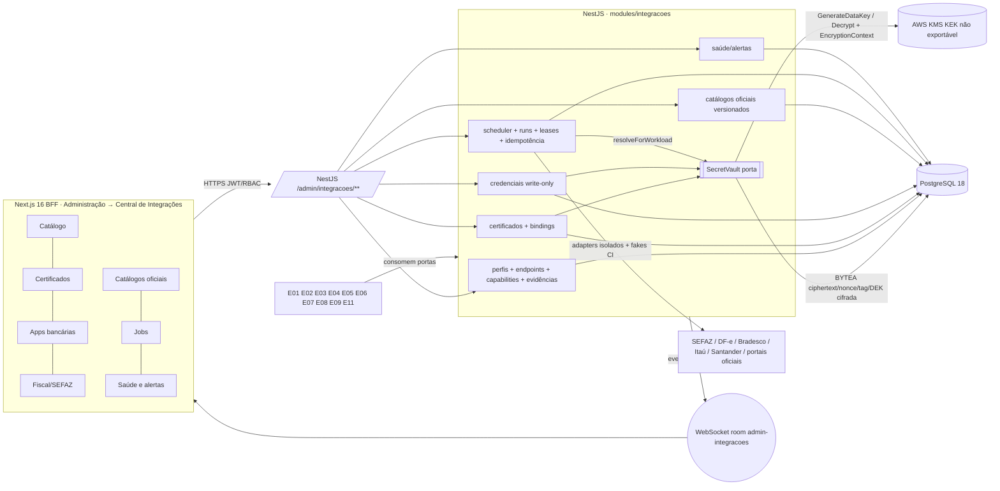

# E12-T00 — Gate CROSS: ADR da fundação de integrações (cofre PostgreSQL + AWS KMS, certificados, jobs batch, 7 views, ownership) — Plano Tático

> Papel autor: `planner`. Documento **somente documental**: zero código, zero migration, zero PR aberto por este papel.
> Workers futuros (E12-T01..T12) seguem este plano **literalmente**; caso não coberto, `old_string` que não casa ou teste que falha após 1 correção → **PARAR e reportar**. Worker não decide regra, não edita `docs/execucao/`, não cria perfil canônico, não altera `MENUS_CANONICOS`.

**Goal:** Congelar, para o Portão 1 do gate CROSS E12-T00 (Linear ALP-173), a arquitetura única da plataforma de integrações do ERP AlphaCarnes. Ela cobre perfis por provedor/serviço/ambiente, endpoints de allowlist, capabilities, certificados A1 e chaves bancárias, credenciais write-only, cofre criptográfico em PostgreSQL com KEK em AWS KMS, catálogos oficiais versionados, jobs batch sem sessão humana e as 7 views da Central de Integrações. O plano fixa ownership, fronteiras, DDL conceitual, mapa de consumidores, matriz tela→protótipo, riscos e pendências, e o DoD→teste 1:1 de E12-T01..T12. Nada é implementado nesta onda.

**Architecture:** monólito modular NestJS 11 (Constituição, "sem microserviços"). O módulo novo `app/backend/src/modules/integracoes/` é a autoridade única (Princípio III), com submódulos `perfis`, `cofre`, `certificados`, `credenciais`, `referencias`, `jobs` e `saude`. O cofre fica atrás de uma porta `SecretVault` com dois adapters: `KmsEnvelopeVault`, que cifra com AES-256-GCM no NestJS usando DEK de `GenerateDataKey`, e `FakeEnvelopeVault`, determinístico para o CI (Princípio V). Ciphertext, nonce, tag e DEK cifrada ficam em `BYTEA` no PostgreSQL 18. O scheduler roda dentro do processo backend com lease/fencing no PostgreSQL. Eventos são emitidos pós-commit via `@nestjs/event-emitter` e WebSocket nativo (Princípio VI, ADR-004). Frontend Next.js 16 App Router com BFF, DS v3 Direção A (AD-10).

**Tech Stack (fixa, sem troca):** Node 22, NestJS 11, TypeScript 5 strict, Next.js 16 App Router/BFF, React 19, PostgreSQL 18, Drizzle + drizzle-kit, Zod 4, WebSocket nativo, JWT + RBAC (11 perfis, AD-04), Jest/Supertest, Playwright. Biblioteca de KMS e de parsing PKCS#12/X.509 será escolhida em E12-T02/T03 com versão pinada e aprovada no Portão 1 daquela task (regra de dependências do AGENTS). Este plano não as adiciona.

**Base pinada no momento do plano:** `origin/develop` @ `db9d8ac1760a01c262c57a9f824d2c8fcf18291b`. Última migration: `0043_onda14_ocorrencias_preco`; próximo índice livre: `0044`. Se o journal de develop avançar, a numeração das tasks futuras é recalculada pelo Planner da onda; o worker não renumera.

**Worktree / branch:** `F:/Projetos/AlphaCarnes/.worktrees/e12-t00` · `feature/erp-e12-t00-cross-adr`. Nunca implementar no worktree coordenador.

**Linear:** ALP-173 (E12-T00). Tasks futuras: E12-T01..T12. Gate irmão: ALP-160 (E11-T00).

---

## 0. Dependência documental com o PR #157 (decisão de merge NÃO tomada aqui)

Fatos verificados:
- `docs/expansao-erp-2026/**` e `docs/prototipos/erp-integrado-v1/**` só existem na branch `feature/erp-fiscal-financeiro-contabil-especificacoes-2026` (PR #157, não mergeado).
- Em `db9d8ac`, `docs/execucao/DECISOES.md` **não contém AD-18, AD-19 nem AD-20**, e `docs/governance/constituicao.md` não está na versão 1.2.0 (emenda do menu de 13 grupos). Os pilares normativos deste ADR estão, portanto, somente no #157.

| Opção | Descrição | Prós | Contras |
|---|---|---|---|
| **A (recomendada)** | O PR do E12-T00 (destino `develop`) só abre depois do merge do #157. Este branch é rebaseado sobre o `develop` resultante, e os links relativos para Cadernos e protótipo passam a resolver. | Fonte única; nenhuma cópia; AD-18..20 e constituição 1.2.0 vigentes no mesmo `develop`; Portão 2 do PR documental verifica links reais. | O E12-T00 fica serializado atrás do #157. |
| B | Portar para este PR cópias dos docs 22/23/24, das matrizes e de `catalogo.js`, com cabeçalho de proveniência (branch, SHA e caminho de origem). | Independe do #157. | Duplica fonte de verdade; causa conflito de merge quando o #157 entrar; as cópias podem divergir; AD-18..20 continuariam ausentes de `develop` (DECISOES só recebe decisão do QO e não pode ser portada pelo planner). |

Recomendação: **Opção A.** Enquanto o #157 não mergear, este plano cita as fontes por caminho relativo ao repositório (`docs/expansao-erp-2026/...`) e registra o SHA de leitura na Task 1. Decisão de merge: Executor ou Quality Owner.

## 1. Decisões fixadas (não reabrir; origem entre parênteses)

1. E12 é a fundação **única** de perfis, endpoints, capabilities, certificados, credenciais, catálogos oficiais e jobs. É proibido duplicar isso em E02, E06 ou E11 (AD-18; doc 23 D3; Caderno B §4-B).
2. Os segredos ficam no PostgreSQL **somente como ciphertext** AES-256-GCM gerado no NestJS. Cada versão de segredo tem sua DEK de 256 bits, obtida por `kms:GenerateDataKey` e guardada cifrada ao lado do ciphertext. A KEK é AWS KMS não exportável. Não há chave mestra no DB, em `.env`, no frontend, no repositório, em logs ou em `parametros.valor_json` (AD-18 (3); ADR-ERP-024).
3. Proibidos: `pgcrypto` com chave enviada ao banco; Secrets Manager por certificado; plaintext ou PFX em disco temporário; GET de chave privada; senha PFX persistida (ADR-ERP-024 "Requisitos inversos").
4. Nonce de 96 bits nova a cada cifragem; tag de 16 bytes. A AAD canônica é JSON com chaves ordenadas `{companyId, environment, service, purpose, secretVersion, secretVersionId}`. O mesmo conjunto sem `secretVersionId` é o `EncryptionContext` do KMS. `encryption_context_hash` = SHA-256 da AAD canônica (ADR-ERP-024 Pipeline 3–4).
5. Ambientes externos: literais `HML` e `PROD`, conforme o CHECK de ADR-ERP-024. O doc 22 usa "PRD"; prevalece o ADR ratificado.
6. Upload: A1 PFX/P12 ou CRT+KEY (e, quando o banco exigir, CSR gerado no backend). A senha é transitória, write-only, só em memória. A3 é rejeitado no upload para batch (doc 22 §4.7).
7. Jobs batch rodam sem sessão de operador, com identidade técnica de menor privilégio, lease com fencing token, idempotência e checkpoint. A chamada de rede fica fora da transação. A versão de certificado e de perfil é fixada no início do run (doc 22 §5).
8. A UI só reage a eventos pós-commit via WS; nenhum polling novo no frontend. O scheduler de backend não é polling de UI (Princípio VI; doc 22 §5).
9. `.env` fica restrito ao bootstrap técnico já existente em `env.schema.ts` (DATABASE_URL, JWT_*, COOKIE_SECURE, THROTTLE_*, CORS_ORIGIN, LOG_LEVEL, PORT). É **proibido** acrescentar `BANK_*`, `SEFAZ_*`, `CERT_*`, `CNAB_*` ou `JOB_*`, URL, cron, timezone de negócio ou client_id (doc 22 §6).
10. Menu: Administração (grupo 13) → Central de Integrações, com 7 views em subnavegação. Os 9 grupos originais e as 39 rotas não mudam (AD-18 (1); ADR-ERP-024 Menu).
11. 11 perfis canônicos (AD-04; AD-18 (5)). Personas do protótipo não viram perfis.
12. A UI não exibe UUID, PK, `company_id`, secretRef, ARN, código E##/ALP nem nome técnico de tabela (Caderno B "Requisito transversal de UX integral"; MATRIZ-UX "Requisito inverso").
13. Nenhum efeito externo real (SEFAZ, banco), homologação ou produção é autorizado por este gate (AD-19 (3)).
14. Migrations futuras: só via `drizzle-kit generate`, uuidv7, TIMESTAMPTZ, status TEXT+CHECK, soft delete onde for entidade de negócio, um schema Drizzle por domínio (Princípio X).

## 2. Conflitos entre fontes, resolvidos por precedência (nenhum é decisão de produto)

| # | Conflito | Fontes | Resolução |
|---|---|---|---|
| C1 | V05 e V06 invertidos | doc 22 §3 (V05=Jobs, V06=Versões) × catalogo.js/MATRIZ (V05=Catálogos Oficiais, V06=Jobs) | Prevalece o protótipo (precedência 4 > 6): **V05 = Catálogos Oficiais e Versões; V06 = Jobs Batch e Histórico**. |
| C2 | `PRD` × `PROD` | doc 22 × ADR-ERP-024 (referenciado por AD-18) | `PROD`. |
| C3 | Cofre em Secrets Manager | doc 23 E12-T02 ("Secrets Manager ou equivalente") × AD-18 | AD-18 prevalece: KMS + ciphertext em PostgreSQL; Secrets Manager não é usado. |
| C4 | `external_contracts` com conta, convênio e carteira | doc 22 §2 × ownership do próprio doc 22 §1 (E06 é dono de contas e convênios) | O E12 guarda só **evidência de habilitação** por serviço (`integration_enablement_evidence`). Conta, convênio e carteira são do E06 e entram por FK nullable criada pelo E06. |
| C5 | "Worker independente" × "sem microserviços" | doc 22/23 × Constituição | Scheduler e worker rodam como módulo do mesmo processo NestJS. Réplicas são coordenadas por lease no PostgreSQL. Não há serviço novo nem variável de ambiente nova. |
| C6 | Rota de protótipo `/admin/integracoes/e12-v0N` × proibição de código E## visível | catalogo.js × Caderno B UX | Proposta: slugs semânticos (§6). Requer confirmação no Portão 1 ou pelo QO → **H-05**. |

## 3. ADR-ERP-025 — Fundação de integrações E12 (conteúdo normativo deste gate)

**Estado:** proposto para o Portão 1 do E12-T00. Complementa ADR-ERP-024, sem substituí-lo.
**Localização recomendada:** seção deste plano, em `docs/superpowers/plans/`, diretório que já existe em `develop`. Um arquivo separado em `docs/expansao-erp-2026/` só faria sentido depois do #157 (§0) e duplicaria a seção. Recomendação: **manter o ADR aqui**.

### 3.1 Contexto
O ERP precisa operar NF-e 55/DF-e (E02/E03), APIs de três bancos (E06), arquivos CNAB/OFX/CSV (E11), SPED (E09) e catálogos normativos (E01) sem `.env` operacional e sem segredo em claro. Em `develop` existem só o EISS municipal (`integracoes/nfse/`) e `parametros` (chave-valor JSONB, legível por todos os 11 perfis via `PARAMETROS_LER` e auditado com valor antes e depois). Esse mecanismo é inadequado como cofre (doc 23 D2, rejeitada).

### 3.2 Decisão
Adotar D3 (doc 23): cadastro central versionado no PostgreSQL, cofre em envelope com AWS KMS, jobs definidos no banco e console administrativo de 7 views. Os épicos de domínio consomem interfaces da fundação e não copiam suas tabelas.

### 3.3 Diagrama


### 3.4 Ownership — tabelas

| Tabela (E12) | Dono | Pode escrever | Consumidores (somente leitura via serviço) |
|---|---|---|---|
| `integration_providers` | E12 | E12 (seed + admin) | todos |
| `integration_profiles` | E12 | E12 | E02, E03, E06, E09, E11 |
| `integration_endpoints` | E12 | E12 (allowlist aprovada) | adapters de E02, E03, E06, E09 |
| `integration_capabilities` | E12 | E12 | E04, E05, E06, E07, E08, E11 |
| `integration_enablement_evidence` | E12 | E12 | E06, E11-T00 |
| `integration_secret_versions` | E12 (cofre) | só `SecretVault` | nenhum acesso direto; só `resolveForWorkload` |
| `integration_certificates` | E12 | E12 | E02, E03, E06, E09 (metadados) |
| `integration_certificate_bindings` | E12 | E12 | adapters |
| `integration_credentials` | E12 | E12 | adapters E06 |
| `integration_reference_datasets` | E12 | E12 | E01 (ativação de regra é do E01), E02, E09, E11 |
| `integration_job_definitions` | E12 | E12 | domínios registram tipos de operação |
| `integration_job_runs` | E12 | scheduler E12 | E12 saúde, E07, E08 (status) |
| `integration_job_leases` | E12 | scheduler E12 | — |
| `integration_job_idempotency_keys` | E12 | scheduler E12 | — |
| `integration_workload_grants` | E12 | E12 (com aprovação) | `SecretVault` |
| `integration_alerts` | E12 | E12 saúde | V07 |

Ficam **fora do E12** (não criar): empresas e estabelecimentos (E01-T01); contas bancárias, convênios e carteiras (E06); layouts, lotes e observações de arquivo (`bank_import_batches`, `bank_source_observations` etc.) (E11); transação econômica, conciliação e baixa (E07); documentos fiscais NF-e e eventos SEFAZ (E02/E03); razão e SPED (E09); outbox genérico de eventos de domínio (owner fixado no gate E11-T00, ver D-E11).

### 3.5 Ownership — eventos (todos pós-commit; valores em snake_case conforme `realtime/events/eventos.ts`)

| Evento | Dono | Room WS | Gatilho |
|---|---|---|---|
| `integracao_perfil_alterado` | E12 | `admin-integracoes` | criar, editar, submeter, aprovar, suspender perfil |
| `certificado_importado` | E12 | `admin-integracoes` | upload validado e cifrado |
| `certificado_binding_alterado` | E12 | `admin-integracoes` | associar, rotacionar, revogar binding |
| `credencial_rotacionada` | E12 | `admin-integracoes` | criar ou rotacionar segredo (só metadados) |
| `catalogo_oficial_alterado` | E12 | `admin-integracoes` | staging, validação, aprovação, ativação |
| `job_execucao_alterada` | E12 | `admin-integracoes` | transição de estado de run |
| `alerta_integracao_aberto` / `alerta_integracao_reconhecido` | E12 | `admin-integracoes`, `dashboard` | expiração 60/30/15/7, falha, CA trocada, gap NSU |

Eventos de negócio (`nfe_autorizada`, título baixado, observação bancária etc.) pertencem aos épicos de domínio. Payloads de evento **nunca** carregam segredo, ciphertext, secretRef ou ARN.

### 3.6 Fronteiras empresa/estabelecimento e HML/PROD
- **Empresa:** toda linha E12 com dado de empresa traz `company_id` (FK para a entidade de empresa do E01-T01) e, quando aplicável, `establishment_id`. A coerência é garantida por FKs compostas `(id, company_id)` entre perfil, binding, certificado e segredo, de modo que um binding não liga certificado de outra empresa. Além disso, o backend filtra por empresa e valida em cada serviço (Princípio III).
- **HML/PROD:** `environment` está em perfil, endpoint, binding e segredo. A FK composta `(profile_id, environment)` impede associar segredo HML a perfil PROD. O ambiente entra na AAD e no EncryptionContext, portanto um ciphertext HML não decifra num contexto PROD.
- **Deployment × ambiente externo:** cada deployment (CI/dev com fake, homologação, produção) usa sua própria chave KMS (`kms_key_arn`). Dentro do deployment de produção coexistem perfis externos HML e PROD; a segregação entre eles é criptográfica, via contexto. Se a TI exigir chave distinta por ambiente externo → **H-02**.
- Restaurar o banco de produção em homologação é proibido (doc 22 §6). Teste de DR decifra com papel de recuperação autorizado.

### 3.7 RBAC e RLS
- Permissões novas (doc 22 §7): `INTEGRACOES_VIEW`, `INTEGRACOES_CONFIG`, `INTEGRACOES_CERT_UPLOAD`, `INTEGRACOES_TEST`, `INTEGRACOES_APPROVE_PROD`, `INTEGRACOES_BATCH_EXEC`, `INTEGRACOES_VAULT_ROTATE`. São aplicadas por `@RequirePermissoes` no controller e revalidadas no serviço por empresa.
- Atribuir essas permissões a quais dos 11 perfis exige decisão de alçada do QO (ADR-ERP-024 RBAC) → **H-03**. Proposta: só `administrador`. Até a decisão, a seed não as atribui a nenhum outro perfil.
- Dupla aprovação em PROD: aprovador ≠ solicitante, ambos com `INTEGRACOES_APPROVE_PROD` → **H-04** (confirmar que bastam dois usuários distintos).
- Identidade de workload: o job executa como principal técnico, sem JWT de usuário. `integration_workload_grants` lista quais `(operation, service, purpose)` cada tipo de job pode resolver no cofre; o padrão é negar. A auditoria grava `usuario_id = NULL` e `modulo = 'integracoes.job'` com o identificador do run.
- **RLS:** não adotado nesta fundação. Motivos: `develop` não tem papéis de banco separados nem RLS em nenhuma tabela; a fronteira de autorização é o backend (Princípio III); o plaintext é protegido por IAM/KMS e não pelo SQL (ADR-ERP-024: o administrador SQL lê só ciphertext). Adotar RLS exige decisão da TI sobre papéis de banco → **H-06**.

### 3.8 Cofre (porta `SecretVault`)
Operações: `saveEncryptedSecret(ctx, plaintext): SecretVersionRef`, `resolveForWorkload(workloadGrant, bindingRef): Buffer` (escopo de uso curto e zeragem do buffer), `rotateSecret`, `revokeBinding`, `auditMetadata`.

Pipeline de cifragem (ADR-ERP-024):
1. `GenerateDataKey(AES_256, EncryptionContext)`.
2. Gerar nonce aleatória de 12 bytes.
3. Cifrar com AES-256-GCM usando a AAD.
4. Persistir em uma única transação: `ciphertext`, `nonce`, `auth_tag`, `encrypted_data_key`, `kms_key_arn`, `encryption_context_hash`.
5. Zerar a DEK em claro.

Pipeline de decifragem: `Decrypt(encrypted_data_key, EncryptionContext)` → verificação GCM. Qualquer falha resulta em erro explícito e alerta, nunca em fallback (Princípio VII).

No CI, `FakeEnvelopeVault` usa uma KEK efêmera gerada em memória por processo de teste. Não existe KEK fake versionada no repositório.

### 3.9 Batch
Estados do run: `QUEUED`, `LEASED`, `RUNNING`, `SUCCEEDED`, `RETRY_SCHEDULED`, `NEEDS_REVIEW`, `FAILED`, `CANCELLED`.

Fluxo:
1. O claim usa `SELECT … FOR UPDATE SKIP LOCKED`.
2. `integration_job_leases` guarda `lease_until` e `fencing_token` monotônico. Escrita com token obsoleto é rejeitada.
3. Idempotência por `(company_id, capability, operation, external_key)`.
4. Backoff com jitter e respeito a `Retry-After`.
5. Checkpoint (NSU, cursor de extrato) avança na mesma transação do resultado.
6. Credencial revogada ou vencida suspende o job e gera alerta.

### 3.10 Consequências
- Positivas: uma única superfície de segredo, rotação e auditoria; nenhum segredo em `.env`.
- Custos: dependência de AWS KMS a partir de uma operação on-premises (**H-01**) e de um scheduler novo. Esta onda não remove nem altera `.env` existente.

## 4. DDL conceitual (NÃO é migration; worker ajusta para Drizzle, uuidv7 e convenções reais)

```sql
-- Referências externas a E12 (criadas por outros épicos):
--   companies(id), establishments(id, company_id)              -- E01-T01
--   bank_accounts(id, company_id), bank_agreements(id, ...)     -- E06
--   bank_file_layouts(id, ...)                                  -- E11
-- users(id) = usuarios(id) existente.

CREATE TABLE integration_providers (
  id uuid PRIMARY KEY DEFAULT uuidv7(),
  code text NOT NULL UNIQUE,                    -- SEFAZ_SP_NFE, DFE_NACIONAL, BRADESCO, ITAU, SANTANDER, SPED, OFICIAL_REF
  display_name text NOT NULL,
  kind text NOT NULL CHECK (kind IN ('FISCAL','BANK','REFERENCE')),
  official_documentation_url text,
  status text NOT NULL CHECK (status IN ('ACTIVE','INACTIVE')),
  created_at timestamptz NOT NULL DEFAULT now(), updated_at timestamptz NOT NULL DEFAULT now()
);

CREATE TABLE integration_profiles (
  id uuid PRIMARY KEY DEFAULT uuidv7(),
  company_id uuid NOT NULL,                     -- FK E01
  establishment_id uuid,                        -- FK E01, nullable
  provider_id uuid NOT NULL REFERENCES integration_providers(id),
  service_code text NOT NULL,                   -- enum controlado por provedor (NFE_AUTORIZACAO, DFE_DIST, BANK_EXTRATO…)
  environment text NOT NULL CHECK (environment IN ('HML','PROD')),
  version integer NOT NULL CHECK (version > 0),
  status text NOT NULL CHECK (status IN ('DRAFT','WAITING_EXTERNAL','HML_READY','HML_TESTED','PROD_REVIEW','ACTIVE','SUSPENDED','EXPIRED')),
  bank_agreement_id uuid,                       -- FK E06 adicionada pelo E06 (expand), nullable
  created_by uuid NOT NULL, approved_by uuid, second_approved_by uuid,
  created_at timestamptz NOT NULL DEFAULT now(), updated_at timestamptz NOT NULL DEFAULT now(), deleted_at timestamptz,
  UNIQUE (id, company_id), UNIQUE (id, environment),
  CHECK (approved_by IS NULL OR approved_by <> created_by),
  CHECK (second_approved_by IS NULL OR second_approved_by NOT IN (created_by, approved_by))
);
-- um ACTIVE por (company, establishment, provider, service, environment):
CREATE UNIQUE INDEX uq_profile_active ON integration_profiles
  (company_id, COALESCE(establishment_id,'00000000-0000-0000-0000-000000000000'), provider_id, service_code, environment)
  WHERE status='ACTIVE' AND deleted_at IS NULL;

CREATE TABLE integration_endpoints (
  id uuid PRIMARY KEY DEFAULT uuidv7(),
  profile_id uuid NOT NULL, environment text NOT NULL,
  service_operation text NOT NULL,              -- enum (NfeAutorizacao4, NfeRetAutorizacao4, NfeConsultaProtocolo4, NfeStatusServico4, RecepcaoEvento4, NfeInutilizacao4, NFeDistribuicaoDFe, …)
  base_url text NOT NULL,                       -- só https; host em allowlist do provedor
  soap_action text, contract_version text NOT NULL,
  official_source_dataset_id uuid,              -- FK integration_reference_datasets
  effective_from timestamptz NOT NULL, effective_to timestamptz,
  approved_by uuid,
  FOREIGN KEY (profile_id, environment) REFERENCES integration_profiles(id, environment),
  CHECK (base_url LIKE 'https://%')
);

CREATE TABLE integration_capabilities (
  id uuid PRIMARY KEY DEFAULT uuidv7(),
  profile_id uuid NOT NULL REFERENCES integration_profiles(id),
  capability text NOT NULL,                     -- BOLETO_REGISTRO, EXTRATO, PIX_COBRANCA, DDA, WEBHOOK, NFE_EMISSAO, DFE_DISTRIBUICAO, …
  channel text NOT NULL CHECK (channel IN ('API','FILE')),
  contract_version text,
  bank_file_layout_id uuid,                     -- FK E11, só quando channel='FILE'
  rate_limit_per_minute integer CHECK (rate_limit_per_minute > 0),
  status text NOT NULL CHECK (status IN ('DISABLED','HML_TESTED','ENABLED','SUSPENDED')),
  enabled_at timestamptz, tested_at timestamptz,
  UNIQUE (profile_id, capability, channel)
);

CREATE TABLE integration_enablement_evidence (  -- evidência de habilitação externa; NÃO guarda conta/convênio (E06)
  id uuid PRIMARY KEY DEFAULT uuidv7(),
  profile_id uuid NOT NULL REFERENCES integration_profiles(id),
  evidence_kind text NOT NULL CHECK (evidence_kind IN ('SEFAZ_CREDENCIAMENTO','BANK_CONTRATO','BANK_APP_PORTAL','CONTADOR_PARECER','OUTRO_OFICIAL')),
  evidence_status text NOT NULL CHECK (evidence_status IN ('DECLARADO','VERIFICADO','REJEITADO')),
  document_ref text,                            -- referência de arquivo/protocolo, sem segredo
  agreed_capabilities text[] NOT NULL DEFAULT '{}',
  valid_from date, valid_to date,
  verified_by uuid, created_at timestamptz NOT NULL DEFAULT now()
);

CREATE TABLE integration_secret_versions (     -- ADR-ERP-024, convenções do projeto
  id uuid PRIMARY KEY DEFAULT uuidv7(),
  company_id uuid NOT NULL,
  environment text NOT NULL CHECK (environment IN ('HML','PROD')),
  service text NOT NULL, purpose text NOT NULL,
  secret_kind text NOT NULL CHECK (secret_kind IN ('PRIVATE_KEY_PKCS8','OAUTH_CLIENT_SECRET','API_KEY','WEBHOOK_SIGNING_KEY')),
  version integer NOT NULL CHECK (version > 0),
  cipher_alg text NOT NULL CHECK (cipher_alg = 'AES-256-GCM'),
  ciphertext bytea NOT NULL,
  nonce bytea NOT NULL CHECK (octet_length(nonce) = 12),
  auth_tag bytea NOT NULL CHECK (octet_length(auth_tag) = 16),
  encrypted_data_key bytea NOT NULL,
  kms_key_arn text NOT NULL,
  encryption_context_hash bytea NOT NULL CHECK (octet_length(encryption_context_hash) = 32),
  status text NOT NULL CHECK (status IN ('PENDING','ACTIVE','RETIRED','REVOKED')),
  expires_at timestamptz,
  created_by uuid NOT NULL, approved_by uuid,
  created_at timestamptz NOT NULL DEFAULT now(),
  UNIQUE (company_id, environment, service, purpose, version),
  UNIQUE (id, company_id), UNIQUE (id, environment)
);  -- imutável: sem UPDATE de colunas criptográficas (só status); sem soft delete do ciphertext antes da política H-12

CREATE TABLE integration_certificates (
  id uuid PRIMARY KEY DEFAULT uuidv7(),
  company_id uuid NOT NULL, establishment_id uuid,
  purpose text NOT NULL CHECK (purpose IN ('NFE_SIGN','NFE_MTLS','BANK_MTLS','BANK_SIGN','SPED_SIGN','WEBHOOK_TLS','TRUST_CA')),
  origin text NOT NULL CHECK (origin IN ('PFX_UPLOAD','PEM_UPLOAD','CSR_GENERATED','TRUST_CA_UPLOAD')),
  certificate_public_der bytea NOT NULL,        -- público, não sigiloso
  thumbprint_sha256 text NOT NULL, serial_number text NOT NULL,
  issuer_dn text NOT NULL, subject_dn text NOT NULL,
  subject_cnpj text,                            -- string (CNPJ alfanumérico)
  not_before timestamptz NOT NULL, not_after timestamptz NOT NULL,
  key_algorithm text NOT NULL,
  private_key_secret_version_id uuid,           -- NULL só para TRUST_CA
  validation_status text NOT NULL CHECK (validation_status IN ('VALID','EXPIRED','REVOKED','CHAIN_INVALID','PENDING_CHECK')),
  uploaded_by uuid NOT NULL, approved_by uuid, revoked_at timestamptz,
  created_at timestamptz NOT NULL DEFAULT now(),
  FOREIGN KEY (private_key_secret_version_id, company_id) REFERENCES integration_secret_versions(id, company_id),
  UNIQUE (company_id, purpose, thumbprint_sha256), UNIQUE (id, company_id),
  CHECK ((purpose = 'TRUST_CA') = (private_key_secret_version_id IS NULL))
);

CREATE TABLE integration_certificate_bindings (
  id uuid PRIMARY KEY DEFAULT uuidv7(),
  company_id uuid NOT NULL,
  profile_id uuid NOT NULL, certificate_id uuid NOT NULL,
  purpose text NOT NULL, environment text NOT NULL,
  valid_from timestamptz NOT NULL, valid_to timestamptz,
  status text NOT NULL CHECK (status IN ('PENDING_APPROVAL','CURRENT','ROTATION_OVERLAP','RETIRED','REVOKED')),
  approved_by uuid, second_approved_by uuid,
  FOREIGN KEY (profile_id, company_id) REFERENCES integration_profiles(id, company_id),
  FOREIGN KEY (profile_id, environment) REFERENCES integration_profiles(id, environment),
  FOREIGN KEY (certificate_id, company_id) REFERENCES integration_certificates(id, company_id)
);
CREATE UNIQUE INDEX uq_binding_current ON integration_certificate_bindings (profile_id, purpose) WHERE status = 'CURRENT';
-- sobreposição só com status ROTATION_OVERLAP aprovado (rotação formal)

CREATE TABLE integration_credentials (
  id uuid PRIMARY KEY DEFAULT uuidv7(),
  company_id uuid NOT NULL, profile_id uuid NOT NULL, environment text NOT NULL,
  credential_type text NOT NULL CHECK (credential_type IN ('OAUTH_CLIENT','API_KEY','WEBHOOK_SIGN')),
  client_id text,                               -- não sigiloso; exibível mascarado
  secret_version_id uuid NOT NULL,              -- "secretRef": nunca serializado para a UI
  scopes text[] NOT NULL DEFAULT '{}',
  expires_at timestamptz, last_rotated_at timestamptz,
  status text NOT NULL CHECK (status IN ('PENDING','ACTIVE','SUSPENDED','REVOKED')),
  FOREIGN KEY (profile_id, environment) REFERENCES integration_profiles(id, environment),
  FOREIGN KEY (secret_version_id, environment) REFERENCES integration_secret_versions(id, environment)
);

CREATE TABLE integration_reference_datasets (
  id uuid PRIMARY KEY DEFAULT uuidv7(),
  dataset_code text NOT NULL,                   -- NFE_XSD, NT, CCLASSTRIB, CBENEF, NCM, MUNICIPIOS, SPED_EFD, BANK_OPENAPI, BANK_CNAB_LAYOUT
  official_url text NOT NULL,                   -- host em allowlist
  version_label text NOT NULL, published_at date, verified_at timestamptz NOT NULL,
  checksum_sha256 text,                         -- obrigatório quando houve download
  effective_from date, effective_to date,
  status text NOT NULL CHECK (status IN ('STAGED','VALIDATED','APPROVED','ACTIVE','RETIRED','REJECTED')),
  diff_summary jsonb NOT NULL DEFAULT '{}',     -- sem segredo
  approved_by uuid, next_review_at date,
  UNIQUE (dataset_code, version_label)
);

CREATE TABLE integration_job_definitions (
  id uuid PRIMARY KEY DEFAULT uuidv7(),
  company_id uuid NOT NULL, profile_id uuid,
  operation text NOT NULL,                      -- enum registrado pelos domínios (DFE_NSU_SYNC, NFE_CONSULTA_PENDENTE, BANK_EXTRATO_SYNC, E11_RETORNO_IMPORT, CERT_EXPIRY_SCAN, REFERENCE_CHECK…)
  schedule_type text NOT NULL CHECK (schedule_type IN ('CRON','INTERVAL','MANUAL','EVENT')),
  schedule_expr text, timezone text NOT NULL DEFAULT 'America/Sao_Paulo',
  next_run_at timestamptz, checkpoint jsonb NOT NULL DEFAULT '{}',
  retry_policy jsonb NOT NULL, concurrency_key text NOT NULL,
  config_version integer NOT NULL, enabled boolean NOT NULL DEFAULT false,
  created_by uuid NOT NULL, approved_by uuid,
  UNIQUE (company_id, operation, concurrency_key)
);

CREATE TABLE integration_job_runs (
  id uuid PRIMARY KEY DEFAULT uuidv7(),
  job_id uuid NOT NULL REFERENCES integration_job_definitions(id),
  attempt integer NOT NULL CHECK (attempt > 0),
  status text NOT NULL CHECK (status IN ('QUEUED','LEASED','RUNNING','SUCCEEDED','RETRY_SCHEDULED','NEEDS_REVIEW','FAILED','CANCELLED')),
  fencing_token bigint, pinned_profile_version integer, pinned_secret_version_id uuid,
  input_checkpoint jsonb, output_checkpoint jsonb,
  external_correlation_id text, error_code text,  -- error_code catalogado, sem mensagem bruta de terceiro com segredo
  total_processed integer NOT NULL DEFAULT 0,
  triggered_by text NOT NULL CHECK (triggered_by IN ('SCHEDULE','MANUAL','REPROCESS','EVENT')),
  requested_by uuid, justification text,
  started_at timestamptz, ended_at timestamptz, created_at timestamptz NOT NULL DEFAULT now()
);

CREATE TABLE integration_job_leases (
  job_id uuid PRIMARY KEY REFERENCES integration_job_definitions(id),
  holder text NOT NULL, lease_until timestamptz NOT NULL, fencing_token bigint NOT NULL
);

CREATE TABLE integration_job_idempotency_keys (
  company_id uuid NOT NULL, capability text NOT NULL, operation text NOT NULL, external_key text NOT NULL,
  first_run_id uuid NOT NULL REFERENCES integration_job_runs(id), created_at timestamptz NOT NULL DEFAULT now(),
  PRIMARY KEY (company_id, capability, operation, external_key)
);

CREATE TABLE integration_workload_grants (
  id uuid PRIMARY KEY DEFAULT uuidv7(),
  operation text NOT NULL, service text NOT NULL, purpose text NOT NULL,
  environment text NOT NULL CHECK (environment IN ('HML','PROD')),
  approved_by uuid NOT NULL, created_at timestamptz NOT NULL DEFAULT now(), revoked_at timestamptz,
  UNIQUE (operation, service, purpose, environment)
);

CREATE TABLE integration_alerts (
  id uuid PRIMARY KEY DEFAULT uuidv7(),
  company_id uuid NOT NULL,
  alert_kind text NOT NULL CHECK (alert_kind IN ('CERT_EXPIRY_60','CERT_EXPIRY_30','CERT_EXPIRY_15','CERT_EXPIRY_7','CERT_EXPIRED','CA_CHANGED','API_DOWN','JOB_LATE','JOB_FAILED','NSU_GAP','LAYOUT_OUTDATED','WEBHOOK_FAILING','RATE_LIMIT','FAILBACK_ACTIVE')),
  severity text NOT NULL CHECK (severity IN ('INFO','WARN','CRITICAL')),
  subject_table text NOT NULL, subject_id uuid NOT NULL,
  status text NOT NULL CHECK (status IN ('OPEN','ACKNOWLEDGED','RESOLVED')),
  acknowledged_by uuid, created_at timestamptz NOT NULL DEFAULT now(), resolved_at timestamptz
);
```

Restrições adicionais:
- `parametros` passa a rejeitar, no backend (E12-T01), chaves e valores com padrão de segredo: `password`, `senha`, `secret`, `token`, `private`, `pfx`, `client_secret` e conteúdo PEM/PKCS12.
- `auditoria.dados_anteriores` e `auditoria.dados_novos` das tabelas E12 recebem só o DTO redigido. As colunas `ciphertext`, `nonce`, `auth_tag`, `encrypted_data_key`, `kms_key_arn` e `secret_version_id` nunca entram na auditoria.

## 5. Consumidores E01..E11 e código impactado em `develop` (db9d8ac)

### 5.1 Por consumidor
| Épico | Mantém (dono) | Consome do E12 | Porta/serviço E12 |
|---|---|---|---|
| E01 | empresas, estabelecimentos, regime, regras tributárias | `integration_reference_datasets` (cClassTrib, cBenef, NCM, NT); certificado só por referência | `ReferenciasService.versaoAtiva(code, data)` |
| E02 | NF-e 55, XMLDsig, eventos SEFAZ | perfil, endpoints, binding `NFE_SIGN`/`NFE_MTLS`, job de consulta pendente | `PerfisService.resolver`, `SecretVault.resolveForWorkload`, `JobsService.registrarOperacao` |
| E03 | DF-e entrada, NSU, manifestação | perfil DF-e, certificado, job `DFE_NSU_SYNC` com checkpoint | idem |
| E04 | AP/pagamentos | capability bancária (`PAGAMENTOS`), job | `CapabilitiesService.habilitada` |
| E05 | AR/boletos | capability `BOLETO_*`, credencial, webhook | idem + `CredenciaisService` |
| E06 | contas, convênios, carteiras, adapters bancários | perfis bancários, credenciais OAuth, `BANK_MTLS`, endpoints, evidências | todas as portas; acrescenta FK `bank_agreement_id` |
| E07 | conciliação, alocação, baixa | runs/jobs como origem; **não** cria ledger no E12 | `job_execucao_alterada` |
| E08 | projeções de caixa | job `BANK_EXTRATO_SYNC`, alertas | eventos E12 |
| E09 | razão, SPED | dataset `SPED_EFD`, `SPED_SIGN` | `ReferenciasService`, `SecretVault` |
| E10 | menu e UX | 7 views; item de menu da Central | E10-T04 altera `MENUS_CANONICOS` e `menu-v2.ts` |
| E11 | layouts, parsers, lotes, provenance | jobs de importação, capability `FILE`, credencial SFTP quando houver | `JobsService`, `CapabilitiesService` |

### 5.2 Arquivos de `develop` impactados (por task futura; nenhum é alterado no E12-T00)
| Arquivo | Impacto | Task |
|---|---|---|
| `app/backend/src/database/schema/index.ts` | `export * from './integracoes.schema'` | E12-T01 |
| `app/backend/src/database/schema/integracoes.schema.ts` (novo) | tabelas da §4 | E12-T01 |
| `app/backend/src/database/migrations/` + `meta/_journal.json` | migration a partir de `0044`, via drizzle-kit | E12-T01 |
| `app/backend/src/modules/parametros/parametros.service.ts` e `dto/parametro.dto.ts` | rejeição de chave e valor com padrão de segredo | E12-T01 |
| `app/backend/src/common/auditoria/auditoria.service.ts` | sem mudança de API; E12 passa DTO redigido; teste de não vazamento | E12-T02 |
| `app/backend/src/common/rbac/permissoes.ts` e `perfil-permissoes.snapshot.json` | 7 permissões `INTEGRACOES_*`; atribuição conforme H-03 | E12-T04 |
| `app/backend/src/common/rbac/menus-canonicos.ts`; `app/frontend/src/lib/menu-v2.ts` | entrada "Central de Integrações" no grupo Administração | **E10-T04** (não E12) |
| `app/backend/src/realtime/events/eventos.ts` e `realtime.gateway.ts` | eventos da §3.5 e room `admin-integracoes` | E12-T04/T09/T10 |
| `app/backend/src/config/env.schema.ts` | **nenhuma variável nova**; teste que falha se surgir `BANK_`, `SEFAZ_`, `CERT_`, `CNAB_` ou `JOB_` | E12-T02/T11 |
| `app/backend/src/app.module.ts` | registrar `IntegracoesModule` | E12-T01 |
| `app/backend/src/integracoes/nfse/*` (EISS) | **não alterar**; NF-e 55 não herda segredo EISS | — |
| `app/backend/src/database/seed.ts` | seed de `integration_providers` e permissões | E12-T01/T04 |
| `app/frontend/src/middleware.ts` e `app/frontend/src/app/api/**` | rotas BFF `/admin/integracoes/**`; upload multipart sem log de corpo | E12-T04/T05 |
| `.env.example`, `docker-compose.yml` | inventário só; nenhuma variável nova | E12-T11 |

## 6. Matriz tela → protótipo (7 views; fonte `docs/prototipos/erp-integrado-v1/`)

| View | Título no protótipo | Deep-link | catalogo.js | MATRIZ-INTEGRAL | MATRIZ-UX | Rota proposta (H-05) | Permissão mínima |
|---|---|---|---|---|---|---|---|
| E12-V01 | Catálogo de Integrações | `index.html#E12-V01` | L990–1003, `kind: admin_integration` | §"E12-V01" L477–483 | §"E12-V01" L1366–1389 | `/admin/integracoes` | `INTEGRACOES_VIEW` |
| E12-V02 | Certificados Digitais e Rotação | `#E12-V02` | L1005–1018, `kind: certificate`; assistente em `aplicacao.js` L345 | L485–491 | L1391–1418 | `/admin/integracoes/certificados` | `INTEGRACOES_CERT_UPLOAD` |
| E12-V03 | Aplicações Bancárias e Credenciais | `#E12-V03` | L1020–1033; `aplicacao.js` L317 | L493–499 | L1420–1448 | `/admin/integracoes/aplicacoes-bancarias` | `INTEGRACOES_CONFIG` |
| E12-V04 | Configuração Fiscal e SEFAZ | `#E12-V04` | L1035–1048; `aplicacao.js` L323 | L501–507 | L1450–1475 | `/admin/integracoes/fiscal` | `INTEGRACOES_CONFIG` |
| E12-V05 | Catálogos Oficiais e Versões | `#E12-V05` | L1050–1063, `kind: dataset`; `aplicacao.js` L329 | L509–515 | L1477–1500 | `/admin/integracoes/catalogos-oficiais` | `INTEGRACOES_CONFIG` |
| E12-V06 | Jobs Batch e Histórico de Execução | `#E12-V06` | L1065–1078, `kind: job`; `aplicacao.js` L347 | L517–523 | L1502–1525 | `/admin/integracoes/jobs` | `INTEGRACOES_BATCH_EXEC` |
| E12-V07 | Monitoramento e Alertas de Integrações | `#E12-V07` | L1080–1093, `kind: monitor`; `aplicacao.js` L335 | L525–531 | L1527– | `/admin/integracoes/saude` | `INTEGRACOES_VIEW` |

`homeRoutes["ADMINISTRAÇÃO"] = "E12-V01"` (catalogo.js L1100). Jornada J06 em `aplicacao.js` L124: V01→V02→V03→V04→V06→V07. Jornada J07 em L125: V05→E01-T03→E01-T04→E02-T05→E09-T05.

Aceite visual (todas as views): as 7 abas, a ficha completa, o formulário, as ações com justificativa, o histórico, o fluxo de erro e o controle de acesso (MATRIZ-INTEGRAL, "Aceite do protótipo"). O rótulo visível é o título do protótipo, sem o código E12-V0N.

## 7. Riscos, dependências e pendências

### 7.1 Dependências
- **D-157:** merge do PR #157 antes do PR deste gate (§0, Opção A).
- **D-E01:** entidade de empresa e estabelecimento do E01-T01 precede o E12-T01 (FK de `company_id` e `establishment_id`). Se o QO quiser inverter a ordem, a decisão é dele; o worker não cria tabela de empresa no E12.
- **D-E06:** FK `integration_profiles.bank_agreement_id` criada pelo E06.
- **D-E10:** E10-T04 inclui a Central no menu e no `MENUS_CANONICOS`. Até lá, as views do E12-T04..T10 não ganham entrada de menu.
- **D-E11:** E11-T00 (ALP-160) é cumulativo para qualquer adapter bancário e fixa o owner do outbox de domínio. A idempotência de job (`integration_job_idempotency_keys`) é do E12.
- **D-REVISÃO:** cada portão exige uma instância nova de Monitor (AD-20).

### 7.2 Pendências humanas e de dados externos (sem decisão inventada)
| ID | Pendência | Responsável | Bloqueia |
|---|---|---|---|
| H-01 | Como o runtime on-premises (docs 017/018) obtém identidade AWS para KMS sem chave estática em `.env` (por exemplo IAM Roles Anywhere ou execução em AWS). | TI + QO | adapter real do E12-T02 em produção (fake no CI segue) |
| H-02 | Conta AWS, região, chave KMS por deployment, key policy, CloudTrail e alarmes; se haverá chave distinta por ambiente externo HML/PROD. | TI | E12-T02 real |
| H-03 | Quais dos 11 perfis recebem cada `INTEGRACOES_*`. | QO | seed do E12-T04 |
| H-04 | Regra de dupla aprovação em PROD (dois usuários distintos bastam?). | QO | E12-T03/T06/T07 |
| H-05 | Rotas semânticas da §6 no lugar de `/admin/integracoes/e12-v0N`. | Monitor P1 / QO | E12-T04 |
| H-06 | Adoção de RLS e de papéis de banco separados. | TI | nenhuma task (RLS fora do escopo até decisão) |
| H-07 | Situação de credenciamento SEFAZ-SP, IE, CRT e séries por estabelecimento. | Titular/contador | ativação PROD do E12-T06 |
| H-08 | Contratos, convênios, apps de portal e endpoints autenticados de Bradesco, Itaú e Santander (doc 21: `PORTAL_LOGADO/HABILITACAO_PENDENTE`). | Titular/bancos | E12-T07 real e E06 |
| H-09 | Se o produto Itaú contratado exige CSR/certificado dinâmico. | Banco/TI | fluxo CSR do E12-T05 |
| H-10 | Viabilidade de OCSP/CRL; a falha de consulta nunca aprova. | TI | política do E12-T03 |
| H-11 | Contador responsável por aprovar datasets fiscais. | QO | ativação do E12-T08 |
| H-12 | Retenção de versões de segredo aposentadas e revogadas. | QO/TI | rotação do E12-T03 |

### 7.3 Riscos
| Risco | Mitigação |
|---|---|
| KMS indisponível impede assinar e emitir | erro explícito e alerta `API_DOWN`; sem cache de plaintext; job em `RETRY_SCHEDULED` |
| Vazamento de segredo por auditoria, log ou erro | DTO redigido; filtro de logger; teste que varre `auditoria` e logs com valor sentinela |
| SSRF por endpoint livre | só endpoints da allowlist do provedor; `https`; aprovação |
| Duplicidade de efeito após timeout | idempotência + consulta antes de reenviar; fencing |
| Perda da chave KMS = perda dos segredos | bloqueio de exclusão da chave; backup do banco + teste de DR com decifragem (H-02) |
| Divergência de fontes (C1–C6) | resolvida na §2; Monitor confere |
| Escopo serializado por D-E01/D-157 | ordem explícita; sem atalho |

## 8. Tasks desta onda (E12-T00, documental)

### Task 1: Pinar a base e confirmar as fontes
- Objetivo: registrar os SHAs lidos.
- Comandos (pwsh):
  - `git -C F:/Projetos/AlphaCarnes/.worktrees/e12-t00 rev-parse HEAD`
  - `git -C F:/Projetos/AlphaCarnes rev-parse HEAD`
  - `Test-Path` em cada fonte da §10.
- Saída esperada: HEAD do worktree = `db9d8ac…`; todas as fontes `True` no checkout coordenador.
- Demo: tabela de SHAs anexada ao relato do Executor.

### Task 2: Portão 1 por Monitor independente
- Objetivo: o Monitor audita este plano contra a Constituição (I, II, III, IV, V, VI, VII, VIII, X), AD-04, AD-10, AD-18, AD-19, AD-20 e confere §2–§9.
- Saída esperada: veredito em `GATE-VEREDITOS.md`, escrito pelo Monitor.
- Demo: veredito com `modelo solicitado=claude-opus-5.5; efetivo=não atestável (AD-20)`.

### Task 3: Rebase após D-157 (Opção A)
- Objetivo: com o #157 em `develop`, rebasear `feature/erp-e12-t00-cross-adr`.
- Comandos:
  - `git fetch origin`
  - `git rebase origin/develop`
  - `rg -n "AD-18|AD-19|AD-20" docs/execucao/DECISOES.md`
  - `Test-Path docs/expansao-erp-2026/24-ADR-COFRE-POSTGRES-KMS-MENU-13-GRUPOS.md`
- Saída esperada: as três ADs presentes; links resolvem.
- Se `develop` mudou o schema ou as migrations depois de `db9d8ac`: PARAR e pedir novo Planner para recalcular §5.2.

### Task 4: PR documental (Executor/Worker conforme rito)
- Objetivo: PR com apenas este arquivo.
- Comandos:
  - `git diff --name-only origin/develop` → saída esperada: só `docs/superpowers/plans/2026-10-12-e12-t00-cross-adr-fundacao-integracoes.md`
  - `npm ci; npm run lint; npm run type-check; npm run test; npm run build`
- Saída esperada: oito jobs de CI verdes. Vercel não é gate (o PR não toca `landing/**`).
- Demo: PR, Portão 2 e Portão A. Merge só no SHA aprovado.

## 9. Fases futuras — DoD → teste 1:1 (cada task terá plano próprio e Portão 1 próprio)

Ordem: E12-T01 (após D-E01) → T02 → T03 → T05 → T04 → T06/T07 (T07 após E11-T00 e E06) → T08 → T09 → T10 → T11 → T12.

| Task | DoD | Teste obrigatório (1:1) |
|---|---|---|
| T01 schema | tabelas §4 via drizzle-kit, FKs compostas | `integracoes-schema.e2e-spec.ts`: "rejeita binding de certificado de outra empresa"; "rejeita credencial HML em perfil PROD"; "dois perfis ACTIVE mesmo escopo → violação uq_profile_active"; "duas empresas × 3 bancos × 2 estabelecimentos × HML/PROD coexistem" |
| T01 parametros | segredo rejeitado em `parametros` | `parametros-segredo.e2e-spec.ts`: "POST chave senha_pfx → 422"; "valor com PEM → 422" |
| T01 rollback | migration reversível | "down + up recria schema idêntico" |
| T02 vault | envelope AES-256-GCM | `secret-vault.spec.ts`: "nonce distinto em duas cifragens do mesmo plaintext"; "AAD alterada → falha GCM"; "EncryptionContext de outro ambiente → falha"; "DEK em claro zerada após uso" |
| T02 sem env | boot sem variáveis de integração | `env-bootstrap.spec.ts`: "envSchema não declara BANK_/SEFAZ_/CERT_/CNAB_/JOB_"; "app inicia sem essas variáveis" |
| T02 menor privilégio | grants | "operação sem grant → 403/erro tipado, sem decifrar" |
| T02 não vazamento | auditoria e log | "sentinela de segredo não aparece em auditoria, log capturado, resposta HTTP nem payload WS" |
| T03 upload | PFX/P12, CRT+KEY | `certificados-upload.e2e-spec.ts`: "PFX válido → VALID, só metadados no body"; "senha errada → 422"; "chave não corresponde → 422"; "expirado → 422"; "CNPJ do titular divergente → 422"; "A3/sem chave → 422"; "nenhum GET devolve chave privada" |
| T03 rotação | sobreposição aprovada | "rotação concorrente → um CURRENT"; "job fixa versão antiga durante o run"; "PROD exige dois aprovadores distintos" |
| T04 UI catálogo | V01 fiel ao protótipo | Playwright `integracoes-catalogo.spec.ts`: estados vazio, erro, conflito; 403 sem permissão; "mudança HML não altera PROD"; "nenhum UUID/E## visível" |
| T05 UI certificados/credenciais | V02/V03 | Playwright: "secret nunca pré-preenchido no edit"; "CSR gera chave cifrada, nunca baixável" |
| T06 fiscal | V04 | "endpoint fora da allowlist → 422"; "PROD não ativa só por upload"; "status SEFAZ via fake HML" |
| T07 bancos | V03 + capabilities | "capability não habilitada → operação bloqueada"; "mesmo evento API e arquivo → um único efeito E07 (fake)" |
| T08 datasets | V05 | "nova versão não altera regra vigente"; "hash divergente → REJECTED"; "XSD incompatível com NT → fail closed" |
| T09 jobs | lease/fencing | `jobs-lease.e2e-spec.ts`: "2 workers concorrentes → 1 execução"; "lease expirado recuperado após crash simulado"; "token obsoleto rejeitado"; "credencial revogada → SUSPENDED + alerta"; "sem rede externa no CI" |
| T10 console/saúde | V06/V07 | Playwright: "reprocessar exige justificativa e auditoria"; "alerta 60/30/15/7 gerado por clock fake"; "UI atualiza por evento WS, sem polling" |
| T11 env | inventário | "lint de env falha ao introduzir prefixo proibido"; "docker compose dev sobe" |
| T12 jornadas | J06/J07 com fakes | Playwright J06 completa; UAT com titulares registrado (H-07/H-08) |

## 10. Referências (lidas neste plano)
`docs/governance/constituicao.md` v1.2.0; `docs/execucao/DECISOES.md` AD-04/AD-10/AD-15/AD-18/AD-19/AD-20; `docs/expansao-erp-2026/22-…`, `23-…`, `24-…`, `20-…`, `21-…`, `11-…`, `12-…`, `B-ESCOPO-NOVOS-MODULOS-ERP.md` §4-B; `docs/prototipos/erp-integrado-v1/catalogo.js`, `MATRIZ-INTEGRAL-INTERFACES.md`, `MATRIZ-UX-COMPONENTES-61-TELAS.md`, `aplicacao.js`; `docs/017`, `docs/018`; `app/backend/src/database/schema/{parametros,auditoria,auth,index}`; `config/env.schema.ts`; `common/auditoria/auditoria.service.ts`; `common/rbac/{permissoes.ts,menus-canonicos.ts,perfil-permissoes.snapshot.json}`; `realtime/events/eventos.ts`; migrations até `0043`.

## 11. Rollback
Este gate é só documental. O rollback é reverter o commit do plano no branch (`git revert <sha>`), sem efeito em schema ou dados. Nas fases futuras, cada migration tem down script (Princípio X), e os segredos cifrados só são removidos conforme H-12.

## 12. Critérios de parada (qualquer um → PARAR e reportar)
- Fonte da §10 ausente ou divergente do SHA lido.
- O #157 não mergeado no momento de abrir o PR (Opção A).
- Qualquer pedido para acrescentar variável de integração ao `.env`, gravar segredo em `parametros`, criar perfil canônico ou alterar as 39 rotas.
- Pendência H-01..H-12 tratada como resolvida sem registro do responsável.
- Divergência visual em relação ao protótipo ERP sem emenda.
- Necessidade de efeito externo real (AD-19 (3)).
