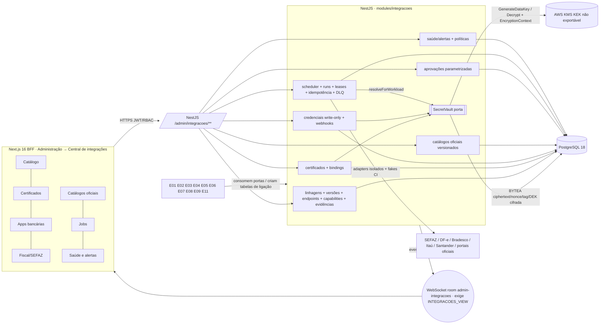

# E12-T00 — Gate CROSS: ADR da fundação de integrações (cofre PostgreSQL + AWS KMS, certificados, jobs batch, 7 views, ownership) — Plano Tático

> Papel autor: `planner`. Documento **somente documental**: zero código, zero migration, zero PR aberto por este papel.
> Workers futuros (E12-T01..T12) seguem este plano **literalmente**; caso não coberto, `old_string` que não casa ou teste que falha após 1 correção → **PARAR e reportar**. Worker não decide regra, não edita `docs/execucao/`, não cria perfil canônico, não altera `MENUS_CANONICOS`.

**Goal:** Congelar, para o Portão 1 do gate CROSS E12-T00 (Linear ALP-173), a arquitetura única da plataforma de integrações do ERP AlphaCarnes. Ela cobre perfis por provedor/serviço/ambiente (com versões), endpoints em allowlist, capabilities, certificados A1 e chaves bancárias, credenciais write-only, webhooks, cofre criptográfico em PostgreSQL com KEK em AWS KMS, catálogos oficiais versionados, jobs batch sem sessão humana, aprovações parametrizadas e as 7 views da Central de integrações. O plano fixa ownership, fronteiras, DDL conceitual com FKs declaradas, mapa de consumidores, matriz tela→protótipo e campo→coluna, análise de ADR-002/006/011 e da auth BFF/JWT, riscos e pendências, e o DoD→teste 1:1 de E12-T01..T12. Nada é implementado nesta onda.

**Architecture:** monólito modular NestJS 11 (Constituição, "sem microserviços"). O módulo novo `app/backend/src/modules/integracoes/` é a autoridade única (Princípio III), com submódulos `perfis`, `cofre`, `certificados`, `credenciais`, `webhooks`, `referencias`, `aprovacoes`, `jobs` e `saude`. O cofre fica atrás de uma porta `SecretVault` (token DI `SECRET_VAULT`, padrão ADR-011) com dois adapters: `KmsEnvelopeVault`, que cifra com AES-256-GCM no NestJS usando DEK de `GenerateDataKey`, e `LocalFakeEnvelopeVault`, determinístico para CI/dev (Princípio V). Ciphertext, nonce, tag e DEK cifrada ficam em `BYTEA` no PostgreSQL 18. O scheduler roda dentro do processo backend com lease/fencing no PostgreSQL. Eventos são emitidos pós-commit via `@nestjs/event-emitter` e WebSocket nativo na room `admin-integracoes`, protegida por `INTEGRACOES_VIEW` (Princípio VI, ADR-004). Frontend Next.js 16 App Router com BFF, DS v3 Direção A (AD-10).

**Tech Stack (fixa, sem troca):** Node 22, NestJS 11, TypeScript 5 strict, Next.js 16 App Router/BFF, React 19, PostgreSQL 18, Drizzle + drizzle-kit, Zod 4, WebSocket nativo, JWT + RBAC (11 perfis, AD-04), Jest/Supertest, Playwright. Biblioteca de KMS e de parsing PKCS#12/X.509 será escolhida em E12-T02/T03 com versão pinada e aprovada no Portão 1 daquela task (regra de dependências do AGENTS). Este plano não as adiciona. Upload multipart usa o multer já embutido em `@nestjs/platform-express` 11.1.28 (dependência existente), só com armazenamento em memória.

**Base pinada no momento do plano:** `origin/develop` @ `db9d8ac1760a01c262c57a9f824d2c8fcf18291b` (merge-base do branch). Última migration: `0043_onda14_ocorrencias_preco`; próximo índice livre: `0044`. Fontes contratuais lidas no checkout coordenador `F:/Projetos/AlphaCarnes` @ `302cdb5a270d73591e3c087a16fef7190101b4f7` (branch do PR #157). Se o journal de develop avançar, a numeração das tasks futuras é recalculada pelo Planner da onda; o worker não renumera.

**Worktree / branch:** `F:/Projetos/AlphaCarnes/.worktrees/e12-t00` · `feature/erp-e12-t00-cross-adr`. Nunca implementar no worktree coordenador.

**Linear:** ALP-173 (E12-T00). Tasks futuras: E12-T01..T12. Gate irmão: ALP-160 (E11-T00), com plano próprio produzido por outra instância de Planner.

---

## Histórico de revisões

| Revisão | Data | Plano (sha256) | Motivo |
|---|---|---|---|
| r1 | 2026-10-12 | `08cff0b4…` | versão inicial; Portão 1 = `ajustar` (veredito 2026-10-12T06:52:31Z) |
| r2 | 2026-10-12 | (calculado pelo Monitor) | resolve os 14 achados do Portão 1 |

| Achado do Portão 1 | Correção | Seção corrigida |
|---|---|---|
| 1. `credentials` sem FKs compostas por empresa | FKs `(profile_id, company_id, environment)` e `(secret_version_id, company_id, environment)`; teste "credencial de outra empresa" | §4 `integration_credentials`; §9 T01 |
| 2. certificados/bindings sem coerência de ambiente, finalidade e estabelecimento | `environment` em `integration_certificates`; FK da chave privada por `(id, company_id, environment)`; binding com FK `(certificate_id, company_id, environment, purpose)`; regra de estabelecimento no serviço com teste | §3.6; §4 certificados/bindings; §9 T01/T03 |
| 3. FKs só em comentário | todas as FKs declaradas; as polimórficas justificadas; vínculos com E06/E11 invertidos para tabelas de ligação do dono consumidor | §4 (bloco "FKs e justificativas"); §2 C4; §3.4 |
| 4. semântica de versão de perfil | `integration_profile_lineages` (escopo único) + `integration_profiles` (uma linha por versão, imutável fora de DRAFT); pin por FK de id | §3.2.1; §4; §3.9 |
| 5. AAD inclui `secretVersionId` mas id tem DEFAULT no DB | id obtido por `SELECT uuidv7()` antes da cifragem; coluna sem DEFAULT | §3.8; §4 `integration_secret_versions` |
| 6. falta matriz campo→coluna/dono por view | matriz por view (V01 responsável, V03 app ID/workspaceId e webhook em allowlist, V04 IE/CRT/série/número/cNF, V06 DLQ) | §6.2 |
| 7. 60/30/15/7 fixos em CHECK | `integration_alert_policies` configurável no DB, seed 60/30/15/7; teste com outro conjunto | §4; §9 T10 |
| 8. Princípio VIII para H-03/H-04/H-10/H-12; seed do administrador ambígua; teste fixando H-04 | quatro parâmetros com `provisorio: true` + badge; seed do administrador fundamentada em doc 013 §2.1; testes exercitam o parâmetro | §3.7; §3.12; §9 |
| 9. H-05/C6 com Monitor como responsável | responsável = Quality Owner | §2 C6; §7.2 H-05 |
| 10. `podeAssinar` libera qualquer room com `DISPONIBILIDADE_LER` | mapa room→permissão (`admin-integracoes` exige `INTEGRACOES_VIEW`); E12 não publica em `dashboard`; testes | §3.5; §3.11 F4; §9 T04 |
| 11. DoD→teste incompleto vs doc 23 §8 | testes acrescentados para T01..T12 | §9 |
| 12. falta inspeção de ADR-002/006/011 e auth BFF/JWT | análise com achados F1..F11 e consequências | §3.11 |
| 13. Task 1 esperava HEAD=db9d8ac; tasks sem commit | Task 1 confere merge-base; toda task tem passo de commit literal | §8 |
| 14. rótulo do menu; linhas da MATRIZ-UX V07; permissão de ver × agir | "Central de integrações" (catalogo.js L1169–1174, `epics.E12`); MATRIZ-UX V07 L1527–1549; colunas separadas de permissão | §1 item 10; §6.1 |

Ajuste adicional, não apontado, por segurança operacional: a Task 3 passa de rebase para merge de `origin/develop` no branch, para não exigir force-push (regras de git do AGENTS). Nenhum outro conteúdo não apontado foi alterado além do necessário para coerência com as correções acima.

---

## 0. Dependência documental com o PR #157 (decisão de merge NÃO tomada aqui)

Fatos verificados:
- `docs/expansao-erp-2026/**` e `docs/prototipos/erp-integrado-v1/**` só existem na branch `feature/erp-fiscal-financeiro-contabil-especificacoes-2026` (PR #157, não mergeado; tip lido `302cdb5`).
- Em `db9d8ac`, `docs/execucao/DECISOES.md` **não contém AD-18, AD-19 nem AD-20**, e `docs/governance/constituicao.md` não está na versão 1.2.0 (emenda do menu de 13 grupos). Os pilares normativos deste ADR estão, portanto, somente no #157.

| Opção | Descrição | Prós | Contras |
|---|---|---|---|
| **A (recomendada)** | O PR do E12-T00 (destino `develop`) só abre depois do merge do #157. Este branch recebe merge do `develop` resultante (sem force-push), e os links relativos para Cadernos e protótipo passam a resolver. | Fonte única; nenhuma cópia; AD-18..20 e constituição 1.2.0 vigentes no mesmo `develop`; Portão 2 do PR documental verifica links reais. | O E12-T00 fica serializado atrás do #157. |
| B | Portar para este PR cópias dos docs 22/23/24, das matrizes e de `catalogo.js`, com cabeçalho de proveniência (branch, SHA e caminho de origem). | Independe do #157. | Duplica fonte de verdade; causa conflito de merge quando o #157 entrar; as cópias podem divergir; AD-18..20 continuariam ausentes de `develop` (DECISOES só recebe decisão do QO e não pode ser portada pelo planner). |

Recomendação: **Opção A.** Enquanto o #157 não mergear, este plano cita as fontes por caminho relativo ao repositório (`docs/expansao-erp-2026/...`) e registra o SHA de leitura na Task 1. Decisão de merge: Executor ou Quality Owner.

## 1. Decisões fixadas (não reabrir; origem entre parênteses)

1. E12 é a fundação **única** de perfis, endpoints, capabilities, certificados, credenciais, webhooks, catálogos oficiais e jobs. É proibido duplicar isso em E02, E06 ou E11 (AD-18; doc 23 D3; Caderno B §4-B).
2. Os segredos ficam no PostgreSQL **somente como ciphertext** AES-256-GCM gerado no NestJS. Cada versão de segredo tem sua DEK de 256 bits, obtida por `kms:GenerateDataKey` e guardada cifrada ao lado do ciphertext. A KEK é AWS KMS não exportável. Não há chave mestra no DB, em `.env`, no frontend, no repositório, em logs ou em `parametros.valor_json` (AD-18 (3); ADR-ERP-024).
3. Proibidos: `pgcrypto` com chave enviada ao banco; Secrets Manager por certificado; plaintext ou PFX em disco temporário (inclui `diskStorage`/`dest` do multer); GET de chave privada; senha PFX persistida (ADR-ERP-024 "Requisitos inversos"; doc 22 §4).
4. Nonce de 96 bits nova a cada cifragem; tag de 16 bytes. A AAD canônica é JSON com chaves ordenadas `{companyId, environment, service, purpose, secretVersion, secretVersionId}`. O mesmo conjunto sem `secretVersionId` é o `EncryptionContext` do KMS. `encryption_context_hash` = SHA-256 da AAD canônica (ADR-ERP-024 Pipeline 3–4). `secretVersionId` é gerado antes da cifragem (§3.8).
5. Ambientes externos: literais `HML` e `PROD`, conforme o CHECK de ADR-ERP-024. O doc 22 usa "PRD"; prevalece o ADR ratificado.
6. Upload: A1 PFX/P12 ou CRT+KEY (e, quando o banco exigir, CSR gerado no backend). A senha é transitória, write-only, só em memória. A3 é rejeitado no upload para batch (doc 22 §4.7).
7. Jobs batch rodam sem sessão de operador, com identidade técnica de menor privilégio, lease com fencing token, idempotência e checkpoint. A chamada de rede fica fora da transação. A versão de perfil, de segredo e de certificado é fixada (por id) no início do run (doc 22 §5).
8. A UI só reage a eventos pós-commit via WS; nenhum polling novo no frontend. O scheduler de backend não é polling de UI (Princípio VI; doc 22 §5).
9. `.env` fica restrito ao bootstrap técnico já existente em `env.schema.ts` (DATABASE_URL, JWT_*, COOKIE_SECURE, THROTTLE_*, CORS_ORIGIN, LOG_LEVEL, PORT) e às variáveis legadas já lidas por `process.env` em `develop` (inventário em §3.11 F7). É **proibido** acrescentar `BANK_*`, `SEFAZ_*`, `CERT_*`, `CNAB_*`, `JOB_*`, `VAULT_*`, URL, ARN, região, cron, timezone de negócio ou client_id (doc 22 §6).
10. Menu: Administração (grupo 13) → **"Central de integrações"** (rótulo de `catalogo.js` L1169–1174, `epics.E12`), com 7 views em subnavegação. Os 9 grupos originais e as 39 rotas não mudam (AD-18 (1); ADR-ERP-024 Menu). O botão "Central de Integrações" de `aplicacao.js` L218 é atalho interno de outra tela, não rótulo de menu.
11. 11 perfis canônicos (AD-04; AD-18 (5)). Personas do protótipo não viram perfis.
12. A UI não exibe UUID, PK, `company_id`, secretRef, ARN, código E##/ALP nem nome técnico de tabela (Caderno B "Requisito transversal de UX integral"; MATRIZ-UX "Requisito inverso"; "Sem colunas técnicas" em cada datagrid E12).
13. Nenhum efeito externo real (SEFAZ, banco), homologação ou produção é autorizado por este gate (AD-19 (3)).
14. Migrations futuras: só via `drizzle-kit generate`, uuidv7, TIMESTAMPTZ, status TEXT+CHECK, soft delete onde for entidade de negócio, um schema Drizzle por domínio, sem trigger nem SQL manual (Princípio X).

## 2. Conflitos entre fontes, resolvidos por precedência (nenhum é decisão de produto)

| # | Conflito | Fontes | Resolução |
|---|---|---|---|
| C1 | V05 e V06 invertidos | doc 22 §3 (V05=Jobs, V06=Versões) × catalogo.js/MATRIZ (V05=Catálogos Oficiais, V06=Jobs) | Prevalece o protótipo (precedência 4 > 6): **V05 = Catálogos Oficiais e Versões; V06 = Jobs Batch e Histórico**. |
| C2 | `PRD` × `PROD` | doc 22 × ADR-ERP-024 (referenciado por AD-18) | `PROD`. |
| C3 | Cofre em Secrets Manager | doc 23 E12-T02 ("Secrets Manager ou equivalente") × AD-18 | AD-18 prevalece: KMS + ciphertext em PostgreSQL; Secrets Manager não é usado. |
| C4 | `external_contracts` com conta, convênio e carteira; `bankAccountId` no perfil | doc 22 §2 × ownership do próprio doc 22 §1 (E06 é dono de contas e convênios; E11 de layouts) | O E12 guarda só **evidência de habilitação** (`integration_enablement_evidence`). Conta, convênio e carteira ficam no E06, que cria a tabela de ligação `bank_integration_links` (FK para `integration_profile_lineages` e para suas próprias tabelas). Layout de arquivo fica no E11, que cria `bank_layout_capability_links` (FK para `integration_capabilities`). O E12 não tem coluna apontando para E06/E11: a dependência vai do consumidor para a fundação. |
| C5 | "Worker independente" × "sem microserviços" | doc 22/23 × Constituição | Scheduler e worker rodam como módulo do mesmo processo NestJS. Réplicas são coordenadas por lease no PostgreSQL. Não há serviço novo nem variável de ambiente nova. |
| C6 | Rota de protótipo `/admin/integracoes/e12-v0N` × proibição de código E## visível | catalogo.js × Caderno B UX | Proposta: slugs semânticos (§6.1). Mudança de rota é estrutura de navegação (Princípio I.6): decide **somente o Quality Owner** → **H-05**. |
| C7 | BullMQ (ADR-006) × stack fixada sem Redis | ADR-006 × Constituição "Stack fixada"; ADR-011 adiou BullMQ | Jobs E12 usam lease/fencing em PostgreSQL. Nenhuma fila Redis é introduzida (exigiria ADR nova + emenda). |


## 3. ADR-ERP-025 — Fundação de integrações E12 (conteúdo normativo deste gate)

**Estado:** proposto para o Portão 1 do E12-T00. Complementa ADR-ERP-024, sem substituí-lo.
**Localização recomendada:** seção deste plano, em `docs/superpowers/plans/`, diretório que já existe em `develop`. Um arquivo separado em `docs/expansao-erp-2026/` só faria sentido depois do #157 (§0) e duplicaria a seção. Recomendação: **manter o ADR aqui**.

### 3.1 Contexto
O ERP precisa operar NF-e 55/DF-e (E02/E03), APIs de três bancos (E06), arquivos CNAB/OFX/CSV (E11), SPED (E09) e catálogos normativos (E01) sem `.env` operacional e sem segredo em claro. Em `develop` existem só o EISS municipal (`integracoes/nfse/`, segredo por `process.env`, ADR-006/011) e `parametros` (chave-valor JSONB, legível por todos os 11 perfis via `PARAMETROS_LER` e auditado com valor antes e depois). Esse mecanismo é inadequado como cofre (doc 23 D2, rejeitada), mas é o veículo correto para parâmetros **não sigilosos** com `provisorio`/`pendencia` (padrão já usado em `seed.ts` L79–92).

### 3.2 Decisão
Adotar D3 (doc 23): cadastro central versionado no PostgreSQL, cofre em envelope com AWS KMS, jobs definidos no banco e console administrativo de 7 views. Os épicos de domínio consomem interfaces da fundação e não copiam suas tabelas.

#### 3.2.1 Versionamento de perfil
- `integration_profile_lineages` = a identidade lógica e o **escopo** de uma integração ("Integração vinculada" na UI): empresa, estabelecimento (nulo = vale para a empresa toda), provedor, serviço, ambiente, nome de exibição e responsável. Escopo único entre linhagens não excluídas.
- `integration_profiles` = **uma linha por versão** da linhagem (`version` 1, 2, …, único por linhagem). Só a versão em `DRAFT` é editável. Submeter congela a versão. Editar uma versão congelada cria `version + 1` em `DRAFT`, clonando endpoints, capabilities, bindings e credenciais (as referências a segredo são copiadas; segredo não é recifrado).
- No máximo uma versão `ACTIVE` por linhagem (índice parcial). Ativar uma nova versão aposenta a anterior (`SUSPENDED` → histórico) na mesma transação.
- Jobs e runs fixam `pinned_profile_id` (FK para a linha da versão), nunca um inteiro de versão. O inteiro `version` serve só para exibição e ordenação.
- Concorrência de edição: coluna `row_version` (lock otimista). Conflito → HTTP 409 com o estado atual (estado "conflito concorrente" da MATRIZ-UX).

### 3.3 Diagrama


### 3.4 Ownership — tabelas

| Tabela (E12) | Dono | Pode escrever | Consumidores (somente leitura via serviço) |
|---|---|---|---|
| `integration_providers`, `integration_provider_hosts`, `integration_services` | E12 | E12 (seed + admin com aprovação) | todos |
| `integration_profile_lineages`, `integration_profiles` | E12 | E12 | E02, E03, E06, E09, E11 |
| `integration_endpoints` | E12 | E12 (só hosts da allowlist) | adapters de E02, E03, E06, E09 |
| `integration_capabilities` | E12 | E12 | E04, E05, E06, E07, E08, E11 |
| `integration_enablement_evidence` | E12 | E12 | E06, E11-T00 |
| `integration_vault_keys` | E12 (cofre) | E12 com aprovação PROD | `SecretVault` |
| `integration_secret_versions` | E12 (cofre) | só `SecretVault` | nenhum acesso direto; só `resolveForWorkload` |
| `integration_certificates`, `integration_certificate_bindings` | E12 | E12 | E02, E03, E06, E09 (metadados); adapters (binding) |
| `integration_credentials` | E12 | E12 | adapters E05/E06 |
| `integration_public_bases`, `integration_webhook_endpoints` | E12 | E12 | E05, E06 (recepção de notificação) |
| `integration_reference_datasets`, `integration_reference_artifacts` | E12 | E12 | E01 (ativação de regra é do E01), E02, E09, E11 |
| `integration_approval_requests`, `integration_approval_votes` | E12 | E12 | V01..V07 |
| `integration_job_definitions` | E12 | E12 | domínios registram tipos de operação |
| `integration_job_runs`, `integration_job_dead_letters` | E12 | scheduler E12 | E12 saúde, E07, E08 (status) |
| `integration_job_leases`, `integration_job_idempotency_keys` | E12 | scheduler E12 | — |
| `integration_workload_grants` | E12 | E12 (com aprovação) | `SecretVault` |
| `integration_alert_policies`, `integration_alerts` | E12 | E12 saúde | V07 |

Ficam **fora do E12** (não criar): empresas e estabelecimentos, IE, CRT (E01-T01); contas bancárias, convênios, carteiras e a ligação `bank_integration_links` (E06); layouts, lotes, observações de arquivo e a ligação `bank_layout_capability_links` (E11); série, numeração e cNF da NF-e (E02); transação econômica, conciliação e baixa (E07); documentos fiscais NF-e e eventos SEFAZ (E02/E03); razão e SPED (E09); outbox genérico de eventos de domínio (owner fixado no gate E11-T00, ver D-E11).

### 3.5 Ownership — eventos (todos pós-commit; valores em snake_case conforme `realtime/events/eventos.ts`)

| Evento | Dono | Room WS | Gatilho |
|---|---|---|---|
| `integracao_perfil_alterado` | E12 | `admin-integracoes` | criar, editar, submeter, aprovar, suspender versão de perfil |
| `certificado_importado` | E12 | `admin-integracoes` | upload validado e cifrado |
| `certificado_binding_alterado` | E12 | `admin-integracoes` | associar, rotacionar, revogar binding |
| `credencial_rotacionada` | E12 | `admin-integracoes` | criar ou rotacionar segredo (só metadados) |
| `catalogo_oficial_alterado` | E12 | `admin-integracoes` | staging, validação, aprovação, ativação |
| `aprovacao_integracao_alterada` | E12 | `admin-integracoes` | abrir, votar, concluir pedido de aprovação |
| `job_execucao_alterada` | E12 | `admin-integracoes` | transição de estado de run, entrada/saída de DLQ |
| `alerta_integracao_aberto` / `alerta_integracao_reconhecido` | E12 | `admin-integracoes` | janela de expiração da política, falha, CA trocada, gap NSU |

Regras de entrega:
- Os eventos E12 **não** usam `roomsDaData(dataOperacao)` (`eventos.ts` L89–91 publica em `dashboard`, `desossa` e `operacao:<data>`). O gateway ganha um broadcast por room explícita, usado só pela room `admin-integracoes`.
- A room `dashboard` **não recebe** eventos E12. Motivo: `podeAssinar` (`realtime.gateway.ts` L151–153) libera essa room a qualquer portador de `DISPONIBILIDADE_LER`, o que inclui perfis operacionais sem `INTEGRACOES_VIEW`; enviar alertas de integração para lá vazaria metadados de integração. A superfície de alertas é a V07.
- Assinar `admin-integracoes` exige `INTEGRACOES_VIEW` (mapa room→permissão, §3.11 F4). As demais rooms mantêm a regra atual.
- Eventos de negócio (`nfe_autorizada`, título baixado, observação bancária etc.) pertencem aos épicos de domínio. Payloads E12 **nunca** carregam segredo, ciphertext, secretRef ou ARN.

### 3.6 Fronteiras empresa/estabelecimento e HML/PROD
- **Empresa:** toda linha E12 com dado de empresa traz `company_id` (FK para a tabela de empresa do E01-T01) e, quando aplicável, `establishment_id` (FK composta `(establishment_id, company_id)`). A coerência é garantida por FKs compostas que incluem `company_id` em todas as relações perfil↔endpoint↔capability↔binding↔certificado↔segredo↔credencial↔webhook (§4). Um binding ou credencial não liga objeto de outra empresa. Além disso, o backend valida a empresa em cada serviço (Princípio III; escopo usuário↔empresa em §3.11 F5).
- **HML/PROD:** `environment` está em linhagem, versão de perfil, endpoint, certificado, segredo, binding, credencial e webhook. As FKs compostas incluem `environment`, de modo que um segredo, certificado ou credencial HML não se associa a um perfil PROD. O ambiente entra na AAD e no EncryptionContext, portanto um ciphertext HML não decifra num contexto PROD. Um mesmo A1 usado nos dois ambientes é enviado duas vezes, gerando duas linhas e dois ciphertexts com contextos distintos.
- **Finalidade:** o binding referencia `(certificate_id, company_id, environment, purpose)`; certificado `NFE_SIGN` não é vinculado como `BANK_MTLS`.
- **Estabelecimento:** certificado com `establishment_id` nulo vale para qualquer estabelecimento da empresa; com valor, só para perfis daquele estabelecimento ou para perfis de escopo empresa. FK não expressa esse curinga, então `BindingService.validarEscopo` aplica a regra antes do INSERT/UPDATE, com teste e2e (§9 T01).
- **Deployment × ambiente externo:** cada deployment (CI/dev com fake, homologação, produção) usa sua própria chave registrada em `integration_vault_keys`. Dentro do deployment de produção coexistem perfis externos HML e PROD; a segregação entre eles é criptográfica, via contexto. Se a TI exigir chave distinta por ambiente externo → **H-02**.
- Restaurar o banco de produção em homologação é proibido (doc 22 §6). Teste de DR decifra com papel de recuperação autorizado.

### 3.7 RBAC e RLS
- Permissões novas (doc 22 §7): `INTEGRACOES_VIEW`, `INTEGRACOES_CONFIG`, `INTEGRACOES_CERT_UPLOAD`, `INTEGRACOES_TEST`, `INTEGRACOES_APPROVE_PROD`, `INTEGRACOES_BATCH_EXEC`, `INTEGRACOES_VAULT_ROTATE`. São aplicadas por `@RequirePermissoes` no controller e revalidadas no serviço (empresa e, para ações sensíveis, permissão relida do banco — §3.11 F3).
- **Seed:** `MAPA_PERFIL_PERMISSOES.administrador` recebe as 7. Fundamento: doc 013 §2.1, citado em `permissoes.ts` L126–127 ("configurar itens, regras e integrações" → GERENCIAR de tudo), e doc 22 §7 ("403 para usuário comum"). Os outros 10 perfis não recebem nenhuma `INTEGRACOES_*` na seed. Atribuí-las a outros perfis é decisão de alçada do QO (ADR-ERP-024 RBAC) → **H-03**; até lá a matriz continua editável em runtime por `/admin/perfis` (`perfis.service.ts` `definirPermissoes`, auditado), e a Central exibe badge Provisório (§3.12 P1).
- **Aprovação em PROD:** ADR-ERP-024 (Pipeline 6) e doc 22 §7 exigem dupla aprovação em PROD; isso é fonte, não pendência. Fica fixo no código: aprovador ≠ solicitante; votos de usuários distintos; piso de 2 aprovações para PROD. O quórum por tipo de assunto e o eventual quórum acima do piso são parâmetro provisório (§3.12 P2, **H-04**).
- Identidade de workload: o job executa como principal técnico, sem JWT de usuário. `integration_workload_grants` lista quais `(operation, service, purpose, environment)` cada tipo de job pode resolver no cofre; o padrão é negar. A auditoria grava `usuario_id = NULL` (coluna já nullable: `auditoria.schema.ts` L12) e `modulo = 'integracoes.job'` com o número do run.
- **RLS:** não adotado nesta fundação. Motivos: `develop` não tem papéis de banco separados nem RLS em nenhuma tabela; a fronteira de autorização é o backend (Princípio III); o plaintext é protegido por IAM/KMS e não pelo SQL (ADR-ERP-024: o administrador SQL lê só ciphertext). Adotar RLS exige decisão da TI sobre papéis de banco → **H-06**.


### 3.8 Cofre (porta `SecretVault`)
Operações: `saveEncryptedSecret(ctx, plaintext): SecretVersionRef`, `resolveForWorkload(workloadGrant, bindingRef): Buffer` (escopo de uso curto e zeragem do buffer), `rotateSecret`, `revokeBinding`, `auditMetadata`.

Pipeline de cifragem (ADR-ERP-024), na ordem:
1. **Gerar o id antes de cifrar:** `SELECT uuidv7()` (função nativa do PostgreSQL 18, sem dependência nova) e calcular `version = max(version)+1` para `(company_id, environment, service, purpose)`. A coluna `integration_secret_versions.id` **não tem DEFAULT**: INSERT sem id falha, então ninguém consegue persistir um ciphertext cuja AAD aponte para outro id.
2. Montar a AAD canônica com `secretVersionId = id` e o EncryptionContext sem ele.
3. `GenerateDataKey(AES_256, EncryptionContext)` — chamada de rede fora de transação.
4. Gerar nonce aleatória de 12 bytes; cifrar com AES-256-GCM usando a AAD.
5. Persistir em uma única transação curta: `id`, `ciphertext`, `nonce`, `auth_tag`, `encrypted_data_key`, `vault_key_id`, `kms_key_arn`, `encryption_context_hash`.
6. Zerar a DEK em claro e o plaintext.
7. Violação de `UNIQUE (company_id, environment, service, purpose, version)` por rotação concorrente → descartar o ciphertext em memória e repetir o pipeline desde o passo 1 (nunca reaproveitar AAD com outro id ou versão).

Pipeline de decifragem: `Decrypt(encrypted_data_key, EncryptionContext)` → verificação GCM com a AAD recalculada a partir das colunas da linha. Qualquer falha resulta em erro explícito e alerta, nunca em fallback (Princípio VII).

Seleção do adapter, sem variável de ambiente nova: a linha `ACTIVE` de `integration_vault_keys` define `provider` (`AWS_KMS` ou `LOCAL_FAKE`). O seed só insere `LOCAL_FAKE` quando `NODE_ENV !== 'production'`; o boot recusa `LOCAL_FAKE` quando `NODE_ENV === 'production'`; sem linha `ACTIVE`, toda operação de cofre falha com erro explícito (produção fica assim até H-01/H-02). `LOCAL_FAKE` usa uma KEK efêmera gerada em memória por processo; após restart, segredos dev antigos falham na decifragem com erro explícito ("reenvie o segredo"). Não existe KEK fake versionada no repositório. Testes de DR injetam uma KEK de teste mantida pelo próprio harness entre duas instâncias da aplicação.

### 3.9 Batch
Estados do run: `QUEUED`, `LEASED`, `RUNNING`, `SUCCEEDED`, `RETRY_SCHEDULED`, `NEEDS_REVIEW`, `FAILED`, `CANCELLED`.

Fluxo:
1. O claim usa `SELECT … FOR UPDATE SKIP LOCKED`.
2. `integration_job_leases` guarda `lease_until` e `fencing_token` monotônico. Escrita com token obsoleto é rejeitada.
3. No início do run são fixados `pinned_profile_id` (versão `ACTIVE` da linhagem), `pinned_secret_version_id` e `pinned_certificate_id`. Rotação durante o run não troca o pin.
4. Idempotência por `(company_id, capability, operation, external_key)`.
5. Backoff com jitter e respeito a `Retry-After`, conforme `retry_policy` do job.
6. Checkpoint (NSU, cursor de extrato) avança na mesma transação do resultado.
7. Esgotada a `retry_policy`, o run vai a `FAILED` e entra em `integration_job_dead_letters` (DLQ). `NEEDS_REVIEW` também entra na DLQ. Sair da DLQ exige reprocessamento com justificativa e aprovação (catalogo.js V06 "reprocessar sob aprovação"; quórum em §3.12 P2) ou descarte justificado.
8. Credencial revogada ou vencida suspende o job e gera alerta.
9. Cada run tem `run_number` sequencial por job, exibido na UI no lugar do UUID.

### 3.10 Consequências
- Positivas: uma única superfície de segredo, rotação e auditoria; nenhum segredo novo em `.env`.
- Custos: dependência de AWS KMS a partir de uma operação on-premises (**H-01**) e de um scheduler novo. Esta onda não remove nem altera `.env` existente.

### 3.11 Análise de ADR-002, ADR-006, ADR-011 e da autenticação BFF/JWT (exigida pelo aceite de ALP-173)

Arquivos inspecionados em `db9d8ac`: `docs/architecture/adr/ADR-002-stack-frontend.md`, `ADR-006-nfse-integracao.md`, `ADR-011-nfse-gateway-porta-fake-retry.md`; `app/frontend/src/middleware.ts`, `src/lib/api.ts`, `src/lib/bff.ts`, `src/app/api/admin/parametros/route.ts`; `app/backend/src/modules/auth/{token.service,jwt.strategy,rbac.service}.ts`, `common/guards/rbac.guard.ts`, `modules/perfis/perfis.service.ts`, `realtime/realtime.gateway.ts`, `realtime/events/eventos.ts`, `modules/operacao/faturamento/faturamento.service.ts`, `integracoes/nfse/{eiss-client.adapter,nfse.module}.ts`, `database/schema/{auth,auditoria,parametros}.schema.ts`, `database/seed.ts`.

| # | Achado | Evidência | Consequência para o E12 | Task / teste |
|---|---|---|---|---|
| F1 | O BFF força `Content-Type: application/json` em toda chamada ao backend | `lib/api.ts` `backendHeaders` (L12–15); `bff.ts` `repassar` reenvia texto | Upload de certificado não pode usar `apiFetch`/`repassar`. Handler BFF dedicado `app/api/admin/integracoes/certificados/upload/route.ts` repassa o corpo em stream com o `content-type` original (boundary), sem ler nem registrar o corpo, e rejeita `Content-Length` acima do limite do backend | T05: "BFF repassa multipart com boundary intacto"; "corpo acima do limite → 413 sem chamar o backend"; "nenhum log contém bytes do corpo" |
| F2 | Backend tem `@nestjs/platform-express` 11.1.28 (multer embutido) | `app/backend/package.json` L25 | `FileInterceptor` só com `memoryStorage()` e `limits.fileSize`; proibido `dest`/`diskStorage` (decisão 3) | T03: "upload não cria arquivo em `os.tmpdir()`" (diretório temporário isolado por teste, contagem antes/depois) |
| F3 | `RbacGuard` decide pelo array `permissoes` do JWT; o JWT é assinado com snapshot de permissões e TTL padrão 15 min; mudança de permissão vale "no próximo login/refresh" | `rbac.guard.ts` L36–51; `token.service.ts` L19–30; `jwt.strategy.ts` `validate`; comentário de `perfis.service.ts` `definirPermissoes` | Revogação de `INTEGRACOES_*` tem atraso de até `JWT_ACCESS_TTL`. Para `APPROVE_PROD`, `CERT_UPLOAD`, `VAULT_ROTATE` e `BATCH_EXEC`, o serviço relê as permissões do banco (`RbacService.resolverPermissoes`, L25) antes de executar | T04: "permissão removida do perfil → ação sensível com token antigo responde 403" |
| F4 | WS autentica o cookie só no handshake; `podeAssinar` libera **qualquer** room a quem tem `DISPONIBILIDADE_LER`; socket não revalida `exp` | `realtime.gateway.ts` L118–125, L137–153 | Mapa room→permissão: `admin-integracoes` exige `INTEGRACOES_VIEW`; demais rooms mantêm `DISPONIBILIDADE_LER`. No broadcast para `admin-integracoes`, socket com `exp` vencido é desligado da room. E12 publica só em `admin-integracoes` (§3.5) | T04: testes listados em §9 T04 (realtime) |
| F5 | O JWT não carrega empresa; `develop` não tem vínculo usuário↔empresa (só `usuarios_perfis`) | `token.service.ts` payload `{sub,nome,perfis,permissoes}`; `auth.schema.ts` L63–69 | A restrição "usuário X só administra a empresa Y" não tem fonte. O E12 consulta a porta `EmpresaAcessoPort`; a implementação padrão libera todas as empresas ativas e é marcada provisória (§3.12 P5, **H-15**) | T04: "porta restritiva (fake) → 403 em empresa não liberada" |
| F6 | O middleware do Next só verifica a assinatura do JWT; não autoriza | `middleware.ts` `tokenValido` | Autorização é só no backend (Princípio III). Rotas BFF `/api/admin/integracoes/**` seguem `repassar`/`fetchBackend`; respostas de endpoints de segredo são `204` ou metadados | T04/T05: "BFF nunca devolve campo sigiloso" |
| F7 | Integração EISS lê segredo e URL de `process.env`, fora de `envSchema` | `faturamento.service.ts` L129, L292–295, L348 (`EISS_RETRY_DELAY_MS`, `EISS_HOMOLOGACAO`, `EISS_CHAVE_AUTENTICACAO_HML/_PRD`); `eiss-client.adapter.ts` L21–22, L134 (`EISS_ENDPOINT_HML/_PRD`, `EISS_TIMEOUT_MS`); `nfse.module.ts` L14 (`NFSE_FAKE`); `hardware.module.ts` L19 (`HARDWARE_FAKE`) | É legado coberto por AD-02 + ADR-006/011; o E12 **não** o altera. Migrar o segredo EISS para o cofre é decisão do QO → **H-14**. O teste de env usa uma allowlist com exatamente esses nomes + as chaves de `envSchema` + `NODE_ENV`, e falha em qualquer `process.env` novo | T02/T11: "conjunto de `process.env[...]` em `app/backend/src` ⊆ allowlist inventariada" |
| F8 | ADR-011 fixou o padrão porta + DI token + fake determinístico, com seleção por `NFSE_FAKE` | ADR-011 §1–§4 | O cofre reusa o padrão (token `SECRET_VAULT`), mas seleciona o adapter por linha de banco (§3.8), sem flag nova | T02 |
| F9 | ADR-006 previa fila BullMQ; ADR-011 a adiou; a stack não tem Redis | ADR-006 "Estrutura do serviço"; ADR-011 "Follow-up" | Scheduler E12 em PostgreSQL (C7). O retry de NFS-e continua no `FaturamentoService` (ADR-011) e não migra para jobs E12 neste épico | T09 |
| F10 | `redigirSegredos()` do ADR-011 só conhece `chaveAutenticacao` | ADR-011 §5 | O E12 cria seu próprio redator (`redigirSegredosIntegracao`) para os DTOs E12, sem alterar `integracoes/nfse/*` | T02: "sentinela não aparece em auditoria, log, HTTP nem WS" |
| F11 | ADR-002 fixa React Hook Form + Zod 4 + TanStack Query; cita Socket.io/EventSource, superado por ADR-004 (WS nativo) | ADR-002 "Decisão" | Campos sigilosos: input sem valor inicial, nunca no cache do TanStack Query, `reset` após envio. Tempo real só por `ws` nativo | T05: "após salvar, o segredo não está em `document.body.innerHTML` nem em resposta capturada" |

### 3.12 Parâmetros provisórios (Princípio VIII)

Os itens abaixo dependem de decisão humana. Cada um vira uma chave em `parametros` (não sigilosa, legível por `PARAMETROS_LER`) com o formato já usado em `seed.ts` (`{grupo, tipo, titulo, texto, valor, provisorio: true, pendencia}`), exibida em `/admin/parametros` com o badge Provisório existente e, quando indicado, também na view E12. Os testes exercitam o parâmetro; **nenhum teste fixa o resultado da decisão pendente**. Remover o badge exige AD do QO em `DECISOES.md`.

| ID | Chave | Valor semeado (critério) | O que é fixo por fonte | Onde aparece o badge | Pendência |
|---|---|---|---|---|---|
| P1 | `integracoes.rbac.alcadas` | `{valor: null}`: só a seed do administrador (§3.7) | nenhum perfil além do administrador recebe `INTEGRACOES_*` na seed | cabeçalho de V01..V07 | H-03 |
| P2 | `integracoes.aprovacoes.quorum` | `{PROD: 2, HML: 0, REPROCESSAMENTO: 1, CHECKPOINT: 1}` (pisos das fontes: dupla aprovação PROD em ADR-ERP-024; "sob aprovação"/"com trilha" em catalogo.js V06) | aprovador ≠ solicitante; votos distintos; `PROD ≥ 2`; `REPROCESSAMENTO ≥ 1`; `CHECKPOINT ≥ 1`; valor abaixo do piso → 422 | diálogo de aprovação de V01..V06 | H-04 |
| P3 | `integracoes.certificados.revogacao_indisponivel` | `{valor: 'BLOQUEAR', opcoes: ['BLOQUEAR','REVISAO_MANUAL']}` (fail-closed, Princípio VII) | "erro de consulta não é aprovação" (doc 22 §4.2): nunca resulta em `VALID` | V02 (validação) | H-10 |
| P4 | `integracoes.cofre.retencao_versoes_inativas_dias` | `{valor: null}`: nenhuma destruição | destruição só por crypto-shredding (status `DESTROYED`, ciphertext e DEK anulados, metadados mantidos); nunca DELETE físico (Princípio X) | V02 e V03 (histórico de versões) | H-12 |
| P5 | `integracoes.escopo_empresa` | `{valor: 'TODAS_ATIVAS'}` (comportamento atual de `develop`, sem vínculo usuário↔empresa) | validação de empresa no serviço sempre via `EmpresaAcessoPort` | cabeçalho de V01..V07 | H-15 |

O snapshot do parâmetro é copiado para o registro no momento do uso (`integration_approval_requests.required_approvals`; `integration_certificates.revocation_policy_applied`), para que mudar o parâmetro depois não reescreva decisões passadas.


## 4. DDL conceitual (NÃO é migration; worker ajusta para Drizzle, uuidv7 e convenções reais)

Nomes `companies` e `establishments` são **conceituais**: o nome físico é o da tabela criada pelo E01-T01 (D-E01), e o Planner do E12-T01 o transcreve. `usuarios` é a tabela existente (`auth.schema.ts`). Todas as FKs abaixo são declaradas; as exceções estão justificadas no bloco final.

```sql
-- ── Catálogo de provedores, hosts e serviços ────────────────────────────────
CREATE TABLE integration_providers (
  id uuid PRIMARY KEY DEFAULT uuidv7(),
  code text NOT NULL UNIQUE,                    -- SEFAZ_SP_NFE, DFE_NACIONAL, BRADESCO, ITAU, SANTANDER, SPED, OFICIAL_REF
  display_name text NOT NULL,                   -- "Instituição ou órgão" / "Banco"
  kind text NOT NULL CHECK (kind IN ('FISCAL','BANK','REFERENCE')),  -- "Tipo Servico"
  official_documentation_url text,
  status text NOT NULL CHECK (status IN ('ACTIVE','INACTIVE')),
  created_at timestamptz NOT NULL DEFAULT now(), updated_at timestamptz NOT NULL DEFAULT now()
);

CREATE TABLE integration_provider_hosts (       -- allowlist de hosts (anti-SSRF)
  provider_id uuid NOT NULL REFERENCES integration_providers(id),
  environment text NOT NULL CHECK (environment IN ('HML','PROD')),
  host text NOT NULL,                           -- hostname exato, sem curinga
  source_dataset_id uuid,                       -- FK abaixo (dataset que comprova o host)
  approved_by uuid NOT NULL REFERENCES usuarios(id),
  created_at timestamptz NOT NULL DEFAULT now(),
  PRIMARY KEY (provider_id, environment, host)
);

CREATE TABLE integration_services (             -- "Serviço contratado" (cadastro, não texto livre)
  id uuid PRIMARY KEY DEFAULT uuidv7(),
  provider_id uuid NOT NULL REFERENCES integration_providers(id),
  code text NOT NULL,                           -- NFE_AUTORIZACAO, DFE_DIST, BANK_EXTRATO, BANK_COBRANCA, …
  display_name text NOT NULL,
  status text NOT NULL CHECK (status IN ('ACTIVE','INACTIVE')),
  UNIQUE (provider_id, code), UNIQUE (id, provider_id)
);

-- ── Linhagem (escopo) e versões de perfil ───────────────────────────────────
CREATE TABLE integration_profile_lineages (     -- "Integração vinculada"
  id uuid PRIMARY KEY DEFAULT uuidv7(),
  company_id uuid NOT NULL REFERENCES companies(id),
  establishment_id uuid,                        -- NULL = empresa toda
  provider_id uuid NOT NULL,
  service_id uuid NOT NULL,
  environment text NOT NULL CHECK (environment IN ('HML','PROD')),
  display_name text NOT NULL,
  responsible_user_id uuid NOT NULL REFERENCES usuarios(id),   -- "responsável" (V01)
  created_by uuid NOT NULL REFERENCES usuarios(id),
  created_at timestamptz NOT NULL DEFAULT now(), updated_at timestamptz NOT NULL DEFAULT now(), deleted_at timestamptz,
  FOREIGN KEY (establishment_id, company_id) REFERENCES establishments(id, company_id),
  FOREIGN KEY (service_id, provider_id) REFERENCES integration_services(id, provider_id),
  UNIQUE (id, company_id), UNIQUE (id, company_id, environment)
);
CREATE UNIQUE INDEX uq_lineage_scope ON integration_profile_lineages
  (company_id, COALESCE(establishment_id,'00000000-0000-0000-0000-000000000000'), service_id, environment)
  WHERE deleted_at IS NULL;

CREATE TABLE integration_approval_requests (
  id uuid PRIMARY KEY DEFAULT uuidv7(),
  company_id uuid NOT NULL REFERENCES companies(id),
  subject_kind text NOT NULL CHECK (subject_kind IN ('PROFILE_ACTIVATION','BINDING_CHANGE','CREDENTIAL_ACTIVATION','SECRET_ACTIVATION','DATASET_ACTIVATION','HOST_ALLOWLIST','VAULT_KEY','JOB_ENABLE','JOB_REPROCESS','CHECKPOINT_CHANGE')),
  subject_id uuid NOT NULL,                     -- polimórfico (justificado abaixo)
  environment text NOT NULL CHECK (environment IN ('HML','PROD')),
  requested_by uuid NOT NULL REFERENCES usuarios(id),
  required_approvals integer NOT NULL CHECK (required_approvals >= 0),   -- snapshot de P2
  justification text NOT NULL CHECK (length(justification) > 0),
  status text NOT NULL CHECK (status IN ('OPEN','APPROVED','REJECTED','CANCELLED')),
  created_at timestamptz NOT NULL DEFAULT now(), decided_at timestamptz,
  CHECK (environment <> 'PROD' OR subject_kind IN ('JOB_REPROCESS','CHECKPOINT_CHANGE') OR required_approvals >= 2),
  CHECK (subject_kind NOT IN ('JOB_REPROCESS','CHECKPOINT_CHANGE') OR required_approvals >= 1)
);
CREATE UNIQUE INDEX uq_approval_open ON integration_approval_requests (subject_kind, subject_id) WHERE status = 'OPEN';

CREATE TABLE integration_approval_votes (
  request_id uuid NOT NULL REFERENCES integration_approval_requests(id),
  approver_id uuid NOT NULL REFERENCES usuarios(id),
  decision text NOT NULL CHECK (decision IN ('APPROVE','REJECT')),
  justification text NOT NULL CHECK (length(justification) > 0),
  decided_at timestamptz NOT NULL DEFAULT now(),
  PRIMARY KEY (request_id, approver_id)        -- votos de usuários distintos
);  -- approver_id ≠ requested_by: validado no serviço (CHECK não cruza tabelas); teste em §9

CREATE TABLE integration_profiles (             -- uma linha por versão
  id uuid PRIMARY KEY DEFAULT uuidv7(),
  lineage_id uuid NOT NULL,
  company_id uuid NOT NULL,
  environment text NOT NULL CHECK (environment IN ('HML','PROD')),
  version integer NOT NULL CHECK (version > 0),
  status text NOT NULL CHECK (status IN ('DRAFT','WAITING_EXTERNAL','HML_READY','HML_TESTED','PROD_REVIEW','ACTIVE','SUSPENDED','EXPIRED')),
  row_version integer NOT NULL DEFAULT 1,       -- lock otimista → 409
  approval_request_id uuid REFERENCES integration_approval_requests(id),
  created_by uuid NOT NULL REFERENCES usuarios(id),
  created_at timestamptz NOT NULL DEFAULT now(), updated_at timestamptz NOT NULL DEFAULT now(), deleted_at timestamptz,
  FOREIGN KEY (lineage_id, company_id, environment) REFERENCES integration_profile_lineages(id, company_id, environment),
  UNIQUE (lineage_id, version),
  UNIQUE (id, company_id, environment)
);
CREATE UNIQUE INDEX uq_profile_active ON integration_profiles (lineage_id) WHERE status = 'ACTIVE' AND deleted_at IS NULL;

CREATE TABLE integration_reference_datasets (
  id uuid PRIMARY KEY DEFAULT uuidv7(),
  provider_id uuid NOT NULL REFERENCES integration_providers(id),   -- "Instituição ou órgão"
  dataset_code text NOT NULL,                   -- NFE_XSD, NT, CCLASSTRIB, CBENEF, NCM, MUNICIPIOS, SPED_EFD, BANK_OPENAPI, BANK_CNAB_LAYOUT
  official_url text NOT NULL,                   -- host deve existir em integration_provider_hosts (serviço)
  version_label text NOT NULL, published_at date, verified_at timestamptz NOT NULL,
  checksum_sha256 text,                         -- obrigatório quando houve download ("Integridade do arquivo")
  effective_from date, effective_to date,
  status text NOT NULL CHECK (status IN ('STAGED','VALIDATED','APPROVED','ACTIVE','RETIRED','REJECTED')),
  diff_summary jsonb NOT NULL DEFAULT '{}',     -- sem segredo
  approval_request_id uuid REFERENCES integration_approval_requests(id),
  next_review_at date,
  created_by uuid NOT NULL REFERENCES usuarios(id),
  UNIQUE (dataset_code, version_label),
  CHECK (effective_to IS NULL OR effective_from IS NULL OR effective_to >= effective_from)
);
-- integration_provider_hosts.source_dataset_id REFERENCES integration_reference_datasets(id):
-- FK declarada no schema Drizzle (referência adiante); drizzle-kit gera a constraint, sem SQL manual.

CREATE TABLE integration_reference_artifacts (   -- "Selecionar arquivo" (não sigiloso)
  id uuid PRIMARY KEY DEFAULT uuidv7(),
  dataset_id uuid NOT NULL REFERENCES integration_reference_datasets(id),
  filename text NOT NULL, media_type text NOT NULL,
  content bytea NOT NULL, sha256 text NOT NULL,
  uploaded_by uuid NOT NULL REFERENCES usuarios(id), created_at timestamptz NOT NULL DEFAULT now()
);

CREATE TABLE integration_endpoints (            -- "Serviço oficial"
  id uuid PRIMARY KEY DEFAULT uuidv7(),
  profile_id uuid NOT NULL, company_id uuid NOT NULL, environment text NOT NULL,
  provider_id uuid NOT NULL,
  service_operation text NOT NULL,              -- NfeAutorizacao4, NfeRetAutorizacao4, NfeConsultaProtocolo4, NfeStatusServico4, RecepcaoEvento4, NfeInutilizacao4, NFeDistribuicaoDFe, …
  base_url text NOT NULL, host text NOT NULL,   -- host extraído de base_url pelo serviço
  soap_action text, contract_version text NOT NULL,
  official_source_dataset_id uuid NOT NULL REFERENCES integration_reference_datasets(id),
  effective_from timestamptz NOT NULL, effective_to timestamptz,
  FOREIGN KEY (profile_id, company_id, environment) REFERENCES integration_profiles(id, company_id, environment),
  FOREIGN KEY (provider_id, environment, host) REFERENCES integration_provider_hosts(provider_id, environment, host),
  CHECK (base_url LIKE 'https://%')
);  -- provider_id = provedor da linhagem do perfil: validado no serviço + teste

CREATE TABLE integration_capabilities (
  id uuid PRIMARY KEY DEFAULT uuidv7(),
  profile_id uuid NOT NULL, company_id uuid NOT NULL, environment text NOT NULL,
  capability text NOT NULL,                     -- BOLETO_REGISTRO, EXTRATO, PIX_COBRANCA, DDA, WEBHOOK, NFE_EMISSAO, DFE_DISTRIBUICAO, …
  channel text NOT NULL CHECK (channel IN ('API','FILE')),
  contract_version text,
  rate_limit_per_minute integer CHECK (rate_limit_per_minute > 0),
  status text NOT NULL CHECK (status IN ('DISABLED','HML_TESTED','ENABLED','SUSPENDED')),
  enabled_at timestamptz, tested_at timestamptz,
  FOREIGN KEY (profile_id, company_id, environment) REFERENCES integration_profiles(id, company_id, environment),
  UNIQUE (profile_id, capability, channel), UNIQUE (id, company_id, environment)
);  -- layout de arquivo: tabela de ligação do E11 (bank_layout_capability_links → integration_capabilities)

CREATE TABLE integration_enablement_evidence (  -- habilitação externa; NÃO guarda conta/convênio (E06)
  id uuid PRIMARY KEY DEFAULT uuidv7(),
  profile_id uuid NOT NULL, company_id uuid NOT NULL, environment text NOT NULL,
  evidence_kind text NOT NULL CHECK (evidence_kind IN ('SEFAZ_CREDENCIAMENTO','BANK_CONTRATO','BANK_APP_PORTAL','CONTADOR_PARECER','OUTRO_OFICIAL')),
  evidence_status text NOT NULL CHECK (evidence_status IN ('DECLARADO','VERIFICADO','REJEITADO')),  -- "status credenciamento" (V04)
  document_ref text,                            -- protocolo/arquivo, sem segredo
  agreed_capabilities text[] NOT NULL DEFAULT '{}',
  valid_from date, valid_to date,
  verified_by uuid REFERENCES usuarios(id), created_at timestamptz NOT NULL DEFAULT now(),
  FOREIGN KEY (profile_id, company_id, environment) REFERENCES integration_profiles(id, company_id, environment)
);
```


```sql
-- ── Cofre ───────────────────────────────────────────────────────────────────
CREATE TABLE integration_vault_keys (
  id uuid PRIMARY KEY DEFAULT uuidv7(),
  provider text NOT NULL CHECK (provider IN ('AWS_KMS','LOCAL_FAKE')),
  kms_key_arn text,                             -- não sigiloso; obrigatório para AWS_KMS
  region text,
  status text NOT NULL CHECK (status IN ('ACTIVE','RETIRED')),
  approval_request_id uuid REFERENCES integration_approval_requests(id),
  created_by uuid REFERENCES usuarios(id),      -- NULL só na linha LOCAL_FAKE do seed dev/test
  created_at timestamptz NOT NULL DEFAULT now(),
  CHECK (provider <> 'AWS_KMS' OR (kms_key_arn IS NOT NULL AND region IS NOT NULL))
);
CREATE UNIQUE INDEX uq_vault_key_active ON integration_vault_keys ((true)) WHERE status = 'ACTIVE';

CREATE TABLE integration_secret_versions (     -- ADR-ERP-024, convenções do projeto
  id uuid PRIMARY KEY,                          -- SEM DEFAULT: gerado por SELECT uuidv7() antes da cifragem (§3.8)
  company_id uuid NOT NULL REFERENCES companies(id),
  environment text NOT NULL CHECK (environment IN ('HML','PROD')),
  service text NOT NULL, purpose text NOT NULL,
  secret_kind text NOT NULL CHECK (secret_kind IN ('PRIVATE_KEY_PKCS8','OAUTH_CLIENT_SECRET','API_KEY','WEBHOOK_SIGNING_KEY')),
  version integer NOT NULL CHECK (version > 0),
  cipher_alg text NOT NULL CHECK (cipher_alg = 'AES-256-GCM'),
  ciphertext bytea,
  nonce bytea NOT NULL CHECK (octet_length(nonce) = 12),
  auth_tag bytea NOT NULL CHECK (octet_length(auth_tag) = 16),
  encrypted_data_key bytea,
  vault_key_id uuid NOT NULL REFERENCES integration_vault_keys(id),
  kms_key_arn text,                             -- cópia histórica; NULL para LOCAL_FAKE
  encryption_context_hash bytea NOT NULL CHECK (octet_length(encryption_context_hash) = 32),
  status text NOT NULL CHECK (status IN ('PENDING','ACTIVE','RETIRED','REVOKED','DESTROYED')),
  expires_at timestamptz, destroyed_at timestamptz,
  approval_request_id uuid REFERENCES integration_approval_requests(id),
  created_by uuid NOT NULL REFERENCES usuarios(id),
  created_at timestamptz NOT NULL DEFAULT now(),
  UNIQUE (company_id, environment, service, purpose, version),
  UNIQUE (id, company_id, environment),
  CHECK ((status = 'DESTROYED') = (ciphertext IS NULL AND encrypted_data_key IS NULL AND destroyed_at IS NOT NULL))
);  -- colunas criptográficas imutáveis (serviço nunca faz UPDATE delas, exceto anular em DESTROYED por P4)

-- ── Certificados e bindings ─────────────────────────────────────────────────
CREATE TABLE integration_certificates (
  id uuid PRIMARY KEY DEFAULT uuidv7(),
  company_id uuid NOT NULL REFERENCES companies(id),
  establishment_id uuid,
  environment text NOT NULL CHECK (environment IN ('HML','PROD')),
  purpose text NOT NULL CHECK (purpose IN ('NFE_SIGN','NFE_MTLS','BANK_MTLS','BANK_SIGN','SPED_SIGN','WEBHOOK_TLS','TRUST_CA')),
  origin text NOT NULL CHECK (origin IN ('PFX_UPLOAD','PEM_UPLOAD','CSR_GENERATED','TRUST_CA_UPLOAD')),
  certificate_public_der bytea NOT NULL,        -- público, não sigiloso
  chain_der bytea[] NOT NULL DEFAULT '{}',      -- "cadeia"
  thumbprint_sha256 text NOT NULL, serial_number text NOT NULL,
  issuer_dn text NOT NULL, subject_dn text NOT NULL,
  subject_cnpj text,                            -- string (CNPJ alfanumérico)
  not_before timestamptz NOT NULL, not_after timestamptz NOT NULL,
  key_algorithm text NOT NULL,
  private_key_secret_version_id uuid,           -- NULL só para TRUST_CA
  validation_status text NOT NULL CHECK (validation_status IN ('VALID','EXPIRED','REVOKED','CHAIN_INVALID','PENDING_CHECK')),
  revocation_policy_applied text NOT NULL CHECK (revocation_policy_applied IN ('BLOQUEAR','REVISAO_MANUAL')),  -- snapshot de P3
  uploaded_by uuid NOT NULL REFERENCES usuarios(id), revoked_at timestamptz,
  created_at timestamptz NOT NULL DEFAULT now(),
  FOREIGN KEY (establishment_id, company_id) REFERENCES establishments(id, company_id),
  FOREIGN KEY (private_key_secret_version_id, company_id, environment) REFERENCES integration_secret_versions(id, company_id, environment),
  UNIQUE (company_id, environment, purpose, thumbprint_sha256),
  UNIQUE (id, company_id, environment, purpose),
  CHECK ((purpose = 'TRUST_CA') = (private_key_secret_version_id IS NULL))
);

CREATE TABLE integration_certificate_bindings (
  id uuid PRIMARY KEY DEFAULT uuidv7(),
  company_id uuid NOT NULL, environment text NOT NULL, purpose text NOT NULL,
  profile_id uuid NOT NULL, certificate_id uuid NOT NULL,
  valid_from timestamptz NOT NULL, valid_to timestamptz,
  status text NOT NULL CHECK (status IN ('PENDING_APPROVAL','CURRENT','ROTATION_OVERLAP','RETIRED','REVOKED')),
  approval_request_id uuid REFERENCES integration_approval_requests(id),
  created_by uuid NOT NULL REFERENCES usuarios(id),
  FOREIGN KEY (profile_id, company_id, environment) REFERENCES integration_profiles(id, company_id, environment),
  FOREIGN KEY (certificate_id, company_id, environment, purpose) REFERENCES integration_certificates(id, company_id, environment, purpose)
);
CREATE UNIQUE INDEX uq_binding_current ON integration_certificate_bindings (profile_id, purpose) WHERE status = 'CURRENT';
-- sobreposição só com status ROTATION_OVERLAP aprovado; estabelecimento validado por BindingService.validarEscopo (§3.6)

-- ── Credenciais e webhooks ──────────────────────────────────────────────────
CREATE TABLE integration_credentials (
  id uuid PRIMARY KEY DEFAULT uuidv7(),
  company_id uuid NOT NULL, profile_id uuid NOT NULL, environment text NOT NULL,
  credential_type text NOT NULL CHECK (credential_type IN ('OAUTH_CLIENT','API_KEY','WEBHOOK_SIGN')),
  application_id text,                          -- "Identificação da aplicação bancária" (app ID), não sigiloso
  workspace_id text,                            -- quando o produto do banco exigir, não sigiloso
  client_id text,                               -- não sigiloso; exibido mascarado
  secret_version_id uuid NOT NULL,              -- "secretRef": nunca serializado para a UI
  scopes text[] NOT NULL DEFAULT '{}',
  expires_at timestamptz, last_rotated_at timestamptz,
  status text NOT NULL CHECK (status IN ('PENDING','ACTIVE','SUSPENDED','REVOKED')),
  approval_request_id uuid REFERENCES integration_approval_requests(id),
  created_by uuid NOT NULL REFERENCES usuarios(id),
  FOREIGN KEY (profile_id, company_id, environment) REFERENCES integration_profiles(id, company_id, environment),
  FOREIGN KEY (secret_version_id, company_id, environment) REFERENCES integration_secret_versions(id, company_id, environment),
  UNIQUE (id, company_id, environment)
);

CREATE TABLE integration_public_bases (          -- base pública HTTPS aprovada para callbacks (H-13)
  id uuid PRIMARY KEY DEFAULT uuidv7(),
  environment text NOT NULL CHECK (environment IN ('HML','PROD')),
  base_url text NOT NULL CHECK (base_url LIKE 'https://%'),
  status text NOT NULL CHECK (status IN ('PENDING','ACTIVE','RETIRED')),
  approval_request_id uuid REFERENCES integration_approval_requests(id),
  created_by uuid NOT NULL REFERENCES usuarios(id),
  UNIQUE (environment, base_url), UNIQUE (id, environment)
);

CREATE TABLE integration_webhook_endpoints (     -- "Endereço de retorno (gerado)" + "Segredo das notificações"
  id uuid PRIMARY KEY DEFAULT uuidv7(),
  company_id uuid NOT NULL, environment text NOT NULL,
  profile_id uuid NOT NULL, capability_id uuid NOT NULL,
  public_base_id uuid NOT NULL,
  callback_path text NOT NULL UNIQUE,           -- gerado no backend com 128 bits aleatórios; nunca digitado
  signing_credential_id uuid NOT NULL,          -- credencial WEBHOOK_SIGN
  allowed_source_cidrs cidr[] NOT NULL DEFAULT '{}',  -- origem permitida, da documentação do banco (H-08)
  status text NOT NULL CHECK (status IN ('PENDING','ACTIVE','SUSPENDED')),
  approval_request_id uuid REFERENCES integration_approval_requests(id),
  FOREIGN KEY (profile_id, company_id, environment) REFERENCES integration_profiles(id, company_id, environment),
  FOREIGN KEY (capability_id, company_id, environment) REFERENCES integration_capabilities(id, company_id, environment),
  FOREIGN KEY (public_base_id, environment) REFERENCES integration_public_bases(id, environment),
  FOREIGN KEY (signing_credential_id, company_id, environment) REFERENCES integration_credentials(id, company_id, environment)
);  -- recepção sem JWT: autenticada por assinatura + allowlist de origem; ativo só com allowlist não vazia
```

```sql
-- ── Jobs ────────────────────────────────────────────────────────────────────
CREATE TABLE integration_job_definitions (       -- "Agendamento"
  id uuid PRIMARY KEY DEFAULT uuidv7(),
  company_id uuid NOT NULL REFERENCES companies(id),
  profile_lineage_id uuid,                      -- NULL para jobs da empresa (CERT_EXPIRY_SCAN, REFERENCE_CHECK)
  operation text NOT NULL,                      -- enum registrado pelos domínios (DFE_NSU_SYNC, NFE_CONSULTA_PENDENTE, BANK_EXTRATO_SYNC, E11_RETORNO_IMPORT, CERT_EXPIRY_SCAN, REFERENCE_CHECK…)
  schedule_type text NOT NULL CHECK (schedule_type IN ('CRON','INTERVAL','MANUAL','EVENT')),
  schedule_expr text,                           -- gerado pelo backend a partir da "Frequência de execução"; nunca digitado
  timezone text NOT NULL DEFAULT 'America/Sao_Paulo',   -- validado contra a lista IANA no serviço (doc 22 §5)
  next_run_at timestamptz, checkpoint jsonb NOT NULL DEFAULT '{}',
  retry_policy jsonb NOT NULL, concurrency_key text NOT NULL,
  config_version integer NOT NULL, enabled boolean NOT NULL DEFAULT false,
  approval_request_id uuid REFERENCES integration_approval_requests(id),
  created_by uuid NOT NULL REFERENCES usuarios(id),
  FOREIGN KEY (profile_lineage_id, company_id) REFERENCES integration_profile_lineages(id, company_id),
  UNIQUE (company_id, operation, concurrency_key)
);

CREATE TABLE integration_job_runs (
  id uuid PRIMARY KEY DEFAULT uuidv7(),
  job_id uuid NOT NULL REFERENCES integration_job_definitions(id),
  run_number bigint NOT NULL,                   -- exibido na UI no lugar do UUID
  attempt integer NOT NULL CHECK (attempt > 0),
  status text NOT NULL CHECK (status IN ('QUEUED','LEASED','RUNNING','SUCCEEDED','RETRY_SCHEDULED','NEEDS_REVIEW','FAILED','CANCELLED')),
  fencing_token bigint, worker_holder text,     -- "worker" (V06), nome amigável da instância
  pinned_profile_id uuid REFERENCES integration_profiles(id),
  pinned_secret_version_id uuid REFERENCES integration_secret_versions(id),
  pinned_certificate_id uuid REFERENCES integration_certificates(id),   -- "versão cert"
  input_checkpoint jsonb, output_checkpoint jsonb,
  external_correlation_id text, error_code text,  -- error_code catalogado, sem mensagem bruta de terceiro
  total_processed integer NOT NULL DEFAULT 0,
  triggered_by text NOT NULL CHECK (triggered_by IN ('SCHEDULE','MANUAL','REPROCESS','EVENT')),
  requested_by uuid REFERENCES usuarios(id),    -- "Usuário" (V06); NULL quando SCHEDULE/EVENT
  approval_request_id uuid REFERENCES integration_approval_requests(id),
  justification text,
  started_at timestamptz, ended_at timestamptz, created_at timestamptz NOT NULL DEFAULT now(),
  UNIQUE (job_id, run_number),
  CHECK (triggered_by <> 'REPROCESS' OR (approval_request_id IS NOT NULL AND justification IS NOT NULL))
);

CREATE TABLE integration_job_dead_letters (      -- DLQ (V06)
  id uuid PRIMARY KEY DEFAULT uuidv7(),
  run_id uuid NOT NULL UNIQUE REFERENCES integration_job_runs(id),
  reason_code text NOT NULL, attempts integer NOT NULL,
  resolution text NOT NULL CHECK (resolution IN ('PENDING','REPROCESSED','DISCARDED')),
  reprocess_run_id uuid REFERENCES integration_job_runs(id),
  resolved_by uuid REFERENCES usuarios(id), resolution_justification text,
  created_at timestamptz NOT NULL DEFAULT now(), resolved_at timestamptz,
  CHECK (resolution = 'PENDING' OR (resolved_by IS NOT NULL AND resolution_justification IS NOT NULL))
);

CREATE TABLE integration_job_leases (
  job_id uuid PRIMARY KEY REFERENCES integration_job_definitions(id),
  holder text NOT NULL, lease_until timestamptz NOT NULL, fencing_token bigint NOT NULL
);

CREATE TABLE integration_job_idempotency_keys (
  company_id uuid NOT NULL REFERENCES companies(id),
  capability text NOT NULL, operation text NOT NULL, external_key text NOT NULL,
  first_run_id uuid NOT NULL REFERENCES integration_job_runs(id), created_at timestamptz NOT NULL DEFAULT now(),
  PRIMARY KEY (company_id, capability, operation, external_key)
);

CREATE TABLE integration_workload_grants (
  id uuid PRIMARY KEY DEFAULT uuidv7(),
  operation text NOT NULL, service text NOT NULL, purpose text NOT NULL,
  environment text NOT NULL CHECK (environment IN ('HML','PROD')),
  approved_by uuid NOT NULL REFERENCES usuarios(id), created_at timestamptz NOT NULL DEFAULT now(), revoked_at timestamptz,
  UNIQUE (operation, service, purpose, environment)
);

-- ── Saúde e alertas ─────────────────────────────────────────────────────────
CREATE TABLE integration_alert_policies (        -- doc 22 INT-UI-07: "60/30/15/7 dias configuráveis via DB"
  id uuid PRIMARY KEY DEFAULT uuidv7(),
  company_id uuid NOT NULL REFERENCES companies(id),
  alert_family text NOT NULL CHECK (alert_family IN ('CERT_EXPIRY')),
  thresholds_days integer[] NOT NULL CHECK (cardinality(thresholds_days) >= 1),   -- seed {60,30,15,7}; valores > 0 validados no serviço
  updated_by uuid REFERENCES usuarios(id), updated_at timestamptz NOT NULL DEFAULT now(),
  UNIQUE (company_id, alert_family)
);

CREATE TABLE integration_alerts (
  id uuid PRIMARY KEY DEFAULT uuidv7(),
  company_id uuid NOT NULL REFERENCES companies(id),
  alert_kind text NOT NULL CHECK (alert_kind IN ('CERT_EXPIRY_WINDOW','CERT_EXPIRED','CA_CHANGED','API_DOWN','JOB_LATE','JOB_FAILED','NSU_GAP','LAYOUT_OUTDATED','WEBHOOK_FAILING','RATE_LIMIT','FAILBACK_ACTIVE')),
  threshold_days integer,                       -- preenchido só para CERT_EXPIRY_WINDOW (valor da política no disparo)
  severity text NOT NULL CHECK (severity IN ('INFO','WARN','CRITICAL')),
  subject_table text NOT NULL, subject_id uuid NOT NULL,   -- polimórfico (justificado abaixo)
  status text NOT NULL CHECK (status IN ('OPEN','ACKNOWLEDGED','RESOLVED')),
  acknowledged_by uuid REFERENCES usuarios(id), ack_justification text,   -- "Justificativa auditável" (V07)
  created_at timestamptz NOT NULL DEFAULT now(), resolved_at timestamptz,
  CHECK ((alert_kind = 'CERT_EXPIRY_WINDOW') = (threshold_days IS NOT NULL)),
  CHECK (status <> 'ACKNOWLEDGED' OR (acknowledged_by IS NOT NULL AND ack_justification IS NOT NULL))
);
CREATE UNIQUE INDEX uq_alert_open ON integration_alerts (subject_id, alert_kind, COALESCE(threshold_days, -1)) WHERE status <> 'RESOLVED';
```

**FKs e justificativas (achado 3).**
- Declaradas: todas as `*_by`/`requested_by`/`responsible_user_id`/`approver_id` → `usuarios(id)`; `official_source_dataset_id` e `source_dataset_id` → `integration_reference_datasets(id)`; `job_definitions (profile_lineage_id, company_id)` → linhagens; `pinned_profile_id`, `pinned_secret_version_id`, `pinned_certificate_id` → respectivas tabelas; `company_id`/`establishment_id` → E01 (D-E01); todas as relações entre objetos E12 por FK composta com `company_id` e `environment`.
- Sem FK, por serem polimórficas: `integration_approval_requests.subject_id` e `integration_alerts.subject_id`. A integridade vem do lado inverso (cada objeto aprovável aponta `approval_request_id` → pedido, com FK) e de `AprovacoesService`/`SaudeService`, que validam `subject_kind`/`subject_table` contra o objeto; teste e2e "pedido com subject inexistente → 422". Alternativa rejeitada: uma coluna FK por tipo de assunto (10 colunas nullable), que viola "sem over-engineering".
- Sem coluna no E12 por desenho (C4): conta, convênio, carteira (tabela de ligação do E06) e layout (tabela de ligação do E11).

**Restrições adicionais.**
- `parametros` passa a rejeitar, no backend (E12-T01), chaves e valores com padrão de segredo: `password`, `senha`, `secret`, `token`, `private`, `pfx`, `client_secret` e conteúdo PEM/PKCS12. As chaves de §3.12 não casam esses padrões.
- `auditoria.dados_anteriores` e `auditoria.dados_novos` das tabelas E12 recebem só o DTO redigido. `ciphertext`, `nonce`, `auth_tag`, `encrypted_data_key`, `kms_key_arn`, `secret_version_id`, `callback_path` e `content` de artefato nunca entram na auditoria (artefato entra só por `sha256`).


## 5. Consumidores E01..E11 e código impactado em `develop` (db9d8ac)

### 5.1 Por consumidor
| Épico | Mantém (dono) | Consome do E12 | Porta/serviço E12 |
|---|---|---|---|
| E01 | empresas, estabelecimentos, IE, CRT, regime, regras tributárias; implementa `EmpresaAcessoPort` quando houver decisão H-15 | `integration_reference_datasets` (cClassTrib, cBenef, NCM, NT); certificado só por referência | `ReferenciasService.versaoAtiva(code, data)` |
| E02 | NF-e 55, XMLDsig, eventos SEFAZ, série, numeração e cNF | linhagem/perfil, endpoints, binding `NFE_SIGN`/`NFE_MTLS`, job de consulta pendente; expõe porta de série/numeração usada pela V04 | `PerfisService.resolver`, `SecretVault.resolveForWorkload`, `JobsService.registrarOperacao` |
| E03 | DF-e entrada, NSU, manifestação | perfil DF-e, certificado, job `DFE_NSU_SYNC` com checkpoint | idem |
| E04 | AP/pagamentos | capability bancária (`PAGAMENTOS`), job | `CapabilitiesService.habilitada` |
| E05 | AR/boletos | capability `BOLETO_*`, credencial, webhook | idem + `CredenciaisService`, `WebhooksService` |
| E06 | contas, convênios, carteiras, adapters bancários, tabela `bank_integration_links` | linhagens bancárias, credenciais OAuth, `BANK_MTLS`, endpoints, evidências, webhooks | todas as portas |
| E07 | conciliação, alocação, baixa | runs/jobs como origem; **não** cria ledger no E12 | `job_execucao_alterada` |
| E08 | projeções de caixa | job `BANK_EXTRATO_SYNC`, alertas | eventos E12 |
| E09 | razão, SPED | dataset `SPED_EFD`, `SPED_SIGN` | `ReferenciasService`, `SecretVault` |
| E10 | menu e UX | 7 views; item de menu da Central | E10-T04 altera `MENUS_CANONICOS` e `menu-v2.ts` |
| E11 | layouts, parsers, lotes, provenance, tabela `bank_layout_capability_links` | jobs de importação, capability `FILE`, credencial SFTP quando houver | `JobsService`, `CapabilitiesService` |

### 5.2 Arquivos de `develop` impactados (por task futura; nenhum é alterado no E12-T00)
| Arquivo | Impacto | Task |
|---|---|---|
| `app/backend/src/database/schema/index.ts` | `export * from './integracoes.schema'` | E12-T01 |
| `app/backend/src/database/schema/integracoes.schema.ts` (novo) | tabelas da §4 | E12-T01 |
| `app/backend/src/database/migrations/` + `meta/_journal.json` | migration a partir de `0044`, via drizzle-kit | E12-T01 |
| `app/backend/src/modules/parametros/parametros.service.ts` e `dto/parametro.dto.ts` | rejeição de chave e valor com padrão de segredo | E12-T01 |
| `app/backend/src/database/seed.ts` | seed de provedores, serviços, hosts, `integration_alert_policies` {60,30,15,7}, linha `LOCAL_FAKE` (só fora de produção), parâmetros P1..P5 e permissões | E12-T01/T02/T04 |
| `app/backend/src/common/auditoria/auditoria.service.ts` | sem mudança de API; E12 passa DTO redigido; teste de não vazamento | E12-T02 |
| `app/backend/src/common/rbac/permissoes.ts` e `perfil-permissoes.snapshot.json` | 7 permissões `INTEGRACOES_*` + `DESCRICOES_PERMISSOES`; só `administrador` na seed (§3.7) | E12-T04 |
| `app/backend/src/modules/auth/rbac.service.ts` | sem mudança; usado para reler permissões em ação sensível (F3) | E12-T03/T04 |
| `app/backend/src/common/rbac/menus-canonicos.ts`; `app/frontend/src/lib/menu-v2.ts` | entrada "Central de integrações" no grupo Administração | **E10-T04** (não E12) |
| `app/backend/src/realtime/events/eventos.ts` | eventos da §3.5 | E12-T04/T09/T10 |
| `app/backend/src/realtime/realtime.gateway.ts` | `podeAssinar(ws, room)` com mapa room→permissão; broadcast por room explícita; desligar socket expirado da room `admin-integracoes` | E12-T04 |
| `app/backend/src/config/env.schema.ts` | **nenhuma variável nova**; teste de allowlist de `process.env` (F7) | E12-T02/T11 |
| `app/backend/src/app.module.ts` | registrar `IntegracoesModule` | E12-T01 |
| `app/backend/src/integracoes/nfse/*` (EISS) | **não alterar**; NF-e 55 não herda segredo EISS (H-14) | — |
| `app/frontend/src/app/api/admin/integracoes/**` (novo) | rotas BFF; upload com handler dedicado em stream (F1) | E12-T04/T05 |
| `app/frontend/src/lib/api.ts`, `src/lib/bff.ts`, `src/middleware.ts` | sem mudança | — |
| `.env.example`, `docker-compose.yml` | inventário só; nenhuma variável nova | E12-T11 |


## 6. Matriz tela → protótipo (7 views; fonte `docs/prototipos/erp-integrado-v1/`)

### 6.1 Views, fontes, rotas e permissões

| View | Título no protótipo | Deep-link | catalogo.js | MATRIZ-INTEGRAL | MATRIZ-UX | Rota proposta (H-05) | Permissão para ver | Permissões de ação |
|---|---|---|---|---|---|---|---|---|
| E12-V01 | Catálogo de Integrações | `index.html#E12-V01` | L990–1003, `kind: admin_integration` | L477–483 | L1366–1389 | `/admin/integracoes` | `INTEGRACOES_VIEW` | criar/editar/associar/submeter/suspender: `CONFIG`; testar: `TEST`; aprovar PROD: `APPROVE_PROD` |
| E12-V02 | Certificados Digitais e Rotação | `#E12-V02` | L1005–1018, `kind: certificate`; assistente em `aplicacao.js` L345 | L485–491 | L1391–1418 | `/admin/integracoes/certificados` | `INTEGRACOES_VIEW` | upload/validar/substituir: `CERT_UPLOAD`; testar assinatura/mTLS: `TEST`; associar/revogar binding, programar alertas: `CONFIG`; aprovar PROD: `APPROVE_PROD` |
| E12-V03 | Aplicações Bancárias e Credenciais | `#E12-V03` | L1020–1033; `aplicacao.js` L317 | L493–499 | L1420–1448 | `/admin/integracoes/aplicacoes-bancarias` | `INTEGRACOES_VIEW` | cadastrar/editar aplicação, webhook: `CONFIG`; gravar/rotacionar segredo: `VAULT_ROTATE`; gerar CSR: `CERT_UPLOAD`; testar token: `TEST`; homologar/ativar PROD: `APPROVE_PROD` |
| E12-V04 | Configuração Fiscal e SEFAZ | `#E12-V04` | L1035–1048; `aplicacao.js` L323 | L501–507 | L1450–1475 | `/admin/integracoes/fiscal` | `INTEGRACOES_VIEW` | configurar emitente: `CONFIG`; status/consulta/simular XSD: `TEST`; habilitar PROD: `APPROVE_PROD` |
| E12-V05 | Catálogos Oficiais e Versões | `#E12-V05` | L1050–1063, `kind: dataset`; `aplicacao.js` L329 | L509–515 | L1477–1500 | `/admin/integracoes/catalogos-oficiais` | `INTEGRACOES_VIEW` | staging/comparar/validar: `CONFIG`; aprovar ativação: `APPROVE_PROD` (aprovador designado conforme H-11) |
| E12-V06 | Jobs Batch e Histórico de Execução | `#E12-V06` | L1065–1078, `kind: job`; `aplicacao.js` L347 | L517–523 | L1502–1525 | `/admin/integracoes/jobs` | `INTEGRACOES_VIEW` | criar/pausar/agendar/executar/reprocessar/alterar checkpoint: `BATCH_EXEC` (+ aprovação P2 para reprocessar e checkpoint) |
| E12-V07 | Monitoramento e Alertas de Integrações | `#E12-V07` | L1080–1093, `kind: monitor`; `aplicacao.js` L335 | L525–531 | L1527–1549 | `/admin/integracoes/saude` | `INTEGRACOES_VIEW` | reconhecer alerta, pausar integração: `CONFIG`; consultar reprocessamento, emitir relatório: `VIEW` |

`homeRoutes["ADMINISTRAÇÃO"] = "E12-V01"` (catalogo.js L1100). Rótulo do item de menu: **"Central de integrações"** (`epics.E12`, catalogo.js L1169–1174). Jornada J06 em `aplicacao.js` L124: V01→V02→V03→V04→V06→V07. Jornada J07 em L125: V05→E01-T03→E01-T04→E02-T05→E09-T05.

Aceite visual (todas as views): as 7 abas, a ficha completa, o formulário, as ações com justificativa, o histórico, o fluxo de erro e o controle de acesso (MATRIZ-INTEGRAL, "Aceite do protótipo"); os estados da MATRIZ-UX (inicial, carregando, sem registros, validação inválida, sem acesso, conflito concorrente, serviço externo indisponível, revisão pendente, concluído com evidência). O rótulo visível é o título do protótipo, sem o código E12-V0N. Ações aparecem desabilitadas, com motivo, para quem tem só `INTEGRACOES_VIEW`; o backend responde 403 de qualquer forma.

### 6.2 Campo da view → coluna/fonte e dono (achado 6)

Legenda de escrita: **E** = editável na view; **D** = derivado/somente leitura; **W** = write-only (nunca devolvido nem pré-preenchido); **P** = escrito pela view via porta do épico dono.

**V01 — Catálogo de Integrações**
| Campo | Coluna / fonte | Dono | Escrita |
|---|---|---|---|
| Empresa / Estabelecimento | `integration_profile_lineages.company_id` / `.establishment_id` (lookup E01) | E12 (valor) / E01 (cadastro) | E na criação; imutável depois |
| Instituição ou órgão / Tipo Servico | `integration_providers.display_name` / `.kind` | E12 | D (seleção) |
| Serviço contratado | `integration_services` via `lineages.service_id` | E12 | E na criação |
| Integração vinculada | `lineages.display_name` | E12 | E |
| Ambiente | `lineages.environment` | E12 | E na criação |
| Serviço oficial / versão | `integration_endpoints.service_operation`, `.contract_version` (só hosts em allowlist) | E12 | E (seleção) |
| Certificado vinculado | `integration_certificate_bindings` (status `CURRENT`) | E12 | E (seleção filtrada por empresa+ambiente+finalidade) |
| Capacidade | `integration_capabilities.capability`/`.channel` | E12 | E |
| Situação | `integration_profiles.status` da versão exibida | E12 | D (muda por ação) |
| Responsável | `lineages.responsible_user_id` → `usuarios.nome` | E12 | E |

**V02 — Certificados Digitais e Rotação**
| Campo | Coluna / fonte | Dono | Escrita |
|---|---|---|---|
| Empresa / Estabelecimento / Ambiente / Finalidade | `integration_certificates.company_id` / `.establishment_id` / `.environment` / `.purpose` | E12 | E no upload |
| Formato do certificado | `.origin` | E12 | E no upload |
| Enviar certificado digital / Certificado público | multipart; público em `.certificate_public_der`, privado só em `integration_secret_versions` | E12 | W (arquivo nunca devolvido) |
| Senha para leitura (temporária) | nenhuma coluna (memória) | — | W |
| Titular / CNPJ | `.subject_dn`, `.subject_cnpj` | E12 | D |
| Autoridade certificadora / cadeia | `.issuer_dn`, `.chain_der` | E12 | D |
| Série / Impressão digital / Validade | `.serial_number`, `.thumbprint_sha256`, `.not_before`/`.not_after` | E12 | D |
| Situação | `.validation_status` + binding `.status` | E12 | D |
| Programar alertas | `integration_alert_policies.thresholds_days` | E12 | E (`CONFIG`) |

**V03 — Aplicações Bancárias e Credenciais**
| Campo | Coluna / fonte | Dono | Escrita |
|---|---|---|---|
| Empresa / Banco / Serviço contratado / Integração vinculada / Ambiente | linhagem + `integration_providers` (`kind='BANK'`) + `integration_services` | E12 | E |
| Conta bancária / Convênio / Carteira | `bank_integration_links` (FK para linhagem) | **E06** | P (porta E06; antes do E06 o campo mostra "cadastro bancário indisponível" e a ativação fica bloqueada) |
| Identificação da aplicação bancária (app ID / workspaceId) | `integration_credentials.application_id`, `.workspace_id` | E12 | E |
| Client ID / escopos | `.client_id` (mascarado), `.scopes` | E12 | E |
| Segredo de autenticação / Chave de API | `integration_secret_versions` via `.secret_version_id` | E12 (cofre) | W |
| Certificado vinculado | binding `BANK_MTLS`/`BANK_SIGN` | E12 | E (seleção) |
| Endereço de retorno (gerado) | `integration_public_bases.base_url` + `integration_webhook_endpoints.callback_path` | E12 | D (gerado no backend) |
| Origem permitida do retorno | `integration_webhook_endpoints.allowed_source_cidrs` | E12 | E (`CONFIG`, conforme doc do banco, H-08) |
| Segredo das notificações | credencial `WEBHOOK_SIGN` → cofre | E12 (cofre) | W |
| Situação | `integration_credentials.status` / perfil | E12 | D |

**V04 — Configuração Fiscal e SEFAZ**
| Campo | Coluna / fonte | Dono | Escrita |
|---|---|---|---|
| Empresa / Estabelecimento | lookup E01 | E01 | D (seleção) |
| Inscrição estadual / Regime tributário (CRT) | cadastro de estabelecimento do E01-T01 | **E01** | P (porta E01; a V04 não cria cópia) |
| Série da NF-e | série por estabelecimento/ambiente | **E02** | P (porta E02) |
| Número da NF-e | próximo número da numeração do E02 | E02 | D |
| cNF (doc 23 E12-T06) | gerado pelo E02 por documento, com auditoria; não é configuração | E02 | não exibido (a MATRIZ-UX V04 não lista o campo) |
| Status credenciamento | `integration_enablement_evidence` (`SEFAZ_CREDENCIAMENTO`) | E12 | E (`CONFIG`; `VERIFICADO` exige documento) |
| Integração vinculada / Ambiente / Serviço oficial | linhagem + `integration_endpoints` | E12 | E |
| Certificado vinculado | binding `NFE_SIGN`/`NFE_MTLS` | E12 | E (seleção) |
| Tabela ou versão oficial | `integration_reference_datasets` (`NFE_XSD`, `NT`) `ACTIVE` | E12 | E (seleção) |
| Situação | perfil `.status` | E12 | D |

**V05 — Catálogos Oficiais e Versões**
| Campo | Coluna / fonte | Dono | Escrita |
|---|---|---|---|
| Instituição ou órgão / Tipo Servico | `integration_reference_datasets.provider_id` → provedor | E12 | E |
| Tabela ou versão oficial (norma, NT, XSD) | `.dataset_code`, `.version_label`, `.published_at` | E12 | E |
| Modelo de arquivo homologado | layouts do E11 | **E11** | D (seleção via porta E11) |
| Início / Fim de vigência | `.effective_from`, `.effective_to` | E12 | E |
| Integridade do arquivo / Selecionar arquivo | `.checksum_sha256`; `integration_reference_artifacts` | E12 | D / E |
| Diff | `.diff_summary` | E12 | D |
| Responsável pela aprovação | votos de `integration_approval_votes` | E12 | D |
| Situação | `.status` | E12 | D |

**V06 — Jobs Batch e Histórico de Execução**
| Campo | Coluna / fonte | Dono | Escrita |
|---|---|---|---|
| Integração vinculada / Serviço contratado | `integration_job_definitions.profile_lineage_id` → linhagem | E12 | E |
| Agendamento / Frequência / Fuso | `.operation`, `.schedule_type` + `.schedule_expr` (gerado), `.timezone` | E12 | E (frequência em opções amigáveis) |
| De / Até | filtro sobre `integration_job_runs.started_at` | — | filtro |
| Checkpoint | `.checkpoint` / `runs.input_checkpoint`/`output_checkpoint` | E12 | D na visão padrão; E só com aprovação `CHECKPOINT_CHANGE` |
| Versão cert | `runs.pinned_certificate_id` → certificado | E12 | D |
| Tentativas / worker / run / resultado / erro | `runs.attempt`, `.worker_holder`, `.run_number`, `.status`/`.total_processed`, `.error_code` | E12 | D |
| DLQ | `integration_job_dead_letters` | E12 | E (reprocessar com aprovação ou descartar com justificativa) |
| Usuário | `runs.requested_by` | E12 | D |
| Situação | `job_definitions.enabled` + último run | E12 | D |

**V07 — Monitoramento e Alertas de Integrações**
| Campo | Coluna / fonte | Dono | Escrita |
|---|---|---|---|
| Instituição / Integração vinculada / Serviço | linhagem + provedor + serviço | E12 | D (filtro) |
| Certificado vinculado / Validade | certificado do binding `CURRENT` | E12 | D |
| Janelas 60/30/15/7 | `integration_alerts.threshold_days` conforme `integration_alert_policies` | E12 | D |
| API status / falhas WS / webhook / filas / incidentes | `integration_alerts` (`API_DOWN`, `WEBHOOK_FAILING`, `JOB_LATE`, …) + último run | E12 | D |
| Agendamento | `integration_job_definitions` | E12 | D |
| Usuário / Justificativa auditável | `.acknowledged_by`, `.ack_justification` | E12 | E ao reconhecer |
| Situação | `integration_alerts.status` | E12 | D |


## 7. Riscos, dependências e pendências

### 7.1 Dependências
- **D-157:** merge do PR #157 antes do PR deste gate (§0, Opção A).
- **D-E01:** entidade de empresa e estabelecimento do E01-T01 (com IE e CRT) precede o E12-T01 (FK de `company_id` e `establishment_id`). Se o QO quiser inverter a ordem, a decisão é dele; o worker não cria tabela de empresa no E12.
- **D-E02:** porta de série/numeração da NF-e do E02 precede a parte de série/número da V04 no E12-T06. Sem ela, a V04 entra completa nos demais campos e o campo de série mostra "numeração fiscal indisponível" com ativação PROD bloqueada (nunca valor inventado, Princípio VII).
- **D-E06:** tabela `bank_integration_links` criada pelo E06 antes da ativação de perfis bancários na V03.
- **D-E10:** E10-T04 inclui a Central no menu e no `MENUS_CANONICOS`. Até lá, as views do E12-T04..T10 não ganham entrada de menu.
- **D-E11:** E11-T00 (ALP-160) é cumulativo para qualquer adapter bancário e fixa o owner do outbox de domínio. E11 cria `bank_layout_capability_links`. A idempotência de job (`integration_job_idempotency_keys`) é do E12.
- **D-REVISÃO:** cada portão exige uma instância nova de Monitor (AD-20).

### 7.2 Pendências humanas e de dados externos (sem decisão inventada)
| ID | Pendência | Responsável | Bloqueia | Tratamento até a decisão |
|---|---|---|---|---|
| H-01 | Como o runtime on-premises (docs 017/018) obtém identidade AWS para KMS sem chave estática em `.env` (por exemplo IAM Roles Anywhere ou execução em AWS). | TI + QO | adapter real do E12-T02 em produção | `LOCAL_FAKE` em CI/dev; produção falha explicitamente sem `integration_vault_keys` ACTIVE |
| H-02 | Conta AWS, região, chave KMS por deployment, key policy, CloudTrail e alarmes; se haverá chave distinta por ambiente externo HML/PROD. | TI | E12-T02 real | idem |
| H-03 | Quais dos 11 perfis, além do administrador, recebem cada `INTEGRACOES_*`. | QO | atribuição a outros perfis | P1 + badge; seed só no administrador |
| H-04 | Quórum de aprovação por assunto acima dos pisos das fontes (PROD ≥ 2, reprocesso/checkpoint ≥ 1). | QO | nenhuma task (parametrizado) | P2 + badge |
| H-05 | Rotas semânticas da §6.1 no lugar de `/admin/integracoes/e12-v0N`. | **QO** | E12-T04 | sem rota até a decisão |
| H-06 | Adoção de RLS e de papéis de banco separados. | TI | nenhuma task | RLS fora do escopo |
| H-07 | Situação de credenciamento SEFAZ-SP, IE, CRT e séries por estabelecimento. | Titular/contador | ativação PROD do E12-T06 | evidência `DECLARADO` não ativa PROD |
| H-08 | Contratos, convênios, apps de portal, endpoints autenticados e faixas de origem de webhook de Bradesco, Itaú e Santander (doc 21: `PORTAL_LOGADO/HABILITACAO_PENDENTE`). | Titular/bancos | E12-T07 real e E06 | webhook não ativa com allowlist vazia |
| H-09 | Se o produto Itaú contratado exige CSR/certificado dinâmico. | Banco/TI | fluxo CSR do E12-T05 | fluxo CSR implementado e testado com fake |
| H-10 | Viabilidade de OCSP/CRL e conduta quando a consulta não responde. | TI | nenhuma task (parametrizado) | P3 (`BLOQUEAR`) + badge |
| H-11 | Contador responsável por aprovar datasets fiscais. | QO | ativação do E12-T08 | aprovação exige `APPROVE_PROD`; dataset fica `APPROVED` sem `ACTIVE` em PROD |
| H-12 | Retenção de versões de segredo aposentadas e revogadas. | QO/TI | nenhuma task (parametrizado) | P4 (`null` = sem destruição) + badge |
| H-13 | Base pública HTTPS de callback por deployment (DNS, exposição do backend on-premises, TLS de entrada). | TI | ativação de webhook do E12-T07 | `integration_public_bases` vazia → webhook fica `PENDING` |
| H-14 | Migrar ou não o segredo e as URLs EISS (`EISS_*` em `process.env`) para o cofre E12. | QO | nenhuma task do E12 | EISS intacto (AD-02, ADR-006/011) |
| H-15 | Escopo de acesso usuário↔empresa (inexistente em `develop`). | QO | restrição por empresa | P5 (`TODAS_ATIVAS`) + badge; serviço sempre consulta `EmpresaAcessoPort` |

### 7.3 Riscos
| Risco | Mitigação |
|---|---|
| KMS indisponível impede assinar e emitir | erro explícito e alerta `API_DOWN`; sem cache de plaintext; job em `RETRY_SCHEDULED` |
| Vazamento de segredo por auditoria, log, erro, BFF ou WS | DTO redigido; redator E12; handler BFF sem log de corpo; teste com valor sentinela em auditoria, logs, HTTP e WS |
| Revogação de permissão com atraso do JWT (F3) e socket aberto após expiração (F4) | releitura de permissão no banco em ações sensíveis; desligamento de socket expirado da room `admin-integracoes` |
| SSRF por endpoint livre | só hosts de `integration_provider_hosts`; `https`; aprovação |
| Webhook público sem JWT | assinatura + allowlist de origem + caminho aleatório; ativo só com allowlist e base aprovadas |
| Duplicidade de efeito após timeout | idempotência + consulta antes de reenviar; fencing |
| Perda da chave KMS = perda dos segredos | bloqueio de exclusão da chave; backup do banco + teste de DR com decifragem (H-02) |
| Divergência de fontes (C1–C7) | resolvida na §2; Monitor confere |
| Escopo serializado por D-E01/D-E02/D-157 | ordem explícita; sem atalho |


## 8. Tasks desta onda (E12-T00, documental)

### Task 1: Pinar a base e confirmar as fontes (Executor)
- Objetivo: registrar os SHAs lidos, sem depender do HEAD do branch (que avança com os commits de plano e de veredito).
- Comandos (pwsh):
  - `git -C F:/Projetos/AlphaCarnes/.worktrees/e12-t00 fetch origin`
  - `git -C F:/Projetos/AlphaCarnes/.worktrees/e12-t00 merge-base HEAD origin/develop` → esperado `db9d8ac1760a01c262c57a9f824d2c8fcf18291b`
  - `git -C F:/Projetos/AlphaCarnes/.worktrees/e12-t00 diff --name-only db9d8ac1760a01c262c57a9f824d2c8fcf18291b HEAD` → esperado só `docs/superpowers/plans/2026-10-12-e12-t00-cross-adr-fundacao-integracoes.md` e `docs/execucao/GATE-VEREDITOS.md`
  - `git -C F:/Projetos/AlphaCarnes rev-parse HEAD` → SHA das fontes do #157 (nesta revisão: `302cdb5a270d73591e3c087a16fef7190101b4f7`; outro valor → Monitor reconfere as linhas citadas em §6)
  - `Test-Path` em cada fonte da §10 (checkout coordenador para `docs/expansao-erp-2026/**`, `docs/prototipos/**`, `docs/governance/constituicao.md`, `docs/execucao/DECISOES.md`; worktree para `app/**` e `docs/architecture/adr/**`)
  - `Get-FileHash -Algorithm SHA256 docs/superpowers/plans/2026-10-12-e12-t00-cross-adr-fundacao-integracoes.md`
- Saída esperada: merge-base = `db9d8ac…`; diff só nos dois arquivos; todas as fontes `True`.
- Se `origin/develop` avançou além de `db9d8ac` sem o #157: o merge-base continua `db9d8ac`, e a checagem passa; a Task 3 trata o avanço.
- Commit: nenhum (a task só lê). `git -C F:/Projetos/AlphaCarnes/.worktrees/e12-t00 status --short` deve sair vazio.
- Demo: tabela de SHAs e hash do plano anexada ao relato do Executor.

### Task 2: Portão 1 por Monitor independente
- Objetivo: nova instância de Monitor audita este plano (r2) contra a Constituição (I, II, III, IV, V, VI, VII, VIII, X), AD-04, AD-10, AD-18, AD-19, AD-20, confere §2–§9 e a tabela "Histórico de revisões" item a item.
- Saída esperada: veredito anexado em `docs/execucao/GATE-VEREDITOS.md`, escrito só pelo Monitor, com `modelo solicitado=claude-opus-5.5; efetivo=não atestável nesta instalação (AD-20); esforço=não controlável`.
- Commit (Executor, incluindo o arquivo do Monitor byte a byte, sem editar):
  - `git -C F:/Projetos/AlphaCarnes/.worktrees/e12-t00 add docs/execucao/GATE-VEREDITOS.md`
  - `git -C F:/Projetos/AlphaCarnes/.worktrees/e12-t00 commit -m "chore(e12-t00): registra veredito Portao 1 (r2) do Monitor"`
- Se o veredito for `ajustar`: nova instância de Planner revisa o plano; o commit do plano revisado usa `docs(e12-t00): revisa plano tatico apos Portao 1 (r<N>)`.

### Task 3: Atualizar o branch após D-157 (Opção A, sem force-push)
- Objetivo: com o #157 em `develop`, trazer `develop` para `feature/erp-e12-t00-cross-adr`.
- Comandos:
  - `git -C F:/Projetos/AlphaCarnes/.worktrees/e12-t00 fetch origin`
  - `git -C F:/Projetos/AlphaCarnes/.worktrees/e12-t00 merge --no-ff origin/develop -m "merge(e12-t00): integra develop com PR #157 no branch do gate CROSS"`
  - `rg -n "AD-18|AD-19|AD-20" docs/execucao/DECISOES.md`
  - `Test-Path docs/expansao-erp-2026/24-ADR-COFRE-POSTGRES-KMS-MENU-13-GRUPOS.md`
  - `Test-Path docs/prototipos/erp-integrado-v1/catalogo.js`
- Saída esperada: merge sem conflito; as três ADs presentes; links resolvem.
- Commit: o próprio merge acima (mensagem literal).
- Se houver conflito ou se `develop` mudou schema, migrations, `realtime.gateway.ts`, `permissoes.ts` ou `lib/api.ts` depois de `db9d8ac`: PARAR e pedir novo Planner para recalcular §3.11, §4 e §5.2.

### Task 4: PR documental (Executor/Worker conforme rito)
- Objetivo: PR para `develop` contendo só o plano e os registros de veredito.
- Comandos:
  - `git -C F:/Projetos/AlphaCarnes/.worktrees/e12-t00 diff --name-only origin/develop...HEAD` → esperado só `docs/superpowers/plans/2026-10-12-e12-t00-cross-adr-fundacao-integracoes.md` e `docs/execucao/GATE-VEREDITOS.md`
  - `npm ci; npm run lint; npm run type-check; npm run test; npm run build`
  - `git -C F:/Projetos/AlphaCarnes/.worktrees/e12-t00 push -u origin feature/erp-e12-t00-cross-adr`
  - `gh pr create --base develop --head feature/erp-e12-t00-cross-adr --title "docs(e12-t00): ADR-ERP-025 fundacao de integracoes (gate CROSS)"`
- Saída esperada: oito jobs de CI verdes. Vercel não é gate (o PR não toca `landing/**`).
- Commit: nenhum novo nesta task (os commits vêm das Tasks 2 e 3 e do plano). Se o CI exigir correção documental, o Planner revisa e o commit usa `docs(e12-t00): ajusta plano tatico para o CI`.
- Demo: PR, Portão 2 e Portão A por Monitores novos. Merge só no SHA aprovado.


## 9. Fases futuras — DoD → teste 1:1 (cada task terá plano próprio e Portão 1 próprio)

Ordem: E12-T01 (após D-E01) → T02 → T03 → T05 → T04 → T06 (após D-E02 para série) / T07 (após E11-T00 e D-E06) → T08 → T09 → T10 → T11 → T12.

Regra para itens com pendência (§3.12): o teste **varia o parâmetro** e verifica que o comportamento segue o valor configurado; nunca afirma qual valor o QO vai escolher. Linhas marcadas "(P#)".

| Task | DoD | Teste obrigatório (1:1) |
|---|---|---|
| T01 schema | tabelas §4 via drizzle-kit, FKs compostas | `integracoes-schema.e2e-spec.ts`: "rejeita binding de certificado de outra empresa"; "rejeita credencial cujo segredo é de outra empresa"; "rejeita credencial HML em perfil PROD"; "rejeita certificado PROD com chave privada HML"; "rejeita binding com finalidade diferente da do certificado"; "rejeita certificado de estabelecimento B em perfil do estabelecimento A (BindingService.validarEscopo)"; "certificado de escopo empresa aceito em perfil de estabelecimento"; "segunda linhagem no mesmo escopo → violação uq_lineage_scope"; "duas versões ACTIVE da mesma linhagem → violação uq_profile_active"; "duas empresas × 3 bancos × 2 estabelecimentos × HML/PROD coexistem"; "duas contas bancárias do mesmo banco coexistem em linhagens distintas"; "INSERT em integration_secret_versions sem id → erro"; "endpoint com host fora da allowlist → violação de FK" |
| T01 versões | linhagem + versão imutável | `integracoes-versoes.e2e-spec.ts`: "editar versão submetida cria version+1 em DRAFT com filhos clonados"; "PATCH com row_version antigo → 409 com estado atual"; "ativar v2 aposenta v1 na mesma transação" |
| T01 config bloqueada | sem perfil/evidência/dataset vigente | "capability sem evidência VERIFICADO → resolver() lança IntegracaoNaoHabilitada"; "endpoint sem dataset ACTIVE na data → resolver() falha explícito" |
| T01 parametros | segredo rejeitado em `parametros` | `parametros-segredo.e2e-spec.ts`: "POST chave senha_pfx → 422"; "valor com PEM → 422"; "chaves P1..P5 aceitas" |
| T01 rollback | migration reversível | "down + up recria schema idêntico"; "pg_dump/restore do schema integracoes em banco limpo preserva FKs" |
| T02 vault | envelope AES-256-GCM | `secret-vault.spec.ts`: "id gerado antes da cifragem entra na AAD e coincide com a linha"; "nonce distinto em duas cifragens do mesmo plaintext"; "AAD alterada → falha GCM"; "EncryptionContext de outro ambiente → falha"; "DEK em claro zerada após uso"; "rotação concorrente → uma versão vence, a outra recifra com nova AAD" |
| T02 seleção | adapter por DB | "sem integration_vault_keys ACTIVE → erro explícito"; "LOCAL_FAKE com NODE_ENV=production → boot falha"; "seed com NODE_ENV=production não insere LOCAL_FAKE" |
| T02 sem env | boot sem variáveis de integração | `env-bootstrap.spec.ts`: "envSchema não declara BANK_/SEFAZ_/CERT_/CNAB_/JOB_/VAULT_"; "conjunto de process.env[...] em app/backend/src ⊆ allowlist F7"; "app inicia sem essas variáveis" |
| T02 menor privilégio | grants | "operação sem grant → erro tipado, sem chamar Decrypt"; "grant de outro serviço → 403" |
| T02 DR | backup + KEK | "dump do banco restaurado em instância nova + papel de recuperação com a KEK do harness decifra a versão ACTIVE"; "sem a KEK → falha explícita, sem fallback" |
| T02 não vazamento | auditoria e log | "sentinela de segredo não aparece em auditoria, log capturado, resposta HTTP, payload WS nem DLQ" |
| T03 upload | PFX/P12, CRT+KEY | `certificados-upload.e2e-spec.ts`: "PFX válido → VALID, só metadados no body"; "senha errada → 422"; "chave não corresponde → 422"; "expirado → 422"; "revogado → REVOKED, não associável"; "CNPJ do titular divergente → 422"; "A3/sem chave → 422"; "nenhum GET devolve chave privada"; "upload não cria arquivo em os.tmpdir()" |
| T03 revogação (P3) | conduta parametrizada | "OCSP indisponível com P3=BLOQUEAR → 422"; "OCSP indisponível com P3=REVISAO_MANUAL → PENDING_CHECK, não associável"; "em nenhum valor de P3 a falha de consulta gera VALID"; "revocation_policy_applied guarda o valor usado" |
| T03 rotação | sobreposição aprovada | "rotação concorrente → um CURRENT"; "job fixa pinned_certificate_id antigo durante o run"; "CA trocada → alerta CA_CHANGED" |
| T03 aprovação (P2) | quórum parametrizado | "para P2.PROD ∈ {2,3}: ativação PROD exige exatamente esse número de votos APPROVE de usuários distintos"; "voto do solicitante → 422"; "P2.PROD=1 → 422 (piso ADR-ERP-024)"; "required_approvals guarda o snapshot; mudar P2 depois não altera pedido aberto"; "ação sensível com permissão removida no banco e token antigo → 403" |
| T03 retenção (P4) | crypto-shredding | "P4=null → nenhuma versão destruída com relógio fake +10 anos"; "P4=N → versão RETIRED além de N dias vira DESTROYED com ciphertext e DEK nulos e metadados preservados"; "versão ACTIVE nunca é destruída" |
| T04 UI catálogo | V01 fiel ao protótipo | Playwright `integracoes-catalogo.spec.ts`: estados da MATRIZ-UX (vazio, erro, conflito 409, sem acesso, serviço indisponível); 403 sem permissão; 422 de validação; "só INTEGRACOES_VIEW → ações desabilitadas com motivo"; "mudança HML não altera PROD"; "CNPJ alfanumérico aceito e exibido"; "duas contas coexistem"; "nenhum UUID/E## visível"; "rótulo do menu = Central de integrações" (após E10-T04) |
| T04 badges (P1, P5) | Princípio VIII | "P1.provisorio=true → badge Provisório no cabeçalho; false → sem badge"; "P5 TODAS_ATIVAS → todas as empresas listadas; EmpresaAcessoPort fake restritiva → empresa não liberada responde 403" |
| T04 realtime | room protegida | `integracoes-realtime.e2e-spec.ts`: "usuário só com DISPONIBILIDADE_LER assina admin-integracoes e não recebe eventos E12"; "usuário com INTEGRACOES_VIEW recebe integracao_perfil_alterado pós-commit"; "rollback da transação → nenhum evento"; "eventos E12 não chegam a dashboard, desossa nem operacao:<data>"; "rooms existentes continuam exigindo DISPONIBILIDADE_LER (regressão)"; "socket com exp vencido é removido de admin-integracoes no broadcast" |
| T05 UI certificados/credenciais | V02/V03 | Playwright: "secret nunca pré-preenchido no edit"; "após salvar, segredo ausente de document.body.innerHTML e das respostas capturadas"; "CSR gera chave cifrada, nunca baixável"; "certificado NFE_SIGN não aparece na seleção BANK_MTLS"; BFF: "multipart com boundary intacto"; "corpo acima do limite → 413"; "nenhum log com bytes do corpo" |
| T06 fiscal | V04 | "endpoint fora da allowlist → 422"; "PROD não ativa só por upload nem com evidência DECLARADO"; "status SEFAZ via fake HML"; "autorização sintética em fake HML valida contra o XSD ACTIVE na data"; "certificado de outro CNPJ → 422"; "erro de assinatura → bloqueio explícito"; "IE/CRT gravados via porta E01, sem coluna no E12"; "sem porta E02 → série indisponível e PROD bloqueado"; "git diff --stat db9d8ac -- app/backend/src/integracoes/nfse vazio e suíte NFS-e verde (EISS intacto)" |
| T07 bancos | V03 + capabilities + webhooks | "capability não habilitada → operação bloqueada"; "mesmo evento API e arquivo → um único efeito E07 (fake)"; "trust CA Itaú: servidor TLS fake com CA nova falha antes da rotação e passa após upload TRUST_CA"; "Santander: layout de ocorrência da carteira A não é usado na carteira B (ligação E11)"; "endpoint bancário só com host vindo de dataset BANK_OPENAPI APPROVED"; "webhook com origem fora da allowlist → 403 + WEBHOOK_FAILING"; "assinatura inválida → 401, sem efeito"; "webhook não ativa com allowlist vazia ou sem base pública" |
| T08 datasets | V05 | "nova versão não altera regra vigente"; "hash divergente → REJECTED"; "XSD incompatível com NT → fail closed"; "XML autorizado sob versão anterior continua validando contra o XSD vigente na data de emissão (regressão)"; "ativação PROD exige quórum P2" |
| T09 jobs | lease/fencing/DLQ | `jobs-lease.e2e-spec.ts`: "2 workers concorrentes → 1 execução"; "lease expirado recuperado após crash simulado"; "token obsoleto rejeitado"; "credencial revogada → SUSPENDED + alerta"; "retry_policy esgotada → FAILED + DLQ"; "reprocessar da DLQ sem aprovação → 422; com aprovação P2 → novo run com triggered_by=REPROCESS"; "alterar checkpoint exige aprovação e grava trilha"; "timezone fora da lista IANA → 422"; "sem rede externa no CI" |
| T10 console/saúde | V06/V07 | Playwright: "reprocessar exige justificativa e auditoria"; "política {60,30,15,7} gera 4 alertas com relógio fake"; "política alterada para {45,10} gera só 45 e 10"; "alerta não duplica na mesma janela"; "reconhecer exige justificativa"; "UI atualiza por evento WS, sem polling"; "remessa exportada não aparece como aceita sem retorno"; "telemetria/log sem sentinela de segredo"; "API→arquivo→API: failover e failback sem duplicar efeito (fake)" |
| T11 env | inventário | "lint de env falha ao introduzir prefixo proibido ou process.env fora da allowlist"; "docker compose dev sobe"; "rollback da migration E12 e restore de backup em banco limpo funcionam" |
| T12 jornadas | J06/J07 com fakes | Playwright J06 e J07 completas; "processo reiniciado no meio de um job retoma do checkpoint sem duplicar"; UAT com titulares registrado (H-07/H-08) |


## 10. Referências (lidas neste plano)
Checkout coordenador @ `302cdb5`: `docs/governance/constituicao.md` v1.2.0; `docs/execucao/DECISOES.md` AD-02/AD-04/AD-10/AD-15/AD-18/AD-19/AD-20; `docs/expansao-erp-2026/20-…`, `21-…`, `22-…`, `23-…`, `24-…`, `11-…`, `12-…`, `B-ESCOPO-NOVOS-MODULOS-ERP.md` §4-B; `docs/prototipos/erp-integrado-v1/catalogo.js` (L990–1100, L1169–1174), `MATRIZ-INTEGRAL-INTERFACES.md` (L475–531), `MATRIZ-UX-COMPONENTES-61-TELAS.md` (L1364–1551), `aplicacao.js` (L124–125, L218, L317–347).
Worktree @ `db9d8ac` (código): `docs/architecture/adr/ADR-002-stack-frontend.md`, `ADR-006-nfse-integracao.md`, `ADR-011-nfse-gateway-porta-fake-retry.md`; `docs/017`, `docs/018`; `app/backend/src/database/schema/{parametros,auditoria,auth,index}.schema.ts`; `database/seed.ts`; `config/env.schema.ts`; `common/auditoria/auditoria.service.ts`; `common/rbac/{permissoes.ts,menus-canonicos.ts,perfil-permissoes.snapshot.json}`; `common/guards/rbac.guard.ts`; `modules/auth/{token.service,jwt.strategy,rbac.service}.ts`; `modules/perfis/perfis.service.ts`; `realtime/{realtime.gateway.ts,events/eventos.ts}`; `modules/operacao/faturamento/faturamento.service.ts`; `integracoes/nfse/{eiss-client.adapter,nfse.module}.ts`; `hardware/hardware.module.ts`; `app/backend/package.json`; `app/frontend/src/{middleware.ts,lib/api.ts,lib/bff.ts,app/api/admin/parametros/route.ts}`; `app/frontend/package.json`; migrations até `0043`.

## 11. Rollback
Este gate é só documental. O rollback é reverter o commit do plano no branch (`git revert <sha>`), sem efeito em schema ou dados. Nas fases futuras, cada migration tem down script (Princípio X), e os segredos cifrados só são destruídos (crypto-shredding) conforme P4/H-12.

## 12. Critérios de parada (qualquer um → PARAR e reportar)
- Fonte da §10 ausente ou divergente do SHA lido.
- O #157 não mergeado no momento de abrir o PR (Opção A).
- Qualquer pedido para acrescentar variável de integração ao `.env`, gravar segredo em `parametros`, criar perfil canônico ou alterar as 39 rotas.
- Pendência H-01..H-15 tratada como resolvida sem registro do responsável, ou badge Provisório removido sem AD em `DECISOES.md`.
- Teste que fixa o resultado de uma pendência parametrizada (P1..P5) em vez de exercitar o parâmetro.
- Divergência visual em relação ao protótipo ERP sem emenda.
- Necessidade de efeito externo real (AD-19 (3)).
- Necessidade de force-push, commit direto em `develop`/`main` ou alteração de `docs/execucao/` por papel não autorizado.
